# NLP|自然语言处理技术从架构到应用

> 来源：[https://qqs7y1hozd1.feishu.cn/docx/OKMydMAtSoykj8xfbescAlzInBf](https://qqs7y1hozd1.feishu.cn/docx/OKMydMAtSoykj8xfbescAlzInBf)

## 一、自然语言处理（NLP）概念

NLP，即自然语言处理。是用计算机来分析和生成 自然语言（文本、语音），目的是让人类可以用自然语言形式跟计算机系统进行人机交互，从而更便捷、有效地进行信息管理。

**为了全面讲清楚NLP，**本文接下来会梳理下NLP流程、主要任务及算法，并最终落到实际NLP项目（经典的文本分类任务的实战）。

## 二、NLP主要任务

+   NLP任务可以大致分为词法分析、句法**分析、语义分析三**个层面。具体的，本文按照单词→句子→文本做顺序展开，并介绍各个层面的任务及对应技术。本节上半部分的分词、命名实体识别、词向量等等可以视为NLP基础的任务。下半部分的句子关系、文本生成及分类任务可以看做NLP主要的应用任务。

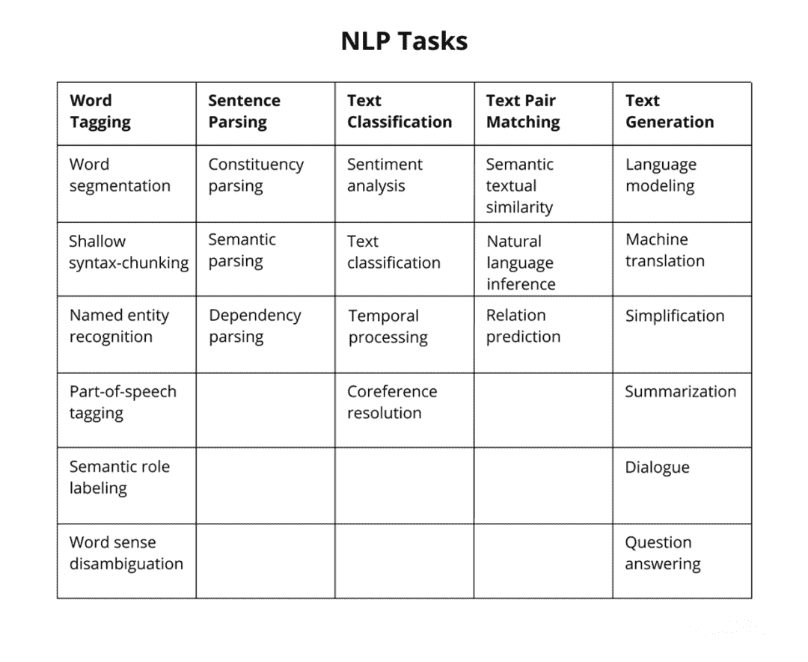

贴一张自然语言处理的技术路线图，介绍了NLP任务及主流模型的分支：

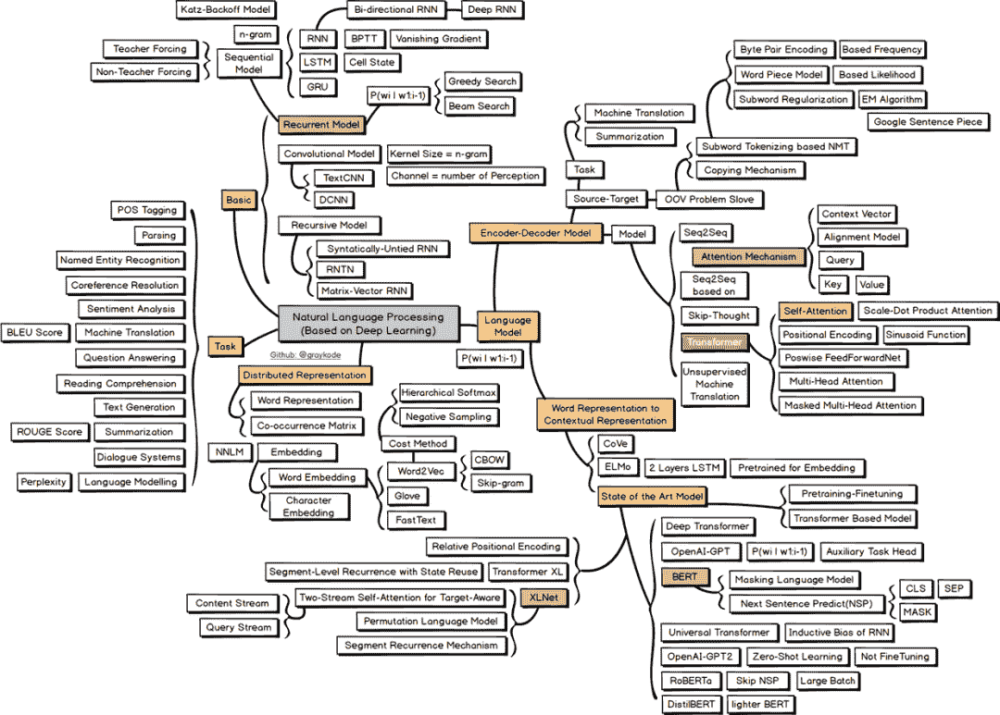

### 2.1 数据清洗 + 分词（系列标注任务）

+   **数据语料清洗。**拿到文本的数据语料(Corpus)后，通常首先要做的是，分析并清洗下文本，主要用正则匹配删除掉数字及标点符号（一般这些都是噪音，对于实际任务没有帮助），做下分词后，删掉一些无关的词（停用词），对于英文还需要统一下复数、语态、时态等不同形态的单词形式，也就是词干/词形还原。

+   **分词。**即划分为词单元（token），是一个常见的序列标注任务。对于英文等拉丁语系的语句分词，天然可以通过空格做分词，

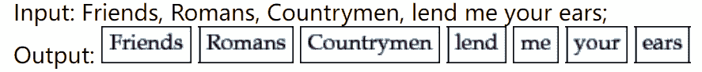

对于中文语句，由于中文词语是连续的，可以用结巴分词（基于trie tree+维特比等算法实现最大概率的词语切分）

+   英文分词后的词干/词形等还原(去除时态 语态及复数等信息，统一为一个“单词”形态)。这并不是必须的，还是根据实际任务是否需要保留时态、语态等信息，有WordNetLemmatizer、 SnowballStemmer等方法。

+   分词及清洗文本后，还需要对照前后的效果差异，在做些微调。这里可以统计下个单词的频率、句长等指标，还可以通过像词云等工具做下可视化~

```
from wordcloud import WordCloud
ham_msg_cloud = WordCloud(width =520, height =260,max_font_size=50, background_color =&quot;black&quot;, colormap=&#x27;Blues&#x27;).generate(原文本语料)
plt.figure(figsize=(16,10))
plt.imshow(ham_msg_cloud, interpolation=&#x27;bilinear&#x27;)
plt.axis(&#x27;off&#x27;) # turn off axis
plt.show()
```

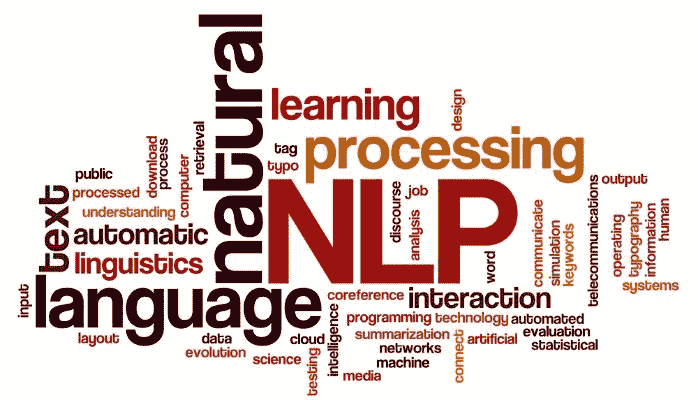

### 2.2 词性标注（系列标注任务）

词性标注是对句子中的成分做简单分析，区分出分名词、动词、形容词之类。对于句法分析、信息抽取的任务，经过词性标注后的文本会带来很大的便利性（其他方面的应用好像比较少）。

常用的词性标注有基于规则、统计以及深度学习的方法，像HanLP、结巴分词等工具都有这个功能。

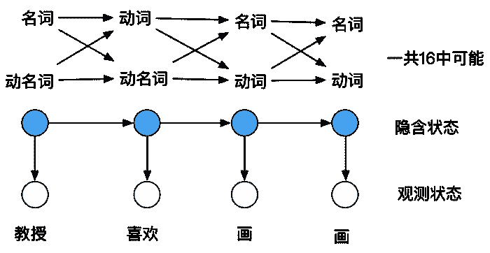

### 2.3 命名实体识别（系列标注任务）

**命名实体识别（Named Entit**y Recognition，简称NER）是一个有监督的系列标注任务，又称作“专名识别”，是指识别文本中具有特定意义的实体，主要包括人名、地名、机构名、时间、专有名词等关键信息。

> 通过NER识别出一些关键的人名、地名就可以很方便地提取出“某人去哪里，做什么事的信息”，很方便信息提取、问答系统等任务。

### 2.4 词向量（表示学习）

对于自然语言文本，计算机无法理解词后面的含义。输**入模型前，首先要做的就**是词的数字化表示，常用的转化方式有2种：One-hot编码、词嵌入分布式方法。

+   **One-hot编码：**最简单的表示方法莫过于onehot表示，每个单词是否出现就用**一位**数单独展示。进一步，句子的表示也就是累加每个单词的onehot，也就是常说的句子的词袋模型（bow）表示。

```
## 词袋表示
from sklearn.feature_extraction.text import CountVectorizer
bow = CountVectorizer(
                analyzer = &#x27;word&#x27;,
                strip_accents = &#x27;ascii&#x27;,
                tokenizer = [],
                lowercase = True,
                max_features = 100, 
                )
```

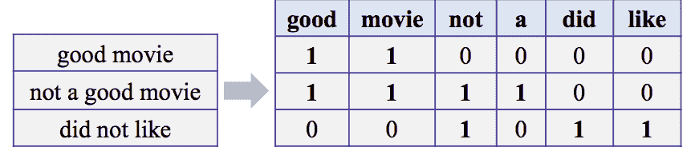

+   **词嵌入分布式表示：**自然语言的单词数是成千上万的，One-hot编码会有高维、词语间无联系的缺陷。这时有一种更有效的方法就是——词嵌入分布式表示，通过神经网络学习构造一个低维、稠密，隐含词语间关系的向量表示。常见有Word2Vec、Fasttext、Bert等模型学习每个单词的向量表示，在表示学习后相似的词汇在向量空间中是比较接近的。

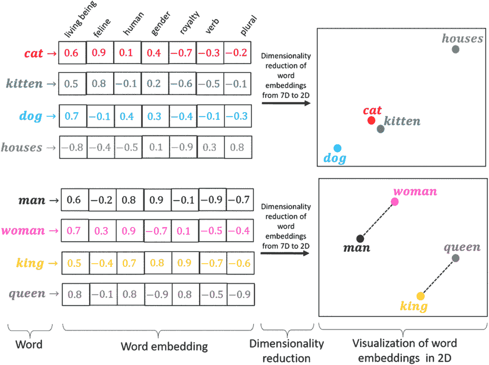

```
# Fasttext embed模型
from gensim.models import FastText,word2vec
 
model = FastText(text,  size=100,sg=1, window=3, min_count=1, iter=10, min_n=3, max_n=6,word_ngrams=1,workers=12)
print(model.wv[&#x27;hello&#x27;]) # 词向量
model.save(&#x27;./data/fasttext100dim&#x27;)
```

特别地，正因为Bert等大规模自监督预训练方法，又为NLP带来了平台

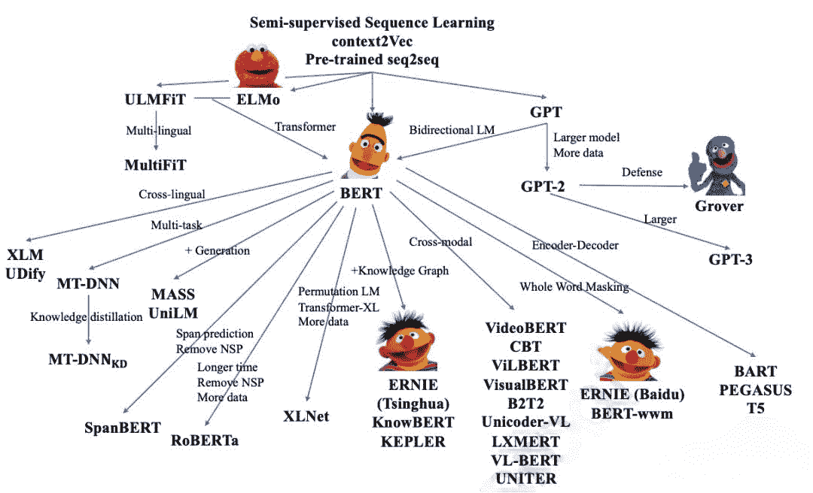

+   对于学习后的词表示向量，还可以通过重要程度进行特征加权，合适的加权方法对于任务可以有不错的提升效果。常用的有卡方chi2、TF-IDF等加权方法。TF-IDF是一种基于统计的方法，其核心思想是假设字词的重要性与其在某篇文章中出现的比例成正比，与其在其他文章中出现比成反比。

```
# TF-IDF可以直接调用sklearn
from sklearn.feature_extraction.text import TfidfTransformer
```

### 2.5 句法、语义依存分析

句法、语义依存分析是传统自然语言的基础句子级的任务，语义依存分析是指在句子结构中分析实词和实词之间的语义关系，这种关系是一种事实上或逻辑上的关系，且只有当词语进入到句子时才会存在。语义依存分析的目的即回答句子的“Who did what to whom when and where”的问题。

> 例如句子“张三昨天告诉李四一个秘密”，语义依存分析可以回答四个问题，即谁告诉了李四一个秘密，张三告诉谁一个秘密，张三什么时候告诉李四一个秘密，张三告诉李四什么。

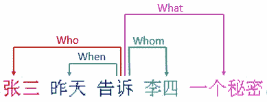

传统的自然语言处理多是参照了语言学家对于自然语言的归纳总结，通过句法、语义分析可以挖掘出词语间的联系（主谓宾、施事受事等关系），用于制定文本规则、信息抽取（如正则匹配叠加语义规则应用于知识抽取或者构造特征）。

随着深度学习技术RNN/LSTM等强大的时序模型（sequential modeling）和词嵌入方法的普及，能够在一定程度上刻画句子的隐含语法结构，学习到上下文信息，已经逐渐取代了词法、句法等传统自然语言处理流程。

### 2.6 相似度算法（句子关系的任务）

自然语言处理任务中，经常需要判断两篇文档的相似程度（句子关系），比如检索系统输出最相关的文本，推荐系统推荐相似的文章。

**文本相似度匹配常用到的方法有：**文本编辑距离、WMD、 BM2.5、词向量相似度 、Approximate Nearest Neighbor以及一些有监督的(神经网络)模型判断文本间相似度。

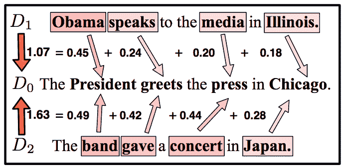

### 2.7 文本分类任务

文本分类是经典的NLP任务，就是将文本系列对应预测到类别。

+   一种是输入序列输出这整个序列的类别，如短信息、🧣分类、意图识别等。

+   另一种是输入序列输出序列上每个位置的类别，上文提及的系列标注可以看做为词粒度的一种分类任务，如实体命名识别。

分类任务使用预训练+(神经网络)分类模型的端对端学习是主流，深度学习学习特征的表达然后进行分类，大大减少人工的特征。但以实际项目中的经验来看，对于一些困难任务（任务的噪声大），加入些人工的特征工程还是很有必要的。

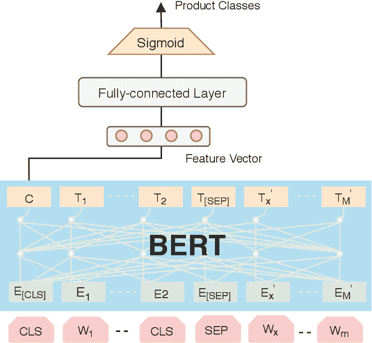

### 2.8 文本生成任务

文本生成也就是由类别生成序列 或者 由序列到序列的预测任务。按照不同的输入划分，文本自动生成可包括文本到文本的生成(text-to-text  generation)、意义到文本的生成(meaning-to-text  generation)、数据到文本的生成(data-to-text  generation)以及图像到文本的生成(image-to-text generation)等。具体应用如机器翻译、文本摘要理解、阅读理解、闲聊对话、写作、看图说话。常用的模型如RNN、CNN、seq2seq、Transformer。

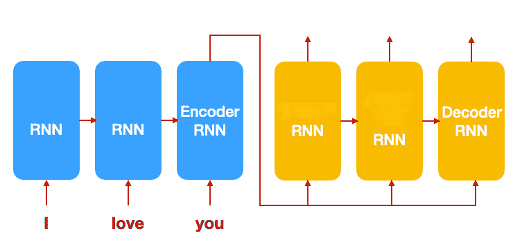

## 三、垃圾短信文本分类项目实战

### 3.1 读取短信文本数据并展示

本项目是通过有监督的短信文本，学习一个垃圾短信文本分类模型。数据样本总的有5572条，label有spam（垃圾短信）和ham两种，是一个典型类别不均衡的二分类问题。

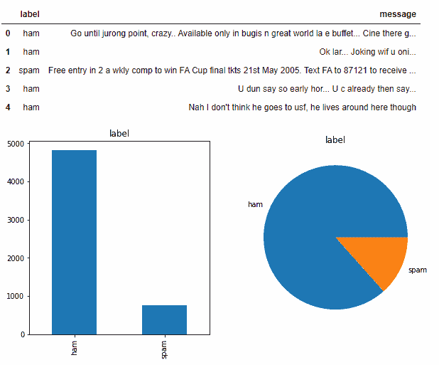

```
# 源码可见https://github.com/aialgorithm/Blog
import pandas as pd
import numpy as np
import  matplotlib.pyplot as plt
 
spam_df = pd.read_csv(&#x27;./data/spam.csv&#x27;, header=0, encoding=&quot;ISO-8859-1&quot;)
 
# 数据展示
_, ax = plt.subplots(1,2,figsize=(10,5))
spam_df[&#x27;label&#x27;].value_counts().plot(ax=ax[0], kind=&quot;bar&quot;, rot=90, title=&#x27;label&#x27;);
spam_df[&#x27;label&#x27;].value_counts().plot(ax=ax[1], kind=&quot;pie&quot;, rot=90, title=&#x27;label&#x27;, ylabel=&#x27;&#x27;);
print(&quot;Dataset size: &quot;, spam_df.shape)
 
spam_df.head(5)
```

### 3.2 数据清洗预处理

数据清洗在于去除一些噪声信息，这里对短信文本做按空格分词，统一大小写，清洗非英文字符，去掉停用词并做了词干还原。考虑到短信文本里面的数字位数可能有一定的含义，这里将数字替换为‘x’的处理。最后，将标签统一为数值（0、1）是否垃圾短信。

```
# 导入相关的库
import nltk
from nltk import word_tokenize
from nltk.corpus import stopwords
from nltk.data import load
from nltk.stem import SnowballStemmer
from string import punctuation
 
import re  # 正则匹配
stop_words = set(stopwords.words(&#x27;english&#x27;))
non_words = list(punctuation)
 
 
# 词形、词干还原
# from nltk.stem import WordNetLemmatizer
# wnl = WordNetLemmatizer()
stemmer = SnowballStemmer(&#x27;english&#x27;)
def stem_tokens(tokens, stemmer):
    stems = []
    for token in tokens:
        stems.append(stemmer.stem(token))
    return stems
 
### 清除非英文词汇并替换数值x
def clean_non_english_xdig(txt,isstem=True, gettok=True):
    txt = re.sub(&#x27;[0-9]&#x27;, &#x27;x&#x27;, txt) # 去数字替换为x
    txt = txt.lower() # 统一小写
    txt = re.sub(&#x27;[^a-zA-Z]&#x27;, &#x27; &#x27;, txt) #去除非英文字符并替换为空格
    word_tokens = word_tokenize(txt) # 分词
    if not isstem: #是否做词干还原
        filtered_word = [w for w in word_tokens if not w in stop_words]  # 删除停用词
    else:
        filtered_word = [stemmer.stem(w) for w in word_tokens if not w in stop_words]   # 删除停用词及词干还原
    if gettok:   #返回为字符串或分词列表
        return filtered_word
    else:
        return &quot; &quot;.join(filtered_word)
 
spam_df[&#x27;token&#x27;] = spam_df.message.apply(lambda x:clean_non_english_xdig(x))
spam_df.head(3)
 
# 数据清洗
spam_df[&#x27;token&#x27;] = spam_df.message.apply(lambda x:clean_non_english_xdig(x))
 
# 标签整数编码
spam_df[&#x27;label&#x27;] = (spam_df.label==&#x27;spam&#x27;).astype(int)
 
spam_df.head(3)
```

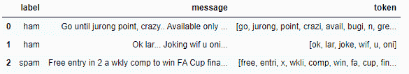

### 3.3 fasttext词向量表示学习

需要将单词文本转化为数值的词向量才能输入模型。词向量表示常用的词袋、fasttext、bert等方法，这里训练的是fasttext，模型的主要输入参数是，输入分词后的语料（通常训练语料越多越好，当现有语料有限时候，直接拿github上合适的大规模预训练模型来做词向量也是不错的选择），词向量的维度size（一个经验的词向量维度设定是，dim > 8.33 logN, N为词汇表的大小，当维度dim足够大才能表达好这N规模的词汇表的含义。语料太大的时候可以使用workers开启多进程训练。

```
# 训练词向量 Fasttext embed模型
from gensim.models import FastText,word2vec
 
fmodel = FastText(spam_df.token,  size=100,sg=1, window=3, min_count=1, iter=10, min_n=3, max_n=6,word_ngrams=1,workers=12)
print(fmodel.wv[&#x27;hello&#x27;]) # 输出hello的词向量
# fmodel.save(&#x27;./data/fasttext100dim&#x27;)
```

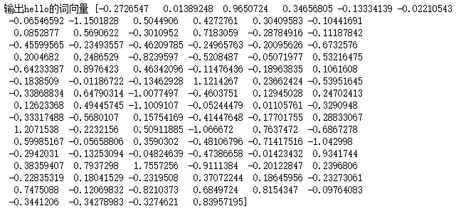

按照句子所有的词向量取平均，为每一句子生成句向量。

```
fmodel = FastText.load(&#x27;./data/fasttext100dim&#x27;)
 
#对每个句子的所有词向量取均值，来生成一个句子的vector
def build_sentence_vector(sentence,w2v_model,size=100):
    sen_vec=np.zeros((size,))
    count=0
    for word in sentence:
        try:
            sen_vec+=w2v_model[word]#.reshape((1,size))
            count+=1
        except KeyError:
            continue
    if count!=0:
        sen_vec/=count
    return sen_vec
 
# 句向量
sents_vec = []
for sent in spam_df[&#x27;token&#x27;]:
    sents_vec.append(build_sentence_vector(sent,fmodel,size=100))
        
print(len(sents_vec))
```

### 3.4 训练文本分类模型

示例采用的fasttext embedding + lightgbm的二分类模型，类别不均衡使用lgb代价敏感学习解决（即class_weight='balanced'），超参数是手动简单配置的，可以自行搜索下较优超参数。

```
### 训练文本分类模型
from sklearn.model_selection import train_test_split
from lightgbm import LGBMClassifier
from sklearn.linear_model import LogisticRegression
 
train_x, test_x, train_y, test_y = train_test_split(sents_vec, spam_df.label,test_size=0.2,shuffle=True,random_state=42)
result = []
clf = LGBMClassifier(class_weight=&#x27;balanced&#x27;,n_estimators=300, num_leaves=64, reg_alpha= 1,reg_lambda= 1,random_state=42)
#clf = LogisticRegression(class_weight=&#x27;balanced&#x27;,random_state=42)
 
clf.fit(train_x,train_y)
 
import pickle
# 保存模型
pickle.dump(clf, open(&#x27;./saved_models/spam_clf.pkl&#x27;, &#x27;wb&#x27;))
 
# 加载模型
model = pickle.load(open(&#x27;./saved_models/spam_clf.pkl&#x27;, &#x27;rb&#x27;))
```

### 3.5 模型评估

训练集测试集按0.2划分，分布验证训练集测试集的AUC、F1score等指标，均有不错的表现。

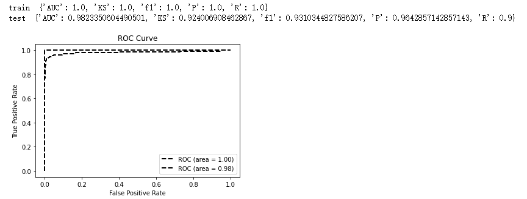

```
from sklearn.metrics import auc,roc_curve,f1_score,precision_score,recall_score
def model_metrics(model, x, y,tp=&#x27;auc&#x27;):
    &quot;&quot;&quot; 评估 &quot;&quot;&quot;
    yhat = model.predict(x)
    yprob = model.predict_proba(x)[:,1]
    fpr,tpr,_ = roc_curve(y, yprob,pos_label=1)
    metrics = {&#x27;AUC&#x27;:auc(fpr, tpr),&#x27;KS&#x27;:max(tpr-fpr),
               &#x27;f1&#x27;:f1_score(y,yhat),&#x27;P&#x27;:precision_score(y,yhat),&#x27;R&#x27;:recall_score(y,yhat)}
    
    roc_auc = auc(fpr, tpr)
 
    plt.plot(fpr, tpr, &#x27;k--&#x27;, label=&#x27;ROC (area = {0:.2f})&#x27;.format(roc_auc), lw=2)
 
    plt.xlim([-0.05, 1.05])  # 设置x、y轴的上下限，以免和边缘重合，更好的观察图像的整体
    plt.ylim([-0.05, 1.05])
    plt.xlabel(&#x27;False Positive Rate&#x27;)
    plt.ylabel(&#x27;True Positive Rate&#x27;)  # 可以使用中文，但需要导入一些库即字体
    plt.title(&#x27;ROC Curve&#x27;)
    plt.legend(loc=&quot;lower right&quot;)
 
 
    return metrics
 
print(&#x27;train &#x27;,model_metrics(clf,  train_x, train_y,tp=&#x27;ks&#x27;))
print(&#x27;test &#x27;,model_metrics(clf, test_x,test_y,tp=&#x27;ks&#x27;))
```