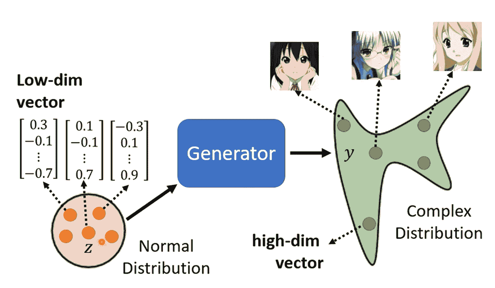
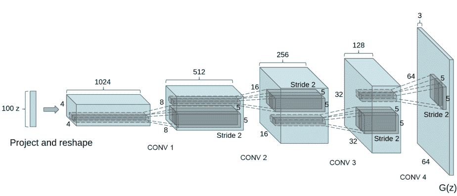
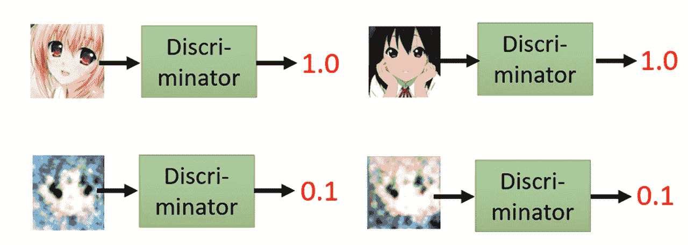
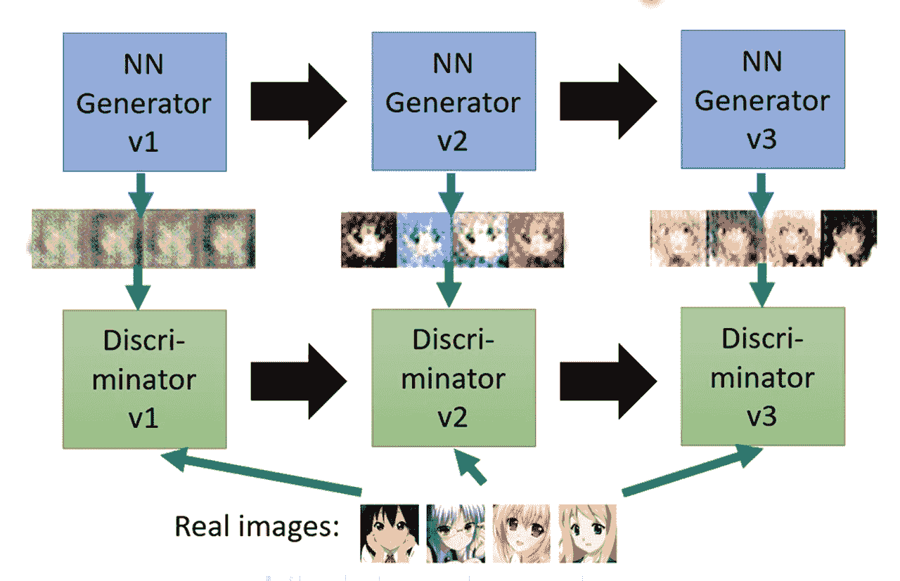
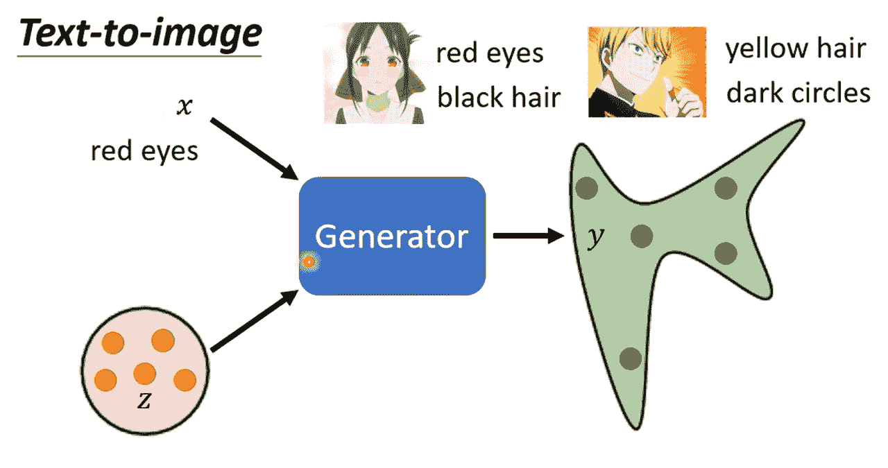
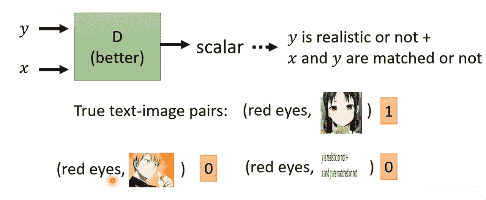
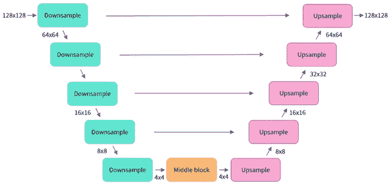
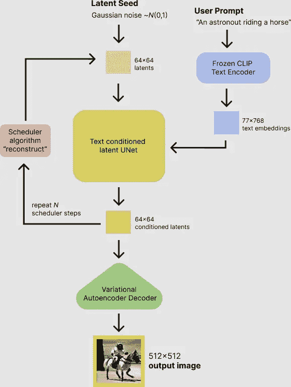

# 0-1拆解AI绘画项目，模型搭建全解

> 来源：[https://qqs7y1hozd1.feishu.cn/docx/OJUZdFFVloOfJvxfyG9cdMuQnCg](https://qqs7y1hozd1.feishu.cn/docx/OJUZdFFVloOfJvxfyG9cdMuQnCg)

## 一、前言

> 可以实现AI绘画的模型有很多种，今天主要讨论Conditional GAN和Stable Diffusion两种模型。

## 二、GAN

这里讨论Conditional GAN（Generative Adversarial Network）实现AI的原理。在讲Conditional GAN之前，来看看GAN是怎么回事。

### 2.1 生成

> **生成网络**一**直被认为**是**赋予AI**创造力的突破口，生成包括文本生成、图像生成、音频生成等。

> GAN是一种比较成熟的生成网络，**通常用来生**成**图像。GAN有许**多变种，包括DCGAN、CycleGAN等。

### 2.2 专家与赝品

**GAN**的中文名叫**生成对抗网络**，在提到GAN时经常会用两个对立的角色来举例。

+   一个是造假专家，专门负责制作赝品；

+   另一个是鉴别专家，专门负责鉴定赝品。

他们最开始都不是专家，而是在对抗中学习，最终造假专家能够制造出人都难以识别出来的赝品。最终我们会抛弃鉴别专家，让造假专家为我们服务。

上面提到的造假专家就是G网络，也就是Generator；而鉴别专家就是D网络，也就是Discriminator。它们在互相对抗中学习，最终成为各自领域的专家，这就是GAN的思想。

### 2.3 Generator

下面以生成动漫头像的例子来讨论**GAN**网络的Generator和Discriminator。

首先讨论Generator，它在**GAN**中充当**造假**的作用，也是用它来生成图像。

> Generator接收一个随机变量，这个随机变量满足一种特定的简单分布，比如高斯分布。接收输入的随机变量后，网络经过运算生成一个非常长的向量，可以把这个向量reshape成w×h×3，也就是彩色图像。



**Generator**的具体结构可以是多种多样的，通常是以卷积为基础的网络。

**比如在DCGAN中**，Generator由5层反卷积组成，其网络结构如下图：



输入一个维度为100的向量，输出一张64×64×3的图像，其PyTorch实现如下：

```
class Generator(nn.Module):
    def __init__(self, ngpu):
        super(Generator, self).__init__()
        self.ngpu = ngpu
        self.main = nn.Sequential(
            # input is Z, going into a convolution
            nn.ConvTranspose2d( nz, ngf * 8, 4, 1, 0, bias=False),
            nn.BatchNorm2d(ngf * 8),
            nn.ReLU(True),
            # state size. (ngf*8) x 4 x 4
            nn.ConvTranspose2d(ngf * 8, ngf * 4, 4, 2, 1, bias=False),
            nn.BatchNorm2d(ngf * 4),
            nn.ReLU(True),
            # state size. (ngf*4) x 8 x 8
            nn.ConvTranspose2d( ngf * 4, ngf * 2, 4, 2, 1, bias=False),
            nn.BatchNorm2d(ngf * 2),
            nn.ReLU(True),
            # state size. (ngf*2) x 16 x 16
            nn.ConvTranspose2d( ngf * 2, ngf, 4, 2, 1, bias=False),
            nn.BatchNorm2d(ngf),
            nn.ReLU(True),
            # state size. (ngf) x 32 x 32
            nn.ConvTranspose2d( ngf, nc, 4, 2, 1, bias=False),
            nn.Tanh()
            # state size. (nc) x 64 x 64
        )

    def forward(self, input):
        return self.main(input)
```

### 2.4 Discriminator

Discriminator是**GAN**中非常重要的一个角色，它是一个接受一**个图片输入的网络****，输入的图像会包**含一部分真实图像real（我们收集的动漫图像），还会包含一部分虚假图像fake（Generator生成的图像），然后输出一个结果。

> 这个结果可以是fake是真实图像的概率，也可以是fake的类别（0表示假，1表示真）。对于Discriminator而言，它的目的就是调整网络参数，让网络知道fake图像是假的。



关于**Discriminator**的结构，并没有非常固定的约束，通常是一个卷积网络。

这里同样参考DCGAN，这里实现PyTorch的一个实现：

```
class Discriminator(nn.Module):
    def __init__(self, ngpu):
        super(Discriminator, self).__init__()
        self.ngpu = ngpu
        self.main = nn.Sequential(
            # input is (nc) x 64 x 64
            nn.Conv2d(nc, ndf, 4, 2, 1, bias=False),
            nn.LeakyReLU(0.2, inplace=True),
            # state size. (ndf) x 32 x 32
            nn.Conv2d(ndf, ndf * 2, 4, 2, 1, bias=False),
            nn.BatchNorm2d(ndf * 2),
            nn.LeakyReLU(0.2, inplace=True),
            # state size. (ndf*2) x 16 x 16
            nn.Conv2d(ndf * 2, ndf * 4, 4, 2, 1, bias=False),
            nn.BatchNorm2d(ndf * 4),
            nn.LeakyReLU(0.2, inplace=True),
            # state size. (ndf*4) x 8 x 8
            nn.Conv2d(ndf * 4, ndf * 8, 4, 2, 1, bias=False),
            nn.BatchNorm2d(ndf * 8),
            nn.LeakyReLU(0.2, inplace=True),
            # state size. (ndf*8) x 4 x 4
            nn.Conv2d(ndf * 8, 1, 4, 1, 0, bias=False),
            nn.Sigmoid()
        )

    def forward(self, input):
        return self.main(input)
```

这里比较特别的就是LeakyReLU的使用。

### 2.5 GAN

有了Generator和Discriminator就可以组成**GAN网络**了。

最开始**Generator**和**Discriminator**是两个懵懂小孩，Generator不知道如何生成，Discriminator也不知道如何辨别。

GAN网络的训练分为下面几个步骤：

+   **第一步：**训练**Discriminator**网络，此时Generator提供的照片都是噪声，先训练Discriminator可以让 Discriminator知道如何区分真实图像和噪声

+   **第二步：****固定Discrim**inator，训练Generator，让Generator生成的图像能够瞒过Discriminator

+   **第三步：**再循环训练Discriminator-Generator，直到Generator生成的图像能够满足我们的需求

+   **第四步：**用Generator生成图像

上述步骤可以看作下图：



**以上就是GAN网络**的**训练过程。其实就是Gene**rator和Di**scriminator交替**训练的过程，其PyTorch实现如下：

```
# Create the generator
netG = Generator(ngpu).to(device)
if (device.type == &#x27;cuda&#x27;) and (ngpu &gt; 1):
    netG = nn.DataParallel(netG, list(range(ngpu)))
netG.apply(weights_init)
```

```
# Create the Discriminator
netD = Discriminator(ngpu).to(device)

if (device.type == &#x27;cuda&#x27;) and (ngpu &gt; 1):
    netD = nn.DataParallel(netD, list(range(ngpu)))
netD.apply(weights_init)

criterion = nn.BCELoss()

print(&quot;Starting Training Loop...&quot;)
# For each epoch
for epoch in range(num_epochs):
    # For each batch in the dataloader
    for i, data in enumerate(dataloader, 0):

        # Output training stats
        if i % 50 == 0:
            print(&#x27;[%d/%d][%d/%d]\tLoss_D: %.4f\tLoss_G: %.4f\tD(x): %.4f\tD(G(z)): %.4f / %.4f&#x27;
                  % (epoch, num_epochs, i, len(dataloader),
                     errD.item(), errG.item(), D_x, D_G_z1, D_G_z2))
```

经过一段时间的训练后，我们就可以生成一些动漫图像了。

## 三、Conditional GAN

通过上面的GAN网络，可以生成动漫图像。但是这个生成是不可控的，只知道它生成的是动漫图像，至于图像内容我们无法得知。我们无法根据描述来生成图像，这个是GAN网络的局限，因此提出一种变形叫Conditional GAN，这种GAN网络可以解决上面的问题。

### 3.1 Generator

Conditional GAN不同于GAN的地方在于其Generator和Discriminator接收参数的数量不同。

> Generator在接收随机变量的同时还接收一个“思想向量”，这个思想向量可以是对句子的一个编码。此时我们的Generator的结构变成了输入两个向量，输出一个图像的网络。



比如上图，将**red eyes**这个句子转化成向量交给Generator，然后让它生成红眼的动漫图像。通过修改可以得到不同的图像，又因为z这个随机变量的存在，即使给同样的x也可以得到不同的图像。

为了能让网络学习到文字和描述之间的关系，我们需要准备好（文字描述-图像）这种组合的数据集。

### 3.2 Discriminator

Discriminator同样需要输入两个向量，分别是Generator生成的图像和输入到Generator的x，然后输出是否正确。



交给Generator的训练数据需要把（正确描述-正确图像）作为类别1，把（正确描述，不正确图像）、（正确描述，正确图像，但图像和描述不匹配）作为类别0。

> 如果不包含（正确描述，正确图像，但图像和描述不匹配）作为训练数据，网络得不到很好的结果。

知道了Generator和Discriminator网络后，可以使用和GAN类似的方式进行训练，最后的Generator就是AI画师了。给它文字描述，返回一张对应的图。

## 四、Stable Diffusion

Stable Diffusion和Conditional GAN有很多相似的地方，因为都可以用来解决Text-to-image的问题，因此模型都是接收一个文本以及影响图像的高斯噪声。只不过使用的网络结构有所区别，而且Stable Diffusion引入了Latent Diffusion，让训练更加顺利。

**Late**n**t Dif**f**usion包括了三个部分**，分别是自编码器、U-Net、Text-Encoder。

> 其中自编码器包括编码器和解码器两部分。

> 编码器的输出会交给U-Net进行处理。而U-Net得输出则会交给解码器。

U-Net在接收编码器输入的同时，还接收一个句子的向量。

**这个句向量由Text-E**ncoder给出。下图是U-Net的结构：



因为U-Net是在低维空间上工作的，因此Latent Diffusion快速有效。Stable Diffusion的整体流程如下图：



## 五、AI作画算法的实际应用

随着人工智能技术的发展，AI作画算法在多个领域得到了广泛应用，不仅在艺术创作中表现出色，还在商业、娱乐、医疗等领域发挥了重要作用。以下是一些具体的应用场景和实例。

1.  **艺术创作**

**AI艺术家和创意合作：**AI作画算法可以与人类艺术家合作，创造出前所未有的艺术作品。通过生成对抗网络（GANs）或变分自编码器（VAEs），AI可以根据输入的图像风格生成新的艺术作品。

> 例如，法国艺术团体Obvious利用GANs创作的肖像画《Edmond de Belamy》，在佳士得拍卖行以超过43万美元的价格售出，成为首个被拍卖的AI生成艺术品。这表明，AI在艺术市场上也有着巨大的潜力。

**自动风格迁移：**AI可以将一种艺术风格应用到另一种图像上，这种技术被称为风格迁移（Style Transfer）。例如，利用神经网络，AI可以将梵高的画风应用到一张普通的照片上，使其看起来像是一幅梵高的画作。

> 这项技术不仅可以用于个人创作，还可以应用于广告设计、影视制作等领域，帮助创意团队快速生成具有特定风格的视觉内容。

1.  **商业应用**

**品牌推广和广告设计：**在商业领域，AI作画算法被广泛用于品牌推广和广告设计。AI可以根据品牌的视觉识别系统自动生成海报、广告图像等，使得设计过程更加高效。

> 例如，Adobe的Sensei平台利用AI技术帮助设计师快速生成和调整设计元素，提高了创意团队的工作效率。

**定制化产品设计：**AI还可以根据客户的需求生成定制化的设计产品。

> 比如，时尚品牌可以利用AI技术根据客户的偏好设计独特的服装图案和款式，家具公司可以利用AI生成个性化的家居设计方案，满足客户的个性化需求。

1.  **娱乐与媒体**

**电影和游戏制作：**在影视和游戏制作中，AI作画算法可以生成高质量的场景和角色图像，降低制作成本和时间。

> Pixar和Disney等大型影视公司已经开始探索利用AI技术辅助动画制作，提高动画制作的效率和质量。游戏开发公司也利用AI生成逼真的游戏场景和角色，使游戏更加生动和引人入胜。

**虚拟现实和增强现实：**AI在虚拟现实（VR）和增强现实（AR）中的应用也十分广泛。AI可以生成逼真的虚拟场景和对象，提升用户的沉浸体验。

> 例如，AI可以根据用户的环境生成适合的AR内容，使得AR应用更加灵活和互动。

1.  **医疗领域**

**医学影像处理：**AI作画算法在医学影像处理方面也有重要应用。AI可以生成和增强医学图像，帮助医生更准确地进行诊断。

> 例如，AI可以将低分辨率的MRI图像增强为高分辨率图像，帮助医生更清晰地观察病变部位，提高诊断的准确性。

**手术模拟和培训：**AI生成的3D图像和虚拟现实技术结合，可以用于手术模拟和培训。

> 医生可以在虚拟环境中进行手术练习，提高手术技能和应急处理能力。这不仅提高了医生的手术水平，还减少了手术过程中的风险。

1.  **教育与研究**

**艺术教育：**AI作画算法在艺术教育中也有广泛应用。

> 通过AI生成的艺术作品，学生可以学习和模仿不同风格的艺术创作，提高艺术创作能力。同时，AI还可以帮助教师快速生成教学材料，提高教学效率。

**科学研究：**在科学研究中，AI可以生成各种模拟图像和数据，辅助研究人员进行实验分析和数据可视化。

> 例如，在天文学中，AI可以根据观测数据生成宇宙的模拟图像，帮助研究人员更好地理解宇宙的结构和演化。

## 六、常见的AI绘画大模型

以下是一些知名的AI绘画大模型：

> **DeepArt：**DeepArt是一种**基于深度学习的艺术风格转换模型**，它能够将普通照片或图像转换成特定艺术风格的作品。通过训练大量的艺术图像数据，DeepArt能够学习到不同艺术风格的特征和表现手法，从而实现风格的迁移和创作。

> **GANs（生成对抗网络）：**GANs是一种由生成器和判别器组成的深度学习模型。在绘画领域，GANs能够生成具有高度真实感的艺术作品。通过不断的对抗训练，生成器能够学习到真实艺术作品的分布特征，并生成与之相似的作品；而判别器则负责判断生成的作品是否真实，从而指导生成器的训练方向。

> **StyleGAN：**StyleGAN是GANs的一种变体，它引入了风格迁移的概念。StyleGAN能够控制生成图像的风格和特征，实现更加灵活和多样化的艺术创作。通过调整不同的风格参数，StyleGAN可以生成具有不同艺术风格的作品。

> **DALL-E 2：**DALL-E 2是一种基于Transformer架构的大型语言模型，它能够根据文本提示生成相应的图像。在绘画领域，DALL-E 2可以根据用户的文字描述或关键词生成符合要求的艺术作品。这种模型具有强大的创作能力和灵活性，能够为用户提供个性化的艺术创作体验。

> **Midjourney：**Midjourney是另一个基于文本生成图像的AI模型，它专注于为创作者提供快速、高质量的图像生成服务。Midjourney支持多种艺术风格和创作主题，能够满足不同用户的需求。同时，它还提供了丰富的参数调整选项，让用户能够根据自己的喜好调整生成作品的效果。

**常见的开源绘画模型**

+   **DeepDream：**DeepDream是Google开发的一种基于深度学习的艺术风格生成模型。它通过对卷积神经网络中的特征进行可视化和增强，生成具有梦幻般艺术效果的图像。DeepDream的优势在于其生成的图像具有丰富的细节和独特的视觉效果，适用于艺术创作、视觉设计等领域。

+   **Neural Style：**Neural Style是一种基于神经网络的风格迁移模型，它能够将任意风格图像的风格应用到另一张图像上。Neural Style通过优化图像在内容和风格上的损失函数，实现风格的迁移和融合。这种模型适用于照片美化、艺术创作等领域，能够让用户轻松地将喜欢的艺术风格应用到自己的作品中。

+   **CycleGAN：**CycleGAN是一种无监督学习的图像到图像转换模型，它能够在不需要成对训练数据的情况下实现图像风格的转换。CycleGAN通过引入循环一致性损失函数，保证了转换后的图像在内容上与原始图像保持一致。这种模型适用于风格迁移、图像增强等场景，能够让用户在不依赖大量成对数据的情况下实现图像风格的转换。

+   **UGATIT：**UGATIT是一种基于无监督学习的图像到图像转换模型，它结合了生成对抗网络和注意力机制来实现高质量的图像风格转换。UGATIT的优势在于其生成的图像在风格和细节上都具有较高的真实感和清晰度，适用于各种艺术风格的转换和创作。

**实现绘画自由，AI绘画工具合集**