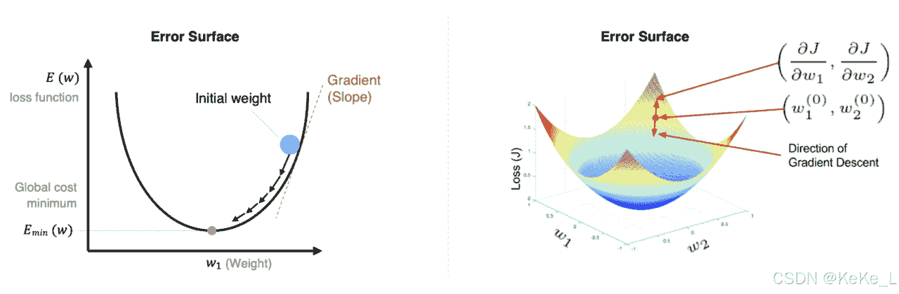
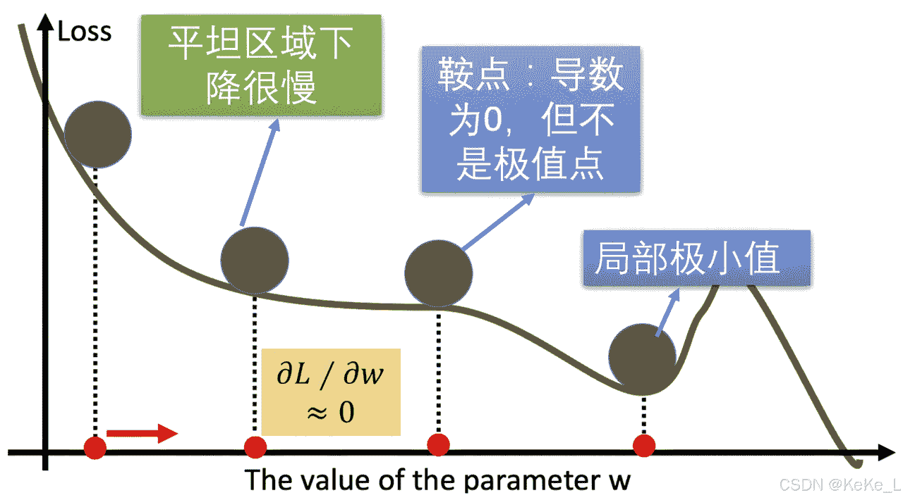
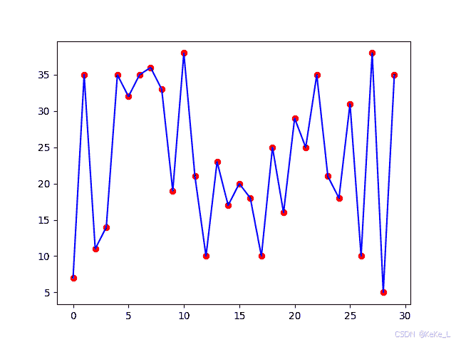
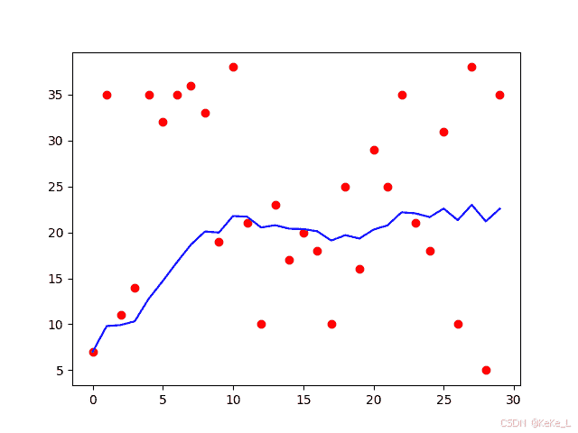

# 批量大小与梯度累积优化

> 来源：[https://qqs7y1hozd1.feishu.cn/docx/L4CNdAg45oQCgaxkYpDcozBsnAd](https://qqs7y1hozd1.feishu.cn/docx/L4CNdAg45oQCgaxkYpDcozBsnAd)

## 梯度下降

### 1.公式

α为学习率



当α过小时，训练时间过久增加算力成本，α过大则容易造成越过最优解导致震荡。

2.梯度下降过程

+   初始化参数：权重：W，偏置：b

+   求梯度：利用损失函数求出权重W的导数。

+   参数更新：按照梯度下降公式求出新的W。

+   循环迭代：按照设定的条件或次数循环更新W。

3.常见梯度下降方法

3.1批量梯度下降

Batch Gradient Descent BGD

特点：

每次更新参数时，使用整个训练集来计算梯度。

优点：

收敛稳定，能准确地沿着损失函数的真实梯度方向下降。

适用于小型数据集。

缺点：

对于大型数据集，计算量巨大，更新速度慢。

需要大量内存来存储整个数据集。

公式：

其中，m mm 是训练集样本总数， 是第 i ii 个样本及其标签。

3.2随机梯度下降

Stochastic Gradient Descent, SGD

特点：

每次更新参数时，仅使用一个样本来计算梯度。

优点：

更新频率高，计算快，适合大规模数据集。

能够跳出局部最小值，有助于找到全局最优解。

缺点：

收敛不稳定，容易震荡，因为每个样本的梯度可能都不完全代表整体方向。

需要较小的学习率来缓解震荡。

公式：

3.3小批量梯度下降

Mini-batch Gradient Descent MGBD

特点：

每次更新参数时，使用一小部分训练集（小批量）来计算梯度。

优点：

在计算效率和收敛稳定性之间取得平衡。

能够利用向量化加速计算，适合现代硬件（如GPU）。

缺点：

选择适当的批量大小比较困难；批量太小则接近SGD，批量太大则接近批量梯度下降。

通常会根据硬件算力设置为32\64\128\256等2的次方。

公式：

其中，b bb 是小批量的样本数量，也就是batch_size

其中， 是当前随机抽取的样本及其标签。

### 4.存在问题



收敛速度慢：BGD和MBGD使用固定学习率，太大会导致震荡，太小又收敛缓慢。

局部最小值和鞍点问题：SGD在遇到局部最小值或鞍点时容易停滞，导致模型难以达到全局最优。

训练不稳定：SGD中的噪声容易导致训练过程中不稳定，使得训练陷入震荡或不收敛。

5.优化方法

5.1指数加权平均数

其中：

+   St 表示指数加权平均值(EMA)；

+   Yt 表示 t 时刻的值；

是平滑系数，取值范围为 。 越接近 1 11，表示对历史数据依赖性越高；越接近 0 则越依赖当前数据。该值越大平均数越平缓

```
import numpy as np
import matplotlib.pyplot as plt


def test01():
    np.random.seed(666)
    y = np.random.randint(5,40,30)
    print(y)
    x = np.arange(30)
    plt.plot(x,y,color=&#x27;b&#x27;)
    plt.scatter(x,y,color=&#x27;r&#x27;)
    plt.show()

def test02(beta = 0.9):
    np.random.seed(666)
    y = np.random.randint(5,40,30)
    print(y)
    x = np.arange(30)
    y_e = []
    for i in range(30):
        if i == 0:
            y_e.append(y[0])
        else:
            st = beta*y_e[-1]+(1-beta)*y[i]
            y_e.append(st)
    plt.plot(x,np.array(y_e),color=&#x27;b&#x27;)
    plt.scatter(x,y,color=&#x27;r&#x27;)
    plt.show()


if __name__ == &#x27;__main__&#x27;:
    test01()
    test02()
```





5.2Momentum

Momentum 的基本思想

在传统的梯度下降法中，参数的更新仅依赖于当前的梯度方向。Momentum 方法通过引入一个累积的动量来加速参数的更新。具体来说，Momentum 方法在参数更新时不仅考虑当前的梯度方向，还考虑了过去梯度的方向。

惯性效应： 该方法加入前面梯度的累积，这种惯性使得算法沿着当前的方向继续更新。如遇到鞍点，也不会因梯度逼近零而停滞。

减少震荡： 该方法平滑了梯度更新，减少在鞍点附近的震荡，帮助优化过程稳定向前推进。

加速收敛： 该方法在优化过程中持续沿着某个方向前进，能够更快地穿越鞍点区域，避免在鞍点附近长时间停留。

梯度计算公式：

表示历史梯度移动加权平均值

Dt 表示当前时刻的梯度值

β 为权重系数

Momentum 算法是对梯度值的平滑调整，但是**并没有**对梯度下降中的学习率进行优化。

```
import torch


# 1.创建一个神经网络：继承官方的nn.Module
class mynet(torch.nn.Module):
    # 2.定义网络结构
    def __init__(self, input_size, output_size):
        # 3.初始化父类：python语法要求调用super方法生成父类的功能让子类对象去继承
        super(mynet, self).__init__()
        # 4.定义网络结构
        self.hide1 = torch.nn.Sequential(torch.nn.Linear(input_size, 3), torch.nn.Sigmoid())
        self.hide2 = torch.nn.Sequential(torch.nn.Linear(3, 2), torch.nn.Sigmoid())
        self.hide3 = torch.nn.Sequential(torch.nn.Linear(2, 12), torch.nn.Sigmoid())
        self.out = torch.nn.Sequential(torch.nn.Linear(12, output_size), torch.nn.Sigmoid())

    def forward(self, input):
        # input.shape[1]
        x = self.hide1(input)
        x = self.hide2(x)
        x = self.hide3(x)
        pred = self.out(x)
        return pred


def train():
    # 数据集
    input = torch.tensor([[0.5, 0.1],
                          [0.05, 0.180],
                          [0.05, 0.310]])
    target = torch.tensor([[1, 2],
                           [0, 3],
                           [1, 123]], dtype=torch.float32)

    # 5.创建网络
    net = mynet(2, 2)
    # 6.定义损失函数
    loss_func = torch.nn.MSELoss()
    # 7.定义优化器
    optimizer = torch.optim.SGD(net.parameters(), lr=0.1,momentum=0.6)
    # 8.训练
    for epoch in range(100):
        # 9.前向传播
        y_pred = net(input)
        # 10.计算损失
        loss = loss_func(y_pred, target)
        # 11.梯度清零
        optimizer.zero_grad()
        # 12.反向传播（计算每一层的w的梯度值）
        loss.backward()
        # print(net.hide1[0].weight.data)
        # 13.梯度更新
        optimizer.step()  # w = w -lr*当前的移动指数加权平均（s = momentum*s + (1-momentum)*w.grad
        print(loss)

if __name__ == &#x27;__main__&#x27;:
    train()
```

5.3AdaGrad

AdaGrad（Adaptive Gradient Algorithm）为每个参数引入独立的学习率，它根据历史梯度的平方和来调整这些学习率，这样就使得参数具有较大的历史梯度的学习率减小，而参数具有较小的历史梯度的学习率保持较大，从而实现更有效的学习。AdaGrad避免了统一学习率的不足，更多用于处理稀疏数据和梯度变化较大的问题。

AdaGrad流程：

1.  初始化学习率 α、初始化参数 θ、小常数 σ = 1e-6

1.  初始化梯度累积变量 s = 0

1.  从训练集中采样 m 个样本的小批量，计算梯度 g

1.  累积平方梯度 s = s + g ⊙ g，⊙ 表示各个分量相乘

1.  学习率α的计算：

1.  参数更新公式：

其中：

α  是全局的初始学习率。

\sigma 是一个非常小的常数，用于避免除零操作

\frac{\alpha}{\sqrt{s }+\sigma}  是自适应调整后的学习率。

```
import torch


# 1.创建一个神经网络：继承官方的nn.Module
class mynet(torch.nn.Module):
    # 2.定义网络结构
    def __init__(self, input_size, output_size):
        # 3.初始化父类：python语法要求调用super方法生成父类的功能让子类对象去继承
        super(mynet, self).__init__()
        # 4.定义网络结构
        self.hide1 = torch.nn.Sequential(torch.nn.Linear(input_size, 3), torch.nn.Sigmoid())
        self.hide2 = torch.nn.Sequential(torch.nn.Linear(3, 2), torch.nn.Sigmoid())
        self.hide3 = torch.nn.Sequential(torch.nn.Linear(2, 12), torch.nn.Sigmoid())
        self.out = torch.nn.Sequential(torch.nn.Linear(12, output_size), torch.nn.Sigmoid())

    def forward(self, input):
        # input.shape[1]
        x = self.hide1(input)
        x = self.hide2(x)
        x = self.hide3(x)
        pred = self.out(x)
        return pred


def train():
    # 数据集
    input = torch.tensor([[0.5, 0.1],
                          [0.05, 0.180],
                          [0.05, 0.310]])
    target = torch.tensor([[1, 2],
                           [0, 3],
                           [1, 123]], dtype=torch.float32)

    # 5.创建网络
    net = mynet(2, 2)
    # 6.定义损失函数
    loss_func = torch.nn.MSELoss()
    # 7.定义优化器
    optimizer = torch.optim.Adagrad(net.parameters(), lr=0.1)
    # 8.训练
    for epoch in range(100):
        # 9.前向传播
        y_pred = net(input)
        # 10.计算损失
        loss = loss_func(y_pred, target)
        # 11.梯度清零
        optimizer.zero_grad()
        # 12.反向传播（计算每一层的w的梯度值）
        loss.backward()
        # print(net.hide1[0].weight.data)
        # 13.梯度更新
        optimizer.step()  # w = w -lr*当前的移动指数加权平均（s = momentum*s + (1-momentum)*w.grad
        print(loss)

if __name__ == &#x27;__main__&#x27;:
    train()
```

5.4RMSProp

RMSProp（Root Mean Square Propagation）在时间步中，不是简单地累积所有梯度平方和，而是使用指数加权平均来逐步衰减过时的梯度信息。这种方法专门用于解决AdaGrad在训练过程中学习率过度衰减的问题。

RMSProp过程

初始化学习率 α、初始化参数 θ、小常数 σ = 1e-8( 用于防止除零操作（通常取 )。

初始化参数 θ

初始化梯度累计变量 s=0

从训练集中采样 m 个样本的小批量，计算梯度 g

使用指数移动平均累积历史梯度，公式：

学习率α的计算公式：

参数更新公式：

优点

适应性强：RMSProp自适应调整每个参数的学习率，对于梯度变化较大的情况非常有效，使得优化过程更加平稳。

适合非稀疏数据：相比于AdaGrad，RMSProp更加适合处理非稀疏数据，因为它不会让学习率减小到几乎为零。

解决过度衰减问题：通过引入指数加权平均，RMSProp避免了AdaGrad中学习率过快衰减的问题，保持了学习率的稳定性

缺点

依赖于超参数的选择：RMSProp的效果对衰减率  \beta 和学习率  \alpha 的选择比较敏感，需要一些调参工作。

需要注意的是：AdaGrad 和 RMSProp 都是对于不同的参数分量使用不同的学习率，如果某个参数分量的梯度值较大，则对应的学习率就会较小，如果某个参数分量的梯度较小，则对应的学习率就会较大一些。

```
import torch


# 1.创建一个神经网络：继承官方的nn.Module
class mynet(torch.nn.Module):
    # 2.定义网络结构
    def __init__(self, input_size, output_size):
        # 3.初始化父类：python语法要求调用super方法生成父类的功能让子类对象去继承
        super(mynet, self).__init__()
        # 4.定义网络结构
        self.hide1 = torch.nn.Sequential(torch.nn.Linear(input_size, 3), torch.nn.Sigmoid())
        self.hide2 = torch.nn.Sequential(torch.nn.Linear(3, 2), torch.nn.Sigmoid())
        self.hide3 = torch.nn.Sequential(torch.nn.Linear(2, 12), torch.nn.Sigmoid())
        self.out = torch.nn.Sequential(torch.nn.Linear(12, output_size), torch.nn.Sigmoid())

    def forward(self, input):
        # input.shape[1]
        x = self.hide1(input)
        x = self.hide2(x)
        x = self.hide3(x)
        pred = self.out(x)
        return pred


def train():
    # 数据集
    input = torch.tensor([[0.5, 0.1],
                          [0.05, 0.180],
                          [0.05, 0.310]])
    target = torch.tensor([[1, 2],
                           [0, 3],
                           [1, 123]], dtype=torch.float32)

    # 5.创建网络
    net = mynet(2, 2)
    # 6.定义损失函数
    loss_func = torch.nn.MSELoss()
    # 7.定义优化器
    optimizer = torch.optim.RMSprop(net.parameters(), lr=0.01,momentum=0.8)
    # 8.训练
    for epoch in range(100):
        # 9.前向传播
        y_pred = net(input)
        # 10.计算损失
        loss = loss_func(y_pred, target)
        # 11.梯度清零
        optimizer.zero_grad()
        # 12.反向传播（计算每一层的w的梯度值）
        loss.backward()
        # print(net.hide1[0].weight.data)
        # 13.梯度更新
        optimizer.step()  # w = w -lr*当前的移动指数加权平均（s = momentum*s + (1-momentum)*w.grad
        print(loss)

if __name__ == &#x27;__main__&#x27;:
    train()

```

5.5Adam

Adam（Adaptive Moment Estimation）算法将动量法和RMSProp的优点结合在一起：

动量法：通过一阶动量（即梯度的指数加权平均）来加速收敛，尤其是在有噪声或梯度稀疏的情况下。

RMSProp：通过二阶动量（即梯度平方的指数加权平均）来调整学习率，使得每个参数的学习率适应其梯度的变化。

Momentum 使用指数加权平均计算当前的梯度值、AdaGrad、RMSProp 使用自适应的学习率，Adam 结合了 Momentum、RMSProp 的优点，使用：移动加权平均的梯度和移动加权平均的学习率。使得能够自适应学习率的同时，也能够使用 Momentum 的优点。

优点

高效稳健：Adam结合了动量法和RMSProp的优势，在处理非静态、稀疏梯度和噪声数据时表现出色，能够快速稳定地收敛。

自适应学习率：Adam通过一阶和二阶动量的估计，自适应调整每个参数的学习率，避免了全局学习率设定不合适的问题。

适用大多数问题：Adam几乎可以在不调整超参数的情况下应用于各种深度学习模型，表现良好。

缺点

超参数敏感：尽管Adam通常能很好地工作，但它对初始超参数（如  \beta_1、 、、 \beta_2 和 η \etaη）仍然较为敏感，有时需要仔细调参。

过拟合风险：由于Adam会在初始阶段快速收敛，可能导致模型陷入局部最优甚至过拟合。因此，有时会结合其他优化算法（如SGD）使用。

```
import torch


# 1.创建一个神经网络：继承官方的nn.Module
class mynet(torch.nn.Module):
    # 2.定义网络结构
    def __init__(self, input_size, output_size):
        # 3.初始化父类：python语法要求调用super方法生成父类的功能让子类对象去继承
        super(mynet, self).__init__()
        # 4.定义网络结构
        self.hide1 = torch.nn.Sequential(torch.nn.Linear(input_size, 3), torch.nn.Sigmoid())
        self.hide2 = torch.nn.Sequential(torch.nn.Linear(3, 2), torch.nn.Sigmoid())
        self.hide3 = torch.nn.Sequential(torch.nn.Linear(2, 12), torch.nn.Sigmoid())
        self.out = torch.nn.Sequential(torch.nn.Linear(12, output_size), torch.nn.Sigmoid())

    def forward(self, input):
        # input.shape[1]
        x = self.hide1(input)
        x = self.hide2(x)
        x = self.hide3(x)
        pred = self.out(x)
        return pred


def train():
    # 数据集
    input = torch.tensor([[0.5, 0.1],
                          [0.05, 0.180],
                          [0.05, 0.310]])
    target = torch.tensor([[1, 2],
                           [0, 3],
                           [1, 123]], dtype=torch.float32)

    # 5.创建网络
    net = mynet(2, 2)
    # 6.定义损失函数
    loss_func = torch.nn.MSELoss()
    # 7.定义优化器
    optimizer = torch.optim.Adam(net.parameters(), lr=0.1)
    # 8.训练
    for epoch in range(100):
        # 9.前向传播
        y_pred = net(input)
        # 10.计算损失
        loss = loss_func(y_pred, target)
        # 11.梯度清零
        optimizer.zero_grad()
        # 12.反向传播（计算每一层的w的梯度值）
        loss.backward()
        # print(net.hide1[0].weight.data)
        # 13.梯度更新
        optimizer.step()  # w = w -lr*当前的移动指数加权平均（s = momentum*s + (1-momentum)*w.grad
        print(loss)

if __name__ == &#x27;__main__&#x27;:
    train()

```