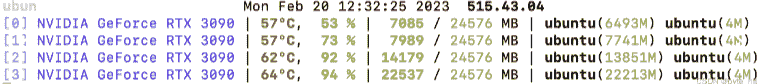
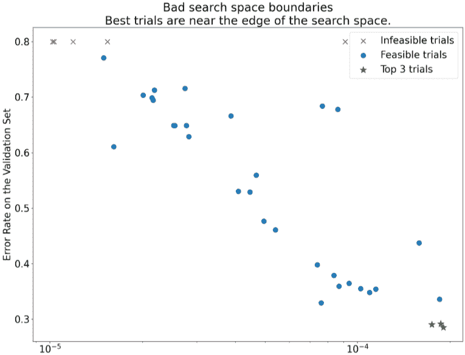
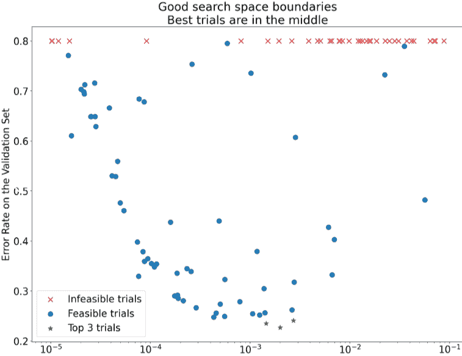
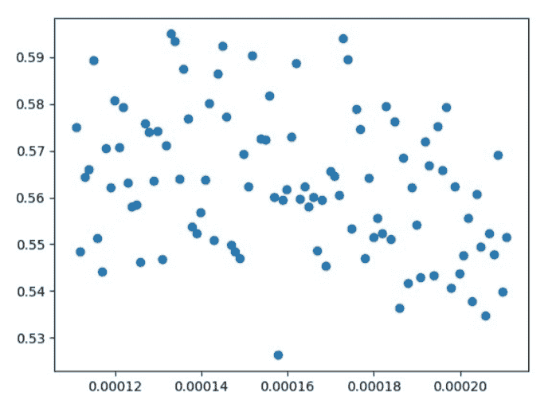
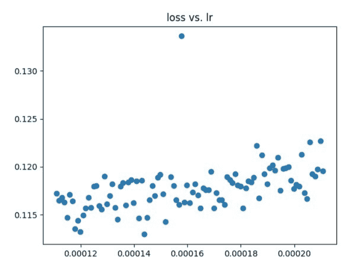
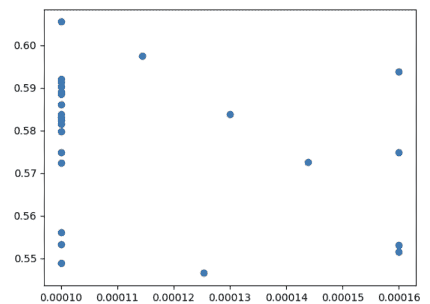
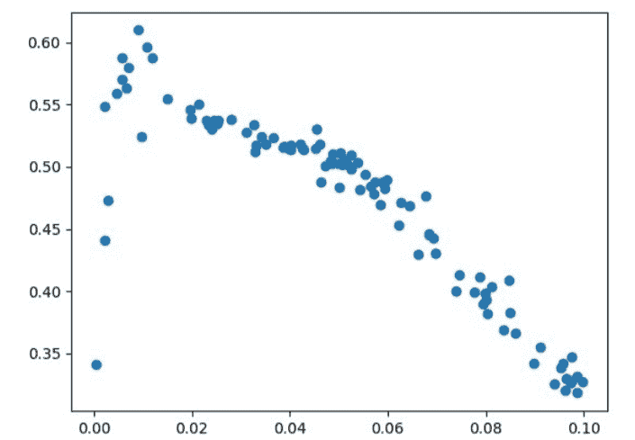
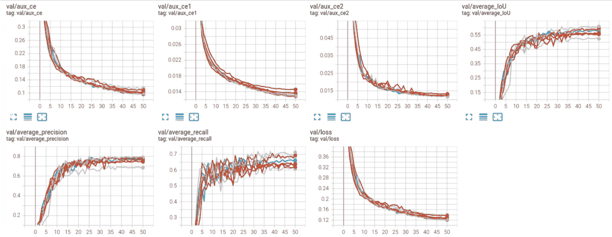
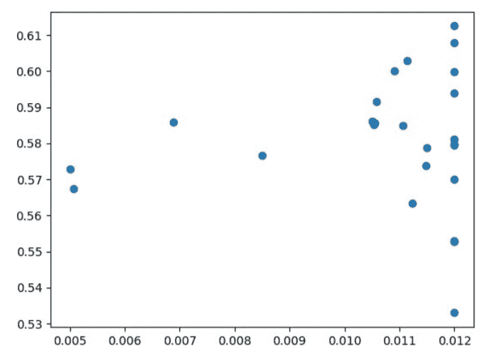
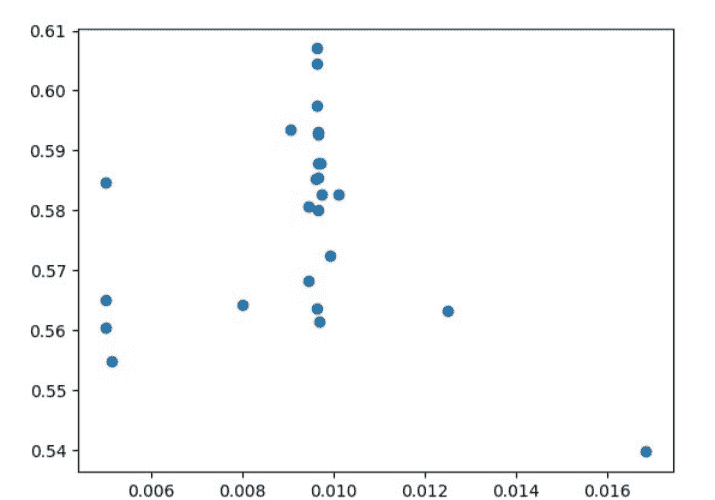

# 谷歌深度学习调参手册（提炼，理解，总结）

> 来源：[https://qqs7y1hozd1.feishu.cn/docx/LFqidjm32oEM0axQzrJcW6dCnIh](https://qqs7y1hozd1.feishu.cn/docx/LFqidjm32oEM0axQzrJcW6dCnIh)

**这个**[**手册**](https://github.com/google-research/tuning_playbook)**系统的总结了调参的整个过程。**

## 1.start point

从一个简单的模型入手，使用简单的优化器（比如固定了beta1,beta2,momentum的ADAMW优化器）。

### 1.1.确定batch_size：

不同的batch_size对训练结果没有影响。在不同的batch_size下可以通过调整优化器的参数（比如学习率，动量等）**实现相同的优化****结**果。需要注意的是，在小的数据集（如MFNet数据集）上，实验中发现大的batch_size训练出的结果，过拟合更加明显。

**在硬件资源受限的情况下**，如果在一个硬件资源更强大的机器上已经调优了一个大batch_size的版本，可以使用梯度累加的策略。此时需要考虑的是，基础的batch_size 不能太小，否则梯度累积模拟的大的batch_size 和实际的大的batch_size 会有比较明显的差异（这种差异的可能原因和批处理的EMA统计有关)。总而言之，对于一个没有先验知识的模型，从头开始调试的话，batch_size的选择依据是，尽量可能大。至于怎么选，自己去试就是了。

> 需要注意的是，每次重新选择batch_size都需要重新调整优化器参数，在参数都调好了的情况下，一个可以参考的经验是：

>

**example：**

使用gmnet模型作为的基础模型，优化器为adamW:

```
torch.optim.AdamW(parameter_group, betas=(0.9, 0.999), eps=1e-8, weight_decay=float(config[&#x27;weight_decay&#x27;]), amsgrad=True)
```

其中weight_decay为0.1，数据集为MFNet。关闭梯度裁剪。直接使用混合精度计算。

**学习率使用****polinominal****策略：**

```
lr_policy: polynomial
power: 0.9
niter_decay: 200
lr_step_per_batch: False
cycle: False
end_lr: 1e-8
backbone_lr: 0.0005
```

batch size 分别设置成2,4,8,16，跑5个epoch，平均每轮的训练的时间分别为：133s,81s,42.25s,46.52s

可以看出，虽然硬件允许的最大batch size是16，但是不是最大的batch size就能够带来最快的训练速度。

**查看gpu消耗：**



可以看到 batch size为16和8的情况下，gpu温度均超过60°，怀疑此时gpu进行了降频处理，性能下降。

> 可以简单的认为，文中的结论存在的情况为，gpu没有接近其性能极限，比如：所占内存不超过gpu内存综合的70%。

**综**上，选择batch size 为8作为批大小（16的批大小不能带来运算效率的提升，但是可能让模型的泛化能力变差）

### 1.2.选择初始配置

使用简单的学习率衰减方案（比如直接使用固定的学习率），尽量少的变量能够有助于对问题有更加直接的认识。选择训练的总epoch数。

## 2.增量调优

从一个简单的基础设置开始，比如说恒定的学习率，固定参数的adamw优化器，基础简单的网络架构。然后慢慢的加特征，比如说增加学习率衰减策略，调优adamw的beta1，beta2，momentum等参数。增加网络模块等。

## 3.探索式调优和针对性调优

原文是Exploration vs exploitation，这里说说我的理解，我们在初次遇到一个问题的时候。我们对问题的认识往往是不充分的，比如

+   是否引入新的技巧（比如如果存在过拟合，则可以引入正则化技巧）;

+   学习率合适的搜索范围是多少（如果确定错误的超参数范围，有可能让最优模型陷在一个错误的点，或者引入错误的模块）;

+   确定对验证集误差（简称为验证误差）敏感的超参数（在每次消融实验的时候，都尽可能的去重新调优）和不敏感的超参数（在每次消融实验的时候，可以设置成固定参数，减少搜索空间）

### 3.1探索阶段

则我们首先研究不同优化器的选择，SGD和ADAMW，对于优化器选择了SGD的实验，我们还需要确定学习率的大小，我们可以简单的使用固定学习率的策略，使用伪随机搜索的策略，确定学习率的大概范围，类似的我们可以确定动量的大概范围，weight_decay的范围，nestrov是否设置成False。在随机搜索的时候，我们可能发现过拟合的现象，因此我们添加了正则化，然后重新进行伪随机搜索确定优化器参数的范围，有可能的，我们还会发现我们的训练误差存在NAN的情况，此时我们就需要考虑使用合适的策略减少NAN的问题（利用学习率warm up或者使用梯度裁剪），然后我们还可以考虑选择合适的学习率衰减策略，针对不同的学习率衰减策略，进行不同的伪随机搜索。

### 3.2针对性调优

在确定了以上问题之后，利用贝叶斯优化器在选定的学习率范围内进行进一步的搜索，确定最终的优化结果。

尽可能的分析每次尝试的结果，包括验证集上的误差，训练误差，各种单项损失函数，梯度范数等。从数据中对调优问题获取更好的认知，比如是否存在过拟合，是否存在梯度爆炸，单项损失函数是否起到该有的作用等等。尽可能的获取有效分析，不能够被一次幸运训练的结果给误导（由于训练的随机性，有时候即使是错误的配置也可能踩狗屎地得到好结果），所有的结果都需要有经得起推敲的支撑。对于随机性的一种有效解决方案，是多做几次训练，分析多次的训练结果。如果不同结果之间存在比较大的偏差，则说明这次结果可能是狗屎运。需要剔除。

> 因此，在做尝试性实验之前，**需要制定好本次实验的目的****，比如确定某一个超参数的作用，**确定某一个模块的作用。需要注意的是，实验设计需要遵循单一变量原则。

## 4.科学的实验

确定scientific, nuisance, and fixed hyperparameters。科学参数是实验设计的目标，实验设计需要研究科学参数对问题的影响。冗余参数是每轮实验需要调优的参数，每次改变科学参数都需要重新调优冗余参数，否则对比实验是不合理的。固定参数是实验中固定的参数。

> 如，消融实验，要验证所提出的模块具有作用，需要对比添加该模块和无该模块下的效果。那么该模块是否存在就是科学参数，二对应的学习率，优化器参数，正则化参数，以及损失函数涉及的参数，就是冗余参数，每轮实验的数据都需要保证是调节冗余参数，获取了最有训练结果的前提下进行对比，否则实验就存在公平性争议。

## 5.确定实验目标

需要首先确认每个实验的目标。科学参数和冗余参数以及固定参数的确定都和实验目标相关，比如，对于实验目标为，确定适合的模型大小（比如选取不同的层数，宽度等），则其科学参数可以为模型的参数，而此时如果讲weight decay作为固定参数显然是不合适的，因为对不同模型大小，其最优的weight decay是不一样的。

优化器相关的参数，学习率，学习率的衰减策略，beta1，beta2，动量，weight decay等是冗余参数。

> **一些可以固定的参数：**

1.  优化器的类型选择(SGD,ADAMW等）是一个科学参数或者固定参数，我们认为所有的优化器都可以得到最优的训练结果。所不同的是不同的优化器其训练的难易不一样。训练的时间长度不一样。

1.  是否添加某种正则化技巧（比如random_flip/crop/cut_out）等，是一个科学参数，或者是一个固定参数

1.  神经网络的结构相关的参数（如层数）往往是科学参数或者固定参数。

> 我们的实验目标是确定最优的优化器。SGD和ADAMW。

**则对应的****SGD****的调参（冗余参数）为：**

learning_rate，weight decay，momentum，nesterov，dampening

**ADAMW****对应的冗余参数为：**

learning_rate, weight decay, beta1, beta2, eps, amsgrad

> 将nestrov固定为True，将amsgrad固定为False

## 6.设计研究（study）

研究是针对特定的科学参数，对冗余参数进行优化，从而让不同科学参数之间的对比尽可能的公平。

> **因此研究的步骤包括：**

1.  确定tunning变量（就是冗余变量）

1.  确定冗余变量的取值范围，即搜索空间

1.  确定进行tunning的次数（number of trials）

1.  利用伪随机搜索进行探索性尝试，确定指定的搜索范围是否合理。确定是否需要添加正则化等策略

1.  重复1~4，直到确定了1~3，并限制在一个比较合理的范围内。

1.  利用贝叶斯优化器进行迭代式优化，寻找最优的配置。

如果科学参数有多种取值，需要进行多次研究，在运算负载不够的情况下，一种可行的办法是将科学参数也和冗余参数一起，进行1~6的调优。

> 需要注意的是，在设计研究的时候，需要平衡硬件条件和搜索范围，搜索次数。越多科学参数的取值，越广的冗余参数的搜索范围，在搜索范围内越密集的采样能够得到更加让人信服的结果。然而也更加消耗计算资源和调参的时间。

## 7.数据分析

在分析所设计的实验是否取得预设的目标时（比如选取确定最优的优化器）。我们需要对训练得到的结果（包括过程数据）进行分析，避免错误的设计带来的问题。

**需要检查以下几个方面的问题：**

### 1） 搜索空间是否足够大





如上面左图（**超参数轴图**，纵轴为每次trial训练过程中得到的最优的验证集误差，横轴为具体某个超参数）所示，如果最优的点簇在搜索空间的边缘，此时扩展搜索空间，可能带来新的最优值。

按上面右图所示的结果，搜索空间是没有问题的，但是对于学习率大于最优点的区域存在大量的无效点，这说明可能存在不稳定问题，限制了大学习率下模型的表现。

### 2）是否已经在搜索空间在进行足够密集的采样

**没有确切的**准则用于判定是否进行了足够的采样，一种方案是在运算载荷能够承担的情况下，尽可能多的采集点，也就是在搜索空间中进行尽可能多的尝试（trials）。然后分析超参数轴图，最好的点簇中包含多少个点。一般来讲包含越多的点，越能够说明采样是足够稠密的。

### 3） 每项研究中，有多少trials是无效的

如果尝试中损失函数发散，或者损失函数异常（很大或者nan），或者运行报错，我们称之为无效的训练。如果研究中，存在很大比例的无效尝试，则需要调整搜索空间，避开无效区域，或者检查代码是否存在bug。

### 4）模型是否存在优化问题

### 5）最优的trial的训练曲线是否存在过拟合等问题

训练曲线包含更加丰富的信息，对于每一个研究，我们至少需要查看其最优的几次尝试的训练曲线。如果训练曲线表明存在过拟合问题（随着训练step的增加，验证误差也逐渐增加）。除非研究对象就是正则化手段。否则需要考虑调整正则化参数或者添加正则化手段。

> **除**了最优的trial出现过拟合问题需要关注之外，如果存在以下问题，也说明最优的trial选择上可能存在问题：

+   如果最优的trial不存在过拟合，但是其他trial存在过拟合现象

+   需要考虑参数的合理性，比如，对于过拟合问题，如果学习率过低，也会降低过拟合问题，但是过低的学习率是不合理的。也就是说最优的trial选择有可能选取了那些比较差的科学参数或者冗余参数配置。

除了过拟合问题需要关注，我们也需要关注：

**训**练曲线中step-to-step（这里的step可以是训练中的一次迭代iteration或者一个epoch）方差

> 大的方差会导致复现困难，说明可能**恰好最后一个是在luc**ky step上。大的方差的主要原因有：

+   批之间差异（数据shuffle加载），小的批大小容易导致批之间存在比较大的差异

+   较小的验证集，验证集太小，验证集太小，其随机性越强，和训练集数据分布的差异更大

+   以及较大的学习率

针对step-to-step方差，相应的解决方案为，增加批大小，增加验证集，利用学习率衰减，或者使用移动平均对验证误差进行平滑处理。

训练过程中的尾声阶段，验证误差是否还下降

这说明还没有达到最优的训练结果。通过增加训练steps总数或者通过调整学习率策略来达到最优的验证误差。

训练结束之前，验证误差是否已经饱和（收敛）

可以减少训练的step数来节省运算开支

其他异常（比如训练误差发散）表明需要对代码进行debug

如果存在以上问题，需要解决了然后重新调优。如果没有存在以上的问题，则可以move on继续其他的研究。同时可以在代码中自动生成所有的训练曲线和超参数轴图。

## 8.再次确定所添加的更改（比如新的网络层，新的超参数设置）是否真的有效

由于神经网络训练存在随机性，貌似得到了很好的验证集结果。但是当使用同样的参数再次训练的时候。有时候会痛苦的发现，好运气用完了。始终无法复现之前好的实验结果。

> **这种训练的差异主要分为：**

1.  尝试（trial）差异：主要是因为不同trial的随机初始化，训练数据的随机加载，dropout mask的随机性，数据增强引入的随机性，并行算子的运算顺序等；

1.  超参搜索或者研究差异：比如在伪随机搜索算法中的随机种子不同，会导致最终采样的点不同

1.  数据采样差异：对数据集的随机划分，划分为训练数据集，测试数据集和验证数据集，进一步的在数据生成过程中的随机性也可能带来这种不一致。

手册里头对此的说明是更关注的是研究差异，建议在搜索空间中采样足够多的点，以消除采样导致的研究差异。另外也可以直接在最好的超参数配置上，进行多次的重复训练，统计多次训练的偏差。在硬件计算负载能够承担得起的情况下，进行多次的训练，避免采用训练偏差大的改变是更加科学的。

## 9.探索之后

在进行探索式调优之后，怎么进行针对性的调优，相当于在探索调优确定的超参数搜索范围内更加精细，密集的搜索最优的配置。这个阶段不用伪随机搜索算法，而是使用贝叶斯优化。如果搜索空间中包含大量的不可行点。建议使用黑盒优化工具进行优化。

此时也需要考虑在测试数据集上的表现。

## 10.确定训练的步长

## 11.关于软件使用

手册中建议使用ossVizier进行参数搜索。用来做quasi_random确定初步的范围还可以，但是每次用高斯过程来优化的时候。总会碰到训练轮次偏差过大的问题。大致是训练样本过小导致的每个轮次的差异性比较大导致的。

下面简单记录一下使用说明：

### 1）安装环境

可以直接用官方说明的方法进行安装。需要注意的是，按照官方说明的方法，去跑所有的测试用例，可能会报错。用的一个是伪随机搜索，一个是贝叶斯搜索。库安好了，就不纠结用例不通过的问题了。直接进行调用。

### 2）使用vizier进行伪随机搜索

**server端：**

```
from __future__ import annotations
import time
from typing import Sequence
from absl import app
from absl import flags
from absl import logging
from vizier.service import vizier_server
from vizier.service import vizier_service_pb2_grpc
import grpc
from concurrent import futures
 
flags.DEFINE_string(
    &#x27;host&#x27;,
    &#x27;localhost&#x27;,
    &#x27;Host location for the server. For distributed cases, use the IP address.&#x27;,
)
 
FLAGS = flags.FLAGS
 
_ONE_DAY_IN_SECONDS = 60 * 60 * 24
 
def main(argv: Sequence[str]) -&gt; None:
  if len(argv) &gt; 1:
    raise app.UsageError(&#x27;Too many command-line arguments.&#x27;)
  hostname = &#x27;localhost&#x27;  # Example ; usually user - specified
  port = 6006  # Example ; usually user - specified
  address = f&#x27;{hostname}:{port}&#x27;
  servicer = vizier_server.vizier_service.VizierServicer()
  server = grpc.server(futures.ThreadPoolExecutor(max_workers=100))
  vizier_service_pb2_grpc.add_VizierServiceServicer_to_server(servicer, server)
  server.add_secure_port(address, grpc.local_server_credentials())
  server.start()
  # prevent the main thread from exiting
  try:
    while True:
      time.sleep(_ONE_DAY_IN_SECONDS)
  except KeyboardInterrupt:
    del server
 
if __name__ == &#x27;__main__&#x27;:
  app.run(main)
```

**client端代码：**

```
from __future__ import annotations
 
import argparse
 
import yaml
from vizier.service import vizier_client
 
from trainV2 import main_train
from util.util import get_conf_list
import multiprocessing
 
from typing import Sequence
 
from absl import app
from absl import flags
from absl import logging
 
from vizier.service import clients
from vizier.service import pyvizier as vz
 
MAX_TRIALS_PER_CLIENT = 25
MAX_PROCS = 4
 
def get_scale_type(sType):
    if sType==&#x27;LOG&#x27;:
        return vz.ScaleType.LOG
    if sType == &#x27;LINEAR&#x27;:
        return vz.ScaleType.LINEAR
    if sType == &#x27;REVERSE_LOG&#x27;:
        return vz.ScaleType.REVERSE_LOG
    if sType == &#x27;UNIFORM_DISCRETE&#x27;:
        return vz.ScaleType.UNIFORM_DISCRETE
    return vz.ScaleType.LINEAR
def creat_client(config,server=&#x27;localhost:45437&#x27;,owner=&#x27;a&#x27;,study_id=&#x27;gmnet&#x27;, client_id=&#x27;0&#x27;):
    clients.environment_variables.server_endpoint = server
    study_config = vz.StudyConfig()  # Search space, metrics, and algorithm.
    root = study_config.search_space.root
    if config == None:
        study = clients.Study.from_owner_and_id(owner,study_id)
        return study
 
    for key in config.keys():
        sType = get_scale_type(config[key][&#x27;scale_type&#x27;]),
        if config[key][&#x27;type&#x27;] == &#x27;float&#x27;:
            root.add_float_param(
                key,
                min_value=config[key][&#x27;min&#x27;],
                max_value=config[key][&#x27;max&#x27;],
                scale_type=sType[0],
            )
        elif config[key][&#x27;type&#x27;] == &#x27;int&#x27;:
            root.add_int_param(
                key,
                min_value=config[key][&#x27;min&#x27;],
                max_value=config[key][&#x27;max&#x27;],
                scale_type=sType[0],
            )
 
    study_config.metric_information.append(
        vz.MetricInformation(
            name=&#x27;mIoU&#x27;,
            goal=vz.ObjectiveMetricGoal.MAXIMIZE,
            min_value=0.0,
            max_value=1.0,
        )
    )
 
    study_config.algorithm = vz.Algorithm.QUASI_RANDOM_SEARCH
 
    client = vizier_client.create_or_load_study(
        server,
        owner_id=owner,
        client_id=client_id,
        study_id=study_id,
        study_config=study_config,
    )
    return client
 
def main_process(config, search_keys, client):
    print(client)
    for _ in range(MAX_TRIALS_PER_CLIENT):
        trials = client.get_suggestions(suggestion_count=1)
        for trial in trials:
            materialized_trial = trial
            print(materialized_trial)
            for key in search_keys:
                print(key)
                value = materialized_trial.parameters.get_value(key)
                print(value)
                config[key] = value
            config[&#x27;trial_id&#x27;] = trial.id
            ioU = main_train(config)
            m = vz.Measurement()
            m.metrics = {&#x27;mIoU&#x27;: ioU}
            client.complete_trial(trial.id,m)
            logging.info(
            &#x27;Trial %d completed with metrics: %s&#x27;, trial.id, m.metrics
            )
 
if __name__ == &#x27;__main__&#x27;:
    parser = argparse.ArgumentParser(description=&#x27;Train MFNet with pytorch&#x27;)
    parser.add_argument(&#x27;--config&#x27;,  &#x27;-c&#x27;,  type=str, default=&#x27;./config/tokyo.config&#x27;)
    parser.add_argument(&#x27;--gpu&#x27;,  &#x27;-g&#x27;,  type=int, default=-1)
    args = parser.parse_args()
 
    if args.config:
        file_address = open(args.config)
        config = yaml.safe_load(file_address)
    else:
        print(&#x27;no config in cmd failed.!&#x27;)
    search_sp = config[&#x27;search_space&#x27;]
    base_cfg = config[&#x27;base_cfg&#x27;]
    if base_cfg:
        file_address = open(base_cfg)
        base_cfg = yaml.safe_load(file_address)
    else:
        print(&#x27;no base config.!&#x27;)
    if args.gpu&gt;=0:
        base_cfg[&#x27;gpu_ids&#x27;]=[args.gpu]
    for key in base_cfg.keys():
        if isinstance(base_cfg[key],str):
            if &#x27;,&#x27; in base_cfg[key]:
                base_cfg[key] = get_conf_list(base_cfg[key])
    client = creat_client(search_sp, server=&#x27;ip:port&#x27;,owner=&#x27;e&#x27;,client_id=&#x27;4&#x27;)
    main_process(base_cfg, search_sp.keys(),client)
    trial_filter = vz.TrialFilter(status=[vz.TrialStatus.COMPLETED])
    all_trials = client.list_trials()
    trials = []
    for t in filter(trial_filter, all_trials):
        trials.append(t)
    if len(trials) &gt;= MAX_TRIALS_PER_CLIENT * MAX_PROCS:
        if client.get_study_state() == vz.StudyState.COMPLETED:
            client.set_study_state(vz.StudyState.COMPLETED)
        optimal_trials = client.list_optimal_trials()
        print(optimal_trials)
        for optimal_trial in optimal_trials:
            print(f&quot;Pareto-optimal trial found so far has parameters {optimal_trial.parameters} and metrics {optimal_trial.final_measurement.metrics}&quot;)
```

**其中配置文件使用yaml加载：**

```
base_cfg: &#x27;./config/tokyo_gmnet_train.config&#x27;
search_space:
  backbone_lr:
    type: &#x27;float&#x27;
    min: 0.00001
    max: 0.001
    scale_type: &#x27;LINEAR&#x27; # LINEAR = &#x27;LINEAR&#x27; LOG = &#x27;LOG&#x27; REVERSE_LOG = &#x27;REVERSE_LOG&#x27;  UNIFORM_DISCRETE = &#x27;UNIFORM_DISCRETE&#x27;
```

> 原计划直接用多进程编程。但是多进程加载cuda库的时候会报错。而且如果在多进程的话，所有vizier的初始化代码都需要再进程在实现，否则会报错。

故直接使用bash脚本进行调用：

```
!/bin/sh
export OMP_NUM_THREADS=32
#python -u -m torch.distributed.run --rdzv_backend=c10d --rdzv_endpoint=localhost:0 --nnodes=1 --nproc_per_node=4 trainV2.py -c $1
if [ 0 -gt $2 ] ; then
  echo &quot;start on multi gpus&quot;
  (python  run_vizier_client.py -c $1 -g 0 &gt; search0.log) &amp; (python  run_vizier_client.py -c $1 -g 1 &gt; search1.log) &amp; (python  run_vizier_client.py -c $1 -g 2 &gt; search2.log) &amp;(python  run_vizier_client.py -c $1 -g 3 &gt; search3.log)
else
  echo &quot;start on gpu $2&quot;
  python  run_vizier_client.py -c $1 -g $2
fi
```

对于最后的结果，官方文档没有直接说明可以在web端直接查看（如果像tensorboard一样，可以直接在web端生成图表，效果会更好）。使用python拉取所有的实验结果，然后用matlplot绘制超参和mIoU的相关图

```
from __future__ import annotations
 
import matplotlib.pyplot as plt
import numpy as np
from vizier.service.clients import environment_variables
from vizier.service import clients, resources, vizier_client
from vizier.service import pyvizier as vz
 
def main() -&gt; None:
    clients.environment_variables.server_endpoint = &#x27;ip:port&#x27;
    # study_config = vz.StudyConfig()  # Search space, metrics, and algorithm.
    # root = study_config.search_space.root
    owner = &#x27;e&#x27;
    study_id = &#x27;gmnet&#x27;
    study_resource_name = resources.StudyResource(
        owner_id=owner, study_id=study_id
    ).name
    client = vizier_client.VizierClient(
        vizier_client.create_vizier_servicer_or_stub(
            environment_variables.server_endpoint
        ),
        study_resource_name,
        &#x27;4&#x27;,
    )
    trial_filter = vz.TrialFilter(status=[vz.TrialStatus.COMPLETED])
 
    all_trials = client.list_trials()
    mIoU = []
    lr = []
    for t in filter(trial_filter, all_trials):
        print(&#x27;trail:&#x27;)
        print(t)
        # trials.append(t)
        iou = t.final_measurement.metrics[&#x27;mIoU&#x27;].value
        l = t.parameters[&#x27;backbone_lr&#x27;].value
        mIoU.append(iou)
        lr.append(l)
    mIoU = np.asarray(mIoU).transpose()
    lr = np.asarray(lr).transpose()
    # x = np.linspace(0, 2, 100)
    plt.scatter(lr,mIoU)
    plt.show()
 
 
 
if __name__ == &#x27;__main__&#x27;:
    main()
```

**输出为：**

```
[Trial(parameters=ParameterDict(_items={&#x27;backbone_lr&#x27;: 0.00013287588294651868}), metadata=Metadata((namespace:, items: {}), current_namespace=), id=23, is_requested=False, assigned_worker=&#x27;3&#x27;, stopping_reason=None, _infeasibility_reason=None, description=&#x27;owners/e/studies/gmnet/trials/23&#x27;, related_links={}, final_measurement=Measurement(metrics={&#x27;mIoU&#x27;: Metric(value=0.5949919441762046, std=None)}, elapsed_secs=0.0, steps=0), measurements=[], creation_time=02/25/23 18:15:47, completion_time=None)]
Pareto-optimal trial found so far has parameters ParameterDict(_items={&#x27;backbone_lr&#x27;: 0.00013287588294651868}) and metrics {&#x27;mIoU&#x27;: Metric(value=0.5949919441762046, std=None)}
```

**得到****mIoU****和****学习率lr****的关系图：**





按照上面左图可以看出，最优的区间在0.00012到0.00018之间。同步如右图绘制验证集损失和初始学习率的关系后可以看出最优的学习率的区间应该在0.00012到0.00015之间。

> （需要注意的是vizier0.1.3之前的版本在做伪随机搜索的时候，存在不均匀的问题，这个问题在0.1.3以后得版本已经修改）

使用贝叶斯优化对模型进行进一步优化。

**只要将算法改成：**

GAUSSIAN_PROCESS_BANDIT

然后直接进行实验。**发现报错：**

Jax transforms and Flax models cannot be mixed.

重新安装ossVizier到0.1.2版本。解决该问题。

**使用贝叶斯优化后得到：**



发现在0.0001的地方，训练轮次之间的偏差过大。这个直接影响了最终判断。

使用SGD优化器进行伪随机搜索。

**使用的学习率的更新策略为：**

```
lr_policy: warmup_cosine
lr_step_per_batch: False
warm_up_iter: 10
T_max: 40
lr_max: 1.33e-4
lr_min: 1e-8
gamma: 0.99
```

**vizier的配置为：**

```
base_cfg: &#x27;./config/tokyo_gmnet_train.config&#x27;
search_space:
  lr_max:
    type: &#x27;float&#x27;
    min: 0.0001
    max: 0.1
    scale_type: &#x27;LINEAR&#x27; 
```

**伪随机搜索得到的结果：**



验证集上，miou超过0.56的采样点如下：

> lr is 0.008992095967644217 iou is 0.6097086748570127

> lr is 0.006673528863708799 iou is 0.5629044428652298

> lr is 0.010705819479248656 iou is 0.5962651373131723

> lr is 0.005665456209823834 iou is 0.5874034043911056

> lr is 0.011814699398522118 iou is 0.5878719203422849

> lr is 0.00576626347521233 iou is 0.5699906138827684

> lr is 0.006975950659874287 iou is 0.579933796565994

同时查看学习率为这些值的时候。整个模型的收敛程度：



可以看出模型基本是收敛的。

可以看到最优的区间应该在[0.005，0.012]之间，我们在这个区间内，使用贝叶斯优化搜索最优的学习率。使用贝叶斯优化的时候，0.1.3的版本中又出现了问题：

> AttributeError: module 'tensorflow_probability.substrates.jax.experimental' has no attribute 'bayesopt'

之前是v0.1.1版本有这个问题，但是v0.1.2的版本中没有这个问题了。v0.1.3的版本中又出现了。看了应该是 tensorflow_probability版本的问题。

```
pip install -Uq tfp-nightly[jax] 
```

**优化之后得到：**





从上面左图可以看到最优点为0.012在边界，因此需要放宽边界，重新搜索，我们将边界设为[0.005，0.2]继续搜索。

如上面右图，输出结果，由于训练之间的误差过大，只能简单的说明大概的趋势。

所以怎么减少训练之间的偏差，非常重要。此外对比sgd和adamw优化器，发现最后优化出来的效果相似。这也和谷歌调参手册中的描述实现了一致。

## **附：谷歌深度调参手册原文：**

## **适用场景**

> **1.图像生成:** GANS可以用于生成新的图像，这在艺术和设计中有很大的应用。例如，DeepArt和Prisma 这样的应用就使用了 GANS 来将用户的照片转换成艺术品。

> **2.超分辨率: **GANS可以用于提高图像的分辨率，这在图像处理和视频流领域非常有用。例如，有些电视和电脑显示器使用 GANS 技术来提高低分辨率内容的质量。

> **3.虚拟现实: **在虚拟现实(VR)和增强现实(AR)中，GANS可以用于生成逼真的虚拟环境和对象。3.

> **4.医疗图像分析: **GANS可以用于生成医疗图像，如CT扫描或MRI图像，这对于训练医疗图像分析4.

> 算法非常有用。

> **5.语音生成: **在语音识别和生成领域，GANS可以用于生成逼真的语音，这在智能助手和语音合成中有很大的应用。

> **6.数据增强: **在机器学习中，GANS可以用于生成额外的训练数据，这可以帮助改善模型的性能。7.深度伪造:GANS 可以用于生成逼真的假视频和音频，这被称为“深度伪造”。虽然这在一些领域(如电影制作)有其用途，但也引发了一些关于隐私和安全的问题。

>

### 12条经验分享

1.调参一定要做好笔记，每次只调1个参数。

2.在 Validation筛选模型参数时，可以除loss函数“外，设置某种规则引导模型向某个想要的方向去更新参数。

3.关于Activation function:

(1)ReLu、Sigmoid、Softmax、Tanh是最常用的4个激活函数°

(2)对于输出层，常用sigmoid°和softMax激活函数，中间层常用 ReLu激活函数，RNN常用Tanh激活函数。

4.关于Weights initialization:

预训练参数是最好的参数初始化方式，其次是Xavir。

5.关于Regularization:

Dropout虽然思想很简单，但效果出奇的好，首选0.5。

6.Batch normalization很好用。

**7.如果在train模型时**，loss可以降到非常低那么模型的学习能力是够的;如果train能达到，validation达不到，则说明模型泛化能力不强。

**8.关于调参:**

有哪些参数可以调呢?

Loss function、Learning rate、Batch size、Epoch number、Optimizer、Activationfunction、Weights initialization、使用Regularization、Validation、使用的GPU个数。

9.关于 Loss function:

Loss function是Model和数据之外，第三重要的参数。具体使用MSE、Cross entropy、Focal还是其他自定义，需要具体问题具体分析。

10.关于Epoch number和early stopping

(1)Epochnumber和Early stopping是息息相关的，需要输出loss看一下，到底是什么epoch°时效果最好，及时early stopping。

(2)Epoch越大，会浪费计算资源;epoch太小，则训练模型提取特征没到极致。

(3)此外，也要明白Epoch、lteration、batchsize的关系。

**11.关于Optimizer:**

(1)Adam和SGDM是最常用的两个，前者能快速收敛°，后者收敛慢但最终精度更高。现在大家会先使用 Adam快速收敛，后面再用SGDM提升精度。

(2)如果必须二选一的话，我会推荐Adam。

12.关于 Learning rate和batch size:

(1)Learningrate和batch size“是两个重要的参数，而且二者也是相互影响的，在反向传播时直接影响梯度。一般情况下，先调batchsize，再调learning rate

(2)batchsize不能太大，也不能太小;太小会浪费计算资源，太大则会浪费内存;一般设置为 16的倍数。

(3)如果使用微调，则learningrate设置为0.0001较好。learningrate设置上有很多trick,包括 cosing learning rate等。