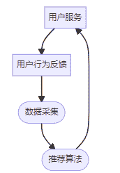
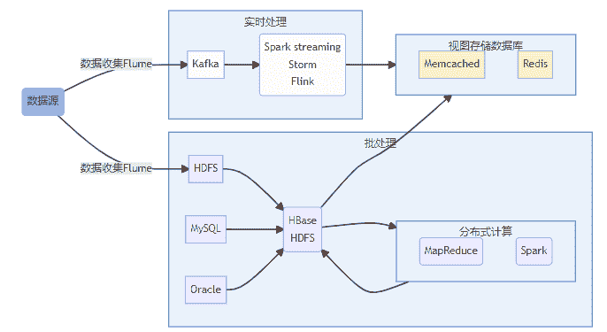
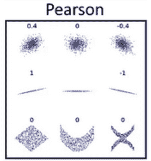
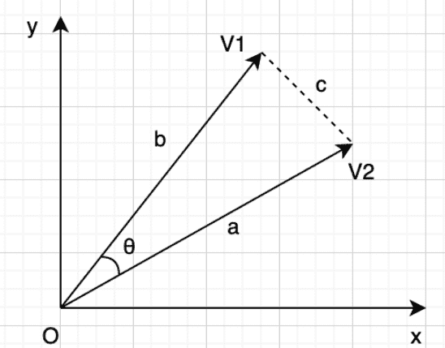

# 推荐系统|从深度学习到内容分发，全解

> 来源：[https://qqs7y1hozd1.feishu.cn/docx/K5QXdX9jVofVRgxuM5UcjIfMnvd](https://qqs7y1hozd1.feishu.cn/docx/K5QXdX9jVofVRgxuM5UcjIfMnvd)

## 一、 推荐系统的发展

> 推荐系统是指面对没有需求的用户在进入产品时，要给用户推荐什么东西，现在的APP基本上都会采用推荐系统。

+   从一开始的**1990s**开始的门户网站，像Yahoo、搜狐和Hao123等等，都是基于分类目录的网页导航网站，将各个网页聚合在一个网页中，方便用户跳转访问；

+   到了**2000s**开始，进入搜索引擎，例如百度、google和必应，用户通过有目的的搜索，找到自己的需求网站；

+   而进入**2010s**开始，进入推荐系统，不需要用户提供明确需求，通过分析用户的历史行为，**主动给用户推荐他们感兴趣的东西**，典型的APP有：快手、抖音和B站等等，基本上现在的APP都是基于推荐系统。

## 二、 推荐系统的工作原理

> 推荐系统是基于以下四种推荐来进行的：

> 1.**社会化推荐** 让用户的社会关系进行推荐，例如好友推荐，例如分享功能；

> 2.**基于内容推荐** 根据用户的搜索的东西，了解用户的兴趣；

> 3.**基于热点推荐** 向用户推荐当前的热点资讯；

> 4.**基于协同过滤推荐** 向同一类用户推荐东西，拓展用户的边界。

综合应用以上四种推荐，可以高效**链接用户和商品**，**提高用户的活跃度和停留时间**，从而提高产品的商业价值。

## 三、 推荐系统的总体架构

> **用户服务主要是前**端界面，数据采**集会**采**用l**ambda架构，推荐算法包含召回和排序两个方面。

推荐系统的总体架构及数据采集架构Lambda架构图如下：





> 在批处理层，数据不可变，并且能进行任何计算同时可水平扩展；

> 但对于及时性要求不高，可以是几分钟的延迟也可**以是几个小时的**延迟。

> 在实时处理层需要低延迟(最好在秒级)同时进行持续计算。

推荐算法架构可以分为召回、排序和策略调整三个主要阶段**，其主要架构图如下**：


## 四、 推荐算法

> 推荐算法部分跟业务数据分析中的机器学习过程很类似，包含以下步骤：

> 1.数据处理

> 2.特征工程

> 3.算法模型训练

> 4.产生推荐结果并评估

> 前两个不具体展开，原理同机器学习数据分析一样，算法模型部分会不同，这里主要会采用协同过滤算法。

### 协同过滤算法

该算法的**核心思想**为：物以类聚，人以群分。

> **一般基于两种假设：**

> **1.基于用户协同过滤：**相同喜好的用户喜欢的东西，你也可能会喜欢。

> **2.基于物品系统过滤：**喜欢的东西同性质的东西，你也可能会喜欢。

> **协同过滤算法主要是两个步骤：**

> 1.**找出TopN相似的人或者物品**：一般通过计算两两的相似度来进行排序。

> 2.**根据相似的人或者物品进行推荐**：利用TopN的推荐结果，过滤掉已有的东西或者明确不喜欢的东西，就是最后的结果。

### 相似度计算

相似度的计算方法主要包含以下四种：

#### （1）欧式距离

欧式距离公式：

因为相似度的结果是[-1,1]之间，所以进行如下转换：

#### （2）余弦相似度

#### （3）Pearson相关系数 余弦相似度的变形，对向量去中心化，即各自减去向量均值。





#### （4）杰卡德相似度Jaccard

用于衡量两组数据之间相似性的指标。 有人可能会争辩说，为了测量相似性，就需要计算两个给定集合之间交集的大小（基数、元素数量）。

然而，仅公共元素的数量并不能告诉我们它与集合大小的相对程度。 这就是杰卡德系数背后的直觉。

因此 Jaccard 提出，为了衡量相似度，需要将两组数据的交集大小除以并集大小。

Jaccard 距离与 Jaccard 系数互补，用于衡量数据集之间的差异性，常规计算公式及非二进制时使用公式分别为：

**在选择相似度计算方法：**

> 1.数值型的采用余弦相似度或者Person相关系数；

> 2.布尔型数据一般采用杰卡德相似度。

### 协同过滤算法代码

#### 导入模块

```
import pandas as pd
import numpy as np
from sklearn.metrics import jaccard_score
from sklearn.metrics.pairwise import pairwise_distances
from pprint import pprint
```

#### 基于用户之间的相似度

```
# 计算⽤户间相似度
user_similar = 1 - pairwise_distances(df.values,metric=&#x27;jaccard&#x27;)
user_similar = pd.DataFrame(user_similar, columns=users, index=users)
print(&quot;⽤户之间的两两相似度：&quot;)
print(user_similar)
```

#### 基于物品相似度

```
# 计算物品间相似度
item_similar = 1 - pairwise_distances(df.T.values, metric=&#x27;jaccard&#x27;)
item_similar = pd.DataFrame(item_similar, columns=items, index=items)
print(&quot;物品之间的两两相似度：&quot;)
print(item_similar)
```

## 五、 推荐系统评估

好的算法可以实现三方共赢，即用户满足、服务方实现商业价值、内容方获得收益。

其中评估的数据也分为直接评估和间接评估。

> 像电影评分或者推荐量表示用户喜欢该内容的属于直接评估，准确性高，但数量少获取成本也较高；

> 更多需要间接评估像播放量、点击量、购买量、评论和下载等等，这种方式虽然准确性较低，但数量多成本少。

### 评估指标

> **常用的评估指标如下：**

> 准确性；信任度；满意度；实时性；覆盖率；鲁棒性；

> 多样性；可扩展性；新颖性；商业目标；惊喜度；用户留存

### 评估方法

> **1.问卷调查：**成本高

> **2.离线评估：**只能评估少数指标，与线上真实效果存在偏差

> **3.在线评估：**灰度发布/AB测试

> 一般会采用离线评估和在线评估相结合，然后定期做问卷调查。

### 推荐系统冷启动

> 推荐系统冷启动本质上是**缺失历史数据的情况下**，怎么预测用户的偏好。

其中可分为用户冷启动、物品冷启动和系统冷启动。

#### 用户冷启动：

> 即如何**为新用户做个性化推荐**。一般会尽可能收集用户特征数据：

> **1.收集用户的基本信息：**性别、年龄、地域、手机型号、GPS定位和APP列表

> 2.引导用户填写兴趣，即进入APP的兴趣选择

> 3.关联其他app的行为数据，例如腾讯产品都会跟QQ和微信进行关联

> **4.新老用户推荐差异：**一般新用户推荐热门，老用户推荐个性化。

#### 物品冷启动：

> 如何**将新物品推荐给用户**。

> **1.给物品打标签**：标签从系统业务中产生，也可以从其他网站爬取。

> 2.利用物品的标签将其推荐给曾喜欢类似物品的用户。

#### 系统冷启动：

> **用户冷启动****+****物品冷启动**。

> 1.系统早期基于内容推荐；

> 2.然后过渡到协同过滤；

> 3.内容推荐和协同过滤结合。