# 手动实现一个扩散模型【DDPM】

> 来源：[https://qqs7y1hozd1.feishu.cn/docx/IuSnddRO4oLV64xI6xsc79Ntnxg](https://qqs7y1hozd1.feishu.cn/docx/IuSnddRO4oLV64xI6xsc79Ntnxg)

扩散模型是目前大部分AIGC生图模型的基座，其本质是用神经网络学习从高斯噪声逐步恢复图像的过程，本文用`python`代码从零开始构建一个简单的扩散模型。

## 理论部分

`DDPM(Denoising Diffusion Probabilistic Models)` 是一种在生成对抗网络等技术的基础上发展起来的新型概率模型去噪扩散模型，与其他生成模型（如归一化流、`GANs`或`VAEs`）相比并不是那么复杂。

`DDPM`由两部分组成：

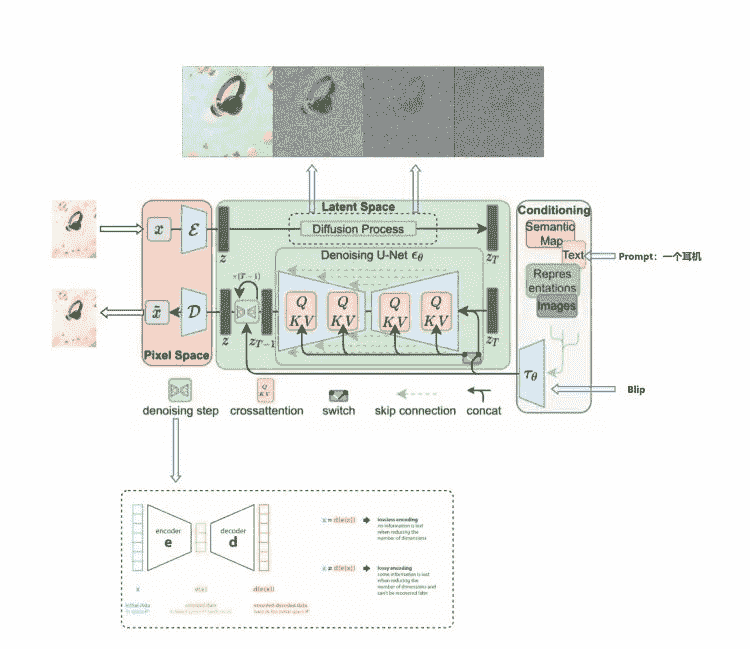

+ 一个固定的前向传播的过程，它会逐渐将高斯噪声添加到图像中，直到最终得到纯噪声。

+ 一种可学习的反向去噪扩散过程，训练神经网络以从纯噪声开始逐渐对图像进行去噪。

### ▐ 前向过程

> 前向扩散过程，其本质上是一个不断加噪声的过程。如下图所示，在猫的图片中多次增加高斯噪声直至图片变成随机噪音矩阵。可以看到，对于初始数据，我们设置`K`步的扩散步数，每一步增加一定的噪声，如果我们设置的`K`足够大，那么我们就能够将初始数据转化成随机噪音矩阵。

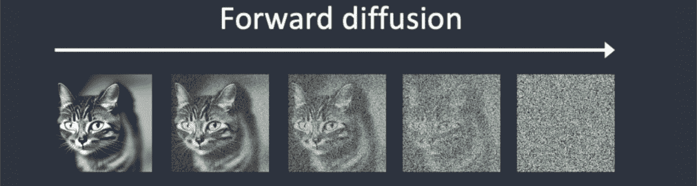

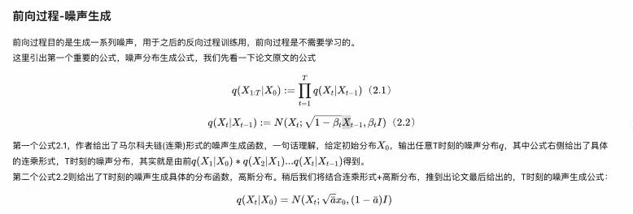

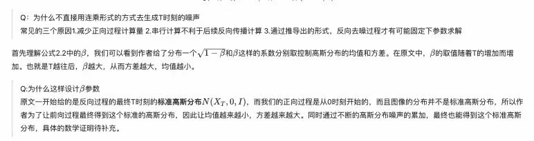

### ▐ 训练过程

> 反向生成过程和前向扩散过程相反，是一个不断去噪的过程。神经网络从一个随机高斯噪声矩阵开始通过扩散模型的`Inference`过程不断预测并去除噪声。

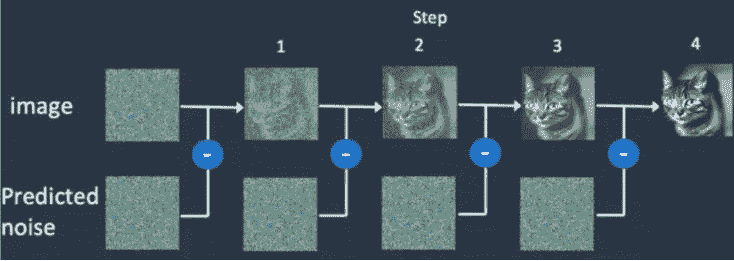

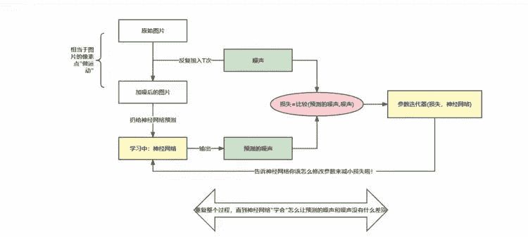

## 实践部分

### ▐ 环境包

首先安装并导入所需的库。

```
!pip install -q -U einops datasets matplotlib tqdm

import math
from inspect import isfunction
from functools import partial

%matplotlib inline
import matplotlib.pyplot as plt
from tqdm.auto import tqdm
from einops import rearrange, reduce
from einops.layers.torch import Rearrange

import torch
from torch import nn, einsum
import torch.nn.functional as F
```

### ▐ 加噪声

> `SD`模型训练时，需要输入加噪的数据集，每一次迭代用`random`函数生成从强到弱各个强度的噪声，通常来说会生成`0-1000`，一共`1001`种不同的噪声强度，通过`time embedding`嵌入到`SD`的训练过程中。

> 下图是一个简单的加噪声流程，可以帮助大家更好地理解`SD`训练时数据是如何加噪声的。首先从数据集中选择一张干净样本，然后再用`random`函数生成`0-3`一共四种强度的噪声，然后每次迭代其中任意一种强度的噪声，增加到干净图片上，完成图片的加噪流程。

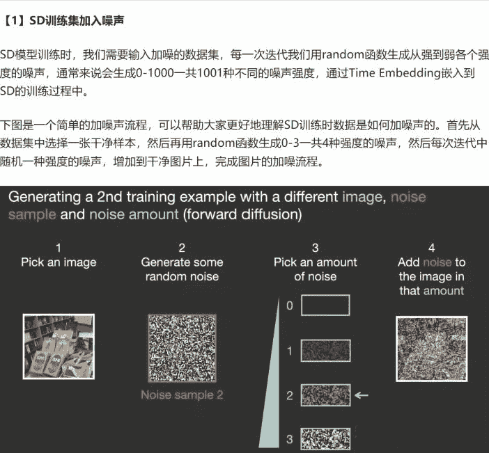

下面是一些周期性的函数，这段代码定义了几种不同的函数，每个函数都用于计算深度学习中`beta`调度（`scheduling`）。

`Beta`调度主要用于控制噪声添加的程度，具体代码如下：

```
import torch


# cosine_beta_schedule函数用于创建一个余弦退火`beta`调度。
# 这种调度方法基于余弦函数，并且可以调整随时间的衰减速率。
def cosine_beta_schedule(timesteps, s=0.008):
    steps = timesteps + 1  # 计算总的步数，需要比时间步多一个，以便计算`alpha`的累积乘积
    x = torch.linspace(0, timesteps, steps)  # 创建从`0`到`timesteps`的均匀分布的张量
    # 计算`alpha`的累积乘积，使用一个余弦变换，并平方来计算当前步的`alpha`值
    alphas_cumprod = torch.cos(((x / timesteps) + s) / (1 + s) * torch.pi * 0.5) ** 2
    alphas_cumprod = alphas_cumprod / alphas_cumprod[0]  # 归一化，确保初始值为`1`
    betas = 1 - (alphas_cumprod[1:] / alphas_cumprod[:-1])  # 计算每个时间步的`beta`值
    return torch.clip(betas, 0.0001, 0.9999)  # 对`beta`值进行裁剪，避免过大或过小


# linear_beta_schedule函数用于创建一个线性退火`beta`调度。
# 这意味着`beta`值将从`beta_start`线性增加到`beta_end`。
def linear_beta_schedule(timesteps):
    beta_start = 0.0001  # 定义起始`beta`值
    beta_end = 0.02  # 定义结束`beta`值
    return torch.linspace(beta_start, beta_end, timesteps)  # 创建一个线性分布的`beta`值数组


# quadratic_beta_schedule函数用于创建一个二次退火`beta`调度。
# 这意味着`beta`值将根据二次函数变化。
def quadratic_beta_schedule(timesteps):
    beta_start = 0.0001  # 定义起始`beta`值
    beta_end = 0.02  # 定义结束`beta`值
    # 创建一个线性分布的数组，然后将其平方以生成二次分布，最后再次平方以计算`beta`值
    return torch.linspace(beta_start**0.5, beta_end**0.5, timesteps) ** 2


# sigmoid_beta_schedule函数用于创建一个`sigmoid`退火`beta`调度。
# 这意味着`beta`值将根据`sigmoid`函数变化，这是一种常见的激活函数。
def sigmoid_beta_schedule(timesteps):
    beta_start = 0.0001  # 定义起始`beta`值
    beta_end = 0.02  # 定义结束`beta`值
    betas = torch.linspace(-6, 6, timesteps)  # 创建一个从`-6`到`6`的线性分布，用于`sigmoid`函数的输入
    # 应用`sigmoid`函数，并根据`beta_start`和`beta_end`调整其范围和位置
    return torch.sigmoid(betas) * (beta_end - beta_start) + beta_start
```

下面是噪声采样函数，其中`extract` 函数的作用是从预先计算的张量中提取适合当前时间步 `t` 的值。

> `sqrt_alphas_cumprod` 和 `sqrt_one_minus_alphas_cumprod` 应该是分别与时间关联的平方根累积乘积和其补数的平方根累积乘积，这两个张量中包含了不同时间步下噪声扩散的缩放系数。`sqrt_alphas_cumprod_t * x_start` 计算了经过时间步 `t` 缩放的原始数据，而 `sqrt_one_minus_alphas_cumprod_t * noise` 计算了同样经过时间步 `t` 缩放的噪声。两者相加得到的是在时间步 `t` 时刻的扩散数据。在扩散模型中，通过反向扩散过程（生成过程）来学习这种加噪声的逆过程，从而可以生成新的数据样本。

```
# import torch  # 假设在代码的其他部分已经导入了`torch`库


# 定义前向扩散函数
# x_start: 初始数据，例如一批图像
# t: 扩散的时间步，表示当前的扩散阶段
# noise: 可选参数，如果提供，则使用该噪声数据；否则，将生成新的随机噪声
def q_sample(x_start, t, noise=None):
    if noise is None:
        noise = torch.randn_like(x_start)  # 如果未提供噪声，则生成一个与`x_start`形状相同的随机噪声张量

    # 提取对应于时间步`t`的`α`的累积乘积的平方根
    sqrt_alphas_cumprod_t = extract(sqrt_alphas_cumprod, t, x_start.shape)
    # 提取对应于时间步`t`的`1-α`的累积乘积的平方根
    sqrt_one_minus_alphas_cumprod_t = extract(
        sqrt_one_minus_alphas_cumprod, t, x_start.shape
    )

    # 返回前向扩散的结果，该结果是初始数据和噪声的线性组合
    # 系数`sqrt_alphas_cumprod_t`和`sqrt_one_minus_alphas_cumprod_t`分别用于缩放初始数据和噪声
    return sqrt_alphas_cumprod_t * x_start + sqrt_one_minus_alphas_cumprod_t * noise
```

测试如下：

```
# take time step
for noise in [10, 20, 40, 80, 100]:
  t = torch.tensor([40])
  get_noisy_image(x_start, t)
```

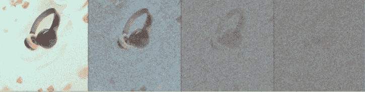

### ▐ 核心残差网络

下面是残差网络的实现代码，`Block` 类是一个包含卷积、归一化、激活函数的标准神经网络层。

> `ResnetBlock` 类构建了一个残差块（residual block），这是深度残差网络（ResNet）的关键特性，它通过学习输入和输出的差异来提高网络性能。在 `ResnetBlock` 中，可选的 `time_emb` 参数和内部的 `mlp` 允许该`Block`处理与时间相关的特征。

```
import torch.nn as nn
from einops import rearrange  # 假设已经导入了`einops`库中的`rearrange`函数
from torch_utils import exists  # 假设已经定义了`exists`函数，用于检查对象是否存在


# 定义一个基础的`Block`类，该类将作为神经网络中的一个基本构建模块
class Block(nn.Module):
    def __init__(self, dim, dim_out, groups=8):
        super().__init__()
        # 一个2D卷积层，卷积核大小为`3x3`，边缘填充为`1`，从输入维度`dim`到输出维度`dim_out`
        self.proj = nn.Conv2d(dim, dim_out, 3, padding=1)
        # `GroupNorm`层用于归一化，分组数为`groups`
        self.norm = nn.GroupNorm(groups, dim_out)
        # 使用`SiLU`（也称为`Swish`）作为激活函数
        self.act = nn.SiLU()
        
    def forward(self, x, scale_shift=None):
        x = self.proj(x)  # 应用卷积操作
        x = self.norm(x)  # 应用归一化操作
        # 如果`scale_shift`参数存在，则对归一化后的数据进行缩放和位移操作
        if exists(scale_shift):
            scale, shift = scale_shift
            x = x * (scale + 1) + shift
        x = self.act(x)  # 应用激活函数
        return x  # 返回处理后的数据


# 定义一个`ResnetBlock`类，用于构建残差网络中的基本块
class ResnetBlock(nn.Module):
    """https://arxiv.org/abs/1512.03385"""
    
    def __init__(self, dim, dim_out, *, time_emb_dim=None, groups=8):
        super().__init__()
        # 如果`time_emb_dim`存在，定义一个小型的多层感知器（`MLP`）网络
        self.mlp = (
            nn.Sequential(nn.SiLU(), nn.Linear(time_emb_dim, dim_out))
            if exists(time_emb_dim)
            else None
        )
        # 定义两个顺序的基础`Block`模块
        self.block1 = Block(dim, dim_out, groups=groups)
        self.block2 = Block(dim_out, dim_out, groups=groups)
        # 如果输入维度`dim`和输出维度`dim_out`不同，则使用`1x1`卷积进行维度调整
        # 否则使用`Identity`层（相当于不做任何处理）
        self.res_conv = nn.Conv2d(dim, dim_out, 1) if dim != dim_out else nn.Identity()
        
    def forward(self, x, time_emb=None):
        h = self.block1(x)  # 通过第一个`Block`模块
        # 如果存在时间嵌入向量`time_emb`且存在`mlp`模块，则将其应用到`h`上
        if exists(self.mlp) and exists(time_emb):
            time_emb = self.mlp(time_emb)  # 通过`MLP`网络
            # 重整`time_emb`的形状以匹配`h`的形状，并将结果加到`h`上
            h = rearrange(time_emb, "b c -> b c 1 1") + h
        h = self.block2(h)  # 通过第二个`Block`模块
        return h + self.res_conv(x)  # 将`Block`模块的输出与调整维度后的原始输入`x`相加并返回
```

### ▐ 注意力机制

> `DDPM`的作者把大名鼎鼎的注意力机制加在卷积层之间。注意力机制是`Transformer`架构的基础模块(参考:`Vaswani et al., 2017`)，`Transformer`在`AI`各个领域，`NLP`,`CV`等等都取得了巨大的成功，这里`Phil Wang`实现了两个变种版本，一个是普通的多头注意力(用在了`transformer`中)，另一种是线性注意力机制(参考:`Shen et al.,2018`)，和普通的注意力在时间和存储的二次的增长相比，这个版本是线性增长的。

> `SelfAttention`可以将输入图像的不同部分（像素或图像`Patch`）进行交互，从而实现特征的整合和全局上下文的引入，能够让模型建立捕捉图像全局关系的能力，有助于模型理解不同位置的像素之间的依赖关系，以更好地理解图像的语义。

在此基础上，`SelfAttention`还能减少平移不变性问题，`SelfAttention`模块可以在不考虑位置的情况下捕捉特征之间的关系，因此具有一定的平移不变性。


```python
import torch
from torch import nn
from einops import rearrange
import torch.nn.functional as F

# 定义一个标准的多头注意力（Multi-Head Attention）机制的类
class Attention(nn.Module):
    def __init__(self, dim, heads=4, dim_head=32):
        super().__init__()
        # 根据维度的倒数平方根来缩放查询（Query）向量
        self.scale = dim_head ** -0.5
        # 头的数量（多头中的"多"）
        self.heads = heads
        # 计算用于多头注意力的隐藏层维度
        hidden_dim = dim_head * heads
        # 定义一个卷积层将输入的特征映射到QKV（查询、键、值）空间
        self.to_qkv = nn.Conv2d(dim, hidden_dim * 3, 1, bias=False)
        # 定义一个卷积层将多头注意力的输出映射回原特征空间
        self.to_out = nn.Conv2d(hidden_dim, dim, 1)

    def forward(self, x):
        # 获取输入的批量大小、通道数、高度和宽度
        b, c, h, w = x.shape
        # 使用to_qkv卷积层得到QKV，并将其分离为三个组件
        qkv = self.to_qkv(x).chunk(3, dim=1)
        # 将QKV重排并缩放查询向量
        q, k, v = map(
            lambda t: rearrange(t, "b (h c) x y -> b h c (x y)", h=self.heads), qkv
        )
        q = q * self.scale
        # 使用爱因斯坦求和约定计算查询和键之间的相似度得分
        sim = einsum("b h d i, b h d j -> b h i j", q, k)
        # 从相似度得分中减去最大值以提高数值稳定性
        sim = sim - sim.amax(dim=-1, keepdim=True).detach()
        # 应用Softmax函数获取注意力权重
        attn = sim.softmax(dim=-1)
        # 使用注意力权重对值进行加权
        out = einsum("b h i j, b h d j -> b h i d", attn, v)
        # 将输出重新排列回原始的空间形状
        out = rearrange(out, "b h (x y) d -> b (h d) x y", x=h, y=w)
        # 返回通过输出卷积层的结果
        return self.to_out(out)

# 定义一个线性注意力（Linear Attention）机制的类
class LinearAttention(nn.Module):
    def __init__(self, dim, heads=4, dim_head=32):
        super().__init__()
        # 根据维度的倒数平方根来缩放查询（Query）向量
        self.scale = dim_head ** -0.5
        # 头的数量
        self.heads = heads
        # 计算用于多头注意力的隐藏层维度
        hidden_dim = dim_head * heads
        # 定义一个卷积层将输入的特征映射到QKV空间
        self.to_qkv = nn.Conv2d(dim, hidden_dim * 3, 1, bias=False)
        # 定义一个顺序容器包含卷积层和组归一化层将输出映射回原特征空间
        self.to_out = nn.Sequential(nn.Conv2d(hidden_dim, dim, 1),
                                    nn.GroupNorm(1, dim))

    def forward(self, x):
        # 获取输入的批量大小、通道数、高度和宽度
        b, c, h, w = x.shape
        # 使用to_qkv卷积层得到QKV，并将其分离为三个组件
        qkv = self.to_qkv(x).chunk(3, dim=1)
        # 将QKV重排，应用Softmax函数并缩放查询向量
        q, k, v = map(
            lambda t: rearrange(t, "b (h c) x y -> b h c (x y)", h=self.heads), qkv
        )
        q = q.softmax(dim=-2)
        k = k.softmax(dim=-1)
        q = q * self.scale
        # 计算上下文矩阵，是键和值的加权组合
        context = torch.einsum("b h d n, b h e n -> b h d e", k, v)
        # 使用上下文矩阵和查询计算最终的注意力输出
        out = torch.einsum("b h d e, b h d n -> b h e n", context, q)
        # 将输出重新排列回原始的空间形状
        out = rearrange(out, "b h c (x y) -> b (h c) x y", h=self.heads, x=h, y=w)
        # 返回经过输出顺序容器处理的结果
        return self.to_out(out)
```

## 位置嵌入

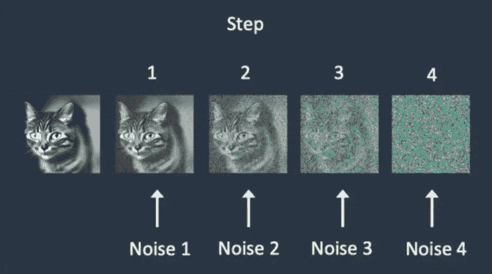

> 如何让网络知道目前处于`K`的哪一步？可以增加一个`Time Embedding`（类似于`Positional embeddings`）进行处理，通过将`timestep`编码进网络中，从而只需要训练一个共享的`U-Net`模型，就可以让网络知道现在处于哪一步了。

> `Time Embedding`正是输入到`ResNetBlock`模块中，为`U-Net`引入了时间信息（时间步长`T`，`T`的大小代表了噪声扰动的强度），模拟一个随时间变化不断增加不同强度噪声扰动的过程，让`SD`模型能够更好地理解时间相关性。

同时，在`SD`模型调用`U-Net`重复迭代去噪的过程中，我们希望在迭代的早期，能够先生成整幅图片的轮廓与边缘特征，随着迭代的深入，再补充生成图片的高频和细节特征信息。由于在每个`ResNetBlock`模块中都有`Time Embedding`，就能告诉`U-Net`现在是整个迭代过程的哪一步，并及时控制`U-Net`根据不同的输入特征和迭代阶段而预测不同的噪声残差。

从AI绘画应用视角解释一下`Time Embedding`的作用。`Time Embedding`能够让`SD`模型在生成图片时考虑时间的影响，使得生成的图片更具有故事性、情感和沉浸感等艺术效果。并且`Time Embedding`可以帮助`SD`模型在不同的时间点将生成的图片添加完善不同情感和主题的内容，从而增加了AI绘画的多样性和表现力。

```python
class SinusoidalPositionEmbeddings(nn.Module):
    def __init__(self, dim):
        super().__init__()
        self.dim = dim

    def forward(self, time):
        device = time.device
        half_dim = self.dim // 2
        embeddings = math.log(10000) / (half_dim - 1)
        embeddings = torch.exp(torch.arange(half_dim, device=device) * -embeddings)
        embeddings = time[:, None] * embeddings[None, :]
        embeddings = torch.cat((embeddings.sin(), embeddings.cos()), dim=-1)
        return embeddings
```

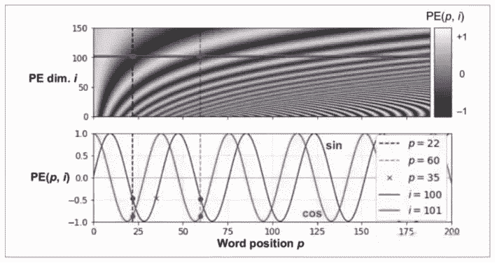

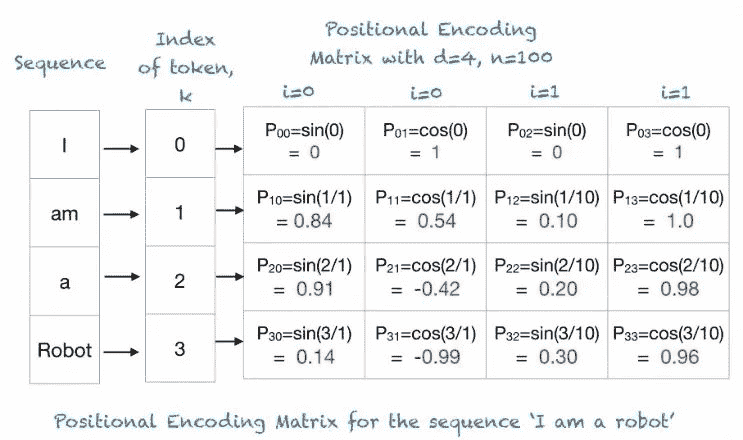

## U-net

基于上述定义的DM神经网络基础的层和模块，现在是时候把他组装拼接起来了：

神经网络接受一批如下`shape`的噪声图像输入(`batch_size`, `num_channels`, `height`, `width`) 同时接受这批噪声水平,`shape=(batch_size, 1)`。返回一个张量，`shape = (batch_size, num_channels, height, width)`

按照如下步骤构建这个网络：

> 首先，对噪声图像进行卷积处理，对噪声水平进行进行位置编码（`embedding`）

> 然后，进入一个序列的下采样阶段，每个下采样阶段由两个`ResNet`/`ConvNeXT`模块+分组归一化+注意力模块+残差链接+下采样完成。

> 在网络的中间层，再一次用`ResNet`/`ConvNeXT`模块，中间穿插着注意力模块(`Attention`)。

> 下一个阶段，则是序列构成的上采样阶段，每个上采样阶段由两个`ResNet`/`ConvNeXT`模块+分组归一化+注意力模块+残差链接+上采样完成。

> 最后，一个`ResNet`/`ConvNeXT`模块后面跟着一个卷积层。

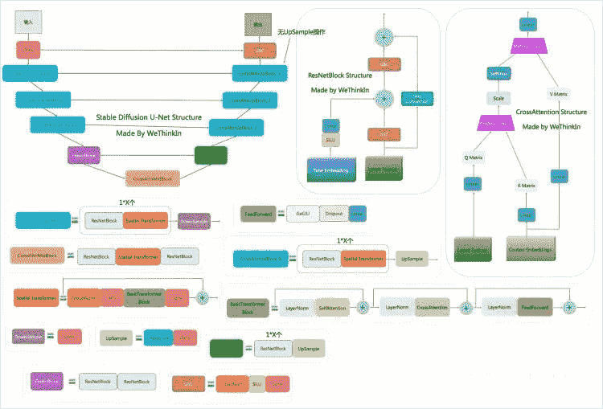


```python
class Unet(nn.Module):
    # 初始化函数，定义U-Net网络的结构和参数
    def __init__(
            self,
            dim,  # 基本隐藏层维度
            init_dim=None,  # 初始层维度，如果未提供则会根据dim计算得出
            out_dim=None,  # 输出维度，如果未提供则默认为输入图像的通道数
            dim_mults=(1, 2, 4, 8),  # 控制每个阶段隐藏层维度倍增的倍数
            channels=3,  # 输入图像的通道数，默认为3
            with_time_emb=True,  # 是否使用时间嵌入，这对于某些生成模型可能是必要的
            resnet_block_groups=8,  # ResNet块中的组数
            use_convnext=True,  # 是否使用ConvNeXt块而不是ResNet块
            convnext_mult=2,  # ConvNeXt块的维度倍增因子
    ):
        super().__init__()  # 调用父类构造函数
        # 确定各层维度
        self.channels = channels
        init_dim = default(init_dim, dim // 3 * 2)  # 设置或计算初始层维度
        self.init_conv = nn.Conv2d(channels, init_dim, 7, padding=3)  # 初始卷积层，使用7x7卷积核和padding
        dims = [init_dim, *map(lambda m: dim * m, dim_mults)]  # 计算每个阶段的维度
        in_out = list(zip(dims[:-1], dims[1:]))  # 创建输入输出维度对
        # 根据use_convnext选择块类
        if use_convnext:
            block_klass = partial(ConvNextBlock, mult=convnext_mult)
        else:
            block_klass = partial(ResnetBlock, groups=resnet_block_groups)
        # 时间嵌入层
        if with_time_emb:
            time_dim = dim * 4  # 时间嵌入的维度
            self.time_mlp = nn.Sequential(  # 时间嵌入的多层感知机
                SinusoidalPositionEmbeddings(dim),  # 正弦位置嵌入
                nn.Linear(dim, time_dim),  # 线性变换
                nn.GELU(),  # GELU激活函数
                nn.Linear(time_dim, time_dim),  # 再一次线性变换
            )
        else:
            time_dim = None
            self.time_mlp = None
        # 下采样层
        self.downs = nn.ModuleList([])
        self.ups = nn.ModuleList([])
        num_resolutions = len(in_out)  # 解析的层数
        # 构建下采样模块
        for ind, (dim_in, dim_out) in enumerate(in_out):
            is_last = ind >= (num_resolutions - 1)  # 是否为最后一层
            self.downs.append(
                nn.ModuleList(
                    [
                        block_klass(dim_in, dim_out, time_emb_dim=time_dim),  # 卷积块
                        block_klass(dim_out, dim_out, time_emb_dim=time_dim),  # 卷积块
                        Residual(PreNorm(dim_out, LinearAttention(dim_out))),  # 残差连接和注意力模块
                        Downsample(dim_out) if not is_last else nn.Identity(),  # 下采样或恒等映射
                    ]
                )
            )
        # 中间层（瓶颈层）
        mid_dim = dims[-1]
        # 第一个中间卷积块
        self.mid_block1 = block_klass(mid_dim, mid_dim, time_emb_dim=time_dim)
        # 中间层的注意力模块
        self.mid_attn = Residual(PreNorm(mid_dim, Attention(mid_dim)))
        # 第二个中间卷积块
        self.mid_block2 = block_klass(mid_dim, mid_dim, time_emb_dim=time_dim)

        # 构建上采样模块
        for ind, (dim_in, dim_out) in enumerate(reversed(in_out[1:])):
            is_last = ind >= (num_resolutions - 1)  # 是否是最后一次上采样，减2是因为我们需要留出一个输出层
            self.ups.append(
                nn.ModuleList(
                    [
                        # 卷积块，这里输入维度翻倍是因为上采样过程中会与编码器阶段的相应层进行拼接
                        block_klass(dim_out * 2, dim_in, time_emb_dim=time_dim),
                        # 卷积块
                        block_klass(dim_in, dim_in, time_emb_dim=time_dim),
                        # 残差和注意力模块
                        Residual(PreNorm(dim_in, LinearAttention(dim_in))),
                        # 上采样或恒等映射
                        Upsample(dim_in) if not is_last else nn.Identity(),
                    ]
                )
            )

        # 设置或计算输出维度，如果未提供则默认为输入图像的通道数
        out_dim = default(out_dim, channels)
        # 最后的卷积层，将输出维度变换到期望的输出维度
        self.final_conv = nn.Sequential(
            block_klass(dim, dim),  # 卷积块
            nn.Conv2d(dim, out_dim, 1)  # 1x1卷积，用于输出维度变换
        )

    # 前向传播函数
    def forward(self, x, time):
        # 初始卷积层
        x = self.init_conv(x)
        # 如果存在时间嵌入层，则将时间编码
        t = self.time_mlp(time) if exists(self.time_mlp) else None
        # 用于存储各个阶段的特征图
        h = []

        # 下采样过程
        for block1, block2, attn, downsample in self.downs:
            x = block1(x, t)  # 应用卷积块
            x = block2(x, t)  # 应用卷积块
            x = attn(x)  # 应用注意力模块
            h.append(x)  # 存储特征图以便后续的拼接
            x = downsample(x)  # 应用下采样或恒等映射

        # 中间层或瓶颈层
        x = self.mid_block1(x, t)  # 第一个中间卷积块
        x = self.mid_attn(x)  # 中间层的注意力模块
        x = self.mid_block2(x, t)  # 第二个中间卷积块

        # 上采样过程
        for block1, block2, attn, upsample in self.ups:
            # 拼接特征图和对应的编码器阶段的特征图
            x = torch.cat((x, h.pop()), dim=1)
            x = block1(x, t)  # 应用卷积块
            x = block2(x, t)  # 应用卷积块
            x = attn(x)  # 应用注意力模块
            x = upsample(x)  # 应用上采样或恒等映射

        # 最后的输出层，输出最终的特征图或图像
        return self.final_conv(x)
```

## ▐ 损失函数

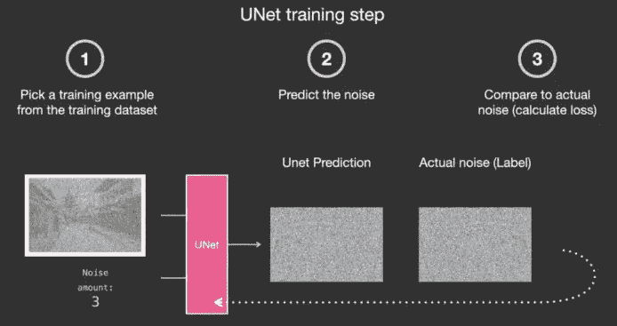

> 下面这段代码是为扩散模型中的去噪模型定义的损失函数。它计算由去噪模型预测的噪声和实际加入的噪声之间的差异。该函数支持不同类型的损失，包括L1损失、均方误差损失（L2损失）和Huber损失。选择适当的损失函数可以帮助模型更好地学习如何预测和去除生成数据中的噪声。

```python
import torch
import torch.nn.functional as F


# 定义损失函数，它评估去噪模型的性能
def p_losses(denoise_model, x_start, t, noise=None, loss_type="l1"):
    if noise is None:
        noise = torch.randn_like(x_start)

    # 使用q_sample函数生成带有噪声的数据x_noisy，这模拟了扩散模型的前向过程
    x_noisy = q_sample(x_start=x_start, t=t, noise=noise)
    # 使用去噪模型对噪声数据x_noisy进行预测，试图恢复加入的噪声
    predicted_noise = denoise_model(x_noisy, t)

    # 根据指定的损失类型计算损失
    if loss_type == 'l1':
        loss = F.l1_loss(noise, predicted_noise)
    elif loss_type == 'l2':
        loss = F.mse_loss(noise, predicted_noise)
    elif loss_type == "huber":
        loss = F.smooth_l1_loss(noise, predicted_noise)
    else:
        raise NotImplementedError()

    return loss
```

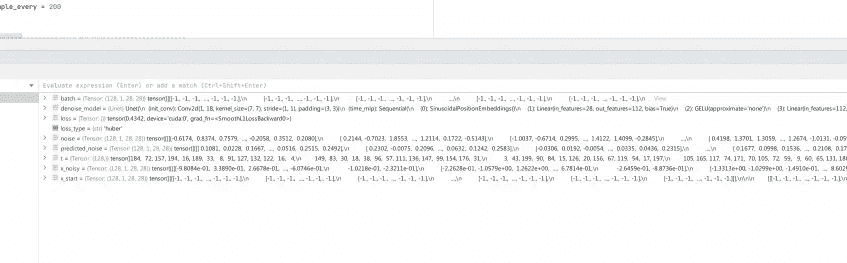

## ▐ 开始训练

```python
if __name__ == "__main__":
    for epoch in range(epochs):
        for step, batch in tqdm(enumerate(dataloader), desc='Training'):
            optimizer.zero_grad()
            batch = batch[0]

            batch_size = batch.shape[0]
            batch = batch.to(device)
            # 国内版启用这段，注释上面两行
            # batch_size = batch[0].shape[0]
            # batch = batch[0].to(device)

            # Algorithm 1 line 3: sample t uniformally for every example in the batch
            t = torch.randint(0, timesteps, (batch_size,), device=device).long()

            loss = p_losses(model, batch, t, loss_type="huber")

            if step % 50 == 0:
                print("Loss:", loss.item())

            loss.backward()
            optimizer.step()

            # save generated images
            if step != 0 and step % save_and_sample_every == 0:
                milestone = step // save_and_sample_every
                batches = num_to_groups(4, batch_size)
                all_images_list = list(map(lambda n: sample(model, batch_size=n, channels=channels), batches))
                all_images = torch.cat(all_images_list, dim=0)
                all_images = (all_images + 1) * 0.5
                # save_image(all_images, str(results_folder / f'sample-{milestone}.png'), nrow = 6)
                currentDateAndTime = datetime.now()
                torch.save(model, f"train.pt")
```
