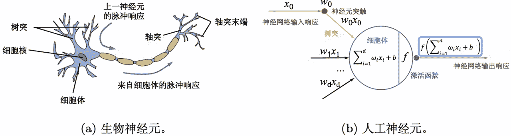
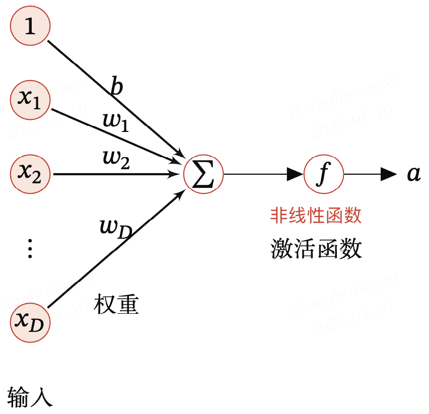
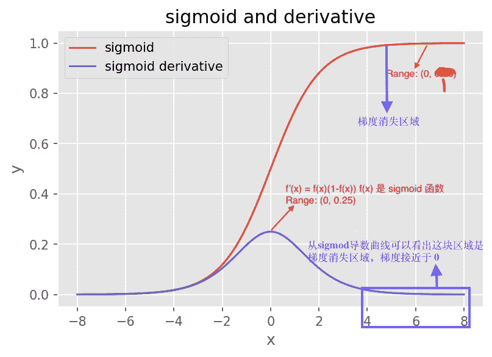
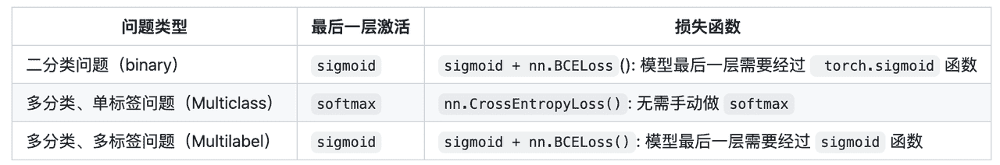
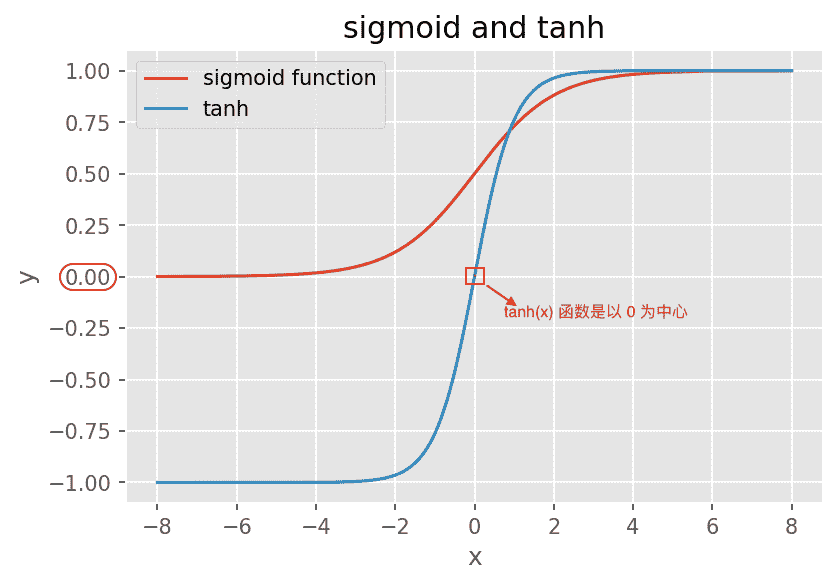
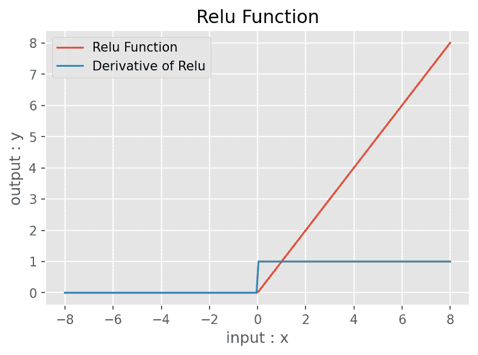
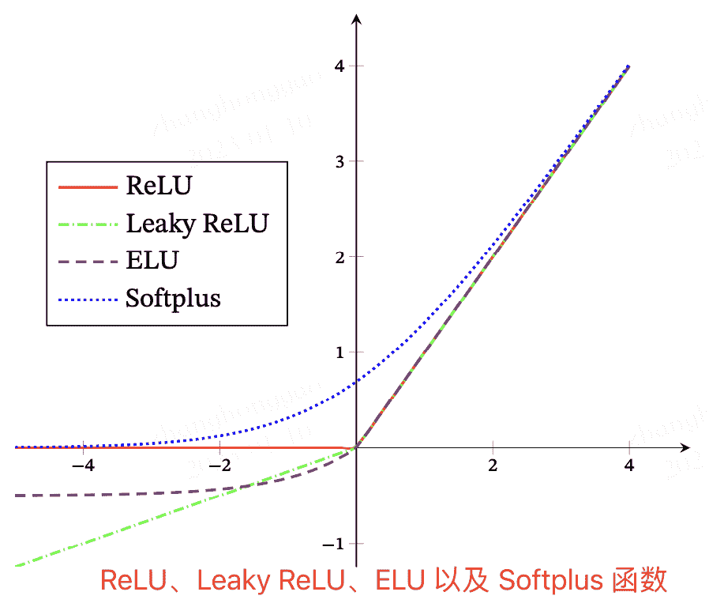
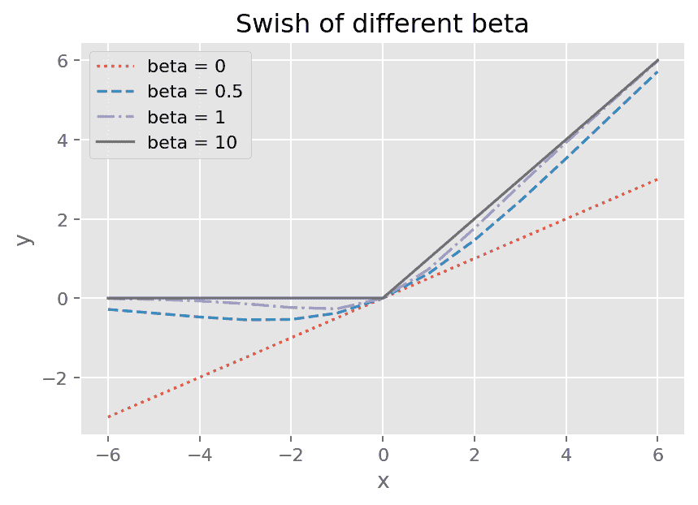
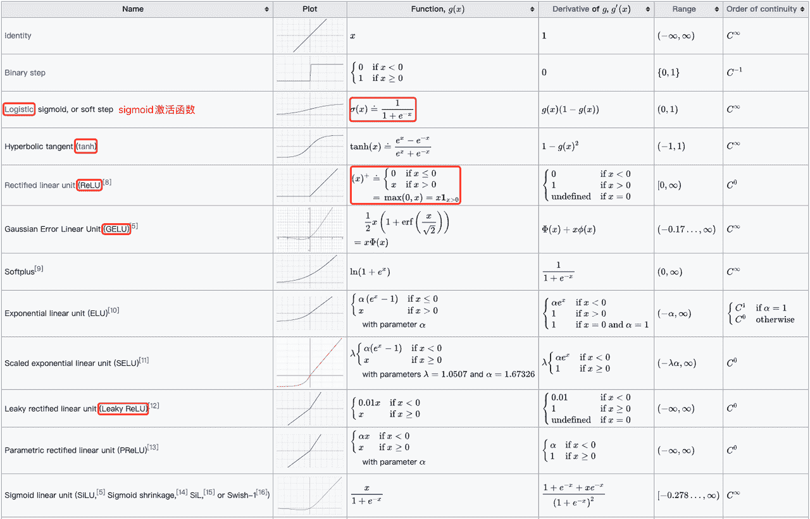

# 激活函数

> 来源：[https://qqs7y1hozd1.feishu.cn/docx/Lq73dsMi4osN52xuQ6bcfjdFnLe](https://qqs7y1hozd1.feishu.cn/docx/Lq73dsMi4osN52xuQ6bcfjdFnLe)

# **激活函数概述**

## **前言**

> **人工神经元(Artificial N**e**uron)，简称神经元(**Neuron)，是构成神经网络的基本单元，其主要是模拟生物神经元的结构和特性，接收一组输入信号并产生输出。

生物神经元与人工神经元的对比图如下所示：



从**机器学习****的角度来看**，神**经网络其实就是一个非线性模型，其基本组成单元为具有**非线性激活函数的神经元，通过大量神经元之间的连接，使得多层神经网络成为一种高度非线性的模型。神经元之间的连接权重就是需要学习的参数，其可以在机器学习的框架下通过梯度下降方法来进行学习。

> 深度学习一般指的是深度神经网络模型，泛指网络层数在三层或者三层以上的神经网络结构。

## **激活函数定义**

**激活函数（也称“非线性映射函数”），是**深度卷积神经网络模型中必不可少的网络层。

假设一个神经元接收 个输入 令向量   来表示这组输入，并用净输入(Net Input)  表示一个神经元所获得的输入信号 的加权和:

其中 是 维的权重矩阵， 是偏置向量。

以上公式其实就是**带有偏置项的线性变换**（类似于放射变换），本质上还是属于线形模型。为了转**换成非线性**模型，我们在净输入 后添加一个非线性函数 𝑓（即激活函数）。

由此，典型的神经元结构如下所示:



## **激活函数性质**

为了增强网络的表示能力和学习能力，激活函数需要具备以下几点性质:

+   连续并可导(允许少数点上不可导)的非线性函数。可导的激活函数可以直接利用数值优化的方法来学习网络参数

+   激活函数及其导函数要**尽可能的简单**，**有利于提高网络计算效率**

+   激活函数的导函数的**值****域要在一个合适的区间内**，不能太大也不能太小，否则会影响训练的效率和稳定性

# **Sigmoid ****型函数（挤压型激活函数）**

> Sigmo**id 型函数是指**一类 S 型曲线函数，为两端饱和函数。常用的 Sigmoid 型函数有 Logistic 函数和 Tanh 函数。

> **相关数学知识: **

+   对于函数  ，若  时，其导数  ，则称其为左饱和

+   若  时，其导数  ，则称其为右饱和。当同时满足左、右饱和时，就称为两端饱和。

## Logistic(sigmoid)函数

对于一个定义域在  中的输入，sigmoid 函数将输入变换为区间 (0, 1)** 上的输****出。因此，sigmoid 通常称为挤压函数(**squashing function): 它将范围 (-inf, inf) 中的任意输入压缩到区间 (0, 1) 中的某个值:

**sigmoid 函数常记作** 。**它的导数公式如下所示:**

sigmoid 函数及其导数曲线如下所示:



**可**以看出，sigmoid 函数连续，光滑、严格单调，以 (0,0.5) 中心对称，是一个非常良好的阈值函数。

当输入为 0 时，sigmoid 函数的导数达到最大值 0.25; 而输入在任一方向上越远离 0 点时，导数越接近 0，即当sigmoid 函数的输入很大或是很小时，它的梯度都会消失。

目前 sigmoid 函数在隐藏层中已经较少使用，**原因是 ****sigmoid**** 的软饱和性**，使得深度神经网络在过去的二三十年里一直难以有效的训练，如今其被更简单、更容易训练的 ReLU 等激活函数所替代。

当我们想要输出二**分类或多分类、多标签问题的概**率时，sigmoid 可用作模型最后一层的激活函数。

下表总结了常见问题类型的最后一层激活和损失函数：



> nn.BCEWithLogitsLoss() 函数等效于 sigmoid + nn.BCELoss

## **Tanh****函数**

Tanh（双曲正切）函数也是一种 Sigmoid 型函数，可以**看作放大并平移**的 Sigmoid 函数，公式如下所示：

利用基本导数公式，可得 Tanh 函数的导数公式（推导过程省略）:

Logistic 和 Tanh 两种激活函数的实现及可视化代码（复制可直接运行）如下所示:

```
# example plot for the sigmoid activation function
import numpy as np
from matplotlib import pyplot
import matplotlib.pyplot as plt

# sigmoid activation function
def sigmoid(x):
    &quot;&quot;&quot;1.0 / (1.0 + exp(-x))
    &quot;&quot;&quot;
    return 1.0 / (1.0 + np.exp(-x))

def tanh(x):
    &quot;&quot;&quot;2 * sigmoid(2*x) - 1
    (e^x – e^-x) / (e^x + e^-x)
    &quot;&quot;&quot;
    # return (exp(x) - exp(-x)) / (exp(x) + exp(-x))
    return 2 * sigmoid(2*x) - 1

def relu(x):
    return max(0.0, x)

def gradient_relu(x):
    &quot;&quot;&quot;1 * (x &gt; 0)&quot;&quot;&quot;
    if x &lt; 0.0:
        return 0
    else:
        return 1

def gradient_sigmoid(x):
    &quot;&quot;&quot;sigmoid(x)(1−sigmoid(x))
    &quot;&quot;&quot;
    a = sigmoid(x)
    b = 1 - a
    return a*b

def gradient_tanh(x):
    return 1 - tanh(x)**2

# 1, define input data
inputs = [x for x in range(-6, 7)]

# 2, calculate outputs
outputs = [sigmoid(x) for x in inputs]
outputs2 = [tanh(x) for x in inputs]

# 3, plot sigmoid and tanh function curve
plt.figure(dpi=100) # dpi 设置
plt.style.use(&#x27;ggplot&#x27;) # 主题设置

plt.plot(inputs, outputs, label=&#x27;sigmoid&#x27;)
plt.plot(inputs, outputs2, label=&#x27;tanh&#x27;)

plt.xlabel(&quot;x&quot;) # 设置 x 轴标签
plt.ylabel(&quot;y&quot;)
plt.title(&#x27;sigmoid and tanh&#x27;) # 折线图标题
plt.legend()
plt.show()
```

程序运行后得到的 Sigmoid 和 Tanh 函数曲线如下图所示:



以上代码的基础上，改下 plt.plot 函数的输入数据，同样可得到 Tanh 函数及其导数曲线图:

可以看出 Sigmoid 和 Tanh 函数在输入很大或是很小的时候，输出都几乎平滑且梯度很小趋近于 0，不**利于权重更新；不**同的是 Tanh 函数的输出区间是在 (-1,1) 之间，而且整个函数是以 0 为中心的，即他本身是零均值的，也就是说，在前向传播过程中，输入数据的均值并不会发生改变，这就使他在很多应用中效果能比 Sigmoid 优异一些。

**Tanh 函数优缺点总结**：

+   具有 Sigmoid 的所有优点。

+   exp 指数计算代价大。梯度消失问题仍然存在。

> Tanh 函数及其导数曲线如下所示:

> Tanh 和 Logistic 函数的导数很类似，都有以下特点:

+   当输入接近 0 时，导数接近最大值 1。

+   输入在任一方向上越远离0点，导数越接近0。

# **ReLU函数****及其变体（半线性激活函数）**

## **ReLU 函数**

ReLU(Rectified Linear Uni**t，修正线性单元)，****是目前深度神经网络中**最经常使用的激活函数，它保留了类似 step 那样的生物学神经元机制：输入超过阈值才会激发

**公式如下所示:**

以上公式通俗理解就是，ReLU 函数仅保留正元素并丢弃所有负元素。

**注意:** 虽然在 0 点不能求导，但是并不影响其在以梯度为主的反向传播算法中发挥有效作用。

> **优点:**

+   ReLU 激活函数**计算简单**；

+   具有**很好的稀疏性**，大约 50% 的神经元会处于激活状态。

+   **函数在 x** > 0 时导数为 1 的性质（左饱和函数），在一定程度上缓解了神经网络的梯度消失问题，加速梯度下降的收敛速度。

> 相关生物知识: 人脑中在同一时刻大概只有 1% ∼ 4% 的神经元处于活跃状态。

> **缺点:**

+   **ReLU 函数的输**出是非零中心化的，给后一层的神经网络引入偏置偏移，会影响梯度下降的效率。

+   Re**LU** 神经元在训练时比较容易“死亡”。如果神经元参数值在一次不恰当的更新后，其值小于 0，那么这个神经元自身参数的梯度永远都会是 0，在以后的训练过程中永远不能被激活，这种现象被称作“死区”

ReLU 激活函数的代码定义如下:

```
# pytorch 框架对应函数： nn.ReLU(inplace=True)
class ReLU(object):

    def func(self, x):
        return np.maximum(x, 0.0)

    def derivative(self, x):
        &quot;&quot;&quot;简单写法: return x &gt; 0.0&quot;&quot;&quot;
        da = np.array([1 if x &gt; 0 else 0 for x in a])
        return da     
```

ReLU 激活函数及其函数梯度图如下所示:



## Leaky ReLU/PReLU/ELU/Softplus 函数

> Leaky ReLU **函数**: 为了缓解“**死区**”现象，研究者将 ReLU 函数中 x < 0 的部**分调整为  ， 其**中  常设置为 0.01 或 0.001 数量级的较小正数。这种新型的激活函数被称作带泄露的 ReLU（Leaky ReLU）

>

> PReLU **函数****: 为****了****解决 L**eaky ReLU 中超参数 不易设定的问题，有研究者提出了参数化 ReLU(Parametric ReLU，PReLU)。参数化 ReLU 直接将  也作为一个网络中可学习的变量融入模型的整体训练过程。对于第  个神经元，PReLU 的 定义为:

>

> ELU **函数**: 2016 年，Clevert 等人提出的 ELU (Exponential Linear Units) 在小于零的部分采用了负指数形式。ELU 有很多优点，一方面作为非饱和激活函数，它在所有点上都是连续的和可微的，所以不会遇到梯度爆炸或消失的问题；另一方面，与其他线性非饱和激活函数（如 ReLU 及其变体）相比，它有着更快的训练时间和更高的准确性。

> **但是，与 ReLU 及**其变体相比，其指数操作也增加了计算量，即模型推理时 ELU 的性能会比 ReLU 及其变体慢。 ELU 定义如下:

>

> 

> 是一个超参数，决定 时的饱和曲线，并调整输出均值在 0 附近

> Softplus **函数**: Softplus 函数其导数刚好是 Logistic 函数.Softplus 函数虽然也具有单侧抑制、宽 兴奋边界的特性，却没有稀疏激活性。Softplus 定义为:

>

> 注意: R**eLU **函**数变体有**很多，但是实际模型当中使用最多的还是 ReLU 函数本身。

ReLU、Leaky ReLU、ELU 以及 Softplus 函数示意图如下图所示:



# **Swish 函数**

Swish** 函数是**一种自门控(Self-Gated)激活 函数，定义为：

其中 为 Logistic 函数， 可学习的参数或一个固定超参数。 可以看作一种软性的门控机制。当   接近于 1 时，门处于“开”状态，激活函数的输出近似于 本身；当 𝜎(𝛽𝑥) 接近于 0 时，门的状态为“关”，激活函数的输出近似于 0

**Swish**** ****函数代码定义如下：**

```
# Swish https://arxiv.org/pdf/1905.02244.pdf
class Swish(nn.Module):  #Swish激活函数
    @staticmethod
    def forward(x, beta = 1): # 此处beta默认定为1
        return x * torch.sigmoid(beta*x)
```

结合前面的画曲线代码，可得 Swish 函数的示例图：



**Swish 函数可以看作线性函数和 ReLU**** ****函数**之间的非线性插值函数，其程度由参数 控制。

# **激活函数总结**

常用的激活函数包括 ReLU 函数、sigmoid 函数和 tanh 函数。其标准代码总结如下（Pytorch 框架中会更复杂）

```
from math import exp

class Sigmoid(object):

    def func(self, x):
        return 1.0 / (1.0 + np.exp(-x))

    def derivative(self, x):
        return self.func(x) * (1.0 - self.func(x))

class Tanh(object):

    def func(self, x):
        return np.tanh(x)

    def derivative(self, x):
        return 1.0 - self.func(x) ** 2
    
class ReLU(object):

    def func(self, x):
        return np.maximum(x, 0.0)

    def derivative(self, x):
        return x &gt; 0.0

class LeakyReLU(object):

    def __init__(self, alpha=0.2):
        super().__init__()
        self.alpha = alpha

    def func(self, x):
        return np.array([x if x &gt; 0 else self.alpha * x for x in z])

    def derivative(self, x):
        dx = np.array([1 if x &gt; 0 else self.alpha for x in a])
        return dx

class Softplus(object):

    def func(self, x):
        return np.log(1 + np.exp(z))

    def derivative(self, x):
        return 1.0 / (1.0 + np.exp(-x))
```

下表汇总比较了几个激活函数的属性:

