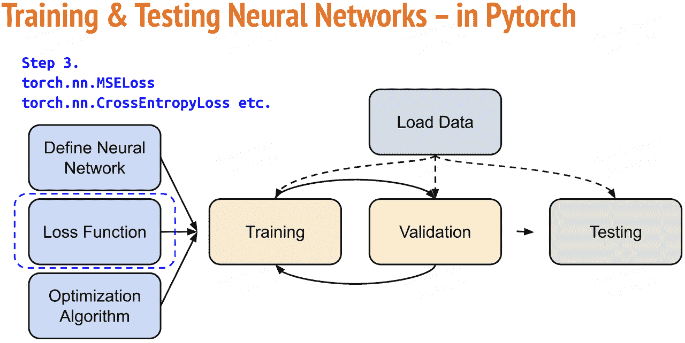
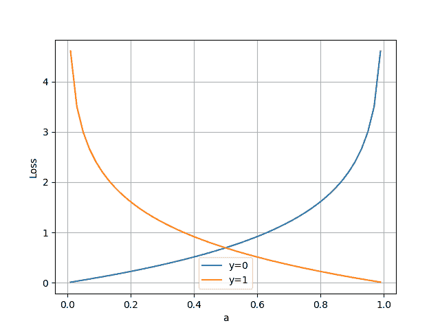
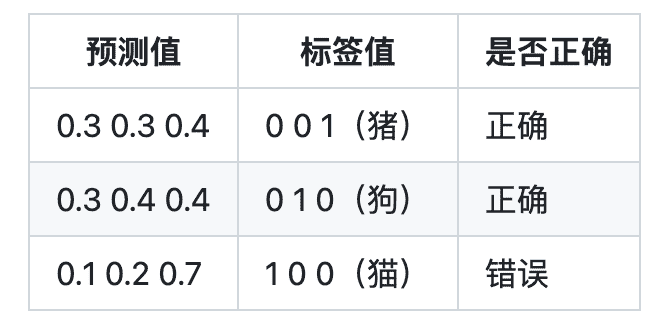
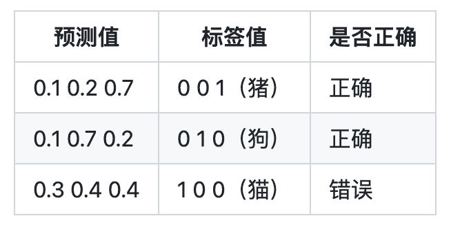
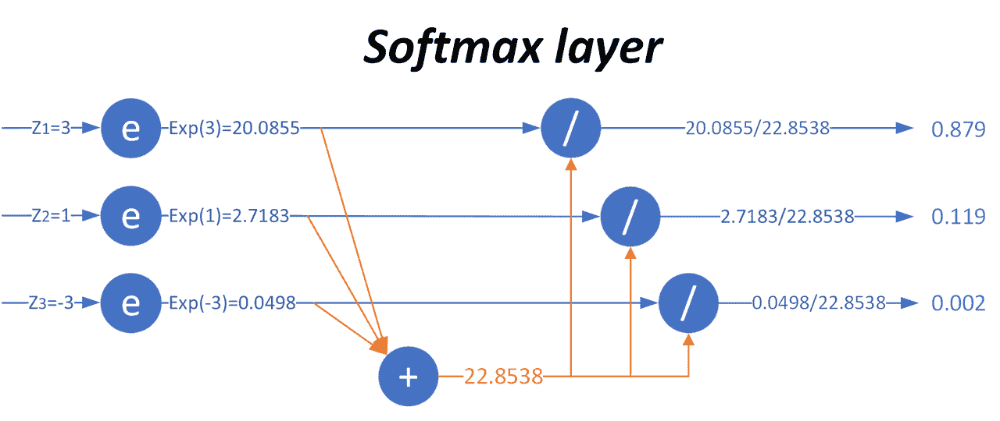
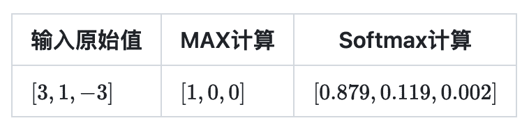
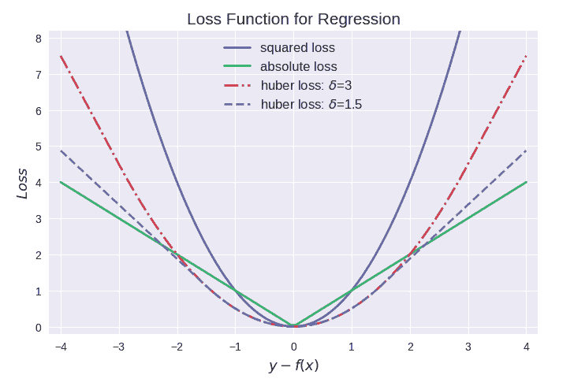
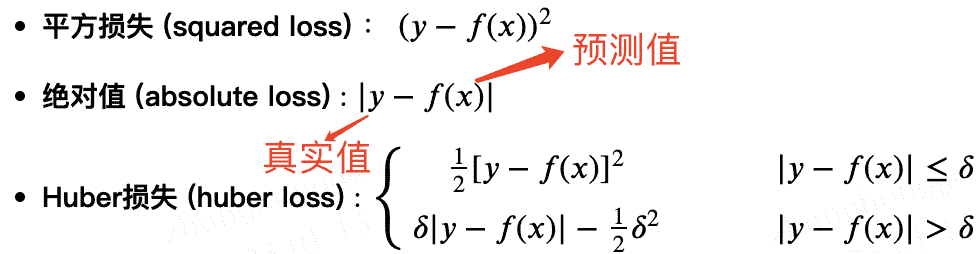

# 深度学习-损失函数

> 来源：[https://qqs7y1hozd1.feishu.cn/docx/H0nDdG4Vco6y3zx14yDcagYdnHh](https://qqs7y1hozd1.feishu.cn/docx/H0nDdG4Vco6y3zx14yDcagYdnHh)

# **损失函数概述**

**大多数深度学习算法都会涉及某种形**式的优化，所谓优化指的是改变 𝑥 以最小化或最大化某个函数 𝑓(𝑥) 的任务，我们通常以最小化 𝑓(𝑥) 指代大多数最优化问题。

在机器学习中，损失函数是代价函数的一部分，而代价函数是目标函数的一种类型。

+   **损失函数**（loss function）: 用于定义单个训练样本预测值与真实值之间的误差

+   **代价函数**（cost function）: 用于定义单个批次/整个训练集样本预测值与真实值之间的累计误差。

+   **目标函数**（objective function）: 泛指任意可以被优化的函数。

**损失函数定义**：损失函数是用来**量化模型预测和真实标签之间差异**的一个**非负实数函数**，其和优化算法紧密联系。深度学习算法优化的第一步便是确定损失函数形式。

**损失函数大致可分为两种：**

+   回归损失（针对连续型变量）

+   分类损失（针对离散型变量）

其在深度学习实验流程中的位置如下图所示：



**常用的减少损失函数的优化算法是“梯度下降**法”（Gradient Descent）

# **交叉熵函数-分类损失**

**交叉**熵损失(Cross-Entropy Loss) 又称为对数似然损失(Log-likelihood Loss)、对数损失，二分类时还可称之为逻辑斯谛回归损失(Logistic Loss)。

## 交叉熵（Cross-Entropy）

### **信息量**

> 《深度学习》中称为自信息(self-information) **。 在**本文中，我们总是用 来表示自然对数，其底数为

+   ** ****：表示一个事件**

+   ** **：表示事件 𝑥𝑗 发生的概率

+   ** ****：信息量，**** **越不可能发生时，它一旦发生后的信息量就越大

### **熵**

**信息量只处理单个的输出**。我们可以用熵（也称**香农熵** Shannon entropy）来对整个概率分布中的不确定性总量进行量化:

**则上面的问题的熵是：**  \begin{aligned} H(p)&=-[p(x_1) \ln p(x_1) + p(x_2) \ln p(x_2) + p(x_3) \ln p(x_3)] \\ &=0.7 \times 0.36 + 0.2 \times 1.61 + 0.1 \times 2.30 \\ &=0.804 \end{aligned}

### **相对熵(KL散度)**

相对熵又称 KL 散度，如果对于同一个随机变量 有两个单独的概率分布  和 ，则可以使用 KL 散度（Kullback-Leibl**er (KL) di**vergence）来衡量这两个分布的差异，这个相当于信息论范畴的均方差。

-

**KL散度的计算公式：**

> ** **为事件的所有可能性（分类任务中对应类别数目）

> ** ****的值越小，表示 **** ****分布和 **** ****分布越接近**

### **交叉熵**

**把上述交叉熵公式变形：**

等式的前一部分恰巧就是 的熵，等式的后一部分，就是**交叉熵**（机器学习中 表示真实分布（目标分布），  表示预测分布）:

**在****机器学习****中****，我们需要评**估标**签值  和预测值 之间的**差距**熵（即两个概率分布****之****间的**相似性），使用 KL 散度  即可，但因为样本标签值的分布通常是固定的，即  不变。

**因此，为了计算方便，在优**化过程中，只需要关注交叉熵就可以了

所以，在机器学习中一般直接用交叉熵做损失函数来评估模型。

-

其中， 是样本数， 是分类数。

有一类特殊问题，就是事件只有两种情况发生的可能**，比如**“是狗”和“不是狗”，称为 分类或二分类。

对于这类问题，由于  ，所以**二分类问题的单个样本的交叉熵**可以简化为：

**二分类对于批量样本的交叉熵**计算公式是：

### **熵、相对熵以及交叉熵总结**

交叉熵  也记作  、 ，其另一种表达公式（公式表达形式虽然不一样，但是意义相同）:

交叉熵函数常用于逻辑回归(logistic** regression)，也**就是分类(classification)

根据信息论中熵的性质，将熵、相对熵（KL 散度）以及交叉熵的公式放到一起总结如下:

## **二分类问题的交叉熵**

把二分类的交叉熵公式 4 分解开两种情况：

+   当  时，即标签值是 1 ，是个正例，加号后面的项为:

+   当 时，即标签值是 0，是个反例，加号前面的项为 0:

**横****坐**标是预测输出，纵坐标是损失函数值。 意味着当前样本标签值是1，当预测输出越接近1时，损失函数值越小，训练结果越准确。当预测输出越接近0时，损失函数值越大，训练结果越糟糕。此时，损失函数值如下图所示。



## **多分类问题的交叉熵**

当标签值不是非0即1的情况时，就是多分类了。

**假设希望根据图片动物的轮廓、**颜色等特征，来预测动物的类别，有三种可预测类别：猫、狗、猪。

假设我们训练了两个分类模型，**其预测结果如下:**

+   **模型1**:



**每**行表示不同样本的预测情况，公共 3 个样本。可以看出，模型 1 对于样本 1 和样本 2 以非常微弱的优势判断正确，对于样本 3 的判断则彻底错误。

+   **模型2**:



可以看出，**模型 2 对于样本 1 和样本 2** 判断非常准确（预测概率值更趋近于 1），对于样本 3 虽然判断错误，但是相对来说没有错得太离谱（预测概率值远小于 1）

结合多分类的交叉熵损失函数公式可得，模型 1 的交叉熵为:

**对所有样本的 ****loss**** 求平均:**

**模型 2 的交叉熵为:**

对所有样本的 loss 求平均:

可以看到，0.63 比 1.37 的损失值小很多，这说明预测值越接近真实标签值，即交叉熵损失函数可以较好的捕捉到模型 1 和模型 2 预测效果的差异。交叉熵损失函数值越小，反向传播的力度越小。

## PyTorch 中的 Cross Entropy

PyTorch 中常用的交叉熵损失函数为 torch.nn.CrossEntropyLoss

```
class torch.nn.CrossEntropyLoss(weight=None, size_average=None,
                                ignore_index=-100, reduce=None, 
                                reduction=&#x27;elementwise_mean&#x27;)
```

**函数功能**:

+   将输入经过 softmax 激活函数之后，再计算其与 target 的交叉熵损失。

+   即该方法将 nn.LogSoftmax() 和 nn.NLLLoss()进行了结合。

+   严格意义上的**交叉熵损失函数**应该是 nn.NLLLoss()

**参数解释**:

+   weight(Tensor)- 为每个类别的 loss 设置权值，常用于类别不均衡问题。weight 必须是 float 类型的 tensor，其长度要于类别 C 一致，即每一个类别都要设置有 weight。

+   size_average(bool)- 当 reduce=True 时有效。为 True 时，返回的 loss 为平均值;为 False 时，返回的各样本的 loss 之和。

+   reduce(bool)- 返回值是否为标量，默认为 True。

+   ignore_index(int)- 忽略某一类别，不计算其 loss，其 loss 会为 0，并且，在采用 size_average 时，不会计算那一类的 loss，除的时候的分母也不会统计那一类的样本。

### **Softmax多分类函数**

> **注意: Softmax 用作模型最后一层的函数通常和交叉熵作**损失函数配套搭配使用，应用于多分类任务。

+   **对于二分类问题，****我们使用 ****Logistic** 函数计算样本的概率值，从而把样本分成了正负两类。

+   **对于多分类问题，**则使用 Softmax 作为模型最后一层的激活函数来将多分类的输出值转换为范围在 [0, 1] 和为 1 的概率分布。

**Softmax 从字面****上**来说，可以分成 soft **和 max 两**个**部分。max 顾名思**义就是最大值的意思。Softmax 的核心在于 soft，而 soft 有软的含义，与之相对的是 hard 硬，即 herdmax。下面分布演示将模型输出值取 max 值和引入 Softmax 的对比情况。

-

+   **取max值（hardmax）**

假设模型输出结果 值是 ，如果取 max 操作会变成 **，这符合我们的分**类需要，即三者相加为1，并且认为该样本属于第一类。但是有两个不足：

1.  分类结果是 ，只保留非 0 即 1 的信息，即非黑即白，没有各元素之间相差多少的信息，可以理解是“Hard Max”；

1.  max 操作本身不可导，无法用在反向传播中。

+   **引入Softmax**

Softmax 加了个"soft"来模拟 max 的行为，但同时又保留了相对大小的信息

**上式中:**

+    是对第  项的分类原始值，即矩阵运算的结果

+    是参与分类计算的每个类别的原始值

+    是总分类数

+    是对第 项的计算结果

**和 hardmax 相比，Softmax 的含义就在于不再唯一的确定某一个最大值**，而是为每个输出分类的结果都赋予一个概率值（置信度），表示属于每个类别的可能性。

-

下图可以形象地说明 Softmax 的计算过程：



当输入的数据  是   时，按照图示过程进行计算，可以得出输出的概率分布是  。

对比 max 运算和 Softmax 的不同，如下表所示：



可以看出 Softmax 运算结果两个特点：

1.  三个类别的概率相加为 1

1.  每个类别的概率都大于 0

下面我再给出 hardmax 和 softmax 计算的代码实现：

```
# example of the argmax of a list of numbers
from numpy import argmax
from numpy import exp

# define data
data = [3, 1, -3]

def hardmax(data):
    &quot;&quot;&quot;# calculate the argmax of the list&quot;&quot;&quot;
    result = argmax(data) 
    return result

def softmax(vector):
    &quot;&quot;&quot;# calculate the softmax of a vector&quot;&quot;&quot;
    e = exp(vector)
    return e / e.sum()

hardmax_result = hardmax(data)
# 运行该示例返回列表索引值“0”，该值指向包含列表“3”中最大值的数组索引 [1]。
print(hardmax(data)) # 0

# convert list of numbers to a list of probabilities
softmax_result = softmax(data) 
print(softmax_result) # report the probabilities
print(sum(softmax_result)) # report the sum of the probabilitie
```

**运行以上代码后，输出结果如下:**

> 0 [0.87887824 0.11894324 0.00217852] 1.0

很明显程序的输出结果和我们手动计算的结果是一样的。

Pytorch 中的 Softmax 函数定义如下:

```
def softmax(x):
    return torch.exp(x)/torch.sum(torch.exp(x), dim=1).view(-1,1)
```

dim=1 用于 torch.sum() 对所有列的每一行求和，.view(-1,1) 用于防止广播。

## 为什么不能使用均方差做为分类问题的损失函数？

+   **回归问题通常用均方差损失函数，可以保**证损失函数是个凸函数，即可以得到最优解。

+   分类问题如果用均方差的话，损失函数的表现不是凸函数，就很难得到最优解。

+   **交叉熵函数可以保证区间内单调**。

分类问题的最后一层网络，需要分类函数，Sigmoid 或者 Softmax，如果再接均方差函数的话，其求导结果复杂，运算量比较大。用交叉熵函数的话，可以得到比较简单的计算结果，一个简单的减法就可以得到反向误差。

# **回归损失**

与分类问题不同，回归问题解决的是对具体数值的预测。

解决回归问题的神经网络一般只有只有一个输出节点，这个节点的输出值就是预测值。

**回归问题的一个基本概念是残差或称为预测误差**，用于衡量模型预测值与真实标记的靠近程度。

假设回归问题中对应于第  个输入特征 的**标签**为 ， 为标记向量总维度，则 即表示样本  上神经网络的回归预测值 ( ) 与其样本标签值在低 维的预测误差(亦称残差):

常用的两种损失函数为 MAE（也叫 L1 损失） 和 MSE 损失函数（也叫 L2 损失）。

## **MAE****损失**

**平均绝**对误差（Mean Absolute Error，MAE）是用于回归模型的最简单但最强大的损失函数之一。

因为**存在离群值**（与其余数据差异很大的值），所以回归问题可能具有本质上不是严格高斯分布的变量。 在这种情况下，平均绝对误差将是一个理想的选择，因为它没有考虑异常值的方向（不切实际的高正值或负值）

顾名思义，**MAE **是**目标值和预测值之差的绝对值之和**。

是数据集中数据点的总数，**其公式如下: **

## **MSE**** 损失**

均方误**差（Mean Square E**rror, MSE）几乎是每个数据科学家在回归损失函数方面的偏好，这是因为大多数变量都可以建模为高斯分布。

均方误差计算方法是求预测值与真实值之间距离的平方和。

预测值和真实值越接近，两者的均方差就越小。公式如下:

## **Huber** **损失**

MAE 和 MSE 损失之间的比较产生以下结果：

1.  MAE 损失比 MSE 损失更稳健。仔细查看公式，可以观察到如果预测值和实际值之间的差异很大，与 MAE 相比，MSE 损失会放大效果。 由于 MSE 会屈服于异常值，因此 MAE 损失函数是更稳健的损失函数。

1.  MAE 损失不如 MSE 损失稳定。由于 MAE 损失处理的是距离差异，因此一个小的水平变化都可能导致回归线波动很大。在多次迭代中发生的影响将导致迭代之间的斜率发生显著变化。总结就是，MSE 可以确保回归线轻微移动以对数据点进行小幅调整。

1.  **MAE 损失更新的梯度始终相同**。即使对于很小的损失值，梯度也很大。这样不利于模型的学习。为了解决这个缺陷，我们可以使用变化的学习率，在损失接近最小值时降低学习率。

1.  MSE 损失的梯度随损失增大而增大，而损失趋于0时则会减小。其使用固定的学习率也可以有效收敛。

Huber Loss 结合了 MAE 的稳健性和 MSE 的稳定性，本质上是 MAE 和 MSE 损失中最好的。

对于大误差，它是线性的，对于小误差，它本质上是二次的。

-

Huber Loss 的特征在于参数 。当 小于一个事先指定的值 \delta  时，变为平方损失，大于 \delta  时，则变成类似于绝对值损失，因此其是比较robust 的损失函数。其定义如下:

三种回归损失函数的曲线图比较如下：



三种回归损失函数的其他形式定义如下:



## **代码实现**

下面是三种回归损失函数的 python 代码实现，以及对应的 sklearn 库的内置函数。

```
# true: Array of true target variable
# pred: Array of predictions
def mse(true, pred):
    return np.sum((true - pred)**2)

def mae(true, pred):
    return np.sum(np.abs(true - pred))

def huber(true, pred, delta):
    loss = np.where(np.abs(true-pred) &lt; delta , 0.5*((true-pred)**2),delta*np.abs(true - pred) - 0.5*(delta**2))

    return np.sum(loss)

# also available in sklearn
from sklearn.metrics import mean_squared_error
from sklearn.metrics import mean_absolute_error
```