# CV人脸识别项目-从架构到应用细节

> 来源：[https://qqs7y1hozd1.feishu.cn/docx/Fz3gdXFoIoSK2uxEozscr7xznee](https://qqs7y1hozd1.feishu.cn/docx/Fz3gdXFoIoSK2uxEozscr7xznee)

## 1. 系统架构

人脸识别系统由采集子系统、解析子系统、存储子系统、比对子系统、决策子系统、管理子系统以及应用开放接口等组成，其系统架构下图所示。

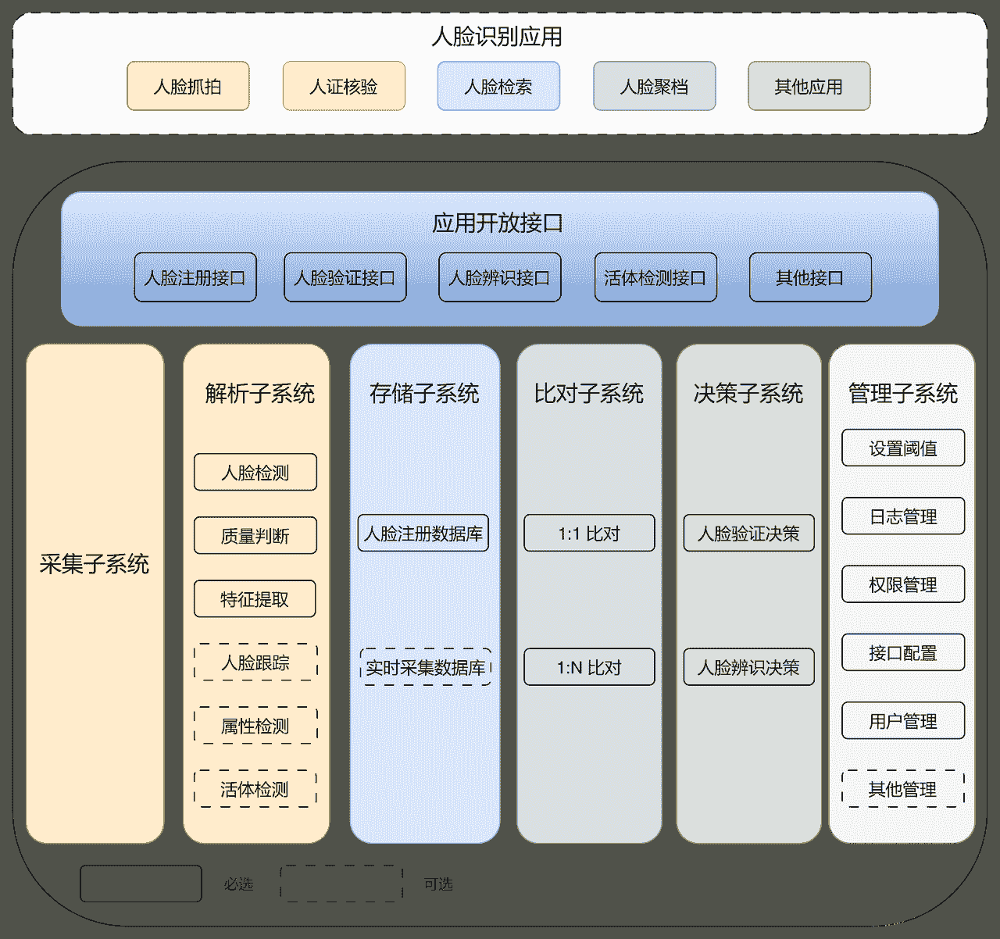

### 1.1 采集子系统

用于人脸图像或视频的采集，包括人脸采集设备以及执行人脸采集过程所需的任何子过程。

### 1.2 解析子系统

用于人脸图像或视频的处理，包括人脸检测、质量判断、特征提取、人脸跟踪、属性检测、活体检测等。

### 1.3 存储子系统

用于人脸注册数据及实时采集数据的存储，包括：

+   **人脸注册数据库：**用于注册数据的存储。

+   **实时采集数据库：**用于采集数据的存储。

###  1.4 比对子系统

**包括两种模式：**

+   **人脸验证模式：**现场人脸与指定的存储人脸进行比对（1:1比对），输出一个相似度得分；

+   **人脸辨识模式：**现场人脸与部分或全部的存储人脸进行比对（1:N比对），输出多个相似度得分，并根据相似度得分进行排序。

### 1.5 决策子系统

**根据一个或多个**相似度得分，对人脸识别提供决策结果，包括两种模式：

+   **人脸验证模式：**当相似度得分超过指定的阈值时，现场人脸和存储人脸匹配；

+   **人脸辨识模式：**当相似度得分超过指定的阈值时，对应的存储人脸构成了与现场人脸匹配的潜在候选者。

### 1.6 管理子系统

管理人脸识别系统的总体策略、执行和应用，包括但不限于：

> **设置阈值：**例如样本质量阈值，相似度阈值，活体检测阈值等；

> **日志管理：**日志生成、查询和导出等；

> **权限管理：**设置不同角色的操作权限等；

> **接口配置：**配置人脸识别系统的视图采集子系统等；

> **用户管理：**存储或删除用户的人脸等注册信息；

> **其他管理：**控制工作环境和非生物特征数据的存储、在视图采集时或采集后向用户提供反馈信息、与人脸识别应用进行交互管理等。

### 1.7 应用开放接口

人脸识别系统与人脸识别应用之间的接口，包括人脸注册接口、人脸验证接口、人脸辨识接口、活体检测接口等。

## 2.业务流程

人脸识别系统的核心业务流程包括人脸注册、人脸验证、人脸辨识等。

### 2.1 人脸注册

+   启动人脸注册过程；

+   根据人脸注册策略，采集用户数据，例如用户基本信息、人脸图像等；

+   解析子系统对采集的视图进行解析，例如质量判断和活体检测等；

+   将该用户的数据记录存储在人脸注册数据库；

+   结束注册过程，记录日志。

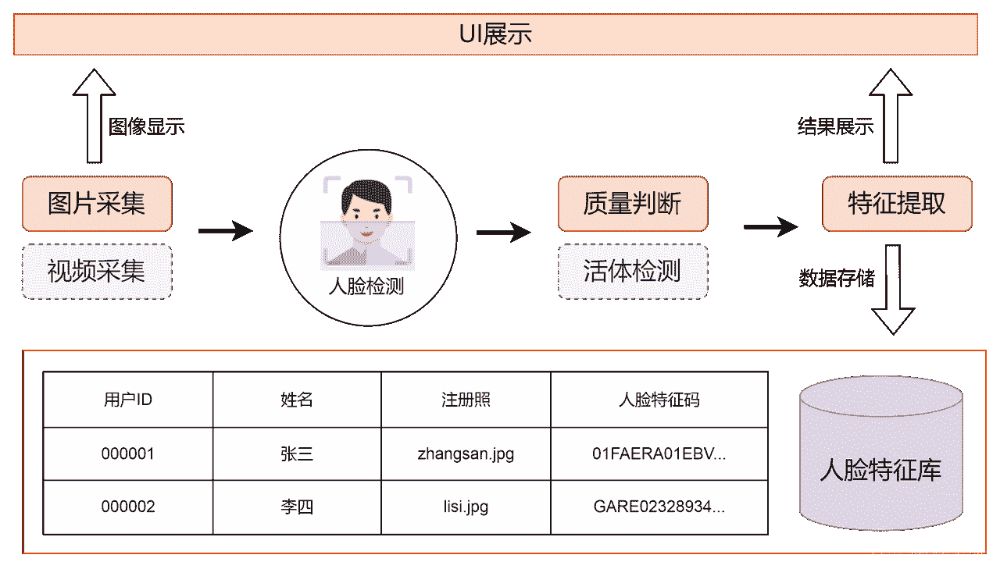

### 2.2 人脸验证

1.  启动人脸验证过程；

1.  读取身份证件中的人脸信息；

1.  采集人脸图像或视频；

1.  将现场人脸与身份证件中的人脸进行比对；

1.  依据系统策略及相似度得分，对人脸验证提供决策结果；

1.  将决策结果传输到人脸验证应用；

1.  结束验证过程，记录日志。

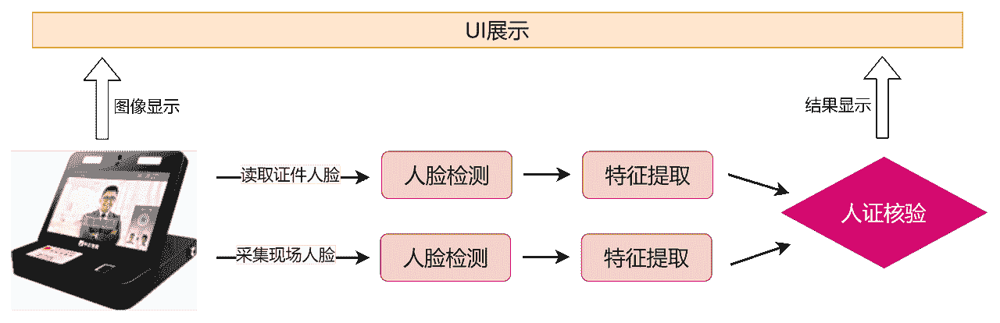

#### 2.2.1 作用

证明你是你。

#### 2.2.2 特点

匹配的特征极少

检验准确率稳定

依赖身份证件（身份证、护照、会员卡等）验证身份

#### 2.2.3 应用场景

适用于车站、机场、大型活动、机关单位、银行、酒店、网吧等人员流动频繁场所或其它重点场所中，以及线上开户，进出人员身份验证，核查人员真实身份。

### 2.3 人脸辨识

1.  启动人脸辨识过程；

1.  采集人脸图像或视频；

1.  将现场人脸与一个或多个存储人脸进行比对；

1.  依据系统策略及相似度得分，对人脸辨识提供决策结果；

1.  将决策结果传输到人脸辨识应用；

1.  结束辨识过程，记录日志。

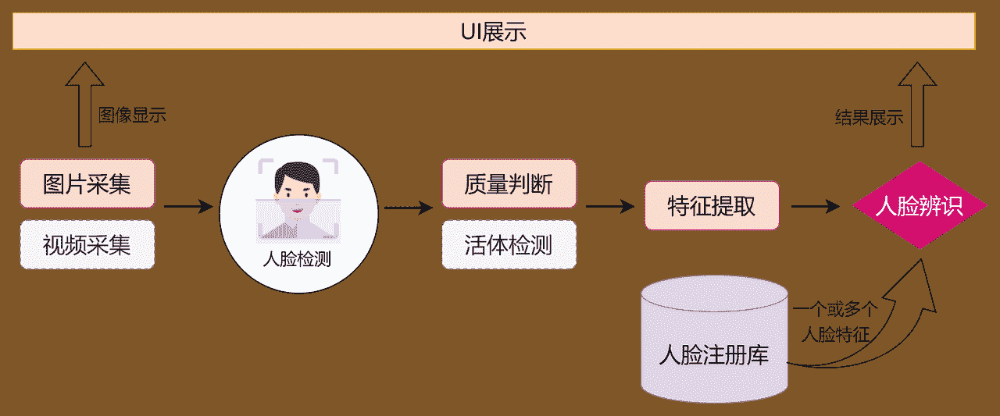

#### 2.3.1 作用

辨识你是谁。

#### 2.3.2 特点

不依赖身份证件信息（身份证、护照、会员卡等）

误识率会随着人脸底库的增加而升高

#### 2.3.3 应用场景

适用于社区、楼宇、工地、学校等较大规模的人脸考勤签到、人脸通行等应用场景，人脸注册到底库，检测到人脸后从人脸底库中检索出谁是谁。

## 3.技术方案

### 3.1 本地离线方案

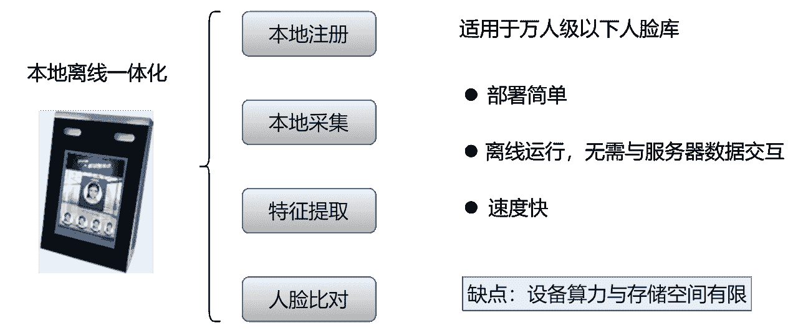

### 3.2 云端服务方案

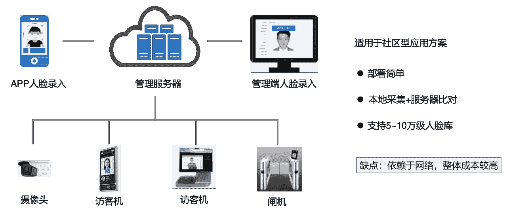

设备端负责数据采集，服务端负责人脸识别，根据不同的应用场景，有三种不同的实施方案如下：

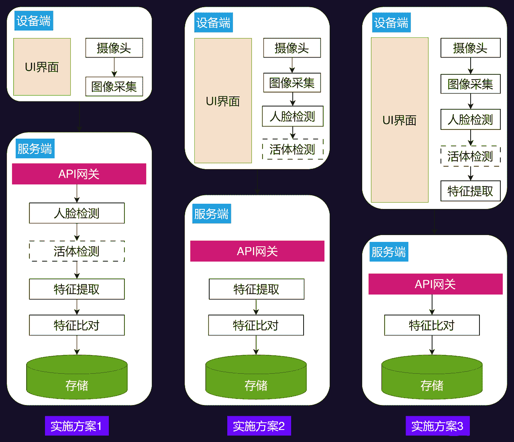

## 4.技术难点

人脸识别技术由于相似脸 、 年龄 、 算法偏见 、 面临的场景多样化以及人脸图像更易公开获取等原因 ， 技术本身也面临着一定的局限性。

### 4.1 相似脸较难解决

双胞胎或者长相很相近的人脸容易识别错误，而该问题在目前暂时没有新技术能完全解决。大部分情况下双胞胎仍能区分分数高低 ，但是往往都在阈值之上，在开放环境下应用效果较差。

### 4.2 算法偏见问题

由于当前人脸识别算法很大程度依赖于数据样本，但是不同人群的人脸数据样本存在差别，这导致了算法对不同地域、不同年龄人群的识别能力有差别。比如，小孩子，老年人以及其他很少出现的人种或者肤色的人脸识别率相对较低，该问题亟需解决 。

### 4.3 算法鲁棒性及性能问题

现有的人脸识别系统在用户配合、采集条件比较理想的情况下可以取得令人满意的结果。但是，在用户不配合 、采集条件不理想的情况下， 比如非限制条件下捕捉的人脸图像，远距离多姿态低像素拍摄的人脸图像，动态视频、模糊、低质量的人脸图像，会影响现有系统的识别率 。另外戴口罩情况下大部分算法的错误率会提高 1 个数量级以上。

### 4.4 年龄变化的影响

随着年龄的变化，面部外观也会变化 ，特别是对于青少年，这种变化更加明显。对于不同的年龄段，人脸识别算法的识别率也不同。

### 4.5 安全性问题

人脸识别系统信息存储同样会面临黑客的攻击，所以对数据加密很重要。随着技术的不断提升，人脸识别技术在安全性上需要加强 。

### 4.6 工程落地问题

如何合理安装摄像头的⻆度、高度以及降低光线干扰，如何提升用户体验。

## 5.人脸识别算法评价指标——TAR，FAR，FRR，ERR

### 定义

#### TPR和FPR

首先我们来看我们熟悉的TPR（True Positive Rate）和FPR(False Positive Rate)，TPR（True Positive Rate）和FPR(False Positive Rate)是二分类算法常用的评价指标，分别是真正例率和假正例率。他们都是基于混淆矩阵的度量标准。

**混淆矩阵**

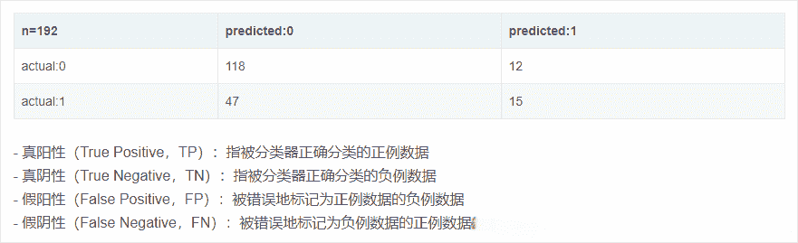

**下面我们来看看他们的怎么进行计算。

TP**R （True Positive Rate）为真正例率，也称召回率和灵敏性： 正确识别的正例数据在实际正例数据中的百分比。

FPR （Frue Positive Rate）为假正例率： 实际值是负例数据，预测错误的百分比。

#### TAR，FAR 和 FRR，ERR

**FAR**

接下来看人脸识别中的 常用的指标TAR和FAR。TAR（True Accept Rate）表示正确接受的比例，FAR（False Accept Rate）表示错误接受的比例。所谓的接受就是在进行人脸验证的过程中，两张图像被认为是同一个人。在网上到的了FAR（False Accept Rate）的计算方式如下：

对于人脸识别不太了解的小伙伴可能不太了解上面公式的意思，下面我就来解释一下。做人脸验证的时候我们会给出两张图像让算法判断两张图片是不是同一个人的。一般是先将两张图片表示成两个高维的特征向量，然后计算两个特征向量的相似度或者距离。在这里定义FAR时使用的是相似度，公式中分数就是指的相似度。在比较的过程中我们希望同一个人的图像相似度比较高，不同人的相似度比较低。我们会给定一个相似度阈值T，比如0.6, 如果两张图像的相似度大于T我们就认为两张图片是一个人的，如果小于T我们就认为两证图像 是不同人的。但是无论将T设置成什么样值都会有一定得错误率，就是FAR，因为我们提取的图像的特征向量总是不够好，并不总能 满足：同一个人的图像相似度比较高，不同人的相似度比较低。偶尔也会出现不同人的图像的相似度大于给定的阈值T，这样我们就会犯错误接受的错误。FAR就是我们比较不同人的图像时，把其中的图像对当成同一个人图像的比例。我们希望FAR越小越好。

**TAR**

TAR（True Accept Rate）表示正确接受的比例。所谓的就是在进行人脸验证的过程中，两张图像被认为是同一个人。我在网上并没有查到TAR的定义，在这里我参照FAR的定义猜测一下，不一定正确，如有错误还望批评指正。

参考上面对 FAR的解释，我们知道对相同人的图片对进行比较也会出现相似度小于阈值T的情况，这是我们就会犯错误，这个错误就是FRR( False Reject Rate),就是把相同的人的图像当做不同人的了，这个下面我们再讲。可以理解 TAR就是对相同人的图片对进行比较，我们计算出的相似度大于阈值的图像对所占的比例。我们希望TAR越大越好。

**FRR**

上面讲解TAR的时候，提到了FRR（False Reject Rate）就是错误拒绝率。就是把相同的人的图像当做不同人的了。有了上面的基础，FRR就很好理解了：

根据上述公式的定义，我们知道  FRR + TAR = 1 ，

FAR和FRR的定义可以概括如下：

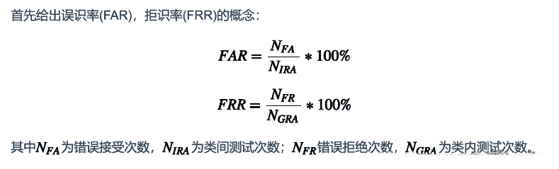

**EER**

EER(Equal Error Rate)即等误率。

EER为 取某个T值时，使得FAR=FRR 时，的FAR或FRR值。

一般画两条曲线，看看交点。

下面以二分类问题来理解一下怎么看EER。在介绍EER之前，首先简单介绍一下混淆矩阵和ROC曲线。

**混淆矩阵**

针对预测值和真实值之间的关系，我们可以将样本分为四个部分，分别是：

真正例（True Positive，TP）：预测值和真实值都为1

假正例（False Positive，FP）：预测值为1，真实值为0

真负例（True Negative，TN）: 预测值与真实值都为0

假负例（False Negative，FN）：预测值为0，真实值为1

我们将这四种值用矩阵表示(图片引自《machine learning：A Probabilistic Perspective》)：

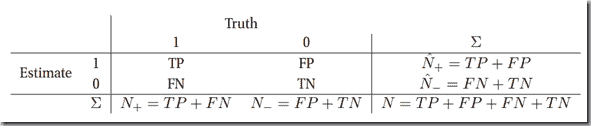

上面的矩阵就是混淆矩阵。

**ROC曲线**

通过混淆矩阵，我们可以得到真正例率（True Positive Rate , TPR）：

我们还可以得到假正例率(False Positive Rate , FPR):

可以看到，TPR也就是我们所说的召回率，那么只要给定一个决策边界阈值clip_image002[7]，我们可以得到一个对应的TPR和FPR值，然而，我们不从这个思路来简单的得到TPR和FPR，而是反过来得到对应的clip_image002[9]，我们检测大量的阈值clip_image002[7]，从而可以得到一个TPR-FPR的相关图，如下图所示（图片引自《machine learning：A Probabilistic Perspective》）：

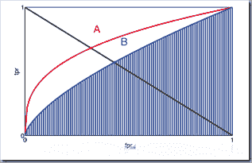

图中的红色曲线和蓝色曲线分别表示了两个不同的分类器的TPR-FPR曲线，曲线上的任意一点都对应了一**个t(阈值)值。该曲**线就是ROC曲线（receiver operating characteristic curve）。该曲线具有以下特征：

+   一定经过（0,0）点，此时t=1，没有预测为P的值，TP和FP都为0

+   一定经过（1,1）点，此时t=0，全都预测为P

+   最完美的分类器（完全区分正负样例）：（0,1）点，即没有FP，全是TP

+   曲线越是“凸”向左上角，说明分类器效果越好

+   随机预测会得到（0,0）和（1,1）的直线上的一个点

+   曲线上离（0,1）越近的点分类效果越好，对应着越合理的t

从图中可以看出，红色曲线所代表的分类器效果好于蓝色曲线所表示的分类器。

**利用ROC的其他评估标准**

AUC(area under thecurve)，也就是ROC曲线的下夹面积，越大说明分类器越好，最大值是1，图中的蓝色条纹区域面积就是蓝色曲线对应的 AUC

EER（equal error rate），也就是FPR=FNR的值，由于 ， 可以画一条从（0,1）到（1,0）的直线，此时的横坐标是FNR。找到交点，图中的A、B两点。曲线交点对应的横坐标是FPR，黑色直线对应的横坐标是FNR，此时FPR等于FNR，假正率等于假负率，即等误率（EER）。

## 6.PCA运用于人脸识别

### 6.1预处理

Tips：预处理包括数据导入处理、求均值去心化、分解协方差矩阵得到特征向量（特征脸）

#### 6.1.1 数据导入与处理

利用imread批量导入人脸数据库，或直接load相应mat文件，并在导入时不断将人脸拉成一个个列向量组成reshaped_faces，本实验取出每个人的前30%作为测试数据，后70%作为训练数据。

```
clear;
% 1.人脸数据集的导入与数据处理（400张图，一共40人，一人10张）
%%%%%%%%%%%%%%%%%%%%%%%%%%%%%%%%%%%%%%%%%%%%
reshaped_faces=[];
for i=1:40    
    for j=1:10       
        if(i&lt;10)
           a=imread(strcat(&#x27;C:\AR_Gray_50by40\AR00&#x27;,num2str(i),&#x27;-&#x27;,num2str(j),&#x27;.tif&#x27;));     
        else
            a=imread(strcat(&#x27;C:\AR_Gray_50by40\AR0&#x27;,num2str(i),&#x27;-&#x27;,num2str(j),&#x27;.tif&#x27;));  
        end          
        b = reshape(a,2000,1); %将每一张人脸拉成列向量
        b=double(b); %utf-8转换为double类型，避免人脸展示时全灰的影响       
        reshaped_faces=[reshaped_faces, b];  
    end
end
 
% 取出前30%作为测试数据，剩下70%作为训练数据
test_data_index = [];
train_data_index = [];
for i=0:39
    test_data_index = [test_data_index 10*i+1:10*i+3];
    train_data_index = [train_data_index 10*i+4:10*(i+1)];
end
 
train_data = reshaped_faces(:,train_data_index);
test_data = reshaped_faces(:, test_data_index);
```

#### 6.1.2 数据集求均值与数据中心化

利用mean函数对训练集求平均值，得出平均脸，将训练集中所有数据减去平均脸，实现中心化（中心化后某些人脸，相对原图灰度值更低）。

```
% 2.图像求均值，中心化
%%%%%%%%%%%%%%%%%%%%%%%%%%%%%%%%%%%%%%%%%%%
 
% 求平均脸
mean_face = mean(train_data,2);
%waitfor(show_face(mean_face)); %平均脸展示，测试用
 
% 中心化
centered_face = (train_data - mean_face);
%用于展示中心化后某些训练图片 测试用
%waitfor(show_faces(centered_face));
```

#### 6.1.3 求协方差矩阵、特征值与特征向量并排序

根据数学推导，协方差矩阵可由cov_matrix = centered_face（中心化人脸数据集） * centered_face'求得，再利用eig函数基于特征值对协方差矩阵进行分解（或使用SVD），并用sort函数将特征向量按从大到小排序好，得到所有特征脸

Tips：一个特征脸即一个特征向量，数据集中所有人脸都是由某些特征脸组合得到，故利用特征向量（特征脸）是后续实现人脸重构、识别、降维可视化的关键。

### 6.2人脸重构

**重构的意义：**检测特征脸对人脸的还原度与维数的关系（数据降到多少维才能较好还原原始数据）

从已中心化的centered_faces中取出某人脸，用20,40,60,80,...,160个投影（前n个特征向量）按公式rebuild_face = eigen_faces * (eigen_faces' * single_face) + mean_face来重构此人脸，并观察在不同数量的投影下的还原度。

### 6.2人脸识别

Tips：本实验中有两个变量，k从1~6取值，维度从10~160，探究k值及维度对识别率的共同影响

分别对测试集、训练集进行降维，将人脸投影到10，20，30，…，160维空间中，计算未知人脸与所有已知人脸的距离（欧几里得距离），然后使用最近邻分类器KNN进行识别

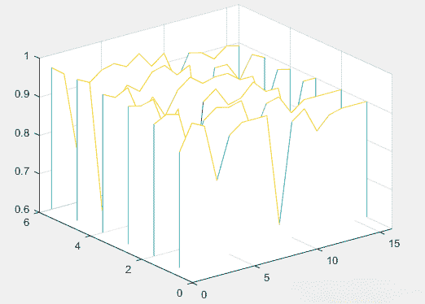

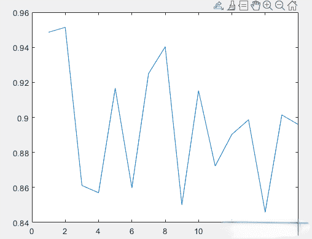

### 6.3人脸图像降维与可视化

**取**出对应数量的特征脸（n维取n个），利用公式projected_test_data = eigen_faces' * (test_data - mean_face)对测试集或其他子集进行投影，投影后上色（同人同色）并使用scatter画图实现可视化

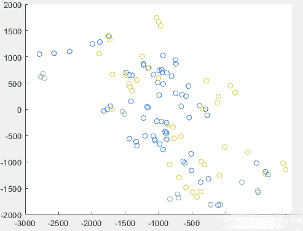

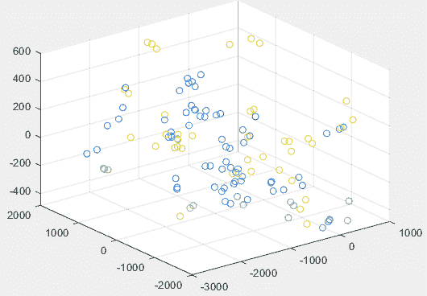