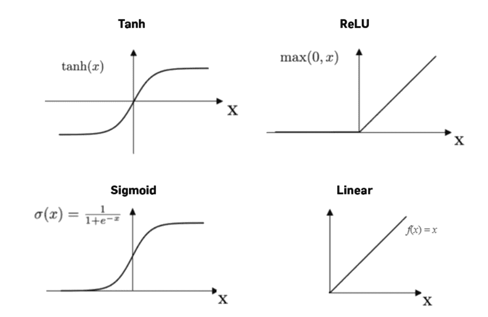
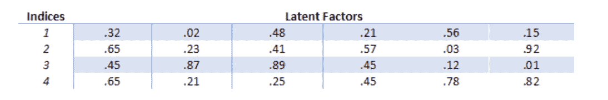

# 深度学习面试常见问题

> 来源：[https://qqs7y1hozd1.feishu.cn/docx/FzQpdOD3joYopsxHyphcUsJin4c](https://qqs7y1hozd1.feishu.cn/docx/FzQpdOD3joYopsxHyphcUsJin4c)

# 机器学习和深度学习有什么区别？

+   **机器学习依靠人类来学习**。人类通过确定**特征的层次结构**来确定**数据输入之间的差异**。它通常需要更多结构化的数据来学习。

+   深度学习使流程中的大部分特征提取部分实现自动化。它消除了所需的人工干预。

+   与深度学习相比，**机器学习对数据量的依赖性较小**。

+   深度学习需要**大量数据**才能达到**高精度**。需要花费数天或数周的时间训练数千或数百万个数据点才能得到可接受的精确模型。

# 什么是集成方法以及它们在深度学习中有何用处？

+   **集成方法用于提高模型的泛化能力**。这些方法既适用于深度学习，也适用于机器学习算法。

+   神经网络中引入的一些集成方法是Dropout和Dropconnect。模型的改进取决于数据类型和神经结构的性质。

# 深度学习机器学习有哪些优势？

+   如果数据集足够大，深度学习比机器学习能提供更好的性能。

+   深度学习不需要模型设计者**对特征自省有丰富的领域理解**。如果没有进行特征工程，深度学习会比其他方法更出色。

+   当涉及图像分类、自然语言处理和语音识别等复杂问题时，深度学习确实很强大。

# 为什么随着输入更多数据的增加，深度学习的性能会提高？

+   **深度学习**的最大优势之一是它能够从原始数据中自动提取特征。

+   当输入学习算法的**数据数量增加时**，将会有更多的边缘情况被考虑，因此算法将学会在这些边缘情况下做出正确的决策。

# 深度学习和人工神经网络有什么区别？

+   当研究人员**开始创建大型人工神经网络时**，他们开始使用**“深度”**这个词来指代它们。

+   随着深度学习这个术语开始被使用，人们普遍理解它代表深度人工神经网络，而不是浅层人工神经网络。

+   **深度人工神经网络和深度学习****通常是同一回事**，并且大多互换使用。

# 如何为深度学习模型选择激活函数？

+   **如果要预测的输出是真实的**，那么使用**线性激活函数**是有意义的。

+   **如果要预测的输出是二元类的概率**，则应该使用**Sigmoid** 函数。

+   **如果要预测的输出有两个类**，那么可以使用**Tanh** 函数。

+   ReLU 函数由于计算简单，可用于许多不同的情况。

# 集成系统如何帮助增量学习？

+   **增量学习**是指算法从先前可用的数据集生成分类器之后可能出现的新数据中学习的能力。

+   如果某个算法针对**一系列训练数据集产生一系列假设**，其中当前假设描述迄今为止已看到的所有数据，但仅取决于先前的假设和当前的训练数据，则该算法被称为增量学习算法。

+   基于集成的系统可以通过在每个可用的数据集上训练一个额外的分类器（或一组额外的分类器）来解决此类问题。

# 为什么要使用嵌入层？

神经网络嵌入克服了表示分类变量的常用方法的一个限制：独热编码，独热编码向量是高维和稀疏的。

例如，假设我们正在进行自然语言处理（NLP）并且有一个词典2000。这意味着，当使用独热编码时，每个单词将由一个包含整数的向量表示2000。1999这些整数中都是零。在大数据集中，这种方法在计算上效率不高。

层嵌入的起源来自词嵌入，我们以这句话为例：

> “深度学习非常深”

> 使用嵌入层的第一步是通过索引对这个句子进行编码。在本例中，我们为每个唯一单词分配一个索引。

> 句子看起来如下：

> 1 2 3 4 1

接下来创建嵌入矩阵。我们决定为每个索引分配多少个“潜在因子32”。

基本上，这意味着我们希望向量有多长。一般用例是长度像和这样的长度50。让我们6在这个例子中为每个索引分配潜在因子以保持其可读性。

嵌入矩阵然后看起来像这样：（在Keras中，嵌入层用随机权重初始化）

因此，**我们可以使用嵌入矩阵来使每个向量的大**小更小，而不是最终得到巨大的独热编码向量。简而言之，所发生的一切就是单词“ deep ”由一个向量表示。[.32, .02, .48, .21, .56, .15]

但是，并不是每个单词都会被向量替换。相反，它会被用于在嵌入矩阵中查找向量的索引替换。同样，当使用非常大的数据集时，这种方法在计算上是高效的。

# 如何知道你的模型是否受到梯度消失问题的影响？

+   **模型在训练阶段会改进得非常慢，**并且训练也有可能很早就停止，这意味着任何进一步的训练都无法改善模型。

+   更接近模型输出层的权重将经历更大的变化，而更接近输入层的层不会发生太大变化（如果有的话）。

+   在训练模型时，**模型权重呈指数缩小并变得非常小**。

+   模型权重进入0训练阶段。

# 如何知道你的模型是否遭受梯度爆炸的问题？

> 有一些细微的迹象表明你在网络训练期间可能遭受梯度爆炸，例如：

+   该模型无法利用您的训练数据（例如损失不佳）

+   模型不稳定，导致每次更新时的损失变化很大。

+   **模型损失**NaN**在训练期间发生**。

> 如果你遇到了这些类型的问题，你可以深入挖掘一下，看看是否存在梯度爆炸的问题。

> 你可以使用一些不太明显的迹象来确认是否存在梯度爆炸：

+   在训练过程中，模型权重很快变得非常大。

+   **模型权重在**NaN**训练期间变为值**。

+   1.0在训练期间，每个节点和层的误差梯度值始终高于该值。