# 多模态大模型——万字梳理视觉自回归图像生成

> 来源：[https://qqs7y1hozd1.feishu.cn/docx/AVpAdvYtoohiaQxSZy4c6mjLnYf](https://qqs7y1hozd1.feishu.cn/docx/AVpAdvYtoohiaQxSZy4c6mjLnYf)

> 目前利用多模态大模型进行图像生成主要有以下两种形式：

1. LLM作为conditioner：利用MLLM依据用户输入的text prompt来生成条件信息，条件信息被注入到下游生成模型进行更精细化的生成控制。这种形式通常需要外接一个额外专门的多模态生成模型，例如Stable Diffusion、DALLE-3、GLIGEN等。条件信息的形式通常是文本，通过利用MLLM对用户输入的text prompt进行润色，润色后输出的新的text prompt作为diffusion的文本条件，来生成更加复杂精美的图片。或者通过利用MLLM依据用户输入的text prompt生成layout信息，其中layout以文本形式指明物体类别和以bounding box形式指明物体位置

1. LLM作为generator：利用LLM不断生成image token完成生成的过程，根据近年的发展，我将其简单分为下面三类

+ visual autoregressive：SEED、SEED-X、DreamLLM｜ Unified IO、Unified IO2、Chameleon、Lumina-mGPT、ANOLE
+ visual scale autoregressive：VAR、STAR
+ visual diffusion：Transfusion、Show-o

## visual autoregressive

+ visual autoregressive指的是完全跟随大语言模型next-token prediction的autoregressive generation的想法，将图片的生成建模成一个接一个图片patch进行causal prediction的过程
+ 在这种设置下，图像原本的continuous feature会借助VQ-GAN离散化为visual vocabulary (codebook) 中discrete visual feature，就可以统一text和image的学习，都采用`CE` loss去训练预测下一个token在各自vocabulary中的`idx`

## Non-native

### SEED

> 通过为LLM配备一个精心设计的discrete image tokenizer将图像离散化，统一了图像和文本表征输入LLM的形式都可以采用同样的next-token prediction的形式对text-to-image生成和image-to-text任务进行训练，完成生成和理解的统一

> 设计的原则包括：

1. `discrete image token`应该具备1D causal dependency，以兼容目前decoder-only LLM的单向注意力的结构
1. `discrete image token`应该像`text token`一样具备高层语义信息，以避免text和`image`的语义不对齐，为了实现上述原则，提出了`SEED tokenizer`，由5个部分组成：`ViT encoder`、`Causal Q-Former`、`VQ Codebook`、`Reverse Q-Former`、`UNet Decoder`。其中`ViT encoder`和`UNet decoder`都直接采用预训练的模型并冻结（分别来自`BLIP-2`和`Stable Diffusion`）

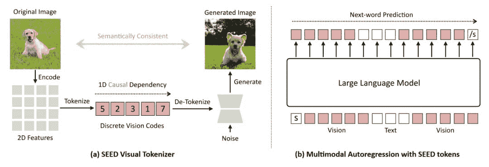

+ `Causal Q-Former`用于将`ViT`抽取出的具有2D dependency的图像特征转化为具有1D causal dependency的特征，然后会用`VQ codebook`将其离散化，得到具有1D causal dependency的`discrete token`
+ 此时的`discrete image token`就可以和`text token`拼接输入到`LLM`中进行图像理解以完成image-to-text的文本生成任务
+ 对于`text-to-image`的图像生成任务，则直接将`text token`输入到`LLM`中，以`next-token prediction`的方式预测出`discrete image token`，这些输出的`image token`将会作为条件信息输入到`UNet Decoder`进行生成，为了保证语义一致性，需要配备一个`Reverse Q-Former`，将输出的token转化为符合`Stable Diffusion condition`的分布（取代`SD`中的`text condition`，因此形式为77 tokens）

为了能够保证离散化后`image token`的语义正确性，需要先进行`SEED tokenizer`的训练，该过程将会采用两阶段方式进行，需要text-image pair数据集，主要依赖于图文对齐任务：

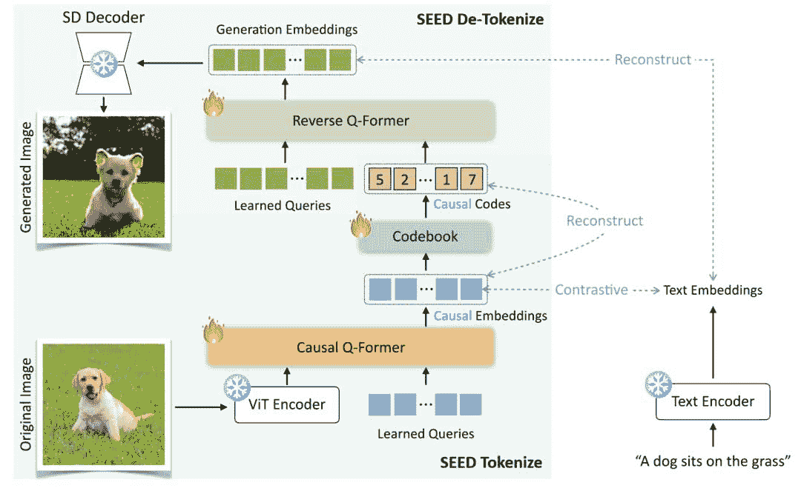

+ 第一阶段训练`Causal Q-Former`：`Causal Q-Former`的输入为`Vision encoder`提取出的图像特征和一系列`learnable query`。query之间采用`causal self-attention`的方式进行交互，以实现causal dependency，并且会通过`cross-attention`层和图片特征交互，因此输出的`learnable query`聚合了一系列图像特征。然后用对比学习的方式，最大化图片last causal embedding和图片对应的caption text feature的cosine similarity。（这里的1D causal dependency感觉是假的1D causal dependency，因为和图片特征的交互仍然是full-attention的，所以前面的query也可能和后面的query一样包含object同个part的信息，比如包含头上部分和头下部分，这样就仍然具有因果关系）
+ 第二阶段训练`VQ Codebook`和`Reverse Q-Former`：
+ 先将`Causal Q-Former`输出的一系列`learnable query`通过`Codebook`量化成一系列`discrete code`（前后数量保持不变），然后再利用multi-layer transformer去依据`discrete code`重建出量化前continuous causal embeddings，此处损失为重建前后的cosine similarity
+ `Reverse Q-Former`将会含有77个`learnable query token`，彼此进行full self-attention的交互，并且Quantization后产生的`discrete causal code`通过cross attention进行交互，得到聚合了图像信息的77个`learnable query token`，然后和`Stable Diffusion`的计算出对应caption text feature计算`MSE loss`

> 完成了`SEED tokenizer`的训练后，可以假定此时得到的`discrete image token`已经是有意义的，含有图片信息的feature了，此时可以接入`LLM`中，在image-text pair上进行text-to-image和image-to-text任务的自回归训练：

+ image-to-text：将`Causal Q-Former`输出的token通过一个`FC`层对齐到`word embedding`，然后和“a photo of a”进行拼接，输入到`LLM`中，进行后续对图片的文本描述的生成。
+ text-to-image：将“Generate an image”作为prefix和对应的caption进行拼接，输入到`LLM`中，要求其自回归的输出`image token`（以``引导），其next-token prediction的监督为配对图片经过`ViT encoder`、`Causal Q-Former`、`VQ Codebook`后得到的`discrete code`。（这点可以理解为`SEED tokenizer`在进行图像生成训练时`UNet Decoder`已经学会了依据`ViT encoder`、`Causal Q-Former`、`VQ Codebook`后得到的`discrete code`进行生成，因此这里想要生成图片，则可以认为最好的condition就是上述的`discrete code`，因此用它们来作为监督。）

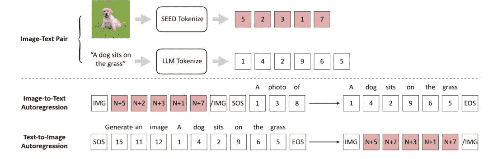

> 至此，模型就可以通过输入图片完成文本生成相关任务（VQA、Caption、Retrieve）或者通过输入文本描述来生成图片。但可以发现，`SEED`框架仅是完成了多模态生成的部分任务，无法输入图文交替数据，也无法生成图文交替数据

### SEED-X

> `SEED-X`是对`SEED`模型的进一步拓展，通过改变visual tokenizer机制并且在更丰富的数据集上进行预训练，可以覆盖更多的现实生活使用场景，包括图像编辑、交替的图文生成等等

在架构上相比于`SEED`主要具有以下改变：

+ 抛弃了discrete image tokenizer的思路，采用`ViT vision encoder`作为continuous tokenizer，以提高多模态理解任务效果
+ 通过使用两阶段不同粒度condition注入策略来预训练visual tokenizer
+ 采用next-token prediction来监督text生成任务，用feature regression loss来监督图像生成任务

也就是说`SEED-X`此时的visual tokenizer仅仅具有`ViT encoder`和`UNet decoder`，将`ViT`提取image feature并对齐的过程称之为Visual tokenize，将`UNet decoder`依据image feature进行图像生成（重建）的过程叫做de-tokenize。`SEED-X`不像`SEED`去执行三个不同训练任务，而是完全依赖图像重建任务去优化visual tokenizer

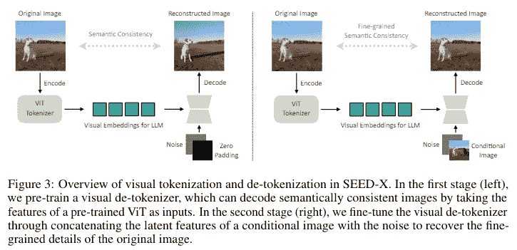

visual tokenizer预训练的重建任务分为两个阶段：

+ 第一个阶段是以vision encoder输出的visual embeddings作为condition来重建原图

具体来说，`ViT`输出的特征将会通过average pooling聚合减少成64个token，然后通过在`UNet decoder`中插入的额外可学习的cross-attention，让这64个token实现与生成过程进行交互，完成条件信息的注入，此时还会额外放开`UNet decoder`中所有的keys和value。

+ 第二个阶段是额外添加image作为condition来重建原图

利用`Stable Diffusion`本身的`VAE encoder`将image编码到latent space然后和noise进行通道维度上的拼接，由于拼接上额外的输入，因此`UNet`的input channel将会扩大两倍，额外的channel和原本的channel在该阶段都会进行训练。此时`ViT`提供high-level的feature，而额外的image提供low-level feature，让visual tokenizer能够更好地学会重建。

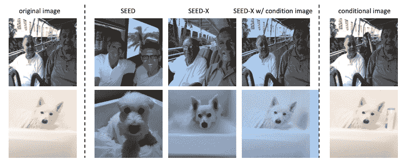

> 由于抛弃了discrete image tokenizer直接采用`ViT`作为continuous image tokenizer，`SEED-X`生成图片不再是通过`LLM`进行next-token prediction来逐个预测condition embedding，而是需要生成图片时，在输入的最后拼接上固定数量的`learnable query`，这些`learnable query`通过`LLM`处理，聚合了text instruction信息后，作为condition输入到`UNet decoder`中进行图片的生成。在多模态预训练时也无法再使用next-token prediction来监督图像生成任务，而是利用`ViT`输出的feature作为condition embedding的`GT`，进行feature `MSE` regression

> 这点也是比较make sense的，在`SEED-X visual tokenizer`的预训练阶段，已经通过微调`UNet Decoder`让其能够依据`ViT feature`作为condition来生成对应正确图片，那么就可以认为要生成图片的`ViT feature`就是`UNet Decoder`所需要的最好的condition。那在图像生成任务训练过程中，我们有image-text pair，输入caption，输出对应预测的图像 condition feature，就应该让预测的condition feature和image的`ViT condition feature`越接近越好。而对于编辑任务，我们有image-edit image-edit instruction，输入image和edit instruction，输出对应预测的编辑图像 condition feature，就应该让就应该让预测的编辑图像 condition feature和edit image的`ViT condition feature`越接近越好

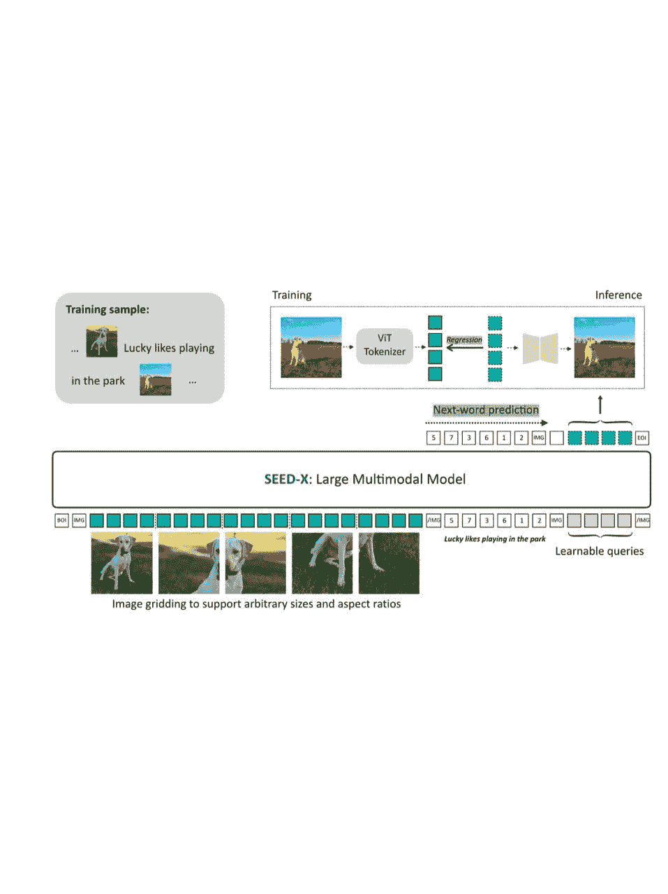

### DreamLLM

从对比的角度来看，`DreamLLM`与上述两个工作最主要的差别在于使用Diffusion生成相关的损失来监督图像的训练，`DreamLLM`认为通常`CLIP-ViT`捕捉的都是模态共享的、全局的特征，将`ViT feature`作为`GT`，会使得`MLLM`生成和理解也更加全局化。因此采用了Diffusion生成的loss来作为生成训练的监督

> 该方法的主要的技术点如下：

+ `DreamLLM`采用continuous embedding的方式来对image进行tokenize
+ 采用一系列`learnable query`，通过聚合之前所有信息来作为当前图像生成的condition
+ 通过分数蒸馏的条件合成损失来监督图像生成部分的训练，不具有tokenizer预训练过程，`SD`全过程frozen

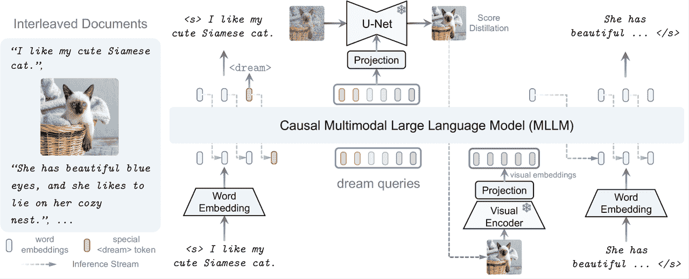

第一点和第二点和`SEED-X`并没有太大的差别，因此不过多赘述，看图就可以理解

+ 对于第三点，具体来说，`DreamLLM`将会在图文交替数据集上进行预训练，当到了生成图片的时候，会要求先预测出一个`<dream>`的special token代表需要开始生成图片，随后会拼接上一系列`learnable query`称之为`dream queries`，该`dream queries`将以causal decode的形式聚合之前生成的文本和图片的信息：


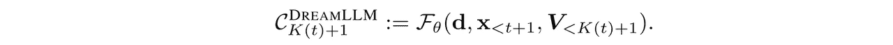

+   然后output dream queries将会作为SD的condition进行图像生成，此时采用噪声预测loss来监督condition的质量

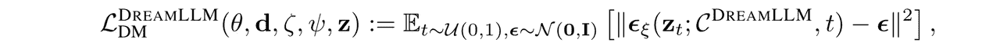

可以看到为了提升理解任务上的性能，后续的方案大多都重新换回了continuous tokenizer，同样因为这个原因，此时image token的生成就不再是next-token prediction了，而是依赖于一系列预定义好的learnable query作为输出，并行理解并输出得到生成模型的condition，此时甚至都有点偏离了visual autoregressive的定义，更像是visual image autoregressive，为了更清楚展示一些发展的脉络，因此还是把SEED-X和DreamLLM放在了此处进行介绍

# Native
可以看到上面我们提到的3个方案都还是需要额外的生成模型例如Stable Diffusion介入，而且LLM输出的image token都是作为condition甚至不能说是真的“image token”，更像是经过LLM处理后对齐的text feature，不能说是LLM真的在生成图片，因此我称上面的为“Non-native”非原生生成，而下述的两个方案，就偏向于原生的生成，无需下游生成模型

## Lumina-mGPT
> Unified IO、Unified IO2、Chameleon是我们在上一章所谈过的三个多模态基座模型，旨在通过一个统一的transformer完成对各个模态的encode和decode，完成各种各样的任务，其中就包括图像生成，它们都是以next-token prediction的形式生成image token并且直接通过vocabulary来decode image token完成生成。在上一篇中，我们比较详细地介绍了Unified IO、Unified IO2、Chameleon，此处不再赘述

> Unified IO、Unified IO2、Chameleon并没有强调自己是为了增强图像生成能力，而ANOLE和Lumina-mGPT主要是进一步增强这些unified transform的图像生成能力，希望能够优化生成图像的质量和灵活性（更多分辨率，更多长宽比）。具体来说，Lumina-mGPT直接采用Chameleon预训练好的模型，然后进行了采用了10M的高质量数据对图像生成任务进行额外的学习，同时为了实现任意分辨率、长宽比的生成加入了以下techs：

+   在image embedding中插入了用来表示height/width的预定义指示符
+   图片每行token embedding末尾会插入一个`<end-of-line>`的特殊token
+   渐进分辨率文生图监督训练：
+   预定义了三个不同分辨率阶段：512、768、1024，每个阶段面积基本接近预定义值，但是长宽比有所差异
+   为了让用户之后可以自定义要生成图片的分辨率，每个训练样本会插入一个resolution-aware prompt
+   该过程还会额外插入OpenHermess中text-only数据和Mini-Gemini中image-text pair数据防止灾难性遗忘

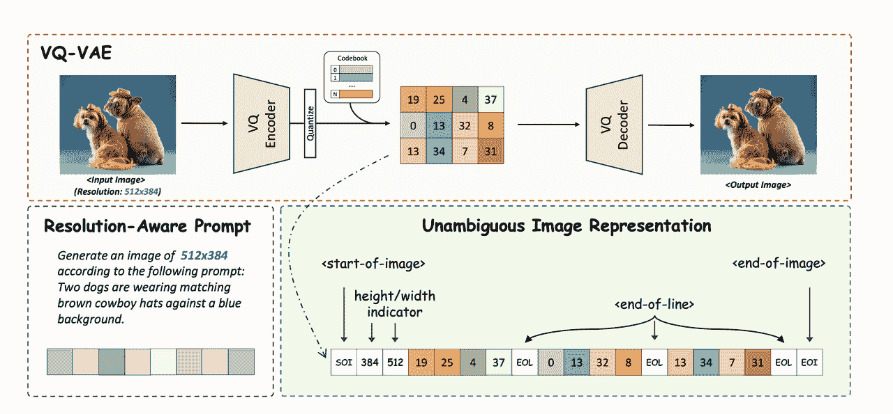

## ANOLE
目前开源的chameleon并不支持除text外的其他模态生成，而ANOLE提出一个简单的数据和参数高效的方式去对chameleon进行微调，以实现不妥协文本生成和其他模态理解的情况下，拥有多模态生成能力。ANOLE是基于chameleon的，因此具有Native（原生）多模态模型、完全基于token无需diffusion介入生成过程的优点，是为了解决开源的chameleon没有开放图文交替生成的问题

具体来说：ANOLE保持和chameleon结构一致，并且冻结chameleon大部分预训练权重，只微调`lm_head`中和image token idx预测相关的部分权重，微调数据集来自于LAION-5B art中5859张图片

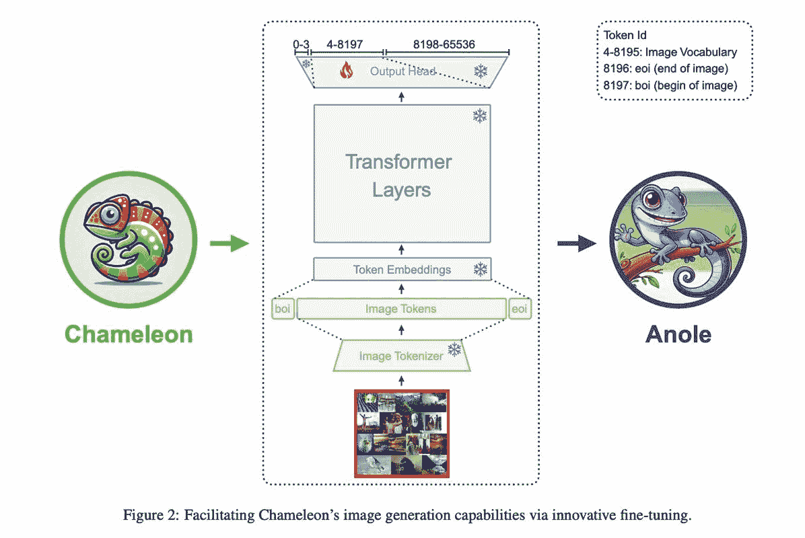

# Visual Scale Autoregressive
+   visual autoregressive这种建模方式对于图像来说似乎不是一种很自然的方式，图像是一个2D的输入数据，visual autoregressive是直接将其拉成1D进行建模，并且这种建模顺序也没有特定的说法，默认都是从左上角按顺序逐个生成直到右下角，但直觉上从外向内或者从内向外螺旋逐个生成也是合理的

+   Visual Scale Autoregressive提供了一种更自然地建模图像的方式，每次autoregressive生成的图像token不再代表生成图像某个位置的patch feature，而是代表该图片在某个分辨率下的生成效果。因此Visual Scale Autoregressive在每个预定的分辨率下会并行的生成多个token，需要一个多尺度的VQ-VAE保证各个分辨率下都能重建出图片

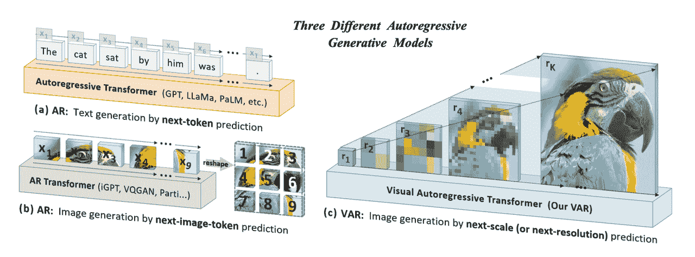

## VAR
+   而VAR就是Visual Scale Autoregressive的开山之作，具体来说，VAR会训练一个具有K个尺度的VQVAE，一张图片通过这样multi-scale VQVAE就可以得到K个Token map，每个Token map具有不同的分辨率

+   每次自回归的进行是通过输入前`k-1`个token map拼接后的结果来预测第`k`个尺度下的token map。也就是说从原来输入逐个token拼接预测得到单独的下一个token，变成了每次自回归输入拼接上前一个尺度的token map，然后预测得到下一个分辨率的token map，token map中的  个tokens将会被并行预测出来

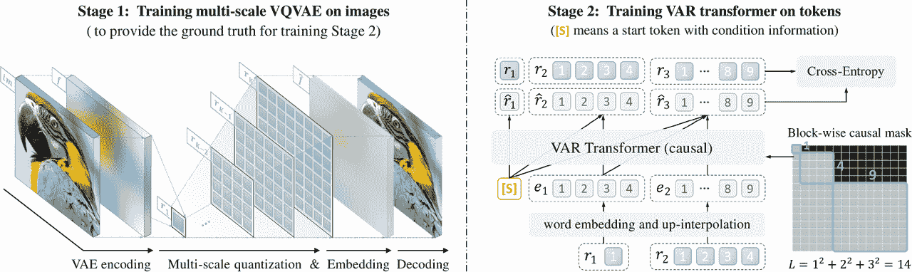

> 对于该multi-scale VQVAE的构造，作者采用了残差设计的思想，而不是每个尺度单独重建恢复原图，也就是说原图的特征会被分解成多个尺度量化后token的组合。具体流程如下：

+   将原来image continuous feature离散化成对应第 k 个尺度下的 hk×wk 的token map
+   对该token map进行插值和变换，对齐原始image feature的空间分辨率大小 H×W
+   从image feature中减去该尺度插值后的token map，表示已经重建恢复一定部分内容，剩下待重建的内容作为下一个尺度重建内容的目标

> 此时VQ-GAN进行decode重建时，也需要利用残差的思想，将所有尺度的重建结果进行组合

+   对每个尺度的token map进行插值和变换，对齐原始image feature的分辨率
+   累积该token map重建的部分

通过上述quantize + dequantize过程可以完成图像的重建，以实现multi-scale VQVAE的训练。由于采用的discrete image tokenizer，因此可以使用CE loss的方式以实现VAR transformer的训练

上述过程随之而来一个问题就是，当生成图片的时候，一定需要所有尺度都生成完成，才可以完成最后输出图片的累积吗？例如一开始只有一个`<boi>`，然后生成1x1 token map再生成2x2 token map，再生成3x3 token map，再生成5x5 token map，最后组合前面四个结果得到最终生成的图？如果是的话，那推理是怎么控制一次并行输出多个scale token的？

我们对应到`def autoregressive_infer_cfg()`用于自回归代码部分可以发现，确实是需要逐个scale自回归生成，但并不是像训练一样，每次尺度的token map预测都需要`concat`上之前尺度的预测，而是对上一个尺度输出token map插值到下一次scale生成对应所需要的分辨率，此时每次transformer的输入仅仅只有当前需要产生的尺度，类似于将上一个尺度插值得到的粗糙结果进行清晰化

```
f_hat, next_token_map = self.vae_quant_proxy[0].get_next_autoregressive_input(si, len(self.patch_nums), f_hat, h_BChw) 
    # ===================== get_next_autoregressive_input: only used in VAR inference, for getting next step's input =====================def get_next_autoregressive_input(self, si: int, SN: int, f_hat: torch.Tensor, h_BChw: torch.Tensor) -> Tuple[Optional[torch.Tensor], torch.Tensor]: # only used in VAR inferenceHW = self.v_patch_nums[-1]if si != SN-1:h = self.quant_resi[si/(SN-1)](F.interpolate(h_BChw, size=(HW, HW), mode='bicubic'))     # conv after upsamplef_hat.add_(h)return f_hat, F.interpolate(f_hat, size=(self.v_patch_nums[si+1], self.v_patch_nums[si+1]), mode='area')else:h = self.quant_resi[si/(SN-1)](h_BChw)f_hat.add_(h)return f_hat, f_hat
```

实验上主要做的class-conditional synthesis，以class embedding作为`[s]` start token放在序列最开始，用以引导后面各个尺度的生成，并且会用`AdaNorm`对class condition进行增强，还会对`query`、`keys`进行norm来稳定训练，代码中其实还有很多细节在文中没有被强调，感兴趣的可以去阅读源码

## STAR
STAR是将上述工作从class-condition拓展到text-condition，以实现利用文本定制化生产图片的效果

VAR方法使用`AdaNorm`来注入条件信息对于文本这种具有丰富信息的输入来说太过简单，因此提出了用一个额外的clip text encoder来提取文本表征作为控制信息，并通过额外的cross attention注入到transformer中。为了进一步提升预测过程图像内部的结构性，提出使用2D的`RoPE`来取代VAR中的learnable absolute position embedding

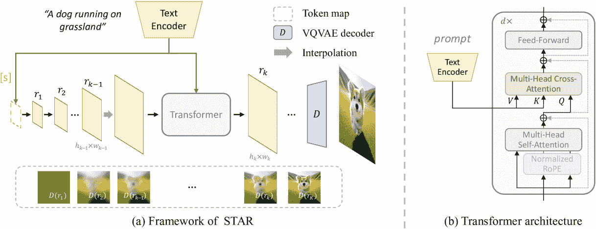

> 具体来说，CLIP text encoder最后提取出来的text prompt embedding会被pooling产生一个single vector，并作为visual scale autoregressive的`[s]` start token。起始的1 × 1 token缺乏传达足够的文本细节的能力，并且在随后的尺度中存在被遮蔽的风险，因此提出了在self attention和mlp之间插入额外的cross attention模块来向每个scale的预测中引入条件信息

> 要点：

+   以`[s]` start token作为预测起点，主要决定了输出内容的全局信息
+   以scale-wise的形式，每次自回归的预测一个固定分辨率大小的token map

# 总结
Q1：Visual Autoregressive的多模态生成范式变化

A1：从MLLM并行输出作为condition变化到使用离散化的图像tokenizer使得MLLM能够统一生成和理解任务。离散化使得MLLM可以实现用CE loss来监督并且带来了抛弃下游生成模型的可能性，但是通常会带来理解任务性能的大幅降低。采用continuous tokenizer来融合图像的生成，可以缓解理解任务性能的下降，但是生成的监督信号需要更多的设计思考，并且似乎无法摆脱下游生成模型的引入。visual scale autoregressive更多是纯纯在做生成，希望能用更好的scaling性质来取代diffusion的位置。感觉问题归根结底在于：到底图像怎么样用生成实现理解的效果，目前看起来任重而道远
