# 多模态和大型多模态模型【LMMs】

> 来源：[https://qqs7y1hozd1.feishu.cn/docx/V5nEduDVTocM7sxDPybcgqNXnFe](https://qqs7y1hozd1.feishu.cn/docx/V5nEduDVTocM7sxDPybcgqNXnFe)

## 简介

长期以来，每个机器学习模型都只针对一种数据模式进行操作，即：

+ 文本（如翻译、语言建模）
+ 图像（如物体检测、图像分类）
+ 音频（如语音识别）

---

然而，自然智能并不仅限于单一模式

> 人类可以阅读、交谈和观察。我们听音乐来放松，并通过注意奇怪的声响来察觉危险。对于我们或任何人工智能来说，能够处理多模态数据是在现实世界中运作的关键

OpenAI在其GPT-4V系统卡片中指出：

“将其他模态（如图像输入）融入LLMs，被一些人视为人工智能研究和开发的关键前沿领域”

+ 将其他模态融入大型语言模型（LLMs）中，便产生了大型多模态模型（LMMs）
+ 并非所有多模态系统都是LMMs

> 例如，Midjourney、Stable Diffusion和Dall-E等文本到图像的模型是多模态的，但它们没有语言模型组件。多模态可以指以下一种或多种情况：

1. 输入和输出具有不同的形式（例如，文本到图像，图像到文本）
1. 输入是多模态的（例如，一个能够同时处理文本和图像的系统）
1. 输出是多模态的（例如，一个能够同时生成文本和图像的系统）

这篇文章总体上涵盖了多模态系统，包括LMMs

它由三个部分组成：

1. 第一部分介绍了多模态的背景，包括为何采用多模态、不同的数据模态以及多模态任务的类型
1. 第二部分讨论了多模态系统的基础知识，并以CLIP和Flamingo为例进行说明。CLIP为许多未来的多模态系统奠定了基础，而Flamingo的出色表现则催生了LMMs
1. 第三部分讨论了LMMs的一些活跃研究领域，包括生成多模态输出和适配器以实现更高效的多模态训练，并涵盖了如BLIP-2、LLaVA、LLaMA-Adapter V2、LAVIN等较新的多模态系统

---

## 第1部分：理解多模态

### 为什么选择多模态

如果没有多模态技术，许多用例将无法实现，尤其是在那些需要处理多种数据模态的行业，如医疗保健、机器人技术、电子商务、零售、游戏等

不仅如此，融合其他模态的数据有助于提升模型性能。一个既能从文本又能从图像中学习的模型，难道不应该比仅能从文本或图像中学习的模型表现得更好吗？

多模态系统可以提供更灵活的交互界面，让你能够以当下最适合自己的方式与它们进行交互。想象一下，你可以通过打字、说话，或者只是将摄像头对准某物来提出问题

特别期待的一个应用场景是，多模态技术还能帮助视障人士浏览互联网，以及在现实世界中导航

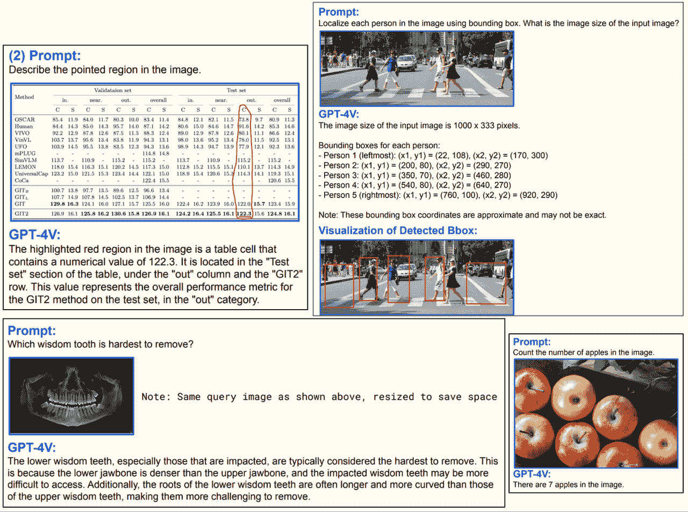

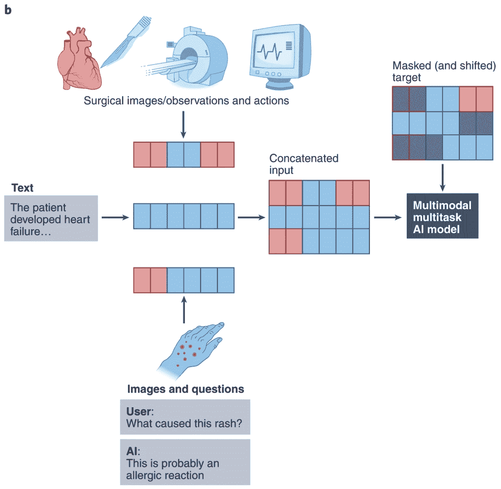

### 数据模态

不同的数据模态包括文本、图像、音频、表格数据等，一种数据模态可以被表示或近似成另一种数据模态

> 例如：

+ 音频可以表示为图像（如梅尔频谱图）
+ 语音可以转录为文本，但这种仅有文本的表示形式会丢失一些信息，比如音量、语调、停顿等
+ 图像可以表示为向量，而向量又可以被展平为一系列文本标记的序列
+ 视频是一系列图像加上音频。现今的机器学习模型通常将视频视为一系列图像处理。这是一个严重的限制，因为声音已经被证明和视觉一样重要。例如，88% 的 TikTok 用户表示声音对他们的 TikTok 体验至关重要
+ 文本可以被表示为图像，只需要拍一张文本的照片即可
+ 数据表可以转换为图表，即一种图像

#### 关于其他数据模态呢？

所有的数字数据格式都可以用比特串（0 和 1 的字符串）或字节串表示。一个可以从比特串或字节串中高效学习的模型将非常强大，并且它可以从任何数据模态中学习

还有其他未提到的数据模态，例如图表和 3D 资产。我们也没有涉及表示气味和触觉（触觉反馈）的一些格式

在当今的机器学习中，音频仍然主要被视为文本的语音替代形式。音频的最常见用例仍然是语音识别（语音到文本）和语音合成（文本到语音）。非语音的音频使用场景，例如音乐生成，仍然相当小众。参见 HuggingFace 上的假 Drake 和 The Weeknd 歌曲模型和 MusicGen 模型

图像可能是输入模型最通用的格式，因为它可以用于表示文本、表格数据、音频，甚至在一定程度上还可以表示视频。今天，我们有手机/摄像头不断拍摄图像和视频

文本是用于模型输出的更强大模式。一个可以生成图像的模型只能用于生成图像，而一个可以生成文本的模型可以用于许多任务：摘要、翻译、推理、问题回答等

为简单起见，我们将主要关注两种模态：图像和文本

#### 多模态任务

要理解多模态系统，研究它们要解决的任务是有帮助的

在文献中，常看到视觉-语言任务被分为两类：生成和视觉-语言理解（VLU）

VLU是指不需要生成的所有任务。两组任务之间的界限是模糊的，因为生成答案需要理解

##### 生成

对于生成任务，输出可以是单模态（如文本、图像、3D 渲染）或多模态。虽然单模态输出在今天较为常见，但多模态输出仍在发展。我们将在本文末尾讨论多模态输出

##### 图像生成（文本到图像合成）

这一类别比较直接。示例包括 DALL-E、Stable Diffusion 和 Midjourney

##### 文本生成

一个常见的文本生成任务是视觉问答。不同于仅依赖文本作为上下文，你可以为模型提供文本和图像。可以想象你可以将相机对准任何东西，提出像“我的车启动不了，问题是什么？”、“如何制作这道菜？”或“这个表情包是什么意思？”这样的问题

另一个常见用例是图像描述生成，可用作基于文本的图像检索系统的一部分。一个组织可能有数百万甚至数十亿张图像：产品图像、图表、设计图、团队照片、宣传材料等。AI可以自动生成这些图像的描述和元数据，使得找到你想要的确切图像更加容易

##### 视觉-语言理解

我们将深入研究两种任务类型：分类和基于文本的图像检索（TBIR）

###### 分类

分类模型只能生成属于预定类别列表的输出。当你只关注固定数量的结果时，这种方法有效。例如，一个 OCR 系统只需要预测某个视觉元素是否是已知字符之一（例如，数字或字母）

> 附注：OCR 系统在字符层面处理数据。当它与能够理解更广泛上下文的系统结合使用时，可以改进某些应用场景，例如允许你“与”任何教科书、合同、装配说明等“对话”

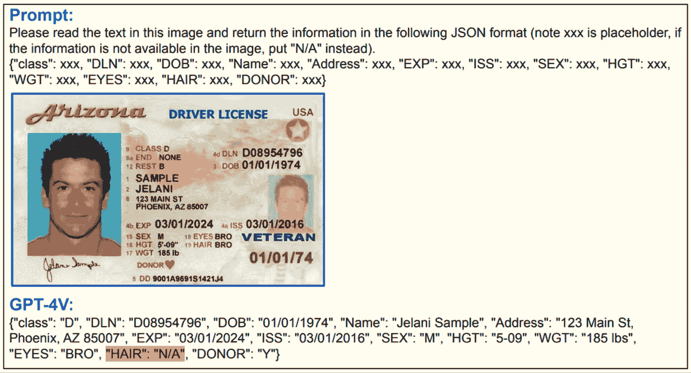

###### 基于文本的图像检索（图像搜索）

与分类相关的一个任务是图像到文本的检索：给定一张图片和一组预定义的文本，从中找到最可能与该图片匹配的文本。这对于产品图像搜索非常有用，例如，从图片中检索产品评论

图像搜索不仅对搜索引擎很重要，对于企业在内部图像和文档中进行搜索也同样重要。有些人称基于文本的图像检索为“文本到图像检索”

> 基于文本的图像检索有多种方法，以下是其中两种：

1. 为每张图像生成标题和元数据，可以手动或自动完成（参考文本生成中的图像描述生成）。给定文本查询，找到那些标题/元数据最接近此文本查询的图像
1. 为图像和文本训练一个联合嵌入空间。给定文本查询，生成此查询的嵌入，然后找到所有嵌入与该查询最接近的图像

> 第二种方法更灵活，我认为会更广泛应用。这种方法需要为视觉和语言构建一个强大的联合嵌入空间，就像 OpenAI 的 CLIP 所开发的那样

## 第二部分：多模态训练基础

鉴于有如此多出色的多模态系统，撰写本文的挑战之一是选择要重点介绍的系统

最终，我决定关注两个模型：CLIP（2021）和 Flamingo（2022），它们因其重要性以及公共细节的可获取性和清晰度而被选中

+ CLIP 是第一个能够在零样本和小样本学习的情况下泛化到多个图像分类任务的模型
+ Flamingo 不是第一个能够生成开放式响应的大型多模态模型（Salesforce 的 BLIP 比它早 3 个月推出）。然而，Flamingo 的强大表现促使一些人认为它是多模态领域的“GPT-3 时刻”

> 尽管这两个模型相对较旧，但它们使用的许多技术在今天仍然具有参考意义。我希望它们可以作为理解新模型的基础。多模态领域正在迅速发展，许多新想法正在涌现。我们将在第三部分讨论这些新模型

> 从高层次来看，一个多模态系统由以下组件组成：

1. 每种数据模态的编码器，用于生成该模态数据的嵌入
1. 将不同模态的嵌入对齐到相同的多模态嵌入空间的方法
1. 【仅生成模型】生成文本响应的语言模型。由于输入可以包含文本和视觉内容，需要开发新技术，以允许语言模型不仅基于文本，还基于视觉内容来生成响应

> 理想情况下，这些组件中的尽可能多的部分应预训练，并尽可能具有可重用性

### CLIP：对比语言-图像预训练

CLIP 的关键贡献在于它能够将不同模态的数据（文本和图像）映射到一个共享的嵌入空间中。这个共享的多模态嵌入空间使文本到图像和图像到文本的任务变得更加容易

训练这个多模态嵌入空间还产生了一个强大的图像编码器，使得 CLIP 能够在许多图像分类任务中实现具有竞争力的零样本性能。这个强大的图像编码器可以用于许多其他任务：图像生成、视觉问答和基于文本的图像检索。Flamingo 和 LLaVa 使用 CLIP 作为它们的图像编码器，DALL-E 使用 CLIP 来重新排序生成的图像。目前还不清楚 GPT-4V 是否使用 CLIP

CLIP 利用了自然语言监督和对比学习，使得 CLIP 可以同时扩大数据规模并提高训练效率

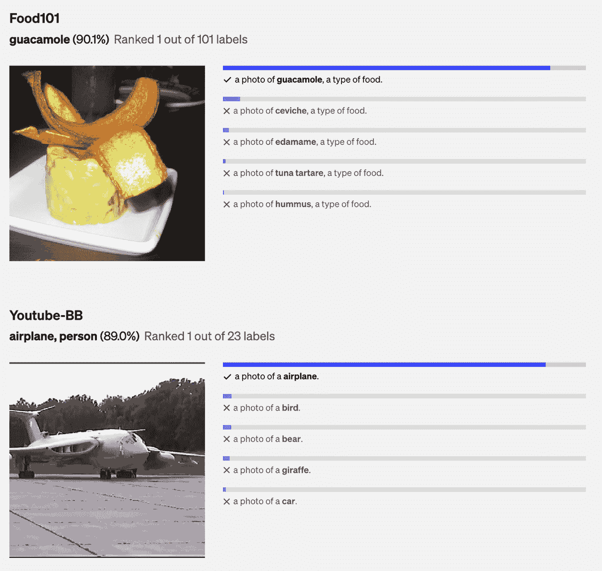

### CLIP 的高层架构

> 编码器和投影矩阵从头开始共同训练，训练目标是最大化正确（图像，文本）配对的相似度分数，同时最小化错误配对的相似度分数（对比学习）

> 对于图像编码器，尝试了 ResNet 和 ViT。他们表现最好的模型是 ViT-L/14@336px：

+ 大型视觉 Transformer (ViT-L)
+ 14 个分块（每张图像被划分为 14x14 像素的小图）
+ 336x336 像素输入

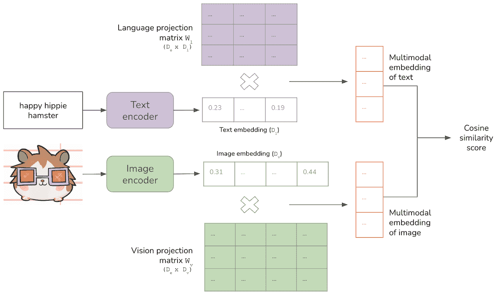

对于文本编码器，CLIP 使用了一个类似于 GPT-2 的 Transformer 模型，但更小。基础模型只有 6300 万个参数，具有 8 个注意力头。作者发现 CLIP 的性能对文本编码器的容量不太敏感

图像编码器和文本编码器生成的嵌入使用两个投影矩阵 和  投射到相同的嵌入空间：

+ 给定图像嵌入 ，对应的多模态嵌入计算为：
+ 给定文本嵌入 ，对应的多模态嵌入计算为：

当人们提到 CLIP 嵌入时，他们指的是这些多模态嵌入或由 CLIP 的图像编码器生成的嵌入

### 自然语言监督

> 多年来，图像模型一直使用手动标注的（图像，文本）数据集进行训练（例如 ImageNet、MS COCO）。这种方式不具备可扩展性，手动标注耗时且成本高昂

> CLIP 论文指出，当时可用的任何（图像，文本）数据集都不够大且质量不高。因此，他们创建了自己的数据集——4 亿对（图像，文本）——具体如下：

1. 构建一个包含 50 万个查询的列表。查询是常用词、双词组和流行维基百科文章的标题。
1. 找到与这些查询匹配的图像（字符串和子字符串匹配）。论文提到，这种搜索没有发生在搜索引擎上，但没有具体说明在哪里。我认为，由于 OpenAI 已经为其 GPT 模型抓取了整个互联网，他们可能只是查询了其内部数据库。
1. 每张图像与同时出现的文本（例如标题、评论）配对，而不是使用查询本身，因为查询太简短，无法具备描述性

> 由于有些查询比其他查询更受欢迎，为了避免数据不平衡，他们为每个查询最多使用 2 万张图像

### 对比学习

+ 在 CLIP 出现之前，大多数视觉-语言模型都使用分类器或语言模型目标进行训练。对比目标是一种巧妙的技术，使 CLIP 能够扩展并泛化到多个任务
+ 我们将通过一个图像描述生成任务的例子来展示为什么对比目标对 CLIP 更有效：给定一张图像，生成一个描述该图像的文本

#### 分类器目标

分类器在预定类别列表中预测正确类别。这适用于输出空间有限的情况。以前使用（图像，文本）对数据集的模型都存在此限制

> 例如，使用 ILSVRC-2012 数据集的模型限制在 1000 个类别，而 JFT-300M 则限制在 18,291 个类别。

这种目标不仅限制了模型输出有意义响应的能力，还限制了其零样本学习的能力

> 例如，如果模型被训练用于 10 个类别的预测，它将无法处理具有 100 个类别的任务

#### 语言模型目标

如果分类器对每个输入仅输出一个类别，那么语言模型则输出一个类别序列。每个生成的类别被称为一个标记。每个标记来自预定的列表，即语言模型的词汇表

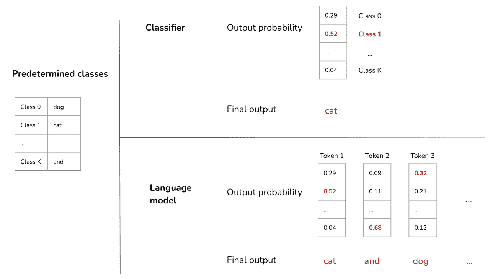

#### 对比目标

尽管语言模型目标允许生成更灵活的输出，CLIP 的作者指出，这一目标使训练变得困难。他们推测这是因为模型试图生成与每个图像完全匹配的文本，而实际上一个图像可以配有许多不同的文本描述，例如替代文本、标题、评论等

> 例如，在 Flickr30K 数据集中，每张图片有 5 个由人工标注员提供的标题，并且同一图像的标题可能非常不同

对比学习用于克服这一挑战。CLIP 并不预测每个图像的确切文本，而是训练预测某段文本是否比其他文本更有可能与某图像配对

对于每一批包含 个（图像，文本）对，模型生成 个文本嵌入和 个图像嵌入

+ 令 表示  个图像的嵌入
+ 令  表示  个文本的嵌入

> CLIP 计算所有 个可能配对 的余弦相似度分数。模型训练的目标是最大化  个正确配对的相似度分数，同时最小化 个错误配对的相似度分数。对于

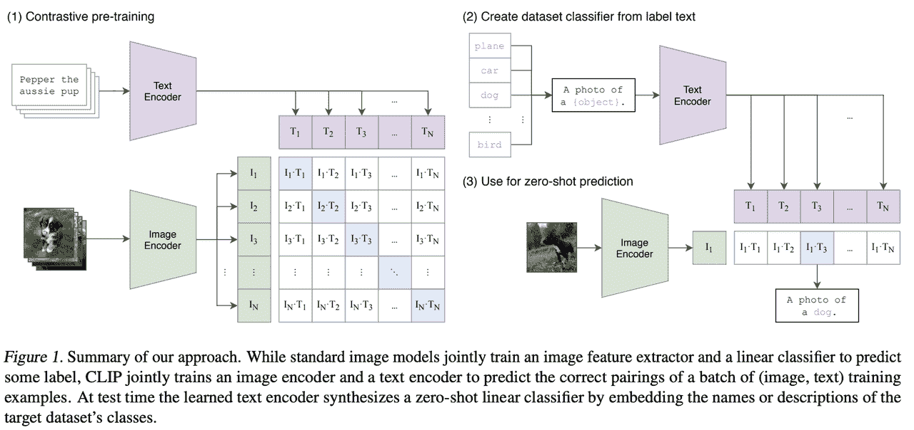

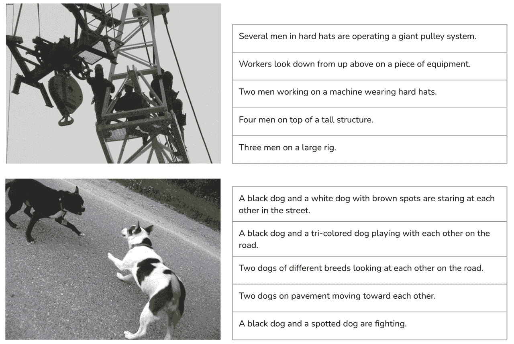

另一种理解方式是：CLIP 的每个训练批次都是两个分类任务

1. 每个图像可以与 \(N\) 个可能的文本配对，模型尝试预测正确的文本。这与图像到文本的检索设置相同
1. 每个文本可以与 \(N\) 个可能的图像配对，模型尝试预测正确的图像。这与文本到图像的检索设置相同

> 这两个损失的和被最小化， 是一个可训练的逆温度参数

CLIP 的作者发现，对比目标相比于语言模型目标基线在效率上提高了 12 倍，同时生成了更高质量的图像嵌入

这在伪代码中展示如下：

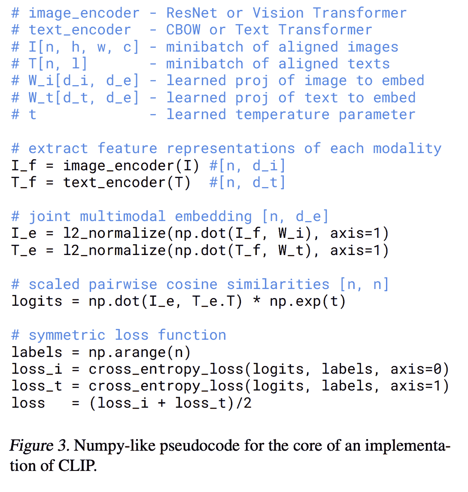

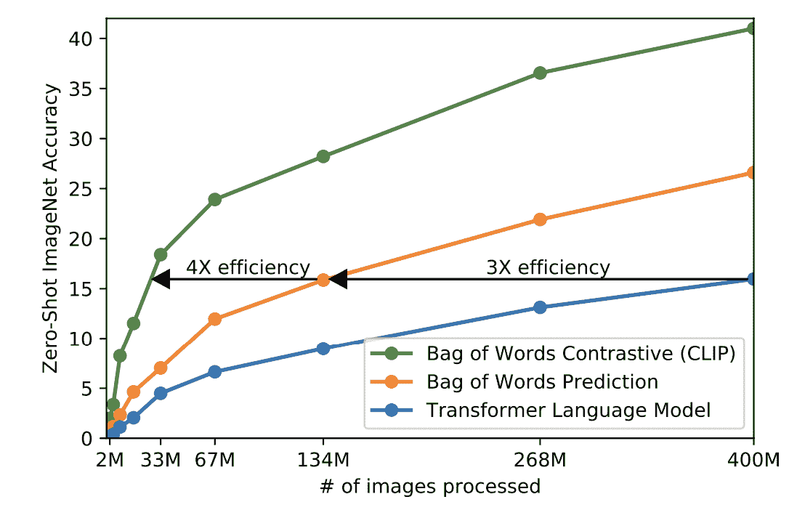

### CLIP 应用

#### 分类

如今，对于许多图像分类任务，CLIP 依然是一个强大的开箱即用的基线模型，可以直接使用或进行微调

#### 基于文本的图像检索

由于 CLIP 的训练过程在概念上类似于图像到文本检索和文本到图像检索，CLIP “在图像检索或搜索等广泛适用的任务上显示出显著的潜力”。然而，“在图像检索方面，CLIP 的性能相对于最先进的技术明显较低。”

有一些使用 CLIP 进行图像检索的尝试。例如，`clip-retrieval` 包的工作原理如下：

1. 为所有图像生成 CLIP 嵌入，并将它们存储在一个向量数据库中
1. 对于每个文本查询，为该文本生成一个 CLIP 嵌入
1. 在向量数据库中查询所有嵌入接近该文本查询嵌入的图像

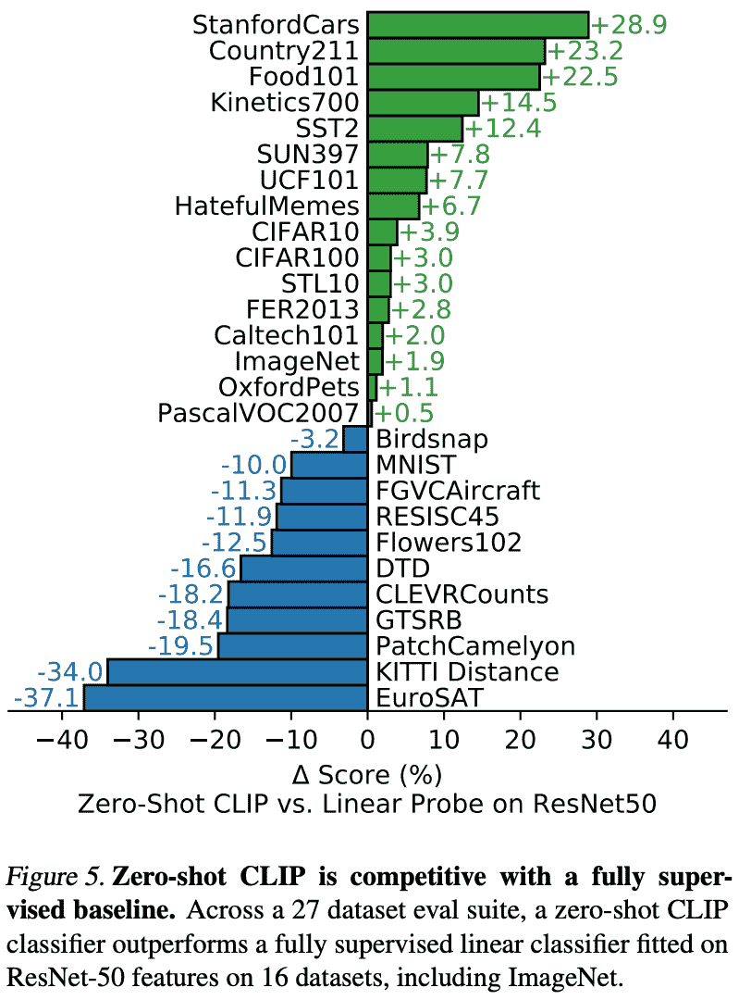

#### 图像生成

CLIP 的联合图像-文本嵌入对图像生成很有用。给定一个文本提示，DALL-E（2021）生成许多不同的视觉效果，并使用 CLIP 对这些视觉效果重新排序，以便在展示前筛选出最佳图像

2022 年，OpenAI 推出了 unCLIP，一种基于 CLIP 潜在表示的文本到图像生成模型。它包含两个主要组件：

1. 训练并冻结 CLIP。预训练的 CLIP 模型可以为文本和图像生成嵌入，并处于相同的嵌入空间
1. 在图像生成时发生两件事：

   + 使用 CLIP 为该文本生成嵌入
   + 使用扩散解码器来生成以此嵌入为条件的图像

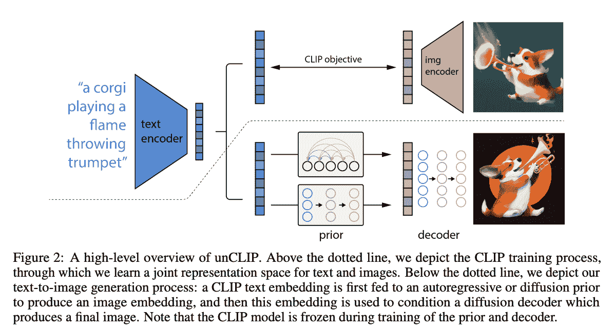

### 文本生成：视觉问答，图像描述

CLIP 的作者确实尝试过创建用于文本生成的模型。他们实验的一种版本叫做 LM RN50。尽管该模型可以生成文本响应，但在所有 CLIP 评估的视觉-语言理解任务中，其性能始终比 CLIP 表现最好的模型低约 10%

尽管如今 CLIP 并未直接用于文本生成，但其图像编码器常作为能够生成文本的大型多模态模型（LMM）的基础

### Flamingo：大型多模态模型的曙光

与 CLIP 不同，Flamingo 可以生成文本响应。从简化的角度看，Flamingo 可以视为 CLIP 加上一个语言模型，并添加了技术，使得语言模型能够基于视觉和文本输入生成文本标记

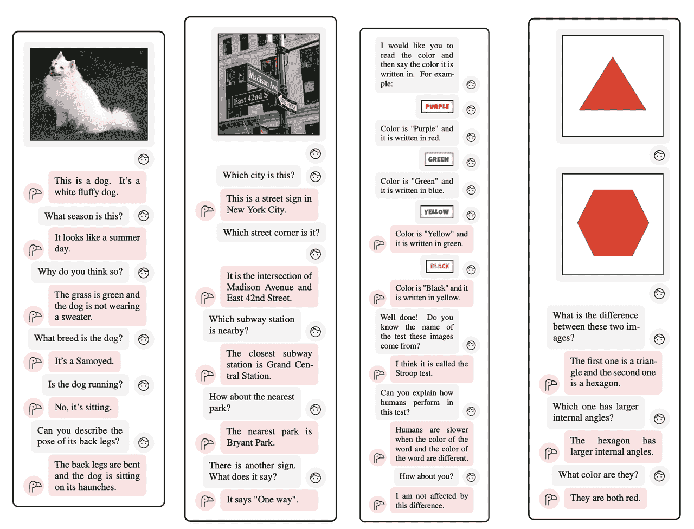

### Flamingo 的高层架构

从高层次看，Flamingo 由两部分组成：

1. 视觉编码器：一个类似 CLIP 的模型，使用对比学习进行训练。该模型的文本编码器随后被丢弃。视觉编码器被冻结，用于主模型中
1. 语言模型：Flamingo 微调 Chinchilla 以生成文本标记，基于视觉和文本进行条件化，使用语言模型损失，并添加了两个额外组件：Perceiver 重采样器和 GATED XATTN-DENSE 层。我们将在本文稍后讨论这些内容

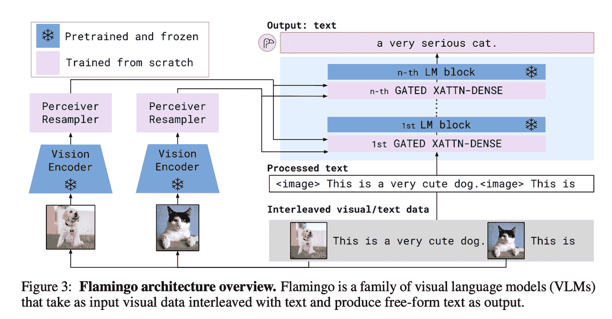

## 数据

Flamingo 使用了 4 个数据集：2 个（图像，文本）配对数据集，1 个（视频，文本）配对数据集，和 1 个交错的图像和文本数据集

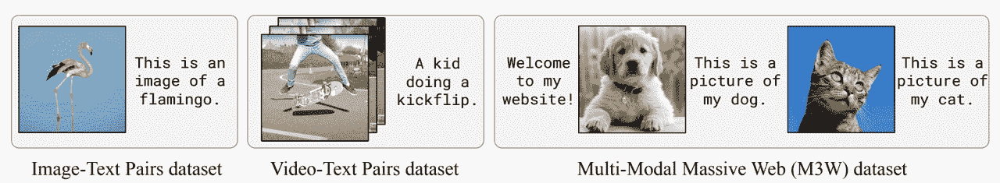

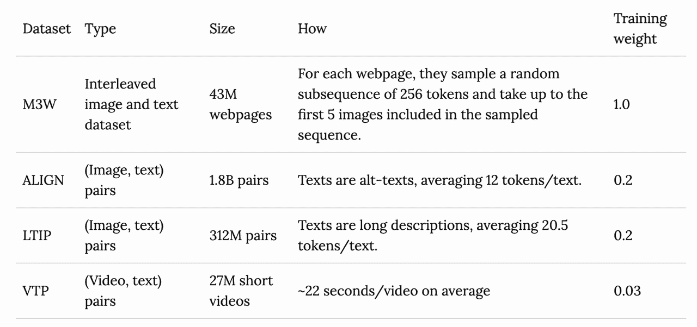

## Flamingo 的视觉编码器

> Flamingo 首先从头开始使用对比学习训练一个类似 CLIP 的模型。此组件仅使用 2 个（图像，文本）配对数据集，ALIGN 和 LTIP，总共包含 21 亿对（图像，文本），比 CLIP 所训练的数据集大 5 倍

+ 对于文本编码器，Flamingo 使用 BERT 而非 GPT-2

+ 对于视觉编码器，Flamingo 使用无归一化 ResNet（NFNet）F6 模型

+ 在投射到联合嵌入空间之前，文本和视觉嵌入会经过均值池化

## Flamingo 的语言模型

+ Flamingo 使用 Chinchilla 作为语言模型。具体而言，他们冻结了预训练的 9 层 Chinchilla 语言模型层。传统语言模型基于前一个文本标记预测下一个文本标记，而 Flamingo 基于前面的文本和视觉标记预测下一个文本标记

+ 为了能够生成基于文本和视觉输入的文本，Flamingo 使用了 Perceiver 重采样器和 GATED XATTN-DENSE 层

## Perceiver 重采样器

由于视觉输入可以是图像或视频，视觉编码器可能会产生数量不一的图像或视频特征。Perceiver 重采样器将这些不固定的特征转换为一致的 64 个视觉输出

有趣的是，在训练视觉编码器时，使用的分辨率为 288 x 288。但在这一阶段，视觉输入被调整为 320 x 320。研究表明，使用卷积神经网络时，较高的测试分辨率可以提高性能

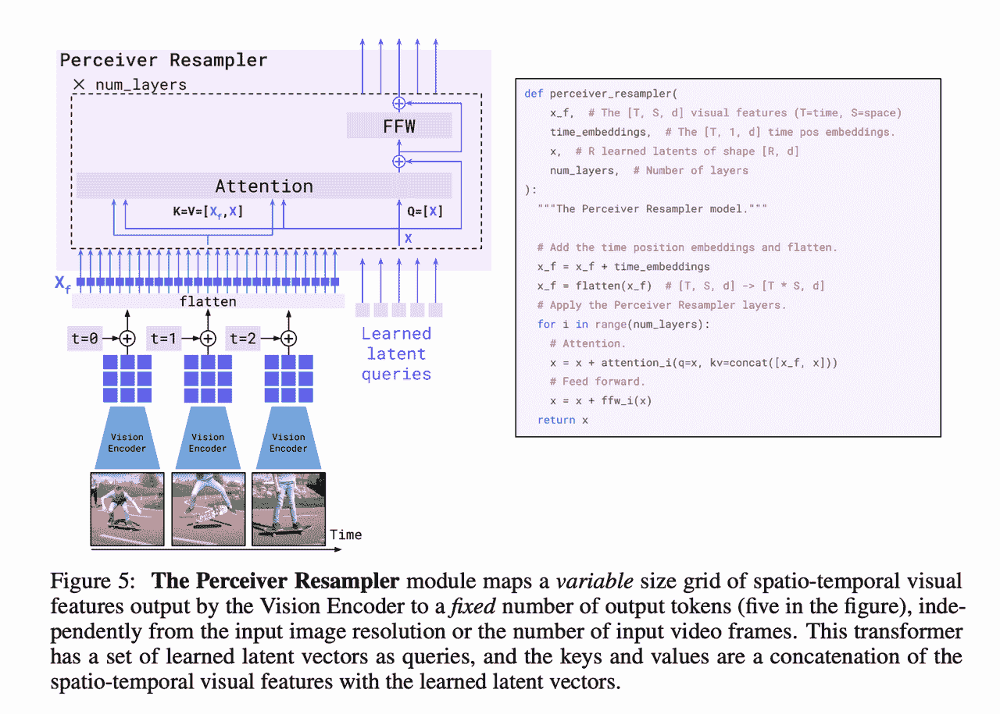

## GATED XATTN-DENSE 层

GATED XATTN-DENSE 层被插入到现有的冻结语言模型层之间，使语言模型在生成文本标记时能够更高效地关注视觉标记

Flamingo 的作者指出，若没有这些层，整体得分下降了 4.2%

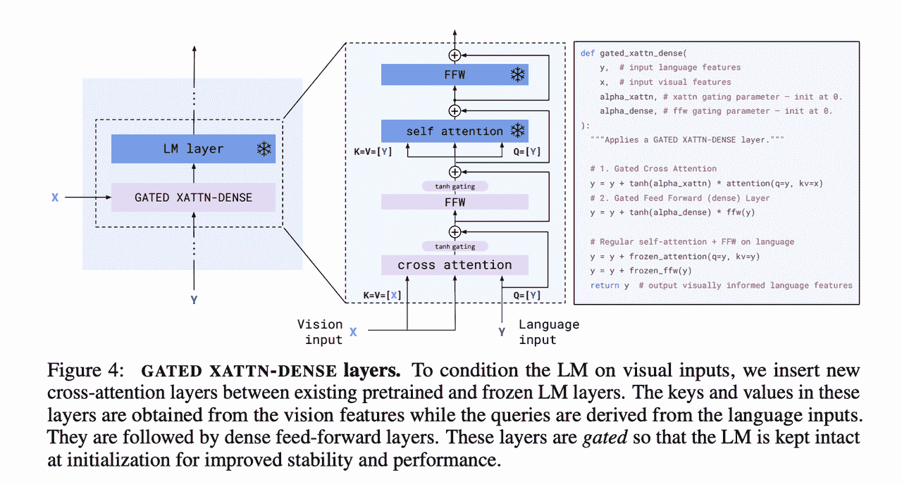

## 损失函数

Flamingo 计算文本 在交错图像和视频 上的条件概率：

训练损失函数是生成文本的期望负对数似然的加权和，跨越所有 4 个数据集， 表示数据集  的训练权重

## 训练

> 虽然 Chinchilla 语言模型层经过微调并被冻结，额外的组件是从头开始训练的，使用 Flamingo 的所有 4 个数据集，不同的数据集权重不同。找到适合每个数据集的权重是性能的关键。每个数据集的权重在数据集表的训练权重列中

VTP 的权重比其他数据集小得多（0.03，相比于 0.2 和 1），因此它对训练的贡献应是最小的。然而，作者指出，去掉该数据集会对所有视频任务的性能产生负面影响

虽然 Flamingo 不是开源的，但有许多开源的 Flamingo 复现版本可用：

+ IDEFICS (HuggingFace)

+ mlfoundations/open_flamingo

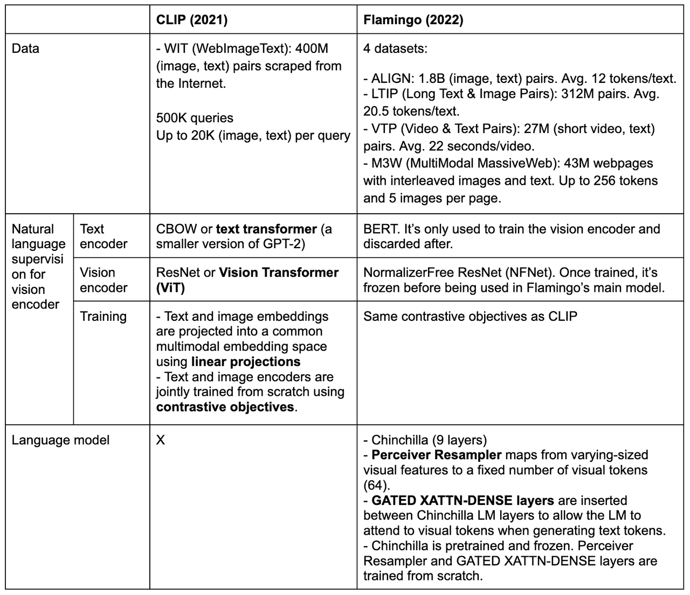

# 第三部分：大型多模态模型（LMMs）的研究方向

> CLIP 已经有 3 年的历史，Flamingo 也接近 2 年了。尽管它们的架构为理解 LMMs 的构建提供了良好的基础，但在这一领域中已有许多新进展

## 融合更多的数据模态

目前，大多数多模态系统处理的是文本和图像。但我们迟早需要能够融合其他模态的系统，如视频、音乐和 3D

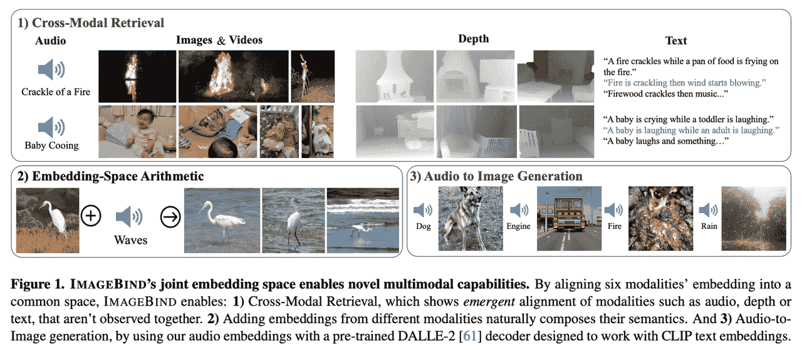

能否为所有数据模态共享一个嵌入空间？

> 该领域的一些相关工作示例：

+ ULIP: 学习语言、图像和点云的统一表示用于 3D 理解 (Xue 等人，2022 年 12 月)

+ ImageBind: 一个绑定所有模态的嵌入空间 (Girdhar 等人，2023 年 5 月)

+ NExT-GPT: 任意模态到任意模态的大型多模态语言模型 (Wu 等人，2023 年 9 月)

+ Jeff Dean 的雄心勃勃的 Pathways 项目（2021）：其愿景是“实现视觉、听觉和语言理解的多模态模型”

## 多模态指令跟随系统

Flamingo 被训练用于完成任务，但并不适合对话或指令跟随。如果你不熟悉任务完成与对话的区别，可以查看我关于 RLHF 的帖子。许多人正在构建能够跟随指令并进行对话的 LMMs，例如：

+ MultiInstruct: 通过指令微调改善多模态零样本学习（Xu 等人，2022 年 12 月）

+ LLaVA: 视觉指令微调（Liu 等人，2023 年 4 月 28 日）

+ InstructBLIP: 面向通用视觉语言模型的指令微调（Salesforce，2023 年 5 月 11 日）

+ LaVIN: 面向大型语言模型的廉价快速视觉语言指令微调（Luo 等人，2023 年 5 月 24 日）

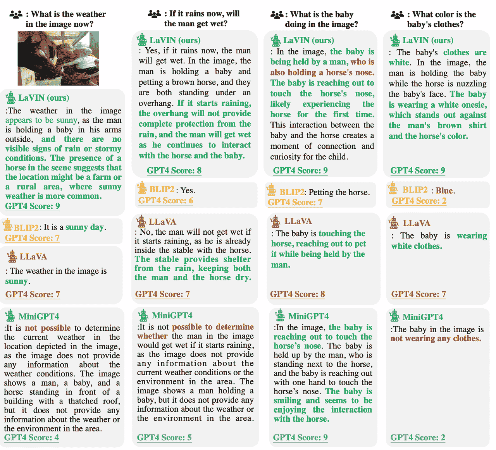

## 更高效的多模态训练适配器

虽然 Flamingo 使用了 9 层预训练和冻结的 Chinchilla 层，但它不得不从头开始预训练其视觉编码器、Perceiver 重采样器和 GATED XATTN-DENSE 层。这些从头开始训练的模块可能计算密集。许多研究聚焦于更高效的方法，通过减少从头开始训练的内容来引导多模态系统

一些研究成果相当有前景。例如，BLIP-2 在零样本 VQA-v2 数据集上以 54 倍更少的可训练参数超越了 Flamingo-80B 的表现（提升 8.7%）

该领域的相关工作包括：

+ BLIP-2: 使用冻结的图像编码器和大型语言模型进行语言-图像预训练

+ LAVIN: 廉价快速的大型语言模型视觉语言指令微调

+ LLAMA-Adapter V2: 参数高效的视觉指令模型

以下两张图片来自 Chunyuan Li 在 CVPR 2023 上的“大型多模态模型”教程，这是一篇很棒的教程

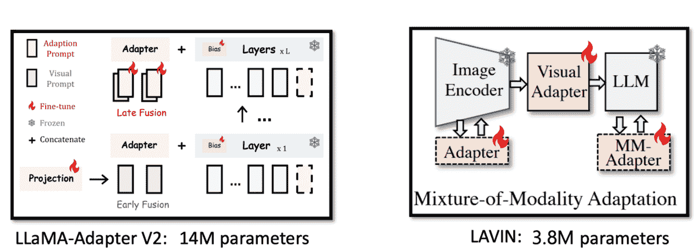

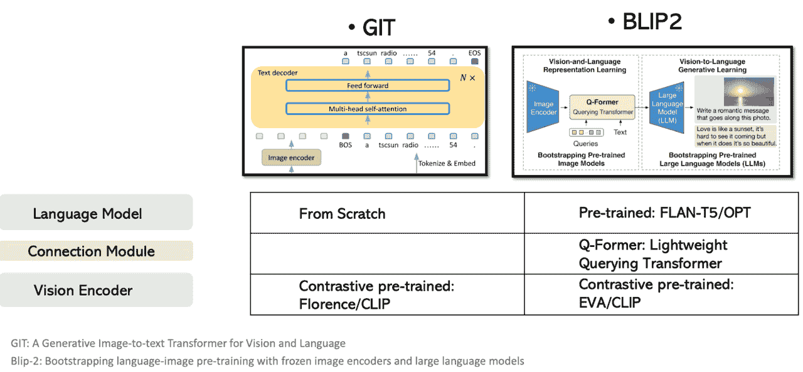

## 生成多模态输出

尽管能够处理多模态输入的模型已成为常态，但多模态输出仍然滞后。许多使用场景需要多模态输出。例如，如果我们要求 ChatGPT 解释 RLHF，有效的解释可能需要图表、公式，甚至简单的动画

要生成多模态输出，模型首先需要生成一个共享的中间输出。一个关键问题是这种中间输出的形式应该是什么样的

一种中间输出的选项是文本，之后可用于生成/合成其他输出

例如，CM3（Aghajanyan 等人，2022）输出 HTML 标记，可编译为网页，包含文本、格式、链接和图像。GPT-4V 生成 Latex 代码，之后可被重建为数据表

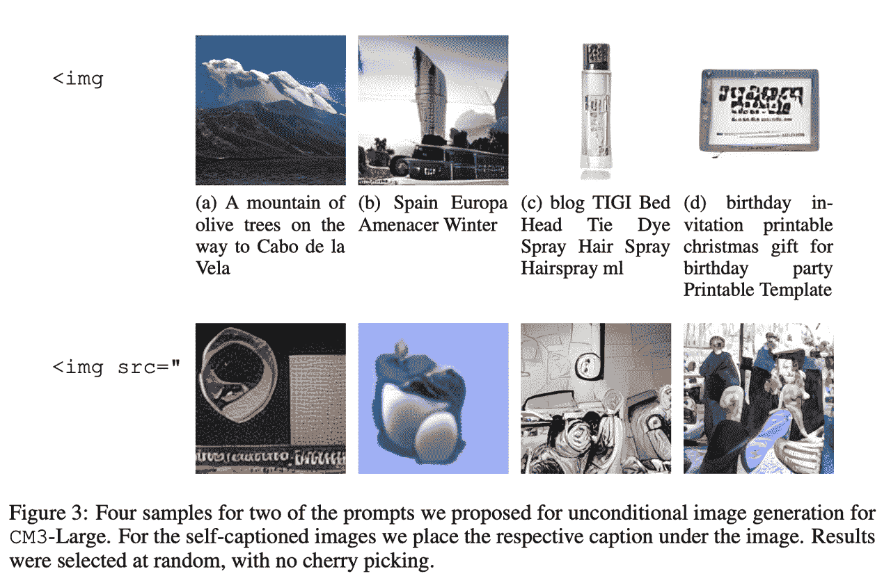

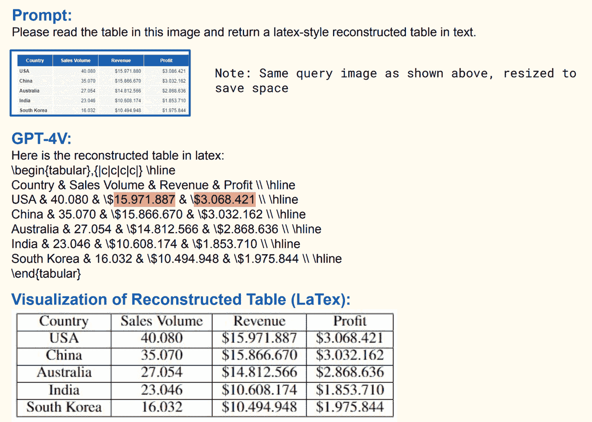

另一种中间输出的选项是多模态标记这是 Caiming Xiong（他的团队在 Salesforce 在多模态方面做了很多出色的工作）提出的选项。每个标记都会有一个标签，用于表示它是文本标记还是图像标记。图像标记随后将输入到像 Diffusion 这样的图像模型中以生成图像。文本标记则将输入到语言模型中

[使用多模态语言模型生成图像](https://arxiv.org/abs/2306.01007)（Koh 等人，2023 年 6 月）是一篇出色的论文，展示了 LMMs 如何在生成文本的同时生成和检索图像

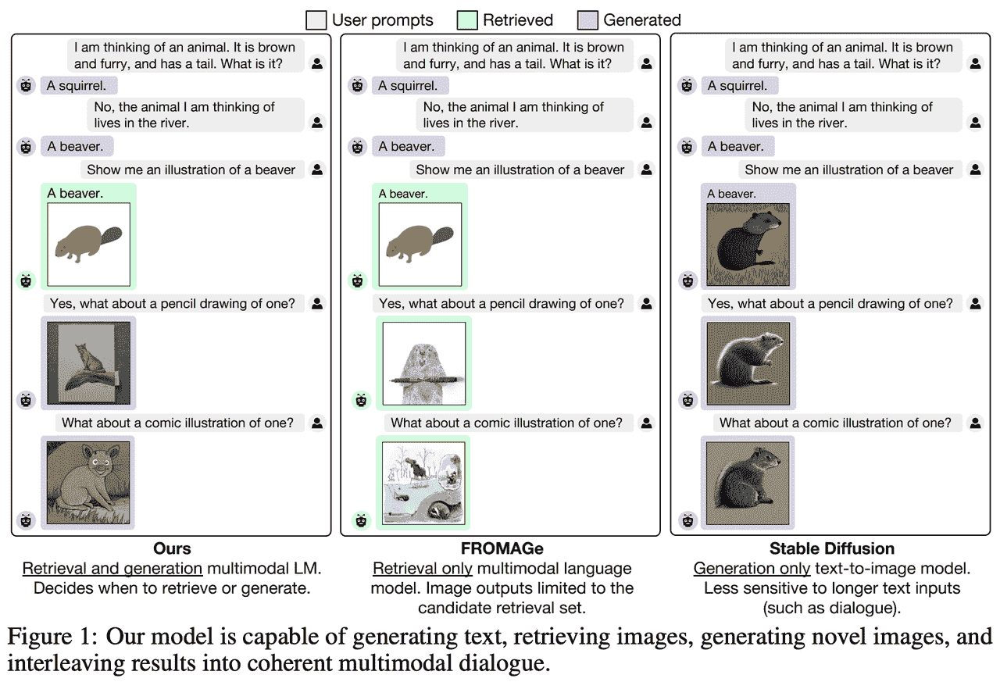

# 结论

关于多模态的内容太多了，我确信还有很多我没有涉及的内容，但我希望这篇文章提供了一些核心模式，能帮助你开发多模态系统并将其应用到你的工作中

正如你在本文的第三部分所见，我们仍处于多模态系统的早期阶段（早到一个朋友告诉我，他不确定 LMM 缩写是否会流行）。在我的大多数对话中，几乎毫无疑问的是，整体的多模态系统，尤其是 LMM，将比大型语言模型（LLMs）产生更大的影响。然而，请记住，LMM 并不会使 LLM 过时。随着 LMM 的发展，其性能依赖于其基础 LLM 的性能。许多从事多模态系统的实验室同时也在研究 LLM
