# 多模态的前生今世——Transformer、Embedding、主流模型与通用任务实战

> 来源：[https://qqs7y1hozd1.feishu.cn/docx/CWXedoGRNocdOpxc6KwcPqdrn9c](https://qqs7y1hozd1.feishu.cn/docx/CWXedoGRNocdOpxc6KwcPqdrn9c)

# 01、多模态概念与意义

多模态学习（Multimo**dal learning**）是机器学习的一个重要分支。模态（Modality），就是数据的一种形式，例如图像、文本、语音等。通常意义的多模态学习，就是利用模型去同时处理多个模态数据，例如同时处理图文，图生文本、文本生图等。通过多模态大模型，可以更好地理解和处理复杂的多模态数据，提高人工智能的应用性能。

# 02、多模态任务类型及数据集

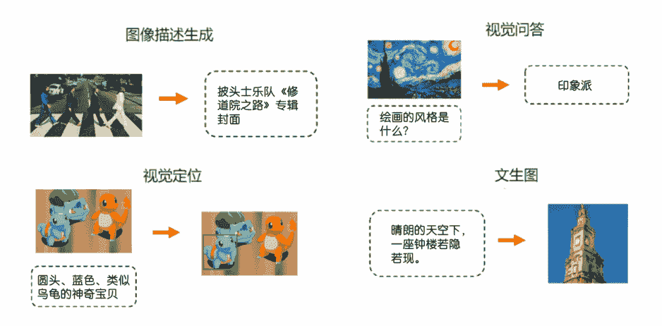

多模态大模型在许多领域都有广泛的应用，应用方向不限于自然语言处理、计算机视觉、音频处理等。具体任务又可以分为文本和图像的语义理解、图像描述、视觉定位、对话问答、视觉问答、视频的分类和识别、音频的情感分析和语音识别等。

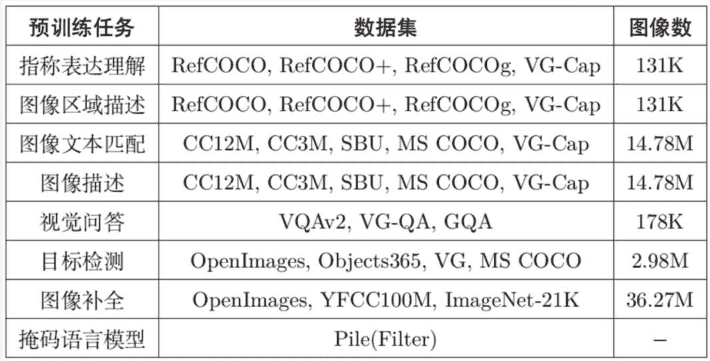

**基础任务数据集版本：**

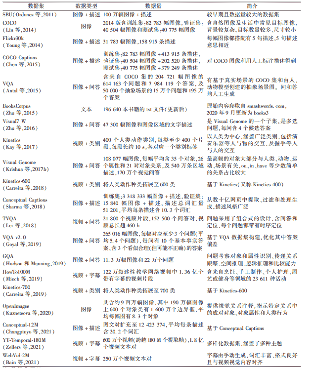

**详细任务数据集版本：**

# 03、多模态模型发展关系及时间线

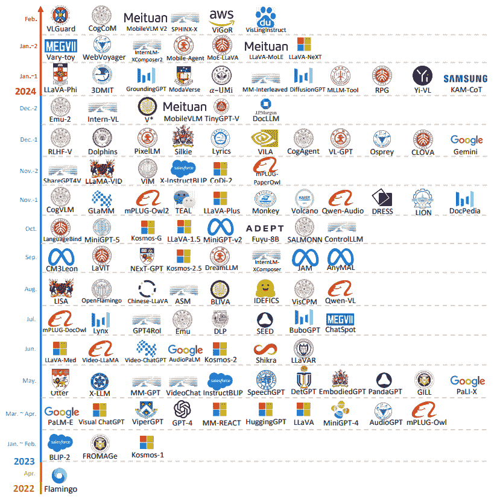

上述的大多多模态模型结构可以总结为五个主要关键组件，具体如下图所示：

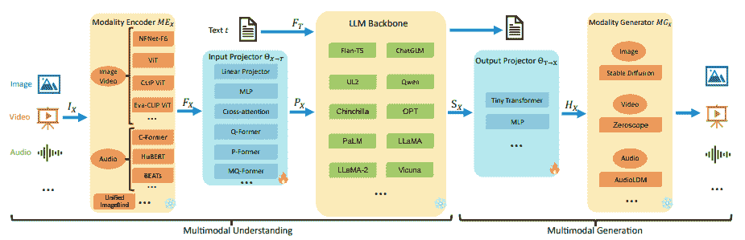

> **模态编码器**（Modality Encoder, ME）：图像编码器（Image Encoder）、视频编码器（Video Encoder）、音频编码器（Audio Encoder）

> **输入投影器**（Input Projector, IP）：线性投影器（Linear Projector）、多层感知器（Multi-Layer Perceptron, MLP）、交叉注意力（Cross-Attention）、Q-Former等

> **大模型基座**（LLM Backbone）：ChatGLM、LLaMA、Qwen、Vicuna等

> **输出投影器**（Output Projector, OP）：Tiny Transformer、Multi-Layer Perceptron (MLP)等

> **模态生成器**（Modality Generator, MG）：Stable Diffusion、Zeroscope、AudioLDM

按上述五部分结构对**经典多模态模型**进行总结，结果如下：

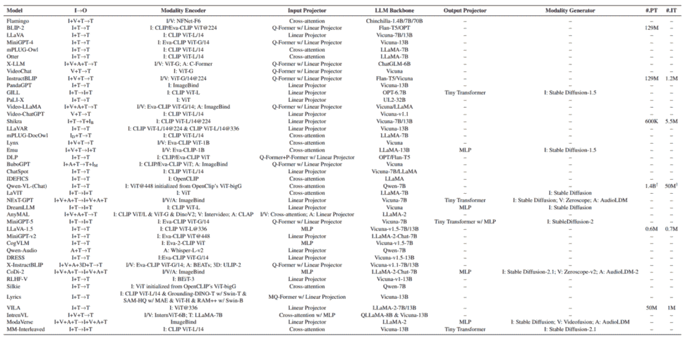

**以**VIT为基础视觉预训练可以通过Transformers模型对视觉进行有效表征，逐渐成为视觉信息编码的主流手段。此部分主要梳理以VIT为延伸的预训练和多模态对齐工作，具体分类如下：

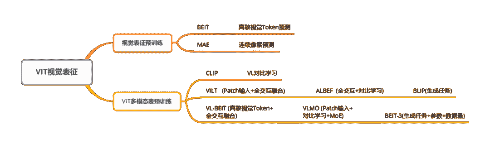

上述多模态预训练模型**发展关系**如下：

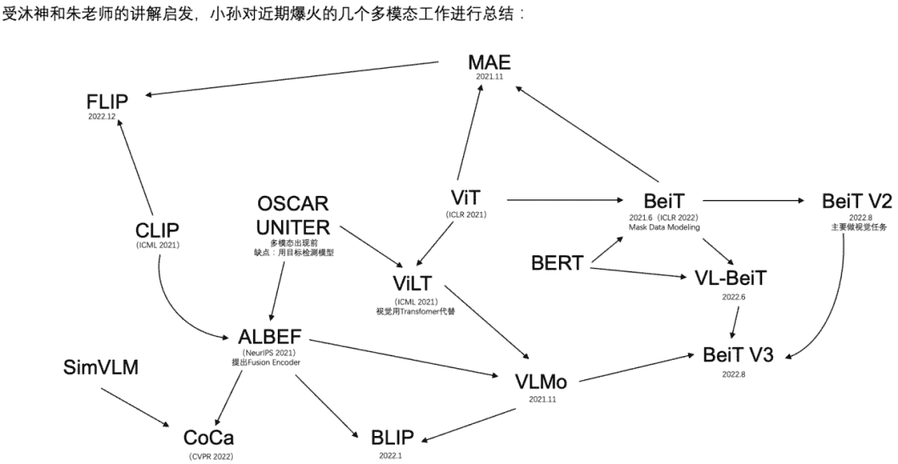

# 04、多模态基础知识–Transformer

目前，主流的多模态**大模型**大多以**Transformer**为基础。Transformer是一种由谷歌**在2017年提出的深度学习**模型，主要用于自然语言处理（NLP）任务，特别是序列到序列（Sequence-to-Sequence）的学习问题，如文本生成。Transformer彻底改变了之前基于循环神经网络（RNNs）和长短期记忆网络（LSTMs）的序列建模范式，并且在性能提升上取得了显著成效。Transformer结构如右图所示：

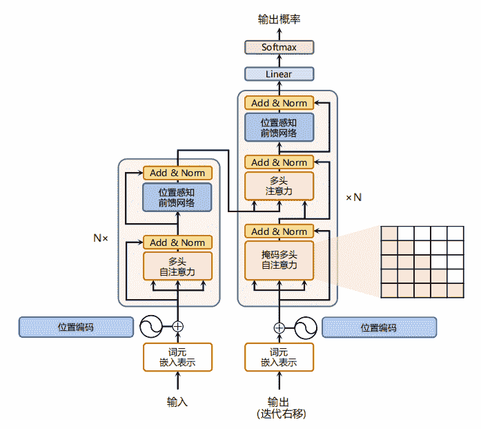

> Transformer的核心构成包括：

> 自注意力机制（Self-Attention Mechanism）：Transformer模型摒弃了传统RNN结构的时间依赖性，通过自注意力机制实现对输入序列中任意两个位置之间的直接关联建模。每个词的位置可以同时关注整个句子中的其他所有词，计算它们之间的相关性得分，然后根据这些得分加权求和得到该位置的上下文向量表示。这种全局信息的捕获能力极大地提高了模型的表达力。

> 多头注意力（Multi-Head Attention）：Transformer进一步将自注意力机制分解为多个并行的“头部”，每个头部负责从不同角度对输入序列进行关注，从而增强了模型捕捉多种复杂依赖关系的能力。最后，各个头部的结果会拼接并经过线性变换后得到最终的注意力输出。

> 位置编码（Positional Encoding）：由于Tra**nsform**er不再使用RNN的顺序处理方式，为了引入序列中词的位置信息，它采用了一种特殊的位置编码方法。这种方法对序列中的每个位置赋予一个特定的向量，该向量的值与位置有关，确保模型在处理过程中能够区分不同的词语顺序。

> **编码器-解码器架构（Encoder-De**coder Architecture）：Transformer采用了标准的编码器-解码器结构，其中，编码器负责理解输入序列，将其转换成高级语义表示；解码器则依据编码器的输出，结合自身产生的隐状态逐步生成目标序列。在解码过程中，解码器还应用了自注意力机制以及一种称为“掩码”（Masking）的技术来防止提前看到未来要预测的部分。

> 残差连接（Residual Connections）：Transformer沿用了ResNet中的残差连接设计，以解决随着网络层数加深带来的梯度消失或爆炸问题，有助于训练更深更复杂的模型。

> 层归一化（Layer Normalization）：Transformer使用了层归一化而非批量归一化，这使得模型在小批量训练时也能获得良好的表现，并且有利于模型收敛。

# 05、多模态任务对齐

本文以文本和图像的多模态数据对齐为例：

## 1.文本转Embedding

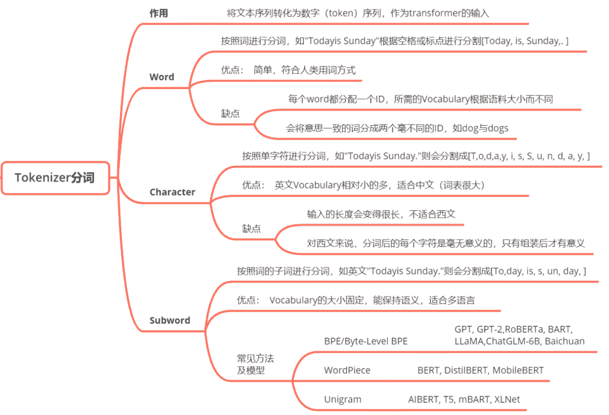

> **Tokenization:**

> Tokenization也称作分词，是把一段文本切分成模型能够处理的token或子词的过程，通常会使用BPE或WordPiece的分词算法，有助于控制词典大小的同时保留了表示文本序列的能力。Tokenization的知识点总结如下：

> **Embedding:**

> Embedding将token或子词用映射到多维空间中的向量表示，用以捕捉语义含义。这些连续的向量使模型能够在神经网络中处理离散的token，从而使其学习单词之间的复杂关系。经典的文本转Embedding可采用 Tramsformer(bert) 模型

**具体步骤：**

输入文本：“thank you very much”

Tokenization后: [“thank”, “you”, “very”,“much”]

Embedding：假设每个token被映射到一个2048维的向量，“thank you very much”被转换成4*2048的embeddings

## 2.图像转换Embedding

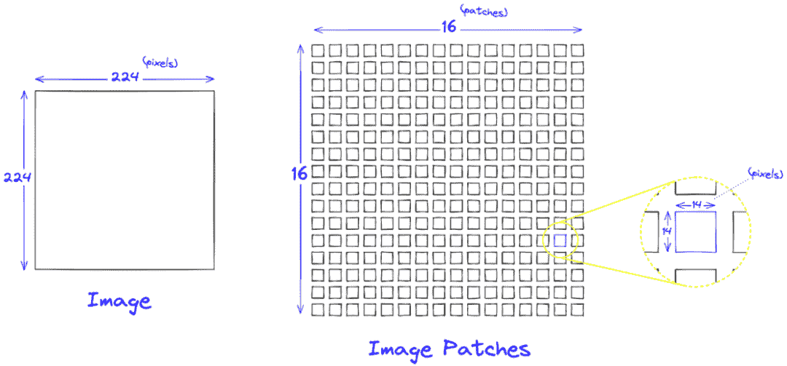

图像转Emdedding一般采用Vit Transformer模型。首先，把图像分成固定大小的patch，类比于LLM中的Tokenization操作；然后通过线性变换得到patch embedding，类比LLM中的Embedding操作。由于Transformer的输入就是token embeddings序列，所以将图像的patch embedding送入Transformer后就能够直接进行特征提取，得到图像全局特征的embeddings。具体步骤如下：

**图像预处理：**

输入图像大小：**224x224像素，3个颜色通道（RGB）+ 预**处理：归一化，但不改变图像大小图像切分：

假设每个patch大小为14x14像素，图像被切分成(224/14) × (224/14) =256个patches 线性嵌入：

将每个14x14x3的patch展平成一个一维向量，向量大小为 14×14×3=588

通过一个线性层将每个patch的向量映射到其他维的空间（假设是D维），例如D=768 , 每个patch被表示为一个D维的向量。最后，由于Transformer内部不改变这些向量的大小，就可以用256*768的embeddings表示一张图像。

## 3.模态对齐

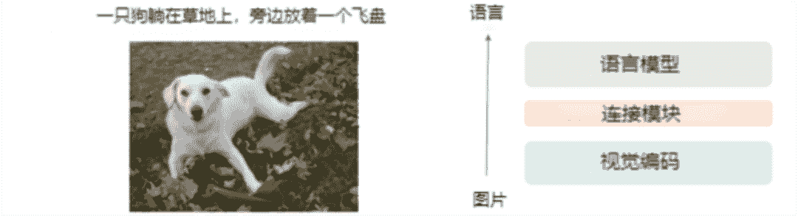

上述介绍文本和图像都被转换成向量的形式，但这并不意味着**它们可以**直接结合使用。问题在于，这两种模态的向量是在不同的向量空间中学习并形成的，它们各自对事物的理解存在差异。例如，图像中“小狗”的Embedding和文本中“小狗”的Embedding，在两种模态中的表示可能截然不同。这就引出了一个重要的概念——模态对齐。

下篇内容将围绕多模态模型对齐的方法进行多模态模型总结，并引入多模态框架PaddleMIX进行多任务实战，帮助大家快速了解多模态技术。

# 06、多模态模型训练流程

多模态大型语言模型的训练流程主要分为两个阶段：多模态预训练（MM PT）和多模态指令调优（MM IT）。以下为两阶段介绍：

**（1）多模态预训练：**

> **目标：**预训练阶段的目标是通过训练输入和输出投影器（IP和OP）来实现不同模态之间的对齐，以便LLM主干能够有效地处理多模态输入。

> **数据集：**通常使用X-Text数据集，包含图像-文本（Image-Text）、视频-文本（Video-Text）和音频-文本（Audio-Text）对，以及交错的图像-文本语料库等。

> **优化：**训练过程中，主要优化的是输入和输出投影器的参数，以最小化条件文本生成损失。通常涉及到将模态编码器的输出特征与文本特征对齐，生成的对齐特征作为LLM主干的输入。

**（2）多模态指令调优：**

> **目标：**指令调优阶段的目标是通过指令格式化的数据集对预训练的MM-LLM进行微调，以提高模型遵循新指令的能力，从而增强其在未见任务上的性能。

> **方法：**指令调优的训练方法可以分为监督式微调（SFT）和基于人类反馈的强化学习（RLHF）。SFT将PT阶段的数据转换为指令感知格式，而RLHF则依赖于对模型响应的人类反馈进行进一步微调。

> **数据集：**使用的数据集通常包括视觉问答（VQA）、指令遵循任务等，数据集结构可以是单轮问答或多轮对话。