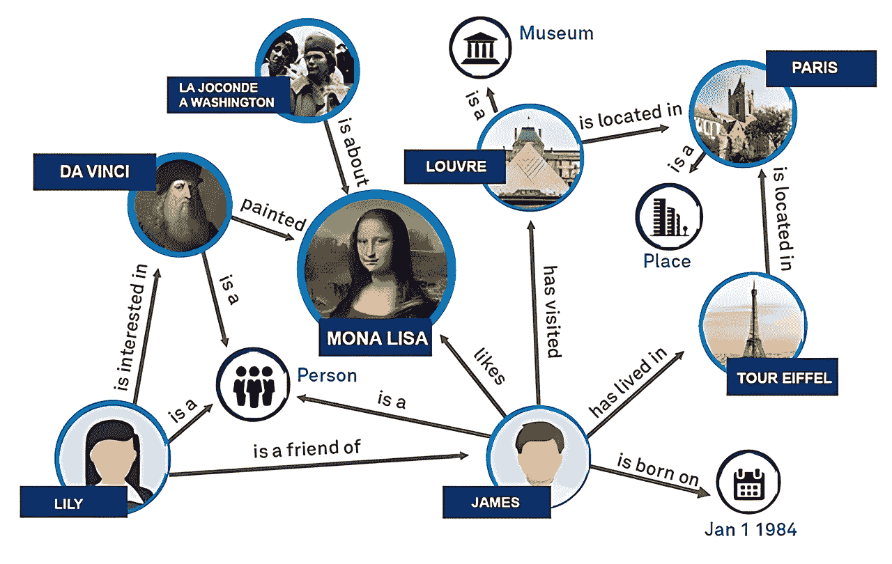
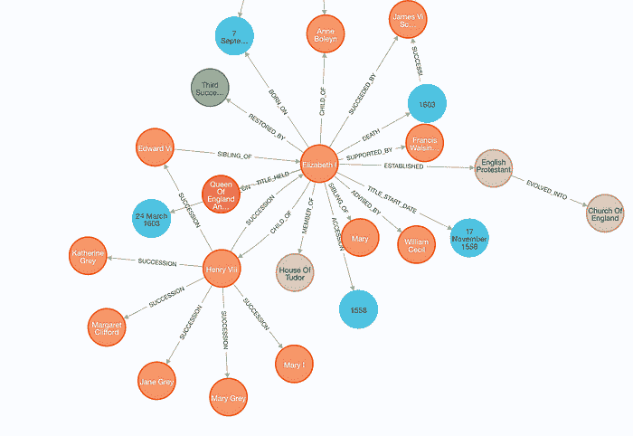
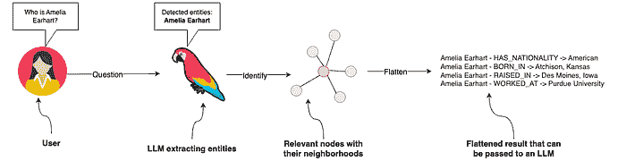

# GraphRAG：知识图谱+大模型 LangChain实现

> 来源：[https://qqs7y1hozd1.feishu.cn/docx/GzmSdt1RNo7UdBxQiXgcpb5QnZb](https://qqs7y1hozd1.feishu.cn/docx/GzmSdt1RNo7UdBxQiXgcpb5QnZb)

## **写在前面**

本文介绍了如何通过构建知识图谱和利用大型语言模型（LLM）增强RAG应用的准确性

重点讲解了使用Neo4j图数据库、LLMGraphTransformer、混合检索方法，包括图数据库中的知识图谱构建、混合搜索策略及其实战示例



图检索增强生成（Graph RAG）正逐渐流行起来，成为传统向量搜索方法的有力补充。这种方法利用图数据库的结构化特性，将数据以节点和关系的形式组织起来，从而增强检索信息的深度和上下文关联性

1.  图在表示和存储多样化且相互关联的信息方面具有天然优势，能够轻松捕捉不同数据类型间的复杂关系和属性。而向量数据库在处理这类结构化信息时则显得力不从心，它们更擅长通过高维向量处理非结构化数据

1.  在 RAG 应用中，结合结构化的图数据和非结构化的文本向量搜索，可以让我们同时享受两者的优势，这也是本文将要探讨的内容

## 一、知识图谱的确很有用，但如何构建一个呢？

+   构建知识图谱通常是利用图数据表示的强大功能中最困难的一步。它需要收集和整理数据，这需要对领域知识和图建模有深刻的理解。为了简化这一过程，开始尝试使用大型语言模型（LLM）

+   LLM 凭借其对语言和上下文的深刻理解，可以自动化知识图谱创建过程中的大部分工作。通过分析文本数据，这些模型能够识别实体，理解它们之间的关系，并提出如何在图结构中最佳表示这些实体

+   基于这些实验，已经将图构建模块的首个版本集成到了 LangChain 中，本文将展示其应用

## **Neo4j 环境搭建**

+   为了跟随本文的示例，需要搭建一个 Neo4j 实例

> 最简单的方法是在 Neo4j Aura 上启动一个免费实例，它提供了 Neo4j 数据库的云版本。当然，您也可以通过下载 Neo4j Desktop 应用程序来创建一个本地数据库实例

```
os.environ[&quot;OPENAI_API_KEY&quot;] = &quot;sk-&quot;
os.environ[&quot;NEO4J_URI&quot;] = &quot;bolt://localhost:7687&quot;
os.environ[&quot;NEO4J_USERNAME&quot;] = &quot;neo4j&quot;
os.environ[&quot;NEO4J_PASSWORD&quot;] = &quot;password&quot;

graph = Neo4jGraph()
```

+   **此外，您还需要一个 OpenAI** 密钥，因为我们将在本文中使用他们的模型

## **数据导入**

在本次演示中，将使用伊丽莎白一世的维基百科页面。可以利用LangChain加载器轻松地从维基百科获取并分割文档

```
# 读取维基百科文章
raw_documents = WikipediaLoader(query=&quot;Elizabeth I&quot;).load()

# 定义分块策略
text_splitter = TokenTextSplitter(chunk_size=512, chunk_overlap=24)
documents = text_splitter.split_documents(raw_documents[:3])
```

+   现在是时候根据获取的文档来构建图谱了

为此，我们开发了一个 LLMGraphTransformer 模块，它极大地简化了在图数据库中构建和存储知识图谱的过程

```
llm=ChatOpenAI(temperature=0, model_name=&quot;gpt-4-0125-preview&quot;)
llm_transformer = LLMGraphTransformer(llm=llm)

# 提取图数据
graph_documents = llm_transformer.convert_to_graph_documents(documents)

# 存储到 neo4j
graph.add_graph_documents(
  graph_documents, 
  baseEntityLabel=True, 
  include_source=True
)
```

您可以**指定知识图谱生成链使用哪种 L**LM。目前，只支持 OpenAI 和 Mistral 的函数调用模型。不过，计划未来会扩展 LLM 的选择范围。在这个例子中，使用的是最新的 GPT-4。需要注意的是，生成的图谱质量很大程度上取决于您使用的模型。理论上，应该选择能力最强的模型

+   LLM 图转**换器返回的**图文档可以通过 add_graph_documents方法导入到 Neo4j

+   **baseEn**tityLabel 参数为每个节点添加了一个额外的 Entity 标签，以增强索引和查询性能

+   include_source 参数则将节点与其原始文档关联起来，便于数据追溯和理解上下文


## **RAG 的混合检索**

在图谱生成之后，**将采用一种混合检索方法，结合向量和关键**字索引以及图检索技术，用于 RAG 应用

上图展示了一个检索过程，从用户提出问题开始，然后由 RAG 检索器处理。这个检索器结合了关键字和向量搜索来筛选非结构化文本数据，并将其与从知识图谱中提取的信息结合起来



由于 Neo4j 同时支持关键字和向量索引，可以使用单一数据库系统实现所有三种检索方式。这些来源的数据将被送入 LLM，以生成并提供最终答案

+   **非结构化数据检索器**

可以使用 Neo4jVector.from_existing_graph 方法为文档添加关键字和向量检索功能。该方法为混合搜索方法配置了关键字和向量搜索索引，目标是标记为 Document 的节点。如果缺少文本嵌入值，它还会自动计算

```
vector_index = Neo4jVector.from_existing_graph(
    OpenAIEmbeddings(),
    search_type=&quot;hybrid&quot;,
    node_label=&quot;Document&quot;,
    text_node_properties=[&quot;text&quot;],
    embedding_node_property=&quot;embedding&quot;
)
```

**然后，可以使用 ****similarity**_search 方法来调用向量索引

+   **图检索器**

另一方面，配置图检索器虽然更为复杂，但提供了更大的灵活性，在这个例子中，将使用全文索引来识别相关节点，然后返回它们的直接邻域



+   **图检索器示意图**

图检索器首先识别输入中的相关实体

为了简化，指导 LLM 识别人物、组织和地点。为了实现这一点，将使用 LCEL 配合新加入的 with_structured_output 方法

```
# 从文本中提取实体
class Entities(BaseModel):
    &quot;&quot;&quot;识别实体相关信息。&quot;&quot;&quot;

    names: List[str] = Field(
        ...,
        description=&quot;文本中出现的所有人物、组织或商业实体的名称&quot;,
    )

prompt = ChatPromptTemplate.from_messages(
    [
        (
            &quot;system&quot;,
            &quot;您正在从文本中提取组织和人物实体。&quot;,
        ),
        (
            &quot;human&quot;,
            &quot;请按照给定格式从以下输入中提取信息：{question}&quot;,
        ),
    ]
)

entity_chain = prompt | llm.with_structured_output(Entities)
```

让我们来实际测试一下：

```
entity_chain.invoke({&quot;question&quot;: &quot;阿梅莉亚·埃尔哈特在哪里出生？&quot;}).names
# [&#x27;阿梅莉亚·埃尔哈特&#x27;]
```

很好，现在我们能够在问题中识别出实体，接下来我们将使用全文索引将这些实体映射到知识图谱中。首先，我们需要定义一个全文索引，并创建一个函数来生成全文查询，这个查询允许一定程度的拼写错误，这里我们不详细展开

```
graph.query(
    &quot;CREATE FULLTEXT INDEX entity IF NOT EXISTS FOR (e:__Entity__) ON EACH [e.id]&quot;)

def generate_full_text_query(input: str) -&gt; str:
    &quot;&quot;&quot;
    为给定的输入字符串生成全文搜索查询。

    该函数构建一个适用于全文搜索的查询字符串。它通过将输入字符串分割成单词，并对每个单词附加一个相似性阈值（允许2个字符变化），然后使用 AND 运算符将它们组合起来。这对于将用户问题中的实体映射到数据库值非常有用，并且能够容忍一些拼写错误。
    &quot;&quot;&quot;
    full_text_query = &quot;&quot;
    words = [word for word in remove_lucene_chars(input).split() if word]
    for word in words[:-1]:
        full_text_query += f&quot;{word}~2 AND&quot;
    full_text_query += f&quot;{words[-1]}~2&quot;
    return full_text_query.strip()
```

现在，让我们整合所有步骤

```
# 全文索引查询
def structured_retriever(question: str) -&gt; str:
    &quot;&quot;&quot;
    收集问题中提到的实体的邻域信息
    &quot;&quot;&quot;
    result = &quot;&quot;
    entities = entity_chain.invoke({&quot;question&quot;: question})
    for entity in entities.names:
        response = graph.query(
            &quot;&quot;&quot;CALL db.index.fulltext.queryNodes(&#x27;entity&#x27;, $query, 
            {limit:2})
            YIELD node,score
            CALL {
              MATCH (node)-[r:!MENTIONS]-&gt;(neighbor)
              RETURN node.id + &#x27; - &#x27; + type(r) + &#x27; -&gt; &#x27; + neighbor.id AS 
              output
              UNION
              MATCH (node)&lt;-[r:!MENTIONS]-(neighbor)
              RETURN neighbor.id + &#x27; - &#x27; + type(r) + &#x27; -&gt; &#x27; +  node.id AS 
              output
            }
            RETURN output LIMIT 50
            &quot;&quot;&quot;,
            {&quot;query&quot;: generate_full_text_query(entity)},
        )
        result += &quot;\n&quot;.join([el[&#x27;output&#x27;] for el in response])
    return result
```

structured_retriever 函数首先识别用户问题中的实体，然后遍历这些实体，使用 Cypher 模板检索相关节点的邻域信息。让我们来实际测试一下！

```
print(structured_retriever(&quot;伊丽莎白一世是谁？&quot;))
# 伊丽莎白一世 - BORN_ON -&gt; 1533年9月7日
# 伊丽莎白一世 - DIED_ON -&gt; 1603年3月24日
# 伊丽莎白一世 - TITLE_HELD_FROM -&gt; 英格兰和爱尔兰女王
# 伊丽莎白一世 - TITLE_HELD_UNTIL -&gt; 1558年11月17日
# 伊丽莎白一世 - MEMBER_OF -&gt; 都铎王朝
# 伊丽莎白一世 - CHILD_OF -&gt; 亨利八世
# 等等...
```

+   **最终检索器**

正如我们一开始提到的，我们将结合非结构化和图检索器来创建最终的上下文，这将传递给 LLM

```
def retriever(question: str):
    print(f&quot;搜索查询：{question}&quot;)
    structured_data = structured_retriever(question)
    unstructured_data = [el.page_content for el in vector_index.similarity_search(question)]
    final_data = f&quot;&quot;&quot;结构化数据：
{structured_data}
非结构化数据：
{&quot;#Document &quot;.join(unstructured_data)}
    &quot;&quot;&quot;
    return final_data
```

由于使用的是 **Python**，可以使用**f-string**轻松地将输出合并

## **定义RAG链**

已经成功实现了 RAG 的检索组件。接下来，将引入一个提示，它利用混合检索器提供的上下文来生成响应，从而完成 RAG 链的实现

```
template = &quot;&quot;&quot;根据以下上下文回答问题：
{context}

问题：{question}
&quot;&quot;&quot;
prompt = ChatPromptTemplate.from_template(template)

chain = (
    RunnableParallel(
        {
            &quot;context&quot;: _search_query | retriever,
            &quot;question&quot;: RunnablePassthrough(),
        }
    )
    | prompt
    | llm
    | StrOutputParser()
)
```

最后，我们可以测试我们的混合 RAG 实现

```
chain.invoke({&quot;question&quot;: &quot;伊丽莎白一世属于哪个家族？&quot;})
# 搜索查询：伊丽莎白一世属于哪个家族？
# &#x27;伊丽莎白一世属于都铎王朝。&#x27;
```

还加入了一个查询重写特性，使得 RAG 链能够适应允许后续问题的对话环境。鉴于我们使用了向量和关键字搜索方法，我们需要重写后续问题以优化搜索过程

```
chain.invoke(
    {
        &quot;question&quot;: &quot;她何时出生？&quot;,
        &quot;chat_history&quot;: [(&quot;伊丽莎白一世属于哪个家族？&quot;,
        &quot;都铎王朝&quot;)],

    }
)
# 搜索查询：伊丽莎白一世何时出生？
# &#x27;伊丽莎白一世出生于1533年9月7日。&#x27;
```

可以看到，‘她何时出生？’ 首先被重写为 ‘伊丽莎白一世何时出生？’。然后使用重写后的查询来检索相关上下文并回答问题

## 总 结

随着 LLMGraphTransformer 的引入，生成知识图谱的过程现在应该更加顺畅和易于访问，这使得任何想要通过知识图谱提供的深度和上下文来增强其基于 RAG 的应用的人更容易上手。这只是一个开始，因为我们计划进行更多的改进