# KAG：RAG已经不够了，知识增强生成才是王道

> 来源：[https://qqs7y1hozd1.feishu.cn/docx/T7ESdK4d1ornbix5RZecDW10nqt](https://qqs7y1hozd1.feishu.cn/docx/T7ESdK4d1ornbix5RZecDW10nqt)

## 为什么要提出KAG框架

检索增强生成（RAG）技术得到广泛运用，利用外部检索系统，显著提升大语言模型的时效性，并大幅减少模型幻觉。

**为了进一步提升RAG在多跳任务、跨段落任务的性能，引入知识图谱，包括G**raphRAG、DALK、SUGRE、ToG 2.0 和 HippoRAG 等。

尽管 RAG 及其优化方案已经解决了因知识缺乏和更新导致的大部分幻觉问题，但生成的文本仍然缺乏连贯性和逻辑性，难以产生正确且有价值的答案，尤其是在法律、医学和科学等需要分析推理的专业领域：

+   **首先，真实场景的业务流程一般需**要基于知识片段之间特定关系的推理来收集与回答问题相关的信息。但RAG 通常依赖于文本或向量的相似性来检索参考信息，会可能导致搜索结果不完整和重复。

+   其次，**真实场景往往涉及逻辑或数值推理**，例如确定一组数据在时间序列中的增减情况，而语言模型使用的下一个标记预测机制在处理这类问题上仍然显得力不从心。

为了解决以上问题，也就提出了知识增强生成（Knowledge Augmented Generation，KAG）。

## KAG框架

KAG框架充分利用知识图谱和RAG技术的互补优势。不仅将图结构整合到知识库，还将知识图谱的语义类型、关系以及知识图谱问答（KGQA）整合到KAG中。

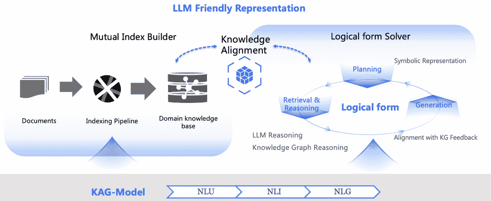

如上图所示，KAG 架构由三大核心组成：KAG-Builder、KAG-Solver 和 KAG-Model。

+   KAG-Builder 负责构建离线索引，此模块提出了一个与大语言模型兼容的知识表示框架，并实现了知识结构与文本片段之间的互索引机制。

+   KAG-S**olver ****引**入了一个以逻辑形式为指导的混合推理引擎，整合了大型语言模型推理、知识推理和数学逻辑推理。利用语义推理进行知识对齐，以增强 KAG-Builder 和 KAG-Solver 在知识表示和检索方面的准确性。

+   KAG-Model 则基于通用语言模型，针对每个模块所需的特定能力进行优化，从而全面提升模块性能。

## 2.1 知识表示框架 LMFriSPG

为了定义一个对大型语言模型更友好的知识语义表达方式，作者对 SPG 进行了三大方面的升级：深化文本上下文意识、动态属性和知识分层，并将其命名为 LLMFriSPG。

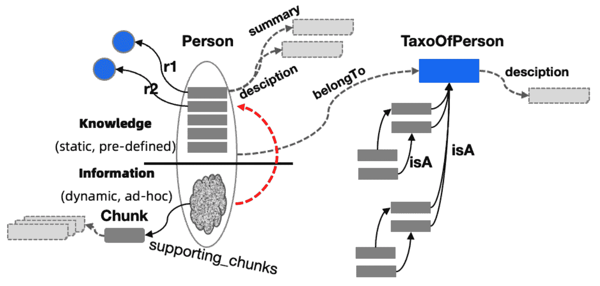

> SPG：Semantic-enhanced Programmable Graph，语义增强可编程知识图谱。

上图展示了 LLMFriSPG：一个专为大型语言模型（LLM）设计的友好型知识表示框架。

LLMFriSPG将实例与概念区分开来，通过概念实现与 LLMs 的对接。

> SPG 的属性被划分为知识区和信息区，也就是静态区和动态区，分别与具有严格模式约束的决策专业知识以及具有开放信息表示的文档检索索引知识相兼容。

图中的红色虚线描绘了**从信息提炼为知识**的融合与挖掘过程。增强的文档块表示方法为 LLMs 提供了可追溯且易于解读的文本上下文。

```
ℳ = { , ρ,  , ℒ}
```

+   其中 ℳ 代表 LLMFriSPG 定义的所有类型

+   代表所有实体类型（EntityType）（例如上图中的“人”）、事件类型类（EventType）以及所有与 LPG 语法声明兼容的预定义属性。

+   代表所有概念类型类（ConceptType）、概念及其关系，每个概念树的根节点是一个与 LPG 语法兼容的概念类型类（如上图中的“人的概念分类”），每个概念节点都有一个独特的概念类型类。

+   ρ 代表从实例到概念的归纳关系。

+   ℓ 代表定义在逻辑关系和逻辑概念上的可执行规则全集。

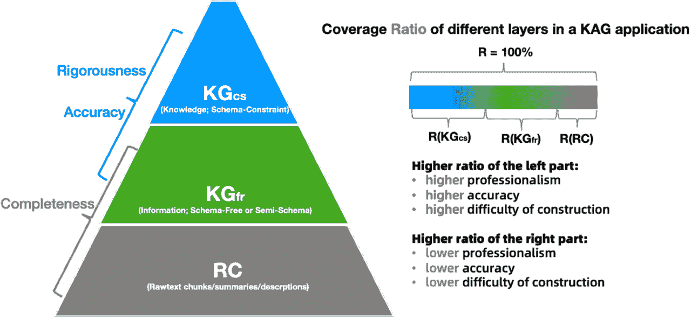

如上图，作者将知识和信息表示分为三个层次：

+   **知识层**定义为 KGcs（KG constraint， cs应该是 constraint 的缩写），包括遵循领域模式约束、经过提炼、整合和评估的领域知识。

+   **信息层**定义为KGfr（KG schema free，fr应该是free的缩写），代表通过信息提取得到的实体和关系等图数据。

+   **原始块层**（RC，Raw Chunks）则是指经过语义分割处理后的原始文档片段。

**如**上图右侧所示，在特定领域应用中，R(KGcs)、R(KGf r)和R(RC)分别代表了它们在解决目标领域问题时的知识覆盖范围。

+   如果应用对知识准确性和逻辑严密性有更高的要求，则需要构建更多的领域结构化知识，并投入更多的专家资源以扩大R(KGcs)的覆盖范围。

+   如果应用更**注重检索效率**，并对信息的一定损失或错误有一定的容忍度，则应扩大R(KGfr)的覆盖范围，充分利用KAG的自动化知识构建能力，减少专家资源的消耗。

### 2.2 互索引（Mutual Indexing）

KAG 构建器（KAG-Builder）包括三个紧密相连的流程：结构化信息获取、知识语义对齐和图存储写入。主要目标包括：

+   1）在图结构与文本块之间构建互索引，为图结构提供更丰富的描述性上下文；

+   2）利用概念语义图对不同粒度的知识进行对齐，减少噪声，增强图的连通性。

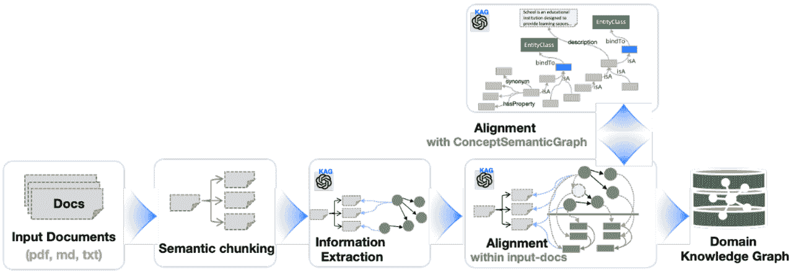

**上图展示了**** KAG 构建器处理领域**非结构化文档的流水线。流程从左至右：

+   首先，通过信息抽取获取短语和三元组；

+   接着，通过语义对齐进行消歧和整合；

+   最终，生成的知识图谱被存储起来。

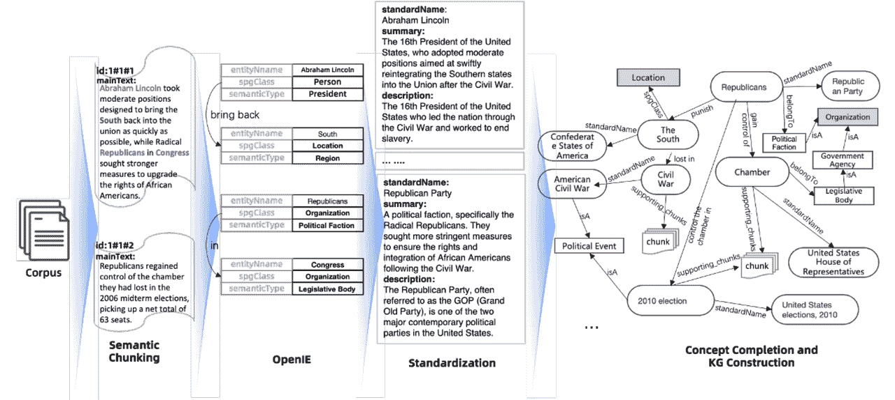

上图是一个 KAG Builder 的示例。

#### 2.2.1 语义分块（ Semantic Chunking）

**基于文档的结构层次和段落间的内在逻辑联**系，利用系统内置提示实现了语义分块过程。产生的文本块既符合长度限制（特别是为了适应 LLM 的上下文窗口大小限制），又保持了语义连贯性，确保每个块的内容在主题上紧密相关。

+   articleID 代表全局唯一的文章 ID

+   paraCode 代表文章中的段落代码

+   idInPara 是段落中每个块的顺序代码

内容上的邻接关系在它们的标识符上也表现为顺序上的邻接。

原始文档与其分割出的块之间建立了双向关系，便于在文档内容的不同粒度间进行导航和理解上下文。这种结构化的分割方法不仅优化了与大型语言模型的兼容性，还保留了并增强了文档的内在语义结构和关联性。

#### 2.2.2 信息提取与更丰富的描述性上下文

**在给定数据集的基础上，采用大语言模型来提取实体、**事件、概念和关系，构建知识图谱 KGf。

采用的大语言模型可以是无需微调的大型语言模型（LLM）（如 GPT-3.5、DeepSeek、QWen 等）或微调的小尺寸大模型 Hum。

**然后，构建 KGfr 与 RC 之间的互索引结构，实**现跨文档的实体和关系链接。分为三个步骤：

+   首先，逐块提取实体集 E={e1, e2, e3, …}；

+   其次，提取与所有实体相关联的事件集 EV={ev1, ev2, ev3, …}，并迭代提取实体集 E 中所有实体之间的关系集 R={r1, r2, r3, …}；

+   最后，完成实例与其 spgClass 之间的所有上位关系。

为了后续的知识对齐阶段提供便利，并解决 Wikidata和 ConceptNet等知识短语识别度低的问题，在实体提取阶段，使用 LLMs 为每个实例 e 生成内置属性描述、摘要、semanticType、spgClass、描述 semanticType，根据 e.description、e.summary 的结构将它们存储在 e 实例存储中，并按照<e, belongTo, semanticType>和<e, hasClass, spgClass>的结构进行组织。

#### 2.2.3 领域知识注入和约束

当开放信息抽取（openIE）应用于专业领域时，可能会引入不相关的噪声。这些噪声和不相关的语料库可能会显著降低 LLMs 的性能。因此将提取的信息与领域知识对齐是一个难题。

KAG 中的领域知识对齐能力包括：

> 1）领域术语和概念注入。

> 2）模式约束提取。

> 3）按文档类型预定义知识结构。

#### 2.2.4 文本块向量与知识结构的互索引

**K**AG 的互索引机制遵循 LLMFriSPG 的语义表示，是一套知识管理和存储方案。涵盖四个核心数据结构：

+   **1、共享模式，**作为项目层面预设的 SPG 类别，囊括了实体类型、概念类型和事件类型，它们作为高层分类，例如人物、组织、地理位置、日期、生物、作品、事件。

+   **2、实例图，**囊括了 KGcs 和 KGfr 中的所有事件和实体实例，无论是通过无模式的开放信息抽取还是通过模式约束的结构化抽取得到的实例，均存储于 KG 存储中。

+   **3、文本块，**是一种特殊的实体节点，符合块实体类型的定义。

+   **4、概念图，**作为知识对齐的核心，由一系列概念及其关系构成，概念节点代表了实例的细粒度类型。通过关系预测，实例节点能够与概念节点相连，从而获得其细粒度的语义类型。

**此外，还有两种存储结构：**

+   **1、KG 存储，**将 KG 数据结构存储于 LPG（Labeled Property Graph） 数据库中，例如 TuGraph、Neo4J。

+   **2、向量存储，**将文本和向量存储于向量存储引擎中，如 ElasticSearch、Milvus，或是 LPG 引擎内置的向量存储。

### 2.3 逻辑形式求解器

在攻克复杂问题的道路上，通常遵循三大核心步骤：规划、推理和检索。

+   **规划：**将问题拆解是一种规划行为，旨在明确接下来的解题方向。

+   **推理：**包括基于拆解后的问题检索相关信息，根据检索结果推导出问题的答案，或者在现有信息不足以解答时，对子问题进行进一步的拆解。

+   **检索，**为了寻找能够作为原始问题或拆解后的子问题参考依据的内容。

在传统** RA**G 中，由于各模块间的互动基于自然语言的向量表达，因此常常出现偏差。借鉴知识图谱问答中常用的逻辑形式，设计了一种具备推理与检索功能的可执行语言。这种语言能够将问题拆解为多个逻辑表达式，每个表达式都可能涵盖检索或逻辑运算的功能。这一过程通过互索引机制实现。

**同时，受到 ReSP 的启发，设计**了一种基于反思和全局记忆的多轮解题机制。

+   首先将当前问题分解为一系列逻辑形式的子问题 list，然后通过混合推理来逐一解决。

+   如果能够通过结构化知识的多跳推理直接得到确切答案，系统将直接返回结果。

+   若非如此，系统将进行反思：将与 list 相关的答案和检索结果存入全局记忆，并判断问题是否已解决。

+   如果问题仍未解决，系统将生成额外问题并进入下一轮迭代。

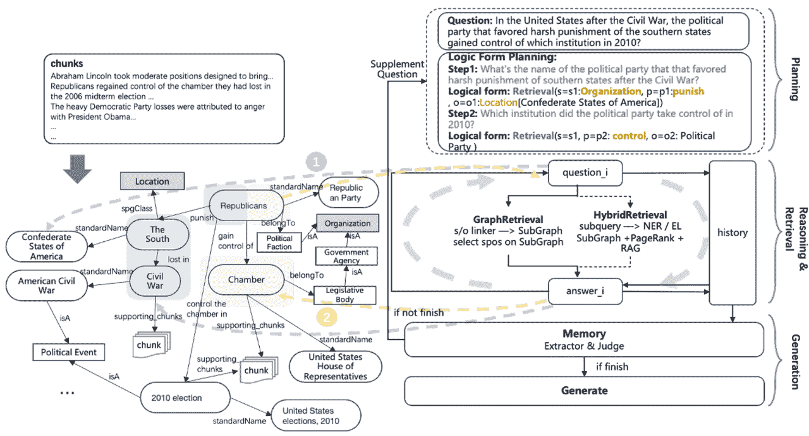

上图展示了该过程。左侧展示了知识图谱构建过程，右侧则展示了整个推理和迭代流程。

这种逻辑形式语言具有以下三大优势：

+   采用符号语言，增强了问题拆解和推理的严谨性与可解释性。

+   充分利用 LLMFriSPG 的层次化表示，通过符号图结构引导事实和文本知识的检索。

+   整合问题拆解与检索流程，简化了系统复杂度。

#### 2.3.1 逻辑形式规划

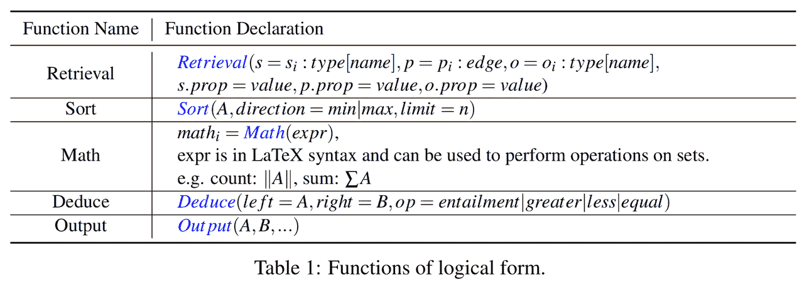

**如**上表所示，逻辑函数是一系列执行动作表示。通过精心规划这些表达式的组合，可以将复杂问题拆解，进而推理出精细的解决方案。

+   **检索：**依据SPO检索所得的知识和信息，同一表达式中不应重复出现s、p、o。查询时可对s、p、o施加约束。多跳查询需要多次检索。若当前变量指向之前提及的变量，则变量名需与所引用变量名一致，仅需提供变量名。首次引用时指定知识类型和名称。

+   **排序：**对检索结果进行排序。A代表检索到的SPO（主体-谓语-宾语）的变量名（si, oi, 或 s.prop, p.prop, o.prop）。direction定义排序方向，direction = min表示升序，direction = max表示降序。limit = n表示输出前N个结果。

+   **数学：**执行数学运算。expr使用LaTeX语法，可对检索结果（集合）或常数进行计算。mathi表示计算结果，可用作后续操作中的变量名。

+   **推理：**根据检索或计算结果回答问题。A、B可以是检索到的SPO的变量名或常数。运算符op = entailment|greater|less|equal分别表示A蕴含B、A大于B、A小于B和A等于B。

#### 2.3.2 推理的逻辑形式

当自然语言表述的查询语句用于搜索时，往往存在逻辑上的模糊性，比如“寻找含有蔬菜或水果的图片”与“寻找含有蔬菜和水果的图片”。不论是文本搜索还是向量搜索，这两类查询的相似度极高，但它们的答案却可能截然不同。

**对于包含逻辑推理过程的问题，如涉及“与”、“或”、“非**”以及交集和差集的情况，也是同样的道理。

> 因此，采用逻辑形式来表达问题，以便能够清晰地描述语义关系。与 IRCOT 类似，把复杂的原始问题拆解，并规划出多种执行动作，包括多步骤的信息检索、数值计算、逻辑推理和语义推导。每个子问题都通过逻辑形式函数来表达，子问题之间的联系则通过变量引用来建立。

#### 2.3.3 检索的逻辑形式

在传统的 RAG 模型中，通过计算问题与文档片段嵌入之间的相似度（如余弦相似度）来实现信息检索，其中嵌入模型的语义表达能力至关重要。这通常包括稀疏编码器（如 BM25）和密集检索器（基于 BERT 架构的预训练语言模型）。稀疏与密集嵌入方法各自捕捉不同的关联特征，通过利用彼此的互补信息，相得益彰。

> 目前，将这两种方法结合的常见做法是将两种**搜索方式的得分进行集成，但在实**际操**作中，不同问题可能需要不同**的搜索策略，尤其是在需要多跳推理的问题上。当查询包含专有名词、人物、地点、时间、数字和坐标时，预训练模型的表现力可能受限，此时需要更精确的文本索引。而对于更接近文本段落表达的查询，如场景描述、行为动作和抽象概念，这两种方法可能会在某些问题中结合使用。

在设计逻辑形式时，可以有效地融合这两种检索方法。当需要将关键字信息作为明确的过滤条件时，可以在检索函数中指定选择条件，实现结构化检索。

例如，对于查询“在杭州西湖区申请残疾证需要哪些文件？”，检索函数可以表示为：

```
Retrieval(s=s1:Event[applying for a disability certificate], p=p1:support_chunks, o=o1:Chunk, s.location=West Lake, Hangzhou)
```

### 2.4 知识对齐

**利用信息提取构建知识图谱索引和基于向量相似**度的检索在知识对齐方面存在三个主要缺陷：

+   **知识间语义关系错位：**正确答案与查询之间通常需要特定的语义关系，例如“包含”、“导致”和“属于”。然而，检索过程所依赖的相似性是一种缺乏属性和方向的弱语义度量，可能导致内容检索不精确。

+   **知识粒度不一致：**开放信息抽取带来的知识粒度差异、噪声和不相关性问题对知识管理构成了巨大挑战。语言的多样性导致了众多的同义词或类似节点，使得知识元素间的连通性降低，检索召回率不完整。

+   **与领域知识结构不匹配：**特定领域内缺乏有组织、系统化的知识。本应相互关联的知识呈现碎片化，导致检索内容缺乏专业性。

为解决这些问题，作者提出了一种解决方案：通过语义推理利用概念图来增强离线索引和在线检索。

包括知识实例标准化、实例到概念的链接、语义关系完善和领域知识注入等任务。

+   在提取阶段为每个实例、概念或关系添加了描述性文本信息，以提高其可解释性和上下文相关性。

+   **KAG**** 支持注**入领域概念和术语知识，以减少垂直领域中知识粒度不匹配造成的噪声问题。

概念推理的目标是充分利用向量检索和概念推理，基于前述知识结构完成概念关系，提高领域知识图谱的准确性和连通性。

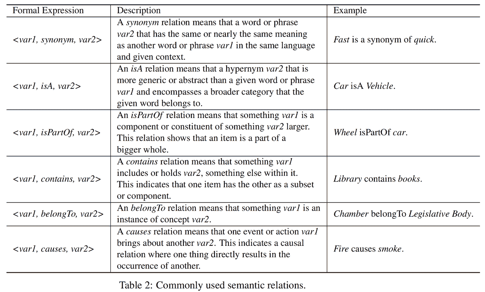

如上表所示，总结了检索和推理通常需要的六种语义关系。

#### 2.4.1 增强索引

**通**过语义推理增强索引的过程，实际是利用大型语言模型预测索引项之间的语义关系或相关知识元素，涵盖四种策略：

+   知识实例的消歧和融合：首先利用实体的直接关联和描述信息来预测同义词关系，从而获得实体的同义词实例集。接着，从同义词集中确定目标实体。最终，应用实体融合规则，将同义词集中剩余实例的属性和关系复制到目标实体，并将其名称添加为目标实体的同义词，同时立即删除这些剩余实例。

+   预测实例与概念间的关系：对于每个知识实例（例如事件、实体），预测其对应的概念，并添加推导出的三元组<ei, belongTo, cj>到知识索引中。比如：<Chamber, belongTo, Legislative Body>意味着Chamber在分类中属于Legislative Body。

+   完善概念及其相互关系：在提取过程中，利用概念推理来完善语义类型和spgClass之间的所有上位词和isA关系。比如，可以在提取阶段得知Chamber的语义类型是Legislative Body，其spgClass是Organization。通过语义完善，能够得出<Legislative Body, isA, Government Agency>, <Government Agency, isA, Organization>。这样的语义完善使得KGfr空间的三元组信息更加完整，节点之间的连通性也更加紧密。

#### 2.4.2 增强检索

在检索阶段，使用语义关系推理根据逻辑形式中的短语和类型来搜索知识图谱索引。对于逻辑形式中提到的类型或关系，采用结合语义关系推理与相似度检索的方法，以替代传统的相似度检索方法。

这种检索方法使检索路径更加专业和逻辑化，从而获得正确答案。


+   首先，混合推理进行精确的类型匹配和实体链接。

+   **如果类型匹配失败，则进行语义推理。如上图所示，如果类型 Political Party 匹配失败，则使用**语义推理预测 Political Party 包含 Political Faction，并从 Political Faction 开始进行推理或路径计算。

### 2.5 KAG 模型

KAG 涵盖了两个核心计算流程：

+   离线构建索引

+   在线处理查询与生成答案

在小规模语言模型盛行的时代，这些任务通常需要两个独立的处理流程，每个流程都包含多个特定任务的 NLP 模型。这种设计不仅增加了应用系统的复杂性，提高了搭建成本，还因为模块间的错误传播而不可避免地带来了级联损失。与此相对，大型语言模型作为一种能力复合体，有潜力将这些流程统一为一个集成的、同步的端到端推理过程。

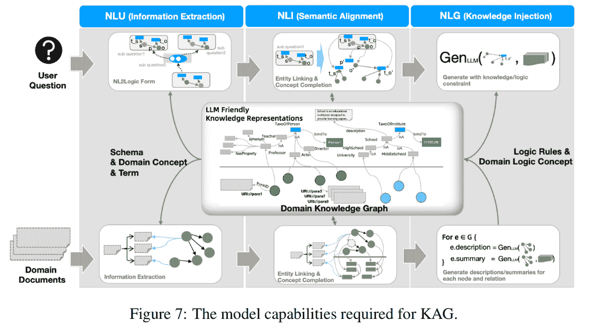

如上图，索引构建和问答生成的过程包含相似的步骤。这两个流程都可以概括为分类、实体识别、实体关系识别、语义对齐、嵌入以及信息块、实例或查询聚焦的摘要。

+   分类、实体识别和实体关系识别可以归为自然语言理解（NLU）

+   语义对齐和嵌入可以归类为自然语言推理（NLI）

+   信息块、实例或查询聚焦的摘要可以归入自然语言生成（NLG）

一个 RAG 系统依赖的自然语言处理的三大核心能力是 NLU、NLI 和 NLG。

为了减少将模型串联成流水线所带来的级联损失，将多个推理过程融合为单一推理过程

#### 2.5.1 NLU（自然语言理解）

NLU 自然语言处理的基石之一，涵盖了文本分类、命名实体识别、关系抽取、主宾语提取、触发词识别、事件论元抽取、事件抽取以及机器阅读理解等多个方面。

**为提升模型的理解力：**

+   搜集了超过 30 个公共数据集

+   进行了大规模的指令重构，设计了多种指令合成策略

利用此数据集对选定的基础模型进行监督式微调后，模型在下游任务中表现出更强的 NLU 能力。指令重构策略主要包括以下三种类型：

+   **标签打包：**此策略关注于标签引导任务，旨在根据标签提取文本或将文本映射到特定标签，涵盖分类、NER、RE 和 EE 等任务。

+   **灵活多样的输入输出格式：**LLM 通过遵循指令进行推理，若输入输出格式过于一致，可能导致模型过度拟合特定任务，缺乏对未知格式的泛化能力。

+   **带有任务指南的指令：**传统 NLP 训练常采用“问题海洋”策略，训练集中包含大量数据，使模型在学习过程中理解任务需求，例如在提取人名时是否包括职位。

**因此，对****于收集到的 N**LU 任务，通过 LLM 内的自省过程总结任务描述，创建包含任务描述的训练数据。为增强任务多样性，还采用启发式策略改写任务描述和答案，使模型能更准确地理解不同任务描述之间的差异，并根据指令完成任务。

**对六个基础模型进行了微调：**qwen2、llama2、baichuan2、llama3、mistral、phi3，并使用 OpenCompass 上记录的六个理解基准进行性能验证。下表展示了模型微调后的对比效果。

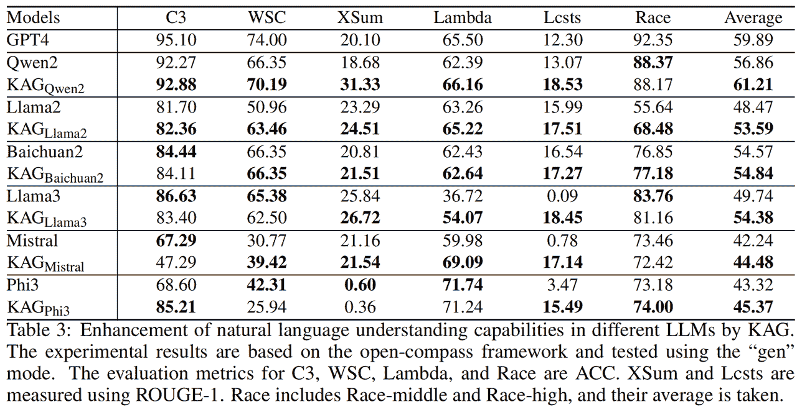

#### 2.5.2 自然语言推理

**N**LI 任务旨在推断特定短语间的语义联系，包括实体链接、消除歧义、分类体系扩展、上位词识别和文本蕴含等。

在知识库问答系统中，自然语言的多样性和模糊性，以及短语间微妙的语义联系，常常需要依靠 NLU 基础上的 NLI 任务来进一步对齐或检索相关信息。

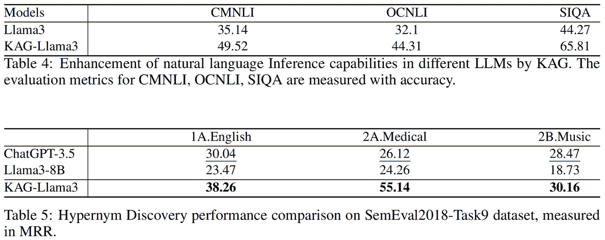

在 KAG 过程中，语义推理是一项核心能力。通过 NLI 任务和通用推理问答任务来评估模型性能，如上图。评估结果显示，KAG 模型在语义推理相关任务上取得显著提升：

+   在上位词识别任务中（这与语义增强索引和检索中所需的推理形式一致），微调的 KAG-llama 模型明显优于 Llama3 和 ChatGPT-3.5。

+   在 CMNLI、OCNLI 和 SIQA 上的表现超越了 Llama3，证明模型在通用逻辑推理方面同样表现出色。

#### 2.5.3 自然语言生成

开发了两种高效率的微调方法，专为特定领域场景设计，以期生成的内容能够更贴近实际场景的需求：即 K-LoRA 和 AKGF（Alignment with KG Feedback）。

**K-LoRA 预训练：**利用知识生成答案与从文本中提取知识是相反的过程。通过逆向操作前述的提取流程，能够创建一个“三元组到文本”的生成任务。经过大量实例的深入微调，模型学会识别知识图谱注入的信息格式，并能够习得目标文本的特定领域语言风格。为提高效率，继续采用基于 LoRA 的 SFT 策略，并将此步骤中获得的 LoRA 称为 K-LoRA。

**与 KG 反馈的对齐：**模型在回答中可能因过拟合等原因产生错误。借鉴了 RLHF 方法，希望 KG 充当自动评估器，对当前回答的知识准确性提供反馈，引导模型进一步优化。通过不同的输入格式或随机种子为每个查询生成多种回答。然后，利用 KG 对这些回答进行评分和排序。评分过程通过比较生成的答案与 KG 中的知识来判断其正确性。奖励由正确匹配的知识三元组数量决定。

**选取两个生物医学问答数据集 CMed**QA 和 BioASQ 来评估模型性能。

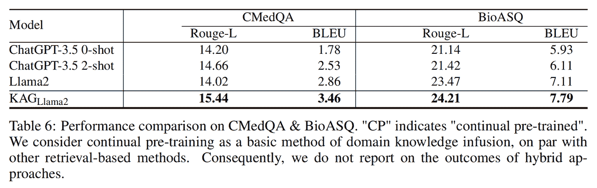

如上图，生成性能显著提升。

#### 2.5.4 单次推理

大多数检索增强型系统由一系列展示模型、检索器和生成模型组成，导致系统复杂度高、构建成本昂贵，以及由于模块间错误传播而不可避免的级联损失。

> 因此，作者提出了一种高效的单次统一生成和检索（OneGen）模型，允许任何大型语言模型（LLM）在单次前向传递中同时进行生成和检索。受到大型语言模型在文本嵌入方面最新进展的启发，通过增加特殊标记（即检索标记）扩展了原有词汇表，并将检索任务分配给自回归生成的检索标记。

在训练过程中，检索标记仅通过对比学习参与表示微调，其他输出标记则按语言模型目标进行训练。在推理阶段，利用检索标记进行高效的按需检索。不同于以往至少需要两个模型分别负责检索和生成的流水线方法，OneGen 将这两者统一在一个模型中，从而省去了单独的检索器需求，大幅降低了系统复杂性。

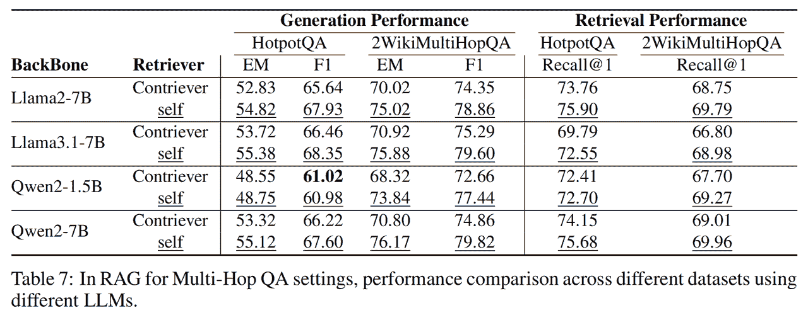

实验结果如上表所示：

+   1、OneGen 在 R→G 任务中展现了出色的效果，联合训练的检索和生成在 RAG 任务上实现了性能提升。Self-RAG 赋予 LLMs 自我评估和自适应检索的能力，而 OneGen 进一步增加了自我检索的功能。在所有数据集上均优于原始的 Self-RAG，特别是在 Pub 数据集上提升了 3.1 个百分点，在 ARC 数据集上提升了 2.8 个百分点，证明了联合训练的优势。

+   2、OneGen 在训练上极为高效，经过指令微调的 LLMs 展现出强大的检索能力，而且只需极少的额外调整。它需要的检索数据更少且质量要求更低，即使仅用 6 万个噪声样本和不完整的文档，也能实现与合成数据相当的性能。

## 效果评估

### 3.1 总体效果

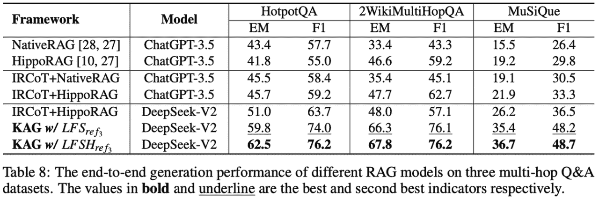

**上表展示了问答系统的****端到端性能****。**在基于 ChatGPT-3.5 作为核心模型的 RAG 框架中，HippoRAG 的表现超过了 NativeRAG。

> HippoRAG 采用了仿人类长期记忆的策略，促进了外部文档中的知识与 LLMs 的持续融合，显著提升了问答性能。然而，考虑到使用 ChatGPT-3.5 的高昂经济成本，选择了 DeepSeek-V2 API 作为替代方案。

平均来看，结合 DeepSeek-V2 API 的 IRCoT + HippoRAG 配置在性能上略胜 ChatGPT-3.5 一筹。

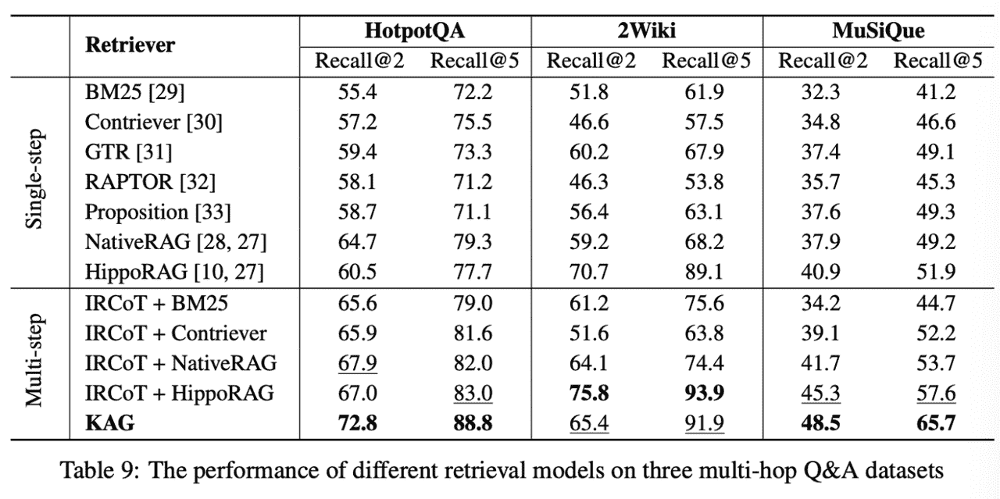

**上表中展示了单步和多步检索器的检索性能。实验结果显示，多步检**索器通常比单步检索器表现更佳。分析发现：

+   单步检索器检索的内容相似度极高，导致无法利用其结果推导出需要进行推理的问题的答案。

+   多步检索器解决了这一问题。 KAG 框架直接采用了多步检索器，并通过互索引、逻辑形式解题和知识对齐等策略显著提升了检索性能。

### 3.2 消融实验

#### 3.3.1 知识图谱索引消融实验

在图谱索引构建阶段，提出以下两种替代方案：

+   **互索引法（Mutual Indexing** Method，M_Indexing）：作为 KAG 框架的基准方法，利用信息提取技术（例如 OpenIE）从文档片段中提取短语和三元组，根据 LLMFriSPG 的层级表示构建图结构与文本片段之间的互索引关系，并将其存入知识图谱库。

+   **知**识对齐增强法（Knowledge Alignment Enhancement，K_Alignment）：利用知识对齐技术来增强知识图谱的互索引能力和逻辑形式引导的推理及检索效率。主要完成实例与概念的分类、概念的上下位词预测、概念间语义关系的完善、实体的消歧和整合等任务，从而增强知识的语义清晰度和实例间的连接性，为之后的逻辑形式引导的推理和检索打下坚实基础。

#### 3.3.2 推理与检索消融实验

**多轮自省机制。**引入了 ReSP的多轮自省机制，以评估逻辑形式求解器是否已经充分回答了问题。如果答案不尽完善，系统将迭代产生补充问题，直至全局记忆中的信息充足。对最大迭代次数 n 的影响进行了分析，记作 refn。当 n=1 时，意味着自省机制未启动。在推理和检索阶段，设计了以下三种替代方案：

+   片段检索器（ChunkRetri）。借鉴 HippoRAG的检索功能，为 KAG 设定了基线检索策略，旨在回忆起能够支持回答当前问题的 top_k 片段。片段得分通过权衡向量相似度和个性化 PageRank 得分来计算。

+   逻辑形式求解器启用图检索（LFrefn）：采用逻辑形式求解器进行推理，该方法利用预定义的逻辑形式解析并回答问题。首先，它深入挖掘 KGcs 和 KGfr 空间内的知识图谱结构，在推理过程中注重准确性与严谨性。如果前面的推理步骤未得出结果，它将利用 RC 中的 supporting_chunks 进行补充检索。

+   逻辑形式求解器启用混合检索（LFSHrefn）。对 LFrefn 进行了修改，关闭了直接推理的图检索功能，转而全部采用混合检索方法生成答案。能够评估图检索对推理性能的贡献。

#### 3.3.3 消融实验结果

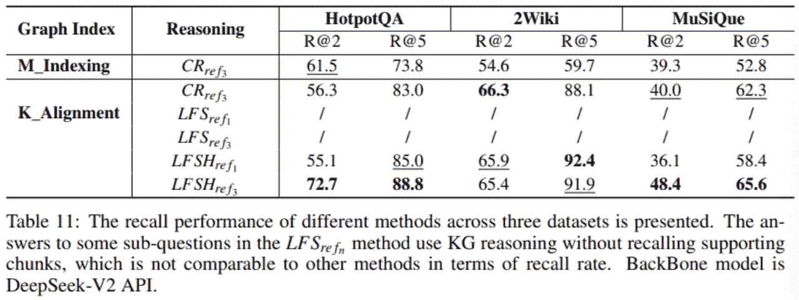

**知识图谱索引效果**

将知识对齐整合到知识图谱互索引中后，CRref3 的前 5 个召回率分别提升了 9.2%，28.4%和 9.5%，平均增幅达到 15.7%。经过知识对齐增强，关系密度显著增加，频率-出度图整体右移。

> **1 跳图谱明显右移，**说明加入的语义结构增加了每个节点的邻接节点数，提高了图谱的密集度。

> 2 跳和 3 跳图谱呈现不均匀分布，左侧稀疏，右侧密集。K_Alignment 优化前后的对比显示，数据集中的节点普遍右移，左侧变得更为稀疏，表明原本邻接节点较少的节点获得了新的连接，导致了这一现象。

> 表明新增的语义关系有效增强了图谱的连通性，进而提升了文档的召回率。

**图谱推理分析**

在召回率方面，LFSHref3 在同一图谱索引的基础上相较于 CRref3 有显著提升，前 **5 个召回率分别提高了 15**%，32.2%和 12.7%，平均增长 19.9%。这一改进主要归功于两个因素：

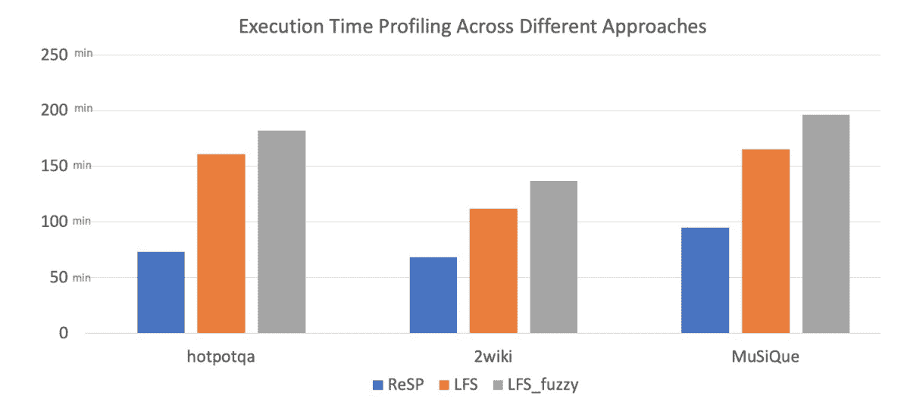

+   **LF****SHr****ef3 将查询分解**为多个可执行步骤，每个子查询独立检索信息片段。

+   LFSHref3 不仅检索信息片段，还将执行过程中的 SPO 三元组整合到片段计算中。

> **性能下降的****案例分析**揭示了构建阶段的错误或不完整的 SPO 导致子查询答案出错，最终导致错误答案。这一问题将在案例研究中详细讨论。计算时间的减少主要是由于 SPO 的检索效率比文档片段更高。

> 在工业应用中，计算时间是一个至关重要的指标。尽管 LFrefn 可能引入一些错误，但这些错误可以通过图谱的纠正和完善来改善。值得注意的是，在当前实验中，我们为了减少计算时间，接受了度量标准的轻微下降，这为工业应用提供了一个可行的改进方向。

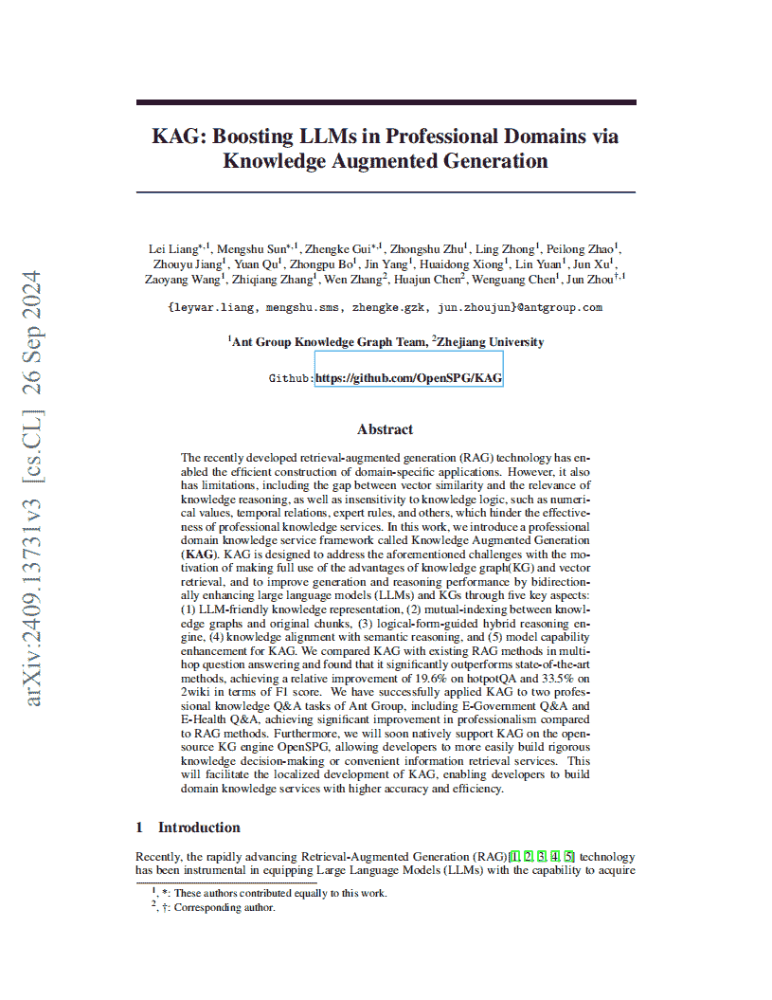

[KAG, Boosting LLMs in Professional Domains via Knowledge Augmented Generation.pdf](https://internal-api-drive-stream.feishu.cn/space/api/box/stream/download/all/FLc0bclSpoeZw2xyellcyY5kn4b)

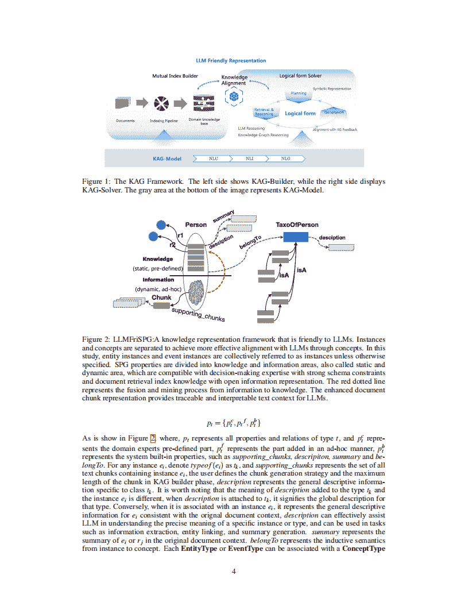

[KAG, Boosting LLMs in Professional Domains via Knowledge Augmented Generation - 副本.pdf](https://internal-api-drive-stream.feishu.cn/space/api/box/stream/download/all/GUaabnkdHob5iCx7WIpcDIAin4e)