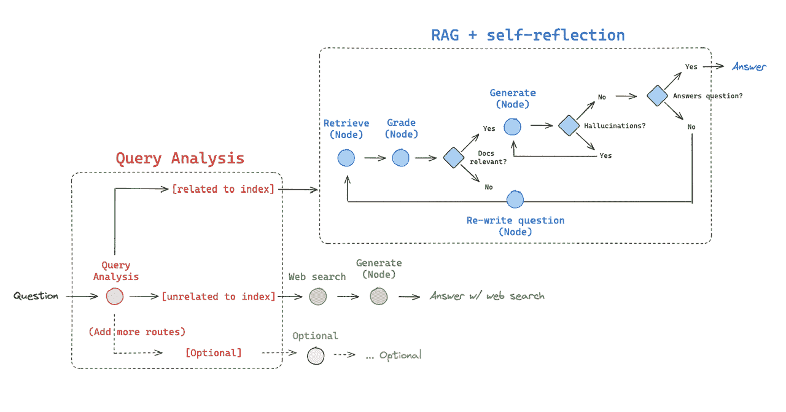

# 自适应RAG

> 来源：[https://qqs7y1hozd1.feishu.cn/docx/P6xYdhUwbo6fAoxBfN5cFnennee](https://qqs7y1hozd1.feishu.cn/docx/P6xYdhUwbo6fAoxBfN5cFnennee)

自适应RAG是一种RAG策略，它将（1）查询分析与（2）主动/自纠正RAG相结合。

在论文[paper](https://arxiv.org/abs/2403.14403)中，他们报告了查询分析以路由跨越：

+   **无检索**

+   **单次RAG**

+   **迭代RAG**

让我们使用LangGraph在此基础上进行构建。

在我们的实现中，我们将在以下之间路由：

+   网络搜索：与最近事件相关的问题

+   自我纠正RAG：对于与我们的索引相关的问题



### 环境

```
%%capture --no-stderr
! pip install -U langchain_community tiktoken langchain-openai langchain-cohere langchainhub chromadb langchain langgraph  tavily-python
```

```
### LLMs
import os

os.environ[&quot;OPENAI_API_KEY&quot;] = &quot;&quot;
os.environ[&quot;COHERE_API_KEY&quot;] = &quot;&quot;
os.environ[&quot;TAVILY_API_KEY&quot;] = &quot;&quot;
```

#### 追踪

或者，通过设置使用LangSmith进行跟踪（显示在底部）：

```
### Tracing (optional)
os.environ[&quot;LANGCHAIN_TRACING_V2&quot;] = &quot;true&quot;
os.environ[&quot;LANGCHAIN_ENDPOINT&quot;] = &quot;https://api.smith.langchain.com&quot;
os.environ[&quot;LANGCHAIN_API_KEY&quot;] = &quot;&quot;
```

### 索引

```
### Build Index

from langchain.text_splitter import RecursiveCharacterTextSplitter
from langchain_community.document_loaders import WebBaseLoader
from langchain_community.vectorstores import Chroma
from langchain_openai import OpenAIEmbeddings

### from langchain_cohere import CohereEmbeddings

# Set embeddings
embd = OpenAIEmbeddings()

# Docs to index
urls = [
    &quot;https://lilianweng.github.io/posts/2023-06-23-agent/&quot;,
    &quot;https://lilianweng.github.io/posts/2023-03-15-prompt-engineering/&quot;,
    &quot;https://lilianweng.github.io/posts/2023-10-25-adv-attack-llm/&quot;,
]

# Load
docs = [WebBaseLoader(url).load() for url in urls]
docs_list = [item for sublist in docs for item in sublist]

# Split
text_splitter = RecursiveCharacterTextSplitter.from_tiktoken_encoder(
    chunk_size=500, chunk_overlap=0
)
doc_splits = text_splitter.split_documents(docs_list)

# Add to vectorstore
vectorstore = Chroma.from_documents(
    documents=doc_splits,
    collection_name=&quot;rag-chroma&quot;,
    embedding=embd,
)
retriever = vectorstore.as_retriever()
```

### LLMs

```
### Router

from typing import Literal

from langchain_core.prompts import ChatPromptTemplate
from langchain_core.pydantic_v1 import BaseModel, Field
from langchain_openai import ChatOpenAI


# Data model
class RouteQuery(BaseModel):
    &quot;&quot;&quot;Route a user query to the most relevant datasource.&quot;&quot;&quot;

    datasource: Literal[&quot;vectorstore&quot;, &quot;web_search&quot;] = Field(
        ...,
        description=&quot;Given a user question choose to route it to web search or a vectorstore.&quot;,
    )


# LLM with function call
llm = ChatOpenAI(model=&quot;gpt-3.5-turbo-0125&quot;, temperature=0)
structured_llm_router = llm.with_structured_output(RouteQuery)

# Prompt
system = &quot;&quot;&quot;You are an expert at routing a user question to a vectorstore or web search.
The vectorstore contains documents related to agents, prompt engineering, and adversarial attacks.
Use the vectorstore for questions on these topics. Otherwise, use web-search.&quot;&quot;&quot;
route_prompt = ChatPromptTemplate.from_messages(
    [
        (&quot;system&quot;, system),
        (&quot;human&quot;, &quot;{question}&quot;),
    ]
)

question_router = route_prompt | structured_llm_router
print(
    question_router.invoke(
        {&quot;question&quot;: &quot;Who will the Bears draft first in the NFL draft?&quot;}
    )
)
print(question_router.invoke({&quot;question&quot;: &quot;What are the types of agent memory?&quot;}))
```

```
datasource=&#x27;web_search&#x27;
datasource=&#x27;vectorstore&#x27;
```

```
### Retrieval Grader


# Data model
class GradeDocuments(BaseModel):
    &quot;&quot;&quot;Binary score for relevance check on retrieved documents.&quot;&quot;&quot;

    binary_score: str = Field(
        description=&quot;Documents are relevant to the question, &#x27;yes&#x27; or &#x27;no&#x27;&quot;
    )


# LLM with function call
llm = ChatOpenAI(model=&quot;gpt-3.5-turbo-0125&quot;, temperature=0)
structured_llm_grader = llm.with_structured_output(GradeDocuments)

# Prompt
system = &quot;&quot;&quot;You are a grader assessing relevance of a retrieved document to a user question. \n 
    If the document contains keyword(s) or semantic meaning related to the user question, grade it as relevant. \n
    It does not need to be a stringent test. The goal is to filter out erroneous retrievals. \n
    Give a binary score &#x27;yes&#x27; or &#x27;no&#x27; score to indicate whether the document is relevant to the question.&quot;&quot;&quot;
grade_prompt = ChatPromptTemplate.from_messages(
    [
        (&quot;system&quot;, system),
        (&quot;human&quot;, &quot;Retrieved document: \n\n {document} \n\n User question: {question}&quot;),
    ]
)

retrieval_grader = grade_prompt | structured_llm_grader
question = &quot;agent memory&quot;
docs = retriever.get_relevant_documents(question)
doc_txt = docs[1].page_content
print(retrieval_grader.invoke({&quot;question&quot;: question, &quot;document&quot;: doc_txt}))
```

```
binary_score=&#x27;no&#x27;
```

```
### Generate

from langchain import hub
from langchain_core.output_parsers import StrOutputParser

# Prompt
prompt = hub.pull(&quot;rlm/rag-prompt&quot;)

# LLM
llm = ChatOpenAI(model_name=&quot;gpt-3.5-turbo&quot;, temperature=0)


# Post-processing
def format_docs(docs):
    return &quot;\n\n&quot;.join(doc.page_content for doc in docs)


# Chain
rag_chain = prompt | llm | StrOutputParser()

# Run
generation = rag_chain.invoke({&quot;context&quot;: docs, &quot;question&quot;: question})
print(generation)
```

```
The design of generative agents combines LLM with memory, planning, and reflection mechanisms to enable agents to behave based on past experience and interact with other agents. Memory stream is a long-term memory module that records agents&#x27; experiences in natural language. The retrieval model surfaces context to inform the agent&#x27;s behavior based on relevance, recency, and importance.
```

```
### Hallucination Grader


# Data model
class GradeHallucinations(BaseModel):
    &quot;&quot;&quot;Binary score for hallucination present in generation answer.&quot;&quot;&quot;

    binary_score: str = Field(
        description=&quot;Answer is grounded in the facts, &#x27;yes&#x27; or &#x27;no&#x27;&quot;
    )


# LLM with function call
llm = ChatOpenAI(model=&quot;gpt-3.5-turbo-0125&quot;, temperature=0)
structured_llm_grader = llm.with_structured_output(GradeHallucinations)

# Prompt
system = &quot;&quot;&quot;You are a grader assessing whether an LLM generation is grounded in / supported by a set of retrieved facts. \n 
     Give a binary score &#x27;yes&#x27; or &#x27;no&#x27;. &#x27;Yes&#x27; means that the answer is grounded in / supported by the set of facts.&quot;&quot;&quot;
hallucination_prompt = ChatPromptTemplate.from_messages(
    [
        (&quot;system&quot;, system),
        (&quot;human&quot;, &quot;Set of facts: \n\n {documents} \n\n LLM generation: {generation}&quot;),
    ]
)

hallucination_grader = hallucination_prompt | structured_llm_grader
hallucination_grader.invoke({&quot;documents&quot;: docs, &quot;generation&quot;: generation})
```

```
GradeHallucinations(binary_score=&#x27;yes&#x27;)
```

```
### Answer Grader


# Data model
class GradeAnswer(BaseModel):
    &quot;&quot;&quot;Binary score to assess answer addresses question.&quot;&quot;&quot;

    binary_score: str = Field(
        description=&quot;Answer addresses the question, &#x27;yes&#x27; or &#x27;no&#x27;&quot;
    )


# LLM with function call
llm = ChatOpenAI(model=&quot;gpt-3.5-turbo-0125&quot;, temperature=0)
structured_llm_grader = llm.with_structured_output(GradeAnswer)

# Prompt
system = &quot;&quot;&quot;You are a grader assessing whether an answer addresses / resolves a question \n 
     Give a binary score &#x27;yes&#x27; or &#x27;no&#x27;. Yes&#x27; means that the answer resolves the question.&quot;&quot;&quot;
answer_prompt = ChatPromptTemplate.from_messages(
    [
        (&quot;system&quot;, system),
        (&quot;human&quot;, &quot;User question: \n\n {question} \n\n LLM generation: {generation}&quot;),
    ]
)

answer_grader = answer_prompt | structured_llm_grader
answer_grader.invoke({&quot;question&quot;: question, &quot;generation&quot;: generation})
```

```
GradeAnswer(binary_score=&#x27;yes&#x27;)
```

```
### Question Re-writer

# LLM
llm = ChatOpenAI(model=&quot;gpt-3.5-turbo-0125&quot;, temperature=0)

# Prompt
system = &quot;&quot;&quot;You a question re-writer that converts an input question to a better version that is optimized \n 
     for vectorstore retrieval. Look at the input and try to reason about the underlying semantic intent / meaning.&quot;&quot;&quot;
re_write_prompt = ChatPromptTemplate.from_messages(
    [
        (&quot;system&quot;, system),
        (
            &quot;human&quot;,
            &quot;Here is the initial question: \n\n {question} \n Formulate an improved question.&quot;,
        ),
    ]
)

question_rewriter = re_write_prompt | llm | StrOutputParser()
question_rewriter.invoke({&quot;question&quot;: question})
```

```
### Question Re-writer

# LLM
llm = ChatOpenAI(model=&quot;gpt-3.5-turbo-0125&quot;, temperature=0)

# Prompt
system = &quot;&quot;&quot;You a question re-writer that converts an input question to a better version that is optimized \n 
     for vectorstore retrieval. Look at the input and try to reason about the underlying semantic intent / meaning.&quot;&quot;&quot;
re_write_prompt = ChatPromptTemplate.from_messages(
    [
        (&quot;system&quot;, system),
        (
            &quot;human&quot;,
            &quot;Here is the initial question: \n\n {question} \n Formulate an improved question.&quot;,
        ),
    ]
)

question_rewriter = re_write_prompt | llm | StrOutputParser()
question_rewriter.invoke({&quot;question&quot;: question})
```

```
&quot;What is the role of memory in an agent&#x27;s functioning?&quot;
```

### Web Search Tool

```
### Search

from langchain_community.tools.tavily_search import TavilySearchResults

web_search_tool = TavilySearchResults(k=3)
```

## Graph

以图形的形式捕获流入。

#### 图状态

```
from typing import List

from typing_extensions import TypedDict


class GraphState(TypedDict):
    &quot;&quot;&quot;
    Represents the state of our graph.

    Attributes:
        question: question
        generation: LLM generation
        documents: list of documents
    &quot;&quot;&quot;

    question: str
    generation: str
    documents: List[str]
```

#### 图流

```
from langchain.schema import Document


def retrieve(state):
    &quot;&quot;&quot;
    Retrieve documents

    Args:
        state (dict): The current graph state

    Returns:
        state (dict): New key added to state, documents, that contains retrieved documents
    &quot;&quot;&quot;
    print(&quot;---RETRIEVE---&quot;)
    question = state[&quot;question&quot;]

    # Retrieval
    documents = retriever.invoke(question)
    return {&quot;documents&quot;: documents, &quot;question&quot;: question}


def generate(state):
    &quot;&quot;&quot;
    Generate answer

    Args:
        state (dict): The current graph state

    Returns:
        state (dict): New key added to state, generation, that contains LLM generation
    &quot;&quot;&quot;
    print(&quot;---GENERATE---&quot;)
    question = state[&quot;question&quot;]
    documents = state[&quot;documents&quot;]

    # RAG generation
    generation = rag_chain.invoke({&quot;context&quot;: documents, &quot;question&quot;: question})
    return {&quot;documents&quot;: documents, &quot;question&quot;: question, &quot;generation&quot;: generation}


def grade_documents(state):
    &quot;&quot;&quot;
    Determines whether the retrieved documents are relevant to the question.

    Args:
        state (dict): The current graph state

    Returns:
        state (dict): Updates documents key with only filtered relevant documents
    &quot;&quot;&quot;

    print(&quot;---CHECK DOCUMENT RELEVANCE TO QUESTION---&quot;)
    question = state[&quot;question&quot;]
    documents = state[&quot;documents&quot;]

    # Score each doc
    filtered_docs = []
    for d in documents:
        score = retrieval_grader.invoke(
            {&quot;question&quot;: question, &quot;document&quot;: d.page_content}
        )
        grade = score.binary_score
        if grade == &quot;yes&quot;:
            print(&quot;---GRADE: DOCUMENT RELEVANT---&quot;)
            filtered_docs.append(d)
        else:
            print(&quot;---GRADE: DOCUMENT NOT RELEVANT---&quot;)
            continue
    return {&quot;documents&quot;: filtered_docs, &quot;question&quot;: question}


def transform_query(state):
    &quot;&quot;&quot;
    Transform the query to produce a better question.

    Args:
        state (dict): The current graph state

    Returns:
        state (dict): Updates question key with a re-phrased question
    &quot;&quot;&quot;

    print(&quot;---TRANSFORM QUERY---&quot;)
    question = state[&quot;question&quot;]
    documents = state[&quot;documents&quot;]

    # Re-write question
    better_question = question_rewriter.invoke({&quot;question&quot;: question})
    return {&quot;documents&quot;: documents, &quot;question&quot;: better_question}


def web_search(state):
    &quot;&quot;&quot;
    Web search based on the re-phrased question.

    Args:
        state (dict): The current graph state

    Returns:
        state (dict): Updates documents key with appended web results
    &quot;&quot;&quot;

    print(&quot;---WEB SEARCH---&quot;)
    question = state[&quot;question&quot;]

    # Web search
    docs = web_search_tool.invoke({&quot;query&quot;: question})
    web_results = &quot;\n&quot;.join([d[&quot;content&quot;] for d in docs])
    web_results = Document(page_content=web_results)

    return {&quot;documents&quot;: web_results, &quot;question&quot;: question}


### Edges ###


def route_question(state):
    &quot;&quot;&quot;
    Route question to web search or RAG.

    Args:
        state (dict): The current graph state

    Returns:
        str: Next node to call
    &quot;&quot;&quot;

    print(&quot;---ROUTE QUESTION---&quot;)
    question = state[&quot;question&quot;]
    source = question_router.invoke({&quot;question&quot;: question})
    if source.datasource == &quot;web_search&quot;:
        print(&quot;---ROUTE QUESTION TO WEB SEARCH---&quot;)
        return &quot;web_search&quot;
    elif source.datasource == &quot;vectorstore&quot;:
        print(&quot;---ROUTE QUESTION TO RAG---&quot;)
        return &quot;vectorstore&quot;


def decide_to_generate(state):
    &quot;&quot;&quot;
    Determines whether to generate an answer, or re-generate a question.

    Args:
        state (dict): The current graph state

    Returns:
        str: Binary decision for next node to call
    &quot;&quot;&quot;

    print(&quot;---ASSESS GRADED DOCUMENTS---&quot;)
    state[&quot;question&quot;]
    filtered_documents = state[&quot;documents&quot;]

    if not filtered_documents:
        # All documents have been filtered check_relevance
        # We will re-generate a new query
        print(
            &quot;---DECISION: ALL DOCUMENTS ARE NOT RELEVANT TO QUESTION, TRANSFORM QUERY---&quot;
        )
        return &quot;transform_query&quot;
    else:
        # We have relevant documents, so generate answer
        print(&quot;---DECISION: GENERATE---&quot;)
        return &quot;generate&quot;


def grade_generation_v_documents_and_question(state):
    &quot;&quot;&quot;
    Determines whether the generation is grounded in the document and answers question.

    Args:
        state (dict): The current graph state

    Returns:
        str: Decision for next node to call
    &quot;&quot;&quot;

    print(&quot;---CHECK HALLUCINATIONS---&quot;)
    question = state[&quot;question&quot;]
    documents = state[&quot;documents&quot;]
    generation = state[&quot;generation&quot;]

    score = hallucination_grader.invoke(
        {&quot;documents&quot;: documents, &quot;generation&quot;: generation}
    )
    grade = score.binary_score

    # Check hallucination
    if grade == &quot;yes&quot;:
        print(&quot;---DECISION: GENERATION IS GROUNDED IN DOCUMENTS---&quot;)
        # Check question-answering
        print(&quot;---GRADE GENERATION vs QUESTION---&quot;)
        score = answer_grader.invoke({&quot;question&quot;: question, &quot;generation&quot;: generation})
        grade = score.binary_score
        if grade == &quot;yes&quot;:
            print(&quot;---DECISION: GENERATION ADDRESSES QUESTION---&quot;)
            return &quot;useful&quot;
        else:
            print(&quot;---DECISION: GENERATION DOES NOT ADDRESS QUESTION---&quot;)
            return &quot;not useful&quot;
    else:
        pprint(&quot;---DECISION: GENERATION IS NOT GROUNDED IN DOCUMENTS, RE-TRY---&quot;)
        return &quot;not supported&quot;
```

#### 构建图

```
from langgraph.graph import END, StateGraph

workflow = StateGraph(GraphState)

# Define the nodes
workflow.add_node(&quot;web_search&quot;, web_search)  # web search
workflow.add_node(&quot;retrieve&quot;, retrieve)  # retrieve
workflow.add_node(&quot;grade_documents&quot;, grade_documents)  # grade documents
workflow.add_node(&quot;generate&quot;, generate)  # generatae
workflow.add_node(&quot;transform_query&quot;, transform_query)  # transform_query

# Build graph
workflow.set_conditional_entry_point(
    route_question,
    {
        &quot;web_search&quot;: &quot;web_search&quot;,
        &quot;vectorstore&quot;: &quot;retrieve&quot;,
    },
)
workflow.add_edge(&quot;web_search&quot;, &quot;generate&quot;)
workflow.add_edge(&quot;retrieve&quot;, &quot;grade_documents&quot;)
workflow.add_conditional_edges(
    &quot;grade_documents&quot;,
    decide_to_generate,
    {
        &quot;transform_query&quot;: &quot;transform_query&quot;,
        &quot;generate&quot;: &quot;generate&quot;,
    },
)
workflow.add_edge(&quot;transform_query&quot;, &quot;retrieve&quot;)
workflow.add_conditional_edges(
    &quot;generate&quot;,
    grade_generation_v_documents_and_question,
    {
        &quot;not supported&quot;: &quot;generate&quot;,
        &quot;useful&quot;: END,
        &quot;not useful&quot;: &quot;transform_query&quot;,
    },
)

# Compile
app = workflow.compile()
```

```
from pprint import pprint

# Run
inputs = {
    &quot;question&quot;: &quot;What player at the Bears expected to draft first in the 2024 NFL draft?&quot;
}
for output in app.stream(inputs):
    for key, value in output.items():
        # Node
        pprint(f&quot;Node &#x27;{key}&#x27;:&quot;)
        # Optional: print full state at each node
        # pprint.pprint(value[&quot;keys&quot;], indent=2, width=80, depth=None)
    pprint(&quot;\n---\n&quot;)

# Final generation
pprint(value[&quot;generation&quot;])
```

```
---ROUTE QUESTION---
---ROUTE QUESTION TO WEB SEARCH---
---WEB SEARCH---
&quot;Node &#x27;web_search&#x27;:&quot;
&#x27;\n---\n&#x27;
---GENERATE---
---CHECK HALLUCINATIONS---
---DECISION: GENERATION IS GROUNDED IN DOCUMENTS---
---GRADE GENERATION vs QUESTION---
---DECISION: GENERATION ADDRESSES QUESTION---
&quot;Node &#x27;generate&#x27;:&quot;
&#x27;\n---\n&#x27;
(&#x27;It is expected that the Chicago Bears could have the opportunity to draft &#x27;
 &#x27;the first defensive player in the 2024 NFL draft. The Bears have the first &#x27;
 &#x27;overall pick in the draft, giving them a prime position to select top &#x27;
 &#x27;talent. The top wide receiver Marvin Harrison Jr. from Ohio State is also &#x27;
 &#x27;mentioned as a potential pick for the Cardinals.&#x27;)
```

```
# Run
inputs = {&quot;question&quot;: &quot;What are the types of agent memory?&quot;}
for output in app.stream(inputs):
    for key, value in output.items():
        # Node
        pprint(f&quot;Node &#x27;{key}&#x27;:&quot;)
        # Optional: print full state at each node
        # pprint.pprint(value[&quot;keys&quot;], indent=2, width=80, depth=None)
    pprint(&quot;\n---\n&quot;)

# Final generation
pprint(value[&quot;generation&quot;])
```

```
---ROUTE QUESTION---
---ROUTE QUESTION TO RAG---
---RETRIEVE---
&quot;Node &#x27;retrieve&#x27;:&quot;
&#x27;\n---\n&#x27;
---CHECK DOCUMENT RELEVANCE TO QUESTION---
---GRADE: DOCUMENT RELEVANT---
---GRADE: DOCUMENT RELEVANT---
---GRADE: DOCUMENT NOT RELEVANT---
---GRADE: DOCUMENT RELEVANT---
---ASSESS GRADED DOCUMENTS---
---DECISION: GENERATE---
&quot;Node &#x27;grade_documents&#x27;:&quot;
&#x27;\n---\n&#x27;
---GENERATE---
---CHECK HALLUCINATIONS---
---DECISION: GENERATION IS GROUNDED IN DOCUMENTS---
---GRADE GENERATION vs QUESTION---
---DECISION: GENERATION ADDRESSES QUESTION---
&quot;Node &#x27;generate&#x27;:&quot;
&#x27;\n---\n&#x27;
(&#x27;The types of agent memory include Sensory Memory, Short-Term Memory (STM) or &#x27;
 &#x27;Working Memory, and Long-Term Memory (LTM) with subtypes of Explicit / &#x27;
 &#x27;declarative memory and Implicit / procedural memory. Sensory memory retains &#x27;
 &#x27;sensory information briefly, STM stores information for cognitive tasks, and &#x27;
 &#x27;LTM stores information for a long time with different types of memories.&#x27;)
```