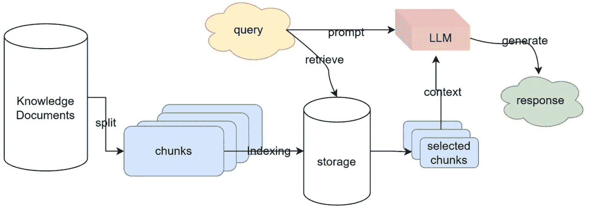
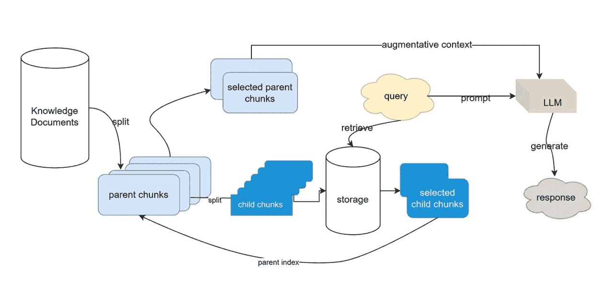
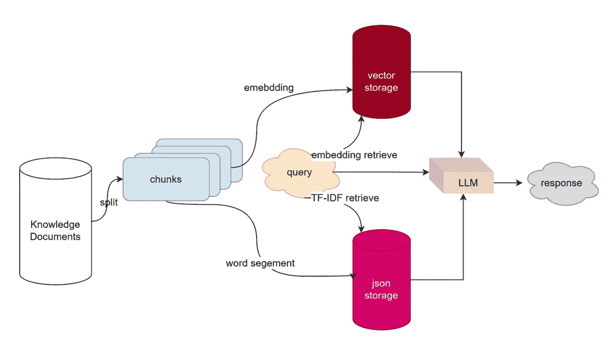
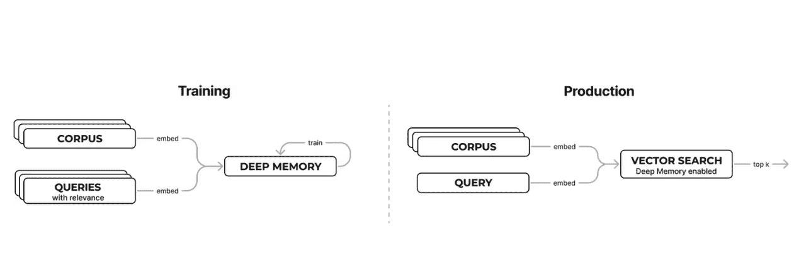
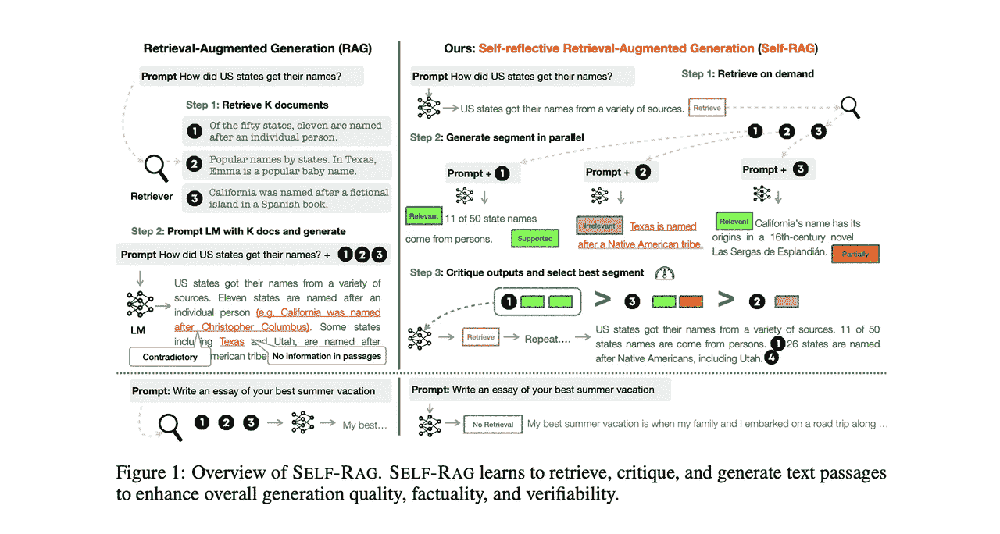
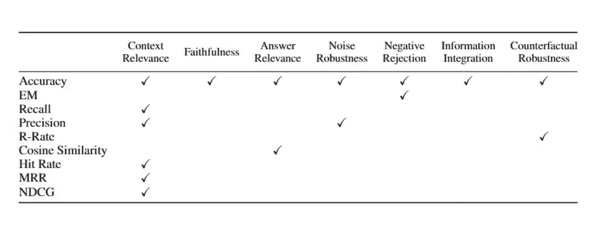
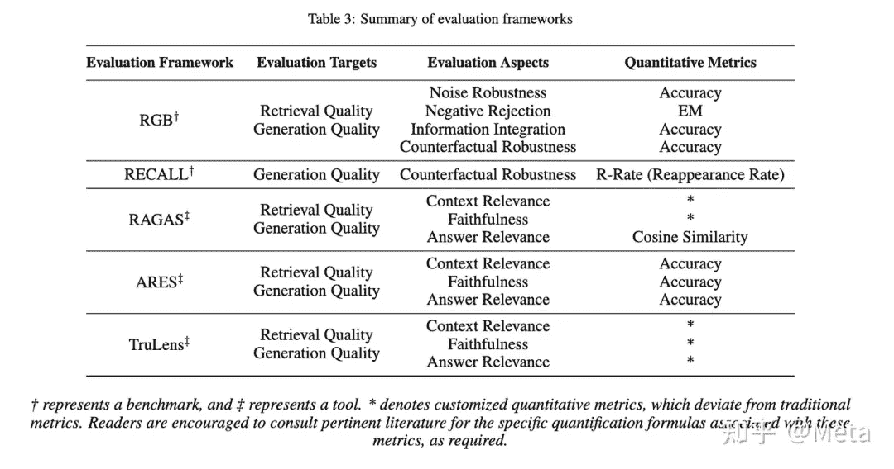

# 关于 RAG 的优化方案及评估

> 来源：[https://qqs7y1hozd1.feishu.cn/docx/CW77dniSFoKokcxq5o0cXNnonEh](https://qqs7y1hozd1.feishu.cn/docx/CW77dniSFoKokcxq5o0cXNnonEh)

## RAG Definition

由于通用的 `LLM` 预训练数据存在限制，缺乏实时知识或者垂直知识，而不断地 `fine-tuning` 又存在较大的成本。因此一种解决该问题的方式出现了

首先通过 `Retrieve` 外部知识库的文档来为 `LLM` 提供补充信息的上下文，并与最初的问题一起被合并成一个 Augmentative 的提示，而后输入 `LLM` 使 `LLM` 能够 `Generate` 更有效的回答

## General RAG Framework

> 通用的 RAG 框架如下：

1. 多文档切分成 `chunks`
1. 将 `chunks` 索引化并存储，目前基于 `LLM` 对文本进行 `embedding` 从而实现向量化存储的方式比较热门
1. `query` 进入并进行索引匹配，从而检索到相关的 `chunks`（如果是向量化索引，则通过计算向量间的相似度来进行匹配）
1. 将 `chunks` 内容作为 `context` 与 `query` 包装成 `prompt` 输入 `LLM`，并生成回答

目前大部分对 `RAG` 的优化都是在如下框架的基础上对环节进行优化，从而提高 `response` 的质量。当然也有将 RAG 进行模块化包装，从而使 RAG 组合更加灵活（`Langchain` 和 `LlamaIndex` 就是典型的例子）



## Advanced RAG

+ 对于 `RAG` 的优化，下面将结合自身的实践经验进行说明

### Query 环节优化

1. 由于单一的 `query` 可能存在噪音和随机性；因此在 `query` 进行检索前，可以对 `query` 进行如下操作

+ 使用 `LLM` 对 `query` 进行改写，使之更加规范
+ 使用 `LLM` 理解 `query` 意图并生成多个 `queries` 并行检索
+ 使用 `LLM` 将 `query` 分解成多个 `sub query`，并进行并行检索
+ 在查询中加入多轮对话，形成聊天引擎，多次上下文连续查询
+ `ContextChatEngine` ：首先检索与用户查询相关的上下文，然后将其与内存缓冲区中的聊天历史记录一起发送给 `LLM`，以便 `LLM` 在生成下一个答案时了解先前的上下文
+ `CondensePlusContextMode`：在每次交互中，聊天历史记录和最后一条消息都会经过 `LLM` 进行融合判断并压缩为一个新查询（如果不相关则直接查询，如果相关则进行融合），然后该查询转到索引，检索到的上下文与原始用户消息一起传递给 `LLM`，以生成一个回答

> 个人评价：这一环节有一个很重要的目的是为 `rerank` 而生，以减少 `raw` 问题检索造成的弱鲁棒性

### Retrieve 环节的优化（以下的优化都是单独说明，可以进行随意组合）

#### 总分层级索引（总→细，提高搜索的效率）

创建多层级索引，如第一层索引由摘要组成，另一层由摘要对应的一或多个文档块组成，并分两步检索，首先将 `query` 与摘要匹配过滤掉不相关的文档，并只在相关组内检索第二层文档块

个人评价：这种方式虽然能够通过快速缩小范围的方式来减少检索时间，但是可能考虑到摘要的信息的完整性，这种方式可能会在第一层匹配时忽略掉文档的细节信息，从而导致检索的准确性降低。个人认为，当是知识库巨大，而且文档块的内容较为单一时可以使用

#### 父子层级索引（细→总，提高搜索精确问题的准确性）

同样创建多层级索引

如：先将文档按一定方式切分成较大的文本块，形成 `parent chunks`；在对每个 `parent chunk` 按更细的方式切分成 `child chunks`，每个 `child chunk` 都有一个其所对应的 `parent index`，`query` 检索时，在 `sub chunks` 中进行检索，后依据被检索到的 `sub chunks` 所对应的 `parent index` 回至父段块（目的是为了获得更完整完整的上下文），以父段作为最终的增强信息获得答案



个人评价：这种方式在匹配时完全依据语义和关键词，能够减少噪音，尤其能够优化当 `query` 所对应的有效信息（或有效提示）较为简短时 `parent` 所面临的匹配不敏感问题

#### 融合或混合搜索（权衡语义和词义的关系）

目前的索引构建有多种方式，包括：`sparse` 检索和 `dense` 检索

`embedding` 向量化索引是 `dense` 检索的代表，而 `TF-IDF` 则是 `sparse` 检索的代表。`dense` 检索的方式更专注于 `query` 和 `chunks` 的语义关系，这就可能导致某些存在明显关键词的 `chunks` 由于语义的不足导致并没有被检索出来，稳健性较弱。因此这时候如果同时使用 `sparse` 检索方式进行 `ensemble`，增强稳健性（下图是融合的方式表现）



#### 多种切分方式并行查询，提高查询的稳健性和全面性

+ 向量检索中 `chunks` 的大小以及部分符号会对相似度结果产生较大影响（这种影响在 `chunks` 内容相同时尤其明显）。当 `chunks` 过小时，没有上下文信息，可能导致宽泛性 `query` 匹配不准确，但能够匹配精准的问题

+ 当 `chunks` 过大时，`chunk` 涵盖的信息多，将导致精确的问题匹配时存在噪音，而忽略了 `chunks` 中的准确答案，因此为了增加稳健性，采用机器学习中的 `ensemble` 方式，可以同时构建多个 `chunks` 数据集，每个数据集的 `chunks` 大小不同（一般依据文档的内容数量选择 2~3 个切分方式即可），采用并行的方式进行同时匹配。并进行集中排序，选择 `top_k` 个文本块作为增强内容

个人评价：这种方式能够显著提升检索的准确率和鲁棒性，但是也会消耗存储资源和匹配时间，更适合文档数量级较小的情况下，当文档量级非常大，将大大增加资源的消耗

#### Rerank

由于检索得到的 `chunks` 并没有经过细致信息的筛选，同时 `LLM` 的输入 `token` 长度具有限制，因此一般而言有必要使用更准确的方式对 `chunks` 与 `query` 的关系进行 `rerank`，以此增加 `MMR` 以及命中率

一般而言 `Rerank` 是使用 `cross encoder` 模型对 `query` 和召回的 `chunk` 进行逐个排序，由于 `cross encoder` 相对普通的 `embedding` 模型而言更耗资源，推理花费的时间远大于一般模型，因此通常放在最后环节，只对最终的候选 `chunks` 进行排名。`Rerank` 模型的效果排名可以参考 `MTEB` 排行榜

个人评价：当然考虑到资源和成本，以及大部分 `cross encoder` 模型只能接受不超过 512 长度的输入。`Rerank` 也可以使用 `embedding` 方式或者 `openai chatgpt`，亦或其它简单算法模型进行重排（其中上述递进方式的混合搜索也可以当作 `rerank`）。本人参考资料写了一个基于 `chatgpt` 的 `rerank.py`，在实际运用中具有一定的效果，有兴趣的可以联系我。

#### Embedding|Cross encoder|Retrieve 模型微调

> 由于一般检索过程中使用的模型都是通用型，因此在面对垂直领域运用时效果不一定很好，但是由于这些模型的参数量相比通用的 `LLM` 小很多很多，因此在条件成本允许的情况下，可以适当地对它们进行微调，从而提升其在垂直领域地检索效果

以下是部分文档中介绍的微调方式：

+ `LlamaIndex Embedding` 微调方式：`LlamaIndex Embedding`
+ `Retrieval Augmentation` 微调：`Retrieval Augmentation`
+ `cross-encoder` 交叉编码微调：`cross-encoder` 交叉编码

个人评价：在成本和数据允许的情况下可以构建 `pairs` 数据进行微调，但是笔者参考了一些相关的项目以及自己的小小经验，不同的 `embedding` 模型对效果的影响并不会很大。如果 `chunks` 很大，建议直接调用 `Openai` 的 `text-embedding-ada-002`

#### 基于 LLM 实现噪声过滤&信息压缩

> 考虑到最终检索到的 `chunks` 内容一般会存在无关的上下文，以及 `LLM` 的输入有 `max token` 的限制，因此可以基于并行的方式：

+ 使用 `query` 分别和检索得到 `chunk` 输入 `LLM` 进行相关性判断，过滤掉不相关的 `chunks`
+ 适用 `LLM` 保留 `chunk` 中的有用信息，以此减少 `augmentative context` 的长度

```
prompt = f"""You are an information retrieval system,
your task is to identify valuable information in response to a query,
you must exclusively respond with the original sentences selected from the provided paragraph,
do not explain or add any of your own words.
"""
messages = {"role": "system", "content": prompt, "role": "user", "content": f"the query is:{query}\n, the paragraph is: {paragraph}"}
openai.Chatcompletion.create(messages=messages, model=model, temperature=0)
```

+ 根据不同的上下文块生成多个答案，然后将它们连接或总结

个人评价：这种方法虽然具有一些效果，但是鲁棒性不强，很容易受到 `prompt` 的影响，稍有不慎可能过滤掉有效的信息，因此当 `query` 真实对应的 `chunks` 数目较多时，谨慎使用

#### DeepMemory

`Deep Memory` 通过从针对应用程序定制的标记查询中学习索引，将 `Deep Lake` 的矢量搜索精度显著提高高达 +22%，而不会影响搜索时间。只需几百个提示嵌入示例对和向量存储中最相关的答案就可以实现这些结果



#### 添加元数据

+ 元数据搜索是指在生成响应之前利用额外的信息（元数据）来帮助检索过程，从而提高生成内容的相关性和质量。元数据可以包括各种类型的信息，如文档的标题、作者、发布日期、标签或任何其他描述性数据，这些数据用来提高检索系统的准确性和效率

+ `Knowledge Graph` 知识图谱就是元数据的一种，知识图谱通过提供结构化的、关系丰富的信息，帮助系统更好地理解和处理查询（如实体），从而增强生成内容的相关性和准确性。但是由于构建 `KG` 的过程较为复杂，质量波动较大，并且维护成本较为麻烦，应用门槛较高，相对而言使用起来不太方便

个人评价：这种方式能够增加信息检索的准确性以及相关性，但是实体、关系的提取和构建需要花费一些成本，当然目前已经可以通过 `LLM` 更好地提取相关实体关系，有兴趣的朋友也可以深入研究看看。

## RAG 框架的优化

### RAG Module（RAG Agent）

> `RAG Module` 将各个功能进行包装，集成了各种方法来增强功能模块，形成工具链，使整个 `RAG` 框架更加灵活。目前 `Langchain` 和 `LlamaIndex` 在这个方面已经做的非常不错，以下为一些常见的模块：

+ `Search module`

> 针对特定场景量身定制，并在语料库上直接搜索。这种集成是使用 `LLM` 生成的代码、查询语言（例如 `SQL` 或 `Cypher`）和其他自定义工具实现的。搜索的数据源可能包括搜索引擎、文本数据、表格数据和知识图

+ `Memory module`

> 该模块利用 `LLM` 的内存能力来指导检索。该方法涉及识别与当前输入最相似的内存。通过使用自己的输出来改进自身的检索增强生成模型，文本在推理过程中与数据分布更加一致

+ `Fusion module`

> 通过使用 `LLM` 将用户查询扩展到多个不同视角的多查询方法来解决它们的局限性，从而增强了传统的搜索系统。融合过程涉及对原始查询和扩展查询的并行向量搜索、重新排序以优化结果，并将最佳结果与新查询配对

+ `Routing module`

> 查询路由决定对用户查询的后续操作，选项范围从摘要、数据库或将不同的路径合并为单个 `response`。`Routing Module` 还为查询选择合适的数据存储，可能包括向量存储、图数据库等，同时也选择索引的层次结构。如，用于多文档存储的摘要索引和文档块向量索引。查询路由器的决策是通过 `llm` 调用预定义和执行的，它将查询引导到所选索引

+ `Predict module`

> 该模块不是直接从数据源检索，而是利用 `LLM` 生成必要的上下文。与通过直接检索获得的内容相比，`LLM` 生成的内容更有可能包含相关信息。（个人目前感觉用处不大）

## 自适应检索&递归检索

### Recursive Retrieval

+ 递归检索通常用于信息检索以此提高搜索结果的深度和相关性。该过程涉及根据先前搜索获得的结果迭代地细化搜索查询

+ 递归检索旨在通过反馈回路逐渐收敛到最相关的信息来增强搜索体验。在复杂搜索场景中，用户的需求从一开始就不完全清楚，或者所寻求的信息是高度专业化或微妙的。该过程的递归性质允许对用户的需求进行持续学习和适应，通常会导致对搜索结果的满意度提高



### Adaptive Retrieval

自适应检索指使 `LLM` 能够主动确定检索的最佳内容从而细化 `RAG` 框架，提高信息来源的效率和相关性。如 `AutoGPT`、`Self-RAG` 等模型。`Self-RAG` 能够判断是否需要检索并且进行自我反思，在检索过程中，其 `Generator` 跨多个段落进行片段级波束搜索，以得出最连贯的序列

## RAG 的评估体系

### a. 检索质量的评价

+ `MMR`（平均倒排率）是一个用于评估推荐系统排序性能的指标。它考虑了用户实际点击的推荐项在推荐列表中的位置。`MRR` 的计算方式是取用户的每个查询（或推荐请求）的倒数排名的平均值。这个指标更加关注推荐项的排名，越靠前的推荐项影响越大

+ `Hits Rate`（命中率）前 k 项中，包含正确信息的项的数目占比

+ `NDCG`（归一化折损累积增益）评估推荐系统排序性能的指标，但相比于 `MRR`，`NDCG` 考虑了推荐项的相关性。它通过考虑推荐列表中每个位置上的推荐项的相关性分数，以及位置权重，计算一个归一化的累积增益

### b. 生成质量的评价

噪声的鲁棒性、信息融合能力、噪声的拒绝能力、反事实的稳健性



### c. 评价 RAG model 的框架



