# RAG从原理到应用，技术解析+实践拆解

> 来源：[https://qqs7y1hozd1.feishu.cn/docx/TdnNd4fqBoeNRyxogMXcrE5fnTe](https://qqs7y1hozd1.feishu.cn/docx/TdnNd4fqBoeNRyxogMXcrE5fnTe)

# 一、深度解析：大模型 RAG 技术

## 1.基础RAG

基础 RAG 的操作流程大致如下：

**首先**，将文本切分成小段，然后利用某种 Transformer 编码器模型，转换成向量形式。

**接着**，把所有向量汇集到一个索引里。

**最后**，为大语言模型（Large Language Model, LLM）制定一个提示词.

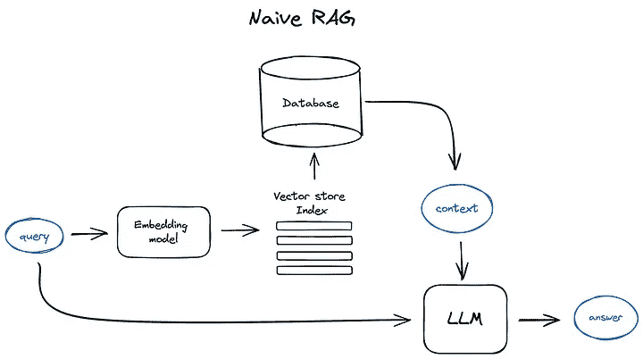

> 在实际运行过程中，会用同一个**编码器模型**把用户的查询转换成向量，然后根据这个向量在索引中进行搜索。系统会找到最相**关的前k个**结果，从数据库中提取相应的文本段，然后把这些文本段作为上下文信息输入到大语言模型的提示词中。

## 2.高级RAG

> 这里是一个**展示核心步骤和相关算法的示意图**。

> 为了保持示意图的清晰易懂，一些逻辑循环和复杂的多步骤智能体行为被省略了。

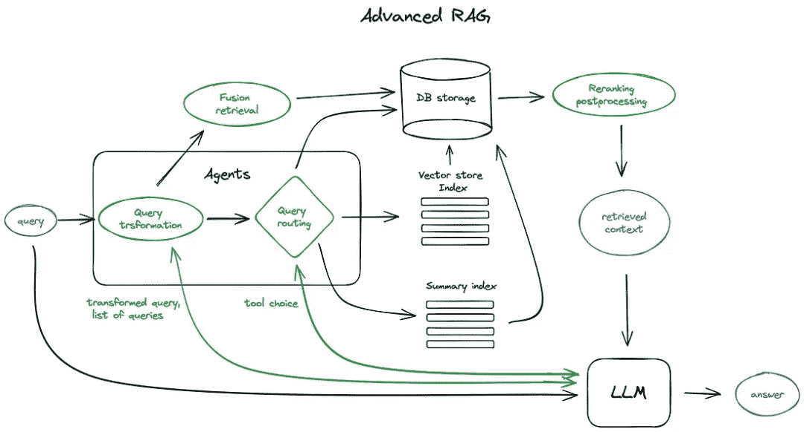

在这个方案中，**绿色部分****代表接下**来将深入探讨的核心 RAG 技术，而蓝色部分则表示文本。

> 需要注意的是，并不是所有高级 RAG 概念都能在这样一个单一的方案中被清晰展示，比如，一些用于扩展上下文的方法就没有包括在内 —— 我们会在后续的讨论中逐一探究这些话题。

### 分块和向量化

> 首先，需要创建一个向量索引，这个索引代表了文档的内容。

> 然后，搜索这些向量与查询向量之间的最小余弦距离，以找到语义上最接近的匹配。

**分块**

> **将文档切分成合适大小的段落****，**同时保持其原有意义不变（例如，将文本划分为句子或段落，而不是将单个句子切割成两部分）。市面上有多种文本分割工具可用于此任务。

**向量化**

> 接**下来的步骤是选择一**个模型来嵌入这些文本块。有很多种模型可以选择，推荐使用像bge-large或E5嵌入系列这样的搜索优化模型。可以查看MTEB排行榜来获取最新的模型信息。

### 搜索索引

**向量存储索引**

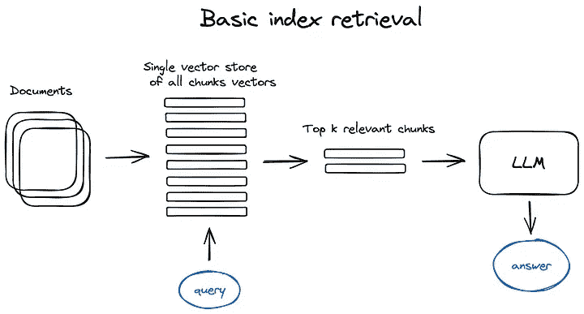

> **LlamaIndex**支持多种向量存储索引类型，但也支持其他更简单的索引实现方式，如列表索引、树索引和关键词表索引——将在后面的融合检索部分进一步讨论这些索引类型。

**层次索引**

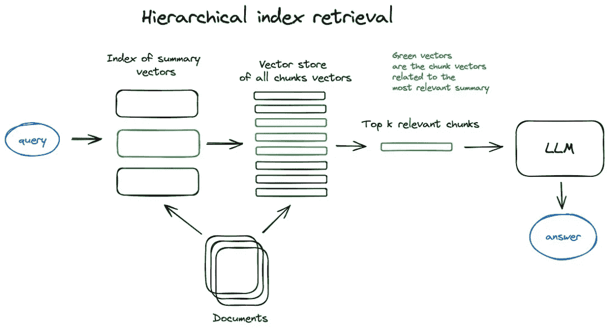

> **在处理大型数**据库时，一个有效的做法是创建两个索引——一个由摘要组成，另一个由文档块组成，然后分两步进行搜索：首先通过摘要过滤出相关文档，接着只在这个相关群体内进行搜索。

**假设性问题和HyDE**

在运行时，针对这个问题向量的索引进行查询搜索（用问题向量替换我们索引中的块向量），检索后将原始文本块作为上下文发送给LLM以获取答案。这种方法由于查询和假设性问题之间的语义相似性更高，从而提高了搜索质量。

> 还有一种反向逻辑的方法叫做HyDE——您可以让LLM根据查询生成一个假设性回答，然后将该回答的向量与查询向量一起用来提高搜索质量。

**上下文增强**

这里的理念是检索较小的块以提高搜索质量，但同时增加周围的上下文以供LLM进行推理分析。

**句子窗口检索**

为了更好地推理分析找到的上下文，会在检索到的关键句子前后各扩展k个句子，然后将这个扩展的上下文发送给LLM。

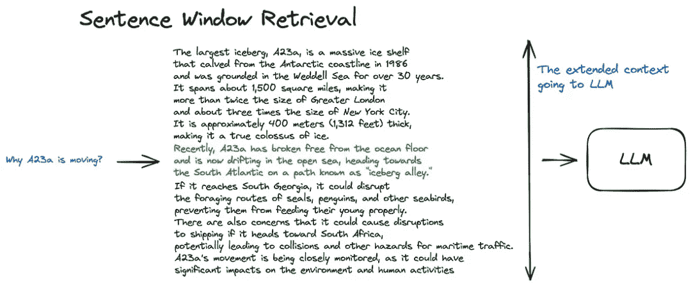

自动合并检索器（又名父文档检索器）

> **这里的思路与句子窗口检索器**十分相似——它旨在搜索更精细的信息片段，然后在将这些上下文信息提供给LLM进行推理之前，先扩展上下文窗口。文档被分割成较小的子块，这些子块又与更大的父块相对应。

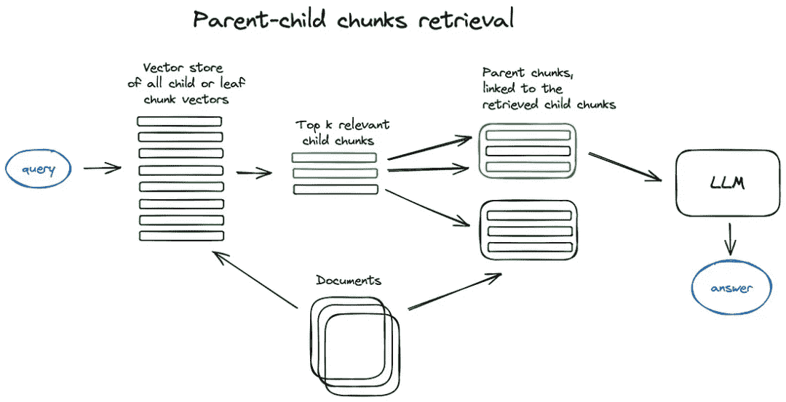

文档被分割成一个层级化的块结构，随后最小的叶子块被发送至索引中。

**融合检索或混合搜索**

这是一个相对较旧的概念，**它结合了两种不同的搜索方法：**

+   **一种是基于关**键词的传统搜索方法，使用稀疏检索算法（如tf-idf或行业标准BM25）

+   另一种是现代的**语义或向量搜索**。

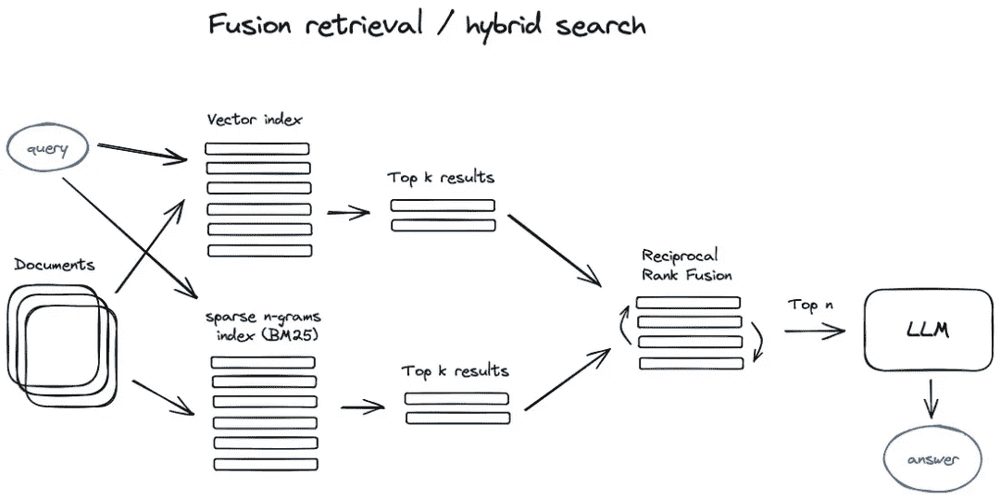

在**LangChain**中，通过Ensemble Retriever类实现的，它结合了定义的一系列检索器，例如faiss向量索引和基于BM25的检索器，并使用逆序位融合算法（RRF）来进行结果的重新排名。

### 重新排名和过滤

> 这是在将检索到的上下文输入到大语言模型（LLM）以得到最终答案之前的最后一步。

现在，将介绍更高级的RAG技术，如查询转换和路由，这两者都涉及到LLM，因此代表了智能体行为——涵盖了RAG管道中涉及到的一些复杂的大语言模型推理逻辑。

### 查询转换

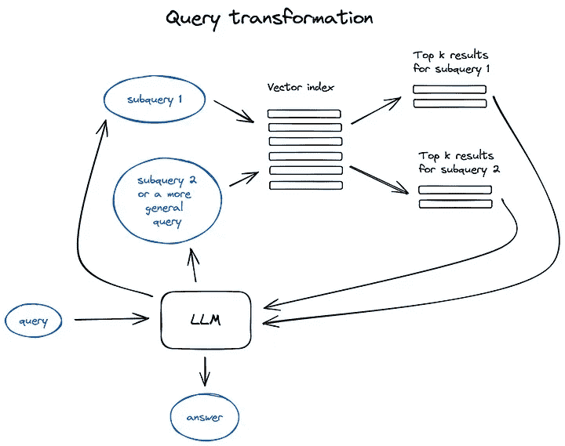

> 这些查询将并行执行，然后检索到的上下文将组合在一个提示中，供大语言模型综合出对初始查询的最终答案。两个库都实现了这一功能——Langchain中作为多查询检索器，在LlamaIndex中作为子问题查询引擎。

> 回退式提示词使用大语言模型生成更一般**的查询，检索更一般或高级**的上下文，有助于为原始查询的答案打下基础。也对原始查询进行检索，最终生成答案时将两个上下文输入大语言模型。这是LangChain的实现方式。

### 对话引擎

关于上下文的压缩，有几种不同的方法 —

> 一种受欢迎且相对简单的方法是使用 ContextChatEngine。这种引擎首先检索与用户查询相关的上下文，然后将其连同聊天历史从内存缓冲区一起发送给 LLM，确保 LLM 在生成下一条回答时能够理解之前的上下文。

> 更为复杂的一个例子是 CondensePlusContextMode。在这种模式下，每次互动中的聊天历史和最后一条消息会被压缩成一个新的查询。然后，这个查询被发送到索引系统，检索到的上下文连同原始用户消息一起回传。

值得注意的是，**LlamaIndex **还支持基于 OpenAI 智能体的聊天引擎，提供了更灵活的聊天模式，Langchain 也支持 OpenAI 功能性 API。

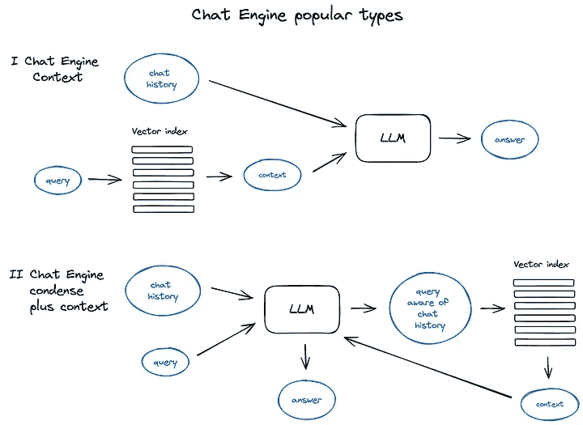

还有其他聊天引擎类型，如ReAct Agent。

### 查询路由

> 查询路由是一种基于LLM的决策步骤，用于确定针对用户的查询接下来应采取的行动。通常的选项包括概括回答、针对某个数据索引执行搜索。

> LlamaIndex 和 LangChain 都支持查询路由器。

### RAG 中的智能体

> 每个文档代理配备了两种工具 ——

> 向量存储索引和摘要索引，它会根据接收到的查询决定使用哪个工具。

> 对于顶级代理来说，所有文档代理都是其工具，可供其调度使用。

这个方案展示了一个高级的 RAG 架构，涉及每个代理做出的复杂路由决策。

这种架构的优势在于它可以比较不同文档中描述的不同解决方案或实体，以及它们的摘要，同时也支持经典的单文档摘要处理和问答流程

—— 这实际上覆盖了大多数与文档集合交互的常见用例。

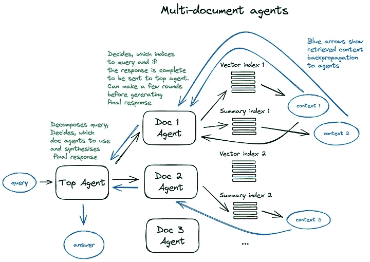

这是一个展示多文档代理工作方式的方案，其中包括了查询的路由处理和代理的智能行为模式。

# RAG技术实践的关键模块

## 1.整体架构

### 产品架构

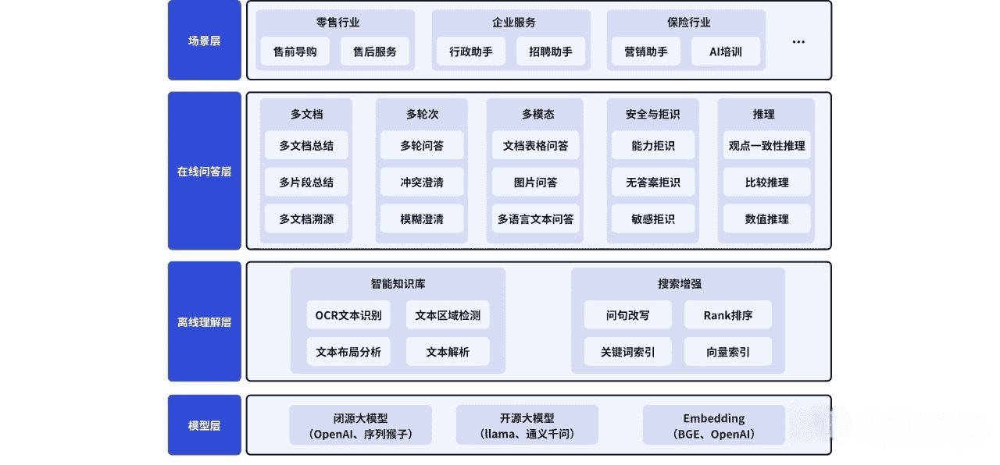

从图上可以清晰的看出，整个产品架构包含如下四层：

+   **最底层是模型层。**屏蔽掉模型的差异，可以支持开源的大模型，第三方的模型。

+   **离线理解层。**在该层，主要围绕智能知识库和搜索增强两个模块设计的。

+   在线问答层，为了满足产品设计需要，支持多文档、多轮次、多模态及安全性与拒识等。

+   **场景层，针对不同行业的特点，**预制多种场景类角色，降低产品使用门槛。

### 技术架构

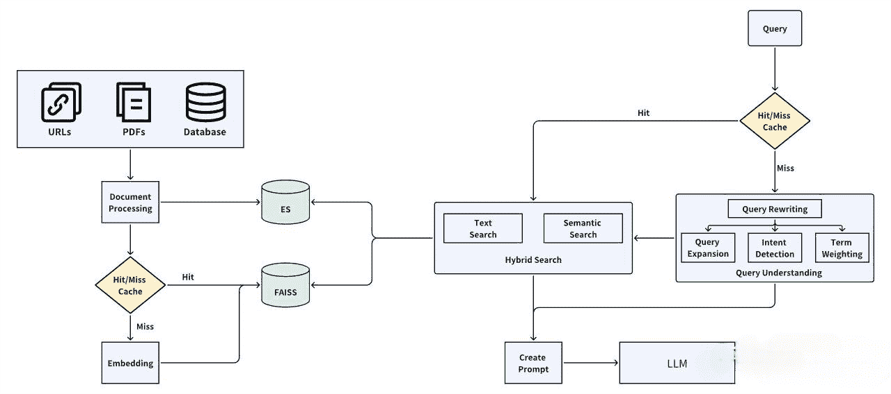

**为了理解检索增强生成框架，我们将其分为三个主要组成部**分：query理解、检索模型和生成模型。

+   **query理解：**该模块旨在对用户的query进行理解或者将用户的query生成结构化的查询，既可以查询结构化的数据库也可以查询非结构化的数据，进而提高召回率。

+   **检索模型：**该模型旨在从给定的文档集或知识库中检索相关信息。 他们通常使用信息检索或语义搜索等技术来根据给定的查询识别最相关的信息。

+   **生成模型：**该模型旨在根据给定的Prompt或上下文生成新内容。 目前，生成模型可以生成富有创意且连贯的文本，但它们可能会在事实准确性或与特定上下文的相关性方面遇到困难。

> **总**之，检索增强生成结合了检索模型和生成模型优势，克服它们各自的局限性。 在此框架中，基于检索的模型用于根据给定的查询或上下文从知识库或一组文档中检索相关信息。 通过整合检索到的信息，生成模型可以利用基于检索的模型的准确性和特异性来生成更相关、更准确的文本。

## 2.Query理解

**目前，RAG系统可能会遇到从知识**库中检索到与用户query不相关的内容。

**这是由于如下问题：**

> （1）用户问题的措辞可能不利于检索；

> （2）可能需要从用户问题生成结构化查询。

为了解决上述问题，引入query理解模块。

### 意图识别

**是接收用户的query和一组"选择"（由元数据定**义）并返回一个或多个选定的"选择模块"。

> 它既可以单独使用（作为 "选择器模块"），也可以作为查询引擎或检索器使用（例如，在其他查询引擎/检索器之上）。

**它可以应用于如下场景：**

+   在各种数据源中选择正确的数据源；

+   **是进行摘要（如摘要索引查询引擎）还是**进行语义搜索（如使用矢量索引查询引擎）；

+   决定是否一次 "尝试 "多种选择并将结果合并（使用多路由功能）。

**核心模块有以下几种形式：**

+   LLM 选择器将选择作为文本转储到提示中，并使用 LLM 做出决定；

+   构建传统的分类模型，包括基于语义匹配的分类模型、Bert意图分类模型等。

### Query改写

该模块主要利用LLM重新措辞用户query，而不是直接使用原始的用户query进行检索。

> 这是因为对于RAG系统来说，在现实世界中原始query不可能总是最佳的检索条件。

**HyDE**

**H**ypothetical Document Embeddings（HyDE）是一种生成文档嵌入以检索相关文档而不需要实际训练数据的技术。

> 首先，LLM创建一个假设答案来响应query。

> 虽然这个答案反映了与query相关的模式，但它包含的信息可能在事实上并不准确。

> **接下来，**query和生成的答案都被转换为嵌入。

> **然后，**系统从预定义的数据库中识别并检索在向量空间中最接近这些嵌入的实际文档。

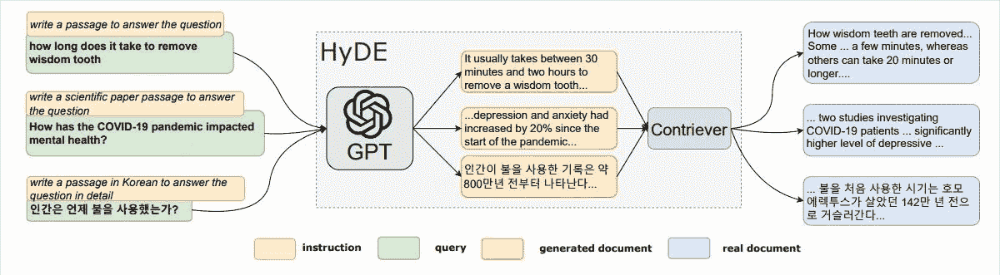

Rewrite-Retrieve-Read

这项工作引入了一个新的框架--Rewrite-Retrieve-Read，从query改写的角度改进了检索增强方法。

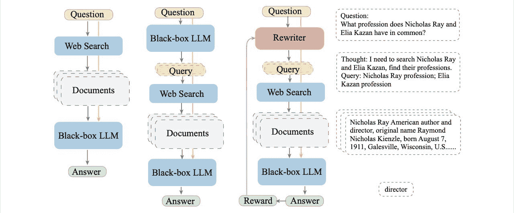

### Query扩写

**该模块主****要是为了将复杂问题拆解为**子问题。该技术使用分而治之的方法来处理复杂的问题。

> 它首先分析问题，并将其分解为更简单的子问题，每个子问题会从提供部分答案的相关文件检索答案。然后，收集这些中间结果，并将所有部分结果合成为最终响应。

Step-Back Prompting

**该工作探索了LLM如何通过抽象和推理两**个步骤来处理涉及许多低级细节的复杂任务。

> 第一步先是使用 LLM "后退一步"生成高层次的抽象概念，将推理建立在抽象概念的基础上，以减少在中间推理步骤中出错的概率。这种方法即可以在有检索的情况下使用，也可以在无检索的情况下使用。当在有检索情况下使用时，抽象的概念和原始问题都用来进行检索，然后这两个结果都用来作为LLM响应的基础。

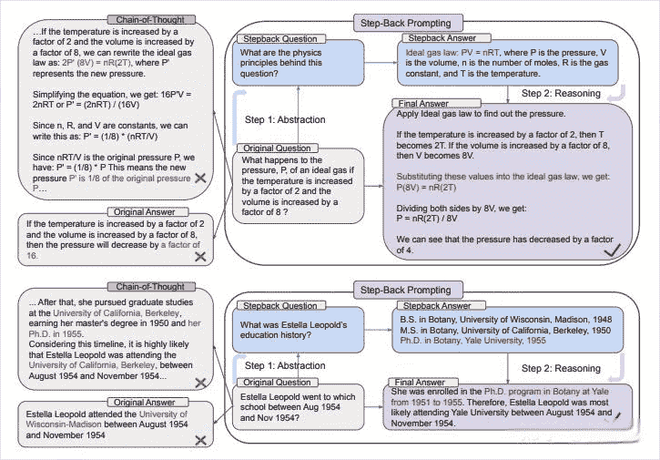

**CoVe**

Chain of Verification (CoVe) 旨在通过系统地验证和完善回答以尽量减少不准确性，从而提高大型语言模型所提供答案的可靠性，特别是在事实性问题和回答场景中。

它背后的概念是基于这样一种理念，即大型语言模型（LLM）生成的响应可以用来验证自身。这种自我验证过程可用于评估初始响应的准确性，并使其更加精确。

> 在RAG系统中，针对用户实际场景中日益复杂的问题，借鉴**了 CoVe技****术，将****复杂 Prompt **拆分为多个独立且能并行检索的搜索友好型query，让LLM对每个子查询进行定向知识库搜索，最终提供更准确详实答案的同时减少幻觉输出。

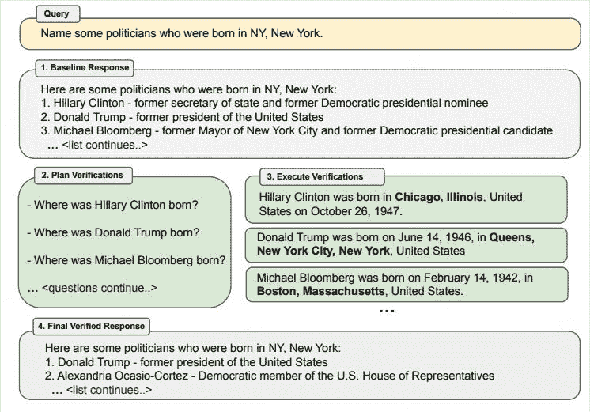

**RAG-Fusion**

**在这种方**法中，原始query经过LLM 生成多个query。然后可以并行执行这些搜索查询，并将检索到的结果一并传递。

> 当一个问题可能依赖于多个子问题时，这种方法就非常有用。RAG-Fusion便是这种方法的代表，它是一种搜索方法，旨在弥合传统搜索范式与人类查询的多面性之间的差距。这种方法先是采用LLM生成多重查询，之后使用倒数排名融合（Reciprocal Rank Fusion，RRF）来重新排序。

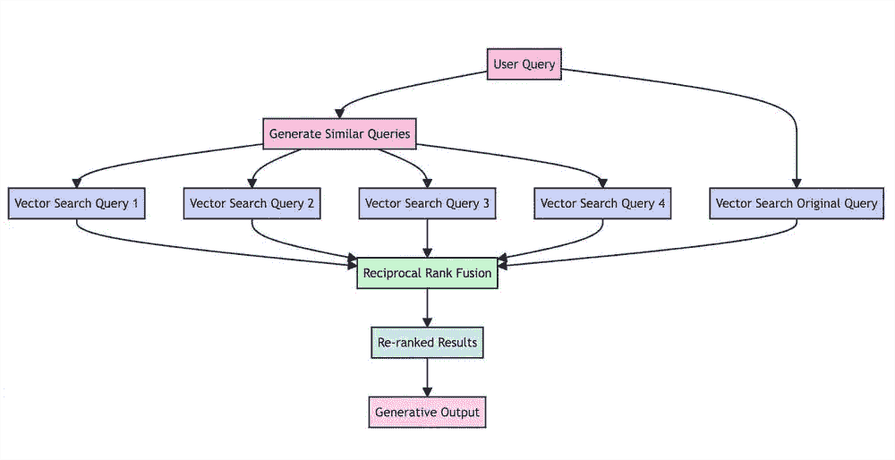

**ReAct**

> **这对组合图尤其有用。**在组成图中，一个查询可以路由到多个子索引，每个子索引代表整个知识语料库的一个子集。通过查询分解，我们可以在任何给定的索引中将查询转化为更合适的问题。

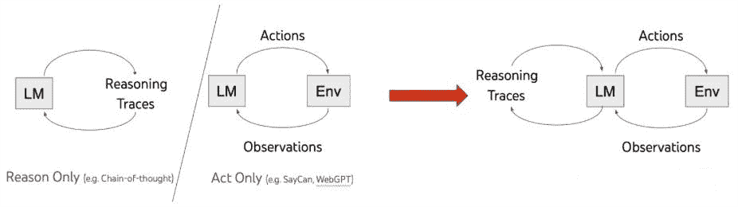

**ReAct的模式如上图所示，它是将思维链提示（Chain of Thoughts，简写为**CoT）和Action计划生成结合起来，相互补充增强，提升大模型解决问题的能力。

> 其中CoT的Reasoning推理跟踪有助于模型诱导、跟踪和更新行动计划以及处理异常。Action操作允许它与知识库或环境等外部来源接口并收集其他信息。

### Query重构

> 考虑Query理解模块整体pipeline的效率，参考Query改写和Query扩写核心思想，自研了Query重构模块，该模块强调了通过一次请求，实现对原始用户输入的复杂问题进行改写、拆解和拓展，挖掘用户更深层次的子问题，从而借助子问题检索效果更高的特点来解决复杂问题检索质量偏差的问题，旨在提高查询的准确性和效率。

## 3.检索模型

### 架构

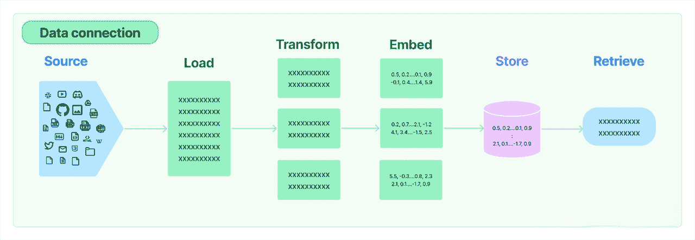

### 文档加载器

> 文档加载器提供了一种 "加载 "方法，用于从配置源加载文档数据。文档数据是一段文本和相关元数据。文档加载器可从多种不同来源加载文档。例如，有一些文档加载器可以加载简单的 .txt 文件或者加载任何网页的文本内容，甚至加载 YouTube 视频的副本。此外，文档加载器还可以选择实现 "懒加载"，以便将数据懒加载到内存中。

### 文本转换器

检索的一个关键部分是只获取文档的相关部分。当加载文档后，通常需要对其进行转换，以便更好地适应应用程序。这涉及几个转换步骤，以便为检索文档做好准备。

> 其中一个主要步骤是将大型文档分割（或分块）成较小的块，即文本转换器。最简单的例子是，当需要处理长篇文本时，有必要将文本分割成若干块，以便能放入模型的上下文窗口中。理想情况下，希望将语义相关的文本片段放在一起。这听起来很简单，但潜在的复杂性却很大。

**工作原理**

+   将文本分割成语义上有意义的小块（通常是句子）。

+   开始将这些小块组合成一个大块，直到达到一定的大小（用某个函数来衡量）。

+   一旦达到一定大小，就将该语块作为自己的文本，然后开始创建有一定重叠的新语块（以保持语块之间的上下文）。

评估文本转换器

**可以使用 Gre****g** Kamradt 创建的 Chunkviz 工具来评估文本转换器。Chunkviz 是可视化文本转换器工作情况的工具。它可以向你展示文本的分割情况，并帮助你调整分割参数。

### 文本嵌入模型

**检索的另一个关键部分是文档嵌入模型**。文档嵌入模型会创建一段文本的向量表示。

> 它可以捕捉文本的语义，让你快速有效地找到文本中相似的其他片段。这非常有用，因为它意味着我们可以在向量空间中思考文本，并进行语义搜索等操作。

> 理想情况下，检索器应该具备将不同语种的翻译文本做关联的能力（跨语种检索能力），具备将长原文和短摘要进行关联的能力，具备将不同表述但相同语义的文本做关联的能力，具备将不同问题但相同意图的问题进行关联的能力，具备将问题和可能的答案文本进行关联的能力。

> 此外，为了给大模型尽可能高质量的知识片段，检索器还应该给出尽可能多的相关片段，并且真正有用的片段应该在更靠前的位置，可以过滤掉低质量文本片段。

### 向量数据库

> 随着嵌入式的兴起，人们开始需要向量数据库来支持这些嵌入式的高效存储和搜索。存储和搜索非结构化数据的最常见方法之一是嵌入数据并存储由此产生的嵌入向量，然后在查询时嵌入非结构化查询并检索与嵌入查询 "最相似 "的嵌入向量。向量数据库负责存储嵌入数据并执行向量搜索。

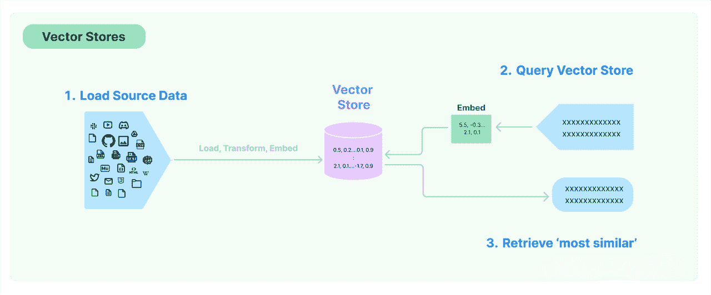

### 索引

> 经过前面的数据读取和文本分块操作后，接着就需要对处理好的数据进行索引。索引是一种数据结构，用于快速检索出与用户查询相关的文本内容。它是检索增强 LLM 的核心基础组件之一。

> **下面介绍几种常见的索引结构。**为了说明不同的索引结构，引入节点(Node)的概念。在这里，节点就是前面步骤中对文档切分后生成的文本块(Chunk)。下面的索引结构图来自 LlamaIndex 的《 How Each Index Works》。

**摘要索引（以前称为链式索引）**

> 摘要索引只是将节点存储为顺序链。在后续的检索和生成阶段，可以简单地顺序遍历所有节点，也可以基于关键词进行过滤。

**树索引**

> 树索引将一组节点 ( 文本块 ) 构建成具有层级的树状索引结构，其从叶节点 (原始文本块) 向上构建，每个父节点都是子节点的摘要。在检索阶段，既可以从根节点向下进行遍历，也可以直接利用根节点的信息。

> 树索引提供了一种更高效地查询长文本块的方式，它还可以用于从文本的不同部分提取信息。与链式索引不同，树索引无需按顺序查询。

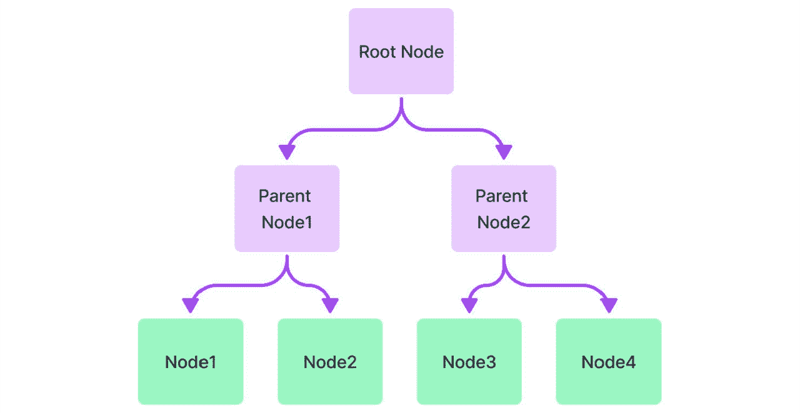

**关键词表****索引**

> 关键词表索引从每个节点中提取关键词，构建了每个关键词到相应节点的多对多映射，意味着每个关键词可能指向多个节点，每个节点也可能包含多个关键词。在检索阶段，可以基于用户查询中的关键词对节点进行筛选。

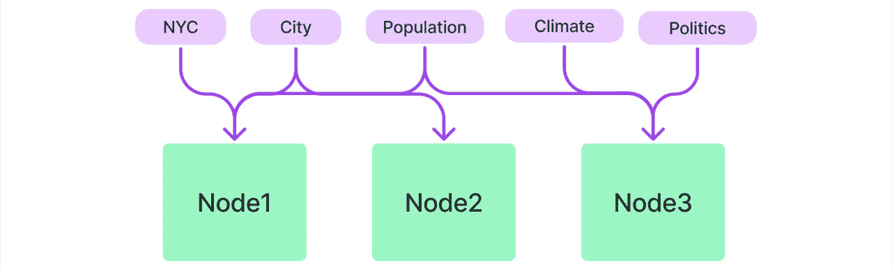

**向量索引**

> 向量索引是当前最流行的一种索引方法。这种方法一般利用文本嵌入模型将文本块映射成一个固定长度的向量，然后存储在向量数据库中。检索的时候，对用户查询文本采用同样的Embedding模型映射成向量，然后基于向量相似度计算获取最相似的一个或者多个节点。

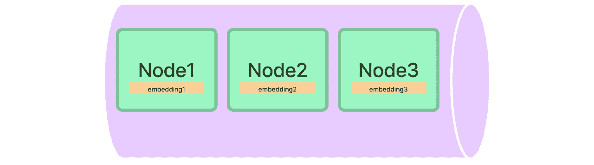

## 4.生成模型

### 回复生成策略

**检**索模块基于用户查询检索出相关的文本块，回复生成模块让 LLM 利用检索出的相关信息来生成对原始查询的回复。这里给出一些不同的回复生成策略。

+   一种策略是依次结合每个检索出的相关文本块，每次不断修正生成的回复。这样的话，有多少个独立的相关文本块，就会产生多少次的 LLM 调用。

+   一种策略是在每次 LLM 调用时，尽可能多地在 Prompt 中填充文本块。如果一个 Prompt 中填充不下，则采用类似的操作构建多个 Prompt，多个 Prompt 的调用可以采用和前一种相同的回复修正策略。

### prompt拼接策略

**用**于将提示的不同部分组合在一起。您可以使用字符串提示或聊天提示来执行此操作。以这种方式构建提示可以轻松地重用组件。

**字符串提示**

**使****用字符串提示时，每个模板都会****连**接在一起。您可以直接使用提示或字符串（列表中的第一个元素必须是提示）。例如，langchain提供的prompttemplate。

**聊天提示**

> **聊天提示由消息列表组成。**纯粹为了开发人员体验，添加一种便捷的方式来创建这些提示。在此管道中，每个新元素都是最终提示中的一条新消息。例如，langchain提供的AIMessage, HumanMessage, SystemMessage。