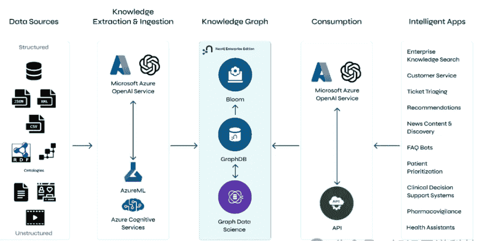
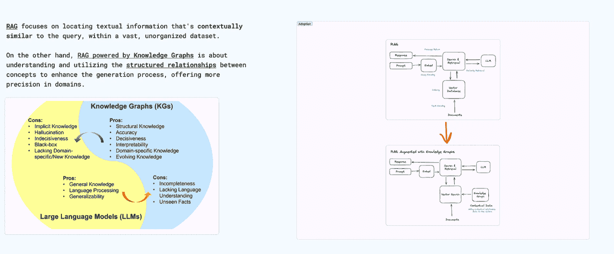
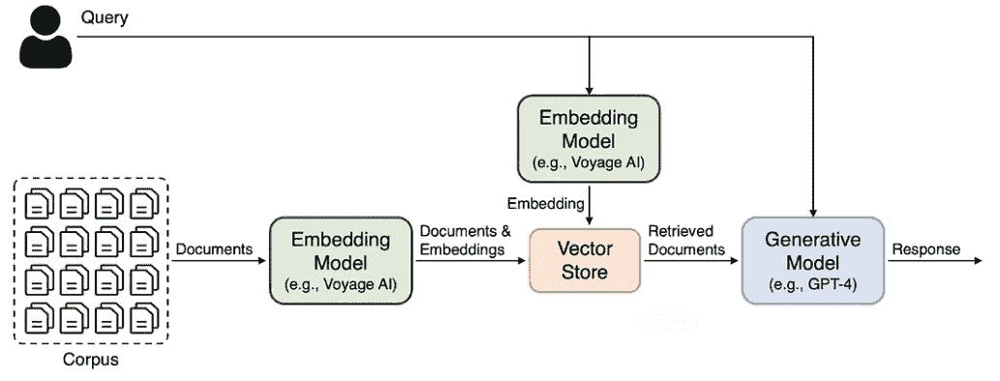
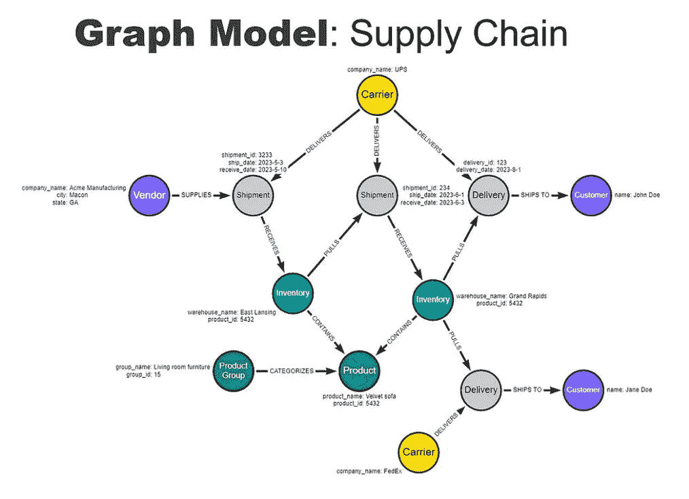
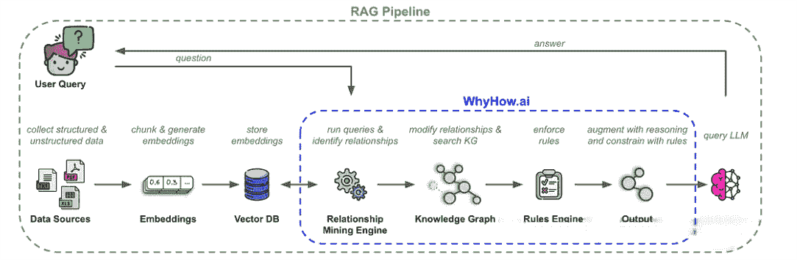
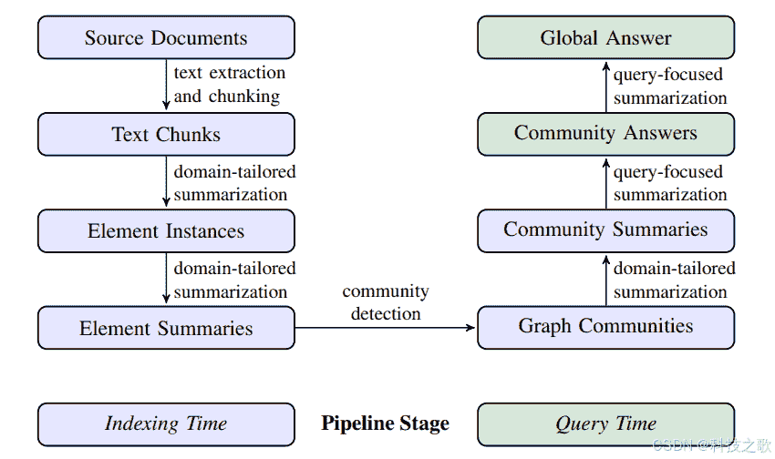
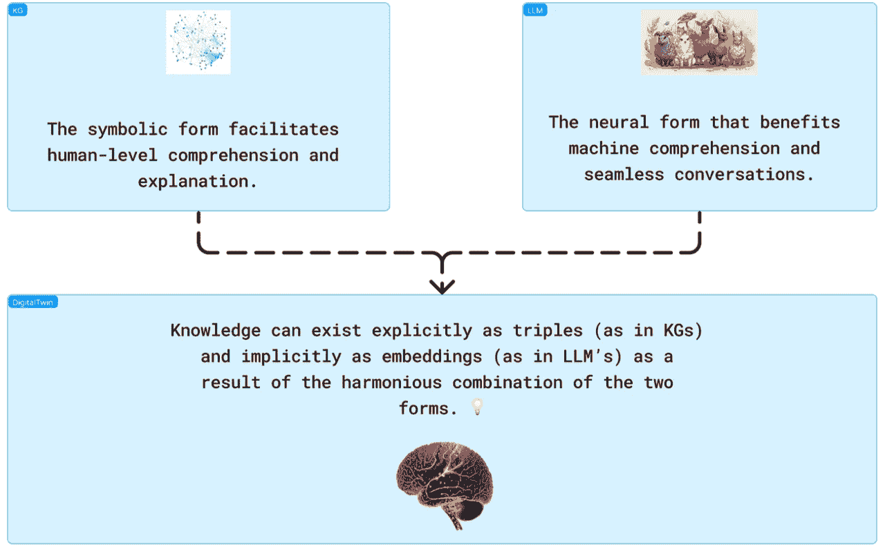
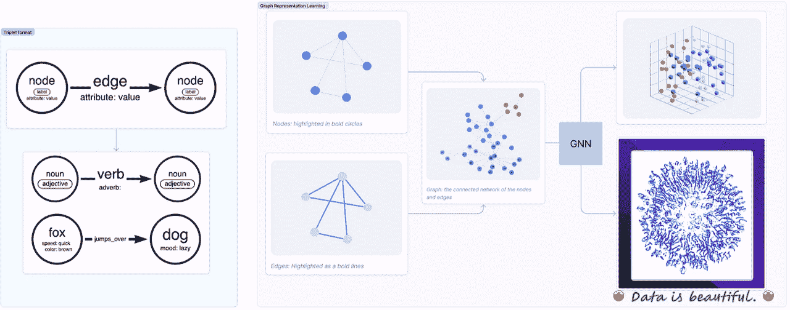
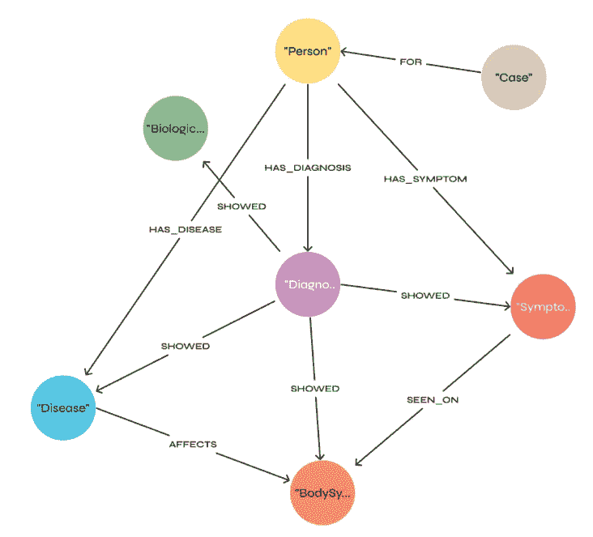
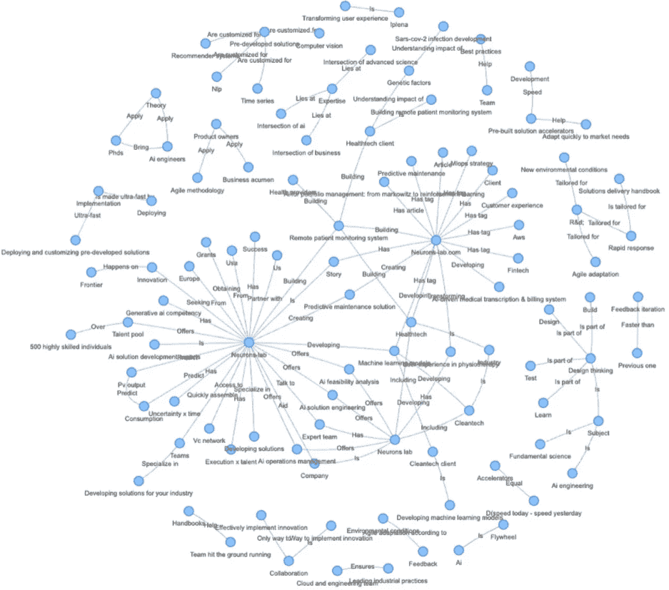

# 大白话讲清GraphRAG：知识图谱与RAG融合

> 来源：[https://qqs7y1hozd1.feishu.cn/docx/D3a4dmSh3oy0Jgxg082c0IqNnwh](https://qqs7y1hozd1.feishu.cn/docx/D3a4dmSh3oy0Jgxg082c0IqNnwh)

大型语言模型（LLMs）以其信息处理和文本生成能力，得到了很多应用。然而，LLMs在实际应用中面临模型输出准确性和“幻觉”问题，为了解决这些问题，通过检索增强生成（RAG）技术，从而让大模型调用外部知识源（比如个人和公司保存的大量文档）回答问题。

> 但是当回答针对整个文本语料库的全局性问题，如“数据集中的主要主题是什么？”，RAG却无能为力。因为这类问题本质上是查询聚焦摘要（QFS）任务，而非一个明确的检索任务。

对此，微软提出的知识图谱RAG（以下使用：Graph RAG）技术，能够将复杂的、大规模文本数据集转化为易于理解和操作的知识结构，以便更好地理解实体

（如人物、地点、机构等）之间的相互关系。

GraphRAG（**Graph-Augmented Retrieval-**Augmented Generation）技术应运而生，它结合了知识图谱和检索增强技术，大幅提升了AI在复杂查询处理中的性能。

## 一、GraphRAG：知识图谱与RAG的结合

> **GraphRAG技术栈的核心在于将知识图谱**的强大表达能力与RAG的检索能力相结合。知识图谱作为一种结构化的语义知识库，通过节点和边的网络结构，有效地存储和表示实体之间的关系。RAG技术则通过将查询与已有文本进行向量空间的匹配，检索出最相关的信息片段来辅助LLMs生成更准确的回答。

## 二、知识图谱与RAG

**知识图谱在GraphRAG中扮演着至**关重要的角色。它不仅提供了对实体间复杂关系的结构化表示，还增强了检索过程的上下文理解能力。RAG技术的引入，标志着从传统的基于文本块的检索向更智能的信息检索的转变。通过将文档转化为向量形式，并利用向量数据库进行高效检索，RAG能够快速定位到与查询最相关的文本片段，从而为LLMs提供丰富的参考信息。

> **知识图谱基本上是节点和关系的集合。节点代**表个别数据点，而关系定义它们之间的连接。每个节点可以具有属性，提供有关节点的附加上下文或属性。这种方法提供了一种灵活而直观的方式来建立数据中复杂的关系和依赖关系。人们经常形容知识图谱是模仿人类大脑思维方式的一种近似方式。

图数据库/知识图谱已经存在一段时间了，但其历史应用范围一直较窄。

> 在历史上，使用知识图谱主要是用于类似于数据字典的用途，即在不同数据孤岛中强制执行语义结构，统一数据集以揭示隐藏的关系。例如，能够将一个数据库中的"user_id"与另一个数据库中的"USER-name"进行关联。这种用例过去通常是一个痛苦的手动过程，只有大公司才会费心去做，而且通常必须由领域专家手动完成。当时的主要价值主张是针对大数据分析的。

然而，LLM RAG系统已经成为知**识图谱的一个完全不同的价值主张的消费者。能够在单词之间建立明确的关联意味着您可以强制确**保LLM理解"USER -> Owns_A -> Golden_Retriever -> Has_A_Disease"。通过查看其知识库中的结构化图形，这有助于企业减少幻觉，注入上下文，并充当记忆、个性化机制以及概率LLM的结构化补充。

> 在这种用例中，有趣的是，**尽管知识图谱可以帮助使RAG系统更加企业就绪，**但LLM也可以帮助自动化知识图谱的创建。因此，尽管对知识图谱的兴趣和需求增加了，但LLM也可以被结构化到工作流程中以自动化不同类型的知识图谱创建，增加了图谱的适用性和可访问性。

知识图谱在RAG中有两种适用方式：

+   作为检索信息的数据存储

+   作为语义结构的数据存储，用于检索向量块

**如**果它们是数据存储，可以与向量数据库并行使用或替代。如果它们是用于检索向量块的语义结构的数据存储，它们将与向量数据库并行使用。

作为数据存储，知识图谱需要对重要数据和最佳知识表示形式有细致的理解（例如，我是存储文档结构还是基于概念的关系映射等），以及每个图谱如何与RAG系统中的不同代理进行交互等等。

> **这需要工作流工具和离散数据管道来帮助管理包含不同数据**类型和数据抽象级别的不同图谱之间的编排。就像我们不会使用单个提示来捕捉工作流的所有描述方式一样，而是将其分解为许多离散提示和代理，使用单个图表或表来存储所有数据是难以操作的，难以创建、维护或编排的，对于信息检索工作流来说，一系列小图谱更为可取。

## 三、GraphRAG实现步骤

Graph RAG的关键步骤如下：

+   **源文档分割：**将文档合理切分成文本块，为大模型处理优化输入。

+   **提取实例：**从文本块中精准提取实体和关系的实例。

+   **实例摘要化：**将实体和关系的实例转换为精炼的摘要。

+   **构建图社区：**利用元素摘要通过社区检测算法构建图社区。

+   **生成社区摘要：**为每个图社区创建全面摘要，捕捉核心内容。

+   **生成全局答案：**通过整合社区摘要，高效生成针对用户查询的全面答案。

### 源文档分割

**将原始文档被精心切分为易于处理的文本块。这一过程对于确定大模**型的调用频率和信息抽取的准确性至关重要。

> 虽然文本块越多越好，但是需要评估准确率和召回率，以最大化大模型的上下文窗口召回率，同时避免因文本过长而导致信息遗漏。

### 提取实例

将每个文本块被送入大模型，以识别和提取图中的节点和边的实例。这一步骤通过多部分大模型提示词实现，首先识别文本中的所有实体及其属性，然后识别实体间的关系，然后将信息以一组分隔的元组形式输出，为构建图索引做好准备。

### 实例摘要化

> **利用大模型对实体、关系和声明的**描述进行抽象总结，形成对概念的独立有意义的摘要。这一过程依赖于大模型对文本本身未明确表述的概念（如隐含关系）的理解能力。

### 构建图社区

将上一步生成的摘要进一步整合，形成图社区。这一步骤中，使用如Leiden算法等社区检测技术，将图划分为多个社区，每个社区内的节点彼此间联系更为紧密，代表了数据集中的相关主题或概念集合。

### 生成社区摘要

> 为每个社区生成摘要，这些摘要不仅有助于理解数据集的全局结构和语义，而且在没有具体查询的情况下，也可用于对整个文档集合的理解。社区摘要的生成考虑了节点的重要性和连接度，以确保社区内的关键信息被有效捕捉。

### 生成全局答案

利用社区摘要生成对用户查询的全局答案。首先，社区摘要被随机分配并分块，以适应LLM的上下文窗口大小。然后，对每个块并行生成中间答案，并由LLM评估答案的相关性。最后根据答案的相关性分数进行排序，逐步汇总形成最终答案。

## 四、GraphRAG的优势与应用场景

**Gr**aphRAG技术以其独特的优势，在多个领域展现出广泛的应用潜力。它不仅提升了信息检索的准确性和效率，还为个性化服务、复杂决策支持、跨领域分析以及知识创新提供了强大的技术支持。

### 增强的语义理解和上下文捕捉能力

> **GraphRAG技术通过整合知识图**谱，显著提升了对语义和上下文的理解能力。与传统的文本检索技术相比，GraphRAG能够跨越文档的界限，将分散在不同文本块中的信息进行整合，为用户提供更加全面和深入的答案。在处理需要多方面信息综合分析的复杂查询优势明显，例如在法律研究、金融分析和学术研究等领域得跨文档处理，检索更快，更准确！利于发现实体之间联系！

### 对复杂关系和层次结构的捕捉

**GraphRAG的另一个显著优势是**其对实体间复杂关系和层次结构的捕捉能力。在构建知识图谱的过程中，GraphRAG不仅识别出文本中的实体，还提取了实体间的关系，形成了一个丰富的语义网络。这种网络能够精确地表示实体间的各种复杂联系，如因果关系、时间顺序、逻辑推理等，这对于需要深入分析和理解复杂系统的场景至关重要，如医疗诊断、供应链管理等。

### 个性化服务与推荐系统

> **GraphRAG技术在个性化服务和推荐系统**中的应用，为用户提供了更加定制化的体验。通过对用户行为、偏好以及相关实体信息的深入理解，GraphRAG能够提供个性化的内容推荐、服务匹配和决策支持。在电商、内容分发平台、智能客服等领域，利用知识图谱，GraphRAG能够实现更为精细的检索控制，快速定位到与查询紧密相关的实体和关系，提高了检索效率与用户体验和满意度。

### 知识发现

**最后，**GraphRAG技术在促进创新和知识发现方面具有重要作用。通过自动化地从大量文献和数据中发现新的知识和模式，GraphRAG能够为研究人员提供新的研究方向和假设。此外，GraphRAG还能够支持自动化的知识整合和验证，加速科学发现和技术进步的过程。

### 其他场景

+   **概念聚合：**需要合并或与彼此交流的两个不同文档或数据源

> 将来自多个文档和数据源的信息进行合并时。比如创建 理财RAG 系统时，有联系人列表、他们所从事的行业以及他们所关联的产品。人员、行业和理财产品应连接到更广泛的上下文和数据，例如新闻文章之类的非结构化文本。

可以看作是一种多跳推理的形式，当它们涵盖了相同的概念或上下文，允许通过自动组合多个来源的信息。

+   **概念对齐：**两个不同领域之间的自动通信

**在企业的工作流程中，将新信息融入现有的知识库，需要调整新**信息与现有信息的特定部分之间的交互方式。

> 比如在农业行业中找到，不同的特定领域对决策和结果起到。例作用不同。如特定的天气数据与特定的土壤数据结合，对产量影响很大。这些天气和土壤数据属于不同的领域，具有不同的更新频率、不同的细粒度、不同的供应商，所有这些都需要一起汇总处理，才能更全面地理解当前和预测农业系统的情况，从而更准确地获得产量和成本信息，利用非结构化的专家建议和LLM推理能力的优势。

+   **分层检索：**通过分层步骤/分类实现确定性的检索。

+   **个性化/记忆：**确保LLM在提到时跟踪用户的兴趣爱好来记录个性化，以后可以根据兴趣爱好提供相关活动的建议。

## 五、GraphRAG的难点问题

> **G**raphRAG技术虽然在多个领域展现出强大的应用潜力，如在处理速度和稳定性方面仍有待提升，实施和运营过程中的挑战和成本问题也不容忽视。技术集成的复杂性要求企业投入大量的研发资源来确保系统的稳定运行。高昂的计算资源需求和API调用成本可能会限制GraphRAG技术的普及，特别是在资源受限的环境中。性能优化和稳定性问题则需要持续的技术改进和创新。

### 技术集成与实现复杂性

> **G**raphRAG作为一种先进的人工智能技术，其实现涉及多个复杂组件的集成，包括知识图谱构建、向量数据库管理、自然语言处理（NLP）技术、以及与大型语言模型（LLMs）的接口等。这种技术集成的复杂性带来了一系列挑战，如不同系统之间的兼容性、数据一致性维护、以及系统集成的稳定性和可靠性问题。

### 高昂的计算资源需求

> GraphRAG技术在处理大量数**据**和复杂查询时，需要消耗大量的计算资源。尤其是在构建和维护知识图谱、执行向量搜索、以及与LLMs交互的过程中，GraphRAG可能会产生巨大的计算负载。这不仅需要强大的硬件支持，如高性能服务器和GPU集群，还可能涉及到云服务的使用，从而带来显著的运营成本。

### API调用与授权成本

> GraphRAG的有效运作依赖于与外部API**的频繁调用，特别是与大型语言模型的**交互。这些API调用可能涉及到昂贵的使用费用，尤其是当使用商业化的API服务时。例如，使用OpenAI的GPT模型进行问答或文档分析时，每次API调用都可能产生费用，而且费用会随着请求的数量和复杂性而增加。

### 性能优化与稳定性问题

> **尽管Grap**hRAG技术具有巨大的潜力，但在实际应用中，其性能和稳定性仍面临挑战。例如，知识图谱的构建和更新可能需要大量的时间和计算资源，而且可能需要持续的人工干预来确保数据的质量和准确性。