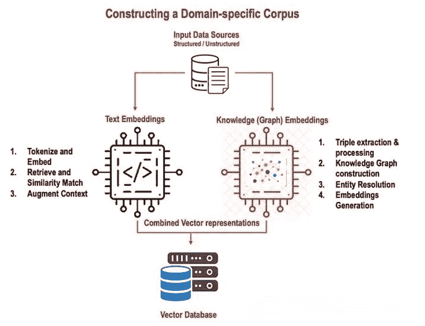
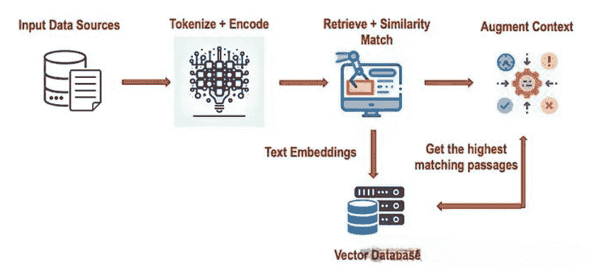
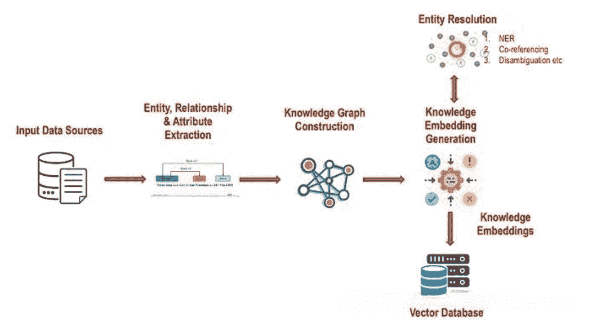
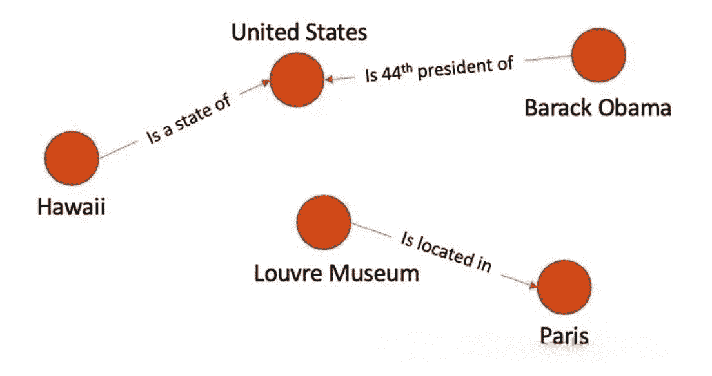
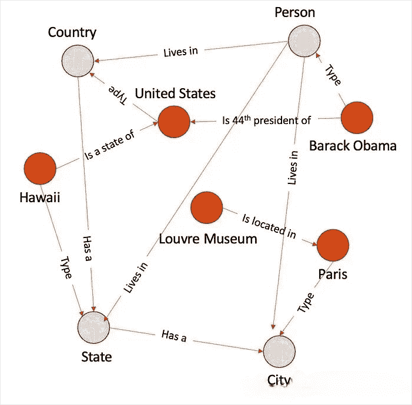

# 提升RAG的性能|整合文本和知识图谱嵌入

> 来源：[https://qqs7y1hozd1.feishu.cn/docx/YOPSdEpe2oHi4Wx7MvWc78c9nIg](https://qqs7y1hozd1.feishu.cn/docx/YOPSdEpe2oHi4Wx7MvWc78c9nIg)

将文本和知识图谱结合，来提升RAG的性能



## 一、**文本嵌入的RAG**

**文本嵌入**是单词或短语的数字表示，可以有效地捕捉它们的含义和上下文。可以将它们视为单词的唯一标识符——捕获它们所代表的单词的含义的简洁向量。这些嵌入使计算机能够增强对文本的理解和处理，使它们能够在各种NLP任务中脱颖而出，例如文本分类、情感分析和机器翻译。

+   可以利用预先训练的模型，如Word2Vec、GloVe或BERT来生成文本嵌入。这些模型已经在大量文本数据上进行了广泛的训练，并且已经获得了对单词及其关系的语义信息进行编码的能力。

使用一个简单的Python代码片段(word2vec)来探索生成文本嵌入的过程:

```
 # Code Implementation: Generating Text Embeddings
 import numpy as np
 from gensim.models import Word2Vec
 
 # Sample sentences
 sentences = [
     [&quot;I&quot;, &quot;love&quot;, &quot;natural&quot;, &quot;language&quot;, &quot;processing&quot;],
     [&quot;Text&quot;, &quot;embeddings&quot;, &quot;are&quot;, &quot;fascinating&quot;],
     [&quot;NLP&quot;, &quot;makes&quot;, &quot;computers&quot;, &quot;understand&quot;, &quot;language&quot;]
 ]
 
 # Train Word2Vec model
 model = Word2Vec(sentences, vector_size=5, window=5, min_count=1, sg=1)
 
 # Get embeddings for words
 word_embeddings = {}
 for word in model.wv.index_to_key:
     word_embeddings[word] = model.wv[word]
 
 # Print embeddings
 for word, embedding in word_embeddings.items():
     print(f&quot;Embedding for &#x27;{word}&#x27;: {embedding}&quot;)
```

在上段代码中，通过**对一组示例**句子进行训练来开发一个Word2Vec模型。然后模型为每个单词生成嵌入。这些嵌入捕获句子中单词之间的语义关系。使用Word2Vec生成文本嵌入的代码片段输出如下:

```
 Embedding for &#x27;I&#x27;: [-0.01978252  0.02348454 -0.0405227  -0.01806103  0.00496107]
 Embedding for &#x27;love&#x27;: [ 0.01147135 -0.00716509 -0.02319919  0.03274594 -0.00713439]
 Embedding for &#x27;natural&#x27;: [ 0.03319094  0.02570618  0.02645341 -0.00284445 -0.01343429]
 Embedding for &#x27;language&#x27;: [-0.01165106 -0.02851446 -0.01676577 -0.01542572 -0.02357706]
```

**在上面的输出中:**

每一行对应一个词的嵌入向量。每行以单词开头，然后是表示为数值列表的嵌入向量。例如，单词“love”的嵌入: [-0.01978252 0.02348454 -0.0405227 -0.01806103 0.00496107]。

RAGs利用文本嵌入来掌握输入查询的上下文并提取相关信息。



现在尝试使用预训练的模型(如BERT)对输入查询进行标记和编码。这将查询转换为捕获其语义和上下文的数字表示形式。

```
 # Code Implementation: Tokenization and Encoding
 from transformers import BertTokenizer, BertModel
 
 # Initialize BERT tokenizer and model
 tokenizer = BertTokenizer.from_pretrained(&#x27;bert-base-uncased&#x27;)
 model = BertModel.from_pretrained(&#x27;bert-base-uncased&#x27;)
 
 # Tokenize and encode the input query
 query = &quot;What is the capital of France?&quot;
 input_ids = tokenizer.encode(query, add_special_tokens=True, return_tensors=&quot;pt&quot;)
```

使**用BERT对输**入查询进行标记并将其编码为数字id。由于BERT模型初始化和标记化过程涉及加载一个大型预训练模型，因此标记化和编码步骤的输出包括以下组件:

**id: **这些是输入查询中令牌的数字表示形式。每个令牌都被转换成一个ID，该ID对应于BERT词汇表中的索引。

**注意力掩码: **这是一个二进制掩码，指示哪些令牌是实际的单词(1)，哪些是填充令牌(0)。它确保模型在处理过程中只关注真实的令牌。

令牌类型id(对于像BERT这样的模型): 在多个片段的情况下，每个令牌属于哪个片段或句子。对于单句输入，所有令牌类型id通常设置为0。

输出是包含这些组件的字典，可以将其用作BERT模型的输入以进行进一步处理。

**下面是输出内容的示例:**

```
 {
     &#x27;input_ids&#x27;: tensor([[  101,  2054,  2003,  1996,  3007,  1997,  2605,  1029,   102,     0]]),
     &#x27;attention_mask&#x27;: tensor([[1, 1, 1, 1, 1, 1, 1, 1, 1, 0]]),
     &#x27;token_type_ids&#x27;: tensor([[0, 0, 0, 0, 0, 0, 0, 0, 0, 0]])
 }
```

input_ids包含输入查询中令牌的数字id。Attention_mask指示哪些令牌是实际单词(1)，哪些是填充令牌(0)。Token_type_ids表示每个令牌所属的片段或句子(本例中第一个句子为0)。

接下来，就可以根据编码查询从语料库中检索相关段落。我们使用余弦相似度计算查询嵌入和段落嵌入之间的相似度分数。

```
 # Code Implementation: Retrieval and Similarity Matching
 from sklearn.metrics.pairwise import cosine_similarity
 
 # Retrieve passages and compute similarity scores
 query_embedding = model(input_ids)[0].mean(dim=1).detach().numpy()
 passage_embeddings = ...  # Retrieve passage embeddings
 similarity_scores = cosine_similarity(query_embedding, passage_embeddings)
```

+   选择相似度得分最高的文章，并将其与相似度得分一起输出。相似度分数表示每个段落与输入查询间的相似度，分数越高表示相似度越高。在RAG模型中，获得最高相似性分数的文章被认为是与进一步处理最相关的。

最后将相似度得分最高的文章指定为最相关的文章。这一段为模型的生成阶段提供了相关的信息。

```
 # Select passage with highest similarity score
 max_similarity_index = np.argmax(similarity_scores)
 selected_passage = passages[max_similarity_index]
 
 # Output selected passage and similarity score
 print(&quot;Selected Passage:&quot;)
 print(selected_passage)
 print(&quot;Similarity Score:&quot;, similarity_scores[0][max_similarity_index])
```

+   文本嵌入是自然语言处理(NLP)领域中非常强大的工具，它可以有效地理解和处理文本信息。它们对很多任务都有重要的影响，比如回答问题、生成文本和分析情绪。通过在RAG中使用文本嵌入，可以提高性能和精度，从而得到更加准确且符合上下文的响应。

## 二、**知识图谱嵌入的RAG**

下面介绍如何定义和实现知识图谱嵌入，从非结构化数据中表示结构域构造。

知识图谱是组织信息、以有意义的方式连接实体及其关系的一种非常有效的方式。这些图就像一个组织良好的信息仓库，捕捉现实世界中物体的意义及其联系。然而，这个过程并没有随着知识图谱的发展而结束。探索知识图谱嵌入领域对于释放其全部潜力至关重要。

为了演示保持了KG的基本结构，但是简化了KG组件的使用。在将KG元素表示为嵌入后，使用评分函数来评估三元组的合理性，例如“Tim”、“is an”、“Artist”。

以下是实现知识(图)嵌入的步骤:



给定一个非结构化文本，我们首先将使用斯坦福大学的OpenIE框架提取关键实体、关系和属性。一旦三元组被提取出来，我们就可以清理/调整它们。

```
 from openie import StanfordOpenIE
 
 text = &quot;Hawaii is a state in the United States. Barack Obama served as the 44th president of the United States. The Louvre Museum is located in Paris, France.&quot;
 
 with StanfordOpenIE() as client:
     triples = client.annotate(text)
     for triple in triples:
         print(triple)
 
     cleaned_triples = [(subject.lower(), relation.lower(), object.lower()) for (subject, relation, object) in triples]
     print(&quot;Cleaned Triples:&quot;, cleaned_triples)
```

上述代码的输出为

```
 (&#x27;Hawaii&#x27;, &#x27;is&#x27;, &#x27;a state in the United States&#x27;)
 (&#x27;Barack Obama&#x27;, &#x27;served as&#x27;, &#x27;the 44th president of the United States&#x27;)
 (&#x27;The Louvre Museum&#x27;, &#x27;is located in&#x27;, &#x27;Paris, France&#x27;)
 
 Cleaned Triples: [(&#x27;hawaii&#x27;, &#x27;is&#x27;, &#x27;a state in the united states&#x27;), (&#x27;barack obama&#x27;, &#x27;served as&#x27;, &#x27;the 44th president of the united states&#x27;), (&#x27;the louvre museum&#x27;, &#x27;is located in&#x27;, &#x27;paris, france&#x27;)]
```

现在可以使用这些信息创建一个知识图谱，使用NetworkX框架构造一个具有实体→节点和关系→边的知识图。

**下面是实现:**

```
 import networkx as nx
 
 # Create a directed graph
 knowledge_graph = nx.DiGraph()
 
 # Add nodes and edges from cleaned triples
 for (subject, relation, object) in cleaned_triples:
     knowledge_graph.add_edge(subject, object, relation=relation)
 
 # Visualize the knowledge graph
 nx.draw(knowledge_graph, with_labels=True)
```



实体解析在各种NLP应用中起着关键作用，包括信息提取、问题回答、知识图谱构建等。通过准确地将文本中实体的提及与结构化知识表示中的相应实体联系起来，实体解析使机器能够更有效地使用自然语言理解和推理，从而促进了广泛的下游任务和应用。

实体解析解决了自然语言中模糊性和可变性的挑战。

> 在日常语言使用中，经常使用不同的名称、同义词、缩写或变体来指代人员、位置、组织和概念等实体。例如，“巴拉克·奥巴马”可能会被说成“奥巴马”、“美国前总统”或简单地说成“他”。

> 另外也可能存在具有相似名称或属性的实体，从而导致潜在的混淆或歧义。例如，“Paris”可以指法国的首都，也可以指同名的其他地方。

**实体解析技术:**

**精确匹配: **在文本中，提到“Hawaii”可以直接链接到图中标记为“Hawaii”的节点，因为它们完全匹配。

**部分匹配: **如果文本提到“USA”而不是“United States”，部分匹配算法可能会识别两者之间的相似性，并将提及链接到图中标记为“United States”的节点。

**命名实体识别(NER): **使用NER，系统可以将“巴拉克·奥巴马”识别为文本中提到的个人实体。然后这个提及可以链接到图中标记为“巴拉克•奥巴马”的相应节点。

**共同引用解析: **如果文本提到“他曾担任总统”，共同引用解析可以将“他”链接回文本前面提到的“巴拉克·奥巴马”，然后将其链接到图中标记为“巴拉克·奥巴马”的相应节点。

**消歧义: **假设文本提到了“Paris”，但没有指定它指的是法国的城市还是其他地方。消歧技术可能会考虑上下文信息或外部知识来源，以确定它指的是“Paris, France”，并将其链接到图中相应的节点。

+   一旦确定了正确的实体链接，文本中的提及就会链接到知识库或知识图中相应的实体。实体解析系统的性能使用精度、召回率和f1分数等指标进行评估，并将预测的实体链接与基本事实或标准进行比较。下面给出了上面构造的图的实体解析示例。灰色圆圈表示给定实体的类类型解析。



作为最后一步，将为实体和关系生成嵌入。这里使用TransE。

```
 from pykeen.pipeline import pipeline
 
 # Define pipeline configuration
 pipeline_config = {
     &quot;dataset&quot;: &quot;nations&quot;,
     &quot;model&quot;: {
         &quot;name&quot;: &quot;TransE&quot;,
         &quot;embedding_dim&quot;: 50
     },
     &quot;training&quot;: {
         &quot;num_epochs&quot;: 100,
         &quot;learning_rate&quot;: 0.01
     }
 }
 
 # Create and run pipeline
 result = pipeline(
     **pipeline_config,
     random_seed=1234,
     use_testing_data=True
 )
 
 # Access trained embeddings
 entity_embeddings = result.model.entity_embeddings
 relation_embeddings = result.model.relation_embeddings
 
 # Print embeddings
 print(&quot;Entity Embeddings:&quot;, entity_embeddings)
 print(&quot;Relation Embeddings:&quot;, relation_embeddings)
```

得到的输出如下：

```
 Entity Embeddings: [Embedding dimension: (120, 50)]
 Relation Embeddings: [Embedding dimension: (120, 50)]
```

## 三、**文本和知识图谱进行整合**

在我们组合这些嵌入之前，要首先了解这些嵌入的目标，并验证它们是否完全互补。

文本嵌入和知识图谱嵌入在自然语言处理(NLP)中有着不同的用途，它们代表了语言和语义信息的不同方面。

下面的代码通过将文本嵌入和知识嵌入组合到单个嵌入空间中来集成文本嵌入和知识嵌入，然后根据查询和段落的组合嵌入之间的余弦相似度从知识库中检索相关段落。输出显示相关的段落以及它们与查询的相似度得分。

```
 import numpy as np
 from sklearn.metrics.pairwise import cosine_similarity
 
 # Sample knowledge embeddings
 knowledge_embeddings = { } #initialise the above knowledge embeddgings output
 
 # Sample text embeddings
 text_embeddings = { } #initialise the above text embeddgings output
    
 # Consider passages from knowledge base
 knowledge_base = {
     &quot;Passage 1&quot;: &quot;Hawaii is a state in the United States.&quot;,
     &quot;Passage 2&quot;: &quot;Barack Obama served as the 44th president of the United States.&quot;,
     # Add more passages as needed
 }
 
 # Function to combine text and knowledge embeddings
 def combine_embeddings(text_emb, know_emb):
     combined_emb = {}
     for entity, t_emb in text_emb.items():
         if entity in know_emb:
             combined_emb[entity] = np.concatenate([t_emb, know_emb[entity]])
         else:
             combined_emb[entity] = t_emb
     return combined_emb
 
 # Function to retrieve relevant passages using combined embeddings
 def retrieve_passages(query_emb, knowledge_base_emb):
     similarities = {}
     for passage, kb_emb in knowledge_base_emb.items():
         sim = cosine_similarity([query_emb], [kb_emb])[0][0]
         similarities[passage] = sim
     sorted_passages = sorted(similarities.items(), key=lambda x: x[1], reverse=True)
     return sorted_passages
 
 # Example usage
 combined_embeddings = combine_embeddings(text_embeddings, knowledge_embeddings)
 query = &quot;query&quot;
 relevant_passages = retrieve_passages(combined_embeddings[query], knowledge_embeddings)
 
 # Print relevant passages
 for passage, similarity in relevant_passages:
     print(&quot;Passage:&quot;, passage)
     print(&quot;Similarity:&quot;, similarity)
```

**输出如下：**

```
 Passage: Passage 1
 Similarity: 0.946943628930774
 
 Passage: Passage 2
 Similarity: 0.9397945401928656
```

## 四、**总结**

在RAG中同时使用文本嵌入和知识嵌入可以从几个方面增强模型性能和能力:

**1、**文本嵌入捕获单个单词或短语的语义，而知识嵌入捕获实体之间的明确关系。通过两种嵌入的集成，RAG模型实现了对输入文本和存储在知识图中的组织信息的更全面的把握。

**2、**文本嵌入通过分析输入文本中的词共现提供有价值的上下文见解，而知识嵌入通过检查知识图中实体之间的关系提供上下文相关性。通过组合不同类型的嵌入，RAG模型能够生成与输入文本在语义上相关且在上下文中与结构化知识一致的响应。

**3、**由于在检索组件中集成了知识嵌入，在RAG模型中利用结构化知识可以显著提高答案选择。利用知识嵌入对知识库中的相关段落进行索引和检索，RAG模型不仅能够检索出更准确的响应，而且具有更丰富的信息。

**4、**文本嵌入通过结合广泛的语言特征和语义细微差别来增强RAG模型的生成组件。通过在答案生成过程中整合文本嵌入和知识嵌入，RAG模型能够生成语言流畅性、语义相关性和结构化知识坚实基础的回答。

**5、**通过使用文本嵌入和知识嵌入，RAG模型获得了对自然语言中模糊性和可变性的增强弹性。文本嵌入捕获非结构化文本中存在的可变性和模糊性，而知识嵌入提供明确的语义关系，以增强和澄清模型的理解。

**6、**知识嵌入允许RAG模型无缝地将来自知识库的结构化知识集成到生成过程中。通过知识嵌入和文本嵌入的集成，RAG模型实现了结构化知识和非结构化文本的无缝融合，从而获得更丰富的信息和上下文相关的响应。

+   在RAG模型中，文本嵌入和知识嵌入都允许对输入文本和结构化知识进行更全面、上下文更丰富的表示。这种集成增强了模型在答案检索、答案生成、对歧义的鲁棒性和结构化知识的有效结合方面的性能，最终导致更准确和信息丰富的响应。