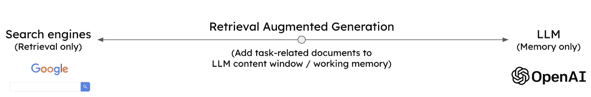
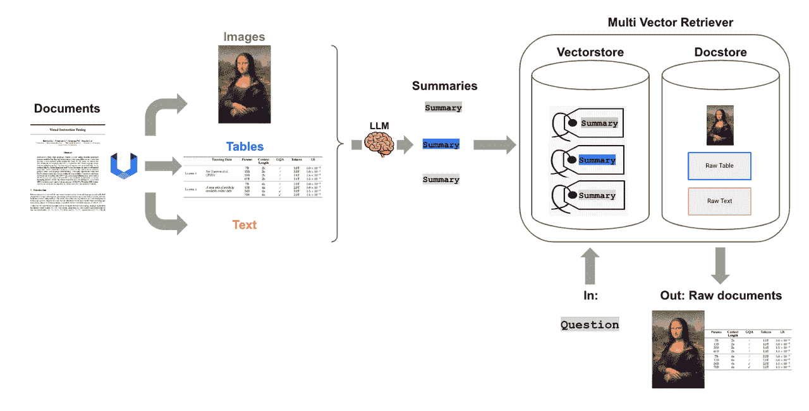
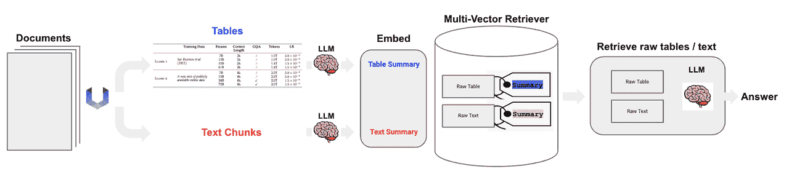
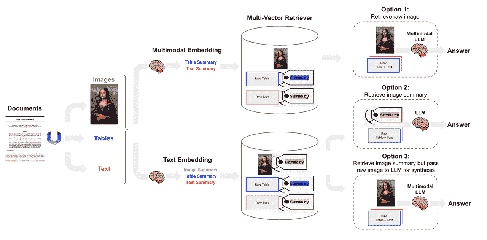
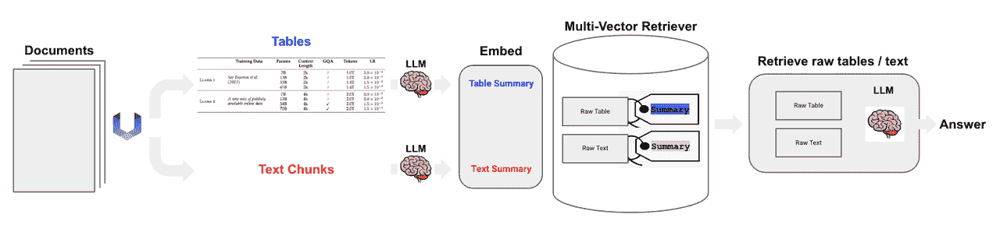
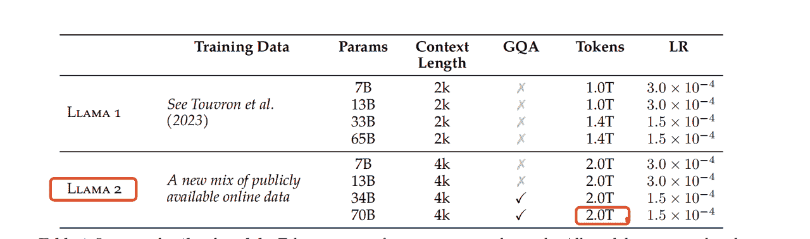

# 多模态RAG项目实战——表格、文本

> 来源：[https://qqs7y1hozd1.feishu.cn/docx/TEzZdXjU6o7m7Gxb2fBcZyd7nxg](https://qqs7y1hozd1.feishu.cn/docx/TEzZdXjU6o7m7Gxb2fBcZyd7nxg)

## 摘要

跨不同数据类型（图片、文本、表格）进行无缝问答是 RAG 的圣杯之一。我们发布了三本新的实用指南，展示了在包含多种内容类型的文档上使用RAG的多向量检索器。这些实用指南提供了一些将多模态LLM与多向量检索器配对以实现图片上的RAG的想法。

实用指南：

+ 半结构化（表格 + 文本）RAG

+ 多模态（文本 + 表格 + 图片）RAG

+ 私有化多模态（文本 + 表格 + 图片）RAG

## 上下文

LLM至少可以通过两种方式获取新信息：

(1) 权重更新（例如，微调）

(2) RAG（检索增强生成），它通过提示词将相关上下文传递给LLM。RAG对事实召回有着很好的前景，因为它将LLM的推理能力与外部数据源的内容结合在一起，这对于企业数据来说特别强大。



## 改进RAG的方法

已经开发了许多改进 RAG 的技术：

## 将 RAG 应用于各种数据类型

现在，对于包含半结构化数据（带有非结构化文本的结构化表格）和多种模态（图片）的文档的 RAG 仍然是一个挑战。随着多个多模态模型的出现，现在值得考虑统一的策略来实现夸多种模态（图片）和半结构化数据的RAG。

## 多向量检索器

在今年八月，我们发布了多向量检索器。它运用了一个简单而强大的 RAG（检索增强生成）概念：将用于答案生成的文档，与用于检索的参考文档分离开来。举个简单的例子：我们可以为一篇冗长的文档创建一个优化后的摘要，摘要用于基于向量的相似性搜索，但仍然将摘要对应的完整的文档传递给 LLM（大语言模型），以确保在答案生成过程中不会丢失上下文信息。这里我们展示了这种方法不仅对纯文本有效，还可以广泛应用于表格或图片，以支持 RAG。



深刻理解上图：

+ 将文档中的图片、表格和文本分割开来。

+ 分别对图片、表格和文本进行摘要总结。对于图片，我们可以使用多模态模型进行解读，形成摘要。

+ 在向量数据库中存储图片、表格和文本的摘要向量化数据，用于检索。同时在文档存储中存储原始图片、表格和文本数据。

+ 根据用户的问题在向量化数据库中进行向量化匹配召回对应的摘要，再返回摘要对应的原始数据（图片、表格和文本）。

### 文档加载

当然，要实现这种方法，首先需要能够将文档划分为不同的类型。Unstructured 是一种出色的 ELT（提取-加载-转换）工具，非常适合这个任务，因为它能够从多种文件类型中提取不同元素（如表格、图片、文本）。

例如，Unstructured将通过先移除所有嵌入的图片块来划分 PDF 文件。然后，它会使用布局模型（YOLOX）来获取边界框（如表格）和标题，这些标题是文档的候选子部分（例如，Introduction 等）。接下来，它将进行后处理，将属于每个标题的文本聚合，并根据用户指定的标记（如最小块大小等）进一步将文本分块，以便于下游处理。

### 半结构化数据

Unstructured文件解析和多向量检索器的结合可以支持半结构化数据上的 RAG（检索增强生成），这对于表格的简单分块策略来说是一个挑战。也就是说直接将表格本身进行向量化是个挑战（表格本身含有一些边框等），我们会首先生成表格元素的摘要，更适合自然语言检索。通过语义相似度检索表格摘要匹配用户的问题，摘要对应的原始表格则会传递给 LLM 以用于答案生成，如上所述。请参见下方使用指南：

[半结构化RAG实用指南](https://github.com/langchain-ai/langchain/blob/master/cookbook/Semi_Structured_RAG.ipynb?ref=blog.langchain.dev)



深刻理解上图：

+ 将文档中的表格和文本分割开来。

+ 分别对表格和文本进行摘要总结。

+ 在向量数据库中存储表格和文本的摘要向量化数据，用于检索。同时在文档存储中存储原始表格和文本数据。

+ 根据用户的问题在向量化数据库中进行向量化匹配召回对应的摘要，再返回摘要对应的原始数据（表格和文本）传递给LLM上下文，形成回答。

### 多模态数据

我们可以更进一步，将图片考虑在内，这种功能随着多模态模型 LLM（如 GPT4-V）和开源模型（如 LLaVA 和 Fuyu-8b）的推出而逐渐变得可行。至少有三种方法可以处理这个问题，这些方法都利用了上述的多向量检索框架：

+ 选项 1：使用多模态嵌入（和[文本嵌入](https://openai.com/index/clip/?ref=blog.langchain.dev)模型`text_embedding`，不一样，它可以嵌入图片和文本）（例如 CLIP）将原始图片和文本一起嵌入到向量数据库中。同时在文档存储中存储对应的原始图片和文本。使用相似度搜索进行检索，获取文档存储中对应的图片。将原始图片和文本块传递给多模态 LLM 生成回答。

+ 选项 2：使用多模态 LLM（如 GPT4-V、LLaVA 或 Fuyu-8b）对图片生成文本摘要。使用文本嵌入模型对文本摘要进行嵌入和检索。同样，可以从文档存储中引用原始文本块或表格供 LLM 用于生成答案；在这种情况下，我们排除文档存储中的图片（例如，无法实际使用多模态 LLM 进行合成）。

+ 理解：选项2，使用多模态模型解读图片，生成图片的摘要文本。在文档存储中只会存储原始文本（包括文本和图片摘要）和表格，并不会在文档存储中存储图片本身。

+ 选项 3：使用多模态 LLM（如 GPT4-V、LLaVA 或 Fuyu-8b）对图片生成文本摘要。嵌入并检索带有原始图片引用的图片摘要，类似于选项 1 中的操作。再次将原始图片和文本块传递给多模态 LLM 进行答案生成。如果不想使用多模态嵌入，这个选项是合理的选择。

选项3和1的区别在于，选项3不直接嵌入图片本身，而是嵌入图片摘要。



我们使用70亿参数的 LLaVA 模型测试了 选项2 以生成图片摘要。LLaVA 最近已添加到`llama.cpp`中，这使得它可以在消费类笔记本电脑（Mac M2 max，32gb，约 45 个 token/秒）上运行，并生成合理的图片摘要。例如，对于下面的图片，它捕捉到了有趣的信息：图片显示了一个装满各种炸鸡块的托盘的特写镜头。鸡块的排列方式类似于世界地图，一些鸡块放置成大陆的形状，另一些则作为国家。鸡块的排列方式创造了一种视觉上吸引人且俏皮的世界表现形式。


我们将图片摘要以及表格和文本摘要存储在多向量检索器中。

多模态（文本、表格、图片）RAG

如果你想保护数据隐私，私有化部署，可以在消费者笔记本电脑上使用开源组件本地运行这个RAG管道，使用LLaVA 7b进行图片摘要，Chroma向量存储，开源嵌入（Nomic的GPT4All），多向量检索器，以及通过Ollama.ai的LLaMA2-13b-chat进行答案生成。

私有化多模态（文本、表格、图片）RAG

## 结论

我们展示了多向量检索器可用于支持半结构化 RAG 以及包含多模态数据的半结构化 RAG。我们还展示了可以使用开源组件在消费类笔记本电脑上本地运行此完整管道。最后，我们提出了三种用于多模态 RAG 的通用方法，这些方法利用多向量检索器概念，运用于未来的实用指南中。

# 多模态RAG实战 - 表格，文本

许多文档包含混合的内容类型，包括文本和表格。

对于传统的 RAG（检索增强生成），半结构化数据可能具有以下两个主要挑战：

+ 文本拆分可能会破坏表格，导致数据在检索中被破坏。

+ 将表格嵌入向量化可能会在语义相似性搜索中带来困难。

本实用指南展示了如何在包含半结构化数据（文本 + 表格）的文档上执行 RAG：

我们将使用 Unstructured 来解析文档（PDF）中的文本和表格。我们将使用 多向量检索器（multi-vector retriever） 来存储原始表格、文本以及更适合检索的表格摘要。我们将使用 LCEL（LangChain Execution Loop） 来实现所需的链式操作。

整体流程如下：



下面我们使用Mac去实现。其他平台如Windows, Linux实现类似。

## 安装依赖包

在你的Python虚拟环境中安装如下依赖：

```
pip install langchain langchain-chroma &quot;unstructured[all-docs]&quot; pydantic lxml langchainhub
```

使用Unstructured对PDF进行分区用到如下系统库：

+ Tesseract：用于光学字符识别 (OCR)。

+ Poppler：用于 PDF 渲染和处理。

在Mac终端下进行安装：

```
brew install tesseractbrew install poppler
```

## 分割PDF中的表格和文本

我们使用：[LLaMA2 PDF](https://personel-zhouxinle888-a66353926f9185cff28f2bd374a5c3a9dd89d5206.gitlab.io/rag/LLaMA2.pdf)进行演示。

我们使用Unstructured的`partition_pdf`方法，它使用布局模型分割PDF文档。

布局模型使得从PDF中提取元素，例如表格成为可能。

我们还可以使用 Unstructured 的 分块处理（chunking）：

+ 尝试识别文档的各个部分（例如，引言等）。

+ 然后，构建保持章节结构的文本块，同时遵循用户定义的分块大小。

```
path = &quot;/Users/rlm/Desktop/Papers/LLaMA2/&quot;
```

```
from typing import Any

from pydantic import BaseModel
from unstructured.partition.pdf import partition_pdf

# Get elements
raw_pdf_elements = partition_pdf(
    filename=path + &quot;LLaMA2.pdf&quot;,
    # Unstructured first finds embedded image blocks
    extract_images_in_pdf=False,
    # Use layout model (YOLOX) to get bounding boxes (for tables) and find titles
    # Titles are any sub-section of the document
    infer_table_structure=True,
    # Post processing to aggregate text once we have the title
    chunking_strategy=&quot;by_title&quot;,
    # Chunking params to aggregate text blocks
    # Attempt to create a new chunk 3800 chars
    # Attempt to keep chunks &gt; 2000 chars
    max_characters=4000,
    new_after_n_chars=3800,
    combine_text_under_n_chars=2000,
    image_output_dir_path=path,
)
```

我们可以检查由 `partition_pdf` 提取的元素。`CompositeElement` 是聚合的分块。

```
# Create a dictionary to store counts of each type
category_counts = {}

for element in raw_pdf_elements:
    category = str(type(element))
    if category in category_counts:
        category_counts[category] += 1
    else:
        category_counts[category] = 1

# Unique_categories will have unique elements
unique_categories = set(category_counts.keys())
category_counts
```

```
输出：
&quot;&lt;class &#x27;unstructured.documents.elements.CompositeElement&#x27;&gt;&quot;: 184,
 &quot;&lt;class &#x27;unstructured.documents.elements.Table&#x27;&gt;&quot;: 47,
 &quot;&lt;class &#x27;unstructured.documents.elements.TableChunk&#x27;&gt;&quot;: 2}
```

```
class Element(BaseModel):
   type: str
   text: Any


# Categorize by type
categorized_elements = []
for element in raw_pdf_elements:
   if &quot;unstructured.documents.elements.Table&quot; in str(type(element)):
       categorized_elements.append(Element(type=&quot;table&quot;, text=str(element)))
   elif &quot;unstructured.documents.elements.CompositeElement&quot; in str(type(element)):
       categorized_elements.append(Element(type=&quot;text&quot;, text=str(element)))

# Tables
table_elements = [e for e in categorized_elements if e.type == &quot;table&quot;]
print(len(table_elements))

# Text
text_elements = [e for e in categorized_elements if e.type == &quot;text&quot;]
print(len(text_elements))
```

```
输出：
49
184
```

## 总结文本和表格摘要

使用 多向量检索器multi-vector-retriever 来生成表格的摘要，并可选的生成文本的摘要。

不仅存储摘要，我们还会存储原始的表格元素。

这些摘要用于提高检索的质量，具体内容可以参考多向量检索器文档。

原始表格会传递给大语言模型（LLM），为 LLM 提供完整的表格上下文，以便生成答案。

我这里使用的是GPT-4o-mini对文本和表格进行总结，形成摘要。

首先要配置`AZURE_OPENAI_API_KEY`和`AZURE_OPENAI_ENDPOINT`

```
os.environ[&quot;AZURE_OPENAI_API_KEY&quot;] = &quot;&quot;
os.environ[&quot;AZURE_OPENAI_ENDPOINT&quot;] = &quot;&quot;
```


# 多模态 RAG 实现

```
from langchain_core.output_parsers import StrOutputParser
from langchain_core.prompts import ChatPromptTemplate
from langchain_openai import AzureChatOpenAI, AzureOpenAIEmbeddings

prompt_text = """You are an assistant tasked with summarizing tables and text. \
        Give a concise summary of the table or text. Table or text chunk: {element} """
prompt = ChatPromptTemplate.from_template(prompt_text)

# 修改这里使用Azure OpenAI
llm = AzureChatOpenAI(
        model="gpt-4o-mini",
        azure_deployment="gpt-4o-mini",  # or your deployment
        model_version="2024-07-18",
        api_version="2024-08-01-preview",
        temperature=0,
        max_tokens=None,
        timeout=None,
        max_retries=2,
        # other params...
    )

summarize_chain = {"element": lambda x: x} | prompt | llm | StrOutputParser()

# 处理表格元素
tables = [i.text for i in table_elements]
table_summaries.clear()  # 清空现有内容
table_summaries.extend(summarize_chain.batch(tables, {"max_concurrency": 5}))
print("表格摘要数量:", len(table_summaries))
print("表格摘要:", table_summaries)

# 处理文本元素
texts = [i.text for i in text_elements]
text_summaries.clear()  # 清空现有内容
text_summaries.extend(summarize_chain.batch(texts, {"max_concurrency": 5}))
print("文本摘要数量:", len(text_summaries))
print("文本摘要:", text_summaries)
```

## 创建检索器

使用多向量检索器：

+   `InMemoryStore` 存储原始文本和表格。

+   `vectorstore` 存储嵌入文本和表格的摘要。

`vectorstore`和`InMemoryStore`使用`id`进行关联，关联向量化摘要数据和原始数据。

```
import uuid

from langchain.retrievers.multi_vector import MultiVectorRetriever
from langchain.storage import InMemoryStore
from langchain_chroma import Chroma
from langchain_core.documents import Document
from langchain_openai import OpenAIEmbeddings

# The vectorstore to use to index the child chunks
vectorstore = Chroma(collection_name="summaries", embedding_function=OpenAIEmbeddings())

# The storage layer for the parent documents
store = InMemoryStore()
id_key = "doc_id"

# The retriever (empty to start)
retriever = MultiVectorRetriever(
    vectorstore=vectorstore,
    docstore=store,
    id_key=id_key,
)

# Add texts
doc_ids = [str(uuid.uuid4()) for _ in texts]
summary_texts = [
    Document(page_content=s, metadata={id_key: doc_ids[i]})
    for i, s in enumerate(text_summaries)
]
retriever.vectorstore.add_documents(summary_texts)
retriever.docstore.mset(list(zip(doc_ids, texts)))

# Add tables
table_ids = [str(uuid.uuid4()) for _ in tables]
summary_tables = [
    Document(page_content=s, metadata={id_key: table_ids[i]})
    for i, s in enumerate(table_summaries)
]
retriever.vectorstore.add_documents(summary_tables)
retriever.docstore.mset(list(zip(table_ids, tables)))
```

## RAG

```
from langchain_core.runnables import RunnablePassthrough

# Prompt template
template = """Answer the question based only on the following context, which can include text and tables:
{context}
Question: {question}
"""
prompt = ChatPromptTemplate.from_template(template)

# LLM
model = ChatOpenAI(temperature=0, model="gpt-4")

# RAG pipeline
chain = (
    {"context": retriever, "question": RunnablePassthrough()}
    | prompt
    | model
    | StrOutputParser()
)
```

```
提问：
chain.invoke("What is the number of training tokens for LLaMA2?")
```

```
结果：
'The number of training tokens for LLaMA2 is 2.0T.'
```

我们可以观察：根据用户问题，召回的是向量化数据库中的下方的表格摘要，如图：



然后将关联的`InMemoryStore`中存储的原始表格和用户的问题作为LLM的上下文，形成回答。

[原文链接](https://github.com/langchain-ai/langchain/blob/master/cookbook/Semi_Structured_RAG.ipynb)
