# LLM-RAG知识库问答 | 检索 | embedding

> 来源：[https://qqs7y1hozd1.feishu.cn/docx/SciqdlXopo47O6xhWXscBrRmnQd](https://qqs7y1hozd1.feishu.cn/docx/SciqdlXopo47O6xhWXscBrRmnQd)

## 一、常见本地知识库问答流程

### 整体框架

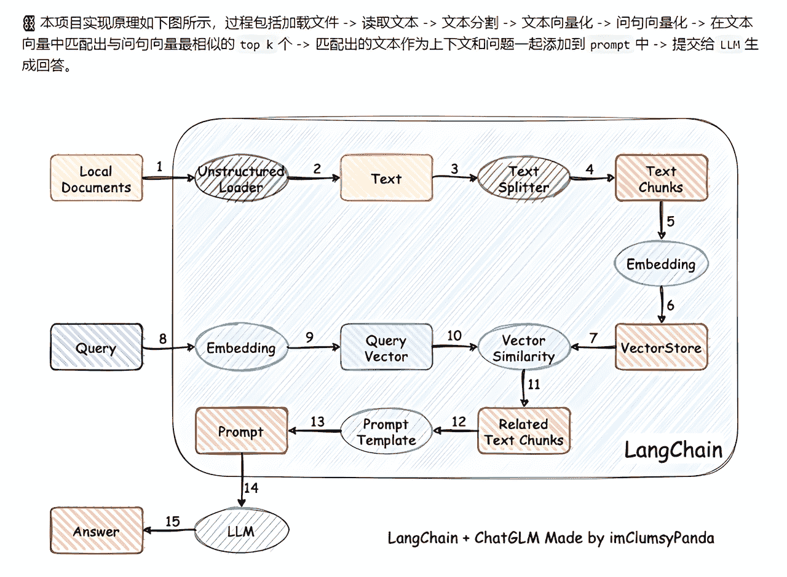

#### 改进

+   改 `LLM` 模型
+   `embedding` 模型
+   文本分割方式
+   多卡加速模型部署
+   提升 `top-k` 检索召回的质量
+   基于数据隐私和私有化部署，可以方便的使用 `Langchain` ➕ 大模型进行推理

### 文本切分

`Langchain` 源码：[源码](https://github.com/hwchase17/langchain/blob/master/langchain/text_splitter.py)

> `Langchain` 的内置文本拆分模块的常见参数：

1.  `chunk_size`

+   文本块的大小，即文本块的最大尺寸

1.  `chunk_overlap`

+   表示两个切分文本之间的重合度，文本块之间的最大重叠量，保留一些重叠可以保持文本块之间的连续性，可以使用滑动窗口进行构造，这个比较重要

1.  `length_function`

+   用于计算文本块长度的方法，默认为简单的计算字符数

其他文本分割器：

| 文本分割器 | 亮点 |

| --- | --- |

| `LatexTextSplitter` | 沿着Latex标题、标题、枚举等分割文本。 |

| `MarkdownTextSplitter` | 沿着Markdown的标题、代码块或水平规则来分割文本。 |

| `NLTKTextSplitter` | 使用NLTK的分割器 |

| `PythonCodeTextSplitter` | 沿着Python类和方法的定义分割文本。 |

| `Recursive Character TextSplitter` | 用于通用文本的分割器。它以一个字符列表为参数，尽可能地把所有的段落（然后是句子，然后是单词）放在一起 |

| `Spacy TextSplitter` | 使用Spacy的分割器 |

| `Token TextSplitter` | 根据openAl的token数进行分割 |

+   直接举个例子，比如对中文文本切分，继承 `langchain` 中类 `CharacterTextSplitter` 的 `ChineseTextSplitter` 类

+   正则表达式 `sent_sep_pattern` 来匹配中文句子的分隔符（如句号，感叹号，问号，分号等）

```
# 中文文本切分类
class ChineseTextSplitter(CharacterTextSplitter):
    def __init__(self, pdf: bool = False, **kwargs):
        super().__init__(**kwargs)
        self.pdf = pdf

    def split_text(self, text: str) -&gt; List[str]:
        if self.pdf:
            text = re.sub(r&quot;\n{3,}&quot;, &quot;\n&quot;, text)
            text = re.sub(&#x27;\s&#x27;, &#x27; &#x27;, text)
            text = text.replace(&quot;\n\n&quot;, &quot;&quot;)
        sent_sep_pattern = re.compile(&#x27;([﹒﹔﹖﹗．。！？][&quot;’”」』]{0,2}|(?=[&quot;‘“「『]{1,2}|$))&#x27;)  # del ：；
        sent_list = []
        for ele in sent_sep_pattern.split(text):
            if sent_sep_pattern.match(ele) and sent_list:
                sent_list[-1] += ele
            elif ele:
                sent_list.append(ele)
        return sent_list
```

### 图解流程

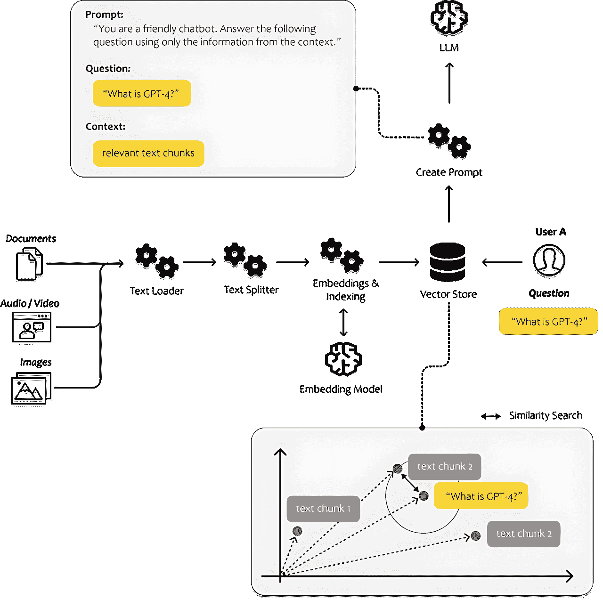

## 二、相关RAG综述/工作

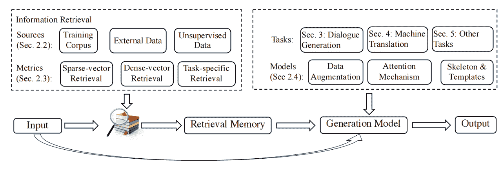

### Retrieval Source知识来源源

+   训练语料：有标注的训练数据直接作为外部知识

+   外部数据：支持提供训练数据之外的外部知识作为检索来源，比如于任务相关的领域数据，实现模型的快速适应

+   无监督数据：前两种知识源都需要一定的人工标注来完善“检索依据-输出”的对齐工作，无监督知识源可以直接支持无标注/对齐的知识作为检索来源

### Retrieval Metrics召回的度量标准

> 浅层语义检索：针对稀疏向量场景的度量方法，比如 `TF-IDF`, `BM25` 等

> 深层语义检索： 针对稠密向量的度量方法，比如文本相似度

> 特定任务检索：在通用的度量场景下，度量得分高并不能代表召回知识准确，因此有学者提出基于特定任务优化的召回度量方法，提高度量的准确率

### Integration集成的方法

> 数据增强：直接拼接用户输入文本和知识文本，然后输入文本生成模型

> 注意力机制：引入额外的 `Encoder`，对用户输入文本和知识文本进行注意力编码后输入文本生成模型

> 架抽取：前两种方法都是通过文本向量化的隐式方法完成知识重点片段的抽取，`skeleton extraction` 方法可以显式地完成类似工作

该工作针对后续优化方向提出了一些观点，认为：

RATG效果强依赖于召回知识的准确率，这个问题在 `query` 和目标知识片段的文本相似度较低的情况尤为突出

+   需要做好存储的容量和召回效率之间的平衡

+   逻辑上，召回度量模块和文本生成模块的联合训练会有更好的效果

+   但是在这样的框架下，其训练和预测之间会存在较大的 `Gap`：训练时，模型只针对少量标注的知识源完成优化（`Local`）；而预测时，模型是针对大量的知识源完成度量（`Global`）

+   此外，针对目前都基于通用的文本语义完成知识召回，后续可以考虑关注基于任务层级的召回方法的多样化研究，以及不同召回方法的调用的灵活性和可控制性，针对多模态知识源召回方法的优化

## 三、HIT的RAG➕知识融合综述

检索增强 `LLM`：给 `LLM` 提供外部数据库，对于用户问题 ( `Query` )，通过一些信息检索 ( `Information Retrieval`, `IR` ) 的技术，先从外部数据库中检索出和用户问题相关的信息，然后让 `LLM` 结合这些相关信息来生成结果

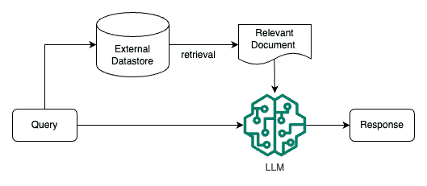

## 四、FastGPT：基于 LLM 大语言模型的知识库问答实现

### 架构：`What` & `How` & `When`

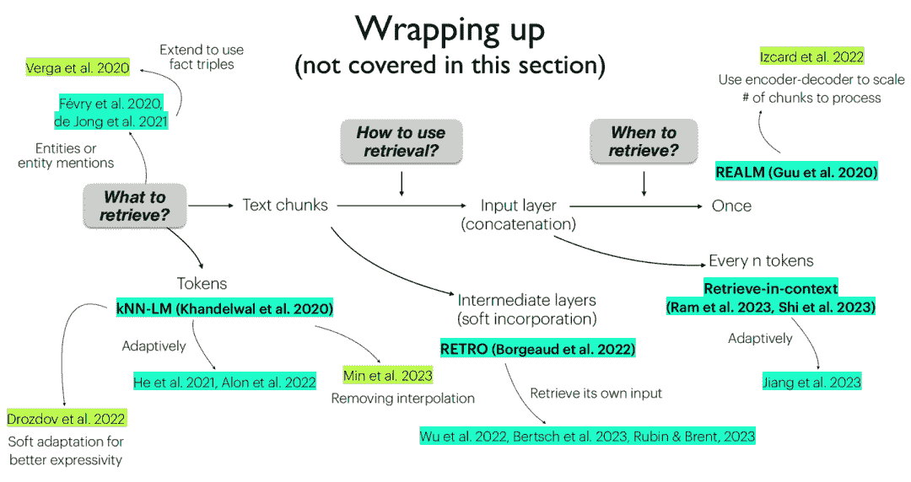

### 如何训练

> 现有工作中对于检索增强的语言模型被证实的比较 `work` 的训练方式可划分为以下四类：

+   `Independent training`：语言模型与检索器均是独立训练的

+   `Sequential training`：独立训练单个组件后将其固定，另一个组件根据此组件任务目标进行训练

+   `Joint training w/ asynchronous index update`：允许索引是“过时”的，即每隔 `T` 步才重新更新检索索引

+   `Joint training w/ in-batch approximation`：使用“批内索引”，而不是完整知识库中的全部索引

### 应用

`RAG` 常用在知识密集型任务上

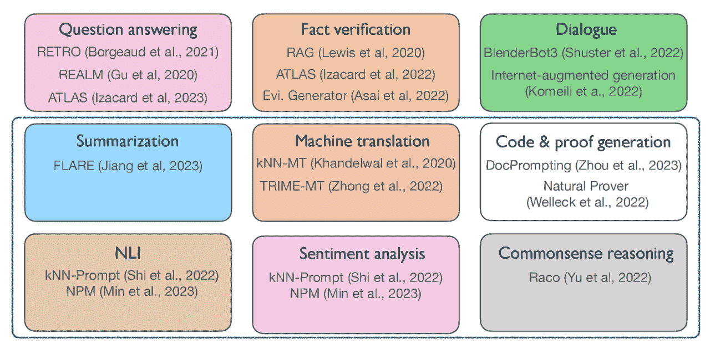

## 五、相关RAG项目

### chatlaw项目

+   `query` 抽取为 `key word`

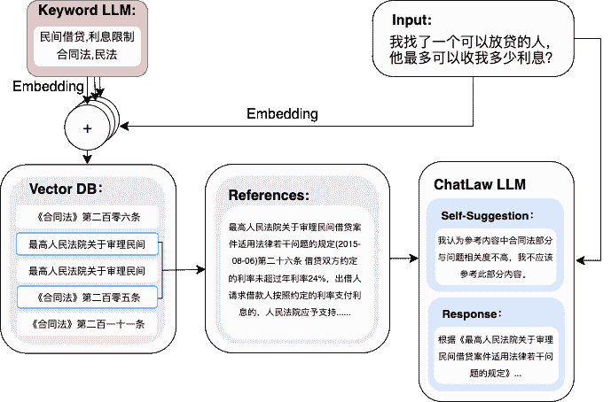

参考：

+    北大团队发布大模型 `ChatLaw`

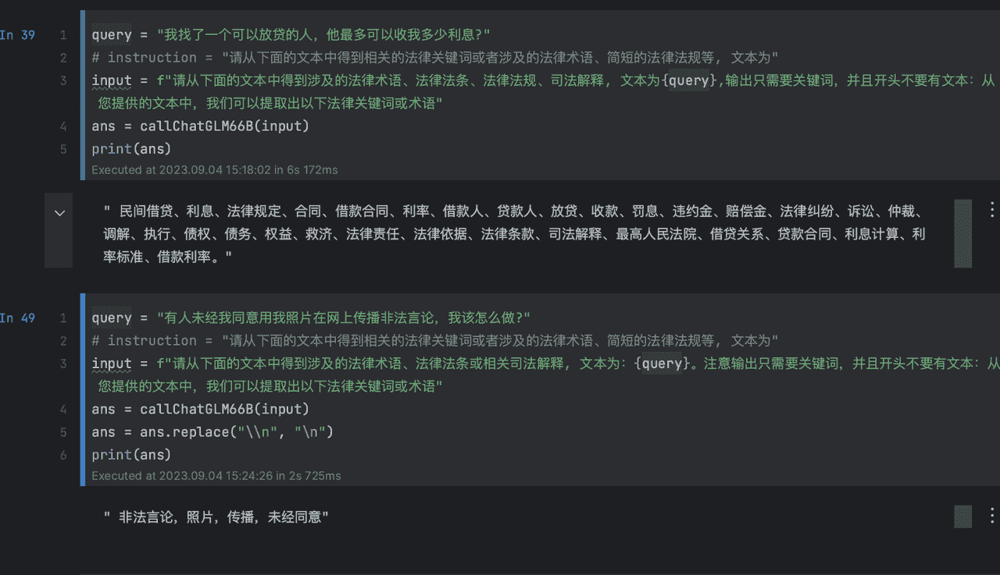

### 项目中的模型

1.  `ChatLaw-13B`

+   此版本为学术 `demo` 版，基于姜子牙 `Ziya-LLaMA-13B-v1` 训练而来，中文各项表现很好，但是逻辑复杂的法律问答效果不佳，需要用更大参数的模型来解决

1.  `ChatLaw-33B`

+   此版本为学术 `demo` 版，基于 `Anima-33B` 训练而来，逻辑推理能力大幅提升，但是因为 `Anima` 的中文语料过少，导致问答时常会出现英文数据

1.  `ChatLaw-Text2Vec`

+   使用93w条判决案例做成的数据集基于 `BERT` 训练了一个相似度匹配模型，可将用户提问信息和对应的法条相匹配

例如：

```
“请问如果借款没还怎么办。”

“合同法(1999-03-15): 第二百零六条 借款人应当按照约定的期限返还借款。对借款期限没有约定或者约定不明确，依照本法第六十一条的规定仍不能确定的，借款人可以随时返还；贷款人可以催告借款人在合理期限内返还。”

两段文本的相似度计算为0.9960
```

### 调度模型

+   将文件、音频、文字整合在一起，同时支持法律援助、法律文书、思维导图等多样化输出

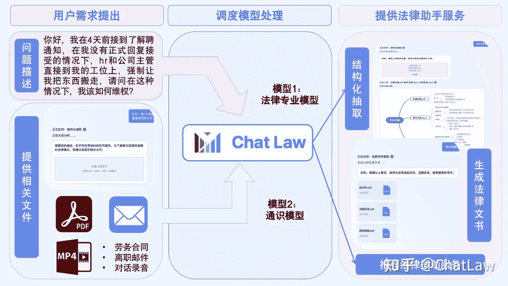

## 六、embedding模型相关

### FlagEmbedding

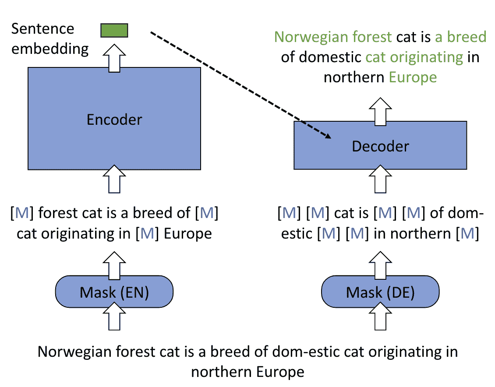

`M3E` embedding

链接：https://huggingface.co/moka-ai/m3e-base?continueFlag=9b46d5a6f39f18849cafedf79fff183f

`M3E`模型的微调：https://github.com/wangyuxinwhy/uniem/blob/main/examples/finetune.ipynb

## 七、7个 `embedding` 模型总结

### BGE

> `BGE`，即 `BAAI` General `Embedding`，是由智源研究院（`BAAI`）团队开发的一款文本 `Embedding` 模型。该模型可以将任何文本映射到低维密集向量，这些向量可用于检索、分类、聚类或语义搜索等任务。此外，它还可以用于 `LLMs` 的向量数据库

> `BGE` 模型在2023年有多次更新，包括发布论文和数据集、发布新的 `reranker` 模型以及更新 `Embedding` 模型。`BGE` 模型已经集成到 `Langchain` 中，用户可以方便地使用它。此外，`BGE` 模型在 `MTEB` 和 `C-MTEB` 基准测试中都取得了第一名的成绩

> `BGE` 模型的主要特点如下：

+   多语言支持：`BGE` 模型支持中英文

+   多版本：`BGE` 模型有多个版本，包括 `bge-large-en`、`bge-base-en`、`bge-small-en` 等，以满足不同的需求

+   高效的 `reranker`：`BGE` 提供了 `reranker` 模型，该模型比 `Embedding` 模型更准确，但比 `Embedding` 模型更耗时。因此，它可以用于重新排名 `Embedding` 模型返回的前 `k` 个文档

+   开源和许可：`BGE` 模型是开源的，并在 `MIT` 许可下发布。这意味着用户可以免费用于商业目的

+   丰富集成：用户可以使用 `FlagEmbedding`、`Sentence-Transformers`、`Langchain` 或 `Huggingface Transformers` 等工具来使用 `BGE` 模型

### GTE

> `GTE` 模型，也称为 `General Text Embeddings`，是阿里巴巴达摩院推出的文本 `Embedding` 技术

它基于 `BERT` 框架构建，并分为三个版本：`GTE-large`、`GTE-base` 和 `GTE-small`

该模型在大规模的多领域文本对语料库上进行训练，确保其广泛适用于各种场景。因此，`GTE` 可以应用于信息检索、语义文本相似性、文本重新排序等任务

尽管 `GTE` 模型的参数规模为110M，但其性能卓越。它不仅超越了 `OpenAI` 的 `Embedding API`，在大型文本 `Embedding` 基准测试中，其表现甚至超过了参数规模是其10倍的其他模型。更值得一提的是，`GTE` 模型可以直接处理代码，无需为每种编程语言单独微调，从而实现优越的代码检索效果

### E5 Embedding

> `E5-embedding` 是由 `intfloat` 团队研发的一款先进的 `Embedding` 模型。`E5` 的设计初衷是为各种需要单一向量表示的任务提供高效且即用的文本 `Embedding`，与其他 `Embedding` 模型相比，`E5` 在需要高质量、多功能和高效的文本 `Embedding` 的场景中表现尤为出色

> 以下是 `E5-embedding` 的一些特点：

+   新的训练方法：`E5` 采用了 “ `EmbEddings from bidirEctional Encoder rEpresentations` ” 这一创新方法进行训练，这意味着它不仅仅依赖传统的有标记数据，也不依赖低质量的合成文本对

+   高质量的文本表示：`E5` 能为文本提供高质量的向量表示，这使得它在多种任务上都能表现出色，尤其是在需要句子或段落级别表示的任务中

+   多场景：无论是在 `Zero-shot` 场景还是微调应用中，`E5` 都能提供强大的现成文本 `Embedding`，这使得它在多种 `NLP` 任务中都有很好的应用前景

### Jina Embedding

> `jina-embedding-s-en-v1` 是 `Jina AI` 的 `Finetuner` 团队精心打造的文本 `Embedding` 模型。它基于 `Jina AI` 的 `Linnaeus-Clean` 数据集进行训练，这是一个包含了3.8亿对句子的大型数据集，涵盖了查询与文档之间的配对。这些句子对涉及多个领域，并已经经过严格的筛选和清洗。注意的是，`Linnaeus-Clean` 数据集是从更大的 `Linnaeus-Full` 数据集中提炼而来，后者包含了高达16亿的句子对

> `Jina Embedding` 有这些亮点：

+   广泛应用：`jina-embedding-s-en-v1` 适合多种场景，如信息检索、语义文本相似性判断和文本重新排序等

+   卓越性能：虽然该模型参数量仅为35M，但其性能出众，而且能够快速进行推理

+   多样化版本：除了标准版本，用户还可以根据需求选择其他大小的模型，包括14M、110M、330M

### Instructor

> `Instructor` 是由香港大学自然语言处理实验室团队推出的一种指导微调的文本 `Embedding` 模型。该模型可以生成针对任何任务（例如分类、检索、聚类、文本评估等）和领域（例如科学、金融等）的文本 `Embedding`，只需提供任务指导，无需任何微调。`Instructor` 在70个不同的 `Embedding` 任务（`MTEB` 排行榜）上都达到了最先进的性能。该模型可以轻松地与定制的 `sentence-transformer` 库一起使用

> `Instructor` 模型主要特点如下：

+   多任务适应性：只需提供任务指导，即可生成针对任何任务的文本 `Embedding`

+   高性能：在 `MTEB` 排行榜上的70个不同的 `Embedding` 任务上都达到了最先进的性能

+   易于使用：与定制的 `sentence-transformer` 库结合使用，使得模型的使用变得非常简单

### XLM-Roberta

> `XLM-Roberta`（简称 `XLM-R` ）是 `Facebook AI` 推出的一种多语言版本的 `Roberta` 模型。它是在大量的多语言数据上进行预训练的，目的是为了提供一个能够处理多种语言的强大的文本表示模型。`XLM-Roberta` 模型在多种跨语言自然语言处理任务上都表现出色，包括机器翻译、文本分类和命名实体识别等。

> 模型主要特点如下：

> 多语言支持：`XLM-Roberta` 支持多种语言，可以处理来自不同语言的文本数据

> 高性能：在多种跨语言自然语言处理任务上，`XLM-Roberta` 都表现出了最先进的性能

> 预训练模型：`XLM-Roberta` 是在大量的多语言数据上进行预训练的，这使得它能够捕获跨语言的文本表示

### text-embedding-ada-002

> `text-embedding-ada-002` 是一个由 `Xenova` 团队开发的文本 `Embedding` 模型。该模型提供了一个与 `Hugging Face` 库兼容的版本的 `text-embedding-ada-002` 分词器，该分词器是从 `openai/tiktoken` 适应而来的。这意味着它可以与 `Hugging Face` 的各种库一起使用，包括 `Transformers`、`Tokenizers` 和 `Transformers.js`

> 模型主要特点如下：

+   兼容性：该模型与 `Hugging Face` 的各种库兼容，包括 `Transformers`、`Tokenizers` 和 `Transformers.js`

+   基于 `openai/tiktoken`：该模型的分词器是从 `openai/tiktoken` 适应而来的

## 八、RAG评测相关

### 相关综述：

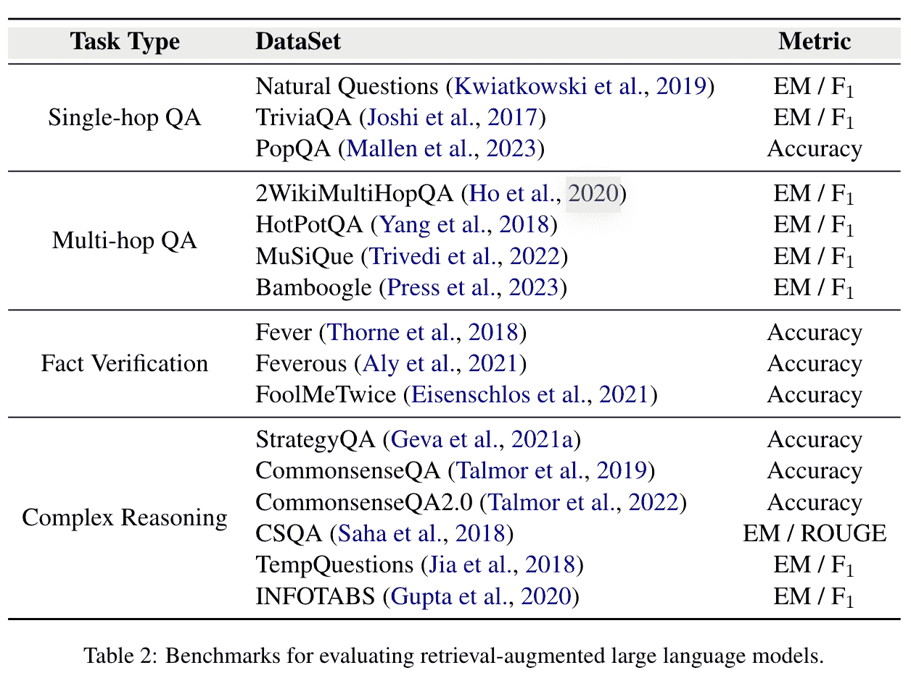


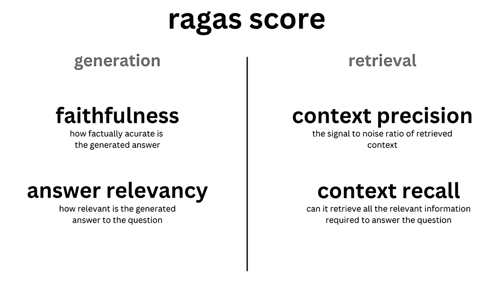

# 九、常见问题

**知识库问题：**扫码版图文表图区精度不高，超长文本存储和检索精度低

> 改进（除了第三点，其他都能粗暴地用prompt实现）：

1. 把问答域细化，给检索文本分类，打标签处理，以缩小召回目标域，提升相关性
2. 增加问答逻辑。如问题与上下文是否相关，上下文是否可以回答用户问题的判定逻辑，拒答逻辑
3. 不同种类问答的分流逻辑。打个比方，问百科，问医药，问金融，走不同的回答逻辑
4. 使用多重召回逻辑。基于向量，基于领域向量，基于es，基于编辑距离等，走投票策略
5. 增加生成前判定，生成后判定逻辑。前者判定适合是否该回答，是否该拒答，后者判定是否对自己回答有置信

## 注意事项

向量库只是个数据库，并不能优化什么决定性的东西【除了检索速度】

## 重心要放在

+ 对相关性内容的召回上，把不对的踢掉【分类，拒答】，把对的提高（加权，投票）
+ 不受控生成的缓解【听懂指令，不跳出给定上下文，这靠SFT】
