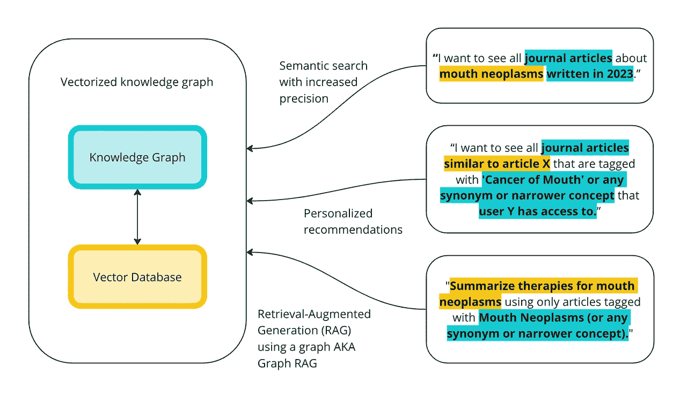
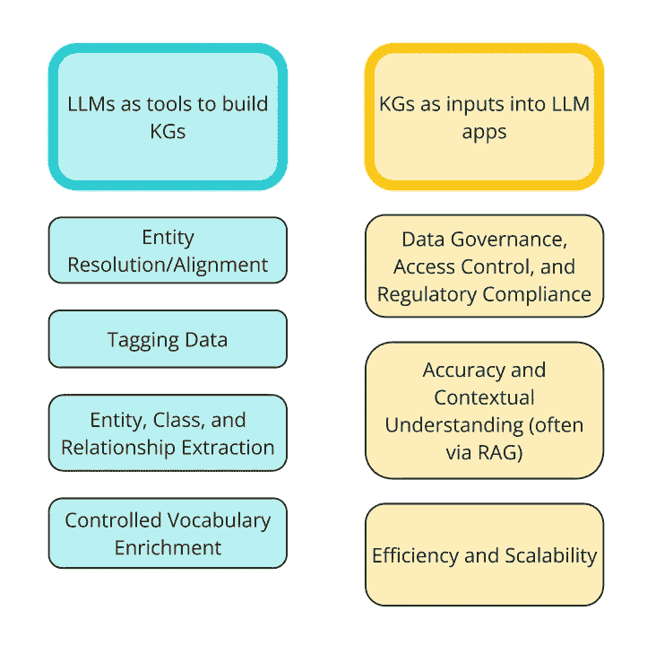
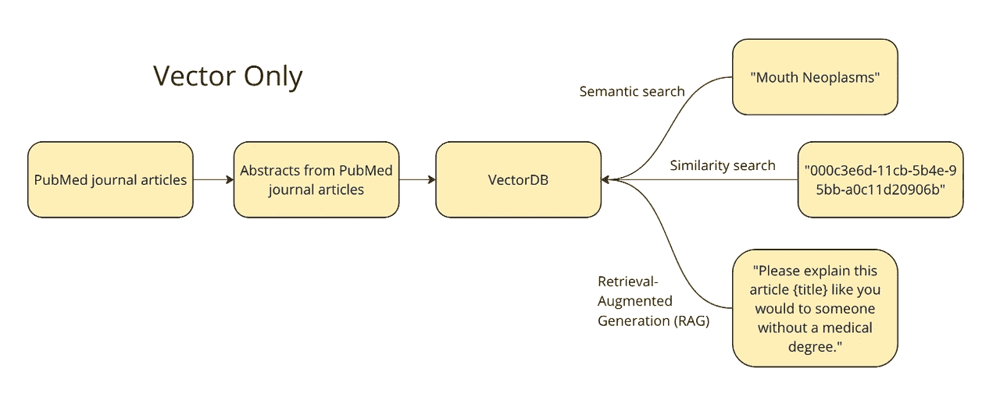
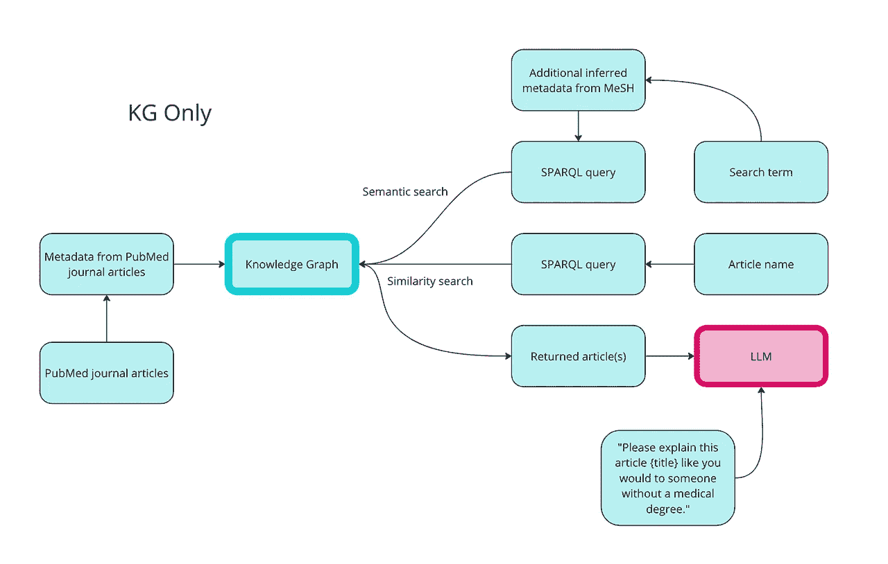
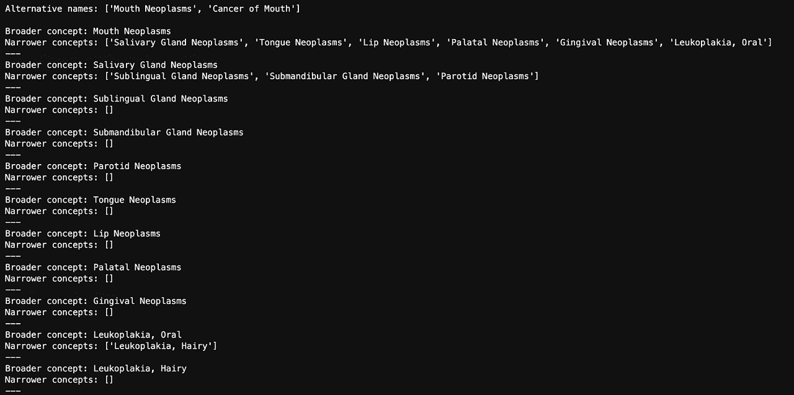

# 知识图谱➕向量数据库实现图 RAG（附代码）

> 来源：[https://qqs7y1hozd1.feishu.cn/docx/U0JudOOwiobLLhxdSa5cHl5GniE](https://qqs7y1hozd1.feishu.cn/docx/U0JudOOwiobLLhxdSa5cHl5GniE)



+ 本教程的随附代码位于：[此处（代码）](https://github.com/SteveHedden/kg_llm)

在之前的文章中，介绍了 KG 和 LLMs 目前互动的两种方式：

LLMs 作为构建 KG 的工具

KG 作为 LLM 或 GenAI 应用程序的输入

下图显示了集成的两个方面以及人们一起使用它们的不同方式



在这篇文章中，将重点讨论 KG 和 LLMs 一起使用的一种 [流行方式：使用知识](https://www.ontotext.com/knowledgehub/fundamentals/what-is-graph-rag/) 图的 RAG，有时称为 [Graph RAG](https://microsoft.github.io/graphrag/)、[GraphRAG](https://arxiv.org/abs/2405.16506)、[Semantic RAG](https://www.poolparty.biz/semantic-retrieval-augmented-generation) 或 GRAG。检索增强生成 (RAG) 是关于检索相关信息以增强发送到 LLM 提示，LLM 会生成响应。我们的想法是，您可以用 LLM 准确回答您的提示所需的相关信息来补充您的提示，而不是将您的提示直接发送给未接受过您的数据培训的 LLM。我在上一篇文章中使用的示例是将职位描述和我的简历复制到 ChatGPT 中以撰写求职信。如果我提供我的简历和我正在申请的工作的描述，LLM 能够针对我的提示“给我写一封求职信”提供更相关的回应。由于知识图是为了存储知识而构建的，因此它们是存储内部数据并通过附加上下文补充 LLM 提示的完美方式，从而提高响应的准确性和上下文理解。

重要的是，我认为经常被误解的是，RAG 和使用 KG 的 RAG（图 RAG）是组合技术的方法，而不是 [产品或](https://arxiv.org/pdf/2311.07509) [技术](https://arxiv.org/pdf/2405.11706) 本身。没有人发明、拥有或垄断 Graph RAG。然而，大多数人都可以看到这两种技术结合起来所具有的潜力，并且越来越多的研究证明了将它们结合起来的好处。

一般来说，使用 KG 来进行 RAG 的检索部分有以下三种方式：

1. 基于向量的检索：向量化你的 KG 并将其存储在向量数据库中。如果您随后对自然语言提示进行矢量化，则可以在向量数据库中找到与您的提示最相似的矢量。由于这些向量对应于图中的实体，因此您可以根据自然语言提示返回图中最“相关”的实体。请注意，您可以在没有图形的情况下进行基于向量的检索。这实际上是 RAG 实现的原始方式，有时称为基线 RAG。您可以对 SQL 数据库或内容进行矢量化并在查询时检索它。

2. 提示查询检索：使用 LLM 为您编写 SPARQL 或 Cypher 查询，针对您的 KG 使用查询，然后使用返回的结果来增强您的提示。

3. 混合（向量 + SPARQL）：您可以以各种有趣的方式组合这两种方法。在本教程中，我将演示一些可以组合这些方法的方法。我将主要关注使用矢量化进行初始检索，然后使用 SPARQL 查询来优化结果。

然而，有很多方法可以将向量数据库和 KG 结合起来进行搜索、相似性和 RAG。这只是一个说明性示例，旨在强调各自的优缺点以及一起使用它们的好处。我在这里一起使用它们的方式（矢量化用于初始检索，然后 SPARQL 进行过滤）并不是唯一的。我在其他地方看到过这种做法。我听说过一个很好的例子，来自一家大型家具制造商的某人。他说，矢量数据库可能会向购买沙发的人推荐绒毛刷，但知识图将了解材料、属性和关系，并确保不向购买皮革沙发的人推荐绒毛刷。

在本教程中我将：

将数据集向量化为向量数据库，以测试语义搜索、相似性搜索和 RAG（基于向量的检索）

将数据转换为 KG 来测试语义搜索、相似性搜索和 RAG（提示查询检索，虽然实际上更像是查询检索，因为我只是直接使用 SPARQL，而不是让 LLM 将我的自然语言提示转换为 SPARQL 查询）

将带有标签和 URI 的数据集从知识图矢量化为向量数据库（我将其称为“矢量化知识图”）并测试语义搜索、相似性和 RAG（混合）

目标是说明知识图谱和向量数据库在这些功能方面的差异，并展示它们可以协同工作的一些方式。下面是向量数据库和知识图如何一起执行高级查询的高级概述。


向量数据库可以很好地运行语义搜索、相似性计算和 RAG 的一些基本形式，但有一些注意事项。第一个需要注意的是，我使用的数据包含期刊文章的摘要，即它具有大量与之相关的非结构化文本。矢量化模型主要针对非结构化数据进行训练，因此在给定与实体相关的文本块时表现良好。

话虽这么说，将数据放入向量数据库并准备好查询的开销非常小。如果您的数据集包含一些非结构化数据，您可以在 15 分钟内进行矢量化并开始搜索。

毫不奇怪，单独使用向量数据库的最大缺点之一是缺乏可解释性。该响应可能会产生三个好的结果和一个没有多大意义的结果，并且无法知道为什么会出现第四个结果。

向量数据库返回不相关内容的可能性对于搜索和相似性来说是一个麻烦，但对于 RAG 来说却是一个巨大的问题。如果你用四篇文章来补充你的提示，其中一篇是关于完全不相关的主题，LLM 的回应将会产生误导。这通常被称为“环境中毒”。

上下文中毒特别危险的是，响应不一定实际上不准确，也不是基于不准确的数据，它只是使用错误的数据来回答您的问题。我在本教程中找到的示例是针对提示“口腔肿瘤的治疗”。检索到的一篇文章是关于一项直肠癌疗法的研究，该研究已发送给 LLM 进行总结。我不是医生，但我很确定直肠不是嘴的一部分。LLM 准确地总结了该研究以及不同治疗方案对口腔癌和直肠癌的影响，但并不总是提及癌症类型。因此，在要求 LLM 描述口腔癌的治疗方法后，用户会不知不觉地阅读 LLM 描述的直肠癌的不同治疗方案。

知识图谱能够很好地进行语义搜索和相似性搜索的程度取决于元数据的质量以及元数据所连接的受控词汇表的质量。[在本教程的](https://www.ncbi.nlm.nih.gov/mesh/) 示例数据集中，所有期刊文章都已使用主题术语进行了标记。这些术语是丰富的受控词汇的一部分，即美国国立卫生研究院的医学主题词 (MeSH)。正因为如此，我们可以相对轻松地进行语义搜索和相似性开箱即用。

将 KG 直接矢量化到向量数据库中以用作 RAG 的知识库可能有一些好处，但我在本教程中没有这样做。我只是以表格格式对数据进行矢量化，但为每篇文章添加了一列 URI，以便我可以将矢量连接回 KG。

使用 KG 进行语义搜索、相似性和 RAG 的最大优势之一是可解释性。您始终可以解释为什么返回某些结果：它们被标记为某些概念或具有某些元数据属性。

我没有 [预见到](https://www.ontotext.com/knowledgehub/fundamentals/what-is-graph-rag/) 的知识图谱的另一个好处有时被称为“增强数据丰富”或“图形专家”——您可以使用知识图谱来扩展或细化您的搜索词。例如，您可以以特定方式查找相似术语、狭义术语或与您的搜索术语相关的术语，以扩展或细化您的查询。例如，我可能会从搜索“口腔癌”开始，但根据我的 KG 术语和关系，将搜索细化为“牙龈肿瘤和腭肿瘤”。

开始使用 KG 的最大障碍之一是您需要构建一个 KG。话虽这么说，有很多方法可以利用 LLMs 来加速知识库的建设（上图 1）。

单独使用 KG 的一个缺点是您需要编写 SPARQL 查询来完成所有操作。因此，上述提示查询检索变得流行。

使用杰卡德相似度在知识图中查找相似文章的结果很差。在没有具体说明的情况下，KG 返回的文章具有重叠标签，例如“老年人”、“男性”和“人类”，这些标签可能与“治疗方案”或“口腔肿瘤”相关性较低。

我面临的另一个问题是 Jaccard 相似性需要很长时间（大约 30 分钟）才能运行。我不知道是否有更好的方法来做到这一点（欢迎建议），但我猜测查找一篇文章和 9,999 篇其他文章之间的重叠标签的计算量非常大。

由于我在本教程中使用的示例提示很简单，例如“总结这些文章” - LLM 响应的准确性（对于基于向量和基于 KG 的检索方法）更依赖于检索，而不是一代。我的意思是，只要你给 LLM 提供了相关的上下文，LLM 就不太可能搞乱像“总结”这样的简单提示。当然，如果我们的提示是更复杂的问题，情况将会非常不同。

使用向量数据库进行初始搜索，然后使用 KG 进行过滤可以提供最佳结果。这有点明显——你不会过滤以获得更糟糕的结果。但这就是重点：KG 本身并不一定会改善结果，而是 KG 为您提供了控制输出以优化结果的能力。

使用 KG 过滤结果可以提高基于提示的准确性和相关性，但它也可以用于根据编写提示的人来自定义结果。例如，我们可能想要使用相似性搜索来查找相似的文章来推荐给用户，但我们只想推荐该人有权访问的文章。KG 允许查询时访问控制。

KG 还可以帮助减少上下文中毒的可能性。在上面的 RAG 示例中，我们可以在向量数据库中搜索“口腔肿瘤疗法”，然后仅过滤带有口腔肿瘤（或相关概念）标签的文章。

在本教程中，我只关注一个简单的实现，其中我们将提示直接发送到向量数据库，然后使用图形过滤结果。有更好的方法可以做到这一点。例如，您可以从提示中提取与您的受控词汇一致的实体，并使用图表丰富它们（使用同义词和狭义术语）；您可以将提示解析为语义块并将它们单独发送到向量数据库；您可以在矢量化之前将 RDF 数据转换为文本，以便语言模型更好地理解它，等等。

# 步骤 1：基于向量的检索

下图显示了高层次的计划。我们希望将期刊文章的摘要和标题矢量化到向量数据库中以运行不同的查询：语义搜索、相似性搜索和 RAG 的简单版本。对于语义搜索，我们将测试像“口腔肿瘤”这样的术语——向量数据库应该返回与该主题相关的文章。对于相似性搜索，我们将使用给定文章的 ID 来查找其在向量空间中的最近邻居，即与本文最相似的文章。最后，向量数据库允许一种 RAG 形式，我们可以用一篇文章补充这样的提示：“请像向没有医学学位的人解释这一点一样”。



[我](https://www.kaggle.com/datasets/owaiskhan9654/pubmed-multilabel-text-classification) 决定使用 [PubMed](https://creativecommons.org/publicdomain/zero/1.0/) 存储库中包含 50,000 篇研究文章的数据集（许可证 CC0：公共领域）。该数据集包含文章的标题、摘要以及元数据标签字段。这些标签来自医学主题词 (MeSH) 控制词汇词库。出于本教程这一部分的目的，我们将仅使用摘要和标题。这是因为我们试图将向量数据库与知识图进行比较，向量数据库的优势在于它能够在没有丰富元数据的情况下“理解”非结构化数据。我只使用了前 10,000 行数据，只是为了让计算运行得更快。

[这](https://weaviate.io/developers/weaviate/quickstart) [是](https://towardsdatascience.com/getting-started-with-weaviate-a-beginners-guide-to-search-with-vector-databases-14bbb9285839) Weaviate 的官方快速入门教程。我还发现这篇文章对入门很有帮助。

```
from weaviate.util import generate_uuid5
import weaviate
import json
import pandas as pd

# Read in the pubmed data
df = pd.read_csv("PubMed Multi Label Text Classification Dataset Processed.csv")
```

然后我们可以建立与 Weaviate 集群的连接：

```
client = weaviate.Client(
    url = "XXX",  # Replace with your Weaviate endpoint
    auth_client_secret=weaviate.auth.AuthApiKey(api_key="XXX"),  # Replace with your Weaviate instance API key
    additional_headers = {
        "X-OpenAI-Api-Key": "XXX"  # Replace with your inference API key
    }
)
```

在将数据矢量化到向量数据库之前，我们必须定义模式。这里是我们定义要向量化的 csv 列的位置。如前所述，出于本教程的目的，首先，我只想对标题和摘要列进行矢量化。

```
class_obj = {
    # Class definition
    "class": "articles",

    # Property definitions
    "properties": [
        {
            "name": "title",
            "dataType": ["text"],
        },
        {
            "name": "abstractText",
            "dataType": ["text"],
        },
    ],

    # Specify a vectorizer
    "vectorizer": "text2vec-openai",

    # Module settings
    "moduleConfig": {
        "text2vec-openai": {
            "vectorizeClassName": True,
            "model": "ada",
            "modelVersion": "002",
            "type": "text"
        },
        "qna-openai": {
          "model": "gpt-3.5-turbo-instruct",
        },
        "generative-openai": {
          "model": "gpt-3.5-turbo",
        }
    },
}
```

然后我们将此模式推送到 Weaviate 集群：

```
client.schema.create_class(class_obj)
```

你可以通过直接查看 Weaviate 集群来检查这是否有效。

现在我们已经建立了模式，我们可以将所有数据写入向量数据库。


# 步骤1：使用向量数据库进行语义搜索、相似性搜索与 RAG

```
import logging
import numpy as np

# Configure logging
logging.basicConfig(level=logging.INFO, format='%(asctime)s %(levelname)s %(message)s')

# Replace infinity values with NaN and then fill NaN values
df.replace([np.inf, -np.inf], np.nan, inplace=True)
df.fillna('', inplace=True)

# Convert columns to string type
df['Title'] = df['Title'].astype(str)
df['abstractText'] = df['abstractText'].astype(str)

# Log the data types
logging.info(f"Title column type: {df['Title'].dtype}")
logging.info(f"abstractText column type: {df['abstractText'].dtype}")

with client.batch(
    batch_size=10,  # Specify batch size
    num_workers=2,   # Parallelize the process
) as batch:
    for index, row in df.iterrows():
        try:
            question_object = {
                "title": row.Title,
                "abstractText": row.abstractText,
            }
            batch.add_data_object(
                question_object,
                class_name="articles",
                uuid=generate_uuid5(question_object)
            )
        except Exception as e:
            logging.error(f"Error processing row {index}: {e}")
```

要检查数据是否已进入集群，您可以运行以下命令：

```
client.query.aggregate("articles").with_meta_count().do()
```

由于某种原因，我的行中只有 9997 行被矢量化。 ˙\_(ツ)_/˙

## 使用向量数据库进行语义搜索

当我们谈论向量数据库中的语义时，我们的意思是使用LLM API 将术语向量化到向量空间中，该 API 已接受过大量非结构化内容的训练。这意味着向量考虑了术语的上下文。例如，如果在训练数据中术语“塞缪尔·克莱门斯”附近多次提到术语“马克·吐温”，则这两个术语的向量在向量空间中应该彼此接近。同样，如果术语“口腔癌”与“口腔肿瘤”在训练数据中多次出现，我们预计一篇有关口腔癌的文章的向量会在向量空间中靠近一篇有关口腔肿瘤的文章。

您可以通过运行一个简单的查询来检查它是否有效：

```
response = (
    client.query
    .get("articles", ["title", "abstractText"])
    .with_additional(["id"])
    .with_near_text({ "concepts": ["Mouth Neoplasms"] })
    .with_limit(10)
    .do()
)

print(json.dumps(response, indent=4))
```

### 结果如下：

**第 1 条：** “牙龈转移是上皮样恶性间皮瘤多器官播散的第一个迹象。”本文是关于对患有恶性间皮瘤（肺癌的一种形式）并扩散到牙龈的患者进行的一项研究。该研究旨在测试不同治疗方法（化疗、剥脱术和放疗）对癌症的效果。这似乎是一篇适合返回的文章——它是关于牙龈肿瘤的，它是口腔肿瘤的一个子集。

**第 2 条：** “小唾液腺来源的肌上皮瘤。光和电子显微镜研究。”本文介绍的是从一名 14 岁男孩的牙龈中切除的肿瘤，该肿瘤已扩散到上颌的部分部位，并且由起源于唾液腺的细胞组成。这似乎也是一篇值得退回的文章——它是关于从男孩嘴里取出的肿瘤的。

**第 3 条：** “下颌骨转移性神经母细胞瘤。案件报告。”本文是一名下颌患有癌症的 5 岁男孩的案例研究。这是关于癌症，但从技术上讲不是口腔癌——下颌肿瘤（下颌肿瘤）不是口腔肿瘤的子集。

这就是**我们**所说的语义搜索——这些文章的标题或摘要中都没有“口”这个词。第一篇文章是关于牙龈（牙龈）肿瘤，这是口腔肿瘤的一个子集。第二篇文章是关于起源于受试者唾液腺的牙龈肿瘤，两者都是口腔肿瘤的亚型。第三篇文章是关于下颌肿瘤 - 从技术上讲，根据 MeSH 词汇表，下颌肿瘤不是口腔肿瘤的子集。尽管如此，矢量数据库知道下颌骨靠近嘴。

## 使用向量数据库进行相似性搜索

我们还可以利用向量数据库来查找类似的文章。我选择了一篇使用上面的口腔肿瘤查询返回的文章，标题为“牙龈转移是上皮样恶性间皮瘤多器官播散的第一个迹象”。使用该文章的 ID，我可以查询矢量数据库中的所有类似实体：

```
response = (
    client.query
    .get("articles", [ "title", "abstractText" ])
    .with_near_object({
        "id": "a7690f03-66b9-5d17-b765-8c6eb21f99c8" #id for a given article
    })
    .with_limit(10)
    .with_additional([ "distance" ])
    .do()
)

print(json.dumps(response, indent=2))
```

结果按相似性顺序排列。相似度计算为向量空间中的距离。正如您所看到的，顶部结果是《Gingival》文章 - 这篇文章是与其本身最相似的文章。

其他文章有：

**第四条**：“针对烟草使用者口腔恶性病变筛查的可行性研究”。这是关于口腔癌的，但关于如何让吸烟者报名参加筛查，而不是关于他们的治疗方式。

**第五条：** “扩大胸膜切除术和剥脱术治疗恶性胸膜间皮瘤是老年人有效、安全的细胞减灭术。”本文是关于通过胸膜切除术和剥脱术（去除肺部癌症的手术）治疗老年人胸膜间皮瘤（肺部癌症）的研究。所以这是相似的，因为它是关于间皮瘤的治疗，而不是关于牙龈肿瘤。

**第 3 条（上文）：** “下颌骨转移性神经母细胞瘤。案件报告。”同样，这是一篇关于下颌患有癌症的 5 岁男孩的文章。这是关于癌症，但从技术上讲不是口腔癌，而且这也不是像牙龈文章那样真正涉及治疗结果。

有人可**能会说，所**有这些文章都与我们最初的牙龈文章相似。很**难评估它们**的相似程度，从而评估相似性搜索的执行情况，因为这很大程度上取决于用户所说的相似的含义。您是否对有关间皮瘤治疗的其他文章感兴趣，而第一篇文章是关于间皮瘤如何扩散到牙龈的事实无关紧要？在这种情况下，第 5 条是最相似的。或者您是否有兴趣通过治疗或预防来减少任何类型的口腔癌？在这种情况下，第 4 条是最相似的。矢量数据库的一个缺点是它是一个黑匣子——我们不知道为什么这些文章被返回。

## 使用矢量数据库的检索增强生成 (RAG)

以下是如何使用向量数据库检索结果，然后将其发送到LLM进行汇总——RAG 的示例。

```
response = (
    client.query
    .get("articles", [ "title", "abstractText" ])
    .with_near_text({ "concepts": [ "Gingival metastasis as first sign of multiorgan dissemination of epithelioid malignant mesothelioma" ] })
    .with_generate(single_prompt="Please explain this article {title} like you would to someone without a medical degree.")
    .with_limit(1)
    .do()
)

print(json.dumps(response, indent=4))
```

您可以看到下面的回复：

> “当然！本文讨论的是一个人患有一种称为上皮样恶性间皮瘤的癌症的病例。这种癌症通常始于肺部或腹部内壁。然而，在这种情况下，癌症扩散到的第一个迹象是身体的其他部位出现在牙龈（牙龈），这称为牙龈转移。\n\n转移意味着癌细胞已从原来的肿瘤扩散到身体的其他部位。这很重要，因为它表明癌症在被发现之前就已经扩散到多个器官。\n\n总的来说，本文强调了早期检测和监测癌症的重要性，以及癌症扩散到身体意想不到部位的可能性。”

其实我对这个回应很失望。摘要清楚地解释了这是一项对 13 名转移性恶性间皮瘤患者进行的研究，这些患者接受了不同的治疗和结果。 RAG 输出将这篇文章描述为关于“一个人”，但根本没有提及该研究。

我们不只是总结一篇文章，而是尝试总结几篇文章。在下一个示例中，我们使用与上面相同的搜索词（口腔肿瘤），然后发送前三篇文章以及提示“以要点总结此处的关键信息”。让没有医学学位的人也能理解” LLM 。

```
response = (
    client.query
    .get(collection_name, [ "title", "abstractText" ])
    .with_near_text({ "concepts": [ "Mouth Neoplasms" ] })
    .with_limit(3)
    .with_generate(grouped_task="Summarize the key information here in bullet points. Make it understandable to someone without a medical degree.")
    .do()
)

print(response["data"]["Get"]["Articles"][0]["_additional"]["generate"]["groupedResult"])
```

结果如下：

```
- Metastatic malignant mesothelioma to the oral cavity is rare, with more cases in jaw bones than soft tissue
- Average survival rate for this type of cancer is 9-12 months
- Study of 13 patients who underwent neoadjuvant chemotherapy and surgery showed a median survival of 11 months
- One patient had a gingival mass as the first sign of multiorgan recurrence of mesothelioma
- Biopsy of new growing lesions, even in uncommon sites, is important for patients with a history of mesothelioma
- Myoepithelioma of minor salivary gland origin can show features indicative of malignant potential
- Metastatic neuroblastoma in the mandible is very rare and can present with osteolytic jaw defects and looseness of deciduous molars in children
```

**在我看来，**这比之前的回复更好——它提到了第 1 条中进行的研究、治疗方法和结果。倒数**第二个项目**是关于“小唾液腺起源的肌上皮瘤”。光和电子显微镜研究”文章，似乎是准确的一行描述。最后一个要点是关于上面引用的第 3 条，而且，似乎又是准确的一行描述。

# 步骤2：使用知识图谱进行数据检索

以下是我们如何使用知识图进行语义搜索、相似性搜索和 RAG 的高级概述：



使用知识图检索数据的第一步是将数据转换为 RDF 格式。下面的代码为所有数据类型创建类和属性，然后用文章和 MeSH 术语的实例填充它。我还创建了发布日期和访问级别的属性，并用随机值填充它们，作为演示。


```python
from rdflib import Graph, RDF, RDFS, Namespace, URIRef, Literal
from rdflib.namespace import SKOS, XSD
import pandas as pd
import urllib.parse
import random
from datetime import datetime, timedelta

# Create a new RDF graph
g = Graph()

# Define namespaces
schema = Namespace('http://schema.org/')
ex = Namespace('http://example.org/')
prefixes = {
    'schema': schema,
    'ex': ex,
    'skos': SKOS,
    'xsd': XSD
}
for p, ns in prefixes.items():
    g.bind(p, ns)

# Define classes and properties
Article = URIRef(ex.Article)
MeSHTerm = URIRef(ex.MeSHTerm)
g.add((Article, RDF.type, RDFS.Class))
g.add((MeSHTerm, RDF.type, RDFS.Class))

title = URIRef(schema.name)
abstract = URIRef(schema.description)
date_published = URIRef(schema.datePublished)
access = URIRef(ex.access)

g.add((title, RDF.type, RDF.Property))
g.add((abstract, RDF.type, RDF.Property))
g.add((date_published, RDF.type, RDF.Property))
g.add((access, RDF.type, RDF.Property))

# Function to clean and parse MeSH terms
def parse_mesh_terms(mesh_list):
    if pd.isna(mesh_list):
        return []
    return [term.strip().replace(' ', '_') for term in mesh_list.strip("[]'").split(',')]

# Function to create a valid URI
def create_valid_uri(base_uri, text):
    if pd.isna(text):
        return None
    sanitized_text = urllib.parse.quote(text.strip().replace(' ', '_').replace('"', '').replace('<', '').replace('>', '').replace("'", "_"))
    return URIRef(f"{base_uri}/{sanitized_text}")

# Function to generate a random date within the last 5 years
def generate_random_date():
    start_date = datetime.now() - timedelta(days=5*365)
    random_days = random.randint(0, 5*365)
    return start_date + timedelta(days=random_days)

# Function to generate a random access value between 1 and 10
def generate_random_access():
    return random.randint(1, 10)

# Load your DataFrame here
# df = pd.read_csv('your_data.csv')

# Loop through each row in the DataFrame and create RDF triples
for index, row in df.iterrows():
    article_uri = create_valid_uri("http://example.org/article", row['Title'])
    if article_uri is None:
        continue
    
    # Add Article instance
    g.add((article_uri, RDF.type, Article))
    g.add((article_uri, title, Literal(row['Title'], datatype=XSD.string)))
    g.add((article_uri, abstract, Literal(row['abstractText'], datatype=XSD.string)))
    
    # Add random datePublished and access
    random_date = generate_random_date()
    random_access = generate_random_access()
    g.add((article_uri, date_published, Literal(random_date.date(), datatype=XSD.date)))
    g.add((article_uri, access, Literal(random_access, datatype=XSD.integer)))
    
    # Add MeSH Terms
    mesh_terms = parse_mesh_terms(row['meshMajor'])
    for term in mesh_terms:
        term_uri = create_valid_uri("http://example.org/mesh", term)
        if term_uri is None:
            continue
        
        # Add MeSH Term instance
        g.add((term_uri, RDF.type, MeSHTerm))
        g.add((term_uri, RDFS.label, Literal(term.replace('_', ' '), datatype=XSD.string)))
        
        # Link Article to MeSH Term
        g.add((article_uri, schema.about, term_uri))

# Serialize the graph to a file (optional)
g.serialize(destination='ontology.ttl', format='turtle')
```

## 使用知识图进行语义搜索

现在我们可以测试语义搜索。然而，“语义”这个词在知识图谱的上下文中略有不同。在知识图中，我们依靠与文档相关的标签及其在 MeSH 分类法中的关系来获取语义。例如，一篇文章可能是关于唾液腺肿瘤（唾液腺癌症），但仍带有术语“口腔肿瘤”标签。

我们不会查询所有带有口腔肿瘤标签的文章，而是会寻找任何比口腔肿瘤更窄的概念。MeSH 词汇表包含术语的定义，但也包含广义和狭义等关系。

```python
from SPARQLWrapper import SPARQLWrapper, JSON

def get_concept_triples_for_term(term):
    sparql = SPARQLWrapper("https://id.nlm.nih.gov/mesh/sparql")
    query = f"""
    PREFIX rdf: <http://www.w3.org/1999/02/22-rdf-syntax-ns#>
    PREFIX rdfs: <http://www.w3.org/2000/01/rdf-schema#>
    PREFIX meshv: <http://id.nlm.nih.gov/mesh/vocab#>
    PREFIX mesh: <http://id.nlm.nih.gov/mesh/>

    SELECT ?subject ?p ?pLabel ?o ?oLabel
    FROM <http://id.nlm.nih.gov/mesh>
    WHERE {{
        ?subject rdfs:label "{term}"@en .
        ?subject ?p ?o .
        FILTER(CONTAINS(STR(?p), "concept"))
        OPTIONAL {{ ?p rdfs:label ?pLabel . }}
        OPTIONAL {{ ?o rdfs:label ?oLabel . }}
    }}
    """
    
    sparql.setQuery(query)
    sparql.setReturnFormat(JSON)
    results = sparql.query().convert()
    
    triples = set()  # Using a set to avoid duplicate entries
    for result in results["results"]["bindings"]:
        obj_label = result.get("oLabel", {}).get("value", "No label")
        triples.add(obj_label)
    
    # Add the term itself to the list
    triples.add(term)
    
    return list(triples)  # Convert back to a list for easier handling

def get_narrower_concepts_for_term(term):
    sparql = SPARQLWrapper("https://id.nlm.nih.gov/mesh/sparql")
    query = f"""
    PREFIX rdf: <http://www.w3.org/1999/02/22-rdf-syntax-ns#>
    PREFIX rdfs: <http://www.w3.org/2000/01/rdf-schema#>
    PREFIX meshv: <http://id.nlm.nih.gov/mesh/vocab#>
    PREFIX mesh: <http://id.nlm.nih.gov/mesh/>

    SELECT ?narrowerConcept ?narrowerConceptLabel
    WHERE {{
        ?broaderConcept rdfs:label "{term}"@en .
        ?narrowerConcept meshv:broaderDescriptor ?broaderConcept .
        ?narrowerConcept rdfs:label ?narrowerConceptLabel .
    }}
    """
    
    sparql.setQuery(query)
    sparql.setReturnFormat(JSON)
    results = sparql.query().convert()
    
    concepts = set()  # Using a set to avoid duplicate entries
    for result in results["results"]["bindings"]:
        subject_label = result.get("narrowerConceptLabel", {}).get("value", "No label")
        concepts.add(subject_label)
    
    return list(concepts)  # Convert back to a list for easier handling

def get_all_narrower_concepts(term, depth=2, current_depth=1):
    # Create a dictionary to store the terms and their narrower concepts
    all_concepts = {}

    # Initial fetch for the primary term
    narrower_concepts = get_narrower_concepts_for_term(term)
    all_concepts[term] = narrower_concepts
    
    # If the current depth is less than the desired depth, fetch narrower concepts recursively
    if current_depth < depth:
        for concept in narrower_concepts:
            # Recursive call to fetch narrower concepts for the current concept
            child_concepts = get_all_narrower_concepts(concept, depth, current_depth + 1)
            all_concepts.update(child_concepts)
    
    return all_concepts

# Fetch alternative names and narrower concepts
term = "Mouth Neoplasms"
alternative_names = get_concept_triples_for_term(term)
all_concepts = get_all_narrower_concepts(term, depth=2)  # Adjust depth as needed

# Output alternative names
print("Alternative names:", alternative_names)
print()

# Output narrower concepts
for broader, narrower in all_concepts.items():
    print(f"Broader concept: {broader}")
    print(f"Narrower concepts: {narrower}")
    print("---")
```

以下是口腔肿瘤的所有替代名称和狭义概念。



我们把它变成一个简单的术语列表：


# 术语扁平化与 MeSH URI 转换

## 扁平化概念字典

```
def flatten_concepts(concepts_dict):
    flat_list = []

    def recurse_terms(term_dict):
        for term, narrower_terms in term_dict.items():
            flat_list.append(term)
            if narrower_terms:
                recurse_terms(dict.fromkeys(narrower_terms, []))  # Use an empty dict to recurse
    
    recurse_terms(concepts_dict)
    return flat_list

# Flatten the concepts dictionary
flat_list = flatten_concepts(all_concepts)
```

然后我们将这些术语转换为 MeSH URI，以便我们可以将它们合并到我们的 SPARQL 查询中：

## 转换为 MeSH URI

```
#Convert the MeSH terms to URI
def convert_to_mesh_uri(term):
    formatted_term = term.replace(" ", "_").replace(",", "_").replace("-", "_")
    return URIRef(f"http://example.org/mesh/_{formatted_term}_")


# Convert terms to URIs
mesh_terms = [convert_to_mesh_uri(term) for term in flat_list]
```

然后，我们编写一个 SPARQL 查询来查找带有“口腔肿瘤”、其替代名称“口腔癌”或任何狭义术语标签的所有文章：

## SPARQL 查询与文章排名

```
from rdflib import URIRef

query = """
PREFIX schema: <http://schema.org/>
PREFIX ex: <http://example.org/>

SELECT ?article ?title ?abstract ?datePublished ?access ?meshTerm
WHERE {
  ?article a ex:Article ;
           schema:name ?title ;
           schema:description ?abstract ;
           schema:datePublished ?datePublished ;
           ex:access ?access ;
           schema:about ?meshTerm .

  ?meshTerm a ex:MeSHTerm .
}
"""

# Dictionary to store articles and their associated MeSH terms
article_data = {}

# Run the query for each MeSH term
for mesh_term in mesh_terms:
    results = g.query(query, initBindings={'meshTerm': mesh_term})

    # Process results
    for row in results:
        article_uri = row['article']

        if article_uri not in article_data:
            article_data[article_uri] = {
                'title': row['title'],
                'abstract': row['abstract'],
                'datePublished': row['datePublished'],
                'access': row['access'],
                'meshTerms': set()
            }

        # Add the MeSH term to the set for this article
        article_data[article_uri]['meshTerms'].add(str(row['meshTerm']))

# Rank articles by the number of matching MeSH terms
ranked_articles = sorted(
    article_data.items(),
    key=lambda item: len(item[1]['meshTerms']),
    reverse=True
)

# Get the top 3 articles
top_3_articles = ranked_articles[:3]

# Output results
for article_uri, data in top_3_articles:
    print(f"Title: {data['title']}")
    print("MeSH Terms:")
    for mesh_term in data['meshTerms']:
        print(f"  - {mesh_term}")
    print()
```
