# RAG知识库问答LangChain+LLM的二次开发：商用时的典型问题及其改进方案

> 来源：[https://qqs7y1hozd1.feishu.cn/docx/F68idHKD9oGRKPxsak7cB02tnNd](https://qqs7y1hozd1.feishu.cn/docx/F68idHKD9oGRKPxsak7cB02tnNd)

## 前言

对于知识库问答，现在有两种方案，一种基于`llamaindex`，一种基于`langchain` + `LLM`

+ 考虑到我已在此文《[基于LangChain+LLM的本地知识库问答：从企业单文档问答到批量文档问答中详细介绍了`langchain`，以及`langchain-ChatGLM`项目的源码剖析

如下图所示，整个系统流程是很清晰的，但涉及的点颇多，所以决定最终效果的关键点包括且不限于：文本分割算法、`embedding`、向量的存储 搜索 匹配 召回 排序、`大模型`本身的生成能力

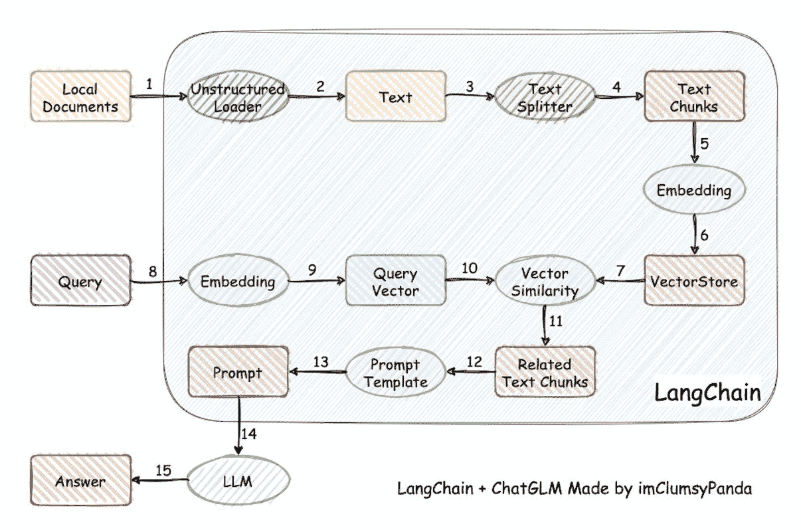

+ 本文重点则阐述“如何通过基于`langchain-chatchat`二次开发一个知识库问答系统”，包括其商用时的典型问题以及对应的改进方案，比如

1. 如何解决检索出错：`embedding`算法是关键之一
2. 如何解决检索到相关但不根据知识库回答而是根据模型自有的预训练知识回答
3. 如何针对结构化文档采取更好的`chunk`分割：基于规则
4. 如何解决非结构化文档分割不够准确的问题：比如最好按照语义切分
5. 如何确保召回结果的全面性与准确性：多路召回与最后的去重/精排
6. 如何解决基于文档中表格的问答

## 前置部分 知识库的构建：基于`langchain-chatchat`的V0.2.6版本(`chatglm2`+`m3e`)

将七月近两年整理的大厂面试题PDF文件作为源文件来进行知识库的构建

默认使用`RapidOCRPDFLoader`作为文档加载器

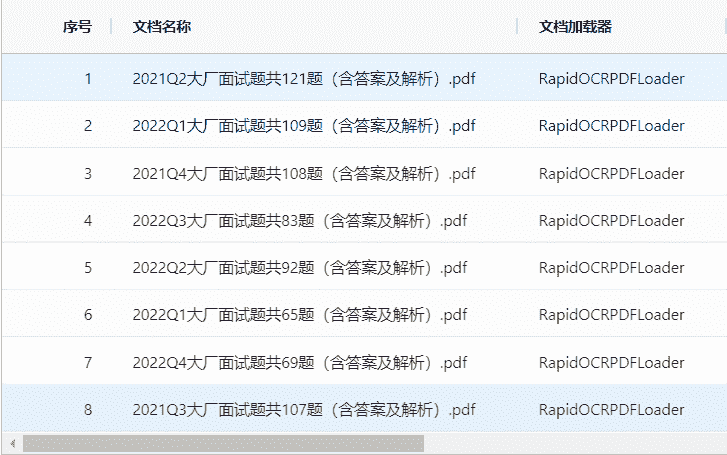

> `RapidOCR`是目前已知运行速度最快、支持最广，完全开源免费并支持离线快速部署的多平台多语言OCR。由于`PaddleOCR`工程化不是太好，`RapidOCR`为了方便大家在各种端上进行OCR推理，将`PaddleOCR`中的模型转换为`ONNX`格式，使用`Python`/`C++`/`Java`/`Swift`/`C#` 将它移植到各个平台

> 更多详情参考：`https://rapidai.github.io/RapidOCRDocs/docs/overview/`

另，本文里的测试及二次开发主要针对`langchain-chatchat`的V0.2.6版本，资源及相关默认配置如下：

+ 显卡：`Tesla P100`，16G（显存）
+ 分词器：`ChineseRecursiveTextSplitter`
+ `chunk_size`：250 (顺带说一下，250是默认分块大小，但该系统也有个可选项，可以选择达摩院开源的语义分割模型：`nlp_bert_document-segmentation_chinese-base`)
+ `embedding`模型：默认为`m3e-base`
+ `LLM`模型：`chatglm2-6b` (默认为该模型，但下文会有些结果来自`chatglm3`)
+ 向量库：`faiss`

## 第一部分 如何解决检索的问题：比如检索出错等

### 1.1 如何解决检索出错：`embedding`算法是关键之一

#### 1.1.1 针对「Bert的预训练过程是什么？」检索出的结果与问题不相关

使用原始的`langchain-chatchat` V0.2.6版本，会出现对某些问题检索不到的情况

比如问一个面试题：Bert的预训练过程是什么？

+ 其在文档中的结果如下：

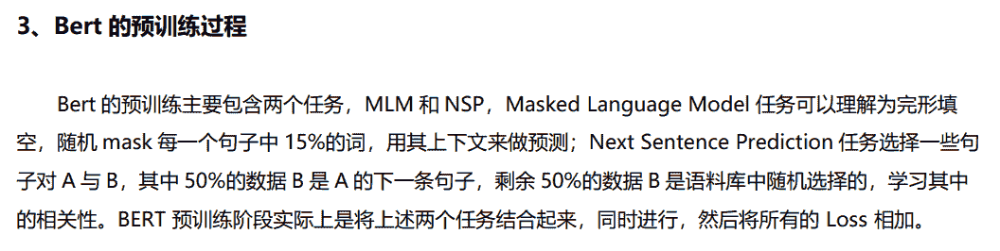

+ 但基于`m3e`的系统实际检索得到的内容如下：

+ 出处 [1] 2021Q2大厂面试题共121题（含答案及解析）.pdf

+ 成. 15.6 `bert` 的改进版有哪些 参考答案： `RoBERTa`：更强大的 `BERT` 加大训练数据 16GB -> 160GB，更大的`batch size`，训练时间加长 不需要 `NSP Loss`： `natural inference` 使用更长的训练 `Sequence``Static vs. Dynamic Masking` 模型训练成本在 6 万美金以上（估算） `ALBERT`：参数更少的 `BERT` 一个轻量级的 `BERT` 模型 共享层与层之间的参数 （减少模型参数）

---

+ 出处 [2] 2022Q1大厂面试题共65题（含答案及解析）.pdf

+ 可以从预训练方法角度解答。

… 20

5、`RoBERTa` 相比 `BERT` 有哪些改进？

…

20 6、`BERT` 的输入有哪几种 `Embedding`?

---

+ 出处 [3] 2022Q2大厂面试题共92题（含答案及解析）.pdf

+ 保证模型的训练，`pre-norm` 显然更好一些。 5、`GPT` 与 `Bert` 的区别 1） `GPT`

是单向模型，无法利用上下文信息，只能利用上文；而 `BERT` 是双向模型。 2） `GPT` 是基于自回归模型，可以应用在 `NLU` 和 `NLG`两大任务，而原生的 `BERT` 采用的基于自编码模 型，只能完成 `NLU` 任务，无法直接应用在文本生成上面。 6、如何加速 `Bert`模型的训练 `BERT` 基线模型的训练使用 `Adam with weight decay`（`Adam` 优化器的变体）作为优化器，`LAMB` 是一款通用优化器，它适用于小批量和大批量，且除了学习率以外其他超参数均无需调整。`LAMB` 优化器支持自

+ 可以看出，是没有检索到相关内容的

+ 在没检索对的情况下，接下来，大模型便只能根据自己的知识去回答(下图左侧是`chatglm2-6b`的回答，下图右侧是`chatglm3-6b`的回答)

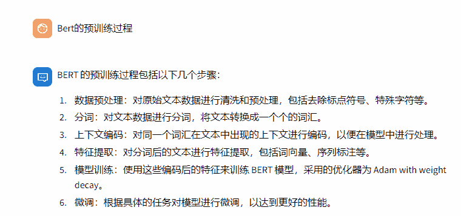

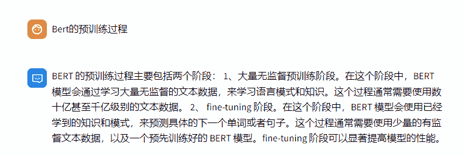

结果就是造成了大模型所谓的编造或幻觉问题，没有答到点子上：`MLM`和`NSP`

#### 1.1.2 可能的原因分析与优化方法

使用默认配置时，虽然上传文档可以实现基础的问答，但效果并不是最好的，通常需要考虑以下几点原因

1. 文件解析及预处理：对于PDF文件，可能出现解析不准确的情况，导致检索召回率低；
1. 文件切分：不同的`chunk_size`切分出来的粒度不一样。如果设置的粒度太小，会出现信息丢失的情况；如果设置的粒度太大，又可能会造成噪声太多，导致模型输出的结果明显错误。且单纯根据`chunk_size`切分比较简单粗暴，需要根据数据进行针对性优化；
1. `embedding` 模型效果：`embedding`效果不好也会影响检索结果

优化方法：

+ 文件解析及预处理

一方面可以尝试不同的PDF解析工具，解析更加准确

另一方面可以考虑将解析后的内容加上标题，并保存成`Markdown`格式，这样可以提高召回率

+ 文件切分

基于策略：对于特定的文档，比如有标题的，可以优先根据标题和对应内容进行划分(就是按照题目和对应答案切分成一个块)，再考虑`chunk_size`

基于语义分割模型：还可以考虑使用语义分割模型

+ 模型效果

尝试使用更多`embedding`模型，获得更精确的检索结果。如：`piccolo-large-zh` 或 `bge-large-zh-v1.5`等等，下文很快阐述

+ 向量库

如果知识库比较庞大（文档数量多或文件较大），推荐使用`pg`向量数据库

如果文件中存在较多相似的内容，可以考虑分门别类存放数据，减少文件中冲突的内容

+ 多路召回

结合传统方法进行多路召回

+ 精排

对多路召回得到的结果进行精排

#### 1.1.3 `embedding`优化：针对「Bert的预训练过程是什么？」把`m3e`替换成`bge`

关于各个`embedding`模型的介绍，请看此文：一文通透Text `Embedding`模型：从`text2vec`、`openai-ada-002`到`m3e`、`bge`

考虑到`bge`在各方面的表现不错，所以接下来，我们把`m3e`替换成`bge`再试下(至于如何更换`embedding`模型？1 找到`condigs`下的`model_config.py`文件；2 修改所用`embedding`模型的路径，即`MODEL_PATH`下的`embed_model`中的模型对应的路径，如：`"bge-large-zh": "/data/datasets/bge-large-zh"`，3 修改选用的`embedding`模型：`EMBEDDING_MODEL = "bge-large-zh"`)，得到的结果是：

+ `bge-large-zh`检索到了与问题最相关的结果，但最相关的结果并没有排在第一位

+ 而`m3e`是没有检索到最相关的结果的

如下图所示

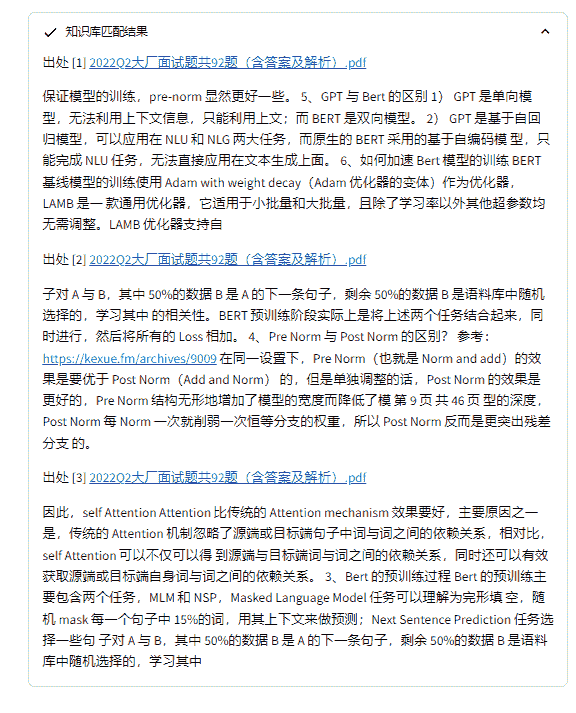

最终大模型也正常答出来了(答到了点子上：`MLM`和`NSP`)

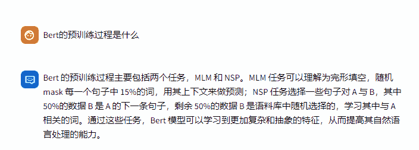

## 第二部分 如何解决检索到相关但不根据相关结果回答

### 2.1 开源`LLM`并没有完全根据文档内容来回答，而是根据模型自有的预训练知识回答

`LLM`问题主要有以下几点：

1. `LLM`的回答会出现遗漏信息或补充多余信息的情况
1. `chatglm2-6b`还会出现回答明显错误的情况

#### 2.1.1 针对「用通俗的语言介绍下强化学习？」检索到部分相关

比如问一个面试题：用通俗的语言介绍下强化学习？

1. 该问题在文档中的结果如下：

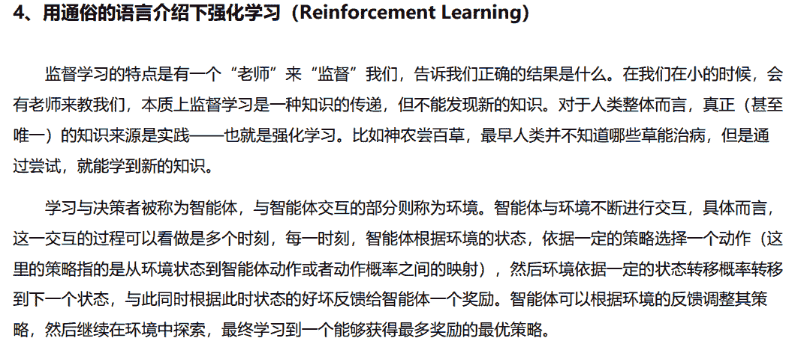

1. `m3e`检索得到的内容如下：

1. 出处 [1] 2022Q2大厂面试题共92题（含答案及解析）.pdf

1. `CART` 树算法的核心是在生成过程中用基尼指数来选择特征。 4、用通俗的语言介绍下强化学习（`Reinforcement Learning`）监督学习的特点是有一个“老师”来“监督”我们，告诉我们正确的结果是什么。在我们在小的时候，会有老师来教我们，本质上监督学习是一种知识的传递，但不能发现新的知识。对于人类整体而言，真正（甚至唯一）的知识来源是实践——也就是强化学习。比如神农尝百草，最早人类并不知道哪些草能治病，但是通 过尝试，就能学到新的知识。学习与决策者被称为智能体，与智能体交互的部分则称为环境。智能体与环境不断进行交互，具体而言，这一交互的过程可以看做是多个时刻，每一时刻，智能体根据环境的状态，依据一定的策略选择一个动作（这

---

1. 出处 [2] 2021Q3大厂面试题共107题（含答案及解析）.pdf

1. 20.2 集成学习的方式，随机森林讲一下，`boost` 讲一下， `XGBOOST` 是怎么回事讲一下。 集成学习的方式主要有 `bagging`，`boosting`，`stacking` 等，随机森林主要是采用了 `bagging` 的思想，通过自助法（`bootstrap`）重采样技术，从原始训练样本集 `N` 中有放回地重复随机抽取 `n` 个样本生成新的训练样本集合训练决策树，然后按以上步骤生成 `m` 棵决策树组成随机森林，新数据的分类结果按分类树 投票多少形成的分数而定。 `boosting`是分步学习每个弱分类器，最终的强分类器由分步产生的分类器组合而成，根据每步学习到的分类器去改变各个样本的权重（被错分的样本权重加大，反之减小) 它是一种基于 `boosting`增强策略的加法模型，训练的时候采用前向分布算法进行贪婪的学习，每次迭代

---

1. 出处 [3] 2022Q2大厂面试题共92题（含答案及解析）.pdf

1. 特征工程可以并行开发，大大加快开发的速度。 训练速度较快。分类的时候，计算量仅仅只和特征的数目相关。 缺点：准确率欠佳。因为形式非常的简单，而现实中的数据非常复杂，因此，很难达到很高的准确性。很难处理 数据不平衡的问题。 3、介绍下决策树算法常见的决策树算法有三种：`ID3`、`C4.5`和`CART` 树 `ID3` 算法的核心是在决策树的每个节点上应用信息增益准则选择特征，递归地构架决策树。`C4.5` 算法的核心是在生成过程中用信息增益比来选择特征。 `CART` 树算法的核心是在生成过程中用基尼指数来选择特征。4、用通俗的语言介绍下强化学习（`Reinforcement Learning`）

1. 可以看出

第一个检索结果和问题是相关的

第二个检索结果和问题是完全没关系的

而第三个检索结果的最后一句话是和问题相关的

顺带提一下，如果把`m3e`替换成`bge-large-zh`，则其检索到的第1个结果和`m3e`的第1个结果是一致的，第2个结果则和`m3e`的第3个结果一样(只最后一句话是和问题相关)，第3个结果则检索到的`SVM`(和问题完全无关)，详见我司的「大模型项目开发线上营」之“`bge-large-zh`模型例子”

1. 最终，`m3e` + `chatglm2`基于知识库给的答案如下图左侧所示，`bge-large-zh` + `chatglm2`则如下图右侧所示：

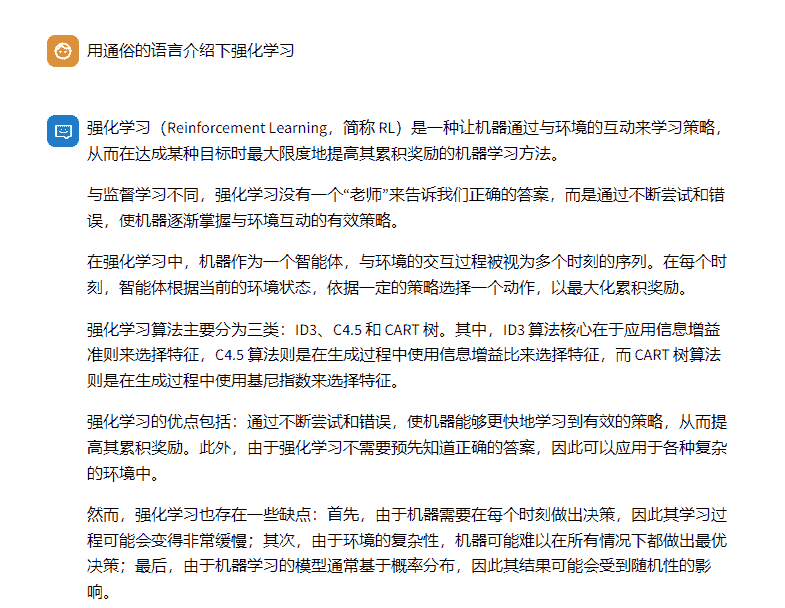

1.

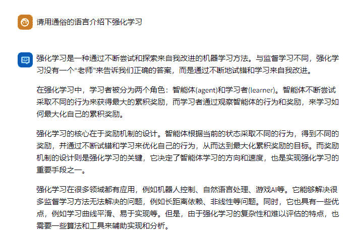

可以看出，`m3e` + `chatglm2`并没有完全根据文档内容来回答，而是基于自己的知识进行了相应回答，而对于回答的第三段话，强化学习算法主要有三种：`ID3`、`C4.5`和`CART`树。可以看出，这段话的表达是完全错误的

#### 2.1.2 针对「生成式模型和判别式模型的区别并举一些例子」检索到的全是相关的

再看一个例子，即提问：生成式模型和判别式模型的区别并举一些例子

1. 其在文档(知识库)中的答案如下

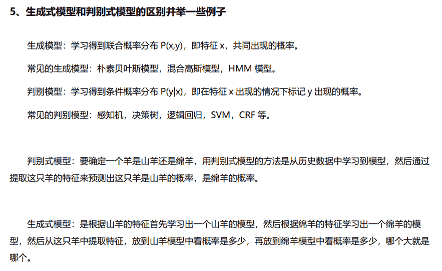

1. `m3e`检索到的结果如下，很明显，三个检索结果都精准匹配到了问题

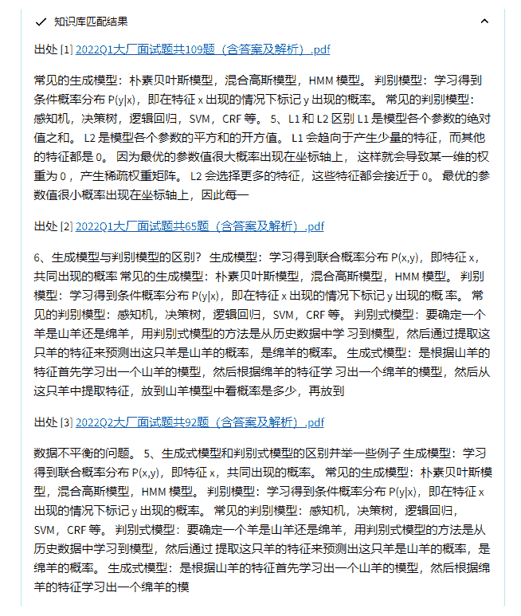

1. 但，系统最终实际生成的答案如下(下图左侧是`chatglm2-6b`，下图右侧是`chatglm3-6b`)

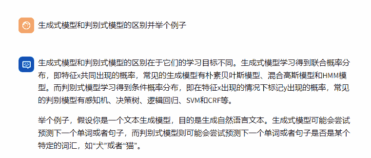

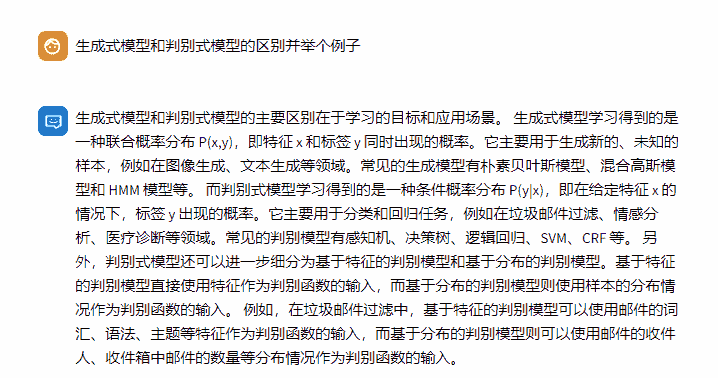

相当于即便在上步骤中，系统检索到的三个结果的内容都是和问题相关的，但大模型还是根据自己的知识进行了回答

### 2.2 `LLM`不按照知识库回答的优化方法

+ 优先使用最新的6B/7B模型：`ChatGLM3-6B`、`Baichuan2-7B`、`Qwen-7B`

当然，即便有的模型换成到了能力更强的最新版，也不一定听话(依然不严格按照知识库中的回答)，例如“2.1.1 针对「用通俗的语言介绍下强化学习？」”中，把`chatglm2`替换成最新的`chatglm3`，也未完全严格按照文档中的答案来回答(但`GLM3`这个结果相比`GLM2`的结果 至少是进步了，没有出现毫不相干的决策树之类的内容)

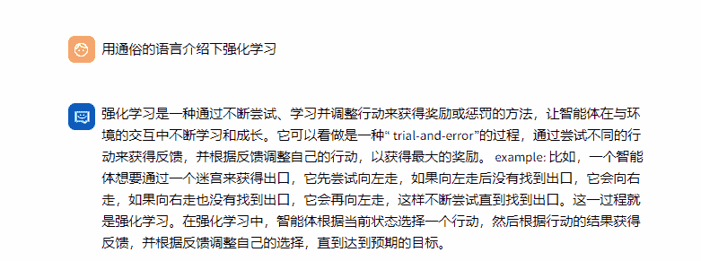

+ 所以，如果资源可以支持48G以上的显卡，可以考虑使用`Qwen-14B-Chat` 或 `Baichuan-13B-Chat`，13B的模型通常好于6B/7B模型

+ 优化`prompt`，可能会有一定效果的。但由于随机性，结果并不能得到保证

+ `PDF`文档解析优化方案，下文详述

## 第三部分 结构化文档与非结构化文档的典型问题：如何更好分割

### 3.1 针对结构化文档本身的特点：基于规则针对性分割

首先确定咱们的目标和步骤，我们需要先解析`PDF`，然后分别获取文本内容和图片内容，最后拼接文本内容和图片内容

而`Langchian-Chatchat`中对于不同类型的文件提供了不同的处理方式，从项目`server/knoledge_base/utils.py`文件中可以看到对于不同类型文件的加载方式，大体有`HTML`，`Markdown`，`json`，`PDF`，图片及其他类型等

```
LOADER_DICT = {"UnstructuredHTMLLoader": ['.html'],"UnstructuredMarkdownLoader": ['.md'],"CustomJSONLoader": [".json"],"CSVLoader": [".csv"],

# "FilteredCSVLoader": [".csv"], # 需要自己指定，目前还没有支持"RapidOCRPDFLoader": [".pdf"],"RapidOCRLoader": ['.png', '.jpg', '.jpeg', '.bmp'],"UnstructuredFileLoader": ['.eml', '.msg', '.rst','.rtf', '.txt', '.xml','.docx', '.epub', '.odt','.ppt', '.pptx', '.tsv'],

}
```

这里，我们重点关注`PDF`文件的解析方式，并探究其可能的优化方案

从上面的文件加载字典中可以看出，`PDF`文件使用的加载器为`RapidOCRPDFLoader`，该文件的方法在项目`document_loaders/mypdfloader.py`中

其对应的处理步骤为：

1. 首先使用`fitz`(即`pyMuPDF`)的`open`方法解析`PDF`文件；
1. 对于每一页的文本内容，通过`get_text`方法进行获取，而对于图片内容通过`get_images`方法进行获取，获取后通过`RapidOCR`对图片中的文本内容进行提取


最后将从图片中提取的文本和原始的文本内容进行拼接，得到最终的所有文本内容

再之后，进行下一步的分词和文本切割

如你所见，chatchat原系统V0.2.6中默认的这种处理方式的

+   优点是**简单粗暴**，基本上对于任何排版的PDF文件都能够提取到有效信息

+   但缺点也很明显，就是无差别，**如果我们的文档本身就有较好的结构，提取**出来的内容也无法将这种较好的结构反映出来

所以，通常情况下需要根据文档的具体情况对文档定制化处理，那下面，咱们就来根据文档固有的特点针对性优化下吧

#### 3.1.1 特定PDF解析方案一：根据书签定位

1.  首先，分析七月在线大厂面试题PDF文档特点

以「七月在线大厂面试题PDF文档」为例，有以下特点：

文档具有书签，可以直接根据书签对应到具体的页码

文档结构不复杂，共有两级标题，一级标题表示一个大的章节，二级标题表示面试题的问题，文本内容为每道面试题对应的答案

每道面试题是独立的，和其前后的面试题并没有明显的相关性

面试题题目的长度长短不一，短的有几个词组成，长的基本一句话

文档中除中文外，还有大量模型或算法英文词，且文档中包含部分公式和代码

因此，可以考虑根据文档的标题进行分割，即将文档中的标题和标题对应的内容分为一块，在放入向量库的时候可以尝试两种方式

一种是只将题目进行向量化表示存入向量库

另一种是将题目和答案一起进行向量化表示存入向量库

1.  **然后考虑PDF文档解析可选方案**

对此，常见的几种PDF解析工具包都可以尝试下，比如`pdfplumber`、`PyPDF2`、`fitz(PyMuPDF)`

---

1.  “`PyPDF2`、`pdfplumber`、`fitz(PyMuPDF)`都是用于解析 PDF 文件的 Python 库，但它们在实现和功能上有一些本质区别

1.  **`PyPDF2`**

描述：`PyPDF2` 是一个用于操作 PDF 文件的库，它提供了一些基本的功能，如合并、拆分和旋转 PDF 页面等

特点：`PyPDF2` 的主要目的是处理 PDF 文件的基本操作，而不是从 PDF 中提取高级内容。它提供了对页面、书签等基本元素的简单控制。

适用场景：`PyPDF2` 适用于对 PDF 文件进行简单的编辑和处理，例如合并多个 PDF 文件或旋转页面

`pdfplumber`

描述：`pdfplumber` 是基于 `PDFMiner.six` 构建的，它提供了更高级的接口，使得从 PDF 中提取文本、表格和图像等信息更加容易

特点：`pdfplumber` 提供了易于使用的API，使得从 PDF 中提取文本、表格等内容变得相对简单。它还允许通过页面对象来获取页面级别的信息

适用场景：`pdfplumber` 适用于需要从 PDF 中提取结构化数据的任务，如文本和表格，比如下面这个例子，先提取表格(主要用到 `extract_table` 这个函数)，后保存为excel文件

```
import pdfplumber

from openpyxl import Workbook #保存表格，需要安装openpyxl

with pdfplumber.open("D:\\pdffiles\\人力资源部岗位编制.pdf") as pdf:

    page01 = pdf.pages[0]

    table = page01.extract_table()

    workbook = Workbook()

    sheet = workbook.active

    for row in table:

        sheet.append(row)

    workbook.save(filename="D:\\pdffiles\\人力资源部岗位编制.xlsx")
```

`fitz`之`PyMuPDF`

描述：`PyMuPDF` 是对 `MuPDF` 渲染引擎的 Python 封装，`MuPDF` 是一个用于渲染 PDF、XPS、EPUB 和 CBZ 等格式的高性能库。

特点：`PyMuPDF` 提供了对 PDF 文件的低级别访问，允许直接访问页面内容，支持文本、图像等的提取。它的速度较快，适合对 PDF 进行高级处理

适用场景：`PyMuPDF` 适用于需要对 PDF 文件进行深度分析、提取详细信息或执行高级操作的应用场景

总的来说，选择使用哪个库取决于任务的性质

如果只需要基本的 PDF 文件处理，可以选择 `PyPDF2`

如果需要从 PDF 中提取结构化数据，`pdfplumber` 是一个不错的选择

如果需要进行更高级的处理、分析以及对 PDF 文件进行详细操作，`PyMuPDF` 可能更适合

当然，`pdf`解析工具远远不止以上三种，更多见下图

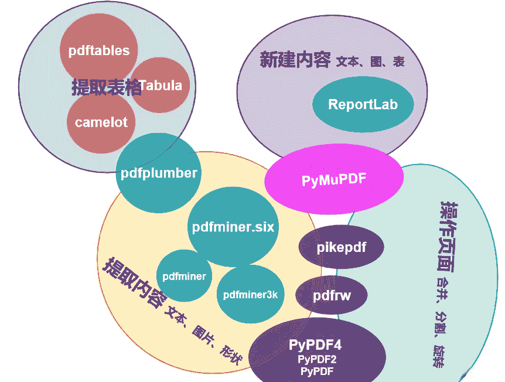

1.  暂以上”

---

1.  回到我们当前的问题上

1.    首先，通过`fitz`的`get_toc`函数获取书签信息，得到面试题题目与其所在的页码，保存为一个字典

```
import fitz

with fitz.open(data_path) as doc:

    # 通过get_toc获取书签内容

    toc = doc.get_toc()  # [[lvl, title, page, …], …]

    for level, title, page in toc:

        print(level, title, page)
```

1.  其次，分别尝试用`PyPDF2`、`pdfplumber`、`fitz(pymupdf)`抽取每一页的文本信息(分别通过`extract_text`、`extract_text`、`get_text`)，然后与字典中的标题进行匹配(使用`find`方法)

1.    接着，通过面试题当前位置和下一个面试题位置(这里的位置指的是索引)，对面试题进行分块

1.    最后，输出面试题与其对应的答案

至于以上4个步骤对应的完整代码见七月的「大模型项目开发线上营」

1.  当然，`PDF`文档解析会存在一些问题

比如

a) 书签中的标题内容和文档中的标题内容并不完全一致，这种情况可能是解析后出现多余的空格导致的

b) 需要考虑一道面试题可能存在跨页的情况，一般是会出现一道面试题出现在两页的情况，但也需要考虑一道面试跨三页或多页的情况

c) 由于一级标题是有分页符的，每个一级标题会另起一页，因此在处理时也需要考虑此种情况

d) 解析的文本中带有页脚，如：第 4 页 共 46 页，由于页脚的内容对面试题是没有意义的，因此也需要考虑去掉

1.  最终确定`PDF`文档解析的解决方案

解决方案：

①对于书签中的标题内容和文档中的标题内容并不完全一致的问题

1.    一种方式有考虑去除文档中标题的空格，实现困难在于无法精确定位，如果全去掉就会出现一些英文单词拼接在一块的情况，可能对语义或后续的检索产生影响


1.    一种方式是不去除，如果出现这种情况，则将标题所在页的信息都提取出来；

②对于一道面试题可能存在跨页的情况，可以通过设置起始页和终止页，对相邻标题（主要是下一个标题）所在页进行判断的方式来处理

③对于每个一级标题会另起一页的情况，可以通过添加对特殊字符“1、”判断的方式来处理；

④对于页脚，可以使用正则表达式进行匹配去除

以上方案更多针对文档的书签是准确的，和对应的标题完全对应，那如果书签不够准确或者没有书签呢，则需要另寻办法，详见下节

#### 3.1.2 特定PDF解析方案二：通过字体大小或字体类型

由于通过`fitz(pymupdf)`的`get_toc`函数获取书签信息与解析出的文中面试题的题目差别较大，匹配率较低，因此，考虑不使用书签信息，直接对每一页中的标题根据一定的规则进行识别。如可以通过字体的大小或字体类型进行规则设定

> 注意，本方案二中只用了`fitz(pymupdf)`解析器，这样可以保证面试题题目的获取与正文信息获取的一致性，而不会出现使用不同解析器可能导致匹配效果差的情况

##### 3.1.2.1 通过字体大小获取标题

1.  通过`get_text`方法获取表的相关信息

该方法通过查看`PDF`文件中不同大小的字体，设置一定的规则获取面试题的题目

通过`page_toc.get_text("dict")["blocks"]`方法可以得到每一行的相关信息，然后查看其中一个`block`中的具体信息如下：

```
{'number': 1,'type': 0,'bbox': (45.35900115966797,

  83.10362243652344,

  475.92999267578125,

  101.64714813232422),'lines': [{'spans': [{'size': 14.050000190734863,'flags': 20,'font': 'MicrosoftYaHei-Bold','color': 0,'ascender': 1.05810546875,'descender': -0.26171875,'text': '第十七篇：2022 年 4 月 10 日百度机器学习方向暑期实习面试题 6 道','origin': (45.35900115966797, 97.97000122070312),'bbox': (45.35900115966797,

      83.10362243652344,

      475.92999267578125,

      101.64714813232422)}],'wmode': 0,'dir': (1.0, 0.0),'bbox': (45.35900115966797,

    83.10362243652344,

    475.92999267578125,

    101.64714813232422)}]}
```

其中，`number`表示行的索引

`font` 表示的是文本的字体

`text` 表示的文本内容

`bbox` 包含：`x0`, `y0`, `x1`, `y1`，即文本块的左下角和右上角的坐标，这表示文本块在页面上的位置

1.  计算文本字体高度，获取标题高度范围

分别查看第1,25,21行的关键信息：`bbox`，`text`，`number`，并根据`bbox`的坐标计算文本字体高度

`(45.35900115966797, 83.10362243652344, 475.92999267578125, 101.64714813232422)`

第十七篇：2022 年 4 月 10 日百度机器学习方向暑期实习面试题 6 道

1height：18.54352569580078

`(45.35900115966797, 135.19273376464844, 159.0, 151.03062438964844)`

1、介绍下 `SVM` 算法

2height：15.837890625

`(67.31999969482422, 223.91693115234375, 161.88865661621094, 238.50099182128906)`

`SVM` 可分为三种：

5height：14.584060668945312

`(45.35900115966797, 671.832763671875, 172.8000030517578, 687.670654296875)`

2、介绍下逻辑回归算法

21height：15.837890625

1.  从结果可知，标题的高度介于15到18之间，从而可以根据这点定位出来的标题实现精准分割

1.  知道了怎么获取到标题，**那便可以通过字体大小**获取标题，并进行分块(具体处理的代码见七月的大模型项目开发线上营)

##### 3.1.2.2 通过字体类型和规则获取标题

+   查看只包含标点符号“、”的文本

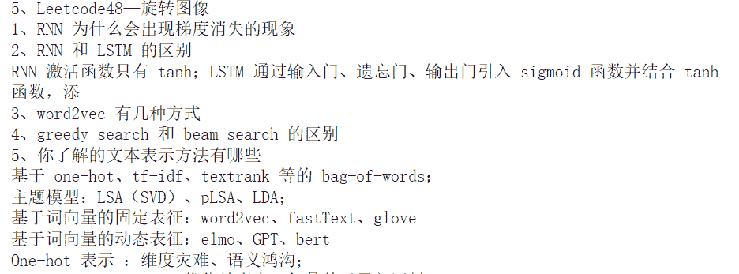

通过结果可以看到，只通过标点符号“、”是不能准确将所有标题找到，因此还可以从字体的角度出发来解决

+   通过标点符号“、”且结合字体类型获取标题

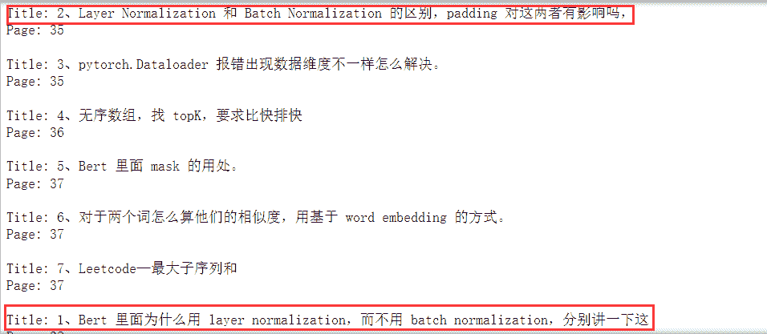

可以看出，通过标点符号、和字体`MicrosoftYaHei-Bold`，可以将所有的标题匹配出来，但对于多行标题来讲，与获取的题目并不能完全匹配(这个对多行标题额外处理下即可，具体怎么处理，详见大模型项目开发线上营)

+   最后，便可以通过字体类型和规则获取标题，并进行分块

### 3.2 如何解决非结构化文档分割不够准确的问题：比如最好按照语义切分

可先看此文《一文掌握文本语义分割：从朴素切分、Cross-Segment到阿里SeqModel》

## 第四部分 让召回结果更全面、准确，及基于表格的问答

### 4.1 如何确保召回结果的全面性与准确性：多路召回与最后的去重/精排

主要任务为**非对称召回**任务，即一个相对较短的问句和一个相对较长的答案（文本块），进行匹配

#### 4.1.1 常规召回方法：Embedding召回

将用户问题和本地知识进行`embedding`，通过向量相似度实现召回。

**问题**：通过语义向量相似度匹配度**不够准确**，故可以通过倒排索引召回出知识语料进行补充

#### 4.1.2 多路召回方法：关键词提取、倒排召回、`embedding`召回、同一问题多样表达

在文本的召回中，倒排的召回方式也非常实用，它具备精确匹配、索引效率和可解释的优势

在目前的全文检索系统中

+   基于倒排的 `BM25` 相关性打分中依然是核心机制

+   当然随着近些年深度学习的发展，语义召回表现了强大的检索效果

这两路召回在不同场景下都具备自己独立的优势，在知识召回中的互补性很强

1.  关键词提取召回

直接使用 `jieba` 分词的方式，将名词部分抽取出来作为关键词，根据关键词在文本块中出现的次数进行打分

1.  **倒排召回(`BM25`)**

基本原理

倒排这个名字是与正排相对的

1.    如果索引是“文档 `ID` → 文档内容”，则索引被称作正排索引


1.  如果索引是“文档内容 → `文档 ID`”，则索引被称作倒排索引

a) 离线索引构建时，通过分词器对文档进行切词，得到一系列的关键词(`Term`)集合，然后以 `Term` 为 `key` 构建它与相关文档的映射关系

b) 在线搜索流程中，首先通过切词器对用户输入进行切词，得到 `Term` 列表，然后根据如下

`BM25` 打分公式进行打分排序返回给用户(关于公式的详细解释，见大模型线上营)

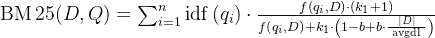

使用`BM25`需要考虑去除停用词

倒排召回的优缺点

优势：发展成熟，易达到非常好的 `baseline` 性能

1)支持自定义停用词表，同义词表

**2)精确匹配能力强**

3)可解释能力强

4)检索速度更快

劣势：没有语义信息，对“一词多义”现象解决的不好

1.  **语义偏移问题**，即使关键词在字面上与文档中的词汇匹配，但如果命中的顺序与用户输入的顺序不一致，那么实际上这些词汇在语义上可能完全不相关

这种情况下，搜索引擎需要更深层次地理解词汇的语义信息，以确保返回的结果在语义上与用户的查询意图相匹配


1.  **关键词不匹配**，即用户进行搜索时，可能不知道文档中确切使用的关键词术语(`terms`)，因此他们输入的关键词可能无法直接命中文档中的相关词汇

为了解决这个问题，可以采用术语扩展(`term expansion`，例如使用同义词)、和查询改写(`query rewriting`)的方法。这意味着通过扩展查询词汇或改写查询，使得搜索引擎能够识别和匹配到用户可能未直接输入但与查询意图相关的词汇

至于`BM25`模型代码见我司七月在线的大模型线上营

1.  **`embedding` 召回**

使用已有的开源 `embedding`：

基于已有领域数据，基于`embedding` 进行标注和微调，即用 🐧 和 QD 语料对向量模型进行 `Finetune`

`embedding` 召回的优缺点

优势：考虑语义相似性，更加智能

a)语义相近即可召回，无需 `term` 命中

b)无需考虑复杂的传统倒排的调优手段

c)具备支持跨模态召回的潜力

劣势：需要模型训练，对垂直领域落地支持有限

预训练模型对于公开数据集的 `benchmark` 参考性不足，对垂直领域泛化性不足，可能出现以下情况：

i) 容易出现语义相似但主题不相似的情况

ii)不理解专有词汇

iii)对精准匹配支持不足，难以用专业词汇精准召回

iv)对”多词一义”情况的支持不如倒排召回中的同义词表简单直接

v) 可解释能力弱

vi) 需要更多的计算资源

1.  **同一问题多样化**

利用 `LLM` 尝试生成多个不同视角的问题，然后分别用这些问题做召回，然后再汇总

比如下面实验的这个问题 “xx有哪些最新的功能？”，就比如生成了这样一系列的问题：

xx有哪些最新的功能？

最新的xx功能有哪些？

xx有什么最新的功能可以使用？

最新的功能是否已经在xx中推出？

xx的新功能有哪些值得关注？

将新生成的问题和原问题放到一个列表中，分别进行召回，得到最终的召回结果

最终的代码实现见大模型线上营

#### 4.1.3 对召回结果的评估

对召回的结果排序前 `k` 个 文本块中包含正确答案即可，即 `TopK` 的准确率

1.  需要构建数据集，如从所有面试题中构建20个样本进行评估


Retrieval（检索）：每个数据集由语料库、查询`query`和每个查询到语料库中相关文档的映射组成，检索的目的是找到与`query`相关的文件。

所提供的模型用于嵌入所有查询和所有语料库文档，并使用余弦相似度计算相似度分数。根据分数对每个查询的语料库文档进行排序后，分别计算`nDCG@k`、`MRR@k`、`MAP@k`、`precision@k`和`recall@k`。

至于各路评估指标的详细介绍见大模型线上营

### 4.1.4 Rerank（重排）

对于多路召回产生的结果进行重排，重排可以有三种方式选择：

1. 一种是去重取并集；
1. 一种是直接使用重排模型；
1. 如果效果不好，还可以基于数据进行微调。

#### 4.1.4.1 重排模型

Reranking（重新排序）：输入是一个查询`query`和文本的列表（列表中是与`query`相关或不相关的文本），其目的是根据与查询的相关性对结果进行排序：

- 文本和`query`通过模型进行嵌入；
- 然后使用余弦相似度将其与查询进行比较；
- 对每个查询进行评分，并在所有查询中取平均值。指标是平均`MRR@k`和`MAP`，后者是主要指标。

交叉编码器将对查询和答案实时计算相关性分数，这比向量模型（即双编码器）更准确，但比向量模型更耗时。因此，它可以用来对嵌入模型返回的前 k 个文档重新排序。

与嵌入模型不同的是，`reranker`使用问题和文档作为输入，直接输出相似度，而不是嵌入模型。且其是基于交叉熵损失进行优化的，因此相关分数不局限于特定的范围。

使用`FlagEmbedding`

安装所需的包：

```
pip install -U FlagEmbedding
```

获得相关性得分：

```
from FlagEmbedding import FlagReranker

reranker = FlagReranker('BAAI/bge-reranker-large', use_fp16=True) # Setting use_fp16 to True speeds up computation with a slight performance degradation

score = reranker.compute_score(['query', 'passage'])

print(score)

scores = reranker.compute_score([['what is panda?', 'hi'], ['what is panda?', 'The giant panda (Ailuropoda melanoleuca), sometimes called a panda bear or simply panda, is a bear species endemic to China.']])

print(scores)
```

使用 Huggingface 的 `transformers`：

```
import torch

from transformers import AutoModelForSequenceClassification, AutoTokenizer

tokenizer = AutoTokenizer.from_pretrained('BAAI/bge-reranker-large')

model = AutoModelForSequenceClassification.from_pretrained('BAAI/bge-reranker-large')

model.eval()

pairs = [['what is panda?', 'hi'], ['what is panda?', 'The giant panda (Ailuropoda melanoleuca), sometimes called a panda bear or simply panda, is a bear species endemic to China.']]

with torch.no_grad():

    inputs = tokenizer(pairs, padding=True, truncation=True, return_tensors='pt', max_length=512)

    scores = model(**inputs, return_dict=True).logits.view(-1, ).float()
    print(scores)
```

#### 4.1.4.2 `reranker` 的微调

[FlagEmbedding reranker 示例](https://github.com/FlagOpen/FlagEmbedding/tree/master/examples/reranker)

### 4.2 如何解决基于文档中表格的问答

#### 4.2.1 对表格的识别：通过OCR提取

对于以下这种表格：

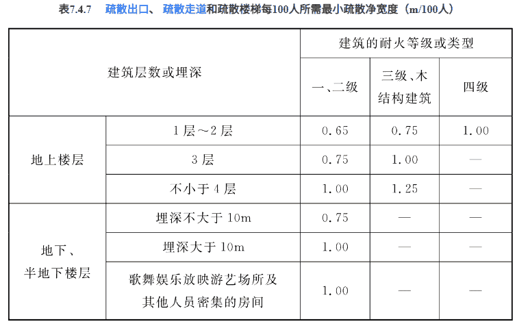

可以通过OCR的方法把表格的内容提取出三元组，即根据表格格式（合并单元格、行列关系、图片）提取知识和结构化数据，比如先通过一些工具把表格的内容先识别出来。

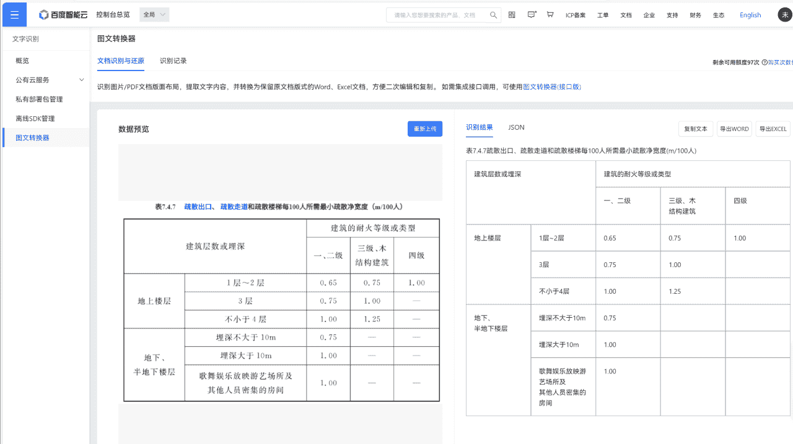

#### 4.2.2 把Excel文档转化成HTML，再做问答

Excel文件有2种思路，导入到SQL或者转成JSON，针对这2种格式做问答相对容易些。

或者把Excel再转成HTML表格源代码，这些源代码是包含表格结构信息的，然后再扔给大模型，基本可以做问答了。

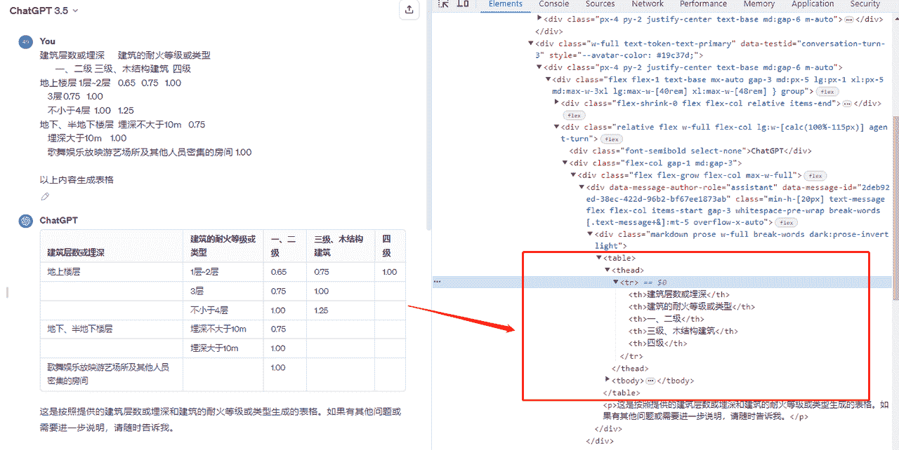

为证实上面的想法，通过如下例子验证一下：

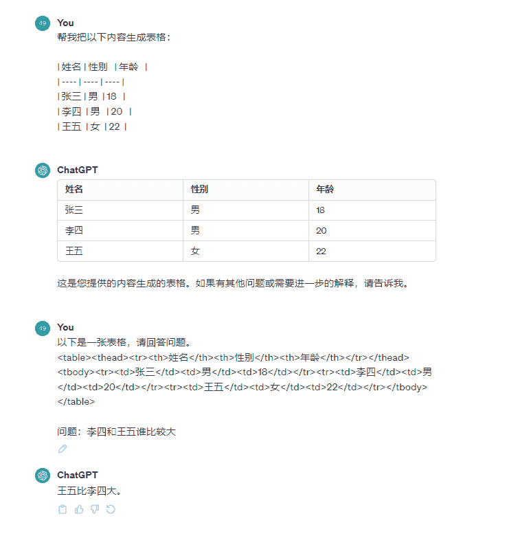

#### 4.2.3 把PDF转化成XML并解析之后，再做问答

解析PDF的关键在于，解析后能否较精准地保留原始PDF中的各项元素和排版信息。保留信息越准确，越容易通过代码把想要的部分提取出来。

一般来说，各大解析器会把PDF转化成HTML或XML格式，因为这2种格式能保留足够丰富的信息，而且容易提取。当然，不管是哪种格式，都依赖于解析器本身对PDF的解析能力。

比如说，同样是有合并单元格和跨页的表格，如果解析器能正确识别这是表格，那么不管是html还是xml，都会加上对应的标签方便后续提取；但如果解析器理解成了这是一个文本段落，那么不管转化成什么格式，都无法把文本和表格正确分离开来。

在下面这个例子中，使用`pdf2docx`的`Converter`类把pdf转化成docx文件，再把docx解压缩得到xml文件，可用于后续的解析：

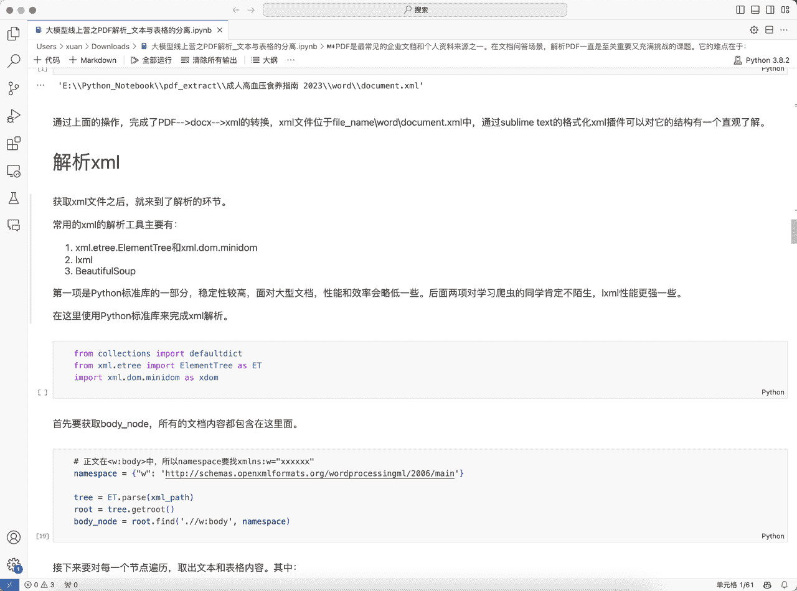

以上三节都只是初步简单的思路，更多细节的处理及代码实现，详见我司的大模型项目开发线上营。
