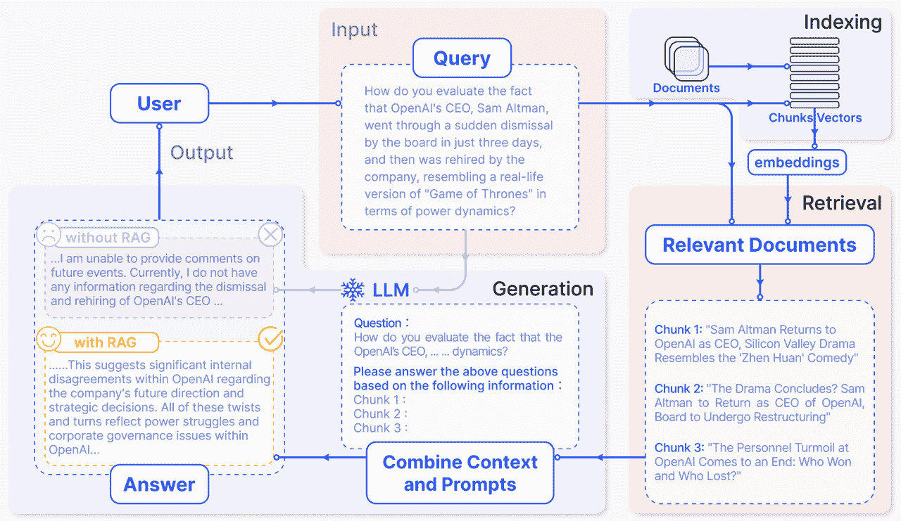
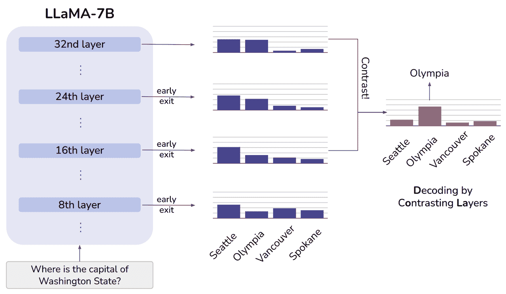
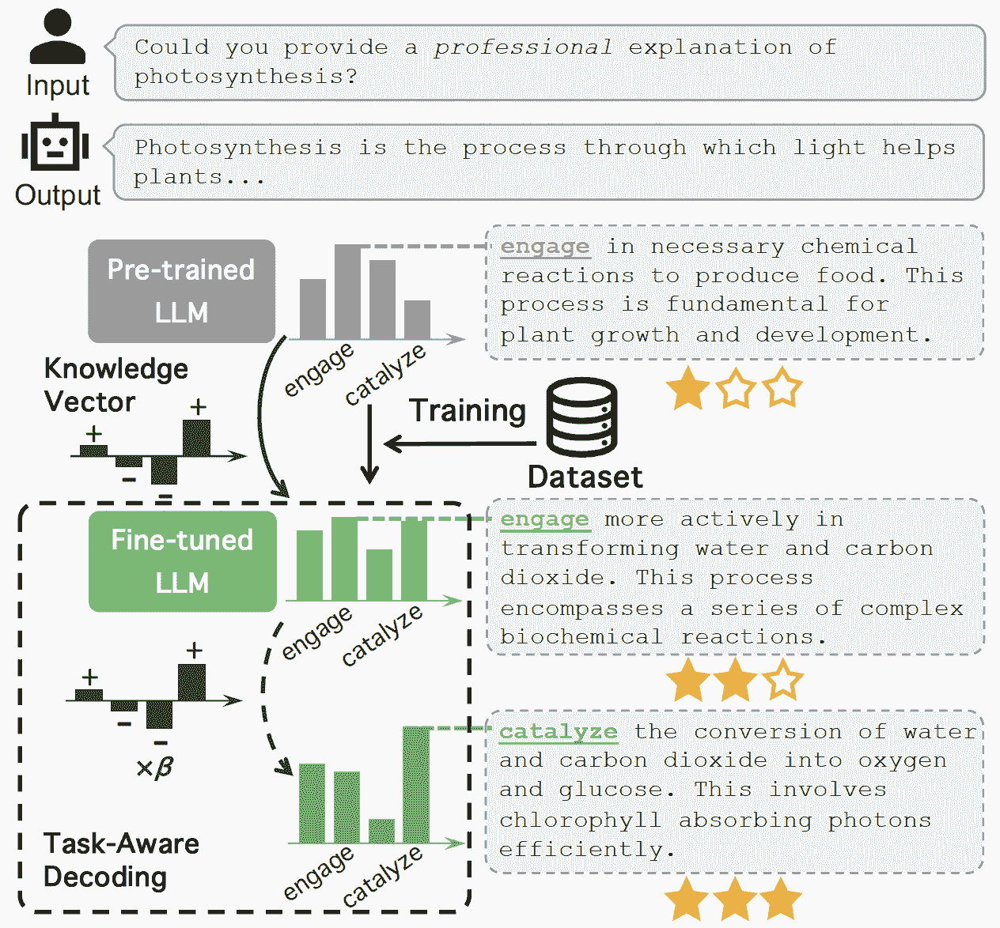
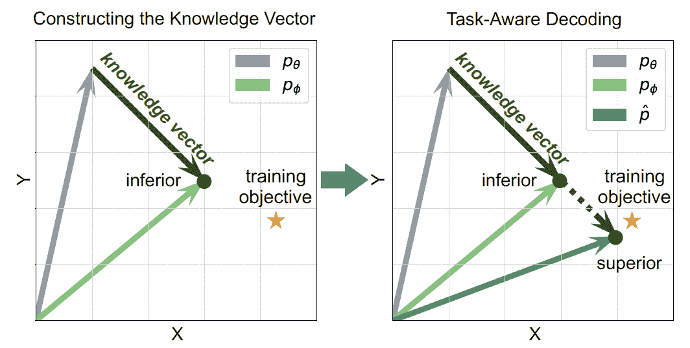
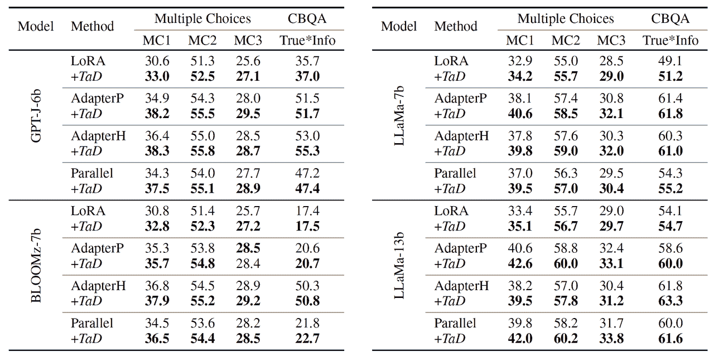
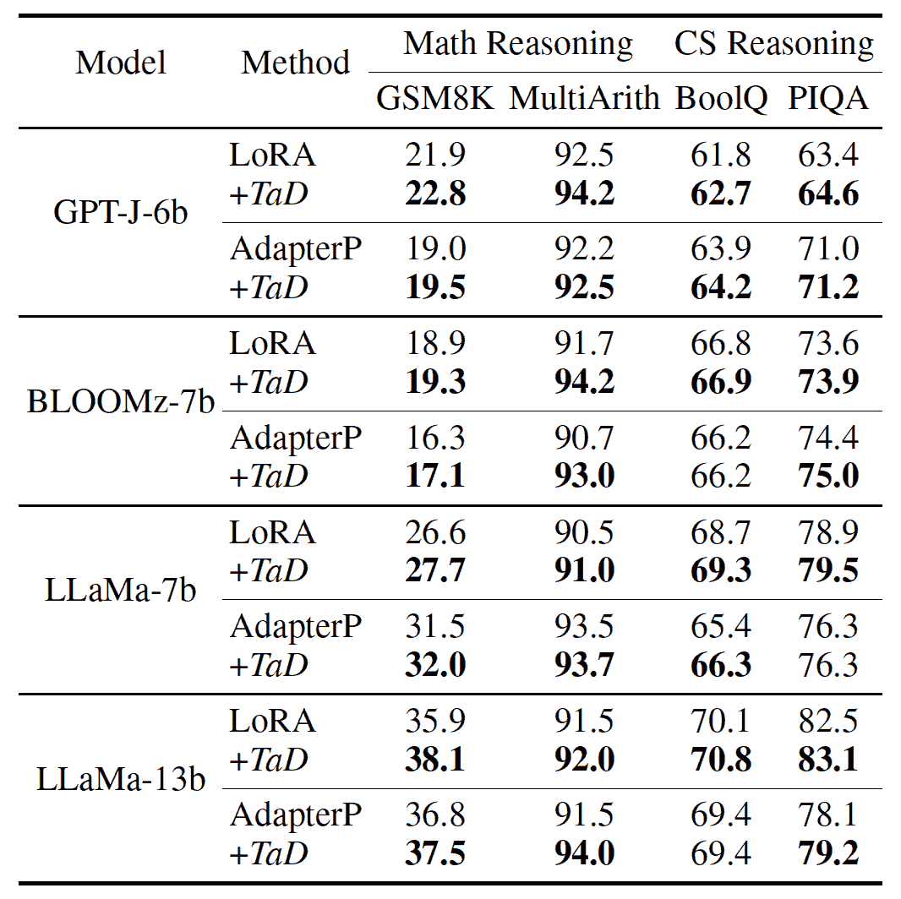
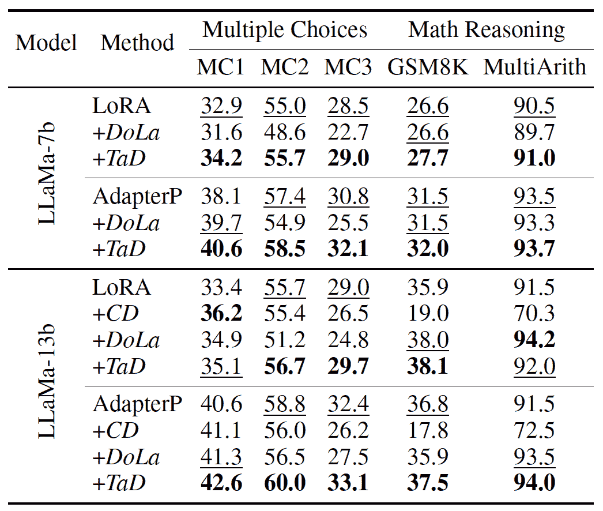
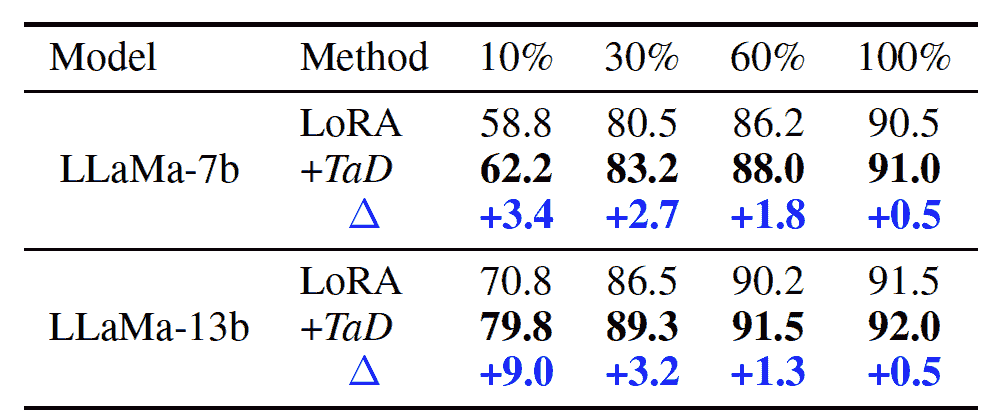
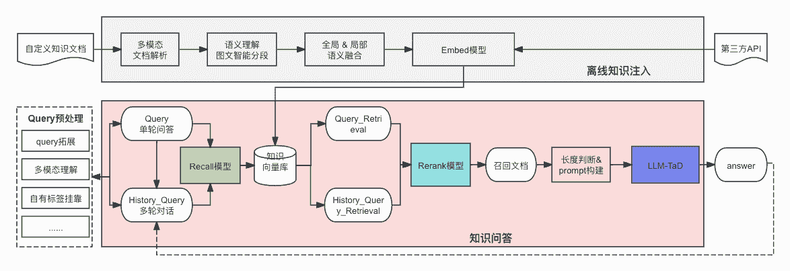

# 自有RAG知识库——建立、幻觉处理

> 来源：[https://qqs7y1hozd1.feishu.cn/docx/OPsldNy4eoRMu8xQfeTc79mkn0y](https://qqs7y1hozd1.feishu.cn/docx/OPsldNy4eoRMu8xQfeTc79mkn0y)

## 一、搭建自有知识库的RAG系统

通过以下几个步骤来完成一个基于云官网文档的RAG系统

> ①数据收集；②建立知识库；③向量检索；④提示词与模型


### 数据收集

> 这里使用云的官方文档作为知识库的基础。

> 数据的收集再整个RAG实施过程中无疑是最耗人工的，涉及到收集、清洗、格式化、切分等过程。

**文档格式：**

```
{
    &quot;content&quot;: &quot;DDoS IP高防结合Web应用防火墙方案说明\n=======================\n\n\nDDoS IP高防+Web应用防火墙提供三层到七层安全防护体系，应用场景包括游戏、金融、电商、互联网、政企等云内和云外的各类型用户。\n\n\n部署架构\n====\n\n\n[](\&quot;https://jdcloud-portal.oss.cn-north-1.jcloudcs.com/cn/image/Advanced%20Anti-DDoS/Best-Practice02.png\&quot;)  \n\nDDoS IP高防+Web应用防火墙的最佳部署架构如下：\n\n\n* 云的安全调度中心，通过DNS解析，将用户域名解析到DDoS IP高防CNAME。\n* 用户正常访问流量和DDoS攻击流量经过DDoS IP高防清洗，回源至Web应用防火墙。\n* 攻击者恶意请求被Web应用防火墙过滤后返回用户源站。\n* Web应用防火墙可以保护任何公网的服务器，包括但不限于云，其他厂商的云，IDC等\n\n\n方案优势\n====\n\n\n1. 用户源站在DDoS IP高防和Web应用防火墙之后，起到隐藏源站IP的作用。\n2. CNAME接入，配置简单，减少运维人员工作。\n\n\n&quot;,
    &quot;title&quot;: &quot;DDoS IP高防结合Web应用防火墙方案说明&quot;,
    &quot;product&quot;: &quot;DDoS IP高防&quot;,
    &quot;url&quot;: &quot;https://docs.jdcloud.com/cn/anti-ddos-pro/anti-ddos-pro-and-waf&quot;
}
```

> 每条数据是一个包含四个字段的json，这四个字段分别是：

> ①**"content"**：文档内容；

> ②**“title”**：文档标题；

> ③**“product”**：相关产品；

> ④**“url”**：文档在线地址

### 向量数据库的选择与Retriever实现

向量数据库是RAG系统的记忆中心。目前市面上开源的向量数据库很多，那个向量库比较好也是见仁见智。本项目中选择了clickhouse作为向量数据库。选择ck主要有以下几个方面的考虑：

+   ck再langchain社区的**集成实现比较好**，入库比较平滑

+   向量查询支持sql，**学习成本较低**，上手容易

+   云有相关产品且**有专业团队支持**，用着放心

### 文档向量化及入库过程

为了简化文档向量化和检索过程，使用longchain的Retriever工具集

**首先将文档向量化，代码如下：**

```
from libs.jd_doc_json_loader import JD_DOC_Loader
from langchain_community.document_loaders import DirectoryLoader
root_dir = &quot;/root/jd_docs&quot;
loader = DirectoryLoader(
    &#x27;/root/jd_docs&#x27;, glob=&quot;**/*.json&quot;, loader_cls=JD_DOC_Loader)
docs = loader.load()
```

**langchain ****社区里并无针对特定格式的装**载器，为此自定义JD_DOC_Loader来实现加载

```
import json
import logging
from pathlib import Path
from typing import Iterator, Optional, Union
from langchain_core.documents import Document
from langchain_community.document_loaders.base import BaseLoader
from langchain_community.document_loaders.helpers import detect_file_encodings

logger = logging.getLogger(__name__)
```

```
class JD_DOC_Loader(BaseLoader):
    &quot;&quot;&quot;Load text file.


    Args:
        file_path: Path to the file to load.

        encoding: File encoding to use. If `None`, the file will be loaded
        with the default system encoding.

        autodetect_encoding: Whether to try to autodetect the file encoding
            if the specified encoding fails.
    &quot;&quot;&quot;
```

```
    def __init__(
        self,
        file_path: Union[str, Path],
        encoding: Optional[str] = None,
        autodetect_encoding: bool = False,
    ):
        &quot;&quot;&quot;Initialize with file path.&quot;&quot;&quot;
        self.file_path = file_path
        self.encoding = encoding
        self.autodetect_encoding = autodetect_encoding

    def lazy_load(self) -&gt; Iterator[Document]:
        &quot;&quot;&quot;Load from file path.&quot;&quot;&quot;
        text = &quot;&quot;
        from_url = &quot;&quot;
        try:
            with open(self.file_path, encoding=self.encoding) as f:
                doc_data = json.load(f)
                text = doc_data[&quot;content&quot;]
                title = doc_data[&quot;title&quot;]
                product = doc_data[&quot;product&quot;]
                from_url = doc_data[&quot;url&quot;]
```

```
                # text = f.read()
        except UnicodeDecodeError as e:
            if self.autodetect_encoding:
                detected_encodings = detect_file_encodings(self.file_path)
                for encoding in detected_encodings:
                    logger.debug(f&quot;Trying encoding: {encoding.encoding}&quot;)
                    try:
                        with open(self.file_path, encoding=encoding.encoding) as f:
                            text = f.read()
                        break
                    except UnicodeDecodeError:
                        continue
            else:
                raise RuntimeError(f&quot;Error loading {self.file_path}&quot;) from e
        except Exception as e:
            raise RuntimeError(f&quot;Error loading {self.file_path}&quot;) from e
        # metadata = {&quot;source&quot;: str(self.file_path)}
        metadata = {&quot;source&quot;: from_url, &quot;title&quot;: title, &quot;product&quot;: product}
        yield Document(page_content=text, metadata=metadata)
```

**以**上代码功能主要是解析json文件，填充Document的page_content字段和metadata字段。

**接下来使用langchain 的 cli**ckhouse 向量工具集进行文档入库：

```
import langchain_community.vectorstores.clickhouse as clickhouse
from langchain.embeddings import HuggingFaceEmbeddings

model_kwargs = {&quot;device&quot;: &quot;cuda&quot;}
embeddings = HuggingFaceEmbeddings(
    model_name=&quot;/root/models/moka-ai-m3e-large&quot;, model_kwargs=model_kwargs)

settings = clickhouse.ClickhouseSettings(
    table=&quot;jd_docs_m3e_with_url&quot;, username=&quot;default&quot;, password=&quot;xxxxxx&quot;, host=&quot;10.0.1.94&quot;)

docsearch = clickhouse.Clickhouse.from_documents(
    docs, embeddings, config=settings)
```

**入库成功后，进行一下检验：**

```
import langchain_community.vectorstores.clickhouse as clickhouse
from langchain.embeddings import HuggingFaceEmbeddings
model_kwargs = {&quot;device&quot;: &quot;cuda&quot;}~~~~
embeddings = HuggingFaceEmbeddings(
    model_name=&quot;/root/models/moka-ai-m3e-large&quot;, model_kwargs=model_kwargs)
settings = clickhouse.ClickhouseSettings(
    table=&quot;jd_docs_m3e_with_url_splited&quot;, username=&quot;default&quot;, password=&quot;xxxx&quot;, host=&quot;10.0.1.94&quot;)
ck_db = clickhouse.Clickhouse(embeddings, config=settings)
ck_retriever = ck_db.as_retriever(
    search_type=&quot;similarity_score_threshold&quot;, search_kwargs={&#x27;score_threshold&#x27;: 0.9})
ck_retriever.get_relevant_documents(&quot;如何创建mysql rds&quot;)
```

有了知识库以后，可以构建一个简单的restful 服务，这里使用fastapi来完成：

```
from fastapi import FastAPI
from pydantic import BaseModel
from singleton_decorator import singleton
from langchain_community.embeddings import HuggingFaceEmbeddings
import langchain_community.vectorstores.clickhouse as clickhouse
import uvicorn
import json
app = FastAPI()
app = FastAPI(docs_url=None)
app.host = &quot;0.0.0.0&quot;
```

```
model_kwargs = {&quot;device&quot;: &quot;cuda&quot;}
embeddings = HuggingFaceEmbeddings(
    model_name=&quot;/root/models/moka-ai-m3e-large&quot;, model_kwargs=model_kwargs)
settings = clickhouse.ClickhouseSettings(
    table=&quot;jd_docs_m3e_with_url_splited&quot;, username=&quot;default&quot;, password=&quot;xxxx&quot;, host=&quot;10.0.1.94&quot;)
ck_db = clickhouse.Clickhouse(embeddings, config=settings)
ck_retriever = ck_db.as_retriever(
    search_type=&quot;similarity&quot;, search_kwargs={&quot;k&quot;: 3})
class question(BaseModel):
    content: str
```

```
@app.get(&quot;/&quot;)
async def root():
    return {&quot;ok&quot;}

@app.post(&quot;/retriever&quot;)
async def retriver(question: question):
    global ck_retriever
    result = ck_retriever.invoke(question.content)
    return result

if __name__ == &#x27;__main__&#x27;:
    uvicorn.run(app=&#x27;retriever_api:app&#x27;, host=&quot;0.0.0.0&quot;,
                port=8000, reload=True)
```

**返回结构大概这样：**

```
[
  {
    &quot;page_content&quot;: &quot;云缓存 Redis--Redis迁移解决方案\n###RedisSyncer 操作步骤\n####数据校验\n```\nwget   https://github.com/TraceNature/rediscompare/releases/download/v1.0.0/rediscompare-1.0.0-linux-amd64.tar.gz\nrediscompare compare single2single --saddr \&quot;10.0.1.101:6479\&quot; --spassword \&quot;redistest0102\&quot; --taddr \&quot;10.0.1.102:6479\&quot; --tpassword  \&quot;redistest0102\&quot; --comparetimes 3\n\n```\n**Github 地址：** [https://github.com/TraceNature/redissyncer-server](\&quot;https://github.com/TraceNature/redissyncer-server\&quot;)&quot;,
    &quot;metadata&quot;: {
      &quot;product&quot;: &quot;云缓存 Redis&quot;,
      &quot;source&quot;: &quot;https://docs.jdcloud.com/cn/jcs-for-redis/doc-2&quot;,
      &quot;title&quot;: &quot;Redis迁移解决方案&quot;
    },
    &quot;type&quot;: &quot;Document&quot;
  },
  {
    &quot;page_content&quot;: &quot;云缓存 Redis--Redis迁移解决方案\n###RedisSyncer 操作步骤\n####数据校验\n```\nwget   https://github.com/TraceNature/rediscompare/releases/download/v1.0.0/rediscompare-1.0.0-linux-amd64.tar.gz\nrediscompare compare single2single --saddr \&quot;10.0.1.101:6479\&quot; --spassword \&quot;redistest0102\&quot; --taddr \&quot;10.0.1.102:6479\&quot; --tpassword  \&quot;redistest0102\&quot; --comparetimes 3\n\n```\n**Github 地址：** [https://github.com/TraceNature/redissyncer-server](\&quot;https://github.com/TraceNature/redissyncer-server\&quot;)&quot;,
    &quot;metadata&quot;: {
      &quot;product&quot;: &quot;云缓存 Redis&quot;,
      &quot;source&quot;: &quot;https://docs.jdcloud.com/cn/jcs-for-redis/doc-2&quot;,
      &quot;title&quot;: &quot;Redis迁移解决方案&quot;
    },
    &quot;type&quot;: &quot;Document&quot;
  },
  {
    &quot;page_content&quot;: &quot;云缓存 Redis--Redis迁移解决方案\n###RedisSyncer 操作步骤\n####数据校验\n```\nwget   https://github.com/TraceNature/rediscompare/releases/download/v1.0.0/rediscompare-1.0.0-linux-amd64.tar.gz\nrediscompare compare single2single --saddr \&quot;10.0.1.101:6479\&quot; --spassword \&quot;redistest0102\&quot; --taddr \&quot;10.0.1.102:6479\&quot; --tpassword  \&quot;redistest0102\&quot; --comparetimes 3\n\n```\n**Github 地址：** [https://github.com/TraceNature/redissyncer-server](\&quot;https://github.com/TraceNature/redissyncer-server\&quot;)&quot;,
    &quot;metadata&quot;: {
      &quot;product&quot;: &quot;云缓存 Redis&quot;,
      &quot;source&quot;: &quot;https://docs.jdcloud.com/cn/jcs-for-redis/doc-2&quot;,
      &quot;title&quot;: &quot;Redis迁移解决方案&quot;
    },
    &quot;type&quot;: &quot;Document&quot;
  }
]
```

### 结合模型和prompt，回答问题

> **为了节约算力资源，选择qwen 1.8B模型，一张v**100卡刚好可以容纳一个qwen模型和一个m3e-large embedding 模型

+   **answer 服务**

```
from fastapi import FastAPI
from pydantic import BaseModel
from langchain_community.llms import VLLM
from transformers import AutoTokenizer
from langchain.prompts import PromptTemplate
import requests
import uvicorn
import json
import logging
```

```
app = FastAPI()
app = FastAPI(docs_url=None)
app.host = &quot;0.0.0.0&quot;
```

```
logger = logging.getLogger()
logger.setLevel(logging.INFO)
to_console = logging.StreamHandler()
logger.addHandler(to_console)
```

```
# load model  # model_name = &quot;/root/models/Llama3-Chinese-8B-Instruct&quot;
model_name = &quot;/root/models/Qwen1.5-1.8B-Chat&quot;
tokenizer = AutoTokenizer.from_pretrained(model_name)
llm_llama3 = VLLM(
    model=model_name,
    tokenizer=tokenizer,
    task=&quot;text-generation&quot;,
    temperature=0.2,
    do_sample=True,
    repetition_penalty=1.1,
    return_full_text=False,
    max_new_tokens=900,
)
```

```
# prompt
prompt_template = &quot;&quot;&quot;
你是一个云技术专家
使用以下检索到的Context回答问题。
如果不知道答案，就说不知道。
用中文回答问题。
Question: {question}
Context: {context}
Answer: 
&quot;&quot;&quot;
prompt = PromptTemplate(
    input_variables=[&quot;context&quot;, &quot;question&quot;],
    template=prompt_template,
)
```

```
def get_context_list(q: str):
    url = &quot;http://10.0.0.7:8000/retriever&quot;
    payload = {&quot;content&quot;: q}
    res = requests.post(url, json=payload)
    return res.text
class question(BaseModel):
    content: str
@app.get(&quot;/&quot;)
async def root():
    return {&quot;ok&quot;}
```

```
@app.post(&quot;/answer&quot;)
async def answer(q: question):
    logger.info(&quot;invoke!!!&quot;)
    global prompt
    global llm_llama3
    context_list_str = get_context_list(q.content)
    context_list = json.loads(context_list_str)
    context = &quot;&quot;
    source_list = []
```

```
    for context_json in context_list:
        context = context+context_json[&quot;page_content&quot;]
        source_list.append(context_json[&quot;metadata&quot;][&quot;source&quot;])
    p = prompt.format(context=context, question=q.content)
    answer = llm_llama3(p)
    result = {
        &quot;answer&quot;: answer,
        &quot;sources&quot;: source_list
    }
    return result

if __name__ == &#x27;__main__&#x27;:
    uvicorn.run(app=&#x27;retriever_api:app&#x27;, host=&quot;0.0.0.0&quot;,
                port=8888, reload=True)
```

代码通过**使**用Retriever接口查找与问题相似的文档，作为context组合prompt推送给模型生成答案。

主要服务就绪后可以开始画一张脸了，使用gradio做个简易对话界面

+   **gradio 服务**

```
import json
import gradio as gr
import requests


def greet(name, intensity):
    return &quot;Hello, &quot; + name + &quot;!&quot; * int(intensity)


def answer(question):
    url = &quot;http://127.0.0.1:8888/answer&quot;
    payload = {&quot;content&quot;: question}
    res = requests.post(url, json=payload)
    res_json = json.loads(res.text)
    return [res_json[&quot;answer&quot;], res_json[&quot;sources&quot;]]
```

```
demo = gr.Interface(
    fn=answer,
    # inputs=[&quot;text&quot;, &quot;slider&quot;],
    inputs=[gr.Textbox(label=&quot;question&quot;, lines=5)],
    # outputs=[gr.TextArea(label=&quot;answer&quot;, lines=5),
    #          gr.JSON(label=&quot;urls&quot;, value=list)]
    outputs=[gr.Markdown(label=&quot;answer&quot;),
             gr.JSON(label=&quot;urls&quot;, value=list)]
)

demo.launch(server_name=&quot;0.0.0.0&quot;)
```

## 二、TaD+RAG-缓解大模型“幻觉”的组合新疗法

**TaD：**任务感知解码技术（Task-aware Decoding，简称TaD），联合清华大学针对大语言模型幻觉问题提出的一项技术，成果收录于IJCAI2024

**RAG：**检索增强生成技术（**Retrieval-augmen**ted Generation，简称RAG），是业内解决LLM幻觉问题最有效的系统性方案

### 背景介绍

> 近来，以ChatGPT为代表的生成式大语言模型（Large Language Model，简称LLM）迅速席卷整个社会的方方面面。得益于前所未有的模型规模、训练数据，以及引入人类反馈的训练新范式，LLM在一定程度上具备对人类意图的理解和甄别能力，可实现生动逼真的类人对话互动，其回答的准确率、逻辑性、流畅度都已经无限接近人类水平。

> **此外，LLM还出现了神奇的“智**能涌现”现象，其产生的强大的逻辑推理、智能规划等能力，已逐步应用到智能助理、辅助创作、科研启发等领域。

> 在诸多核心业务如AI搜索、智能客服、智能导购、创意声称、推荐/广告、风控等场景下，均对LLM的落地应用进行了深入探索。这一举措提升了业务效率，增强了用户体验。

> **尽管具备**类人对话能力，大语言模型的另外一面——不准确性，是其大规模落地的制约和瓶颈。

> **通俗地讲**，LLM生成不准确、误导性或无意义的信息被称为“幻觉”。

**在大多数场景下，模型提供正确回**答的能力至关重要，因此幻觉常常被认为是一种缺陷；尤其是在一些对输出内容准确性要求较高的场景下，比如医疗诊断、法律咨询、工业制造、售后客服等，幻觉问题导致的后果往往是灾难性的。

以下主要探索针对LLM幻觉问题的解决方案。

### 相关调研

> 众所周知，大语言模型的本质依然是语言模型（Langu**a**ge Model，简称LM），该模型可通过计算句子概率建模自然语言概率分布。

> 具体而言，LM基于统计对大量语料进行分析，按顺序预测下一个特定字/词的概率。LLM的主要功能是根据输入文本生成连贯且上下文恰当的回复，即生成与人类语言和写作的模式结构极为一致的文本。

注意到，L**LM并不擅长真正理解或**传递事实信息。故而其幻觉不可彻底消除。

> 虽**然幻****觉****问题**无**法彻**底消除，但依然可以进行优化和缓解，业内也有不少相关的探索。有研究总结了LLM产生幻觉的三大来源：数据、训练和推理，并给出了对应的缓解策略。

#### 2.1 数据引入的幻觉

**“病从口入”，训练数据是LL**M的粮食，数据缺陷是使其致幻的一大原因。数据缺陷既包括数据错误、缺失、片面、过期等，也包括由于领域数据不足所导致的模型所捕获的事实知识利用率较低等问题。

以下是针对训练数据类幻觉的一些技术方案：

##### 数据清洗

**针对数据相关的幻觉，最直接的方法就是收**集更多高质量的事实数据，并进行数据清理。

> 训**练数据量越大、质量越高**，最终训练得到的LLM出现幻觉的可能性就可能越小。但是，训练数据总有一定的覆盖范围和时间边界，不可避免地形成知识边界，单纯从训练数据角度解决幻觉问题，并不是一个高性价比的方案

针对“知识边界”问题，有两种主流方案：

> **一种是知识编辑****，即直接编辑模型参数弥合知识鸿沟。另一种是检索增强生成（**Retrieval-augmented Generation，简称RAG），保持模型参数不变，引入第三方独立的知识库

##### 知识编辑

**知识编辑有两种方法：**

> **1）编辑模型参数的方法**可以细粒度地调整模型的效果，但难以实现知识间泛化能力，且不合理的模型编辑可能会导致模型产生有害或不适当的输出；

> **2）外部干预的方法（不编**辑模型参数）对大模型通用能力影响较小，但需要引入一个单独的模块，且需要额外的资源训练这个模块。

如何**保持原始LLM能力不受影响**的前提下，实现知识的有效更新，是LLM研究中的重要挑战。鉴于知识编辑技术会给用户带来潜在风险，无论学术界还是业界都建议使用包含明确知识的方法，比如RAG。

##### 检索增强生成（RAG）

> RAG引入信息检索过程，通过第三方数据库中检索相关信息来增强LLM的生成过程，从而提高准确性和鲁棒性，降低幻觉。由于接入外部实时动态数据，RAG在理论上没有知识边界的限制，且无需频繁进行LLM的训练，故已经成为LLM行业落地最佳实践方案。

> 下图1为RAG的一个标准实现方案，用户的Query经由信息检索处理并召回；随后RAG方法将Prompt、用户query和召回文档一起输入LLM，最终由LLM生成最终的答案。



RAG借助信息检索，引入第三方事实知识，大大缓解了单纯依靠LLM生成答案而产生的幻觉，但由LLM生成的最终输出仍然有较大概率产生幻觉。因此，缓解LLM本身的幻觉，对整个RAG意义重大。

#### 2.2 模型训练引入的幻觉

LLM的整个训练过程，都可能会引入幻觉。

> **首先，LLM通常是tra**nsformer结构的单向语言模型，通过自回归的方式建模目标，天然存在单向表示不足、注意力缺陷、曝光偏差等问题；

> 其次，在文本对齐阶段，无论是监督微调（SFT）还是人类反馈的强化学习（RLHF），都有可能出现有标注数据超出LLM知识边界、或者与LLM内在知识不一致的问题；这一系列对齐问题很可能放大LLM本身的幻觉风险。

对于训练过程引入的幻觉，可以**通过优化模型结构、注意力机制、训**练目标、改进偏好模型等一系列手段进行缓解。但这些技术都缺乏通用性，难以在现有的LLM上进行迁移，实用性不高。

#### 2.3 推理过程引入的幻觉

**推理过程引入的幻觉，**一方面源自于解码策略的抽样随机性，它与幻觉风险的增加呈正相关，尤其是采样温度升高导致低频token被采样的概率提升，进一步加剧了幻觉风险。另一方面，注意力缺陷如上下文注意力不足、Softmax瓶颈导致的不完美解码都会引入幻觉风险。

##### 层对比解码（DoLa）

> **针对推理过程解码策略存在的缺陷，一项具有代表性且较**为有效的解决方案是层对比解码（Decoding by Contrasting Layers, 简称DoLa）。

模型可解释性研究发现，在基于Transformer的语言模型中，下层transform**e**r编码“低级”信息（词性、语法），而上层中包含更加“高级”的信息（事实知识）。DoLa主要通过强调较上层中的知识相对于下层中的知识的“进步”，减少语言模型的幻觉。

> **具体地，DoLa通过计**算上层与下层之间的logits差，获得输出下一个词的概率。这种对比解码方法可放大LLM中的事实知识，从而减少幻觉。



上图2是DoLa的一个简单直观的示例。“Seattle”在所有层上都保持着很高的概率，可能仅仅因为它是一个从语法角度上讲比较合理的答案。当上层通过层对比解码注入更多的事实知识后，正确答案“Olympia”的概率会增加。

可见，层对比解码（DoLa）技术可以揭示真正的答案，更好解码出LLM中的事实知识，而无需检索外部知识或进行额外微调。此外，DoLa还有动态层选择策略，保证最上层和中间层输出差别尽可能大

可见，DoLa的核心思想是淡化下层语言/语法知识，尽可能放大事实性知识，但这可能导致生成内容存在语法问题；在实验中还发现DoLa会倾向于生成重复的句子，尤其是长上下文推理场景。

此外，DoLa不适用有监督微调，限制了LLM的微调优化 。

### 技术突破

通过以上分析，RAG无疑是治疗LLM幻觉的一副妙方，它如同LLM的一个强大的外挂，让其在处理事实性问题时如虎添翼。

> **但RAG的最终输出仍然由LLM**生**成，缓****解****LLM本身****的****幻觉也极为重要**，而目前业内针对LLM本身幻觉的技术方案存在成本高、实用落地难、易引入潜在风险等问题。

鉴于此，零售联合清华大学进行相关探索，提出任务感知解码（Task-aware Decoding，**简称TaD）技术（成**果收录于IJCAI2024），可即插即用地应用到任何LLM上，通过对比有监督微调前后的输出，缓解LLM本身的幻觉。该方法通用性强，在多种不同LLM结构、微调方法、下游任务和数据集上均有效，具有广泛的适用场景。

##### 任务感知解码（TaD）技术

> 关于LLM知识获取机制的一些研究表明，LLM的输出并不能总是准确反映它们所拥有的知识，即使一个模型输出错误，它仍然可能拥有正确的知识。

此项工作主要探索LLM在保留预训练学到的公共知识的同时，如何更好地利用微调过程中习得的下游任务特定领域知识，进而提升其在具体任务中的效果，缓解LLM幻觉。

> TaD的基本原理如图3所示。微调前LLM和微调后LLM的输出词均为“engage”，但深入探究不难发现其相应的预测概率分布发生了明显的改变，这反映了LLM在微调期间试图将其固有知识尽可能地适应下游任务的特定领域知识。

具体而言，经过微调，更加**符合用户输入要求（“专业的”）的**词“catalyze”的预测概率明显增加，而更通用的反映预训练过程习得的知识却不能更好满足下游任务用户需求的词“engage”的预测概率有所降低。

> TaD巧妙利用微调后LLM与微调前LLM的输出概率分布的差异来构建知识向量，得到更贴切的输出词“catalyze”，进而增强LLM的输出质量，使其更符合下游任务偏好，改善幻觉。



##### 知识向量

> **为了直观理解LLM**在微调阶段学习到的特定领域知识，引入知识向量的概念，具体如图4所示。微调前LLM的输出条件概率分布为pθ，微调后LLM的输出条件概率分布为 pϕ。

> 知识向量反应了微调前后LLM输出词的条件概率分布变化，也代表着LLM的能力从公共知识到下游特定领域知识的适应。

**基于TaD技术构建的知识向量可强化LLM微调过程中习**得的领域特定知识，进一步改善LLM幻觉。



特别地，当微调数据较少时，LLM的输出条件概率分布达不到最终训练目标。在此情形下，TaD技术增强后的知识向量可以加强知识对下游任务的适应。

##### 实验结果

> 1）针对不同的LLM，采用**LoRA****、****AdapterP**等方式、在不同的任务上进行微调，实验结果如下表1和表2所示。注意到，TaD技术均取得了明显的正向效果提升。





> 2）相比较其他对比解码技术，TaD技术在绝大部分场景下效果占优，具体如表3所示。需要特别强调的一点是，其他技术可能会导致LLM效果下降，TaD未表现上述风险。





> 3）针对不同比例的训练样本进行实验，发现一个非常有趣的结果：训练样本越少，TaD技术带来的收益越大，具体如表4所示。由此可见，TaD技术能够在一定程度上突破训练数据有限情形下LLM的效果限制。

**可见，TaD可以即插即用，**适用于不同LLM、不同微调方法、不同下游任务，突破了训练数据有限的瓶颈，是一项实用且易用的改善LLM自身幻觉的技术。

### 落地案例

> 自从以ChatGPT为代表的LLM诞生之后，针对其应用的探索一直如火如荼，然而其幻觉已然成为限制落地的最大缺陷。

**综上分析，目前**检索增强生成（RAG）+低幻觉的LLM是缓解LLM幻觉的最佳组合疗法。

> 在通用知识问答系统的构建中，通过TaD技术实现低幻觉的LLM，系统层面基于RAG注入自有事实性知识，具体方案如图5所示，最大程度缓解了LLM的生成幻觉 。



目前知识问答系统已经接入6000+业务场景，为用户提供知识性问答。

## 三、小结

**缓解LLM幻觉一定是个复杂的系统问题，可以综合不同的技术**方案、从多个层级协同去降低LLM的幻觉。

> **如果LLM依然按照语****言**模型的模式发展，那么其幻觉就无法彻底消除。目前业**内**还没有一种超脱语言模型范畴，且可以高效完成自然语言相关的任务新的模型结构。因此，缓解LLM的生成幻觉，仍然是未来一段时期的探索路径。

### 系统层面——RAG+Agent+More的复杂系统

> RAG技术确实在一些常见的自然语言处理任务中发挥出色的作用，尤其是针对简单问题和小型文档集。但是遇到一些复杂的问题和大型文档集时，RAG技术就显得力不从心。

### LLM层面——低幻觉LLM

> LLM本身的幻觉是问题的根本和瓶颈，随着LLM更广泛的应用，类似TaD可缓解LLM本身幻觉的探索可能会成为业内的更大的研究热点。