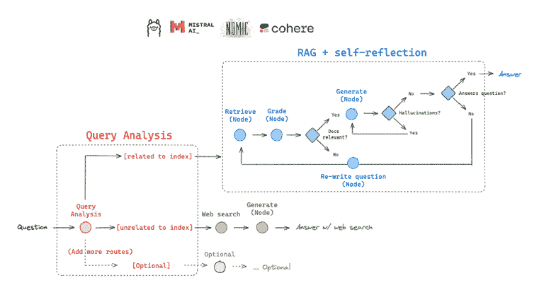

# 使用本地LLM的自适应RAG

> 来源：[https://qqs7y1hozd1.feishu.cn/docx/XTdAdHF2socIUaxc5mycO5dtntg](https://qqs7y1hozd1.feishu.cn/docx/XTdAdHF2socIUaxc5mycO5dtntg)

自适应RAG是一种RAG策略，它将（1）查询分析与（2）主动/自纠正RAG相结合。

在论文[paper](https://arxiv.org/abs/2403.14403)中，他们报告了查询分析以路由跨越：

+   无检索

+   单次RAG

+   迭代RAG

让我们使用LangGraph在此基础上进行构建。

+   网络搜索：与最近事件相关的问题

+   网络搜索：与最近事件相关的问题



## 环境

```
%capture --no-stderr
%pip install -U langchain-nomic langchain_community tiktoken langchainhub chromadb langchain langgraph tavily-python nomic[local]
```

LLMs

Local Embeddings

您可以使用Nomic的GPT4AllEmbedding（），它可以使用Nomic最近发布的v1和v1.5嵌入进行访问。

Local LLM

（1）下载Ollama应用程序。

（2）从此处的各种Mistral版本和此处可用的Mixtral版本下载Mistral模型。此外，尝试一种quantized command-R models。

```
ollama pull mistral
```

```
# Ollama model name
local_llm = &quot;mistral&quot;
```

### Index

```
from langchain.text_splitter import RecursiveCharacterTextSplitter
from langchain_community.document_loaders import WebBaseLoader
from langchain_community.vectorstores import Chroma
from langchain_nomic.embeddings import NomicEmbeddings

urls = [
    &quot;https://lilianweng.github.io/posts/2023-06-23-agent/&quot;,
    &quot;https://lilianweng.github.io/posts/2023-03-15-prompt-engineering/&quot;,
    &quot;https://lilianweng.github.io/posts/2023-10-25-adv-attack-llm/&quot;,
]

docs = [WebBaseLoader(url).load() for url in urls]
docs_list = [item for sublist in docs for item in sublist]

text_splitter = RecursiveCharacterTextSplitter.from_tiktoken_encoder(
    chunk_size=250, chunk_overlap=0
)
doc_splits = text_splitter.split_documents(docs_list)

# Add to vectorDB
vectorstore = Chroma.from_documents(
    documents=doc_splits,
    collection_name=&quot;rag-chroma&quot;,
    embedding=NomicEmbeddings(model=&quot;nomic-embed-text-v1.5&quot;, inference_mode=&quot;local&quot;),
)
retriever = vectorstore.as_retriever()
```

### LLMs

注意：在Mac M2 32GB上测试了cmd-R，RAG生成的延迟约为52秒。

```
### Router

from langchain.prompts import PromptTemplate
from langchain_community.chat_models import ChatOllama
from langchain_core.output_parsers import JsonOutputParser

# LLM
llm = ChatOllama(model=local_llm, format=&quot;json&quot;, temperature=0)

prompt = PromptTemplate(
    template=&quot;&quot;&quot;You are an expert at routing a user question to a vectorstore or web search. \n
    Use the vectorstore for questions on LLM  agents, prompt engineering, and adversarial attacks. \n
    You do not need to be stringent with the keywords in the question related to these topics. \n
    Otherwise, use web-search. Give a binary choice &#x27;web_search&#x27; or &#x27;vectorstore&#x27; based on the question. \n
    Return the a JSON with a single key &#x27;datasource&#x27; and no premable or explanation. \n
    Question to route: {question}&quot;&quot;&quot;,
    input_variables=[&quot;question&quot;],
)

question_router = prompt | llm | JsonOutputParser()
question = &quot;llm agent memory&quot;
docs = retriever.get_relevant_documents(question)
doc_txt = docs[1].page_content
print(question_router.invoke({&quot;question&quot;: question}))
```

```
{&#x27;datasource&#x27;: &#x27;vectorstore&#x27;}
```

```
### Retrieval Grader

from langchain.prompts import PromptTemplate
from langchain_community.chat_models import ChatOllama
from langchain_core.output_parsers import JsonOutputParser

# LLM
llm = ChatOllama(model=local_llm, format=&quot;json&quot;, temperature=0)

prompt = PromptTemplate(
    template=&quot;&quot;&quot;You are a grader assessing relevance of a retrieved document to a user question. \n 
    Here is the retrieved document: \n\n {document} \n\n
    Here is the user question: {question} \n
    If the document contains keywords related to the user question, grade it as relevant. \n
    It does not need to be a stringent test. The goal is to filter out erroneous retrievals. \n
    Give a binary score &#x27;yes&#x27; or &#x27;no&#x27; score to indicate whether the document is relevant to the question. \n
    Provide the binary score as a JSON with a single key &#x27;score&#x27; and no premable or explanation.&quot;&quot;&quot;,
    input_variables=[&quot;question&quot;, &quot;document&quot;],
)

retrieval_grader = prompt | llm | JsonOutputParser()
question = &quot;agent memory&quot;
docs = retriever.get_relevant_documents(question)
doc_txt = docs[1].page_content
print(retrieval_grader.invoke({&quot;question&quot;: question, &quot;document&quot;: doc_txt}))
```

```
{&#x27;score&#x27;: &#x27;yes&#x27;}
```

```
### Generate

from langchain import hub
from langchain_community.chat_models import ChatOllama
from langchain_core.output_parsers import StrOutputParser

# Prompt
prompt = hub.pull(&quot;rlm/rag-prompt&quot;)

# LLM
llm = ChatOllama(model=local_llm, temperature=0)


# Post-processing
def format_docs(docs):
    return &quot;\n\n&quot;.join(doc.page_content for doc in docs)


# Chain
rag_chain = prompt | llm | StrOutputParser()

# Run
question = &quot;agent memory&quot;
generation = rag_chain.invoke({&quot;context&quot;: docs, &quot;question&quot;: question})
print(generation)
```

```
 In an LLM-powered autonomous agent system, the Large Language Model (LLM) functions as the agent&#x27;s brain. The agent has key components including memory, planning, and reflection mechanisms. The memory component is a long-term memory module that records a comprehensive list of agents’ experience in natural language. It includes a memory stream, which is an external database for storing past experiences. The reflection mechanism synthesizes memories into higher-level inferences over time and guides the agent&#x27;s future behavior.
```

```
### Hallucination Grader

# LLM
llm = ChatOllama(model=local_llm, format=&quot;json&quot;, temperature=0)

# Prompt
prompt = PromptTemplate(
    template=&quot;&quot;&quot;You are a grader assessing whether an answer is grounded in / supported by a set of facts. \n 
    Here are the facts:
    \n ------- \n
    {documents} 
    \n ------- \n
    Here is the answer: {generation}
    Give a binary score &#x27;yes&#x27; or &#x27;no&#x27; score to indicate whether the answer is grounded in / supported by a set of facts. \n
    Provide the binary score as a JSON with a single key &#x27;score&#x27; and no preamble or explanation.&quot;&quot;&quot;,
    input_variables=[&quot;generation&quot;, &quot;documents&quot;],
)

hallucination_grader = prompt | llm | JsonOutputParser()
hallucination_grader.invoke({&quot;documents&quot;: docs, &quot;generation&quot;: generation})
```

```
{&#x27;score&#x27;: &#x27;yes&#x27;}
```

```
### Answer Grader

# LLM
llm = ChatOllama(model=local_llm, format=&quot;json&quot;, temperature=0)

# Prompt
prompt = PromptTemplate(
    template=&quot;&quot;&quot;You are a grader assessing whether an answer is useful to resolve a question. \n 
    Here is the answer:
    \n ------- \n
    {generation} 
    \n ------- \n
    Here is the question: {question}
    Give a binary score &#x27;yes&#x27; or &#x27;no&#x27; to indicate whether the answer is useful to resolve a question. \n
    Provide the binary score as a JSON with a single key &#x27;score&#x27; and no preamble or explanation.&quot;&quot;&quot;,
    input_variables=[&quot;generation&quot;, &quot;question&quot;],
)

answer_grader = prompt | llm | JsonOutputParser()
answer_grader.invoke({&quot;question&quot;: question, &quot;generation&quot;: generation})
```

```
{&#x27;score&#x27;: &#x27;yes&#x27;}
```

```
### Question Re-writer

# LLM
llm = ChatOllama(model=local_llm, temperature=0)

# Prompt
re_write_prompt = PromptTemplate(
    template=&quot;&quot;&quot;You a question re-writer that converts an input question to a better version that is optimized \n 
     for vectorstore retrieval. Look at the initial and formulate an improved question. \n
     Here is the initial question: \n\n {question}. Improved question with no preamble: \n &quot;&quot;&quot;,
    input_variables=[&quot;generation&quot;, &quot;question&quot;],
)

question_rewriter = re_write_prompt | llm | StrOutputParser()
question_rewriter.invoke({&quot;question&quot;: question})
```

```
&#x27; What is agent memory and how can it be effectively utilized in vector database retrieval?&#x27;
```

### 网页搜索工具

```
### Search

from langchain_community.tools.tavily_search import TavilySearchResults

web_search_tool = TavilySearchResults(k=3)
```

### 图

以图形的形式捕获流入。

#### 图状态

```
from typing import List

from typing_extensions import TypedDict


class GraphState(TypedDict):
    &quot;&quot;&quot;
    Represents the state of our graph.

    Attributes:
        question: question
        generation: LLM generation
        documents: list of documents
    &quot;&quot;&quot;

    question: str
    generation: str
    documents: List[str]
```

```
### Nodes

from langchain.schema import Document


def retrieve(state):
    &quot;&quot;&quot;
    Retrieve documents

    Args:
        state (dict): The current graph state

    Returns:
        state (dict): New key added to state, documents, that contains retrieved documents
    &quot;&quot;&quot;
    print(&quot;---RETRIEVE---&quot;)
    question = state[&quot;question&quot;]

    # Retrieval
    documents = retriever.get_relevant_documents(question)
    return {&quot;documents&quot;: documents, &quot;question&quot;: question}


def generate(state):
    &quot;&quot;&quot;
    Generate answer

    Args:
        state (dict): The current graph state

    Returns:
        state (dict): New key added to state, generation, that contains LLM generation
    &quot;&quot;&quot;
    print(&quot;---GENERATE---&quot;)
    question = state[&quot;question&quot;]
    documents = state[&quot;documents&quot;]

    # RAG generation
    generation = rag_chain.invoke({&quot;context&quot;: documents, &quot;question&quot;: question})
    return {&quot;documents&quot;: documents, &quot;question&quot;: question, &quot;generation&quot;: generation}


def grade_documents(state):
    &quot;&quot;&quot;
    Determines whether the retrieved documents are relevant to the question.

    Args:
        state (dict): The current graph state

    Returns:
        state (dict): Updates documents key with only filtered relevant documents
    &quot;&quot;&quot;

    print(&quot;---CHECK DOCUMENT RELEVANCE TO QUESTION---&quot;)
    question = state[&quot;question&quot;]
    documents = state[&quot;documents&quot;]

    # Score each doc
    filtered_docs = []
    for d in documents:
        score = retrieval_grader.invoke(
            {&quot;question&quot;: question, &quot;document&quot;: d.page_content}
        )
        grade = score[&quot;score&quot;]
        if grade == &quot;yes&quot;:
            print(&quot;---GRADE: DOCUMENT RELEVANT---&quot;)
            filtered_docs.append(d)
        else:
            print(&quot;---GRADE: DOCUMENT NOT RELEVANT---&quot;)
            continue
    return {&quot;documents&quot;: filtered_docs, &quot;question&quot;: question}


def transform_query(state):
    &quot;&quot;&quot;
    Transform the query to produce a better question.

    Args:
        state (dict): The current graph state

    Returns:
        state (dict): Updates question key with a re-phrased question
    &quot;&quot;&quot;

    print(&quot;---TRANSFORM QUERY---&quot;)
    question = state[&quot;question&quot;]
    documents = state[&quot;documents&quot;]

    # Re-write question
    better_question = question_rewriter.invoke({&quot;question&quot;: question})
    return {&quot;documents&quot;: documents, &quot;question&quot;: better_question}


def web_search(state):
    &quot;&quot;&quot;
    Web search based on the re-phrased question.

    Args:
        state (dict): The current graph state

    Returns:
        state (dict): Updates documents key with appended web results
    &quot;&quot;&quot;

    print(&quot;---WEB SEARCH---&quot;)
    question = state[&quot;question&quot;]

    # Web search
    docs = web_search_tool.invoke({&quot;query&quot;: question})
    web_results = &quot;\n&quot;.join([d[&quot;content&quot;] for d in docs])
    web_results = Document(page_content=web_results)

    return {&quot;documents&quot;: web_results, &quot;question&quot;: question}


### Edges ###


def route_question(state):
    &quot;&quot;&quot;
    Route question to web search or RAG.

    Args:
        state (dict): The current graph state

    Returns:
        str: Next node to call
    &quot;&quot;&quot;

    print(&quot;---ROUTE QUESTION---&quot;)
    question = state[&quot;question&quot;]
    print(question)
    source = question_router.invoke({&quot;question&quot;: question})
    print(source)
    print(source[&quot;datasource&quot;])
    if source[&quot;datasource&quot;] == &quot;web_search&quot;:
        print(&quot;---ROUTE QUESTION TO WEB SEARCH---&quot;)
        return &quot;web_search&quot;
    elif source[&quot;datasource&quot;] == &quot;vectorstore&quot;:
        print(&quot;---ROUTE QUESTION TO RAG---&quot;)
        return &quot;vectorstore&quot;


def decide_to_generate(state):
    &quot;&quot;&quot;
    Determines whether to generate an answer, or re-generate a question.

    Args:
        state (dict): The current graph state

    Returns:
        str: Binary decision for next node to call
    &quot;&quot;&quot;

    print(&quot;---ASSESS GRADED DOCUMENTS---&quot;)
    state[&quot;question&quot;]
    filtered_documents = state[&quot;documents&quot;]

    if not filtered_documents:
        # All documents have been filtered check_relevance
        # We will re-generate a new query
        print(
            &quot;---DECISION: ALL DOCUMENTS ARE NOT RELEVANT TO QUESTION, TRANSFORM QUERY---&quot;
        )
        return &quot;transform_query&quot;
    else:
        # We have relevant documents, so generate answer
        print(&quot;---DECISION: GENERATE---&quot;)
        return &quot;generate&quot;


def grade_generation_v_documents_and_question(state):
    &quot;&quot;&quot;
    Determines whether the generation is grounded in the document and answers question.

    Args:
        state (dict): The current graph state

    Returns:
        str: Decision for next node to call
    &quot;&quot;&quot;

    print(&quot;---CHECK HALLUCINATIONS---&quot;)
    question = state[&quot;question&quot;]
    documents = state[&quot;documents&quot;]
    generation = state[&quot;generation&quot;]

    score = hallucination_grader.invoke(
        {&quot;documents&quot;: documents, &quot;generation&quot;: generation}
    )
    grade = score[&quot;score&quot;]

    # Check hallucination
    if grade == &quot;yes&quot;:
        print(&quot;---DECISION: GENERATION IS GROUNDED IN DOCUMENTS---&quot;)
        # Check question-answering
        print(&quot;---GRADE GENERATION vs QUESTION---&quot;)
        score = answer_grader.invoke({&quot;question&quot;: question, &quot;generation&quot;: generation})
        grade = score[&quot;score&quot;]
        if grade == &quot;yes&quot;:
            print(&quot;---DECISION: GENERATION ADDRESSES QUESTION---&quot;)
            return &quot;useful&quot;
        else:
            print(&quot;---DECISION: GENERATION DOES NOT ADDRESS QUESTION---&quot;)
            return &quot;not useful&quot;
    else:
        pprint(&quot;---DECISION: GENERATION IS NOT GROUNDED IN DOCUMENTS, RE-TRY---&quot;)
        return &quot;not supported&quot;
```

### 构建图

```
from langgraph.graph import END, StateGraph

workflow = StateGraph(GraphState)

# Define the nodes
workflow.add_node(&quot;web_search&quot;, web_search)  # web search
workflow.add_node(&quot;retrieve&quot;, retrieve)  # retrieve
workflow.add_node(&quot;grade_documents&quot;, grade_documents)  # grade documents
workflow.add_node(&quot;generate&quot;, generate)  # generatae
workflow.add_node(&quot;transform_query&quot;, transform_query)  # transform_query

# Build graph
workflow.set_conditional_entry_point(
    route_question,
    {
        &quot;web_search&quot;: &quot;web_search&quot;,
        &quot;vectorstore&quot;: &quot;retrieve&quot;,
    },
)
workflow.add_edge(&quot;web_search&quot;, &quot;generate&quot;)
workflow.add_edge(&quot;retrieve&quot;, &quot;grade_documents&quot;)
workflow.add_conditional_edges(
    &quot;grade_documents&quot;,
    decide_to_generate,
    {
        &quot;transform_query&quot;: &quot;transform_query&quot;,
        &quot;generate&quot;: &quot;generate&quot;,
    },
)
workflow.add_edge(&quot;transform_query&quot;, &quot;retrieve&quot;)
workflow.add_conditional_edges(
    &quot;generate&quot;,
    grade_generation_v_documents_and_question,
    {
        &quot;not supported&quot;: &quot;generate&quot;,
        &quot;useful&quot;: END,
        &quot;not useful&quot;: &quot;transform_query&quot;,
    },
)

# Compile
app = workflow.compile()
```

```
from pprint import pprint

# Run
inputs = {&quot;question&quot;: &quot;What is the AlphaCodium paper about?&quot;}
for output in app.stream(inputs):
    for key, value in output.items():
        # Node
        pprint(f&quot;Node &#x27;{key}&#x27;:&quot;)
        # Optional: print full state at each node
        # pprint.pprint(value[&quot;keys&quot;], indent=2, width=80, depth=None)
    pprint(&quot;\n---\n&quot;)

# Final generation
pprint(value[&quot;generation&quot;])
```

```
---ROUTE QUESTION---
What is the AlphaCodium paper about?
{&#x27;datasource&#x27;: &#x27;web_search&#x27;}
web_search
---ROUTE QUESTION TO WEB SEARCH---
---WEB SEARCH---
&quot;Node &#x27;web_search&#x27;:&quot;
&#x27;\n---\n&#x27;
---GENERATE---
---CHECK HALLUCINATIONS---
---DECISION: GENERATION IS GROUNDED IN DOCUMENTS---
---GRADE GENERATION vs QUESTION---
---DECISION: GENERATION ADDRESSES QUESTION---
&quot;Node &#x27;generate&#x27;:&quot;
&#x27;\n---\n&#x27;
(&#x27; The AlphaCodium paper introduces a new approach for code generation by &#x27;
 &#x27;Large Language Models (LLMs). It presents AlphaCodium, an iterative process &#x27;
 &#x27;that involves generating additional data to aid the flow, and testing it on &#x27;
 &#x27;the CodeContests dataset. The results show that AlphaCodium outperforms &#x27;
 &quot;DeepMind&#x27;s AlphaCode and AlphaCode2 without fine-tuning a model. The &quot;
 &#x27;approach includes a pre-processing phase for problem reasoning in natural &#x27;
 &#x27;language and an iterative code generation phase with runs and fixes against &#x27;
 &#x27;tests.&#x27;)
```