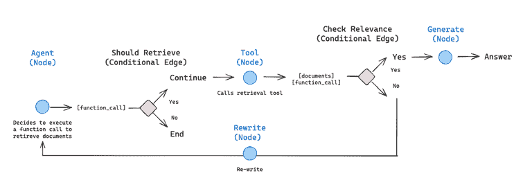
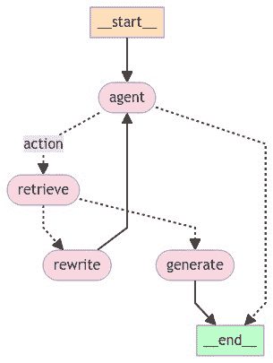

# 项目-RAG智能体工作流

> 来源：[https://qqs7y1hozd1.feishu.cn/docx/J2M5dTdHJoNSZuxRjP7c8Ri4nYt](https://qqs7y1hozd1.feishu.cn/docx/J2M5dTdHJoNSZuxRjP7c8Ri4nYt)

当我们想要决定是否从索引中检索时，检索代理很有用。

要实现检索代理，我们只需要让LLM访问检索工具。

我们可以将其合并到LangGraph中。

```
%%capture --no-stderr
%pip install -U --quiet langchain-community tiktoken langchain-openai langchainhub chromadb langchain langgraph langchain-text-splitters
```

```
import getpass
import os


def _set_env(key: str):
    if key not in os.environ:
        os.environ[key] = getpass.getpass(f&quot;{key}:&quot;)


_set_env(&quot;OPENAI_API_KEY&quot;)

# (Optional) For tracing
os.environ[&quot;LANGCHAIN_TRACING_V2&quot;] = &quot;true&quot;
_set_env(&quot;LANGCHAIN_API_KEY&quot;)
```

## 检索器

首先，我们索引3篇博客文章。

```
from langchain_community.document_loaders import WebBaseLoader
from langchain_community.vectorstores import Chroma
from langchain_openai import OpenAIEmbeddings
from langchain_text_splitters import RecursiveCharacterTextSplitter

urls = [
    &quot;https://lilianweng.github.io/posts/2023-06-23-agent/&quot;,
    &quot;https://lilianweng.github.io/posts/2023-03-15-prompt-engineering/&quot;,
    &quot;https://lilianweng.github.io/posts/2023-10-25-adv-attack-llm/&quot;,
]

docs = [WebBaseLoader(url).load() for url in urls]
docs_list = [item for sublist in docs for item in sublist]

text_splitter = RecursiveCharacterTextSplitter.from_tiktoken_encoder(
    chunk_size=100, chunk_overlap=50
)
doc_splits = text_splitter.split_documents(docs_list)

# Add to vectorDB
vectorstore = Chroma.from_documents(
    documents=doc_splits,
    collection_name=&quot;rag-chroma&quot;,
    embedding=OpenAIEmbeddings(),
)
retriever = vectorstore.as_retriever()
```

然后我们创建一个检索工具。

```
from langchain.tools.retriever import create_retriever_tool

retriever_tool = create_retriever_tool(
    retriever,
    &quot;retrieve_blog_posts&quot;,
    &quot;Search and return information about Lilian Weng blog posts on LLM agents, prompt engineering, and adversarial attacks on LLMs.&quot;,
)

tools = [retriever_tool]
```

## 代理状态

我们将定义一个图。

一个传递给每个节点的状态对象。

我们的状态将是一个消息列表。

图中的每个节点都会向其中添加内容。

```
from typing import Annotated, Sequence, TypedDict

from langchain_core.messages import BaseMessage

from langgraph.graph.message import add_messages


class AgentState(TypedDict):
    # The add_messages function defines how an update should be processed
    # Default is to replace. add_messages says &quot;append&quot;
    messages: Annotated[Sequence[BaseMessage], add_messages]
```

### 节点和边

我们可以像这样布置一个代理型 RAG 图：

+ 状态是一组消息

+ 每个节点都会更新（附加到）状态

+ 条件边决定下一个访问的节点



```
from typing import Annotated, Literal, Sequence, TypedDict

from langchain import hub
from langchain_core.messages import BaseMessage, HumanMessage
from langchain_core.output_parsers import StrOutputParser
from langchain_core.prompts import PromptTemplate
from langchain_core.pydantic_v1 import BaseModel, Field
from langchain_openai import ChatOpenAI

from langgraph.prebuilt import tools_condition

### Edges


def grade_documents(state) -&gt; Literal[&quot;generate&quot;, &quot;rewrite&quot;]:
    &quot;&quot;&quot;
    Determines whether the retrieved documents are relevant to the question.

    Args:
        state (messages): The current state

    Returns:
        str: A decision for whether the documents are relevant or not
    &quot;&quot;&quot;

    print(&quot;---CHECK RELEVANCE---&quot;)

    # Data model
    class grade(BaseModel):
        &quot;&quot;&quot;Binary score for relevance check.&quot;&quot;&quot;

        binary_score: str = Field(description=&quot;Relevance score &#x27;yes&#x27; or &#x27;no&#x27;&quot;)

    # LLM
    model = ChatOpenAI(temperature=0, model=&quot;gpt-4-0125-preview&quot;, streaming=True)

    # LLM with tool and validation
    llm_with_tool = model.with_structured_output(grade)

    # Prompt
    prompt = PromptTemplate(
        template=&quot;&quot;&quot;You are a grader assessing relevance of a retrieved document to a user question. \n 
        Here is the retrieved document: \n\n {context} \n\n
        Here is the user question: {question} \n
        If the document contains keyword(s) or semantic meaning related to the user question, grade it as relevant. \n
        Give a binary score &#x27;yes&#x27; or &#x27;no&#x27; score to indicate whether the document is relevant to the question.&quot;&quot;&quot;,
        input_variables=[&quot;context&quot;, &quot;question&quot;],
    )

    # Chain
    chain = prompt | llm_with_tool

    messages = state[&quot;messages&quot;]
    last_message = messages[-1]

    question = messages[0].content
    docs = last_message.content

    scored_result = chain.invoke({&quot;question&quot;: question, &quot;context&quot;: docs})

    score = scored_result.binary_score

    if score == &quot;yes&quot;:
        print(&quot;---DECISION: DOCS RELEVANT---&quot;)
        return &quot;generate&quot;

    else:
        print(&quot;---DECISION: DOCS NOT RELEVANT---&quot;)
        print(score)
        return &quot;rewrite&quot;


### Nodes


def agent(state):
    &quot;&quot;&quot;
    Invokes the agent model to generate a response based on the current state. Given
    the question, it will decide to retrieve using the retriever tool, or simply end.

    Args:
        state (messages): The current state

    Returns:
        dict: The updated state with the agent response appended to messages
    &quot;&quot;&quot;
    print(&quot;---CALL AGENT---&quot;)
    messages = state[&quot;messages&quot;]
    model = ChatOpenAI(temperature=0, streaming=True, model=&quot;gpt-4-turbo&quot;)
    model = model.bind_tools(tools)
    response = model.invoke(messages)
    # We return a list, because this will get added to the existing list
    return {&quot;messages&quot;: [response]}


def rewrite(state):
    &quot;&quot;&quot;
    Transform the query to produce a better question.

    Args:
        state (messages): The current state

    Returns:
        dict: The updated state with re-phrased question
    &quot;&quot;&quot;

    print(&quot;---TRANSFORM QUERY---&quot;)
    messages = state[&quot;messages&quot;]
    question = messages[0].content

    msg = [
        HumanMessage(
            content=f&quot;&quot;&quot; \n 
    Look at the input and try to reason about the underlying semantic intent / meaning. \n 
    Here is the initial question:
    \n ------- \n
    {question} 
    \n ------- \n
    Formulate an improved question: &quot;&quot;&quot;,
        )
    ]

    # Grader
    model = ChatOpenAI(temperature=0, model=&quot;gpt-4-0125-preview&quot;, streaming=True)
    response = model.invoke(msg)
    return {&quot;messages&quot;: [response]}


def generate(state):
    &quot;&quot;&quot;
    Generate answer

    Args:
        state (messages): The current state

    Returns:
         dict: The updated state with re-phrased question
    &quot;&quot;&quot;
    print(&quot;---GENERATE---&quot;)
    messages = state[&quot;messages&quot;]
    question = messages[0].content
    last_message = messages[-1]

    question = messages[0].content
    docs = last_message.content

    # Prompt
    prompt = hub.pull(&quot;rlm/rag-prompt&quot;)

    # LLM
    llm = ChatOpenAI(model_name=&quot;gpt-3.5-turbo&quot;, temperature=0, streaming=True)

    # Post-processing
    def format_docs(docs):
        return &quot;\n\n&quot;.join(doc.page_content for doc in docs)

    # Chain
    rag_chain = prompt | llm | StrOutputParser()

    # Run
    response = rag_chain.invoke({&quot;context&quot;: docs, &quot;question&quot;: question})
    return {&quot;messages&quot;: [response]}


print(&quot;*&quot; * 20 + &quot;Prompt[rlm/rag-prompt]&quot; + &quot;*&quot; * 20)
prompt = hub.pull(&quot;rlm/rag-prompt&quot;).pretty_print()  # Show what the prompt looks like
```


# LangGraph RAG Agent 工作流

## Prompt 模板

```text
********************Prompt[rlm/rag-prompt]********************
================================ Human Message =================================

You are an assistant for question-answering tasks. Use the following pieces of retrieved context to answer the question. If you don&#x27;t know the answer, just say that you don&#x27;t know. Use three sentences maximum and keep the answer concise.
Question: {question} 
Context: {context} 
Answer:
```

## 工作流图

### 图

- 从一个代理开始，调用模型
- 代理决定是否调用一个函数
- 如果是，那么执行调用工具（检索器）的操作
- 然后将工具的输出添加到消息（状态）中，并调用代理

### 状态图定义

```python
from langgraph.graph import END, StateGraph
from langgraph.prebuilt import ToolNode

# Define a new graph
workflow = StateGraph(AgentState)

# Define the nodes we will cycle between
workflow.add_node(&quot;agent&quot;, agent)  # agent
retrieve = ToolNode([retriever_tool])
workflow.add_node(&quot;retrieve&quot;, retrieve)  # retrieval
workflow.add_node(&quot;rewrite&quot;, rewrite)  # Re-writing the question
workflow.add_node(
    &quot;generate&quot;, generate
)  # Generating a response after we know the documents are relevant
# Call agent node to decide to retrieve or not
workflow.set_entry_point(&quot;agent&quot;)

# Decide whether to retrieve
workflow.add_conditional_edges(
    &quot;agent&quot;,
    # Assess agent decision
    tools_condition,
    {
        # Translate the condition outputs to nodes in our graph
        &quot;tools&quot;: &quot;retrieve&quot;,
        END: END,
    },
)

# Edges taken after the `action` node is called.
workflow.add_conditional_edges(
    &quot;retrieve&quot;,
    # Assess agent decision
    grade_documents,
)
workflow.add_edge(&quot;generate&quot;, END)
workflow.add_edge(&quot;rewrite&quot;, &quot;agent&quot;)

# Compile
graph = workflow.compile()
```

### 图像可视化

```python
from IPython.display import Image, display

try:
    display(Image(graph.get_graph(xray=True).draw_mermaid_png()))
except Exception:
    # This requires some extra dependencies and is optional
    pass
```



## 执行示例

### 输入与流式输出

```python
import pprint

inputs = {
    &quot;messages&quot;: [
        (&quot;user&quot;, &quot;What does Lilian Weng say about the types of agent memory?&quot;),
    ]
}
for output in graph.stream(inputs):
    for key, value in output.items():
        pprint.pprint(f&quot;Output from node &#x27;{key}&#x27;:&quot;)
        pprint.pprint(&quot;---&quot;)
        pprint.pprint(value, indent=2, width=80, depth=None)
    pprint.pprint(&quot;\n---\n&quot;)
```

### 输出结果

```
---CALL AGENT---
&quot;Output from node &#x27;agent&#x27;:&quot;
&#x27;---&#x27;
{ &#x27;messages&#x27;: [ AIMessage(content=&#x27;&#x27;, additional_kwargs={&#x27;tool_calls&#x27;: [{&#x27;index&#x27;: 0, &#x27;id&#x27;: &#x27;call_z36oPZN8l1UC6raxrebqc1bH&#x27;, &#x27;function&#x27;: {&#x27;arguments&#x27;: &#x27;{&quot;query&quot;:&quot;types of agent memory&quot;}&#x27;, &#x27;name&#x27;: &#x27;retrieve_blog_posts&#x27;}, &#x27;type&#x27;: &#x27;function&#x27;}]}, response_metadata={&#x27;finish_reason&#x27;: &#x27;tool_calls&#x27;}, id=&#x27;run-2bad2518-8187-4d8f-8e23-2b9501becb6f-0&#x27;, tool_calls=[{&#x27;name&#x27;: &#x27;retrieve_blog_posts&#x27;, &#x27;args&#x27;: {&#x27;query&#x27;: &#x27;types of agent memory&#x27;}, &#x27;id&#x27;: &#x27;call_z36oPZN8l1UC6raxrebqc1bH&#x27;}])]}
&#x27;\n---\n&#x27;
---CHECK RELEVANCE---
---DECISION: DOCS RELEVANT---
&quot;Output from node &#x27;retrieve&#x27;:&quot;
&#x27;---&#x27;
{ &#x27;messages&#x27;: [ ToolMessage(content=&#x27;Table of Contents\n\n\n\nAgent System Overview\n\nComponent One: Planning\n\nTask Decomposition\n\nSelf-Reflection\n\n\nComponent Two: Memory\n\nTypes of Memory\n\nMaximum Inner Product Search (MIPS)\n\n\nComponent Three: Tool Use\n\nCase Studies\n\nScientific Discovery Agent\n\nGenerative Agents Simulation\n\nProof-of-Concept Examples\n\n\nChallenges\n\nCitation\n\nReferences\n\nPlanning\n\nSubgoal and decomposition: The agent breaks down large tasks into smaller, manageable subgoals, enabling efficient handling of complex tasks.\nReflection and refinement: The agent can do self-criticism and self-reflection over past actions, learn from mistakes and refine them for future steps, thereby improving the quality of final results.\n\n\nMemory\n\nMemory\n\nShort-term memory: I would consider all the in-context learning (See Prompt Engineering) as utilizing short-term memory of the model to learn.\nLong-term memory: This provides the agent with the capability to retain and recall (infinite) information over extended periods, often by leveraging an external vector store and fast retrieval.\n\n\nTool use\n\nThe design of generative agents combines LLM with memory, planning and reflection mechanisms to enable agents to behave conditioned on past experience, as well as to interact with other agents.&#x27;, name=&#x27;retrieve_blog_posts&#x27;, id=&#x27;d815f283-868c-4660-a1c6-5f6e5373ca06&#x27;, tool_call_id=&#x27;call_z36oPZN8l1UC6raxrebqc1bH&#x27;)]}
&#x27;\n---\n&#x27;
---GENERATE---
&quot;Output from node &#x27;generate&#x27;:&quot;
&#x27;---&#x27;
{ &#x27;messages&#x27;: [ &#x27;Lilian Weng discusses short-term and long-term memory in &#x27;
                &#x27;agent systems. Short-term memory is used for in-context &#x27;
                &#x27;learning, while long-term memory allows agents to retain and &#x27;
                &#x27;recall information over extended periods.&#x27;]}
&#x27;\n---\n&#x27;
```
