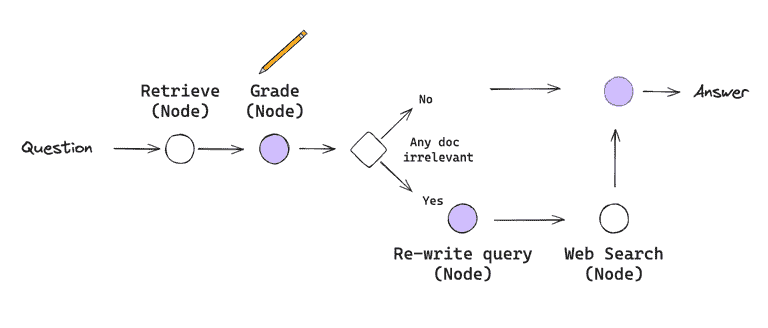

# 校正RAG（CRAG）

> 来源：[https://qqs7y1hozd1.feishu.cn/docx/Cea7dTgx2ok9AqxE19Lc5MdvnXg](https://qqs7y1hozd1.feishu.cn/docx/Cea7dTgx2ok9AqxE19Lc5MdvnXg)

校正RAG（CRAG）是RAG的一种策略，它在检索到的文档上结合了自反射/自分级。

在此论文中[here](https://arxiv.org/pdf/2401.15884.pdf)，采取了以下几个步骤：

+   如果至少有一个文档的相关性超过了阈值，则继续生成

+   在生成之前，它会进行知识精炼

+   这会将文档划分为“知识条”

+   它对每个知识条进行评分，并过滤掉不相关的部分

+   如果所有文档的相关性都低于阈值或评分者不确定，则框架会寻找额外的数据源

+   它将使用网页搜索来补充检索

我们将使用 LangGraph 从头实现这些想法：

+   作为第一次尝试，我们将跳过知识精炼阶段。如果需要，可以将其添加回一个节点。

+   如果任何文档不相关，我们将选择通过网页搜索来补充检索。

+   我们将使用 Tavily Search 进行网页搜索。

+   让我们使用查询重写来优化网页搜索的查询。



### 环境

```
! pip install langchain_community tiktoken langchain-openai langchainhub chromadb langchain langgraph tavily-python
```

LLMs

```
import os

os.environ[&quot;OPENAI_API_KEY&quot;] = &quot;&quot;
```

搜索

我们将使用 Tavily Search 进行网页搜索。

```
os.environ[&quot;TAVILY_API_KEY&quot;] = &quot;&quot;
```

追踪

可选地，通过设置使用 LangSmith 进行追踪（示例在底部显示）。

```
os.environ[&quot;LANGCHAIN_TRACING_V2&quot;] = &quot;true&quot;
os.environ[&quot;LANGCHAIN_ENDPOINT&quot;] = &quot;https://api.smith.langchain.com&quot;
os.environ[&quot;LANGCHAIN_API_KEY&quot;] = &quot;&quot;
```

```
索引
让我们索引三篇博客文章。
```

```
from langchain.text_splitter import RecursiveCharacterTextSplitter
from langchain_community.document_loaders import WebBaseLoader
from langchain_community.vectorstores import Chroma
from langchain_openai import OpenAIEmbeddings

urls = [
    &quot;https://lilianweng.github.io/posts/2023-06-23-agent/&quot;,
    &quot;https://lilianweng.github.io/posts/2023-03-15-prompt-engineering/&quot;,
    &quot;https://lilianweng.github.io/posts/2023-10-25-adv-attack-llm/&quot;,
]

docs = [WebBaseLoader(url).load() for url in urls]
docs_list = [item for sublist in docs for item in sublist]

text_splitter = RecursiveCharacterTextSplitter.from_tiktoken_encoder(
    chunk_size=250, chunk_overlap=0
)
doc_splits = text_splitter.split_documents(docs_list)

# Add to vectorDB
vectorstore = Chroma.from_documents(
    documents=doc_splits,
    collection_name=&quot;rag-chroma&quot;,
    embedding=OpenAIEmbeddings(),
)
retriever = vectorstore.as_retriever()
```

### LLMs

```
### Retrieval Grader

from langchain_core.prompts import ChatPromptTemplate
from langchain_core.pydantic_v1 import BaseModel, Field
from langchain_openai import ChatOpenAI


# Data model
class GradeDocuments(BaseModel):
    &quot;&quot;&quot;Binary score for relevance check on retrieved documents.&quot;&quot;&quot;

    binary_score: str = Field(
        description=&quot;Documents are relevant to the question, &#x27;yes&#x27; or &#x27;no&#x27;&quot;
    )


# LLM with function call
llm = ChatOpenAI(model=&quot;gpt-3.5-turbo-0125&quot;, temperature=0)
structured_llm_grader = llm.with_structured_output(GradeDocuments)

# Prompt
system = &quot;&quot;&quot;You are a grader assessing relevance of a retrieved document to a user question. \n 
    If the document contains keyword(s) or semantic meaning related to the question, grade it as relevant. \n
    Give a binary score &#x27;yes&#x27; or &#x27;no&#x27; score to indicate whether the document is relevant to the question.&quot;&quot;&quot;
grade_prompt = ChatPromptTemplate.from_messages(
    [
        (&quot;system&quot;, system),
        (&quot;human&quot;, &quot;Retrieved document: \n\n {document} \n\n User question: {question}&quot;),
    ]
)

retrieval_grader = grade_prompt | structured_llm_grader
question = &quot;agent memory&quot;
docs = retriever.get_relevant_documents(question)
doc_txt = docs[1].page_content
print(retrieval_grader.invoke({&quot;question&quot;: question, &quot;document&quot;: doc_txt}))
```

```
binary_score=&#x27;yes&#x27;
```

```
### Generate

from langchain import hub
from langchain_core.output_parsers import StrOutputParser

# Prompt
prompt = hub.pull(&quot;rlm/rag-prompt&quot;)

# LLM
llm = ChatOpenAI(model_name=&quot;gpt-3.5-turbo&quot;, temperature=0)


# Post-processing
def format_docs(docs):
    return &quot;\n\n&quot;.join(doc.page_content for doc in docs)


# Chain
rag_chain = prompt | llm | StrOutputParser()

# Run
generation = rag_chain.invoke({&quot;context&quot;: docs, &quot;question&quot;: question})
print(generation)
```

```
The design of generative agents combines LLM with memory, planning, and reflection mechanisms to enable agents to behave conditioned on past experience. Memory stream is a long-term memory module that records a comprehensive list of agents&#x27; experience in natural language. Short-term memory is utilized for in-context learning, while long-term memory allows agents to retain and recall information over extended periods.
```

```
### Question Re-writer

# LLM
llm = ChatOpenAI(model=&quot;gpt-3.5-turbo-0125&quot;, temperature=0)

# Prompt
system = &quot;&quot;&quot;You a question re-writer that converts an input question to a better version that is optimized \n 
     for web search. Look at the input and try to reason about the underlying semantic intent / meaning.&quot;&quot;&quot;
re_write_prompt = ChatPromptTemplate.from_messages(
    [
        (&quot;system&quot;, system),
        (
            &quot;human&quot;,
            &quot;Here is the initial question: \n\n {question} \n Formulate an improved question.&quot;,
        ),
    ]
)

question_rewriter = re_write_prompt | llm | StrOutputParser()
question_rewriter.invoke({&quot;question&quot;: question})
```

```
&#x27;What is the role of memory in artificial intelligence agents?&#x27;
```

### 网络搜索工具

```
### Search

from langchain_community.tools.tavily_search import TavilySearchResults

web_search_tool = TavilySearchResults(k=3)
```

### 图

以图方式捕捉流程。

#### 图的状态

```
from typing import List

from typing_extensions import TypedDict


class GraphState(TypedDict):
    &quot;&quot;&quot;
    Represents the state of our graph.

    Attributes:
        question: question
        generation: LLM generation
        web_search: whether to add search
        documents: list of documents
    &quot;&quot;&quot;

    question: str
    generation: str
    web_search: str
    documents: List[str]
```

```
from langchain.schema import Document


def retrieve(state):
    &quot;&quot;&quot;
    Retrieve documents

    Args:
        state (dict): The current graph state

    Returns:
        state (dict): New key added to state, documents, that contains retrieved documents
    &quot;&quot;&quot;
    print(&quot;---RETRIEVE---&quot;)
    question = state[&quot;question&quot;]

    # Retrieval
    documents = retriever.get_relevant_documents(question)
    return {&quot;documents&quot;: documents, &quot;question&quot;: question}


def generate(state):
    &quot;&quot;&quot;
    Generate answer

    Args:
        state (dict): The current graph state

    Returns:
        state (dict): New key added to state, generation, that contains LLM generation
    &quot;&quot;&quot;
    print(&quot;---GENERATE---&quot;)
    question = state[&quot;question&quot;]
    documents = state[&quot;documents&quot;]

    # RAG generation
    generation = rag_chain.invoke({&quot;context&quot;: documents, &quot;question&quot;: question})
    return {&quot;documents&quot;: documents, &quot;question&quot;: question, &quot;generation&quot;: generation}


def grade_documents(state):
    &quot;&quot;&quot;
    Determines whether the retrieved documents are relevant to the question.

    Args:
        state (dict): The current graph state

    Returns:
        state (dict): Updates documents key with only filtered relevant documents
    &quot;&quot;&quot;

    print(&quot;---CHECK DOCUMENT RELEVANCE TO QUESTION---&quot;)
    question = state[&quot;question&quot;]
    documents = state[&quot;documents&quot;]

    # Score each doc
    filtered_docs = []
    web_search = &quot;No&quot;
    for d in documents:
        score = retrieval_grader.invoke(
            {&quot;question&quot;: question, &quot;document&quot;: d.page_content}
        )
        grade = score.binary_score
        if grade == &quot;yes&quot;:
            print(&quot;---GRADE: DOCUMENT RELEVANT---&quot;)
            filtered_docs.append(d)
        else:
            print(&quot;---GRADE: DOCUMENT NOT RELEVANT---&quot;)
            web_search = &quot;Yes&quot;
            continue
    return {&quot;documents&quot;: filtered_docs, &quot;question&quot;: question, &quot;web_search&quot;: web_search}


def transform_query(state):
    &quot;&quot;&quot;
    Transform the query to produce a better question.

    Args:
        state (dict): The current graph state

    Returns:
        state (dict): Updates question key with a re-phrased question
    &quot;&quot;&quot;

    print(&quot;---TRANSFORM QUERY---&quot;)
    question = state[&quot;question&quot;]
    documents = state[&quot;documents&quot;]

    # Re-write question
    better_question = question_rewriter.invoke({&quot;question&quot;: question})
    return {&quot;documents&quot;: documents, &quot;question&quot;: better_question}


def web_search(state):
    &quot;&quot;&quot;
    Web search based on the re-phrased question.

    Args:
        state (dict): The current graph state

    Returns:
        state (dict): Updates documents key with appended web results
    &quot;&quot;&quot;

    print(&quot;---WEB SEARCH---&quot;)
    question = state[&quot;question&quot;]
    documents = state[&quot;documents&quot;]

    # Web search
    docs = web_search_tool.invoke({&quot;query&quot;: question})
    web_results = &quot;\n&quot;.join([d[&quot;content&quot;] for d in docs])
    web_results = Document(page_content=web_results)
    documents.append(web_results)

    return {&quot;documents&quot;: documents, &quot;question&quot;: question}


### Edges


def decide_to_generate(state):
    &quot;&quot;&quot;
    Determines whether to generate an answer, or re-generate a question.

    Args:
        state (dict): The current graph state

    Returns:
        str: Binary decision for next node to call
    &quot;&quot;&quot;

    print(&quot;---ASSESS GRADED DOCUMENTS---&quot;)
    state[&quot;question&quot;]
    web_search = state[&quot;web_search&quot;]
    state[&quot;documents&quot;]

    if web_search == &quot;Yes&quot;:
        # All documents have been filtered check_relevance
        # We will re-generate a new query
        print(
            &quot;---DECISION: ALL DOCUMENTS ARE NOT RELEVANT TO QUESTION, TRANSFORM QUERY---&quot;
        )
        return &quot;transform_query&quot;
    else:
        # We have relevant documents, so generate answer
        print(&quot;---DECISION: GENERATE---&quot;)
        return &quot;generate&quot;
```

构建图

这只是按照我们上面概述的流程进行的。

```
from langgraph.graph import END, StateGraph

workflow = StateGraph(GraphState)

# Define the nodes
workflow.add_node(&quot;retrieve&quot;, retrieve)  # retrieve
workflow.add_node(&quot;grade_documents&quot;, grade_documents)  # grade documents
workflow.add_node(&quot;generate&quot;, generate)  # generatae
workflow.add_node(&quot;transform_query&quot;, transform_query)  # transform_query
workflow.add_node(&quot;web_search_node&quot;, web_search)  # web search

# Build graph
workflow.set_entry_point(&quot;retrieve&quot;)
workflow.add_edge(&quot;retrieve&quot;, &quot;grade_documents&quot;)
workflow.add_conditional_edges(
    &quot;grade_documents&quot;,
    decide_to_generate,
    {
        &quot;transform_query&quot;: &quot;transform_query&quot;,
        &quot;generate&quot;: &quot;generate&quot;,
    },
)
workflow.add_edge(&quot;transform_query&quot;, &quot;web_search_node&quot;)
workflow.add_edge(&quot;web_search_node&quot;, &quot;generate&quot;)
workflow.add_edge(&quot;generate&quot;, END)

# Compile
app = workflow.compile()
```

```
from pprint import pprint

# Run
inputs = {&quot;question&quot;: &quot;What are the types of agent memory?&quot;}
for output in app.stream(inputs):
    for key, value in output.items():
        # Node
        pprint(f&quot;Node &#x27;{key}&#x27;:&quot;)
        # Optional: print full state at each node
        # pprint.pprint(value[&quot;keys&quot;], indent=2, width=80, depth=None)
    pprint(&quot;\n---\n&quot;)

# Final generation
pprint(value[&quot;generation&quot;])
```

---RETRIEVE---

"Node 'retrieve':"

'\n---\n'

---CHECK DOCUMENT RELEVANCE TO QUESTION---

---GRADE: DOCUMENT NOT RELEVANT---

---GRADE: DOCUMENT NOT RELEVANT---

---GRADE: DOCUMENT RELEVANT---

---GRADE: DOCUMENT RELEVANT---

"Node 'grade_documents':"

'\n---\n'

---ASSESS GRADED DOCUMENTS---

---DECISION: ALL DOCUMENTS ARE NOT RELEVANT TO QUESTION, TRANSFORM QUERY---

---TRANSFORM QUERY---

"Node 'transform_query':"

'\n---\n'

---WEB SEARCH---

"Node 'web_search_node':"

'\n---\n'

---GENERATE---

"Node 'generate':"

'\n---\n'

"Node '__end__':"

'\n---\n'

('Agents possess short-term memory, which is utilized for in-context learning, '

'and long-term memory, allowing them to retain and recall vast amounts of '

'information over extended periods. Some experts also classify working memory '

'as a distinct type, although it can be considered a part of short-term '

'memory in many cases.')

```
from pprint import pprint

# Run
inputs = {&quot;question&quot;: &quot;How does the AlphaCodium paper work?&quot;}
for output in app.stream(inputs):
    for key, value in output.items():
        # Node
        pprint(f&quot;Node &#x27;{key}&#x27;:&quot;)
        # Optional: print full state at each node
        # pprint.pprint(value[&quot;keys&quot;], indent=2, width=80, depth=None)
    pprint(&quot;\n---\n&quot;)

# Final generation
pprint(value[&quot;generation&quot;])
```

```
---RETRIEVE---
&quot;Node &#x27;retrieve&#x27;:&quot;
&#x27;\n---\n&#x27;
---CHECK DOCUMENT RELEVANCE TO QUESTION---
---GRADE: DOCUMENT NOT RELEVANT---
---GRADE: DOCUMENT NOT RELEVANT---
---GRADE: DOCUMENT NOT RELEVANT---
---GRADE: DOCUMENT RELEVANT---
&quot;Node &#x27;grade_documents&#x27;:&quot;
&#x27;\n---\n&#x27;
---ASSESS GRADED DOCUMENTS---
---DECISION: ALL DOCUMENTS ARE NOT RELEVANT TO QUESTION, TRANSFORM QUERY---
---TRANSFORM QUERY---
&quot;Node &#x27;transform_query&#x27;:&quot;
&#x27;\n---\n&#x27;
---WEB SEARCH---
&quot;Node &#x27;web_search_node&#x27;:&quot;
&#x27;\n---\n&#x27;
---GENERATE---
&quot;Node &#x27;generate&#x27;:&quot;
&#x27;\n---\n&#x27;
&quot;Node &#x27;__end__&#x27;:&quot;
&#x27;\n---\n&#x27;
(&#x27;The AlphaCodium paper functions by proposing a code-oriented iterative flow &#x27;
 &#x27;that involves repeatedly running and fixing generated code against &#x27;
 &#x27;input-output tests. Its key mechanisms include generating additional data &#x27;
 &#x27;like problem reflection and test reasoning to aid the iterative process, as &#x27;
 &#x27;well as enriching the code generation process. AlphaCodium aims to improve &#x27;
 &#x27;the performance of Large Language Models on code problems by following a &#x27;
 &#x27;test-based, multi-stage approach.&#x27;)
```