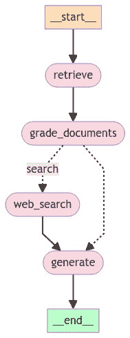
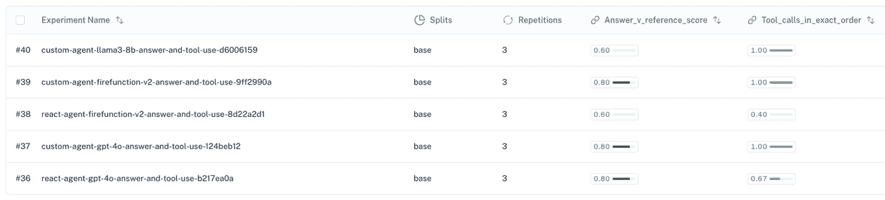

# 使用本地语言模型机器（LLMs）的校正RAG（CRAG）

> 来源：[https://qqs7y1hozd1.feishu.cn/docx/Le64dQvAKoE8RqxX9C0cBUBqnLc](https://qqs7y1hozd1.feishu.cn/docx/Le64dQvAKoE8RqxX9C0cBUBqnLc)

校正RAG（CRAG）是RAG的一种策略，它在检索到的文档上结合了自反射/自分级。

论文遵循以下一般流程：

+   如果至少有一个文档超过相关性阈值，则继续生成

+   如果所有文档都低于相关性阈值，或者评分者不确定，则使用网页搜索来补充检索

+   在生成之前，对搜索或检索的文档进行知识精炼

+   将文档分割为知识条

+   对每个知识条进行评分，并过滤掉不相关的条目

我们将使用 LangGraph 从头开始实现一些这些想法：

+   如果有任何文档不相关，我们将使用网页搜索来补充检索。

+   我们将跳过知识精炼阶段，但如果需要的话，可以将其作为一个节点添加回去。

+   我们将使用 Tavily Search 进行网页搜索。

环境

我们将使用以下工具和资源：

+   使用 Ollama 应用程序访问本地语言模型（LLM）：

+   下载 Ollama 应用程序。

+   拉取您选择的模型，例如：ollama pull llama3

+   使用 Tavily 进行网页搜索。

+   使用 Nomic 的本地嵌入式向量存储，或者选择性地使用 OpenAI 的嵌入式向量存储。

+   使用 LangSmith 进行追踪和评估。

```
%%capture --no-stderr
%pip install -U langchain_community tiktoken langchainhub scikit-learn langchain langgraph tavily-python  nomic[local] langchain-nomic langchain_openai
```

```
# Search
import os
os.environ[&quot;TAVILY_API_KEY&quot;] = &quot;xxx&quot;
```

```
# Embedding (optional)
os.environ[&quot;OPENAI_API_KEY&quot;] = &quot;xxx&quot;
```

```
# Tracing and testing (optional)
os.environ[&quot;LANGCHAIN_API_KEY&quot;] = &quot;xxx&quot;
os.environ[&quot;LANGCHAIN_TRACING_V2&quot;] = &quot;true&quot;
os.environ[&quot;LANGCHAIN_ENDPOINT&quot;] = &quot;https://api.smith.langchain.com&quot;
os.environ[&quot;LANGCHAIN_PROJECT&quot;] = &quot;corrective-rag-agent-testing&quot;
```

#### LLM

您可以从 Ollama 的语言模型（LLMs）中进行选择。

```
local_llm = &quot;llama3&quot;
model_tested = &quot;llama3-8b&quot;
metadata = f&quot;CRAG, {model_tested}&quot;
```

#### 索引

让我们索引3篇博文。

```
from langchain.text_splitter import RecursiveCharacterTextSplitter
from langchain_community.document_loaders import WebBaseLoader
from langchain_community.vectorstores import SKLearnVectorStore
from langchain_nomic.embeddings import NomicEmbeddings # local
from langchain_openai import OpenAIEmbeddings # api

# List of URLs to load documents from
urls = [
    &quot;https://lilianweng.github.io/posts/2023-06-23-agent/&quot;,
    &quot;https://lilianweng.github.io/posts/2023-03-15-prompt-engineering/&quot;,
    &quot;https://lilianweng.github.io/posts/2023-10-25-adv-attack-llm/&quot;,
]

# Load documents from the URLs
docs = [WebBaseLoader(url).load() for url in urls]
docs_list = [item for sublist in docs for item in sublist]

# Initialize a text splitter with specified chunk size and overlap
text_splitter = RecursiveCharacterTextSplitter.from_tiktoken_encoder(
    chunk_size=250, chunk_overlap=0
)

# Split the documents into chunks
doc_splits = text_splitter.split_documents(docs_list)

# Embedding
&#x27;&#x27;&#x27;
embedding=NomicEmbeddings(
    model=&quot;nomic-embed-text-v1.5&quot;,
    inference_mode=&quot;local&quot;,
)
&#x27;&#x27;&#x27;
embedding = OpenAIEmbeddings()

# Add the document chunks to the &quot;vector store&quot;
vectorstore = SKLearnVectorStore.from_documents(
    documents=doc_splits,
    embedding=embedding,
)
retriever = vectorstore.as_retriever(k=4)
```

#### Tools 工具

```
### Retrieval Grader

from langchain.prompts import PromptTemplate
from langchain_community.chat_models import ChatOllama
from langchain_core.output_parsers import JsonOutputParser
from langchain_mistralai.chat_models import ChatMistralAI

# LLM
llm = ChatOllama(model=local_llm, format=&quot;json&quot;, temperature=0)

# Prompt
prompt = PromptTemplate(
    template=&quot;&quot;&quot;You are a teacher grading a quiz. You will be given: 
    1/ a QUESTION
    2/ A FACT provided by the student
    
    You are grading RELEVANCE RECALL:
    A score of 1 means that ANY of the statements in the FACT are relevant to the QUESTION. 
    A score of 0 means that NONE of the statements in the FACT are relevant to the QUESTION. 
    1 is the highest (best) score. 0 is the lowest score you can give. 
    
    Explain your reasoning in a step-by-step manner. Ensure your reasoning and conclusion are correct. 
    
    Avoid simply stating the correct answer at the outset.
    
    Question: {question} \n
    Fact: \n\n {documents} \n\n
    
    Give a binary score &#x27;yes&#x27; or &#x27;no&#x27; score to indicate whether the document is relevant to the question. \n
    Provide the binary score as a JSON with a single key &#x27;score&#x27; and no premable or explanation.
    &quot;&quot;&quot;,
    input_variables=[&quot;question&quot;, &quot;documents&quot;],
)

retrieval_grader = prompt | llm | JsonOutputParser()
question = &quot;agent memory&quot;
docs = retriever.invoke(question)
doc_txt = docs[1].page_content
print(retrieval_grader.invoke({&quot;question&quot;: question, &quot;documents&quot;: doc_txt}))
```

```
{&#x27;score&#x27;: &#x27;1&#x27;}
```

```
### Generate

from langchain_core.output_parsers import StrOutputParser

# Prompt
prompt = PromptTemplate(
    template=&quot;&quot;&quot;You are an assistant for question-answering tasks. 
    
    Use the following documents to answer the question. 
    
    If you don&#x27;t know the answer, just say that you don&#x27;t know. 
    
    Use three sentences maximum and keep the answer concise:
    Question: {question} 
    Documents: {documents} 
    Answer: 
    &quot;&quot;&quot;,
    input_variables=[&quot;question&quot;, &quot;documents&quot;],
)

# LLM
llm = ChatOllama(model=local_llm, temperature=0)

# Chain
rag_chain = prompt | llm | StrOutputParser()

# Run
generation = rag_chain.invoke({&quot;documents&quot;: docs, &quot;question&quot;: question})
print(generation)
```

```
The document mentions &quot;memory stream&quot; which is a long-term memory module that records a comprehensive list of agents&#x27; experience in natural language. It also discusses short-term memory and long-term memory, with the latter providing the agent with the capability to retain and recall information over extended periods. Additionally, it mentions planning and reflection mechanisms that enable agents to behave conditioned on past experience.
```

```
### Search

from langchain_community.tools.tavily_search import TavilySearchResults

web_search_tool = TavilySearchResults(k=3)
```

图

在这里，我们将明确定义大部分控制流程，仅在评分后使用LLM来定义一个单一的分支点。

```
from typing import List
from typing_extensions import TypedDict
from IPython.display import Image, display
from langchain.schema import Document
from langgraph.graph import START, END, StateGraph


class GraphState(TypedDict):
    &quot;&quot;&quot;
    Represents the state of our graph.

    Attributes:
        question: question
        generation: LLM generation
        search: whether to add search
        documents: list of documents
    &quot;&quot;&quot;

    question: str
    generation: str
    search: str
    documents: List[str]
    steps: List[str]


def retrieve(state):
    &quot;&quot;&quot;
    Retrieve documents

    Args:
        state (dict): The current graph state

    Returns:
        state (dict): New key added to state, documents, that contains retrieved documents
    &quot;&quot;&quot;
    question = state[&quot;question&quot;]
    documents = retriever.invoke(question)
    steps = state[&quot;steps&quot;]
    steps.append(&quot;retrieve_documents&quot;)
    return {&quot;documents&quot;: documents, &quot;question&quot;: question, &quot;steps&quot;: steps}


def generate(state):
    &quot;&quot;&quot;
    Generate answer

    Args:
        state (dict): The current graph state

    Returns:
        state (dict): New key added to state, generation, that contains LLM generation
    &quot;&quot;&quot;

    question = state[&quot;question&quot;]
    documents = state[&quot;documents&quot;]
    generation = rag_chain.invoke({&quot;documents&quot;: documents, &quot;question&quot;: question})
    steps = state[&quot;steps&quot;]
    steps.append(&quot;generate_answer&quot;)
    return {
        &quot;documents&quot;: documents,
        &quot;question&quot;: question,
        &quot;generation&quot;: generation,
        &quot;steps&quot;: steps,
    }


def grade_documents(state):
    &quot;&quot;&quot;
    Determines whether the retrieved documents are relevant to the question.

    Args:
        state (dict): The current graph state

    Returns:
        state (dict): Updates documents key with only filtered relevant documents
    &quot;&quot;&quot;

    question = state[&quot;question&quot;]
    documents = state[&quot;documents&quot;]
    steps = state[&quot;steps&quot;]
    steps.append(&quot;grade_document_retrieval&quot;)
    filtered_docs = []
    search = &quot;No&quot;
    for d in documents:
        score = retrieval_grader.invoke(
            {&quot;question&quot;: question, &quot;documents&quot;: d.page_content}
        )
        grade = score[&quot;score&quot;]
        if grade == &quot;yes&quot;:
            filtered_docs.append(d)
        else:
            search = &quot;Yes&quot;
            continue
    return {
        &quot;documents&quot;: filtered_docs,
        &quot;question&quot;: question,
        &quot;search&quot;: search,
        &quot;steps&quot;: steps,
    }


def web_search(state):
    &quot;&quot;&quot;
    Web search based on the re-phrased question.

    Args:
        state (dict): The current graph state

    Returns:
        state (dict): Updates documents key with appended web results
    &quot;&quot;&quot;

    question = state[&quot;question&quot;]
    documents = state.get(&quot;documents&quot;, [])
    steps = state[&quot;steps&quot;]
    steps.append(&quot;web_search&quot;)
    web_results = web_search_tool.invoke({&quot;query&quot;: question})
    documents.extend(
        [
            Document(page_content=d[&quot;content&quot;], metadata={&quot;url&quot;: d[&quot;url&quot;]})
            for d in web_results
        ]
    )
    return {&quot;documents&quot;: documents, &quot;question&quot;: question, &quot;steps&quot;: steps}


def decide_to_generate(state):
    &quot;&quot;&quot;
    Determines whether to generate an answer, or re-generate a question.

    Args:
        state (dict): The current graph state

    Returns:
        str: Binary decision for next node to call
    &quot;&quot;&quot;
    search = state[&quot;search&quot;]
    if search == &quot;Yes&quot;:
        return &quot;search&quot;
    else:
        return &quot;generate&quot;


# Graph
workflow = StateGraph(GraphState)

# Define the nodes
workflow.add_node(&quot;retrieve&quot;, retrieve)  # retrieve
workflow.add_node(&quot;grade_documents&quot;, grade_documents)  # grade documents
workflow.add_node(&quot;generate&quot;, generate)  # generatae
workflow.add_node(&quot;web_search&quot;, web_search)  # web search

# Build graph
workflow.set_entry_point(&quot;retrieve&quot;)
workflow.add_edge(&quot;retrieve&quot;, &quot;grade_documents&quot;)
workflow.add_conditional_edges(
    &quot;grade_documents&quot;,
    decide_to_generate,
    {
        &quot;search&quot;: &quot;web_search&quot;,
        &quot;generate&quot;: &quot;generate&quot;,
    },
)
workflow.add_edge(&quot;web_search&quot;, &quot;generate&quot;)
workflow.add_edge(&quot;generate&quot;, END)

custom_graph = workflow.compile()

display(Image(custom_graph.get_graph(xray=True).draw_mermaid_png()))
```



```
import uuid

def predict_custom_agent_local_answer(example: dict):
    config = {&quot;configurable&quot;: {&quot;thread_id&quot;: str(uuid.uuid4())}}
    state_dict = custom_graph.invoke(
        {&quot;question&quot;: example[&quot;input&quot;], &quot;steps&quot;: []}, config
    )
    return {&quot;response&quot;: state_dict[&quot;generation&quot;], &quot;steps&quot;: state_dict[&quot;steps&quot;]}


example = {&quot;input&quot;: &quot;What are the types of agent memory?&quot;}
response = predict_custom_agent_local_answer(example)
response
```

```
{&#x27;response&#x27;: &#x27;According to the documents, there are two types of agent memory:\n\n* Short-term memory (STM): This is a data structure that holds information temporarily and allows the agent to process it when needed.\n* Long-term memory (LTM): This provides the agent with the capability to retain and recall information over extended periods.\n\nThese types of memories allow the agent to learn, reason, and make decisions.&#x27;,
 &#x27;steps&#x27;: [&#x27;retrieve_documents&#x27;,
  &#x27;grade_document_retrieval&#x27;,
  &#x27;web_search&#x27;,
  &#x27;generate_answer&#x27;]}
```

### 评估

现在我们已经定义了两种大致相同的代理架构！我们可以对它们进行评估。查看我们的概念指南以获取有关代理评估背景的内容。

首先，我们可以评估代理在一组问题-答案对上的表现。我们将创建一个数据集并将其保存在 LangSmith 中。

```
from langsmith import Client

client = Client()

# Create a dataset
examples = [
    (
        &quot;How does the ReAct agent use self-reflection? &quot;,
        &quot;ReAct integrates reasoning and acting, performing actions - such tools like Wikipedia search API - and then observing / reasoning about the tool outputs.&quot;,
    ),
    (
        &quot;What are the types of biases that can arise with few-shot prompting?&quot;,
        &quot;The biases that can arise with few-shot prompting include (1) Majority label bias, (2) Recency bias, and (3) Common token bias.&quot;,
    ),
    (
        &quot;What are five types of adversarial attacks?&quot;,
        &quot;Five types of adversarial attacks are (1) Token manipulation, (2) Gradient based attack, (3) Jailbreak prompting, (4) Human red-teaming, (5) Model red-teaming.&quot;,
    ),
    (
        &quot;Who did the Chicago Bears draft first in the 2024 NFL draft”?&quot;,
        &quot;The Chicago Bears drafted Caleb Williams first in the 2024 NFL draft.&quot;,
    ),
    (&quot;Who won the 2024 NBA finals?&quot;, &quot;The Boston Celtics on the 2024 NBA finals&quot;),
]

# Save it
dataset_name = &quot;Corrective RAG Agent Testing&quot;
if not client.has_dataset(dataset_name=dataset_name):
    dataset = client.create_dataset(dataset_name=dataset_name)
    inputs, outputs = zip(
        *[({&quot;input&quot;: text}, {&quot;output&quot;: label}) for text, label in examples]
    )
    client.create_examples(inputs=inputs, outputs=outputs, dataset_id=dataset.id)
```

现在，我们将使用LLM作为分级器，将两种代理响应与地面实况参考进行比较answer.Here是我们可以使用的默认提示。我们将使用gpt-4o作为LLM分级器。

```
from langchain import hub
from langchain_openai import ChatOpenAI

# Grade prompt
grade_prompt_answer_accuracy = hub.pull(&quot;langchain-ai/rag-answer-vs-reference&quot;)

def answer_evaluator(run, example) -&gt; dict:
    &quot;&quot;&quot;
    A simple evaluator for RAG answer accuracy
    &quot;&quot;&quot;

    # Get the question, the ground truth reference answer, RAG chain answer prediction
    input_question = example.inputs[&quot;input&quot;]
    reference = example.outputs[&quot;output&quot;]
    prediction = run.outputs[&quot;response&quot;]

    # Define an LLM grader
    llm = ChatOpenAI(model=&quot;gpt-4o&quot;, temperature=0)
    answer_grader = grade_prompt_answer_accuracy | llm

    # Run evaluator
    score = answer_grader.invoke(
        {
            &quot;question&quot;: input_question,
            &quot;correct_answer&quot;: reference,
            &quot;student_answer&quot;: prediction,
        }
    )
    score = score[&quot;Score&quot;]
    return {&quot;key&quot;: &quot;answer_v_reference_score&quot;, &quot;score&quot;: score}
```

### 轨迹

其次，我们可以评估每个代理相对于预期轨迹进行的工具调用列表。这会评估我们的代理所采取的特定推理轨迹！

```
from langsmith.schemas import Example, Run

# Reasoning traces that we expect the agents to take
expected_trajectory_1 = [
    &quot;retrieve_documents&quot;,
    &quot;grade_document_retrieval&quot;,
    &quot;web_search&quot;,
    &quot;generate_answer&quot;,
]
expected_trajectory_2 = [
    &quot;retrieve_documents&quot;,
    &quot;grade_document_retrieval&quot;,
    &quot;generate_answer&quot;,
]

def check_trajectory_react(root_run: Run, example: Example) -&gt; dict:
    &quot;&quot;&quot;
    Check if all expected tools are called in exact order and without any additional tool calls.
    &quot;&quot;&quot;
    messages = root_run.outputs[&quot;messages&quot;]
    tool_calls = find_tool_calls_react(messages)
    print(f&quot;Tool calls ReAct agent: {tool_calls}&quot;)
    if tool_calls == expected_trajectory_1 or tool_calls == expected_trajectory_2:
        score = 1
    else:
        score = 0

    return {&quot;score&quot;: int(score), &quot;key&quot;: &quot;tool_calls_in_exact_order&quot;}


def check_trajectory_custom(root_run: Run, example: Example) -&gt; dict:
    &quot;&quot;&quot;
    Check if all expected tools are called in exact order and without any additional tool calls.
    &quot;&quot;&quot;
    tool_calls = root_run.outputs[&quot;steps&quot;]
    print(f&quot;Tool calls custom agent: {tool_calls}&quot;)
    if tool_calls == expected_trajectory_1 or tool_calls == expected_trajectory_2:
        score = 1
    else:
        score = 0

    return {&quot;score&quot;: int(score), &quot;key&quot;: &quot;tool_calls_in_exact_order&quot;}
```

```
from langsmith.evaluation import evaluate

experiment_prefix = f&quot;custom-agent-{model_tested}&quot;
experiment_results = evaluate(
    predict_custom_agent_local_answer,
    data=dataset_name,
    evaluators=[answer_evaluator, check_trajectory_custom],
    experiment_prefix=experiment_prefix + &quot;-answer-and-tool-use&quot;,
    num_repetitions=3,
    max_concurrency=1, # Use when running locally
    metadata={&quot;version&quot;: metadata},
)
```

```
View the evaluation results for experiment: &#x27;custom-agent-llama3-8b-answer-and-tool-use-d6006159&#x27; at:
https://smith.langchain.com/o/1fa8b1f4-fcb9-4072-9aa9-983e35ad61b8/datasets/a8b9273b-ca33-4e2f-9f69-9bbc37f6f51b/compare?selectedSessions=83c60822-ef22-43e8-ac85-4488af279c6f
```

```
Tool calls custom agent: [&#x27;retrieve_documents&#x27;, &#x27;grade_document_retrieval&#x27;, &#x27;web_search&#x27;, &#x27;generate_answer&#x27;]
Tool calls custom agent: [&#x27;retrieve_documents&#x27;, &#x27;grade_document_retrieval&#x27;, &#x27;web_search&#x27;, &#x27;generate_answer&#x27;]
Tool calls custom agent: [&#x27;retrieve_documents&#x27;, &#x27;grade_document_retrieval&#x27;, &#x27;web_search&#x27;, &#x27;generate_answer&#x27;]
Tool calls custom agent: [&#x27;retrieve_documents&#x27;, &#x27;grade_document_retrieval&#x27;, &#x27;web_search&#x27;, &#x27;generate_answer&#x27;]
Tool calls custom agent: [&#x27;retrieve_documents&#x27;, &#x27;grade_document_retrieval&#x27;, &#x27;web_search&#x27;, &#x27;generate_answer&#x27;]
Tool calls custom agent: [&#x27;retrieve_documents&#x27;, &#x27;grade_document_retrieval&#x27;, &#x27;web_search&#x27;, &#x27;generate_answer&#x27;]
Tool calls custom agent: [&#x27;retrieve_documents&#x27;, &#x27;grade_document_retrieval&#x27;, &#x27;web_search&#x27;, &#x27;generate_answer&#x27;]
Tool calls custom agent: [&#x27;retrieve_documents&#x27;, &#x27;grade_document_retrieval&#x27;, &#x27;web_search&#x27;, &#x27;generate_answer&#x27;]
Tool calls custom agent: [&#x27;retrieve_documents&#x27;, &#x27;grade_document_retrieval&#x27;, &#x27;web_search&#x27;, &#x27;generate_answer&#x27;]
Tool calls custom agent: [&#x27;retrieve_documents&#x27;, &#x27;grade_document_retrieval&#x27;, &#x27;web_search&#x27;, &#x27;generate_answer&#x27;]
Tool calls custom agent: [&#x27;retrieve_documents&#x27;, &#x27;grade_document_retrieval&#x27;, &#x27;web_search&#x27;, &#x27;generate_answer&#x27;]
Tool calls custom agent: [&#x27;retrieve_documents&#x27;, &#x27;grade_document_retrieval&#x27;, &#x27;web_search&#x27;, &#x27;generate_answer&#x27;]
Tool calls custom agent: [&#x27;retrieve_documents&#x27;, &#x27;grade_document_retrieval&#x27;, &#x27;web_search&#x27;, &#x27;generate_answer&#x27;]
Tool calls custom agent: [&#x27;retrieve_documents&#x27;, &#x27;grade_document_retrieval&#x27;, &#x27;web_search&#x27;, &#x27;generate_answer&#x27;]
Tool calls custom agent: [&#x27;retrieve_documents&#x27;, &#x27;grade_document_retrieval&#x27;, &#x27;web_search&#x27;, &#x27;generate_answer&#x27;]
```

我们可以看到使用自定义代理（如图所示）和ReAct对GPT-4o和Llama-3-70b进行基准测试的结果。



本地自定义代理在工具调用可靠性方面表现良好：它遵循预期的推理轨迹。然而，答案准确性性能落后于具有自定义代理实现的较大模型。