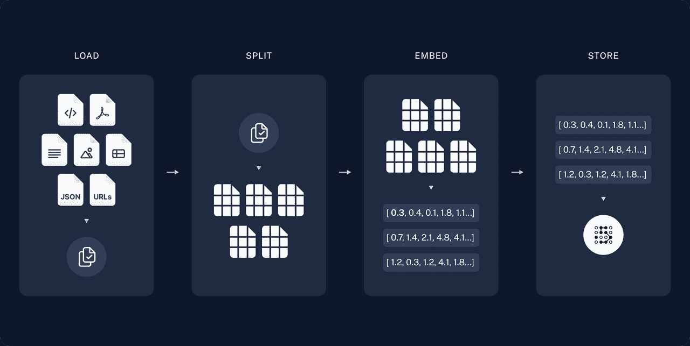
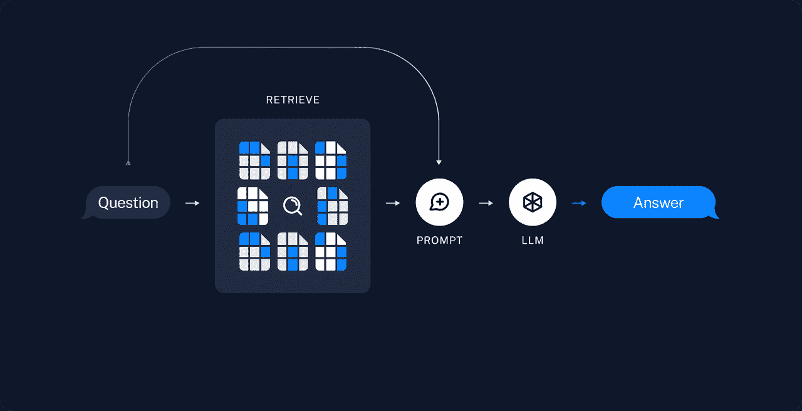

# 构建检索增强生成（RAG）应用程序

> 来源：[https://qqs7y1hozd1.feishu.cn/docx/Tr3kdlnStov7wixohWzcRnYvnAE](https://qqs7y1hozd1.feishu.cn/docx/Tr3kdlnStov7wixohWzcRnYvnAE)

LLM支持的最强大的应用程序之一是复杂的问答（Q&A）聊天机器人。这些应用程序可以回答有关特定源信息的问题。这些应用程序使用一种称为检索增强生成或RAG的技术。

本教程将展示如何在文本数据源上构建一个简单的问答应用程序。在此过程中，我们将介绍一个典型的问答架构，并突出显示用于更高级问答技术的其他资源。我们还将了解LangSmith如何帮助我们跟踪和理解我们的应用程序。随着我们的应用程序变得越来越复杂，LangSmith将变得越来越有帮助。

## 什么是RAG？

RAG是一种用附加数据扩充LLM知识的技术。

LLM可以推理广泛的主题，但他们的知识仅限于公共数据，直到他们接受培训的特定时间点。如果你想构建人工智能应用程序来推理私人数据或模型截止日期后引入的数据，你需要用模型所需的特定信息来扩充模型的知识。引入适当信息并将其插入模型提示符的过程被称为检索增强生成（RAG）。

LangChain有许多组件旨在帮助构建问答应用程序，以及更普遍的RAG应用程序。

注意：这里我们关注非结构化数据的问答。如果您对结构化数据上的RAG感兴趣，请查看我们关于对SQL数据进行问答的教程。

## 概念

典型的RAG应用程序有两个主要组件：

索引（`indexing`）：用于从源中获取数据并对其进行索引的管道。这通常离线发生。

检索和生成（`Retrieval and generation`）：实际的RAG链，它在运行时接受用户查询并从索引中检索相关数据，然后将其传递给模型。

从原始数据到答案最常见的完整序列如下所示：

### Indexing

1. 加载：首先我们需要加载数据。这是使用`DocumentLoaders`完成的。

1. 拆分：文本拆分器将大文档分解为更小的块。这对于索引数据和将其传递给模型都很有用，因为大块更难搜索并且不适合模型的有限上下文窗口。

1. 存储：我们需要一个地方来存储和索引我们的拆分，以便以后可以搜索它们。这通常使用`VectorStore`和`Embedding`模型来完成。



### 检索和生成（Retrieval and generation）

1. 检索：给定用户输入，使用检索器从存储中检索相关拆分。

1. 生成：`ChatModel`/`LLM`使用包含问题和检索到的数据的提示生成答案



## 预览

在本指南中，我们将构建一个QA应用程序作为网站。我们将使用的具体网站是LilianWeng的LLM Powerd自治代理博客文章，它允许我们就帖子的内容提出问题。

我们可以创建一个简单的索引管道和RAG链，只需20行代码即可完成：

```
import getpass
import os

os.environ["OPENAI_API_KEY"] = getpass.getpass()

from langchain_openai import ChatOpenAI

llm = ChatOpenAI(model="gpt-3.5-turbo-0125")
```

```
import bs4
from langchain import hub
from langchain_chroma import Chroma
from langchain_community.document_loaders import WebBaseLoader
from langchain_core.output_parsers import StrOutputParser
from langchain_core.runnables import RunnablePassthrough
from langchain_openai import OpenAIEmbeddings
from langchain_text_splitters import RecursiveCharacterTextSplitter

# Load, chunk and index the contents of the blog.
loader = WebBaseLoader(
    web_paths=("https://lilianweng.github.io/posts/2023-06-23-agent/",),
    bs_kwargs=dict(
        parse_only=bs4.SoupStrainer(
            class_=("post-content", "post-title", "post-header")
        )
    ),
)
docs = loader.load()

text_splitter = RecursiveCharacterTextSplitter(chunk_size=1000, chunk_overlap=200)
splits = text_splitter.split_documents(docs)
vectorstore = Chroma.from_documents(documents=splits, embedding=OpenAIEmbeddings())

# Retrieve and generate using the relevant snippets of the blog.
retriever = vectorstore.as_retriever()
prompt = hub.pull("rlm/rag-prompt")


def format_docs(docs):
    return "\n\n".join(doc.page_content for doc in docs)


rag_chain = (
    {"context": retriever | format_docs, "question": RunnablePassthrough()}
    | prompt
    | llm
    | StrOutputParser()
)

rag_chain.invoke("What is Task Decomposition?")
```

```
'Task Decomposition is a process where a complex task is broken down into smaller, simpler steps or subtasks. This technique is utilized to enhance model performance on complex tasks by making them more manageable. It can be done by using language models with simple prompting, task-specific instructions, or with human inputs.'
```

## Detailed walkthrough

让我们一步一步地浏览上面的代码，以真正理解发生了什么。

### Indexing: Load

我们需要首先加载博客文章内容。我们可以为此使用`DocumentLoaders`，它是从源加载数据并返回`Documents`列表的对象。`Document`是一个带有一些`page_content`（`str`）和元数据的对象。

在这种情况下，我们将使用`WebBaseLoader`，它使用`urllib`从Web URL加载超文本标记语言，并使用`BeautifulSoup`将其解析为文本。我们可以通过`bs_kwargs`将参数传递给`BeautifulSoup`解析器来自定义超文本标记语言->文本解析（参见`BeautifulSoup`文档）。在这种情况下，只有带有`post-content`、`post-title`或`post-head`类的超文本标记语言才是相关的，所以我们将删除所有其他标签。

```
import bs4
from langchain_community.document_loaders import WebBaseLoader

# Only keep post title, headers, and content from the full HTML.
bs4_strainer = bs4.SoupStrainer(class_=("post-title", "post-header", "post-content"))
loader = WebBaseLoader(
    web_paths=("https://lilianweng.github.io/posts/2023-06-23-agent/",),
    bs_kwargs={"parse_only": bs4_strainer},
)
docs = loader.load()

len(docs[0].page_content)
```

```
43131
```

```
print(docs[0].page_content[:500])
```

```
      LLM Powered Autonomous Agents
    
Date: June 23, 2023  |  Estimated Reading Time: 31 min  |  Author: Lilian Weng


Building agents with LLM (large language model) as its core controller is a cool concept. Several proof-of-concepts demos, such as AutoGPT, GPT-Engineer and BabyAGI, serve as inspiring examples. The potentiality of LLM extends beyond generating well-written copies, stories, essays and programs; it can be framed as a powerful general problem solver.
Agent System Overview#
In
```

#### Go deeper

> `DocumentLoader`：从源加载数据作为文档列表的对象。

1. 文档：关于如何使用`DocumentLoaders`的详细留档。

1. 集成：160多种集成可供选择。

1. 接口：基本接口的API引用。

### Indexing: Split

我们加载的文档超过42k个字符长。这太长了，不适合许多模型的上下文窗口。即使对于那些可以在上下文窗口中容纳完整帖子的模型，模型也很难在很长的输入中找到信息。

为了解决这个问题，我们将文档拆分为用于嵌入和矢量存储的块。这应该有助于我们在运行时仅检索博客文章中最相关的部分。

在这种情况下，我们将文档拆分为1000个字符的块，块之间有200个字符的重叠。重叠有助于减少将语句与相关的重要上下文分开的可能性。我们使用`RecursiveCharacterTextSplitter`，它将使用常用分隔符（如新行）递归拆分文档，直到每个块的大小合适。这是通用文本用例的推荐文本拆分器。

我们设置`add_start_index=True`，以便在初始`Document`中每个拆分`Document`开始的字符索引保留为元数据属性`start_index`。

```
from langchain_text_splitters import RecursiveCharacterTextSplitter

text_splitter = RecursiveCharacterTextSplitter(
    chunk_size=1000, chunk_overlap=200, add_start_index=True
)
all_splits = text_splitter.split_documents(docs)

len(all_splits)
```

```
66
```

```
len(all_splits[0].page_content)
```

```
969
```

```
all_splits[10].metadata
```

```
{'source': 'https://lilianweng.github.io/posts/2023-06-23-agent/',
 'start_index': 7056}
```

#### Go deeper

文本分割器：将文档列表分割成更小的块的对象。`DocumentTransformers`的子类。

通过阅读操作说明文档，了解有关使用不同方法拆分文本的更多信息

代码（py或js）

科学论文

接口：基本接口的API引用。

`DocumentTransform`：对`Document`对象列表执行转换的对象。

文档：详细的留档如何使用`DocumentTransformers`

集成

接口：基本接口的API引用。

### Indexing: Store

现在我们需要索引我们的66个文本块，以便我们可以在运行时搜索它们。最常见的方法是嵌入每个文档拆分的内容，并将这些嵌入插入到向量数据库（或向量存储）中。当我们想要搜索我们的拆分时，我们采取文本搜索查询，嵌入它，并执行某种“相似性”搜索，以识别与我们的查询嵌入最相似的嵌入的存储拆分。最简单的相似性度量是余弦相似性——我们测量每对嵌入之间角度的余弦（它们是高维向量）。

我们可以使用`Chroma`矢量存储和`OpenAIEmbedding`模型将所有文档拆分嵌入和存储在单个命令中。

```
from langchain_chroma import Chroma
from langchain_openai import OpenAIEmbeddings

vectorstore = Chroma.from_documents(documents=all_splits, embedding=OpenAIEmbeddings())
```

#### Go deeper

嵌入：围绕文本嵌入模型的包装器，用于将文本转换为嵌入。

+ [Docs](https://python.langchain.com/v0.2/docs/how_to/embed_text/): 关于如何使用嵌入的详细留档。

+ [Integrations](https://python.langchain.com/v0.2/docs/integrations/text_embedding/): 30多种集成可供选择。

+ [Interface](https://api.python.langchain.com/en/latest/embeddings/langchain_core.embeddings.Embeddings.html): 基本接口的API参考。

> `VectorStore`: 围绕向量数据库的包装器，用于存储和查询嵌入。

+ [Docs](https://python.langchain.com/v0.2/docs/how_to/vectorstores/): 关于如何使用矢量存储的详细留档。

+ [Integrations](https://python.langchain.com/v0.2/docs/integrations/vectorstores/): 40多种集成可供选择。

+ [Interface](https://api.python.langchain.com/en/latest/vectorstores/langchain_core.vectorstores.VectorStore.html): 基本接口的API参考。

这就完成了管道的索引部分。此时，我们有一个可查询的向量存储，其中包含我们博客文章的分块内容。给定一个用户问题，理想情况下，我们应该能够返回回答问题的博客文章片段。

### Retrieval and Generation: Retrieve

现在让我们编写实际的应用程序逻辑。我们想创建一个简单的应用程序，它接受一个用户问题，搜索与该问题相关的文档，将检索到的文档和初始问题传递给模型，并返回答案。

首先，我们需要定义搜索文档的逻辑。LangChain定义了一个`Retriever`接口，该接口包装了一个索引，该索引可以在给定字符串查询的情况下返回相关文档。

最常见的`Retriever`类型是`VectorStoreRetriever`，它使用向量存储的相似性搜索功能来方便检索。任何`VectorStore`都可以很容易地通过`VectorStore`变成`Retriever`。`as_retriever()`：

```
retriever = vectorstore.as_retriever(search_type="similarity", search_kwargs={"k": 6})

retrieved_docs = retriever.invoke("What are the approaches to Task Decomposition?")

len(retrieved_docs)
```

```
6
```

```
print(retrieved_docs[0].page_content)
```


Tree of Thoughts (Yao et al. 2023) extends CoT by exploring multiple reasoning possibilities at each step. It first decomposes the problem into multiple thought steps and generates multiple thoughts per step, creating a tree structure. The search process can be BFS (breadth-first search) or DFS (depth-first search) with each state evaluated by a classifier (via a prompt) or majority vote.

Task decomposition can be done (1) by `LLM` with simple prompting like "Steps for XYZ.\n1.", "What are the subgoals for achieving XYZ?", (2) by using task-specific instructions; e.g. "Write a story outline." for writing a novel, or (3) with human inputs.

## Go deeper

向量存储通常用于检索，但也有其他方法可以进行检索。`Retriever`：在给定文本查询的情况下返回`Documents`的对象

+ [Docs](https://python.langchain.com/v0.2/docs/how_to/#retrievers): 进一步留档界面和内置检索技术。其中一些包括：

+ `MultiQueryRetriever` 生成输入问题的变体以提高检索命中率。

+ `MultiVectorRetriever` 而是生成嵌入的变体，也是为了提高检索命中率。

+ Max marginal relevance 选择检索到的文档之间的相关性和多样性，以避免在重复上下文中传递。

+ 在向量存储检索期间，可以使用元数据过滤器（例如使用自查询检索器）过滤文档。

+ [Integrations](https://python.langchain.com/v0.2/docs/integrations/retrievers/): 与检索服务的集成。

+ [Interface](https://api.python.langchain.com/en/latest/retrievers/langchain_core.retrievers.BaseRetriever.html): 基本接口的API参考。

### Retrieval and Generation: Generate

让我们将所有这些放在一个链中，该链接受一个问题，检索相关文档，构造一个提示，将其传递给模型，并解析输出。

我们将使用`gpt-3.5-turbo` OpenAI聊天模型，但可以替换任何`LLM`或`ChatModel`。

我们将使用签入LangChain提示符中心（此处）的RAG提示符。

```
from langchain import hub

prompt = hub.pull("rlm/rag-prompt")

example_messages = prompt.invoke(
    {"context": "filler context", "question": "filler question"}
).to_messages()

example_messages
```

```
[HumanMessage(content="You are an assistant for question-answering tasks. Use the following pieces of retrieved context to answer the question. If you don't know the answer, just say that you don't know. Use three sentences maximum and keep the answer concise.\nQuestion: filler question \nContext: filler context \nAnswer:")]
```

```
print(example_messages[0].content)
```

```
You are an assistant for question-answering tasks. Use the following pieces of retrieved context to answer the question. If you don't know the answer, just say that you don't know. Use three sentences maximum and keep the answer concise.
Question: filler question 
Context: filler context 
Answer:
```

我们将使用`LCEL` `Runnable`协议来定义链，允许我们

以透明的方式将组件和功能管道连接在一起

在`LangSmith`中自动追踪我们的链

开箱即用的流式传输、异步和批量调用。

这是实现：

```
from langchain_core.output_parsers import StrOutputParser
from langchain_core.runnables import RunnablePassthrough


def format_docs(docs):
    return "\n\n".join(doc.page_content for doc in docs)


rag_chain = (
    {"context": retriever | format_docs, "question": RunnablePassthrough()}
    | prompt
    | llm
    | StrOutputParser()
)

for chunk in rag_chain.stream("What is Task Decomposition?"):
    print(chunk, end="", flush=True)
```

```
Task Decomposition is a process where a complex task is broken down into smaller, more manageable steps or parts. This is often done using techniques like "Chain of Thought" or "Tree of Thoughts", which instruct a model to "think step by step" and transform large tasks into multiple simple tasks. Task decomposition can be prompted in a model, guided by task-specific instructions, or influenced by human inputs.
```

让我们剖析`LCEL`以了解发生了什么。

首先：这些组件（检索器、提示符、`llm`等）都是`Runnable`的实例。这意味着它们实现了相同的方法——例如`sync`和`async`、`invoke`、`.stream`或`.batch`——这使得它们更容易连接在一起。它们可以通过`|`运算符连接到`RunnableSequence`——另一个`Runnable`。

当遇到`|`运算符时，LangChain会自动将某些对象强制转换为`runnable`。在这里，`format_docs`被强制转换为`RunnableLambda`，带有“上下文”和“问题”的`dic`被强制转换为`RunnablePar`并行。细节不如更重要的一点重要，那就是每个对象都是一个`Runnable`。

让我们跟踪输入问题如何流经上述运行项。

正如我们在上面看到的，提示的输入应该是一个带有键“上下文”和“问题”的`ute`。因此，该链的第一个元素构建了可运行项，该可运行项将从输入问题中计算这两个：

+ `retriever | format_docs` 通过检索器传递问题，生成`Document`对象，然后`format_docs`生成字符串；

+ `RunnablePassthrough()` 通过输入问题不变。

也就是说，如果你构建了

```
chain = (
    {"context": retriever | format_docs, "question": RunnablePassthrough()}
    | prompt
)
```

然后`chain.invoke(问题)`将构建一个格式化的提示符，准备进行推理。（注意：使用`LCEL`开发时，使用这样的子链进行测试可能很实用。）

链的最后一步是运行推理的`llm`和`StrOutputParser`（），它只是从`LLM`的输出消息中提取字符串内容。

您可以通过其`LangSmith`轨迹分析该链的各个步骤。

## Built-in chains

如果愿意，LangChain包括实现上述`LCEL`的便利功能。我们组成两个函数：

```
from langchain.chains import create_retrieval_chain
from langchain.chains.combine_documents import create_stuff_documents_chain
from langchain_core.prompts import ChatPromptTemplate

system_prompt = (
    "You are an assistant for question-answering tasks. "
    "Use the following pieces of retrieved context to answer "
    "the question. If you don't know the answer, say that you "
    "don't know. Use three sentences maximum and keep the "
    "answer concise."
    "\n\n"
    "{context}"
)

prompt = ChatPromptTemplate.from_messages(
    [
        ("system", system_prompt),
        ("human", "{input}"),
    ]
)


question_answer_chain = create_stuff_documents_chain(llm, prompt)
rag_chain = create_retrieval_chain(retriever, question_answer_chain)

response = rag_chain.invoke({"input": "What is Task Decomposition?"})
print(response["answer"])
```

```
Task Decomposition is a process in which complex tasks are broken down into smaller and simpler steps. Techniques like Chain of Thought (CoT) and Tree of Thoughts are used to enhance model performance on these tasks. The CoT method instructs the model to think step by step, decomposing hard tasks into manageable ones, while Tree of Thoughts extends CoT by exploring multiple reasoning possibilities at each step, creating a tree structure of thoughts.
```

返回来源 通常在问答应用程序中，向用户展示用于生成答案的来源非常重要。LangChain的内置`create_retrieval_chain`将检索到的源文档传播到`context`键中的输出：

```
for document in response["context"]:
    print(document)
    print()
```


# LLM 驱动的自主代理系统

## 组件一：规划

### 任务分解

#### 思维链（Chain of Thought）

`Chain of Thought` (`CoT`; Wei et al. 2022) 已成为增强模型在复杂任务上表现的标准提示技术。模型被指示“think step by step”以利用更多测试时计算，将困难任务分解为更小、更简单的步骤。`CoT` 将大任务转化为多个可管理的任务，并揭示了模型思考过程的诠释。

#### 思维树（Tree of Thoughts）

`Tree of Thoughts` (Yao et al. 2023) 通过在每个步骤探索多个推理可能性扩展了 `CoT`。它首先将问题分解为多个思考步骤，并为每个步骤生成多个想法，创建树结构。搜索过程可以是 `BFS`（广度优先搜索）或 `DFS`（深度优先搜索），每个状态由分类器（通过提示）或多数投票评估。

任务分解可以通过以下方式完成：(1) 使用 `LLM` 进行简单提示，例如 `"Steps for XYZ.\n1."`、`"What are the subgoals for achieving XYZ?"`；(2) 使用特定任务指令；例如 `"Write a story outline."` 用于写小说；或 (3) 结合人工输入。

## 资源

1. 互联网访问，用于搜索和信息收集。
2. 长期记忆管理。
3. 基于 `GPT-3.5` 的代理，用于委派简单任务。
4. 文件输出。

## 绩效评估

1. 持续审查和分析您的行为，以确保您尽力而为。
2. 不断建设性地自我批评您的全局行为。
3. 回顾过去的决策和策略以改进您的方法。
4. 每个命令都有成本，所以要聪明高效。力求以最少步骤完成任务。

## 模型选择

### ChatModel

`ChatModel` 是 `LLM` 支持的聊天模型。接收一系列消息并返回一条消息。

- 集成：25 多种集成可供选择。
- 接口：基本接口的 API 参考。

### LLM

`LLM` 是文本输入文本输出模型。接受一个字符串并返回一个字符串。

- 集成：75 多种集成可供选择。
- 接口：基本接口的 API 参考。

### 相关链接

- [Go deeper](https://python.langchain.com/v0.2/docs/how_to/#chat-models)
- [ChatModel API 参考](https://api.python.langchain.com/en/latest/language_models/langchain_core.language_models.chat_models.BaseChatModel.html)
- [LLM API 参考](https://api.python.langchain.com/en/latest/language_models/langchain_core.language_models.llms.BaseLLM.html)
- [本地运行模型的 RAG 指南](https://python.langchain.com/v0.2/docs/tutorials/local_rag/)

## 自定义提示

如上所示，我们可以从提示中心加载提示（例如，此 RAG 提示）。提示也可以轻松自定义：

```
from langchain_core.prompts import PromptTemplate

template = """Use the following pieces of context to answer the question at the end.
If you don't know the answer, just say that you don't know, don't try to make up an answer.
Use three sentences maximum and keep the answer as concise as possible.
Always say "thanks for asking!" at the end of the answer.

{context}

Question: {question}

Helpful Answer:"""
custom_rag_prompt = PromptTemplate.from_template(template)

rag_chain = (
    {"context": retriever | format_docs, "question": RunnablePassthrough()}
    | custom_rag_prompt
    | llm
    | StrOutputParser()
)

rag_chain.invoke("What is Task Decomposition?")
```

## 输出示例

```
Task decomposition is the process of breaking down a complex task into smaller, more manageable parts. Techniques like Chain of Thought (CoT) and Tree of Thoughts allow an agent to "think step by step" and explore multiple reasoning possibilities, respectively. This process can be executed by a Language Model with simple prompts, task-specific instructions, or human inputs. Thanks for asking!
```

## 后续步骤

我们已经介绍了[基于数据构建基本问答应用程序](https://python.langchain.com/v0.2/docs/concepts/#document-loaders)的步骤：

1. [加载数据](https://python.langchain.com/v0.2/docs/how_to/qa_sources/)：使用 `Document Loader`
2. 使用文本拆分器对索引数据进行分块，使其更容易被模型使用
3. 嵌入数据并将数据存储在向量存储中
4. 响应传入问题的先前存储的块
5. 使用检索到的块作为上下文生成答案

在上述每个部分中都有大量的功能、集成和扩展可供探索。除了上面提到的“Go deeper”来源之外，好的后续步骤包括：

- `Return sources`: 了解如何返回源文档
- `Streaming`: 了解如何流式传输输出和中间步骤
- `Add chat history`: 了解如何将聊天记录添加到您的应用程序
