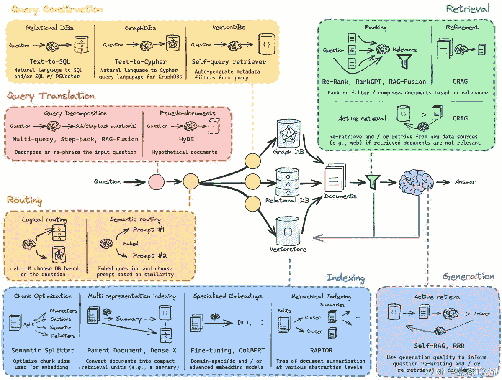
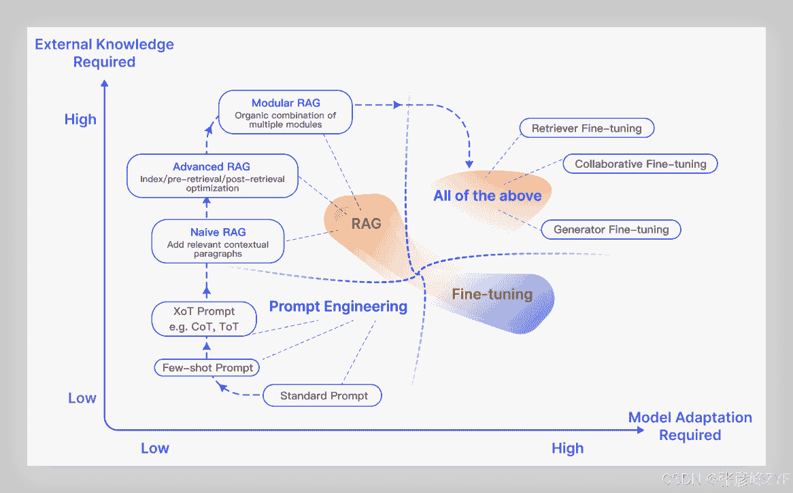
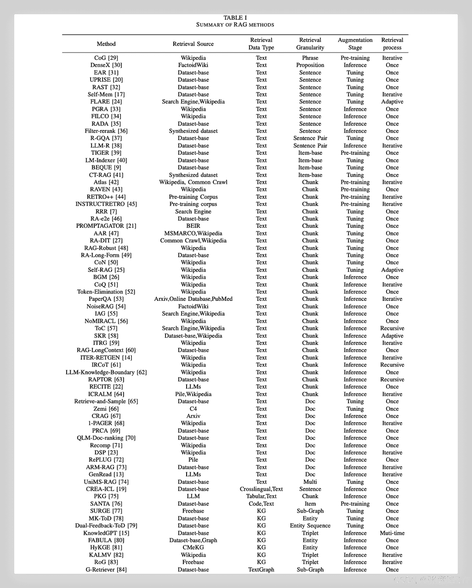
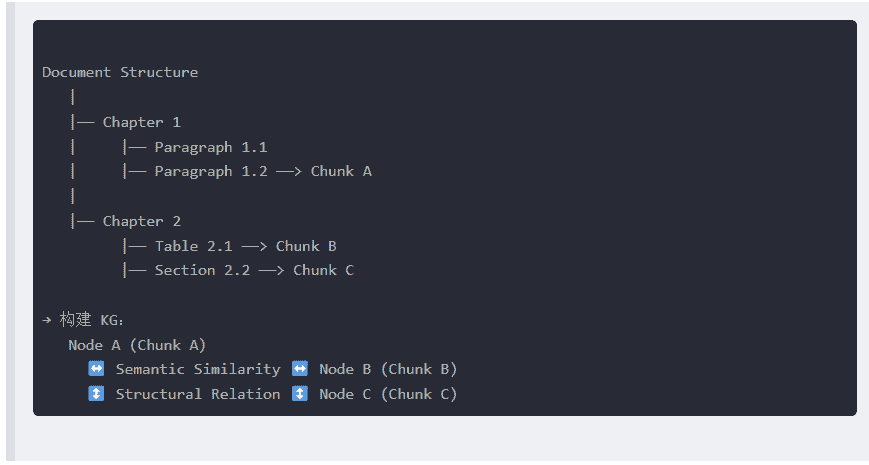
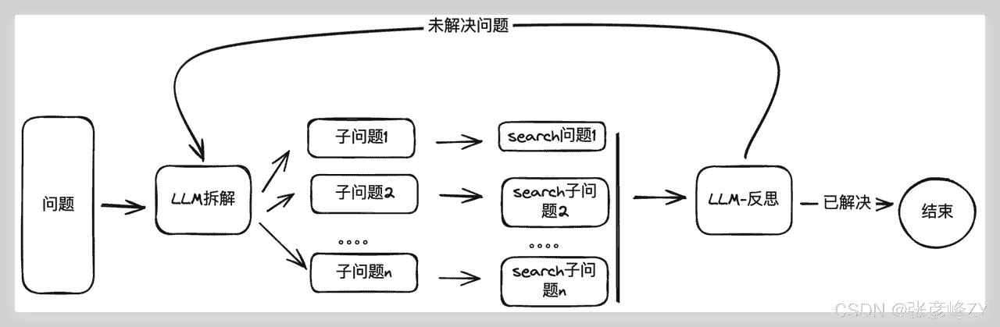
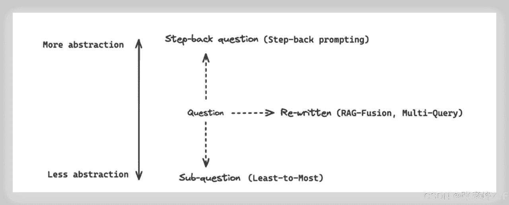
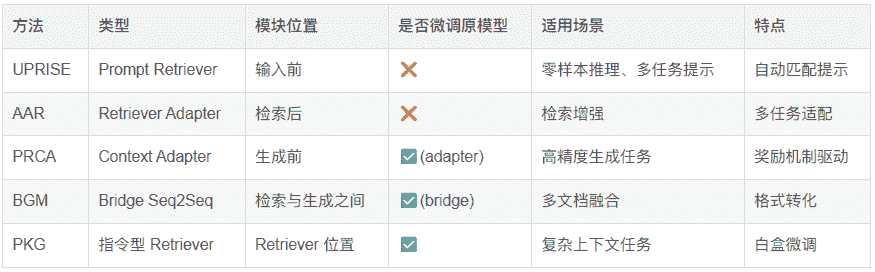

# RAG 架构地基工程-Retrieval 模块的系统设计

> 来源：[https://qqs7y1hozd1.feishu.cn/docx/XOYOdCsnRopYSCxZPN4c3JHinhc](https://qqs7y1hozd1.feishu.cn/docx/XOYOdCsnRopYSCxZPN4c3JHinhc)

> 在** Retrieval-Augme**nted Generation（RAG）体系中，Retrieval 模块是整个流程的“信息引擎”。它承担着连接大语言模型（LLM）与外部知识源的关键职责，其性能直接影响生成内容的准确性、相关性与可靠性。一个优秀的检索系统，必须在速度、精度与可扩展性之间取得平衡。

本节将围绕 检索源、检索粒度、检索预处理、嵌入模型的选择 四个核心维度展开探讨，并结合实际应用中常见的技术实践进行分析。

---

### 一、知识注入的关键前奏——RAG 系统中的检索综述

随着大语言模型（LLM）能力的飞速提升，Retrieval-Augmented Generation（RAG）成为融合外部知识与生成模型的关键架构，广泛应用于智能问答、企业知识库、代码助手、搜索引擎等场景。而在整个 RAG 架构中，Retrieval 模块不仅是知识注入的起点，更是影响生成结果准确性与可信度的决定性因素。

#### （一）模块定位：连接语言模型与知识世界的桥梁

RAG 的核心思想是将大语言**模型的“生成能力”与外部**知识的“事实性”结合起来。而 Retrieval 模块正是这一结合的“中介”：

+   上游连接 Embedding 向量空间与文档库

+   下游为 LLM 提供上下文提示（Prompt）或检索结果

它**通过将用户查询语句转化为**向量，检索语义相近的文档片段，并作为“上下文知识”注入 LLM，使生成结果更具相关性、事实性、实时性。

#### （二）核心任务：四大关键问题的协调解法

+   Retrieval 模块并非单一任务，而是由多个技术子任务协同完成，每个环节都对检索质量产生深远影响：

| **核心问题** | **技术挑战** | **工程影响** |
| --- | --- | --- |
| **检索源选择** | 数据结构多样、更新频率不一 | 决定知识范围与质量 |
| **检索粒度设置** | 粒度太大冗余、太小丢上下文 | 决定召回效率与相关性 |
| **文本预处理** | 噪声、格式不统一、段落不连贯 | 决定语义清晰度 |
| **嵌入模型选型** | 模型能力、速度、适配性差异大 | 决定语义向量质量 |

这些问题彼此关联，例如粒度与预处理策略相互影响，嵌入模型的选择又受数据域特性制约，因此构建高效 Retrieval 系统需要在技术合理性与工程可行性之间寻找最佳平衡点。

#### （三）系统特征：性能、精度与可扩展性的三角权衡

一个优秀的检索模块，在系统设计上需要具备以下三大能力：

+   高相关性（Relevance）：召回内容需紧密贴合用户意图；

+   高可扩展性（Scalability）：应支持百万量级文档与并发查询；

+   低响应延迟（Latency）：适配在线生成、实时问答等场景。

这三者构成经典的“系统三角”，在不同场景中取舍各异。例如，企业内部知识问答倾向优先相关性与可扩展性，而在线搜索助手则对响应延迟尤为敏感。

#### （四）应用视角：从技术模块走向业务场景

在工程实践中，Retrieval 不仅仅是技术组件，更深刻地影响业务可用性：

+   在** 金融问答系统 **中，检索的精确度直接影响合规风险；

+   在 **代码生成助手 **中，检索粒度影响生成代码的上下文质量；

+   在** 企业知识库** 中，知识时效性要求检索支持动态增量更新。

因此，构建 Retrieval 模块时应不仅考虑模型与算法，还需立足业务场景，用系统视角理解“可用的知识检索”，才能真正释放 RAG 架构的潜能。

#### （五）小结：Retrieval 是 RAG 系统中的“地基工程”

**如果**将 LLM 视作 RAG 架构中的“语言天赋”，那么 Retrieval 就是决定生成结果“靠不靠谱”的知识地基。只有构建起精准、高效、可扩展的检索能力，后续的生成与对齐模块才能发挥最大效用。

在后续章节中，我们将深入剖析 Retrieval 模块中的各个关键子问题，包括：

+   检索数据源的选型与管理；

+   文本切分策略与粒度控制；

+   向量化处理与嵌入模型评估；

+   向量检索系统的技术选型与优化。

通过技术原理与工程案例的结合，我们将逐步揭示如何打造一个面向生产的高质量检索系统，为 RAG 架构的实际落地奠定坚实基础。

### 二、外部知识的类型与粒度 —— RAG 数据源的发展与演进

在 Retrieval-Augmented Generation（RAG）架构中，“检索数据源”（Retrieval Source）的选择及其“粒度划分”（Granularity）策略，直接决定了模型生成的准确性、上下文契合度以及任务表现。因此，理解不同类型的数据源及其粒度演化，是深入掌握 RAG 技术演进路径的关键一环。

我们围绕两个核心维度展开分析：

+   检索数据源的类型（结构化 vs 半结构化 vs 非结构化 vs 自生内容）

+   检索单元的粒度（Token、句子、段落、文档等）

并以图表和代表性方法为例，系统性解析现有技术路线。

#### （一）检索数据源的多样化趋势

1.  非结构化数据：RAG 最早的原始形态

**RA**G 最初依赖的大多为非结构化文本数据，如 Wikipedia、Common Crawl、开放问答语料等。这类数据具有覆盖广泛、内容丰富的特点，特别适合开放领域问答（ODQA）场景。典型数据版本如：

+   Wikipedia HotpotQA（2017年）

+   DPR Wikipedia Dump（2018年）

随着任务不断深化，RAG 模型也开始使用跨语言数据（如 CREA-ICL）以及特定领域数据（如医学、法律等）进行检索增强，以提升领域适应能力。

**如图所**示展示了各类模型在“是否需要外部知识”和“是否需改动模型结构”两方面的权衡。RAG 初期偏向“低改动+高利用”的 Prompt Engineering 路线，随着 Modular RAG 的提出，则向深度整合 Fine-tuning 方向演进。

1.  半结构化数据：复杂文本结构带来的挑战

随着文本内容向 PDF 等富文档形式发展，RAG 面临了新的挑战。PDF 通常包含文本与表格混排信息，传统的分词策略可能会错误切割表格，导致信息语义被破坏。另一方面，检索引擎在进行语义相似性计算时，也难以有效处理嵌套结构的数据。

研究者尝试了如下策略以解决这一问题：

+   利用 LLM 的代码生成能力，生成 Text-to-SQL 查询（如 TableGPT）；

+   将表格结构转换为自然语言，再作为普通文本处理（如 PKG）；

尽管初具成效，但现有方案仍不完美，表明这是未来 RAG 在“文档-表格混合场景”下的重要研究方向。

1.  结构化数据：引入知识图谱以提升精准性

**结**构化数据如知识图谱（Knowledge Graph, KG）为 RAG 带来更高的准确性与逻辑一致性。例如：

+   KnowledGPT 通过生成结构化查询并存入用户定制的 KB，实现对 LLM 的知识增强；

+   G-Retriever 融合图神经网络（GNN）与 PCST 优化算法，对知识图进行结构检索，提升 LLM 对图结构语义的理解能力；

然而，构建与维护结构化数据代价较高，需要大量人工验证与更新，这限制了其大规模应用的可扩展性。

1.  LLM 自生内容：向“自我增强”过渡

**除**外部数据源外，部分研究关注于LLM 内部生成内容的再利用，通过“模型记忆”或“生成代检索”等方式构建新型反馈循环：

+   SelfMem：迭代生成高质量记忆池，通过检索-生成-回填实现自我增强；

+   GenRead：用 LLM 直接替代检索器生成上下文内容，其生成内容往往更契合语言模型的预训练目标；

+   SKR：判断问题是否为“未知知识”，并选择性启用检索增强；

这些方法在一定程度上减少了对外部知识源的依赖，打开了模型内部知识激活与结构重用的新思路。

### （二）检索粒度的演进与策略选择

除数据源类型外，检索粒度同样决定了最终生成效果的上下文质量和可控性。

1.  粒度维度与分类

目前主流粒度类型从细到粗可分为：

+   Token（单词级别）

+   Phrase（短语）

+   Sentence（句子）

+   Proposition（命题）

+   Chunk（段落/子文档）

+   Document（整篇文档）

+   Multi-Source（多种异构结合）

下表系统整理了不同方法的检索粒度及使用场景。

从中可以看出：

+   **DenseX** 提出了“命题级”（Proposition）检索单元的概念，即以信息最小闭包单元作为粒度，兼顾上下文完整性与语义准确性；

+   RAG-Robust、RETRO++、Self-RAG 等更倾向于使用 Chunk（段落）作为单元，便于与 LLM 进行上下文拼接；

+   文档级（Document）检索如 RePLUG、DSP 更适用于长上下文生成任务；

+   精细控制粒度选择的方案如 SKR、Self-RAG 提出Adaptive Granularity概念，可动态根据任务需求进行粒度调节；

1.  粒度选择的权衡逻辑

+   粗粒度（Chunk/Doc）：上下文信息更完整，但可能引入冗余内容干扰模型注意力；

+   细粒度（Phrase/Sentence）：信息密度更高，便于精确匹配，但容易丢失语义上下文完整性；

+   适配性粒度策略：如 FLARE 使用 Adaptive 方式在推理时动态选择最佳粒度，平衡性能与精度；

**粒度选择不仅影响检索精**度，也影响生成速度与内存消耗。因此，如何设计任务驱动的粒度调控机制，仍是当前研究的重点。

### （三）小结与趋势洞察思考

从本章的系统梳理中我们可以看出：

+   数据源维度：RAG 正从“单一文本源”逐渐扩展至“结构化+半结构化+自生内容”多元融合格局；

+   粒度控制维度：由固定粒度向任务适配、上下文动态调节的方向演进；

+   未来趋势：

+   更智能的数据类型识别与粒度匹配策略；

+   利用多模态信息（图文表）进行统一检索；

+   检索与生成的融合边界将逐渐模糊，向“生成即检索”的统一范式发展。

RAG 在数据利用上的演进不仅扩展了语言模型的“知识边界”，也促使生成模型的行为逐步具备“搜索、理解与选择”的能力，未来仍有广阔的创新空间值得探索。

### 三、索引优化策略（Indexing Optimization）

在 RAG 系统的构建流程中，索引阶段承担着将原始文档处理为可被检索利用的嵌入向量（Embeddings）的关键任务。该阶段通常包括文档切分、向量转换和存入向量数据库等步骤。索引质量的高低，直接决定了后续检索阶段能否获得与问题高度相关的上下文，因此索引构建不仅是预处理的一环，更是对生成效果的前置保障。

#### （一）文档切分策略（Chunking Strategy）

RAG 系统中最基本的索引操作之一，是将长文档切分为多个Chunk，每个 Chunk 会独立生成 Embedding 并存入向量库，供后续查询使用。最常见的做法是固定 Token 数量切分，例如将文档按 100、256、512 tokens 分块，这种方式实现简单、效率较高。

然而，Chunk 大小选择的权衡非常关键：

+   Chunk 太大：可以保留更多上下文，但会引入噪声，影响匹配准确性，同时增加 Embedding 和生成时的成本。

+   Chunk 太小：虽然干扰少、效率高，但可能割裂语义上下文，导致信息片段无法被正确理解。

因此，研究者提出了"递归切分（Recursive Splitting）与滑动窗口（Sliding Window）"等优化方法，试图在分块时减少语义中断，同时通过多次检索合并结果以恢复整体语义。这种方式虽有所提升，但在“语义完整性”与“上下文长度”之间仍难以两全。

为进一步突破，Small2Big 方法应运而生，其核心思想是：以句子为最小检索单元（small），并将前后句作为扩展上下文（big）供 LLM 生成时参考。这种方式更加贴近人类的阅读与理解习惯，在保持精细语义颗粒度的同时，减少语义碎片化所造成的幻觉问题。

**📌 关键启示：Chunk 切分应服务于语义稳定性和上下**文连贯性，而非仅追求技术上的分段标准。

#### （二）元信息附加（Metadata Attachments）

在基础的 Chunk 切分基础上，引入"元信息（Metadata）"是一种重要的增强手段。常见的元数据包括：

+   页码、文档名、作者、时间戳、分类标签等；

+   自定义结构化信息，如文段摘要、文内标题、层级编号等。

> 这些元信息不仅可以用于在检索阶段进行过滤（如只检索最近 1 年的文档），还可以通过权重建模实现时间感知型 RAG（Time-Aware RAG），在生成回答时更倾向于使用最新知识，避免“陈旧答案”。

> 更进一步的创新，是引入“反向 HyDE（Reverse HyDE）”技术，即通过 LLM 预先为每个 Chunk 生成可由其回答的问题，将这些假设问题一并作为索引信息存储。检索阶段不直接用原始问题去匹配文段，而是先与假设问题进行语义对齐，大幅减少用户提问与文档语义之间的差异，提高召回质量。

📌 关键启示：构造性元信息（Constructed Metadata）将索引从“数据匹配”提升为“语义匹配”，显著增强检索能力。

#### （三）结构化索引（Structural Index）

传统 RAG 系统常以“扁平化 Chunk 列表”方式组织文档内容，但该方式容易造成上下文割裂和幻觉。为解决此问题，研究者提出构建结构化索引体系，主要分为两种典型形式：

1.  分层结构索引（Hierarchical Index）

通过构建父子层级结构（例如：文档 → 章节 → 段落 → Chunk），为每个节点附加摘要信息，实现类似于树结构的索引体系。在查询时，系统可首先遍历摘要层，快速定位与问题相关的区域，再深入检索具体的 Chunk，从而兼顾准确性与效率。

> ✅** 优势：避免了“全局检索”引发的干扰，减少**了幻觉风险，同时适配多轮、多跳推理需求。

1.  知识图谱索引（Knowledge Graph Index）

另一种更高级的做法是将文档内容结构转化为知识图谱（KG），每个节点表示一个文段、段落或结构化单元（如表格、页面等），边表示它们之间的语义相似度或结构关联关系。这类方法尤其适用于多文档环境，能够支持基于关系图谱的知识推理与信息溯源。

代表性研究如 **KGP（Knowledge Graph-bas**ed Indexing for RAG），通过构建 KG 图结构，提升了跨文档语义理解能力，并为 LLM 提供可解释的检索路径。

📊 图示示意：

📌 关键启示：结构即语义，利用文档原有结构与图谱建模能力，是提升索引精准性与上下文一致性的关键路径。

#### （四）小结：索引优化的本质在于“预处理即检索策略设计”

+   Chunk 切分关乎语义颗粒度与上下文捕捉；

+   Metadata 构建提供了筛选机制与语义增强；

+   结构化索引重构了检索路径，使其更智能、更高效。

通过以上多维度的优化，RAG 系统的“知识准备”阶段可实现更精准、更可控的结果输出，为下游生成打下坚实基础。

### 四、Query Optimization：提升查询质量以增强 RAG 精度

> 在 Retrieval-Augmented Generation（RAG）系统中，查询的质量直接决定了检索的有效性和生成内容的准确性。然而，Naive RAG 模型往往直接使用用户原始的自然语言问题进行向量检索，这在真实业务中面临诸多挑战：用户可能难以提出精准问题、存在歧义或表达复杂不清。此外，专业术语、缩略词（如 "LLM" 同时可表示 “大语言模型” 和 “法律硕士”）等语言复杂性进一步加剧了理解与匹配的困难。

> 因此，Query Optimization（查询优化）成为提升 RAG 系统性能的关键一环，其目标是通过对查询的拓展、转换与路由，引导检索系统获得更相关的上下文，从而生成更高质量的答案。

#### （一） 查询扩展（Query Expansion）：丰富原始问题，增强上下文语义

查询扩展旨在通过引入更多角度的子问题或同义问题，减少原始问题的语义缺失，提高召回的上下文相关性。

1.  Multi-Query 扩展

**通过** Prompt Engineering 引导 LLM 对原始查询进行语义多样化扩展，生成多个变体查询。这些查询在向量空间中各自独立进行相似度匹配，最终的上下文结果合并输入到生成阶段，从而增强信息多样性与鲁棒性。

+   优点：覆盖面广，减少原始查询遗漏的相关信息；

+   注意：扩展必须控制在主题相关范围内，避免引入噪声。

1.  Sub-Query 分解

将复杂查询拆解成一系列可独立求解的子问题，再汇总其检索结果。这种“Least-to-Most Prompting”策略能够对多步骤、多语义层级的问题进行系统性建模，提升精确性。

将复杂查询分解为多个子查询进行并行检索：

Chain-of-Verification (CoVe) 验证链

扩展查询在输入检索系统前，通过 LLM 进行一轮“语义验证”或过滤，筛选出最有代表性、歧义最小的版本。这一步可以显著降低幻觉（Hallucination）发生概率，是一种“查询先验验证”机制。

#### （二）查询转换（Query Transformation）：优化问题表达以匹配知识结构

有时候，用户原始查询并不适合直接参与向量相似度匹配。通过对查询进行“改写”或“抽象转换”，我们可以生成更能代表检索意图的查询形式。

1.  Query Rewrite 查询重写

通过 LLM 对用户原始问题进行改写，使其更加结构化、语义清晰。例如淘宝采用 BEQUE 系统，对长尾商品查询进行改写，大幅提升召回率与 GMV。

应用示例：RRR（Rewrite-Retrieve-Read）架构

先改写、再检索、后生成，使得每一步都更可控。

1.  **HyDE（Hypothetical** Document Embedding）

与其对“问题”做 embedding，不如让 LLM 先根据问题生成一个“假设答案”（如文档摘要），然后将这个假设答案进行向量嵌入，再去匹配真实文档。

+   优点：从“答案相似性”而非“问题相似性”进行匹配，能够更贴近用户潜在意图。

#### Step-back Prompting

该方法将原始查询“抽象上推”一层，例如从“2023年GPT-4架构是怎样的？”生成一个“LLM 架构演进”的更高层问题，然后两个问题同时进行检索，并融合其结果用于回答生成。

#### （三）查询路由（Query Routing）：根据语义将查询分流至最合适的检索路径

随着 RAG 系统的功能日益复杂，统一检索路径难以适配所有查询场景。Query Routing 机制旨在根据查询内容，将其分配至最适合的子系统或索引。

1.  Metadata Router / Filter

从查询中提取关键实体（如“商品名”、“时间”、“类别”），然后基于 chunk 的元数据进行筛选。例如：如果查询中含“2023年财报”，则仅检索带有“2023”时间戳的文档块。

+   适合场景：结构化数据丰富、有明确标签文档，如企业知识库。

1.  Semantic Router

通过语义理解将查询归类到不同处理通道。例如，将“法律相关问题”定向至法律文档索引，“技术问题”引导至技术百科。这需要训练语义分类模型，或依赖 LLM 进行路由决策。

1.  Hybrid Routing 混合路由

综合使用 Metadata 与 Semantic 两类信息，实现更精准的路由。例如先通过实体识别粗过滤候选集，再通过语义匹配细分路由方向，是一种典型的多层检索策略。

查询优化不仅是提升 RAG 系统性能的必要手段，更是构建“智能问答”系统的基石。随着检索能力与生成能力的不断增强，查询优化将日益走向自动化与智能化，不再仅仅依赖用户提出“好问题”，而是依靠系统主动理解、扩展与转换，使“模糊提问”也能获取“精确回答”。

下一章节将聚焦 生成优化（Generation Optimization），进一步探讨在检索之后，如何通过 Prompt Design、结构控制与验证机制，提高回答的准确性、稳定性与一致性。

### 五、向量化嵌入与语义召回 —— Embedding 的核心作用与进化

在 Retrieval-Augmented Generation (RAG) 框架中，Embedding 是实现“语义检索”的关键组件。通过将用户查询（Query）与知识库文档进行语义向量化编码，并计算它们之间的相似度（如余弦相似度），系统可以识别最具相关性的文档，从而增强生成效果。

#### （一）嵌入模型的类型：稀疏 vs. 稠密 vs. 混合检索

1.  稀疏表示（Sparse Embedding）

稀疏模型如 BM25，基于关键词的匹配，其优势在于对 OOV（Out-Of-Vocabulary）词汇或特定术语的识别能力较强，适合冷启动阶段或命中率要求高的场景。然而，它们无法捕捉深层语义。

1.  稠密表示（Dense Embedding）

基于深度预训练语言模型（如 BERT、GTR、bge-m3、E5）构建的稠密向量检索器，能更好地刻画上下文、语义关系，适用于自然语言表达丰富的开放问答、摘要生成等场景。

1.  混合检索（Hybrid Retrieval）

近年来研究者提出将两者结合，形成混合嵌入策略。例如，使用稀疏检索提供初始候选结果，再用稠密向量进行重排序，或者训练时引入稀疏信号提升稠密模型在长尾实体、低频概念上的表现。

💡 这类方法提升了检索系统在长尾任务中的鲁棒性，也为小样本训练提供了更强的初始化能力。

#### （二）嵌入模型能力评估：MTEB 与 C-MTEB 榜单

目前最权威的嵌入模型评估体系是 Hugging Face 提出的 Massive Text Embedding Benchmark (MTEB)，它覆盖了 8 类任务，包含 58 个英文数据集，从多维度评估嵌入模型的能力。常见任务包括：

> Classification（分类）

> **Clustering（聚类）**

> Pair Classification

> **Reranking**

> **Retrieval**

> STS（Semantic Textual Similarity）

> **Summarization**

> **Bitext Mining**

此外，中文领域也有专门的 C-MTEB（Chinese MTEB） 评估体系，覆盖 6 大任务与 35 个数据集，涵盖法律、医疗、问答、文本相似度等多个应用领域。

MTEB 榜单展示（英文主榜）

为了直观地了解当前 Embedding 模型的性能对比，下面是截至 2025 年初，MTEB 榜单部分节选图表（展示模型整体平均分 Top 排名）：https://huggingface.co/datasets/mteb/leaderboard/resolve/main/static/images/leaderboard-overall.png

> **M**TEB 榜单部分截图（图片目前已失效），展示多个模型在 8 类任务下的平均表现（Source: Hugging Face）

从图中可以看到：

+   bge-m3、GTR-XLarge、E5-Large 等模型在多个任务中表现稳定，具备跨任务迁移能力。

+   多数高性能模型基于 多任务微调（multi-task fine-tuning） 或 指令微调（instruction tuning），例如 Voyage、AngIE 等。

#### （三）嵌入模型的进阶调优：微调与对齐

为了适配实际业务场景，尤其在医疗、法律、金融等领域，预训练模型可能难以理解专业术语，必须借助 Embedding 微调（Fine-tuning）。

1.  语料迁移适配

+   使用领域数据对嵌入模型进行继续训练，提升语义建模能力。

+   在领域数据不足的情况下，可引入 跨任务少样本提示生成器（如 PROMPTAGATOR） 创建训练样本。

1.  Retriever 与 Generator 对齐（Alignment）

+   利用 LLM 的输出作为监督信号进行训练，形成 LSR（LM-Supervised Retriever）。

+   示例：REPLUG 使用 LLM 生成文档分布概率，通过 KL 散度计算反向梯度更新。

+   先进方法如 LLM-Embedder 引入 reward-based 微调信号，同时使用 hard label 与 soft reward。

> **🚀 类似 RLHF 的强化学习技术也已逐步进入向量检索领域，**实现从 LLM 反馈中强化嵌入器性能。

#### （四）小结与趋势展望

+   向量表示是 RAG 成败的根基，选好 Embedding 模型远比后端 LLM 调得再高更关键。

+   MTEB/C-MTEB 提供了客观评估标准，应成为模型选型与进化路径的常规参考。

+   未来 Embedding 发展趋势：

+   更通用的 多语言、多任务嵌入器（如 BGE-M3）；

+   更灵活的 细粒度检索-生成对齐机制；

+   更强可解释性与动态嵌入（如图谱融合、Token-level routing）能力。

### 六、插件式适配器的兴起 —— 在有限资源下释放 RAG 潜能

在实际部署 RAG 系统的过程中，直接微调大模型（如 LLM 或嵌入器）往往面临现实挑战：一方面，API 接入的大模型无法直接进行参数更新；另一方面，本地部署微调受限于算力资源与开发周期。因此，近年来出现了一种趋势——引入外部适配器（Adapter）模块，以插件化、可插拔的方式对检索器或生成器进行功能增强与对齐微调。

这类方法的优势在于：

+   不破坏原模型参数结构，兼容 HuggingFace、OpenAI API 等闭源模型；

+   可根据任务灵活插拔，提升模型多任务适应性（multi-task adaptability）；

+   更低的训练成本、更高的部署灵活性，适合 边缘计算与私有化部署场景。

**下面从几类典型适配器出发，结合技术原理与应用效果**，剖析其在 RAG 系统中的定位与作用。

#### （一）UPRISE：自动提示检索器（Prompt Retriever）

UPRISE（Uncertainty-aware Prompt Retriever with Implicit Semantic Embeddings）提出了一种轻量级的提示检索器，用于 自动从提示池中选择最适合当前任务的 prompt，以增强零样本任务的适应性。技术关键点：

+   **预构建 Prompt 池：**针对常见任务（如问答、分类、推理）预置高质量提示模板；

+   **查询-提示匹配器：**使用轻量级语义嵌入模型，建立任务输入与提示之间的匹配机制；

+   **不依赖硬编码规则**，通过训练提升提示检索的泛化能力。

📌 适用场景：零样本问答、多任务测试环境、提示工程自动化。

#### （二）AAR：通用型适配器（Augmentation-Adapted Retriever）

AAR 引入了一种可扩展的通用适配器模块，用于增强检索器在不同任务下的信息提取能力。技术思路：

+   将适配器部署在检索器之后，用于动态分析上下文、增强文档表示；

+   能够根据任务目标调整召回策略（如分类 vs. 生成）；

+   支持增量学习、无需端到端微调主模型。

📌 类似于“中继装置”的架构，起到“语义过滤器 + 上下文增强器”的作用。

#### （三）PRCA：奖励驱动的上下文适配器（Pluggable Reward-Driven Contextual Adapter）

PRCA 通过引入基于奖励机制的上下文适配器，解决“检索结果质量不稳定”的问题。其本质是在生成阶段引入一个“调度器”，对当前检索文档进行重打分与排序。核心设计：

+   使用 RL 或模型反馈信号，设计 reward 函数；

+   按照上下文对齐程度重新选择/过滤检索文档；

+   保留结构化输入能力，兼容结构化检索场景（如知识图谱查询）。

✅ 实践效果：在医疗问答、法律分析等需要“强一致性文档”的场景中性能显著提升。

#### （四）BGM：桥接模型 Bridge Seq2Seq 的动态适配

BGM（Bridge Generation Module）采用了独特的“桥接策略”：在 Retriever 和 LLM 中间加入一个 Seq2Seq 模型，将检索结果转换成更易被理解的上下文格式。技术逻辑：

+   Retriever 和 LLM 保持冻结状态（无需微调）；

+   Seq2Seq 桥接器接收检索结果，重新组织、摘要、筛选关键片段；

+   生成端可以更灵活地复用文档内容，甚至支持上下文重排序、重复强调等策略。

#### （五）PKG：白盒模型的指令式知识整合（Prompt-aware Knowledge Grounding）

PKG 提出了一种新颖的知识引入方式，通过指令微调让 Retriever 模块直接学习任务需求下的文档选择逻辑，从而解决“模型微调困难、指令覆盖不足”的问题。特点包括：

+   使用白盒可训练 Retriever（如 Dense retriever）；

+   将“文档选择策略”转化为指令响应式行为；

+   模拟 RAG 全流程的“主动学习”，提升端到端效果。

📌 该方法在多轮问答、代码搜索、多文档问答等任务中具备很强的迁移与泛化能力。

#### （六）Adapter 方法的对比与总结

#### （七）小结：插件化是大模型生态的“中间件机会”

在当前大模型主导的 AI 应用体系中，“插件式适配器”正逐渐成为连接基础模型与应用需求之间的关键桥梁。它提供了一种 既不需要昂贵微调，又能满足特定任务对齐的中间路径，尤其适合企业落地、资源受限或跨领域泛化等场景。

> ✅ 未来趋势判断：

+   更加模块化的 RAG 系统中，Adapter 将作为核心中间件标准化；

+   Adapter 将不仅限于 Retriever，还会出现在 Embedding、Ranking、Generation 各个子模块中；

+   Adapter 可结合 LLM 多模态能力，成为图文检索、表格生成的跨模态桥梁。

### 六、总结：回归初心，构建坚实的 RAG 地基

> Retrieval 模块作为 RAG 架构中的“地基工程”，其关键作用远不止是“查资料”这么简单。它连接了数据与语义、召回与生成，是支撑整个系统表现的核心组件。从系统目标出发，Retrieval 不仅要在召回率、精确性与上下文容量三者间权衡，还必须应对不同业务场景下的语义建模、消歧粒度、时效性与噪声控制等挑战。我们看到，它既涉及技术层面的索引设计、Embedding 表达、相似度度量，也关乎业务层面的数据结构治理、内容权限控制与流程集成。

>

> 正因如此，Retrieval 并非一个“独立可替换”的模块，而是与数据架构、业务流程、生成能力深度耦合的战略模块。只有认识到它的复杂性，系统性地分析和优化其每个环节，RAG 系统才能真正发挥“以检索增强生成”的价值。

>

> 面向未来，构建稳固且高效的 Retrieval 模块，应当回归两个核心原则：以数据为本、以语义为纲。唯有如此，RAG 的“地基”才足够稳，生成的“楼层”才敢往高处建。

### 📚 References & Further Reading

1.  RAG 架构与发展演进

Lewis, P., et al. (2020). Retrieval-Augmented Generation for Knowledge-Intensive NLP Tasks. [2005.11401] Retrieval-Augmented Generation for Knowledge-Intensive NLP Tasks

Meta AI. (2020). Facebook AI introduces RAG: combining retrieval and generation. Blog Post

Wang, W., et al. (2023). Survey on Retrieval-Augmented Generation (RAG) Techniques. arXiv:2305.13043

Gao, Y. et al. (2023). Retrieval-Augmented Generation for Large Language Models: A Survey.

Shanghai Research Institute for Intelligent Autonomous Systems & Fudan University.

📎 论文概览

1.  数据源与预处理

LlamaIndex Documentation: Data Connectors & Document Loaders. https://docs.llamaindex.ai

LangChain Documentation: Data ingestion & document loaders. https://docs.langchain.com

1.  文档切分与上下文窗口

Pinecone. (2023). The Ultimate Guide to Chunking for RAG. https://www.pinecone.io/learn/chunking-strategies/

OpenAI. (2023). Best practices for prompt engineering with long context. https://platform.openai.com/docs/guides/

1.  向量化与嵌入模型

OpenAI. Text Embedding Models Overview. https://platform.openai.com/docs/guides/embeddings

HuggingFace Embeddings: https://huggingface.co/models?pipeline_tag=feature-extraction

BGE (BAAI General Embedding): GitHub - FlagOpen/FlagEmbedding: Retrieval and Retrieval-augmented LLMs

1.  向量存储系统

FAISS (Facebook AI Similarity Search): GitHub - facebookresearch/faiss: A library for efficient similarity search and clustering of dense vectors.

Milvus: Milvus | 高性能向量数据库，为规模而构建

Weaviate: The AI-native database developers love | Weaviate

ChromaDB: Chroma

1.  语义检索与混合检索

Karpukhin, V., et al. (2020). Dense Passage Retrieval for Open-Domain QA. [2004.04906] Dense Passage Retrieval for Open-Domain Question Answering

Gao, L., et al. (2021). COIL: Revisit Exact Lexical Match in Information Retrieval with Contextualized Inverted List. [2104.07186] COIL: Revisit Exact Lexical Match in Information Retrieval with Contextualized Inverted List

1.  多文档融合（Multi-Document Fusion）策略

Lyu, Y., et al. (2023). Multi-Document Reasoning with Prompt Fusion and Retrieval. [2302.12303] How to measure the momentum of single quanta

LongContext-RAG: Better Fusion for Long Context with RAG. https://github.com/facebookresearch/longcontext

1.  开源框架实践

LangChain: GitHub - langchain-ai/langchain: 🦜🔗 Build context-aware reasoning applications

LlamaIndex (原 GPT Index): GitHub - run-llama/llama_index: LlamaIndex is the leading framework for building LLM-powered agents over your data.

Haystack: GitHub - deepset-ai/haystack: AI orchestration framework to build customizable, production-ready LLM applications. Connect components (models, vector DBs, file converters) to pipelines or agents that can interact with your data. With advanced retrieval methods, it's best suited for building RAG, question answering, semantic search or conversational agent chatbots.

1.  延伸行业实践

Andrej Karpathy. (2023). State of LLMs and Retrieval. YouTube Lecture

OpenAI Cookbook – RAG Examples: GitHub - openai/openai-cookbook: Examples and guides for using the OpenAI API

Vectara Blog. (2023). Deep Dive into Hybrid Search and Scoring Fusion. https://vectara.com/blog