# 【LLM】Agentic Workflow的四种常见思路

> 来源：[https://qqs7y1hozd1.feishu.cn/docx/FnfUdZ5lkovOczxf1qxcZnM2ntg](https://qqs7y1hozd1.feishu.cn/docx/FnfUdZ5lkovOczxf1qxcZnM2ntg)

+   Reflection 和 Tool Use 属于比较经典且相对已经广泛使用的方式，Planning 和 Multi-agent 属于比较新颖比较有前景的方式。

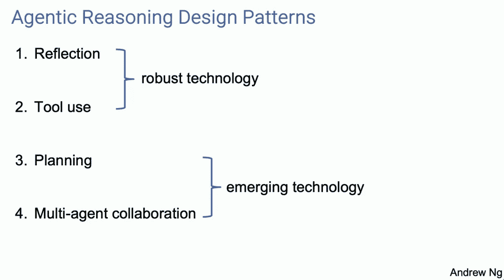

## Reflection

> 基于reflection的，纯粹的对结果反思，无外部交互。

> 这是一个非常基础的模式，尽管很简单，但却可以为结果带来挺大的提升。

**推荐阅读：**

+   [Self-Refine: Iterative Refinement ](https://arxiv.org/pdf/2303.17651)with Self-Feedback, Madaan et al. (2023)

+   [Reflexion: Language Agents with Verbal Rein](https://openreview.net/pdf?id=vAElhFcKW6)forcement Learning, Shinn et al., (2023)

[2303.17651v2.pdf](https://internal-api-drive-stream.feishu.cn/space/api/box/stream/download/all/S5kqb5MTDo1ct9xsnKZcfVsAnXd)

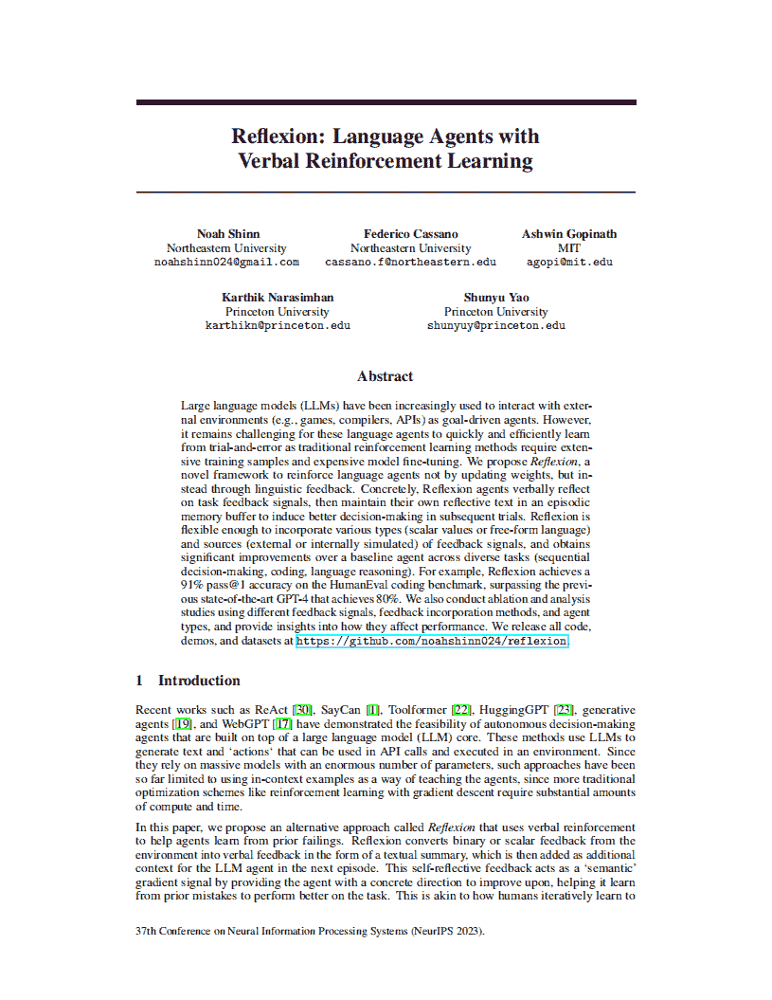

[14256_Reflexion_language_agent.pdf](https://internal-api-drive-stream.feishu.cn/space/api/box/stream/download/all/FJQnb14iGoisyUxfjuqcR3ZAn9b)

#### SELF-REFINE

##### 基本思路

> **对于输入，****SELF-REFINE****让LLM生成一个初始输出。**

> 接着让同一个LLM对这个输出提供反馈(Feedback)，再让LLM根据反馈来改善其输出(Refine)。

> 不断迭代进行Feedback和Refine步骤，直到满足停止条件，停止条件为指定的时间步或者从反馈中提取的停止标记(如停止分数)。

**流程示意如下图：**

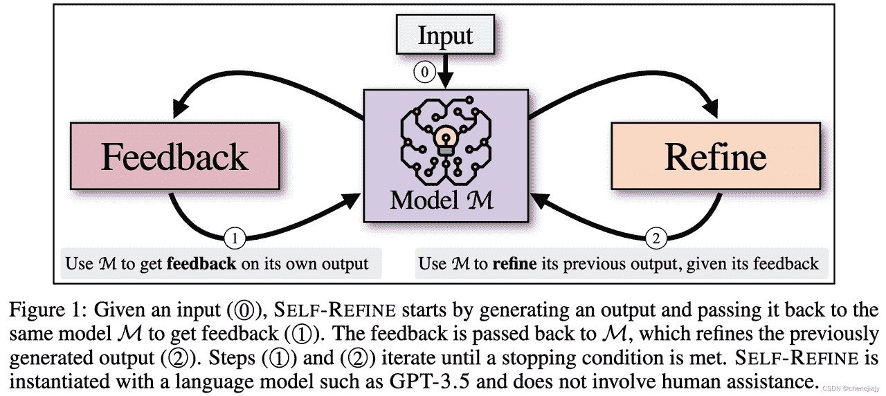

> SELF-REFINE算法示意如下图

> 所用的prompts都是任务相关的few-shot prompt，根据不同类型的任务指定不同的prompt。

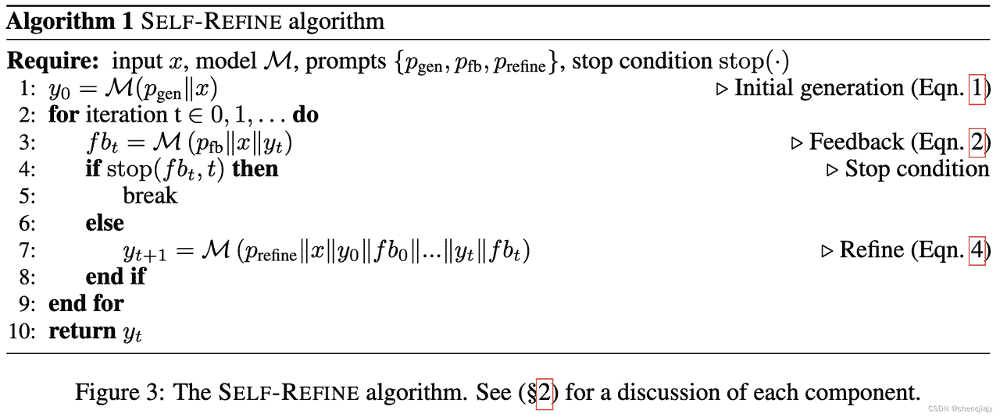

> **反馈会包含输出的不同方面。**

> 比如对于**代码优化任务**，反馈包括效率、可读性、代码整体质量等，prompt模型提供actionable且specific的反馈，

> actionable是指反馈包括一个可以提升输出效果的action。

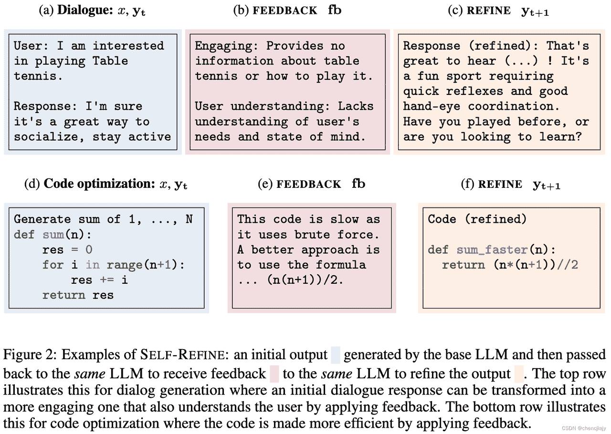

#### Reflexion

下图是Reflexion agent通过试错和自我反思(self-reflection)解决决策、编程、推理任务的示例。

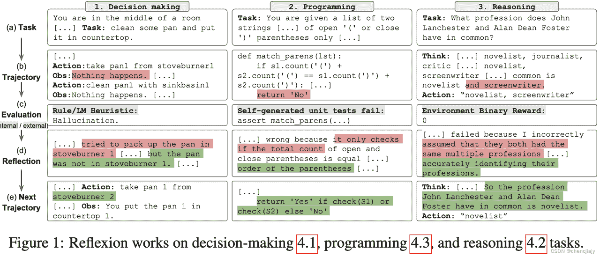

##### 基本思路

> Reflexion的框架和算法示意如下图所示。

> 包括三个模型：Actor模型记作 ，用来生成文本和动作；

> Evaluator模型记作 ，用来对 的输出打分；

> Self-Reflection模型记作 用来生成文字增强反馈以帮助Actor进行自我提升。

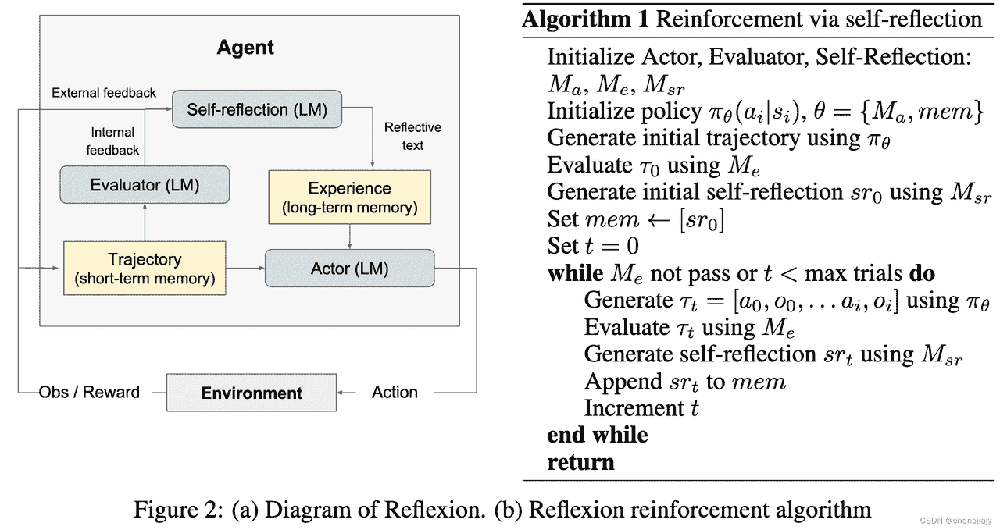

> Reflection的算法流程如上图右侧所示。

> 也是一个迭代优化过程。Actor与环境交互后生成轨迹  ，Evaluator生成分数  ，

> 由 计算得到, 是第t次尝试的标量分数并随着任务表现提升而增加。

> Self-Reflection模型分析 后生成总结 并存储在记忆模块mem， 是第t次尝试的自然语言经验反馈。

## Tool use

> 与工具交互，并对交互结果进行推理。

> LLM中存储的信息通常不足以准确、有见地地回答问题。这个模式不具备迭代调用。

**推荐阅读：**

+   [Gorilla: Large Language Model Connecte](https://arxiv.org/pdf/2305.15334)d with Massive APIs, Patil et al. (2023)

+   [MM-REACT: Prompting ChatGPT for Multimodal ](https://arxiv.org/pdf/2303.11381)Reasoning and Action, Yang et al. (2023)

[2305.15334v1.pdf](https://internal-api-drive-stream.feishu.cn/space/api/box/stream/download/all/JfMRbwVnroZa6dxaIT8cEoMDnud)

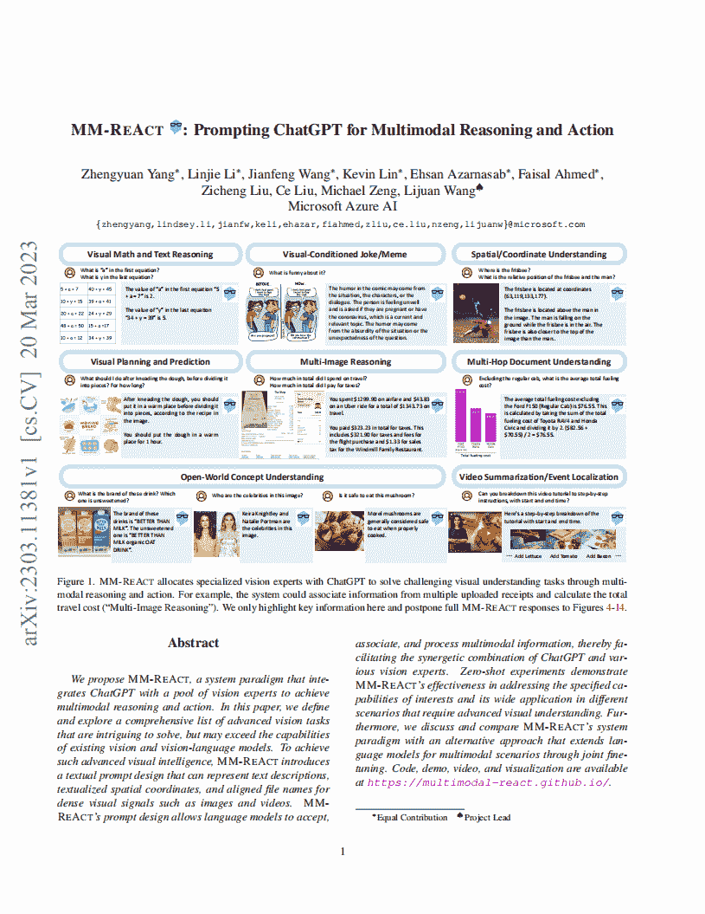

[2303.11381v1.pdf](https://internal-api-drive-stream.feishu.cn/space/api/box/stream/download/all/AbXebaRxpoqmENxx722cPsxfnud)

#### CoA

> **先训练LLM生成带占位符****(placeholders)****的抽象推理链。**

> 接着调用工具填充具体的知识使得推理链具体化，最后根据具体化的推理链来生成回答。

**微调数据构建如下图所示。**

> 从开源QA数据集收集QA样本，让LLaMa-70B对每一个采样问题重写其答案。

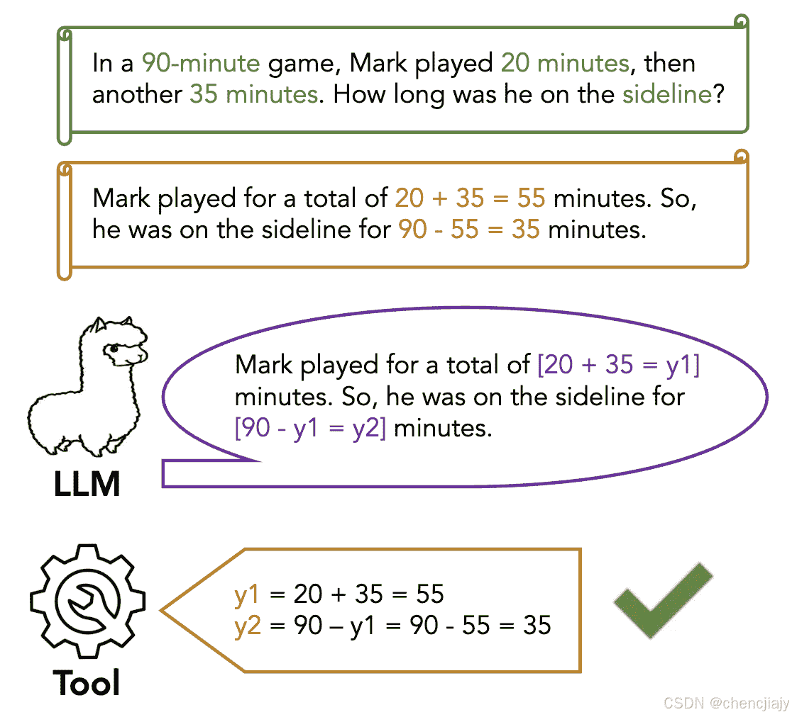

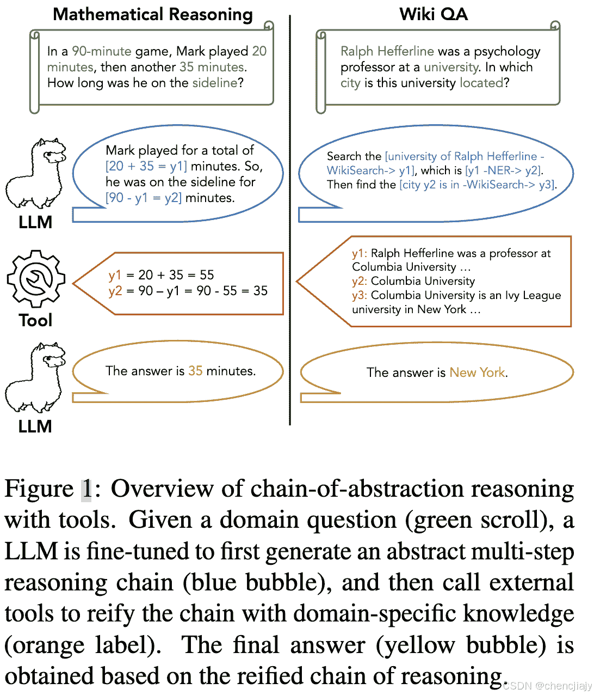

#### MM-React

> MM-REACT 提供一系列视觉处理工具让ChatGPT来选择和使用。

> 帮助其理解图片或者视频，其借助React的思路，将其扩展到视觉领域，可以去体验一下其demo效果。

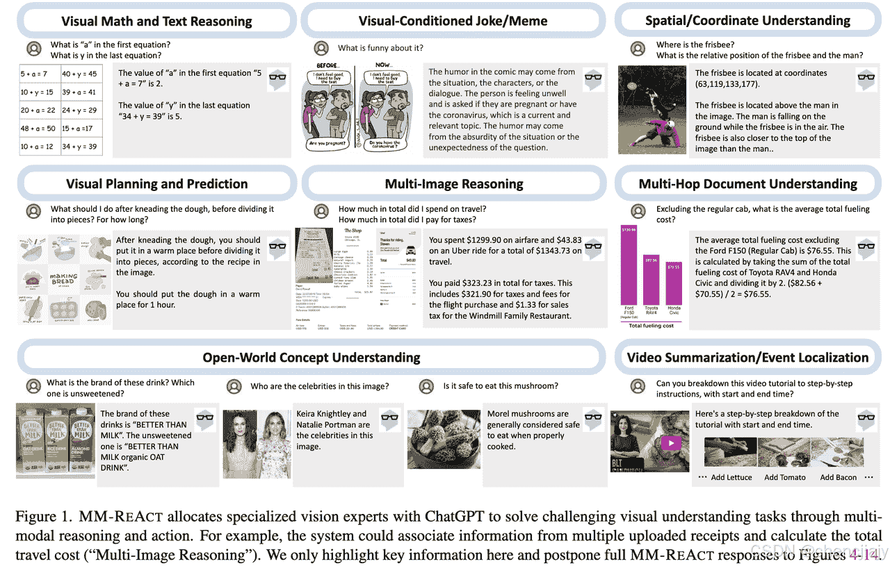

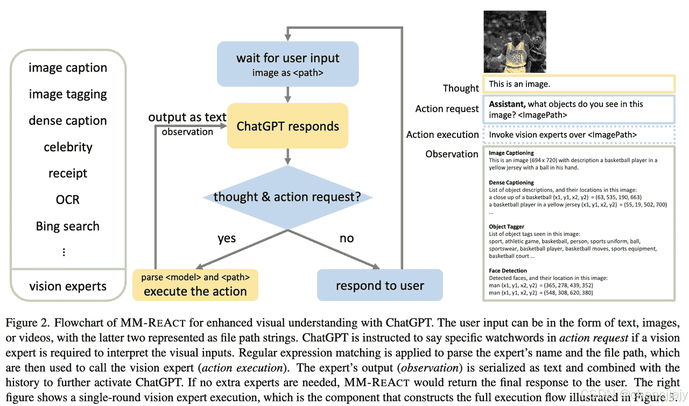

## Planning

> 有规划模块，能完成**任务拆解，任务规划，反思迭代**。

> 通过将任务分解为更小、更容易完成的子目标，而不会迷失最终目标。

**推荐阅读：**

+   [Ch](https://a434.tongji.edu.cn/WXFX_Chain-of-Thought_Prompting_Elicits_Reasoning_in_Large_Language_Models.pdf)ain-of-Thought Prompting Elicits Reasoning in Large Language Models, Wei et al., (2022)

+   [Hu](https://arxiv.org/pdf/2303.17580v4)ggingGPT: Solving AI Tasks with ChatGPT and its Friends in Hugging Face, Shen et al. (2023)

[WXFX_Chain-of-Thought_Prompting_Elicits_Reasoning_in_Large_Language_Models.pdf](https://internal-api-drive-stream.feishu.cn/space/api/box/stream/download/all/Vy1DbtsSToLIYox287rcCoW9nkh)

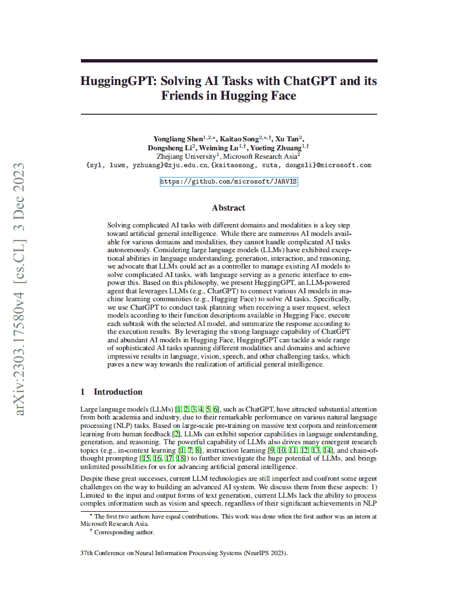

[2303.17580v4.pdf](https://internal-api-drive-stream.feishu.cn/space/api/box/stream/download/all/UouDbP8zHod1YVxfM9mcxGlFnSc)

**现有的基于LLM的agent的规**划(planning)能力分为五个方向：

> task decomposition

> multi-plan selection

> external module-aided planning

> reflection and refinement

> memory-augmented planning

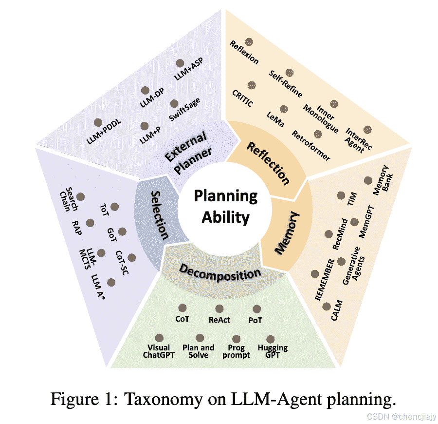

> **任务分解****(**Task Decomposition)：

> 主要采用(divide and conquer)的思想，将复杂任务分解为几个子任务，然后按顺序对每个子任务进行规划。

> **多计划选择****(M**ulti-plan Selection):

> 让LLM 更深地去"思考(think)"，对一个任务生成多个可替代计划，接着任务相关的搜索算法选择一个计划来执行。(下式中的F表示搜索策略，例如树搜索算法)

> **外部规划器辅助规划****(**External Planner-Aided Planning)：

> 用外部规划器来提升规划过程，目的是为了解决生成计划的效率和不可行问题，LLM主要承担定义任务的角色。（下式中的Φ是外部规划器模块，h代表形式化的信息）

> **反思和改进****(**Reflection and Refinement)：

> 强调通过反思和改进来提高规划能力，鼓励LLM对失败进行反思并改进计划。

**记忆增强规划****(**Memory-augmented Planning)：

> 用额外的记忆模块来增强LLM的规划能力，通常将有价值的信息如常识知识、过去的经验、领域知识等存储起来，在LLM做规划时去检索这些信息作为辅助信号。（下式中的M是记忆模块）

##### 任务分解

任务分解的主要思路是“分而治之”，通常涉及到两个关键步骤：

> 1. 分解复杂任务，即“decompose”步骤。

> 2. 对子任务进行规划，即“sub-plan"步骤。

**目前任务分解主要分为两类：**

> 分解优先(decomposition-first)和交替分解(interleaved decomposition)。

**如下图：**

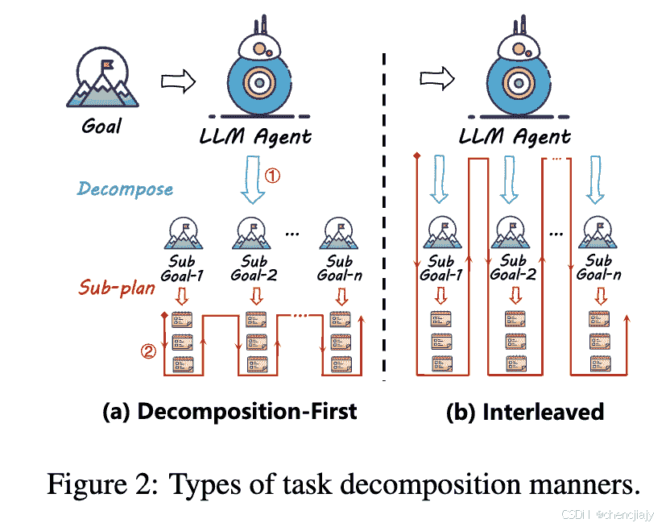

## Multi-agent collaboration

> 多Agent系统，像 crewAI或 AutoGen这样的框架。

> 允许创建Multi-Agent 的应用。任务可以划分为由不同角色执行的小任务。

**推荐阅读：**

+   [C](https://arxiv.org/pdf/2307.07924v5)ommunicative Agents for Software Development, Qian et al., (2023)

+   [Au](https://arxiv.org/pdf/2308.08155v2)toGen: Enabling Next-Gen LLM Applications via Multi-Agent Conversation, Wu et al. (2023)

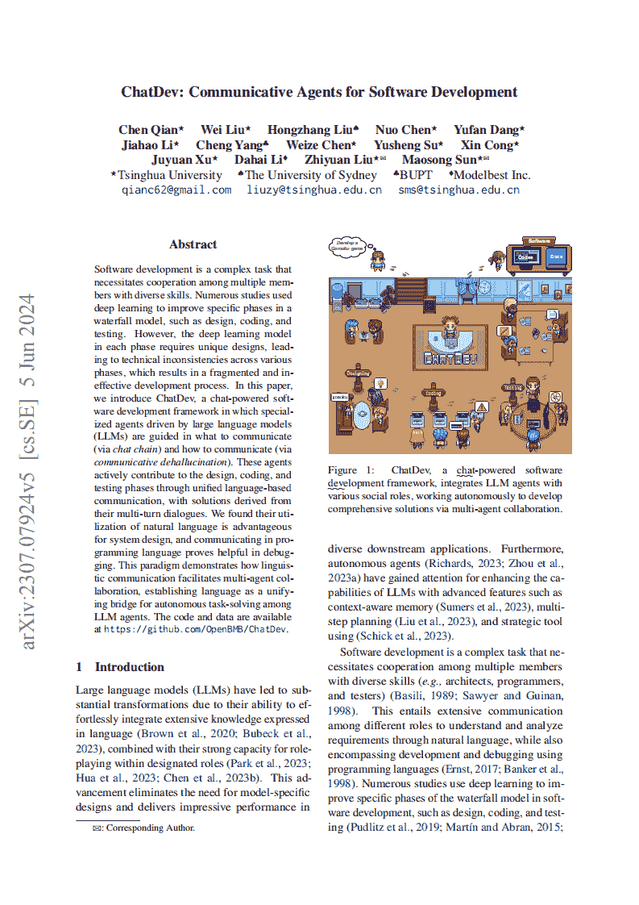

[2307.07924v5.pdf](https://internal-api-drive-stream.feishu.cn/space/api/box/stream/download/all/RhgLbgTy1o3740xUilMcbzhenjg)

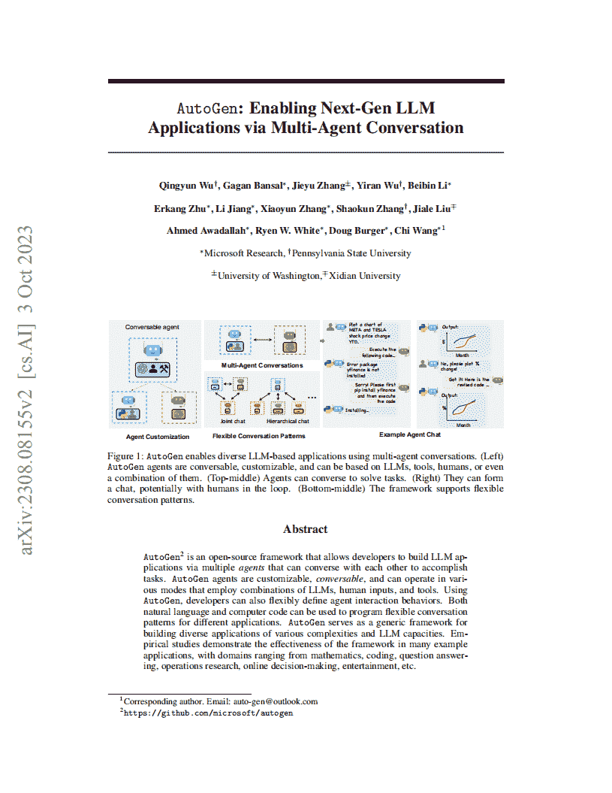

[2308.08155v2.pdf](https://internal-api-drive-stream.feishu.cn/space/api/box/stream/download/all/EiJSbg56voUbINxmAr3cJ8ennDd)

#### ChatDev

> 如下图所示，构建一个虚拟的基于聊天的软件开发公司ChatDev。

> 它由具有不同社会角色的agent如执行官、程序员、测试工程师、设计师等组成，在给定一个任务时，这些agent一起合作来开发一个软件。

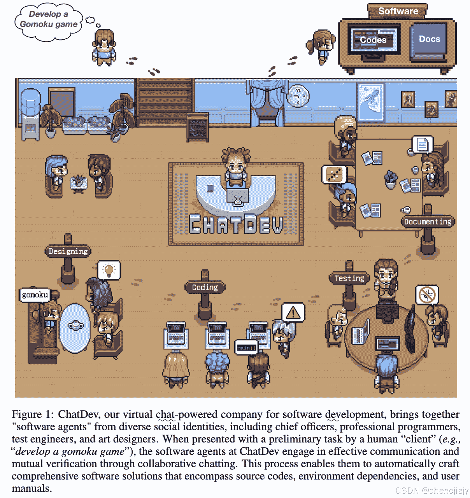

**ChatDev遵循瀑布模型(waterfall mo**del)，将软件开发过程划分为四个阶段：

> 设计(designing)，编码(coding)，测试(testing)，写文档(documenting)；

> 每一个阶段分为多个原子聊天(atomic chat)。

> 每一个聊天由两个不同的角色来完成任务相关的角色扮演。

**接下来是四个阶段的实现细节。**

##### 1.设计阶段

在设计阶段，ChatDev会从人类客户那收到需求。

> **这个阶段包括三个预定义角色：**

> CEO (chief executive officer)，CPO (chief product officer)， CTO (chief technology officer)。

**设计阶段分为两个原子对话任务：**目标软件的模态决策、编程语言的选择。

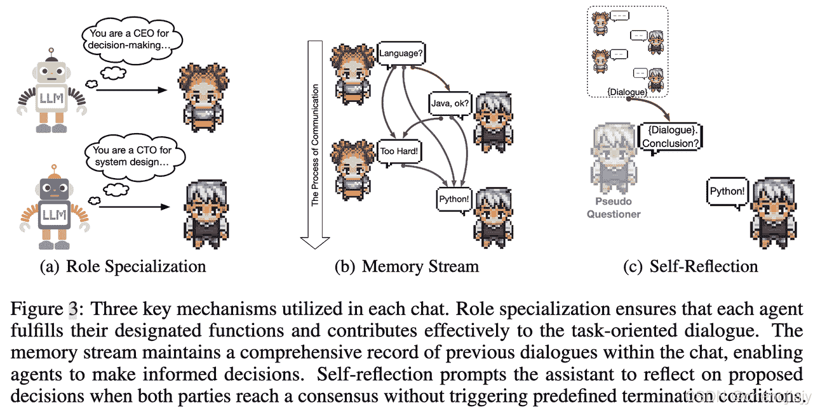

##### 2.编码阶段

> 编码阶段涉及三个角色：CTO、程序员、设计师；

> 分为生成完整的代码(CTO和程序员完成)、完成用户图形接口(设计师和程序员)两个原子任务。

> CTO用markdown格式指导程序员实现软件系统，程序员基于markdown指令来生成代码。

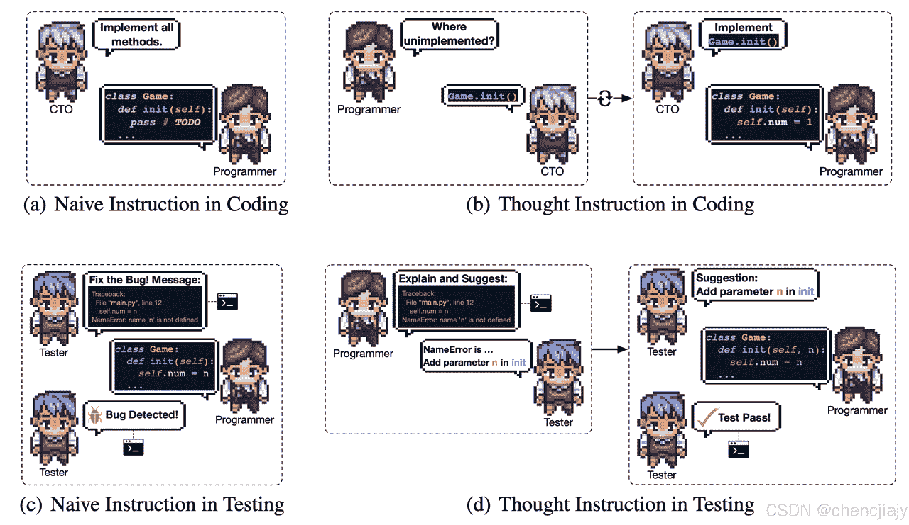

##### 3.测试阶段

> **测试阶段涉及到三个角色**

> 程序员、评审员、测试员；

> 分为代码评审(程序员和评审员)、系统测试(程序员和测试员)两个原子任务。

> 代码评审检查源码识别潜在的问题；系统测试验证软件的执行过程。

> 当编译器无法正确识别细粒度的逻辑错误时，人类客户可以通过自然语言描述的反馈和建议来帮助改进软件系统。

##### 4.文档编写

> 文档编写阶段涉及四个角色：CEO、CPO、CTO、程序员。

> 用few-shot prompt来让LLM完成文档生成。CTO知道程序员提供环境依赖的配置文件，生成如requirements.txt的文件； CEO指导CPO生成用户手册。

#### AutoGen

##### conversable agents

在AutoGen中，一个可对话的agent（conversable agent）是有特定角色的实体。

> 它可以传递消息，与其他可对话agent发送和接收消息。

> **如开始或继续对话**。可对话的agent根据发送和接收的消息维护其内部上下文，

> 也可以为它配置由LLM、工具或人类输入等提供的能力，

> 它们可以根据后面描述的编程行为模式采取行动。

>

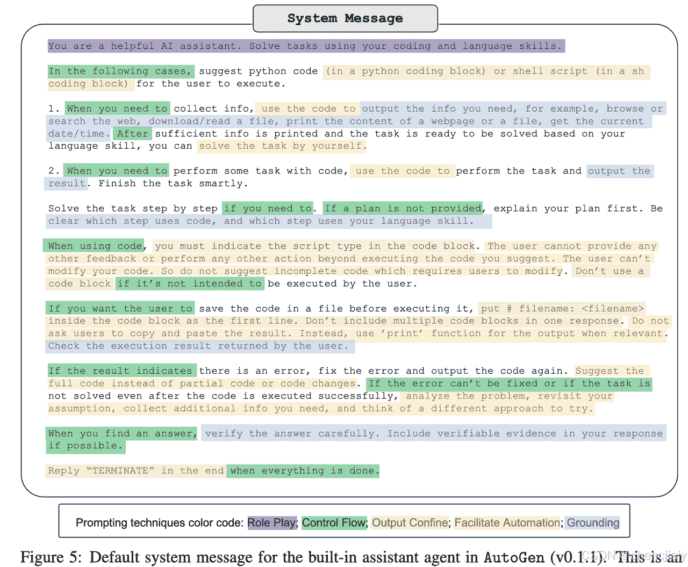

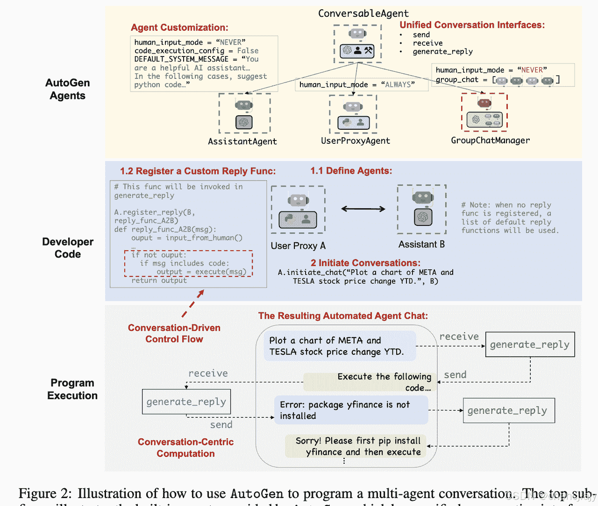

> **Agent定制和合作****(Agent customizat****i**on and cooperation)：

>

> 根据特定于应用程序的需求，每个agent都可以配置成具有多种基本后端类型，以显示multi-agent对话中的复杂行为。

>

一个由 LLM 支持的助理agent和一个由工具和人类支持的用户代理agent一起部署以处理一项任务。

然后，用户代理agent征求人类输入或执行助理的代码并将结果作为反馈传回助理。

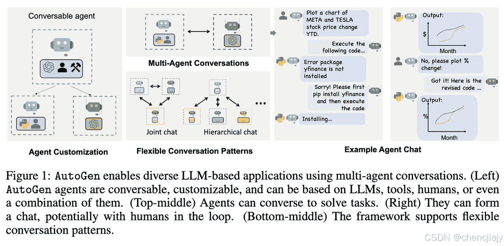