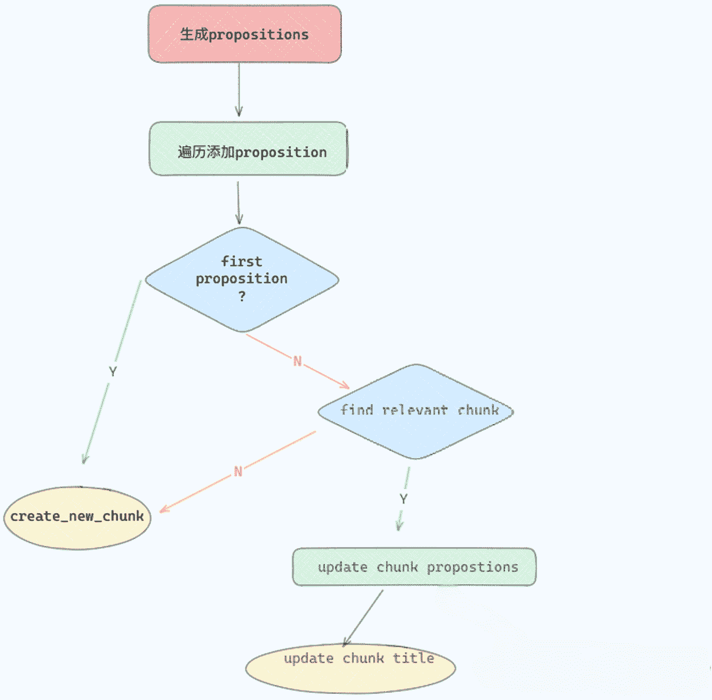

# Agentic chunking：接近人类水平的RAG分块方法

> 来源：[https://qqs7y1hozd1.feishu.cn/docx/BF3MdHcQuoMIwpxN2YTcf0cznuh](https://qqs7y1hozd1.feishu.cn/docx/BF3MdHcQuoMIwpxN2YTcf0cznuh)

## 01 Agentic Chunking 的工作原理

在 Agentic chunking 方法中，大语言模型（LLM）会处理文本段落中的每一句话，并将其分配到包含相似句子的文本块中，如果没有匹配的文本块，则会创建一个新的。

**大语言模型（LLM）无法确定这个句子中的“He”是**指谁。因此，这段话应该被转换成如下形式。

> On July 20, 1969, astronaut Neil Armstrong walked on the moon .

> Neil Armstrong was leading the NASA’s Apollo 11 mission.

> Neil Armstrong famously said, “That’s one small step for man, one giant leap for mankind” as he stepped onto the lunar surface.

这个过程通常被称为 propositioning。

> 大语言模型（LLM）可以单独检查每一个句子，并将其分配到一个文本块中。

> 如果句子不相关，则可以创建一个新的文本块。之所以能做到这一点，是因为每个句子都有一个主语。

## 02 实现 Agentic chunking

为了让这个过程有效，需要对句子进行 propositioned 处理。



**实现这一过程的方法有很多种。**

> 可以使用 Greg Kamradt 在 GitHub 上的代码仓库实现这一过程。

> Greg 的代码只是实现智能体式分割（agentic splitting）的百万种方法中的一种。

### 2.1 Propositioning the text

既然我们现在了解了 propositioning，我们可以创建自己的提示词，让大语言模型（LLM）为我们完成这项工作。幸运的是，Langchain hub 上提供了一个优秀的提示词模板。

让我们拉取提示词模板，创建一个 LLM chain，并进行测试。

```
obj = hub.pull(&quot;wfh/proposal-indexing&quot;)

# You can explore the prompt template behind this by running the following:
# obj.get_prompts()[0].messages[0].prompt.template

llm = ChatOpenAI(model=&quot;gpt-4o&quot;)


# A Pydantic model to extract sentences from the passage
class Sentences(BaseModel):
    sentences: List[str]

extraction_llm = llm.with_structured_output(Sentences)


# Create the sentence extraction chain
extraction_chain = obj | extraction_llm


# Test it out
sentences = extraction_chain.invoke(
    &quot;&quot;&quot;
    On July 20, 1969, astronaut Neil Armstrong walked on the moon .
    He was leading the NASA&#x27;s Apollo 11 mission.
    Armstrong famously said, &quot;That&#x27;s one small step for man, one giant leap for mankind&quot; as he stepped onto the lunar surface.
    &quot;&quot;&quot;
)


&gt;&gt;[&#x27;On July 20, 1969, astronaut Neil Armstrong walked on the moon.&#x27;,
 &quot;Neil Armstrong was leading NASA&#x27;s Apollo 11 mission.&quot;,
 &#x27;Neil Armstrong famously said, &quot;That\&#x27;s one small step for man, one giant leap for mankind&quot; as he stepped onto the lunar surface.&#x27;]


```

上述代码使用 Pydantic 模型来提取句子。这是一种从文本中提取结构化输出的推荐方法。

但在大段文本中，我们无法非常有效地进行这种操作。某一个句子中的“He”可能指的是尼尔·阿姆斯特朗，但在另一个段落中，“He”可能指的是亚历山大·格拉汉姆·贝尔。取决于文本内容。

因此，好的办法是将文本按段落分割，并在每个段落内部进行 propositioning 处理。

```
paragraphs = text.split(&quot;\n\n&quot;)

propositions = []

for i, p in enumerate(paragraphs):
    propositions = extraction_chain.invoke(p

    propositions.extend(propositions)


```

上述代码片段将在每个段落的内容中创建一个 propositions 列表。

### 2.2 使用 LLM Agent 创建文本块。

现在，通过 proportioning 处理，我们就得到了独立的句子，它们均各自表达了自己的意思。此时，文档已经准备好由 Agents 进行处理。

Agents 在这里要做几个操作。

首先，Agents 会创建一个名为 “chunks”的空字典，用来存储它创建的所有文本块。每个文本块包含主题相似的 propositions。AI Agents 的目标是将这些 propositions 按照以下格式分组到文本块中：

```
{
    &quot;12345&quot;: {
        &quot;chunk_id&quot;: &quot;12345&quot;,
        &quot;propositions&quot;: [
            &quot;The month is October.&quot;,
            &quot;The year is 2023.&quot;
        ],
        &quot;title&quot;: &quot;Date &amp; Time&quot;,
        &quot;summary&quot;: &quot;This chunk contains information about dates and times, including the current month and year.&quot;,
    },
    &quot;67890&quot;: {
        &quot;chunk_id&quot;: &quot;67890&quot;,
        &quot;propositions&quot;: [
            &quot;One of the most important things that I didn&#x27;t understand about the world as a child was the degree to which the returns for performance are superlinear.&quot;,
            &quot;Teachers and coaches implicitly told us that the returns were linear.&quot;,
            &quot;I heard a thousand times that &#x27;You get out what you put in.&#x27;&quot;
        ],
        &quot;title&quot;: &quot;Performance Returns&quot;,
        &quot;summary&quot;: &quot;This chunk contains information about performance returns and how they are perceived differently from reality.&quot;,
    }
}

```

当 AI Agents 遇到一个新的 proposition 时，它要么将其添加到一个现有的文本块中，要么在找不到合适的文本块时创建一个新的文本块。是否与现有的文本块匹配，要根据接收到的 proposition 和文本块的当前摘要来决定。

此外，如果新的 propositions 被添加到文本块中，AI Agents 可以更新文本块的摘要和标题，以不断反映新信息。这样确保了随着文本块的发展，元数据仍然保持相关性。

让我们一步一步来编写代码。

**第一步：创建文本块**

当我们第一次启动时，没有任何文本块。因此，我们必须创建一个文本块来存储我们的第一个 proposition。不仅如此。我们还需要一个函数，以便在 AI Agents 决定需要一个新文本块来存放一个 proposition 时，能够创建文本块。让我们定义一个函数来完成这个任务。

```
from langchain_core.prompts import ChatPromptTemplate
from langchain_openai import ChatOpenAI

llm = ChatOpenAI(temperature=0)

chunks = {}

def create_new_chunk(chunk_id, proposition):
    summary_llm = llm.with_structured_output(ChunkMeta)

    summary_prompt_template = ChatPromptTemplate.from_messages(
        [
            (
                &quot;system&quot;,
                &quot;Generate a new summary and a title based on the propositions.&quot;,
            ),
            (
                &quot;user&quot;,
                &quot;propositions:{propositions}&quot;,
            ),
        ]
    )

    summary_chain = summary_prompt_template | summary_llm

    chunk_meta = summary_chain.invoke(
        {
            &quot;propositions&quot;: [proposition],
        }
    )

    chunks[chunk_id] = {
        &quot;summary&quot;: chunk_meta.summary,
        &quot;title&quot;: chunk_meta.title,
        &quot;propositions&quot;: [proposition],
    }


```

确实，文本块（chunks）通常存储在函数外部，因为它们会被这个函数和其他函数多次更新。在上述代码中，我们使用了大语言模型（LLM）来为我们的文本块生成标题和摘要。这是列表中第一个 proposition 的摘要。

第二步：将 proposition 添加到文本块

当我们扫描文档时，每个后续的 proposition 都需要被添加到一个文本块中。当我们添加一个 proposition 时，文本块的标题和摘要可能并不完全准确地反映其内容。因此，我们要对它们进行重新评估，并在必要时进行重写。

```
from langchain_core.pydantic_v1 import BaseModel, Field

class ChunkMeta(BaseModel):
    title: str = Field(description=&quot;The title of the chunk.&quot;)
    summary: str = Field(description=&quot;The summary of the chunk.&quot;)

def add_proposition(chunk_id, proposition):
    summary_llm = llm.with_structured_output(ChunkMeta)

    summary_prompt_template = ChatPromptTemplate.from_messages(
        [
            (
                &quot;system&quot;,
                &quot;If the current_summary and title is still valid for the propositions return them.&quot;
                &quot;If not generate a new summary and a title based on the propositions.&quot;,
            ),
            (
                &quot;user&quot;,
                &quot;current_summary:{current_summary}\n\ncurrent_title:{current_title}\n\npropositions:{propositions}&quot;,
            ),
        ]
    )

    summary_chain = summary_prompt_template | summary_llm

    chunk = chunks[chunk_id]

    current_summary = chunk[&quot;summary&quot;]
    current_title = chunk[&quot;title&quot;]
    current_propositions = chunk[&quot;propositions&quot;]

    all_propositions = current_propositions + [proposition]

    chunk_meta = summary_chain.invoke(
        {
            &quot;current_summary&quot;: current_summary,
            &quot;current_title&quot;: current_title,
            &quot;propositions&quot;: all_propositions,
        }
    )

    chunk[&quot;summary&quot;] = chunk_meta.summary
    chunk[&quot;title&quot;] = chunk_meta.title
    chunk[&quot;propositions&quot;] = all_propositions

```

上述函数用于将新 proposition 整合到已有的文本块中。同样，我们再次利用 LLM 来判断是否需要对标题和摘要进行更新。为了简化操作，我们将 LLM 配置为 Pydantic 模型，这样输出的结果就不再是随机文本，而是结构化对象了。

**第三步：实现 AI Agent，负责将 p**roposition 推送到合适的文本块

虽然前文定义的那两个函数能够完成任务，但它们并不能判断一个现成的文本块是否适合接纳新的 proposition。如果有合适的文本块，我们需要用正确的 chunk_id 和新 proposition 来调用 add_proposition 函数。如果没有，我们就得通过调用 create_new_chunk 函数来生成一个新的文本块。

下面这个函数就是负责这项工作的。

```
def find_chunk_and_push_proposition(proposition):

    class ChunkID(BaseModel):
        chunk_id: int = Field(description=&quot;The chunk id.&quot;)

    allocation_llm = llm.with_structured_output(ChunkID)

    allocation_prompt = ChatPromptTemplate.from_messages(
        [
            (
                &quot;system&quot;,
                &quot;You have the chunk ids and the summaries&quot;
                &quot;Find the chunk that best matches the proposition.&quot;
                &quot;If no chunk matches, return a new chunk id.&quot;
                &quot;Return only the chunk id.&quot;,
            ),
            (
                &quot;user&quot;,
                &quot;proposition:{proposition}&quot; &quot;chunks_summaries:{chunks_summaries}&quot;,
            ),
        ]
    )

    allocation_chain = allocation_prompt | allocation_llm

    chunks_summaries = {
        chunk_id: chunk[&quot;summary&quot;] for chunk_id, chunk in chunks.items()
    }

    best_chunk_id = allocation_chain.invoke(
        {&quot;proposition&quot;: proposition, &quot;chunks_summaries&quot;: chunks_summaries}
    ).chunk_id

    if best_chunk_id not in chunks:
        best_chunk_id = create_new_chunk(best_chunk_id, proposition)
        return

    add_proposition(best_chunk_id, proposition)

```

该函数利用大语言模型（LLM）来判断是新建一个文本块，还是将新 proposition 加入到现有的文本块中。同时，它也会调用相关函数来实现这一过程。

这段代码是对 Agent 分块过程的简化描述。在开发过程中，你需要做出多种技术选型。比如，你可以选择执行相似度搜索（similarity search），而不是依赖大语言模型去对比文本块的摘要和新传入的 proposition。

## 03 Final thoughts

Agentic chunking 无疑是一种高效的文档处理技术。与语义分块（semantic chunking）相似，它能够将文档内容划分为多个有意义的文本块。但是这种方法更为独特，即使相关句子在文档中的位置相隔较远，它也能基于主题将它们归入同一块中。

需要注意的是，LLM 的每一次调用都会消耗成本，并且增加延迟。众所周知，Agentic chunking 是一种速度慢、成本高的分块策略。因此，在处理大型项目时，必须对预算有所把控。