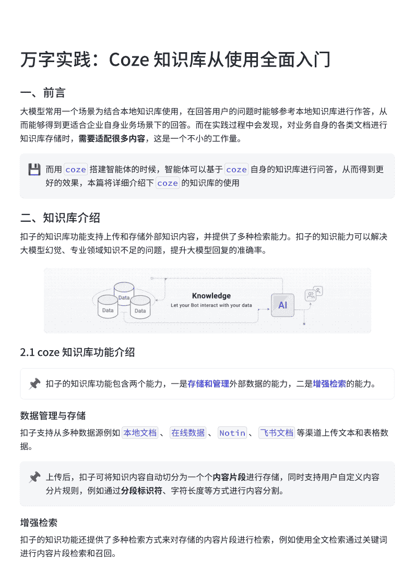
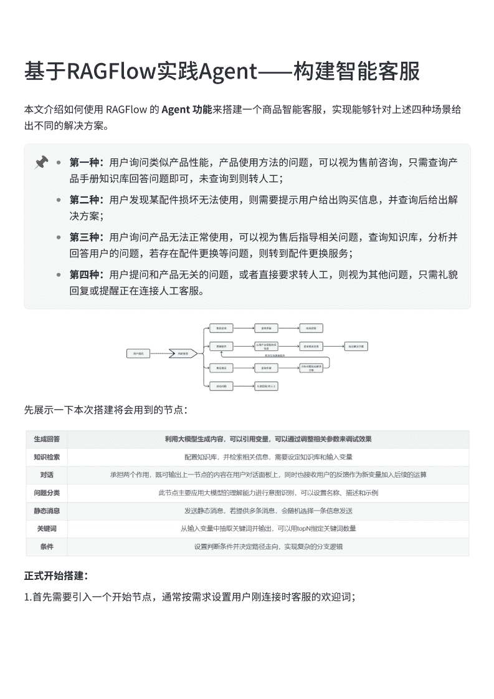
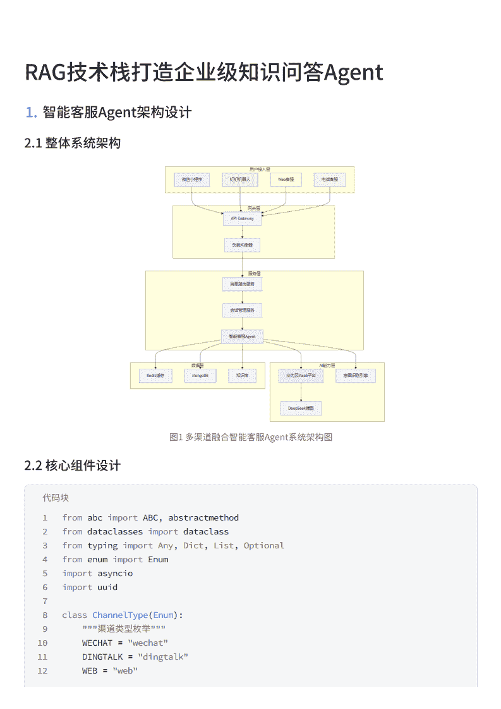
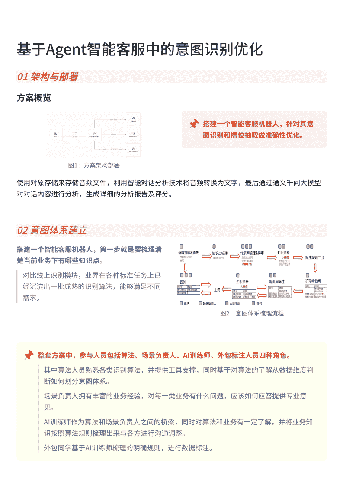
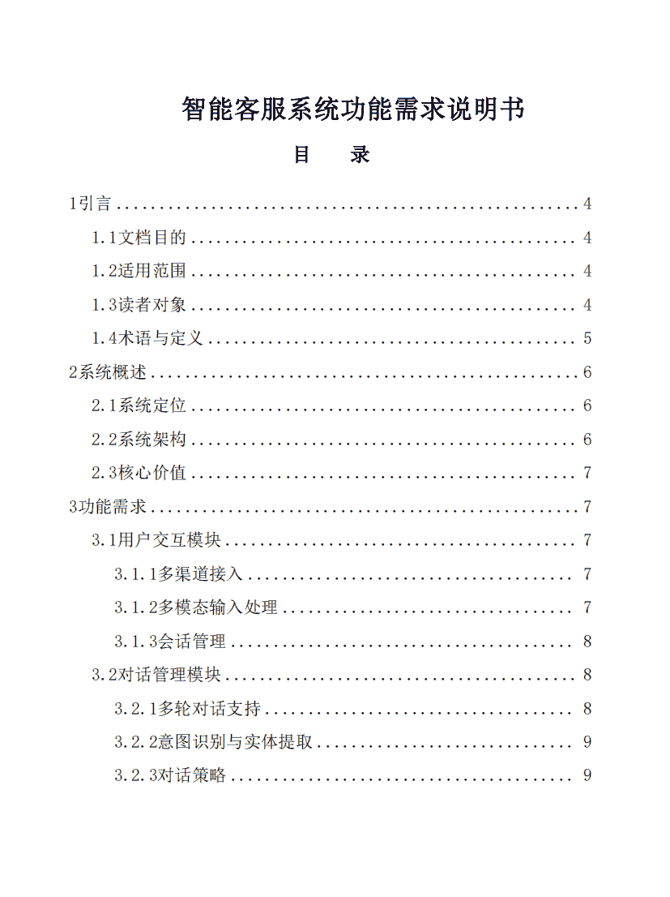
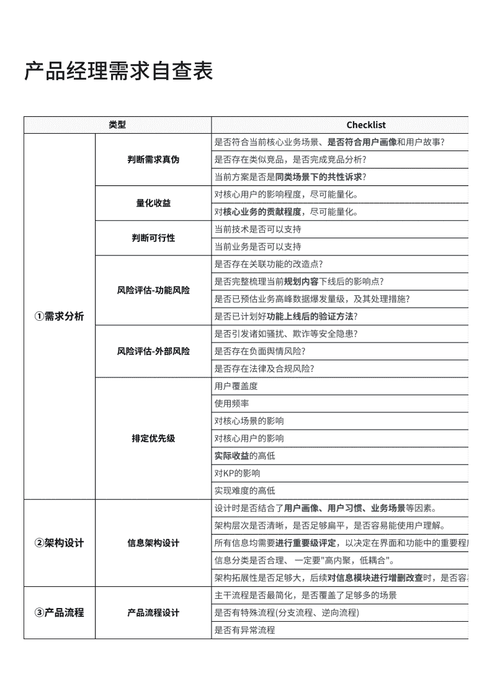
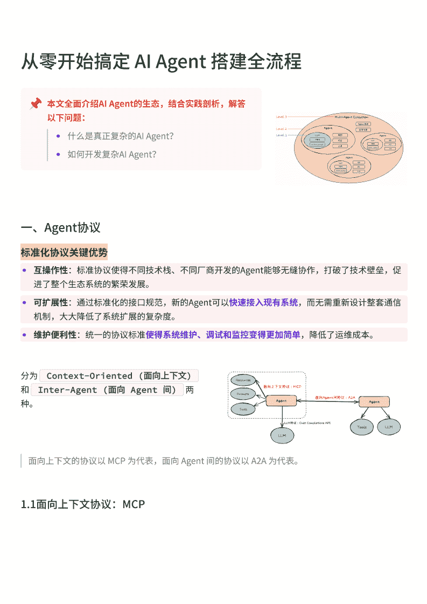
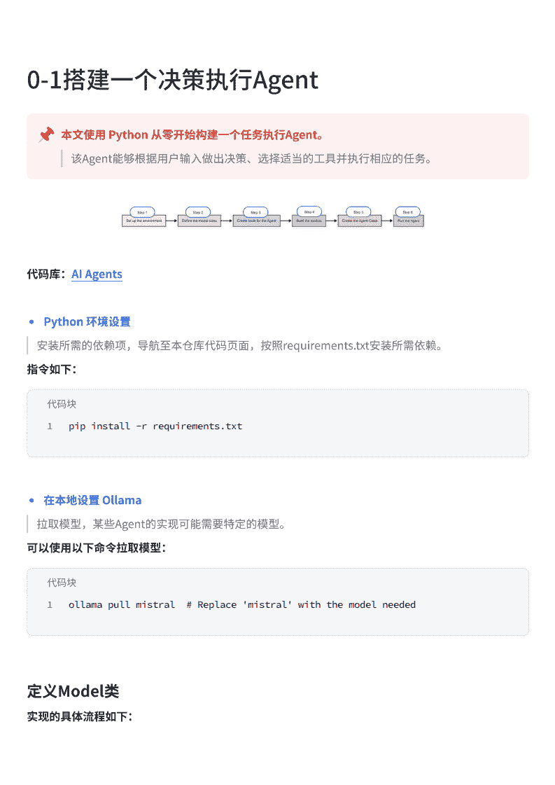
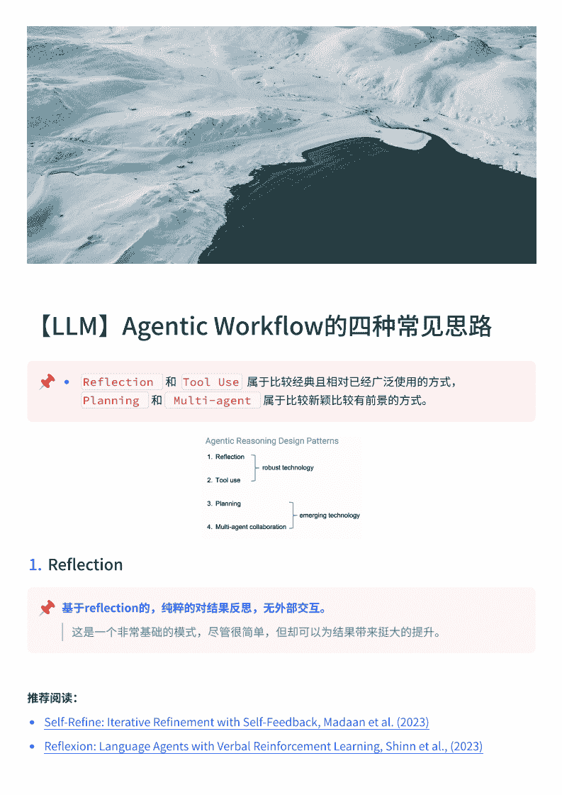
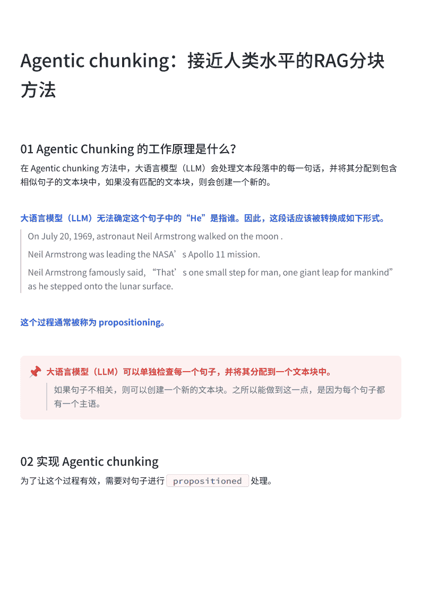

# AI Agent

> 来源：[https://qqs7y1hozd1.feishu.cn/docx/LHK7dPJnYoM4NuxiuXIcrpyInBg](https://qqs7y1hozd1.feishu.cn/docx/LHK7dPJnYoM4NuxiuXIcrpyInBg)

<https://qqs7y1hozd1.feishu.cn/sync/WsLwdK9UMsOqdhb16EFcUL0qn4d>

---

## coze搭建AI工作流

[从0-1成为基于Agent的创造者](https://qqs7y1hozd1.feishu.cn/wiki/JwiCwWJJBibtYTkdTaCcvizwn9c)

[从0-1成为基于Agent的创造者](https://qqs7y1hozd1.feishu.cn/wiki/JwiCwWJJBibtYTkdTaCcvizwn9c)

[Coze实战：构建企业级知识库](https://qqs7y1hozd1.feishu.cn/wiki/KS7ww3viYivARhkLS7QcHbHJny1)

[Coze——构建AI企业级知识库](https://qqs7y1hozd1.feishu.cn/wiki/H4XQwzAljiKnonky7SscSaaHnzh)

[coze搭建作业智能体（图片识别+语音合成+知识听写）](https://qqs7y1hozd1.feishu.cn/wiki/Q1txwJmzsizEoDkvbHCc4Z0xndf)

[长文深度解析 Coze 的多 Agent 模式的实现机制](https://qqs7y1hozd1.feishu.cn/wiki/G2xkwJLX7iPmTsk8Iqqc85WZnQd)

[coze搭建电影推荐智能体](https://qqs7y1hozd1.feishu.cn/wiki/SueQwalariY5WPkxmD3cUovcnUF)

[coze搭建智能搜索agent](https://qqs7y1hozd1.feishu.cn/wiki/FBMGwfbeYiAecmkMQIrcOEhcnSH)

[coze打造个性化问答机器人](https://qqs7y1hozd1.feishu.cn/wiki/P1w5w2wmZiz6Chkp1q2cnpgrnr8)

[coze打造换脸表情包生成器](https://qqs7y1hozd1.feishu.cn/wiki/GvmVwEZlIiHfjUkkZSrc1LHHn8q)

[coze搭建智能待办事项agent](https://qqs7y1hozd1.feishu.cn/wiki/MHHJw4h4oiC0kPkW84IcLMGUnXd)

[coze搭建一个商品推荐bot/agent](https://qqs7y1hozd1.feishu.cn/wiki/GBPXwIrDdiYfcRkGGVVcsuEwnUf)

[万字实践：Coze 知识库从使用全面入门](https://qqs7y1hozd1.feishu.cn/wiki/FWxiwfhbziXnljkPzIecx2XqnMc)

[基于RAGFlow实践Agent——构建智能客服](https://qqs7y1hozd1.feishu.cn/wiki/Dctpw71PFirKsLkKEjicbjPLnOh)

[万字实践：Coze 知识库从使用全面入门 (1).pdf](https://internal-api-drive-stream.feishu.cn/space/api/box/stream/download/all/CSQ1bwG8boFdLMxlimEcmjPunsb)

[基于RAGFlow实践Agent——构建智能客服 (1).pdf](https://internal-api-drive-stream.feishu.cn/space/api/box/stream/download/all/AMKvbeA9ooV8QrxM6X0c1qbCnNc)

## AI Agent

[RAG从原理到应用，技术解析+实践拆解](https://qqs7y1hozd1.feishu.cn/wiki/KXlfw5V5FiPzZ4koNGkcYosjn3e)

[大白话讲清GraphRAG：知识图谱与RAG融合](https://qqs7y1hozd1.feishu.cn/wiki/EiOZw0VRXiMzG1kqKSBc0t3ZnMf)

[深度解析：大模型 RAG 技术](https://qqs7y1hozd1.feishu.cn/wiki/GafzwTVcIiRyIpkt0F1cKM7CnHb)

[案例拆解：AI Agent 从原理到应用](https://qqs7y1hozd1.feishu.cn/wiki/NScCw5vcMiANTzkLUkecfwXgnFc)

[基于RAG的LLM应用](https://qqs7y1hozd1.feishu.cn/wiki/XqgCwJ3vaiMRRAkpTJCc🐧BlnPc)

[AI Agent 从原理到应用，全解](https://qqs7y1hozd1.feishu.cn/wiki/QEOiwwCN8iuCbrk9eg5cGFe8naf)

[【LLM-RAG】知识库问答 | 检索 | embedding](https://qqs7y1hozd1.feishu.cn/wiki/FhMGwc1kNiakITk9vFWcoUrXnnc)

[GraphRAG：知识图谱+RAG+ LangChain实现](https://qqs7y1hozd1.feishu.cn/wiki/Q87nwpZVQidPSjkVl1ocSlywnLd)

[Agent、RAG主流开发技术和未来应用 ](https://qqs7y1hozd1.feishu.cn/wiki/SB0lwYytViH0rVkor1ncuz3YnQb)

[从LLM Agent工作流程看Prompt优化技巧](https://qqs7y1hozd1.feishu.cn/wiki/EhjVwzzsfibqJRka9dlcqQU8noD)

[万字长文，带你纵观大模型Agent，涉及研究痛点、应用场景、发展方向](https://qqs7y1hozd1.feishu.cn/wiki/MGPEwh0wLiyeHbksk9ickqp6nwh)

[RAG技术详解：构建高效、可信赖的知识检索系统](https://qqs7y1hozd1.feishu.cn/wiki/BmuiwvdmeiRVZiky8b1chyAunqc)

[Agent的8种设计模式拆解（图解+代码）](https://qqs7y1hozd1.feishu.cn/wiki/PsrzwM5h3iynfOkHtaMcOR9inbb)

[读懂Agent--19类Agent框架对比](https://qqs7y1hozd1.feishu.cn/wiki/LM0XwumoWiI5XskbNIgcbTXnnAb)

## AI Agent搭建

[从零开始搞定 AI Agent 搭建全流程](https://qqs7y1hozd1.feishu.cn/wiki/XPm9whlGuiyNQ5kOvQlcoiTDnYc)

[从零开始构建你的第一个 ReAct Agent](https://qqs7y1hozd1.feishu.cn/wiki/DLRUwXow7iEDTtkN9RqcX6pLn7c)

[从零开始搭建基于 LangGraph 的 AI Agent](https://qqs7y1hozd1.feishu.cn/wiki/CuZnwnLkhijilQkFO8ZcORGTnJc)

[0-1搭建一个决策执行Agent](https://qqs7y1hozd1.feishu.cn/wiki/MvEEwK6INiBJJSkpxDkcbJOjnYV)

[Agent问答助手中多轮对话设计](https://qqs7y1hozd1.feishu.cn/wiki/U0wowFI5DiBhWYkIxuHckCcenag)

[实现一个多轮对话模型来分析用户意图](https://qqs7y1hozd1.feishu.cn/wiki/CqDywt3J8i1eCPkPGhec1U92nRc)

[RAG本地知识库搭建](https://qqs7y1hozd1.feishu.cn/wiki/CU0ywZIt4iX2B5k84MzcmrLpnlh)

[AI产品总结：基于langchain的rag大模型构建](https://qqs7y1hozd1.feishu.cn/wiki/YCCrwMa38igvQdkLsHNca478nNh)

[结合CoT思维链的workflow应用拆解（基于Dify平台）](https://qqs7y1hozd1.feishu.cn/wiki/GbkjwOy9piT7uvk6dXhc88KLnlc)

[【Agent】Coze个人智能体助手搭建（agent | workflow）](https://qqs7y1hozd1.feishu.cn/wiki/LnK4wtH6UiMiJfkJvrNcarijnmf)

[典型workflows和Building effective agents](https://qqs7y1hozd1.feishu.cn/wiki/KEUnwo6VRiM0mvkVOIFczZtcnEg)

[从零开始构建企业级高可靠 AI Agent 系统架构](https://qqs7y1hozd1.feishu.cn/wiki/CUX8w1pWOi54iGk7GUMcbHu4n5g)

[LLM based Agent实践](https://qqs7y1hozd1.feishu.cn/wiki/Rl8XwpQdIipnlykx56fci1aAnXe)

[RAG实践、提升RAG效果方法梳理](https://qqs7y1hozd1.feishu.cn/wiki/RvBiwwTMUiQAJAkpzOpcgBT1nVc)

[RAG技术栈打造企业级知识问答Agent](https://qqs7y1hozd1.feishu.cn/wiki/CewBwhFNLiudmtkHoQFcEFuun2g)

[基于Agent智能客服中的意图识别优化](https://qqs7y1hozd1.feishu.cn/wiki/UvabwjyvWi0xF7k8gaPcI0T1nme)

[RAG技术栈打造企业级知识问答Agent.pdf](https://internal-api-drive-stream.feishu.cn/space/api/box/stream/download/all/LVACbyxfTotAG6xS7NacIhpUnNe)

[基于Agent智能客服中的意图识别优化 (1).pdf](https://internal-api-drive-stream.feishu.cn/space/api/box/stream/download/all/Idm8bTTw9oKJVnxFu8tcpcz4nFf)

## AI Agent案例

[电商智能客服Agent](https://qqs7y1hozd1.feishu.cn/wiki/FnxfwQlULiYrnlk1tK8cyH8tnAb)

[运维智能体Agent](https://qqs7y1hozd1.feishu.cn/wiki/IKlvwDpWoiO8ZKk1SVZcllocnLe)

[物流智能体Agent](https://qqs7y1hozd1.feishu.cn/wiki/P45twg0RZiQGM3kbz6ac9gk4nef)

[数据分析智能体Agent](https://qqs7y1hozd1.feishu.cn/wiki/Vt6GwXHZbiC62hkNYMvc45Qnnrg)

[医疗智能体Agent](https://qqs7y1hozd1.feishu.cn/wiki/WOzXwzPP5iNWITk0iWGcx7eCnee)

[学业辅导智能体Agent](https://qqs7y1hozd1.feishu.cn/wiki/TvYLwF0LQi0WLlknMqzcYaH6nZD)

[AI智能问诊系统（基于LLM大模型）](https://qqs7y1hozd1.feishu.cn/wiki/WEelwBJDBimseXkRumccDUtNnCh)

[舆情分析Agent：AI 舆情 Agent](https://qqs7y1hozd1.feishu.cn/wiki/Lqn9wHAFHiyqpDkPmYWcTh2Qn3c)

[智能客服系统功能需求说明书.pdf](https://qqs7y1hozd1.feishu.cn/wiki/GJE0wmBjyiuXhnkvsKXczDiCnyE)

[产品经理需求自查表](https://qqs7y1hozd1.feishu.cn/wiki/YTQzwLLftixxgvkJ9K1cOqD7nDb)

[智能客服系统功能需求说明书.pdf](https://internal-api-drive-stream.feishu.cn/space/api/box/stream/download/all/OXSGbdV2SoZU4Vx4kL0cN1bInne)

[产品经理需求自查表 (16).pdf](https://internal-api-drive-stream.feishu.cn/space/api/box/stream/download/all/EFdSbmtFyo62fJxb1Vece3cGnXu)

## AI Agent项目实操

[基于Agent智能客服中的意图识别优化](https://qqs7y1hozd1.feishu.cn/wiki/UvabwjyvWi0xF7k8gaPcI0T1nme)

[从0到1开发一个商用 Agent（智能体）](https://qqs7y1hozd1.feishu.cn/wiki/CTiCwfaQGi0Bs8kcd24cP4msn0g)

[0-1搭建智能体（Agent）AI 电商客服助手](https://qqs7y1hozd1.feishu.cn/wiki/VURHw95Rliyh67k9jENcNUIVnHb)

[FinRobot：基于LLM的金融分析AI Agent ](https://qqs7y1hozd1.feishu.cn/wiki/QNCFw4GiEidnM4kLaXmcfzVgnhh)

[0-1搭建智能体（Agent）AI 电商客服助手](https://qqs7y1hozd1.feishu.cn/wiki/VURHw95Rliyh67k9jENcNUIVnHb)

[基于Agent的智能客服项目（已交付）](https://qqs7y1hozd1.feishu.cn/wiki/IxnswZnkYiEXEkkmmhScUbUAndh)

[基于Agent搭建ai论文写作程序](https://qqs7y1hozd1.feishu.cn/wiki/VQfVwS1vkiqxA4kFCH5cCjaYn9e)

[RAG本地知识库搭建](https://qqs7y1hozd1.feishu.cn/wiki/CU0ywZIt4iX2B5k84MzcmrLpnlh)

[大厂0-1数据分析Agent项目实现](https://qqs7y1hozd1.feishu.cn/wiki/Kiz2wwtvkihukBkQki0cg562nVb)

[TableAgent 数据分析智能体](https://qqs7y1hozd1.feishu.cn/wiki/RdG4wfkB5idqhtk7WhncIfYlnSJ)

[从零开始构建你的第一个 ReAct Agent](https://qqs7y1hozd1.feishu.cn/wiki/DLRUwXow7iEDTtkN9RqcX6pLn7c)

[0-1构建智能客服Agent（已脱敏）](https://qqs7y1hozd1.feishu.cn/wiki/ZxWZwmwrliZ5eqkIUehcYBWNn1c)

[LangChain智能体开发实战：从零构建企业级AI助手](https://qqs7y1hozd1.feishu.cn/wiki/TKsNwS4goioEzYkpqTgcQv79nme)

[从零开始搭建基于 LangGraph 的 AI Agent](https://qqs7y1hozd1.feishu.cn/wiki/CuZnwnLkhijilQkFO8ZcORGTnJc)

[从零开始搞定 AI Agent 搭建](https://qqs7y1hozd1.feishu.cn/wiki/XPm9whlGuiyNQ5kOvQlcoiTDnYc)

[0-1搭建一个决策执行Agent](https://qqs7y1hozd1.feishu.cn/wiki/MvEEwK6INiBJJSkpxDkcbJOjnYV)

[从零开始搞定 AI Agent 搭建全流程.pdf](https://internal-api-drive-stream.feishu.cn/space/api/box/stream/download/all/G697bA5PwoBUJ0xEYWCcJCYgnMb)

[0-1搭建一个决策执行Agent (1).pdf](https://internal-api-drive-stream.feishu.cn/space/api/box/stream/download/all/DShubJewAoEoh1x2Ve7ceXdCnBc)

## Agentic LLM

[基于Agentic上下文工程，0微调实现模型优化](https://qqs7y1hozd1.feishu.cn/wiki/NTu9wUvtgihfhxkiv6IcvnQdnGc)

[基于dify实践Agentic AI](https://qqs7y1hozd1.feishu.cn/wiki/LmQRww5Dci22IgkgUfYc9TMmnrd)

[从AI Agent到Agent工作流，搞懂智能体工作流（Agentic Workflow）](https://qqs7y1hozd1.feishu.cn/wiki/ViPJwG0C0iTA2ZkiN0ic8ZOunOf)

[【LLM】Agentic Workflow的四种常见思路](https://qqs7y1hozd1.feishu.cn/wiki/BYk6wthDSiI5oKkVaoOcw1H9nfh)

[Agentic chunking：接近人类水平的RAG分块方法](https://qqs7y1hozd1.feishu.cn/wiki/Z1DYwbwMPih0ORksfJhcjqiWn8T)

[【LLM】Agentic Workflow的四种常见思路.pdf](https://internal-api-drive-stream.feishu.cn/space/api/box/stream/download/all/DSVebZ7BGo4FDExU7XYczUCqnuc)

[Agentic chunking：接近人类水平的RAG分块方法.pdf](https://internal-api-drive-stream.feishu.cn/space/api/box/stream/download/all/W4c0bg9WTo4LiGxnZ04czux2nqZ)

## 上下文工程

[上下文工程：AI 智能体架构落地的关键技术](https://qqs7y1hozd1.feishu.cn/wiki/OdIVwqnqvi2RGUkcvLPcCQ09nzw)

[”上下文工程”的四大核心策略和实践技巧](https://qqs7y1hozd1.feishu.cn/wiki/ZA5owrlpPiwtMDkBuxjcZjzSnAg)

[0-1上手“上下文工程”](https://qqs7y1hozd1.feishu.cn/wiki/F8hBwzJcfi7dD0kOWNic4TO4nhg)

[清华大学-上下文工程综述.pdf](https://qqs7y1hozd1.feishu.cn/wiki/QzUXwPQW4iYbj9kSlFBcvTTtntb)

[基于上下文工程，动手优化LangChain AI Agents](https://qqs7y1hozd1.feishu.cn/wiki/E1oUw4eFfiEahUkLuYgcwgrxndf)

[高质量「上下文工程」资料整理（含速览和精读）](https://qqs7y1hozd1.feishu.cn/wiki/Z4hMwPBNfi7H8mkHXBDcRnLEnUh)

[The rise of "context engineering"](https://qqs7y1hozd1.feishu.cn/wiki/SsoawLRtciLO5nkmfG5cyryznle)

[上下文工程的6大技巧](https://qqs7y1hozd1.feishu.cn/wiki/GUjnwi4jBiDCxpk4rQKcn6O3nch)

[The New Skill in AI is Not Prompting, It's Context Engineering](https://qqs7y1hozd1.feishu.cn/wiki/IC7mwd83PirKcdkFrrmcrRiinyb)

# 12-Factor Agents

[01自然语言绑定工具调用](https://qqs7y1hozd1.feishu.cn/wiki/JuzswDF5Ji07GpkPexScolcDnln)

[02掌控你的 Prompt](https://qqs7y1hozd1.feishu.cn/wiki/EuGqwJYkViVvxnk0pGOcY4QBnId)

[03掌控 Context 窗口](https://qqs7y1hozd1.feishu.cn/wiki/VzZJwXxfBiV4XAknP6hcYOspn7f)

[04工具应为结构化输出](https://qqs7y1hozd1.feishu.cn/wiki/McxSw1n4xiwjgqkLzy9cnriYnrt)

[05统一执行状态与业务状态](https://qqs7y1hozd1.feishu.cn/wiki/VL6twB1DwihbtmkbgxmctQuMn2g)

[06提供启动 / 暂停 / 恢复 API](https://qqs7y1hozd1.feishu.cn/wiki/WtGBwnp3yij1UWk6iopcIoY6ndY)

[07将人类交互视为工具调用](https://qqs7y1hozd1.feishu.cn/wiki/L5RiwA9BgiXEIjkQM3vcQpUsnqc)

[08掌控你的控制流](https://qqs7y1hozd1.feishu.cn/wiki/EdfVw6r4PiuxiLkku3hcDe4enif)

[09将错误压缩进入上下文](https://qqs7y1hozd1.feishu.cn/wiki/PCtlwTUcYinwIRkdOEOcS7gkngi)

[10构建小而专注的 Agent](https://qqs7y1hozd1.feishu.cn/wiki/MSHRwaq08ixeuMkvqOFcb4Ndnmg)

[11自任触发源，面向用户使用路径](https://qqs7y1hozd1.feishu.cn/wiki/CJfcwR97ri6YtZkOnEWcOCwVnxn)

[12让 Agent 成为无状态 Reducer](https://qqs7y1hozd1.feishu.cn/wiki/Ivnfwh0gOij7AOkboG8cRWFen5f)

# workflow

[结合CoT思维链的workflow应用拆解（基于Dify平台）](https://qqs7y1hozd1.feishu.cn/wiki/GbkjwOy9piT7uvk6dXhc88KLnlc)

[典型workflows和Building effective agents](https://qqs7y1hozd1.feishu.cn/wiki/KEUnwo6VRiM0mvkVOIFczZtcnEg)

[【Agent】Coze个人智能体助手搭建（agent | workflow）](https://qqs7y1hozd1.feishu.cn/wiki/LnK4wtH6UiMiJfkJvrNcarijnmf)

[【LLM】Agentic Workflow的四种常见思路](https://qqs7y1hozd1.feishu.cn/wiki/BYk6wthDSiI5oKkVaoOcw1H9nfh)

## 各大厂Agent项目案例

多维表格（IQDgbA3DDaob8AsLMm6ceDI3nhh_tblm902fzXuzneDE）