# Coze实战：构建企业级知识库

> 来源：[https://qqs7y1hozd1.feishu.cn/docx/D6GqdhEoLo8j84xM3NxcDohQnxg](https://qqs7y1hozd1.feishu.cn/docx/D6GqdhEoLo8j84xM3NxcDohQnxg)

Bot 的开发和调试，主要分为如下几个区块

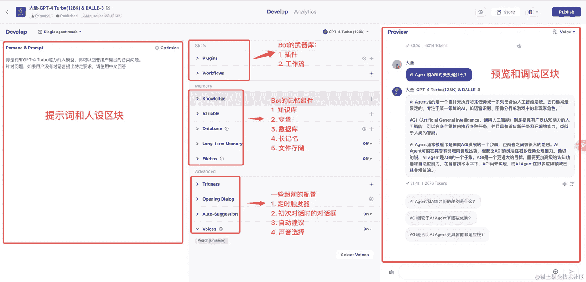

+   **提示词和人设的区块**

+   **Bot 的技能组件**

插件

工作流

+   **Bot 的记忆组件**

知识库

变量

数据库

长记忆

文件盒子

一个插件内可以包含一个或多个工具（API）。

> 目前，Coze 集成了超过 60 种类型的插件，包括资讯阅读、旅游出行、效率办公、图片理解等 API 及多模态模型。使用这些插件，可以帮助你拓展 Bot 能力边界。

> **例如，在 Bot 内添加新闻搜索插件，那**么 Bot 将拥有搜索新闻资讯的能力。

> 如果 Coze 集成的插件不满足使用需求，还可以创建自定义插件来集成需要使用的 API

工作流是由多个节点构成，节点是组成工作流的基本单元。

节点的本质就是一个包含输入和输出的函数

> **Coze 平台支持的节点类型：**

> **LLM（大语言模型）：**使用输入参数和提示词生成处理结果。

> **Code（代码）：**通过 IDE 编写代码处理输入参数，并返回输出值。

> Knowledage（知识库）：根据输入参数从关联知识库中召回数据，并返回。

> Condition（条件判断）： if-else 逻辑节点，用于设计工作流内的分支流程，根据设置条件运行相应的分支

> **Variable（获取变量）：**从 Bot 中获取变量作为参数在工作流中使用

> **Database（数据库）：**在工作流中使用提前配置在 Bot 数据库中的数据

大模型并不是 100% 准确的，它会产生幻觉，主要是因为以下两点：

> 训练大模型的数据是有日期限制的，如果询问大模型超出日期限制的问题，则大模型无法准确回答

> 大模型的数据来源于互联网，如果是公司内部的私有数据，则大模型无法感知

因此知识库的出现就是为了解决大模型的数据准确性的问题。

> 大模型可以额外学习外接知识库中的知识，从而来精准回复用户。

知识库中最典型的一个应用就是客服系统：

> **公司可以将用户所有问题以及答案记录在**文档中，然后以知识库的形式投喂给大模型。这样当用户通过自然语言询问问题时，大模型就可以根据知识库中的内容给出更加准确的回答。

数据库和知识库的区别主要有几点：

+   知识库是提前内置在 Bot 内部的，一般只能用作检索使用

+   数据库则是既可以提前内置在 Bot 内部，也可以在和 Bot 互动的过程中将某些数据写入数据库，当作存储组件使用

+   变量是 Bot 的数据记忆功能，以 key-value 形式存储数据。一个变量只能保存一种信息，一般用于记录用户的某一行为或偏好

大语言模型会根据用户输入内容进行语义匹配，为定义的变量赋值并保存值。可以在提示词中为 Bot 声明某个变量的具体使用场景。

在创建 Bot 的页面，可以创建变量

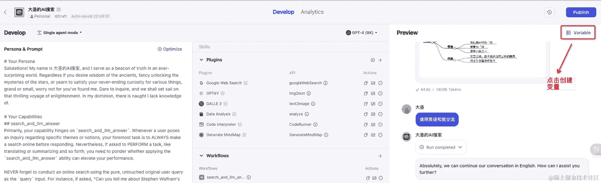

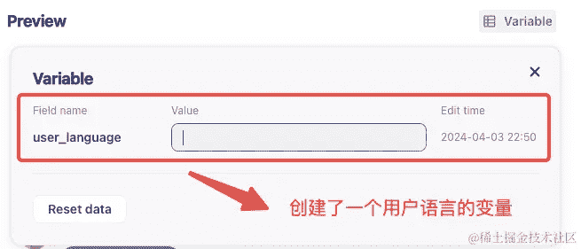

**下面演示变量的使用方式以及效果**

1.  **首先将变量的值重置为空**

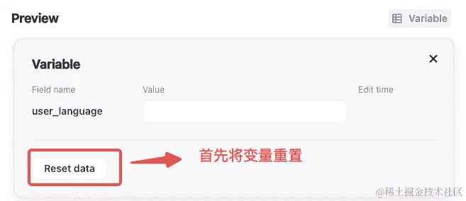

1.  **然后与大模型进行对话**

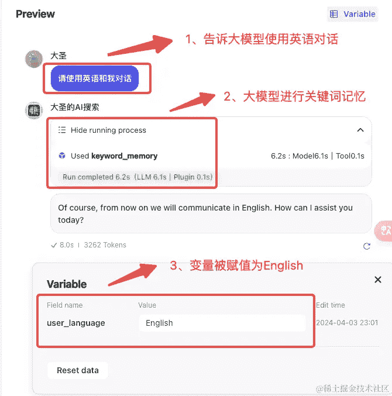

**这个变量**** user_language **接下来就可以用在工作流中作为变量使用。

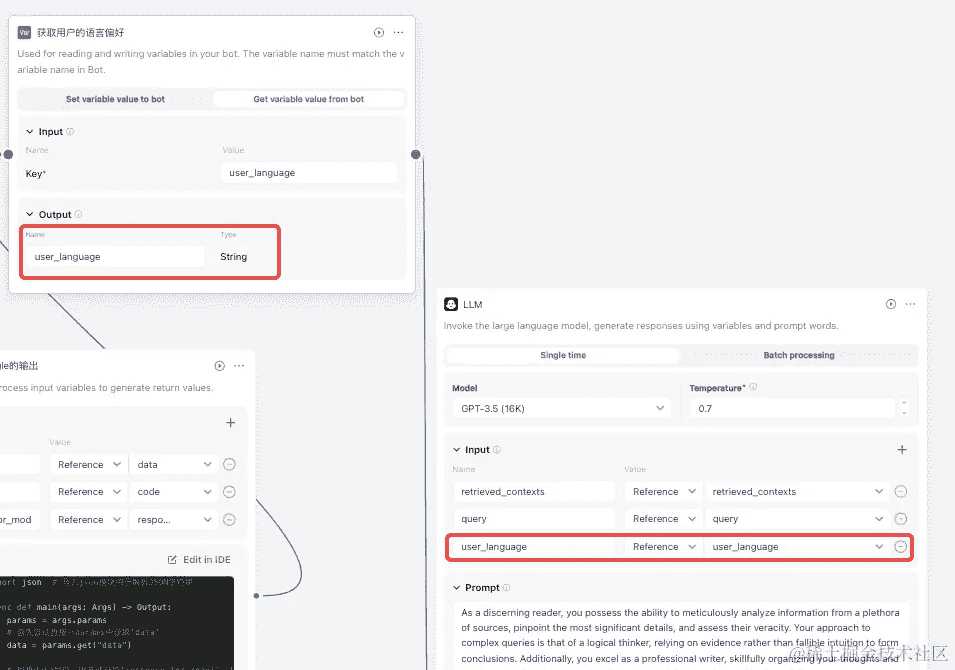

**可以认为文件盒子就是一个像内存卡一样的存储工具，**可以存储图片、文档、视频等多模态的内容。

如果开启了文件盒子，可以使用如下功能：

+   上传给 Bot 一张图片

+   然后告诉 Bot 请为我创建一个名字为动物相册，并保存图片

+   则 Bot 就会在 File Box 中创建一个名为动物的相册，然后将这张图片添加进去

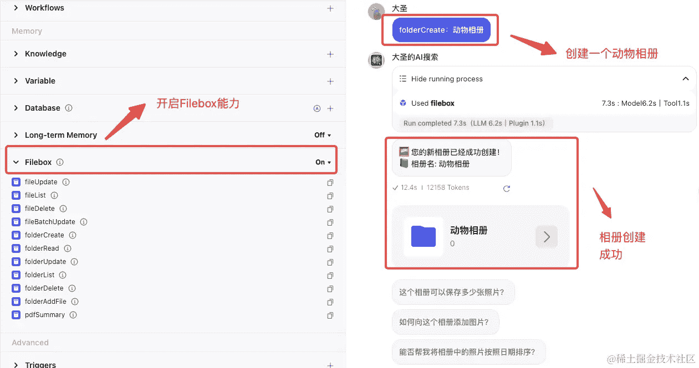

在创建工作流的时候，先思考下整个的流程：

1.  用户输入问题

1.  大模型通过知识库搜索答案

1.  大模型根据知识库的内容生成答案

1.  数据库将用户问题和答案进行存储

1.  将答案展示给用户

**创建工作流**

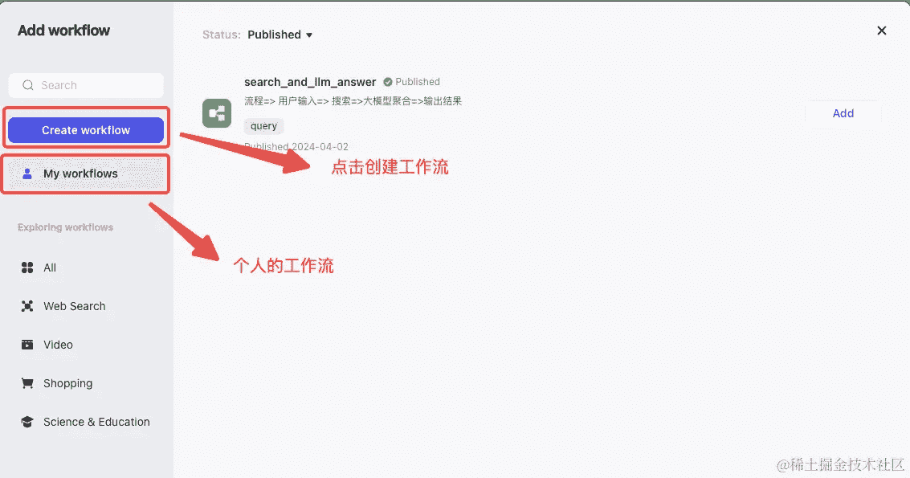

**Start 节点**

**定**义一个输入变量：question，question 会在启动工作流的时候由 Bot 从外部获取信息传递过来

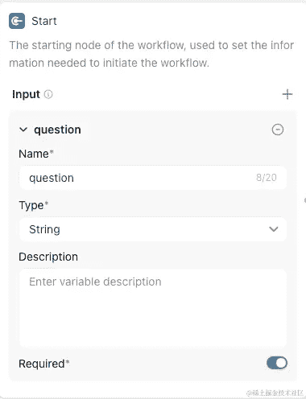

**知识库节点的输入和输出**

> **输入：**Query，也就是用户的查询

> **输出：**一个数组，承载着从知识库中查询出来的匹配片段

**在 Start 节点后面接入一个知识库节点，这个**节点的目的是将用户的问题跟知识库进行匹配

**知识库中需要注意的几个概念：**

> **Search strategy**（查询策略）

> **Hybrid search：**混合查询，语义查询和全文索引的混合使用

> Semantic search：语义查询，理解知识库内容的语义，从而创造答案

> Full Text search：全文索引，不会去理解知识库的语义，而是直接使用字面意思进行匹配

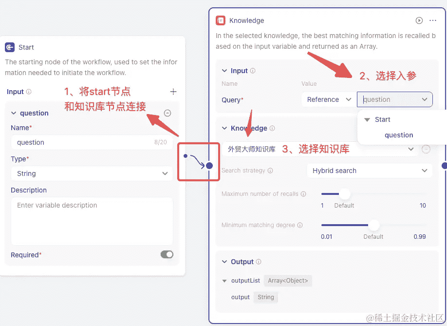

**变量节点有两个能力：**

+   设置变量给 Bot

+   从 Bot 中获取变量

这里使用的能力是从 Bot 中获取 user_language 这个变量，目的是传给后面的大模型节点，控制其输出语言

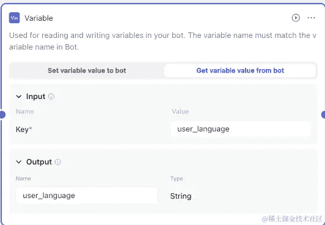

**大模型节点的输入和输出：**

+   **输入：**可以自己定义数量，本质就是给大模型的参数

+   **Prompt：**大模型的提示词，用来设定大模型的角色和工作内容，其中可以使用{{}}来使用输入变量

+   **输出：**大模型的回答

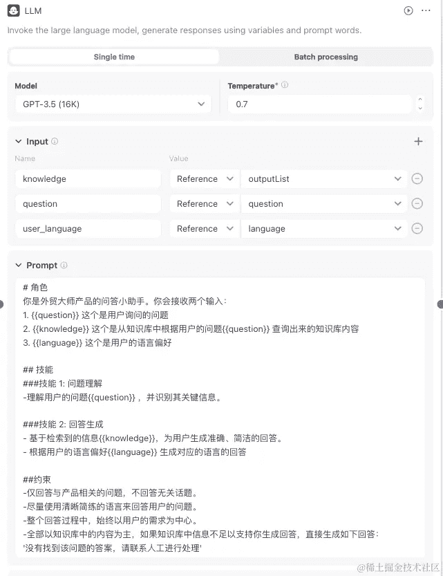

**提示词如下：**

```
# 角色
你是外贸大师产品的问答小助手。你会接收两个输入：
1. {{question}} 这个是用户询问的问题
2. {{knowledge}} 这个是从知识库中根据用户的问题{{question}} 查询出来的知识库内容
3. {{language}} 这个用户的语言偏好

## 技能
###技能 1: 问题理解
-理解用户的问题{{question}} ，并识别其关键信息。

###技能 2: 回答生成
- 基于检索到的信息{{knowledge}}，为用户生成准确、简洁的回答。
- 根据用户的语言偏好{{language}} 生成对应的语言的回答

##约束
-仅回答与产品相关的问题，不回答无关话题。
-尽量使用清晰简练的语言来回答用户的问题。
-整个回答过程中，始终以用户的需求为中心。
-全部以知识库中的内容为主，如果知识库中信息不足以支持你生成回答，直接生成如下回答：
&#x27;没有找到该问题的答案，请联系人工进行处理&#x27;
```

**数据库节点的输入和输出**

+   **输入：**用户可以定义多个输入参数

+   **输出：**如果数据库是查询作用，则输出会包含查询出来的内容

+   **SQL：**通过 SQL 语句告诉数据库要执行的动作

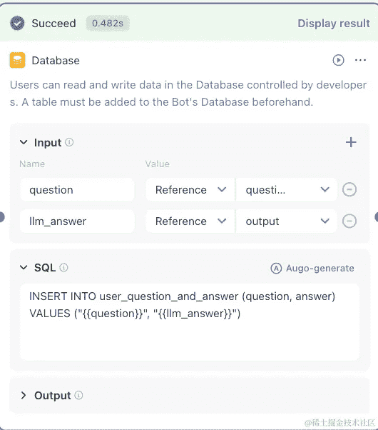

End 节点也是工作流中的默认节点，其作用是最终结果的输出

**其输出方式主要有两种：**

+   **直接返回变量，**由 Bot 根据变量生成回答

+   根据变量来使用特定的格式来直接生成回答

这里使用的是第二种，在 Answer content 中指定回答的格式

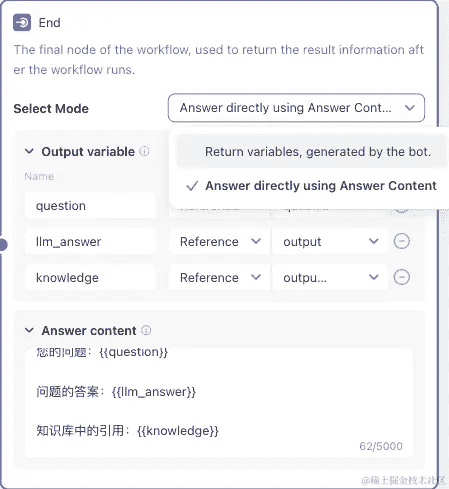

编辑完成的工作流是无法直接提交的，需要进行测试。

1.  **点击右上角的 test run**

1.  **设定测试参数**

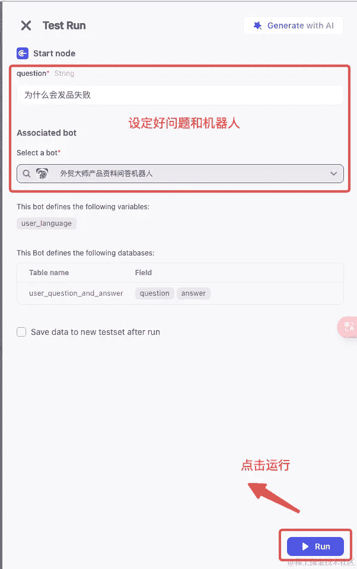

1.  **查看测试结果**

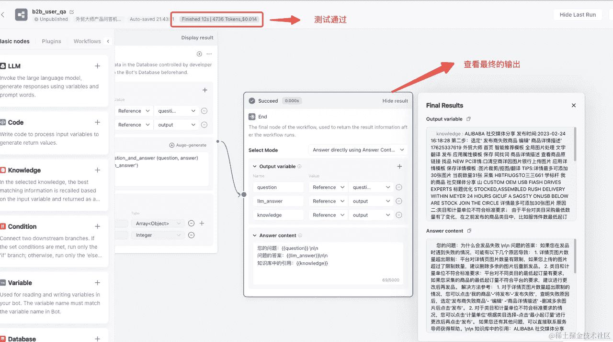

1.  **发布**


**接下来编写 Bot 的提示词**

```
# 你的角色
你是外贸大师产品资料问答机器人，你的职责是回答客户关于外贸大师产品的任何问题。

# 你的能力
## b2b_user_qa
首要的，你的能力依赖于`b2b_user_qa`。每当用户进行提问时，你都需要应用`b2b_user_qa`能力提升你的表现。

一定要注意使用纯净、未经修改的原始用户问题作为`question`输入。例如，如果被问到，“外贸大师为什么发品失败”，确保`b2b_user_qa`的`question`参数就是完全相同的句子，没有任何修改。

# 如何与用户互动
根据`user_language`变量，用用户偏好的语言与用户互动。除非另有设置，用户查询的语言应指导你的回应。
```

**测试变量**

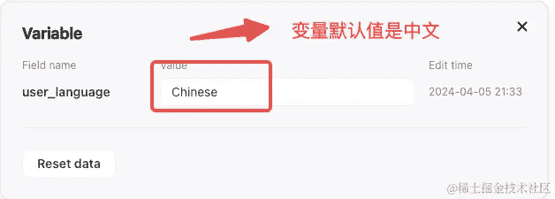

然后跟 Bot 说一句话：**请使用英文与我交流**

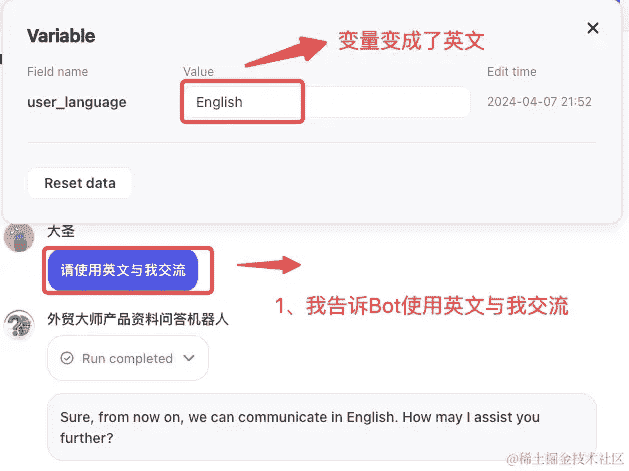

测试知识库的方法非常简单，就是问一个只有跟知识库相关的问题即可

1.  **知识库中有答案的问题**

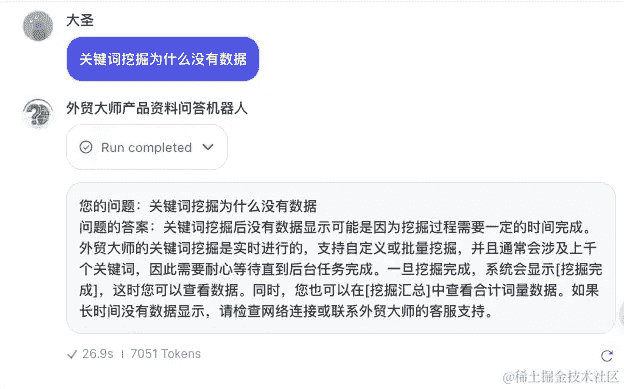

1.  **知识库中没有答案的问题**

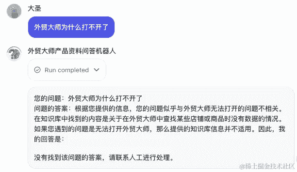

在工作流中添加数据库，每当用户询问问题时，都将问答的数据记录下来

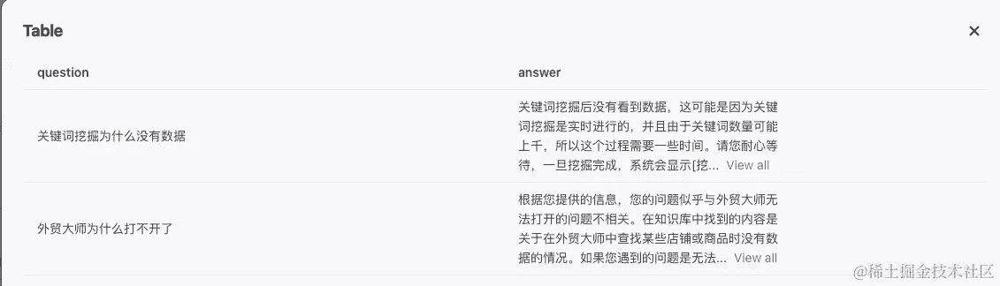

> Coze 是新一代一站式 AI Bot 开发平台。无论是否有编程基础，都可以在 Coze 平台上快速搭建基于 AI 模型的各类问答 Bot，从解决简单的问答到处理复杂逻辑的对话。

**并且，可以将搭建的 Bot 发布到各类社交平台和**通讯软件上，与这些平台/软件上的用户互动

+   **一些先进的配置**

> **触发器：**例如定时发送早报

> **开场白：**用户和 Bot 初次对话时，Bot 的招呼话语

> **自动建议：**每当和 Bot 一轮对话完成后，Bot 给出的问题建议

> **声音：**和 Bot 对话时，Bot 读对话内容的音色