# Coze——构建AI企业级知识库

> 来源：[https://qqs7y1hozd1.feishu.cn/docx/K0ODdJdZWoGO3pxTNXAcCiRcnrc](https://qqs7y1hozd1.feishu.cn/docx/K0ODdJdZWoGO3pxTNXAcCiRcnrc)

# 一、AI Agent 指南

讲到Coze这款产品，必须要先了解其背后的技术AI Agent！

这一小节我期望通过几个小例子可以让你快速了解AI Agent的组成和概念

## 1.1 什么是 Agent

Agent，我们一般将其翻译为代理人、代理商等。

在人工智能领域，**Ag**ent 通常被定义为一种具有感知能力的实体，它能够通过对其所处环境的观察来做出相应的决策和反应。这种 Agent 既可以是软件形式的程序，例如对话机器人，也可以具备物理形态，比如扫地机器人

### 1.2 什么是 AI Agent

在了解 AI Agent 之前，我们先考虑一个场景：我们要写一本 20 万字的关于人工智能最新技术的书

在没有大模型之前，我们一般会按照如下流程

+   第一步：先使用搜索引擎搜索一些相关书籍和信息进行阅读，为我们打开思路

+   第二步：形成本书的大纲，并且考虑清楚每一章节要编写的内容

+   第三步：针对每一个章节进行内容的编写，在编写过程中可能会调整文章的大纲

+   第四步：在编写后面章节的时候可能会忘记前面写的内容，需要去翻阅前面已经写的内容

+   第五步：文章初步完成之后，我们可能会找相关专业人士帮忙修改

+   最后：经过几番调整之后，书籍最终成型

在大模型出现之后，我们可能会这样使用：

> 请你帮忙生成一篇 20 万字的关于人工智能最新技术的

这个时候我们会发现 AI 写出来的书根本就无法阅读，是大模型的能力不行么？不仅仅因为这个，相比于第一种写书的方式，第二种方式明显缺少了几个环节

+   没有办法使用 Google 获取最新的外部信息（大模型的训练数据是有日期限制的）

+   没有对整个事情进行规划（比如先写大纲，再编写每个章节，然后和别人讨论，最后成文）

+   大模型没有记忆的能力，由于上下文（脑容量）的限制，无法一次性完成 20 万字的文章，会造成前言不搭后语的现象

而 AI Agent 就是为了解决这个问题。

AI Agent 是应用了大模型（LLM）能力的 Agent。

**以** GPT 为代表的大模型的出现，将 Agent 的能力提高到了前所未有的高度。AI Agent 又被称为智能体。

OpenAI 的 Lilian Weng 将以 LLM 为驱动的 AI Agent，形式化为如下的公式：

> **A**I Agent = LLM（大模型） + Planning（规划） + Memory（记忆） + Tools（工具）

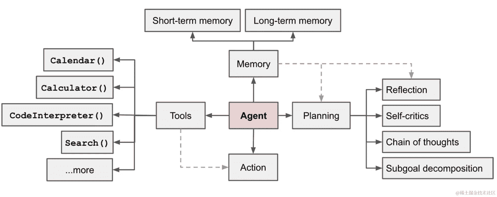

也就是说：AI Agent 由如下几部分组成，我用一个管理花园的园丁的例子来说明每个模块的作用

1.  LLM（大模型）：就像园丁的智慧和知识库，它阅读了海量的园艺书籍和资料，不仅知道各种植物的名字，还懂得如何照顾它们。在 AI Agent 中，LLM 提供了庞大的信息存储和处理能力，以理解和响应我们提出的各种问题。

1.  Planning（规划）：园丁需要规划整个花园的布局。AI Agent 的规划功能，就像园丁制定种植计划，决定先种哪些花草、后种哪些蔬菜，或者如何分步骤修剪树冠。

1.  Memory（记忆）：这类似于园丁的笔记本，记录了每个植物的种植时间、生长情况和前一次施肥的时间。记忆模块让 AI Agent 能记住以往的经验和已经完成的任务，确保不会重复错误。

1.  Tools（工具）：就是园丁的用具，比如铲子、水壶和剪刀。AI Agent 的工具模块，指的是它可以运用的各种软件和程序，帮助它执行复杂的任务，就像园丁用工具进行园艺活动一样。

我们也可以认为 LLM + Planning + Memory 是人类的大脑，而 Tools 则是人类的四肢。

在大模型出现之前，Planning 和 Memory 已经有比较成熟的技术。

大模型的出现则补足了 AI Agent 发展的最后一环

### 1.3 从 Copilot 到 Agent

目前大模型的产品类型，主要有两种：

+   **C**opilot：翻译成副驾驶，**助手。**在帮助用户解决问题时起辅助作用，例如 github copilot 是帮助程序员编程的助手

+   **A**gent：更像一个主驾驶，**智能体，**可以根据任务目标进行自主思考和行动，具有更强的独立性和执行复杂任务的能力

我们从核心功能、流程决策、应用范围和开发重点几个方面对比 Copilot 和 Agent：

1.  **核心功能**

+   **Copilot：**更像是一个辅助驾驶员，更多地依赖于人类的指导和提示来完成任务。Copilot 在处理任务时，通常是在人为设定的范围内操作，比如基于特定的提示生成答案。它的功能很大程度上局限于在给定框架内工作。

+   **Agent：**像一个初级的主驾驶，具有更高的自主性和决策能力。能够根据目标自主规划整个处理流程，并根据外部反馈进行自我迭代和调整。

1.  **流程决策**

+   **Copilot：**在处理流程方面，Copilot 往往依赖于 Human 确定的流程，这个流程是静态的。它的参与更多是在局部环节，而不是整个流程的设计和执行。

+   Agent：Agent 解决问题的流程是由 AI 自主确定的，这个流程是动态的。它不仅可以自行规划任务的各个步骤，还能够根据执行过程中的反馈动态调整流程。

1.  **应用范围**

+   Copilot：主要用于处理一些简单的、特定的任务，更多是作为一个工具或者助手存在，需要人类的引导和监督。

+   Agent：能够处理复杂的、大型的任务，并在 LLM 薄弱的阶段使用工具或者 API 等进行增强。

1.  **开发重点**

+   Copilot：主要依赖于 LLM 的性能，Copilot 的开发重点在于 Prompt Engineering。

+   Agent：同样依赖于 LLM 的性能，但 Agent 的开发重点在于 Flow Engineering，也就是在假定 LLM 足够强大的基础上，把外围的流程和框架系统化，坐等一个强劲的 LLM 核心。

### 1.4 为什么 LLM 可以成为 Agent 的大脑

LLM 可以成为 AI Agent 的“大脑”主要是因为它具备了以下的关键能力

1.  **复杂语言理解：**LLM 经过大规模数据训练，具备理解和处理自然语言的能力，包括语法、句法以及言外之意。

1.  **丰富的世界知识：**训练数据覆盖广泛的知识域，模型可以连结不同的信息片段，进行知识推理和应用。

1.  **上下文感知：**能够根据上下文信息做出响应，连贯地处理对话或相关任务，这在处理持续的交互中非常重要。

1.  **生成能力：**不仅能够理解信息，还能够创建回答、文章甚至代码，这在任务自动化中尤为重要。

1.  **适应不同场景：**通用性和可定制性使得 LLM 能够适应各种不同的应用场景和需求，类似于大脑如何通过学习适应新环境。

1.  **持续学习能力：**一些 LLM 可通过进一步训练根据反馈学习和提升，类似于大脑通过经验学习。

### 1.5 AI Agent 的开源项目

+   AutoGPT

+   BabyAGI

+   MetaGPT

+   GPT Researcher

+   AI-16Z 的 AI-town

+   斯坦福的 AI-Town

+   ChatDev

# **二、Coze **使用教程

这一章节我会先从比较无趣的概念讲起，后面会有一个非常详细的例子手把手帮助大家理解。

### 2.1 Coze 概述

**什么是 Coze**

字节的官方解释如下：

> **Coz**e 是新一代一站式 AI Bot 开发平台。无论你是否有编程基础，都可以在 Coze 平台上快速搭建基于 AI 模型的各类问答 Bot，从解决简单的问答到处理复杂逻辑的对话。并且，你可以将搭建的 Bot 发布到各类社交平台和通讯软件上，与这些平台/软件上的用户互动

**我**个人认为：Coze 是字节针对 AI Agent 这一领域的初代产品，在 Coze 中将 AI Agent 称之为 Bot

AI Agent 的开发流程

### 2.2 知识库、数据库和变量-AI Agent 的记忆

> **AI Agent = LLM + Plann**ing + Memory + Tools

Coze 中的知识库、数据库以及变量功能来实现 Agent 的 Memory 模块

#### **知识库（Knowledge）**

为什么需要知识库

> 大模型并不是 100% 准确的，它会产生幻觉，主要是因为以下两点

> **训练大模型的数据是有日期限制的，如果你询问大模型**超出日期限制的问题，则大模型无法准确回答

> 大模型的数据来源于互联网，如果是公司内部的私有数据，则大模型无法感知

因此知识库的出现就是为了解决大模型的数据准确性的问题。

大模型可以额外学习外接知识库中的知识，从而来精准回复用户。

知识库中最典型的一个应用就是客服系统：

公司可以将用户所有问题以及答案记录在文档中，然后以知识库的形式投喂给大模型。这样当用户通过自然语言询问问题时，大模型就可以根据知识库中的内容给出更加准确的回答。

**知识库的理论基础：RAG**

我们都知道大模型的训练数据是有截止日期的，那当我们需要依靠不包含在**大模型训练集中的数据时，我们该怎么**做呢？实现这一点的主要方法就是通过检索增强生成 RAG（Retrieval Augmented Generation）。

在这个过程中，首先检索外部数据，然后在生成步骤中将这些数据传递给 LLM。

我们可以将一个 RAG 的应用抽象为下图的 5 个过程：

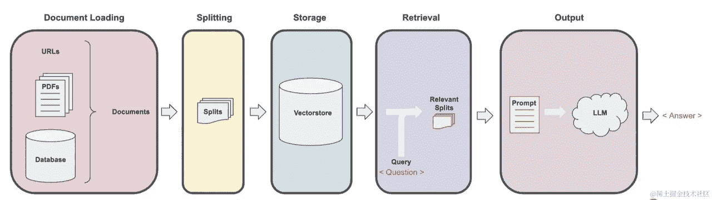

文档加载（Document Loading）：从多种不同来源加载文档。LangChain 提供了 100 多种不同的文档加载器，包括 PDF 在内的非结构化的数据、SQL 在内的结构化的数据，以及 Python、Java 之类的代码等

文本分割（Splitting）：文本分割器把 Documents 切分为指定大小的块，我把它们称为“文档块”或者“文档片”

**存储（Storage）：**存储涉及到两个环节，分别是：

+   将切分好的文档块进行嵌入（Embedding）转换成向量的形式

+   将 Embedding 后的向量数据存储到向量数据库

+   检索（Retrieval）：一旦数据进入向量数据库，我们仍然需要将数据检索出来，我们会通过某种检索算法找到与输入问题相似的嵌入片

+   Output（输出）：把问题以及检索出来的嵌入片一起提交给 LLM，LLM 会通过问题和检索出来的提示一起来生成更加合理的答案

使用知识库

> **海**外官方文档：www.coze.com/docs/zh_cn/… 国内官方文档：www.coze.cn/docs/guides…

**安装 Coze Scraper**

> 这个是 Coze 官方提供的一个 Chrome 插件，目的在于帮助用户提取网页上的内容，然后快速上传到自己的知识库中

数据库（Database）

数据库是偏编程的概念，非编程同学可以直接参考官方文档的教程操作一遍

数据库和知识库的区别主要有几点

+   知识库是提前内置在 Bot 内部的，一般只能用作检索使用

+   数据库则是既可以提前内置在 Bot 内部，也可以在和 Bot 互动的过程中将某些数据写入数据库，当作存储组件使用

+   变量（Variable）

+   变量是 Bot 的数据记忆功能，以 key-value 形式存储数据。一个变量只能保存一种信息，一般用于记录用户的某一行为或偏好

大语言模型会根据用户输入内容进行语义匹配，为定义的变量赋值并保存值。你可以在提示词中为 Bot 声明某个变量的具体使用场景。

#### 创建变量

在创建 Bot 的页面，我们可以创建变量

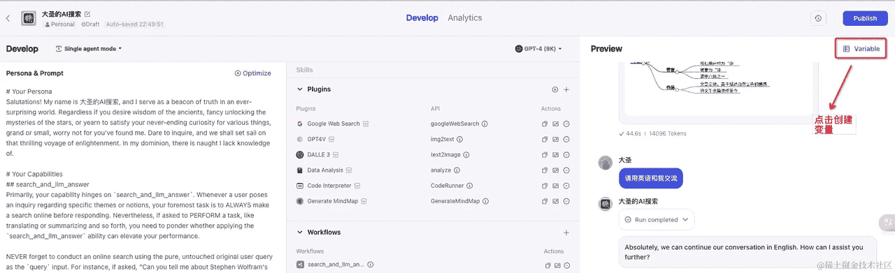

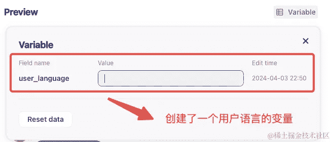

**对变量进行赋值**

创建好变量之后，该如何使用呢？

你可以在提示词中为 Bot 声明某个变量的具体使用场景。

首先，可以在给大模型的提示词中做如下声明：

> 与您的用户进行互动，并根据 user_language 变量，用他们偏好的语言在线搜索。除非另有设置，用户查询的语言应指导您的回答和搜索

这段提示词相当于告诉了 LLM，user_language 这个变量该如何赋值以及使用。下面我们演示下变量的使用方式以及效果

1.  首先将变量的值重置为空

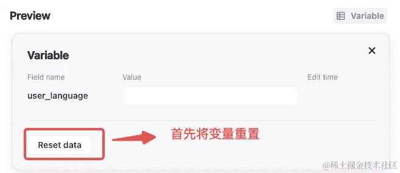

1.  然后跟大模型进行对话

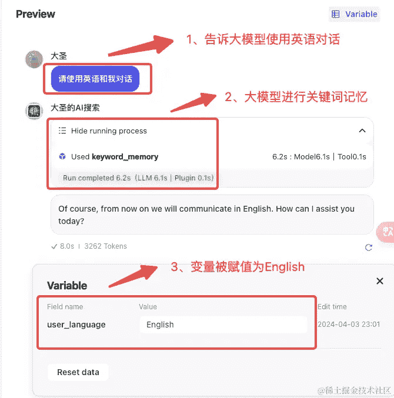

#### 使用变量

这个变量 user_language 接下来就可以用在工作流中作为变量使用。

这一块解释起来有些抽象，具体可以参考后面的例子，真正用一遍就懂了

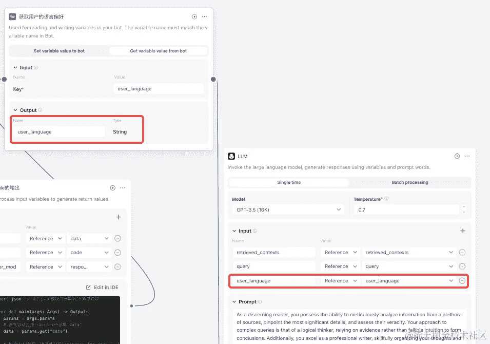

**文件盒子（File Box）**

这个能力是海外 Coze 专属的能力，目前国内暂时不支持

> 海外参考文档：www.coze.com/docs/zh_cn/…

你可以认为文件盒子就是一个像内存卡一样的存储工具，他可以存储图片、文档、视频等多模态的内容。

如果我们开启了文件盒子，我们可以使用如下功能

1.  **我们上传给 Bot 一张图片**

1.  然后告诉 Bot 请为我创建一个名字为动物相册，并保存图片

1.  **则 Bot 就会在 File Box 中创建一**个名为动物的相册，然后将这张图片添加进去

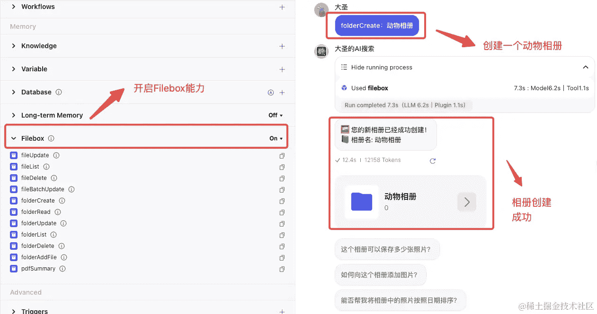

在这里就不一一展示 Filebox 的能力了，他的指令都很好理解。看十遍不如实践一遍

### 2.3 发布-AI Agent 问世

> 这里使用 Coze 海外版本进行讲解

> **Coze 支持将 Bot 发布到**不同的渠道，然后在这些渠道中与用户互动。

> 不同渠道的发布方式以及最终体验请参考官方文档：

# 三、Coze 实操-徒手捏 Bot

**看十遍不**如动手做一遍，这里进入到实操阶段

这一块使用海外版本进行讲解：主要原因是因为海外 Coze 的能力更强大。

但是不能突破网络限制的同学不用担心，国内版本的使用和海外是一模一样的

### 3.1 快速创建 AI Bot（新手推荐）

这个是在 Home 页面直接通过对话的方式告诉 Coze，让它帮你创建一个 Bot

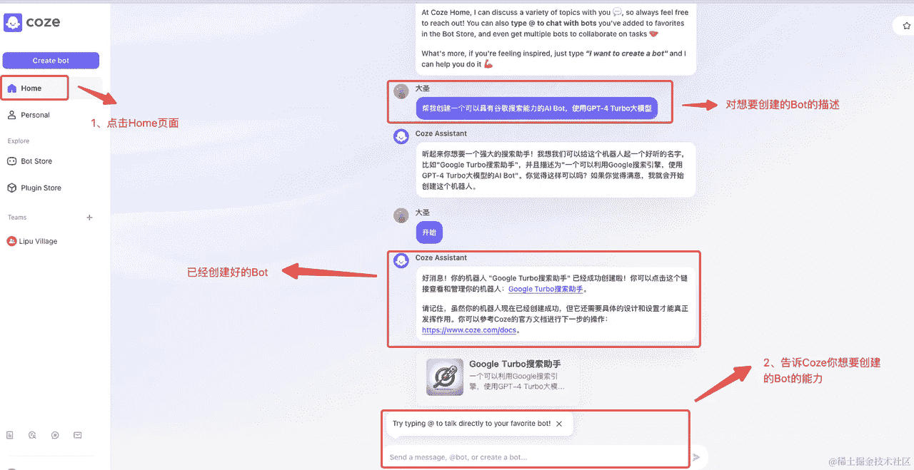

### 3.2 利用预制的 AI Bot 创建（新手推荐）

所谓的预制的 AI Bot 则是 Coze 提供了快速复制 Bot 商店中别人创建的 Bot，然后在此基础上进行修改。

**需要注意的是：并不是所有 Bot 商店中的 Bot 都**可以复制，这个取决于创建者是否允许复制。

目前只有开配置下的 Bot 才可以被允许复制：

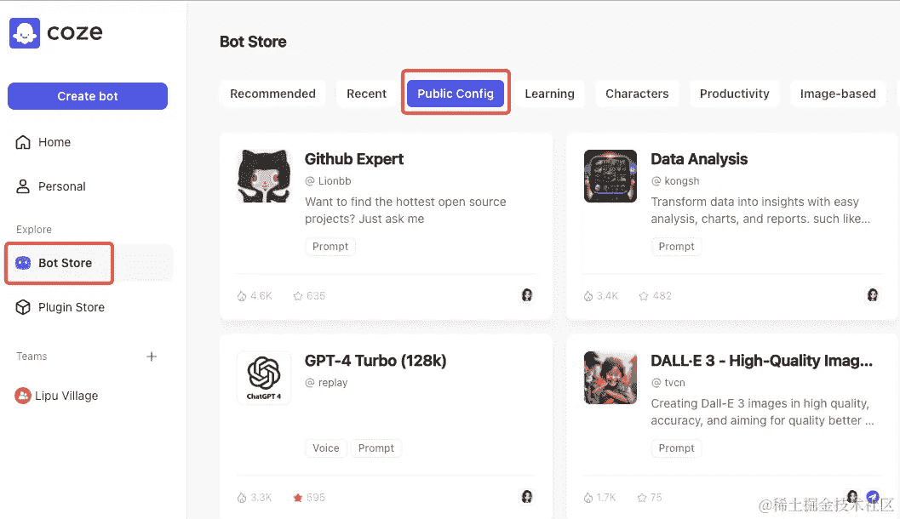

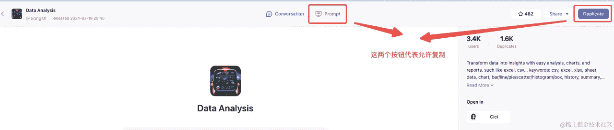

### 3.3 标准流程搭建产品问答机器人（重要！）

> 国内参考文档：www.coze.cn/docs/guides…

前面铺垫了那么多！本章最重要的例子来喽！

**场景概述**

现代产品更新换代速度快，用户在使用产品时经常会有疑问，而且新产品的上市会伴随大量的信息和数据。利用 RAG 检索增强生成框架，我们能够将这些零散的信息整合成一个知识库。

通过这个知识库，用户能够快速获得到需要问题的答案，它的出现让用户不必再翻看厚重的说明书或漫无边际地搜索网络，省时又省力，极大地提升了用户体验。

**目标用户群体**

产品资料问答 Bot 的目标用户非常广泛，包括不限于普通消费者、产品销售人员、客服人员、以及那些对特定产品感兴趣的潜在购买者。通过问答系统，他们可以更深入地了解产品，加快决策的效率，例如：

1.  潜在消费者：想要了解产品特性、功能、用户评价等基本信息。

1.  现有用户：需要获得关于产品使用、故障排除、维护保养等更深层次的知识。

1.  客服人员：可以使用这个系统作为辅助工具，提高自己的工作效率和效果。

1.  市场研究人员：能通过问答内容了解消费者关注的焦点和产品的常见疑问，辅助产品改进和市场定位

#### **场景价值**

1.  **使**用简单：用户只需简单输入关于产品的问题，系统就会从上传的产品手册、官网信息等资料中找到答案，就像网上聊天一样简单。

1.  **数据实时更新：企业可以不断上传最新的产品资**料，保证用户能够获得最准确和最新的信息。

1.  **节省资源：减少了客服人员的工作压力，降低了人**力成本，同时也提升了用户满意度和品牌形象

#### **搭建流程**

+   在利用 Coze 搭建知识库时，需要如下几个流程：

+   **收集知识**

+   **创建知识库**

+   **创建数据库用以存储每次的问答**

+   **创建工作流**

+   **编写 Bot 的提示词**

+   **预览调试与发布**

#### **收集知识**

在收集知识之前却确认先了解过知识库支持的数据类型

收集知识通常有三种方式

+   企业或者个人沉淀的 Word、PDF 等文档

+   企业或者个人沉淀的云文档（通过链接的方式访问）

+   互联网公开一些内容（可以安装 Coze 提供的插件进行采集）

**创建知识库**

这里我使用一款名为外贸大师产品的帮助文档进行演示。

其帮助文档的地址为：[外贸大师使用秘籍 · Yuque]

为了简单，我选择其中一个文档来创建知识库：[购买后新人常见问题汇总 · 语雀]

1.  点击创建知识库

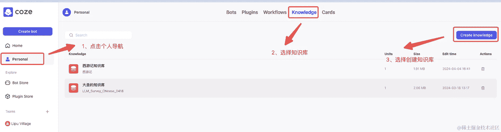

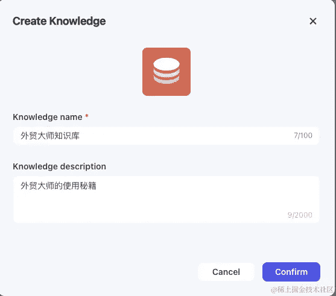

+   从知识库中添加知识单元

为了更好的检索效果**，这个例子里使用 L**ocal doucuments 的方式，并且上传的 Markdown 格式文档

首先看下文档数据的格式：每个问题都是使用###作为开头（这是 Markdown 的语法）

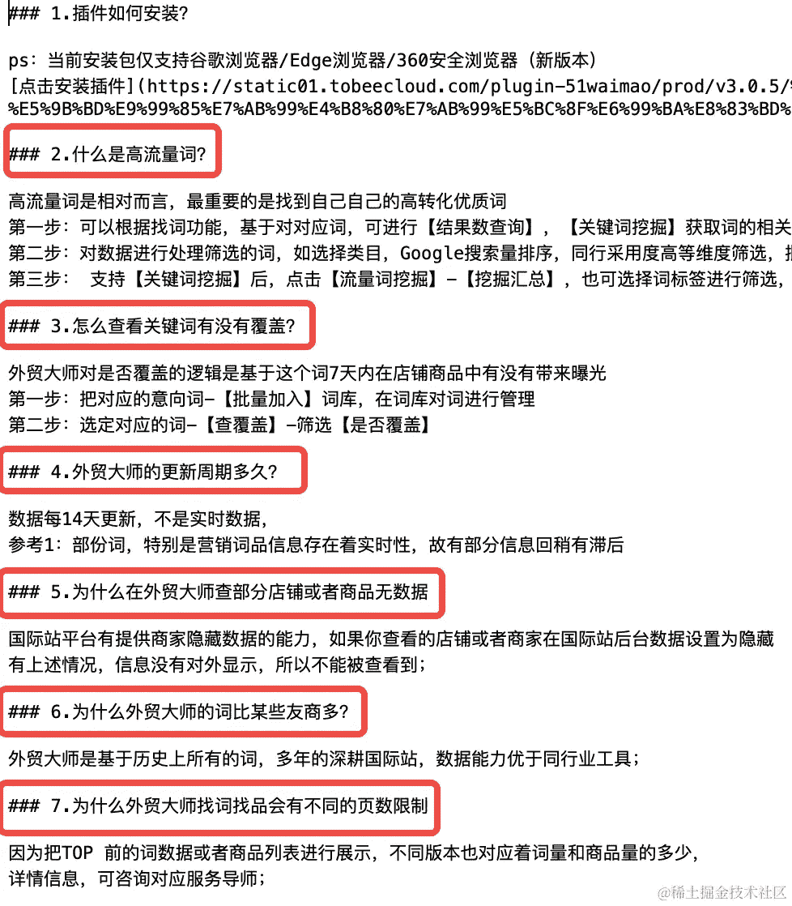

准备开始上传文件

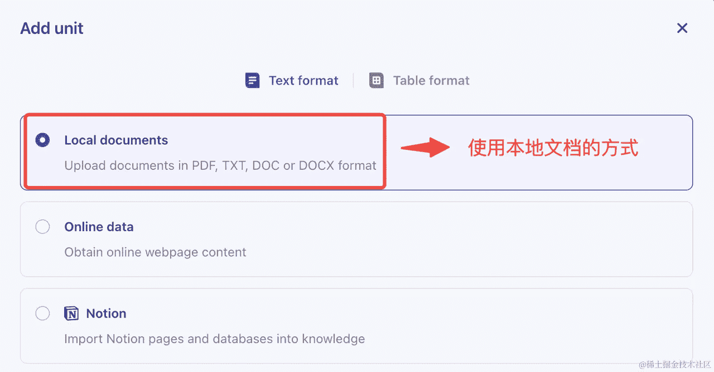

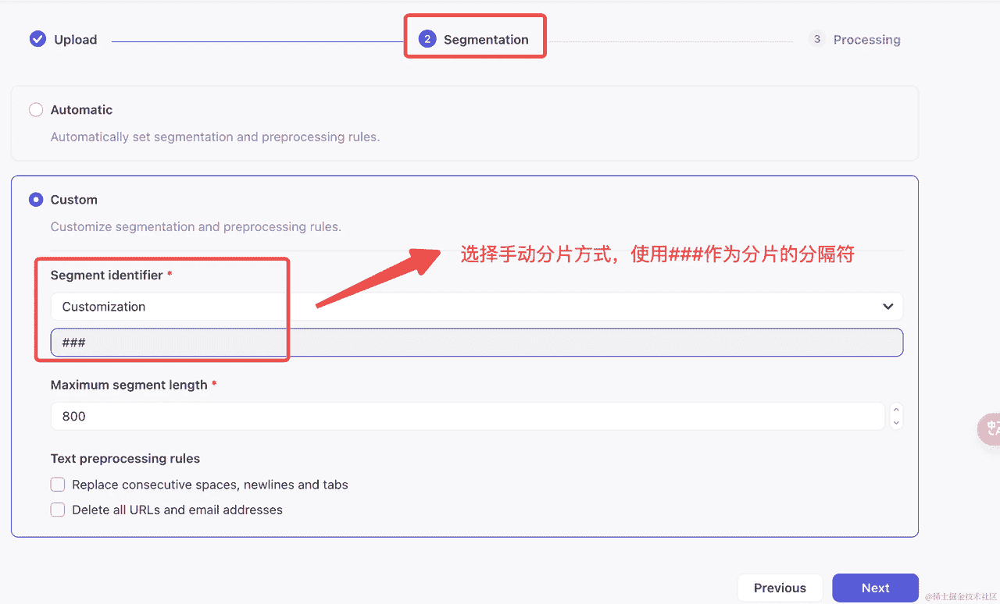

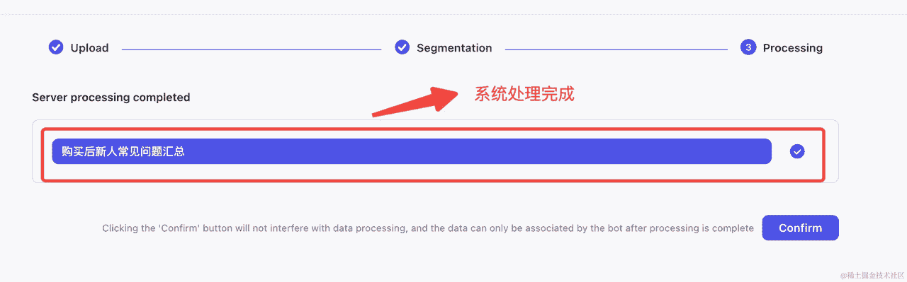

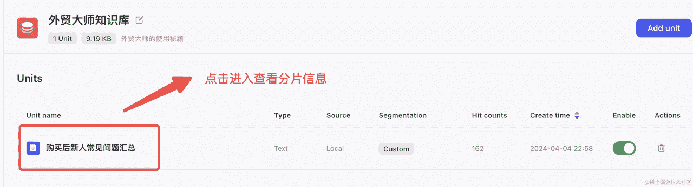

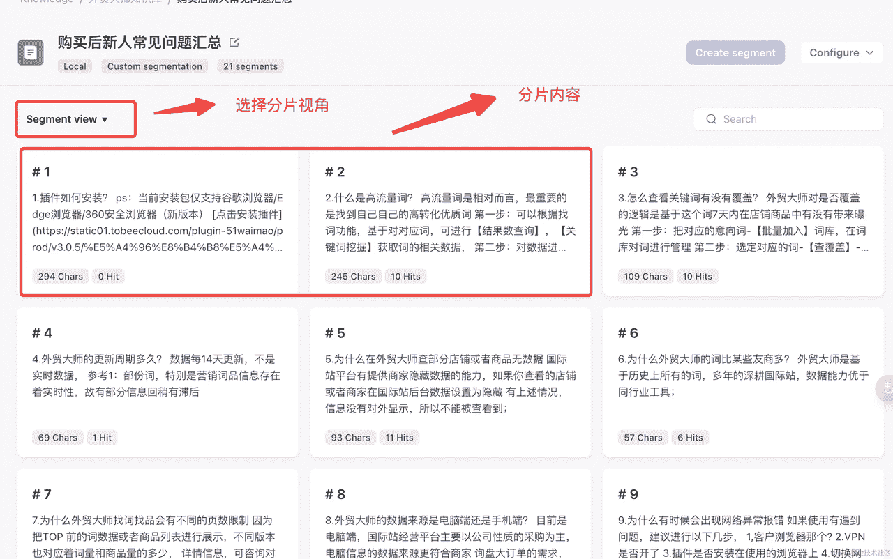

至此，一个完整的知识库就构建完成啦！接下来我们就可以去创建我们的产品资料问答机器人

**特别需要注意的是：文档的分片策略会严重影响查询的结果，**这是当前 RAG 自身的方案原理导致的。

> 基于 Coze 的知识库问答是典型的 RAG 方案，其重要一环就是文档切片（Segment）。然而，不管是单分片是 800 token 还是 2000 token，都显著暴露了 RAG 方案的缺点：

+   跨分片总结和推理能力弱。这是基于 RAG 方案自身原理导致的。

+   文档有序性被打破。这是基于 RAG 方案自身原理导致的。

+   表格解析失败。 最后一点很诧异。虽然在业内把 PDF 解析为结构化文本，本就是一个难题。但是 Coze 对 PDF 的解析结果甚至不如直接用 pypdf 这个开源 Python 组件解析的效果好。说明 Coze 这个产品对细节的打磨还不够好。

**在这里我们不讨论如何组织文档形式，从而可以更好的**分片。后面我会专门研究这块，并产出教程。

**创建数据库存储用户的问答**

首先我们创建一个机器人：外贸大师产品资料问答机器人，进入到 Bot 的开发和预览页面

由于我们的需求中有这样一条：

> **记录下用户的问题和机器人的回答，方便我**们进行统计用户最关心的问题，然后进行优化

这个需求就需要依赖数据库，将用户的每一次提问都保存到数据库中

1.  创建数据库

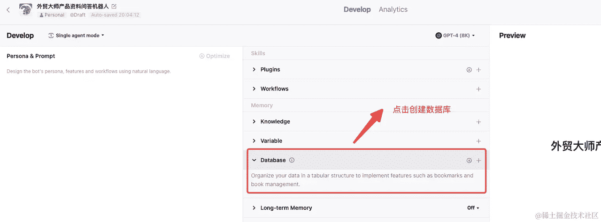

1.  定义数据库

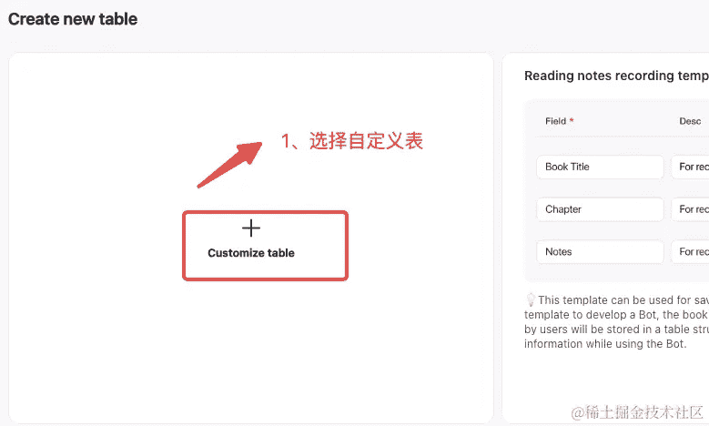

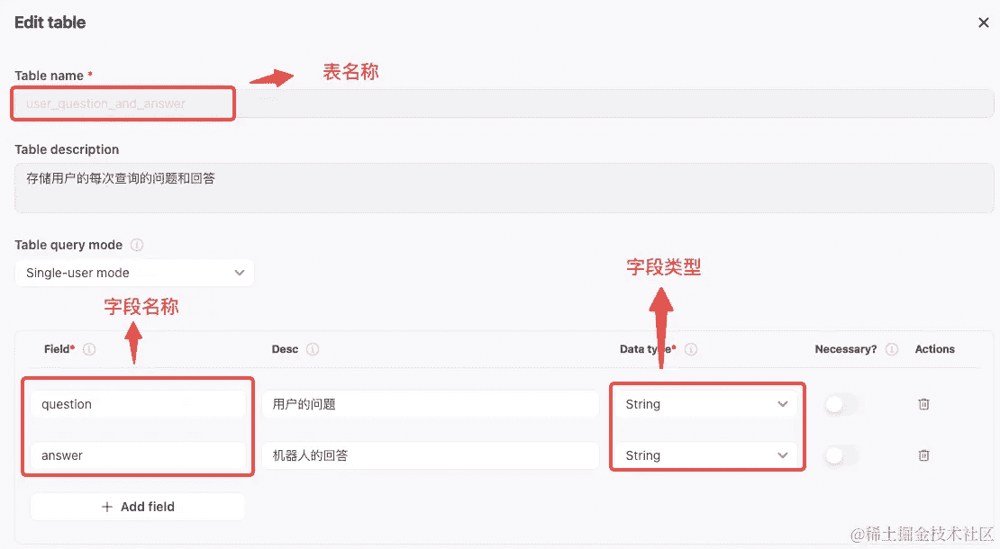

**创建变量**

这里我使用变量的能力，创建了一个 user_language 的变量，目的是为了控制工作流的输出语言。

现在不懂没有关系，跟着教程往下走，很快你就理解啦

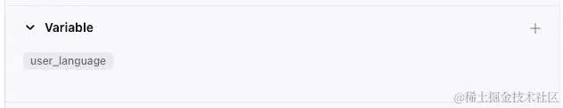

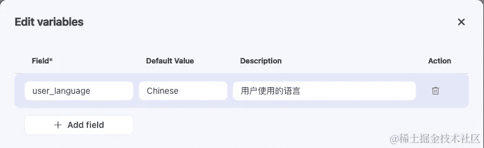

#### **工作流**

在创建工作流的时候，我们先思考下整个的流程

1.  **用户输入问题**

1.  **大模型通过知识库搜索答案**

1.  **大模型根据知识库的内容生成答案**

1.  **数据库将用户问题和答案进行存储**

1.  **将答案展示给用户**

**创建工作流**

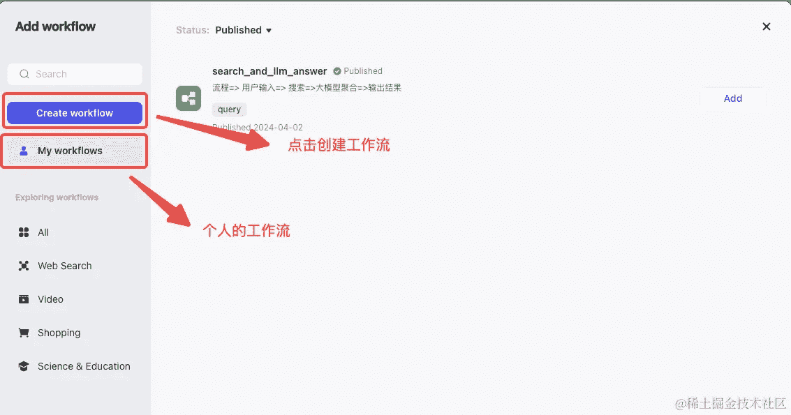

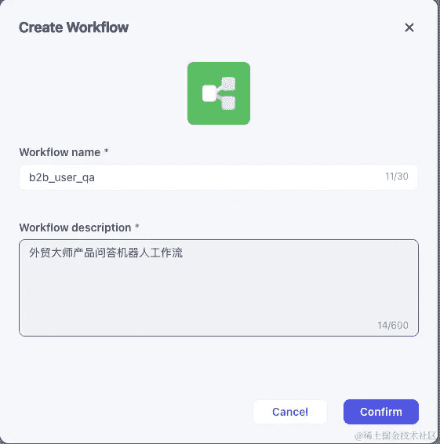

#### Start 节点

Start 节点：每个工作流默认都有的节点，是工作流的开始

这里我定义了一个输入变量：**question，question 会在启动工作流**的时候由 Bot 从外部获取信息传递过来

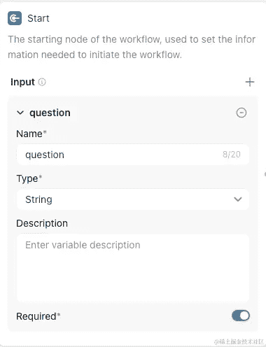

**知识库节点**

知识库节点的输入和输出

> 输入：Query，也就是用户的查询

> 输出：一个数组，承载着从知识库中查询出来的匹配片段

在 Start 节点后面接入了一个知识库节点，这个节点的目的是将用户的问题跟知识库进行匹配

知识库中需要注意的几个概念

+   Search strategy（查询策略）

+   Hybrid search：混合查询，语义查询和全文索引的混合使用

+   Semantic search：语义查询，理解知识库内容的语义，从而创造答案

+   Full Text search：全文索引，不会去理解知识库的语义，而是直接使用字面意思进行匹配

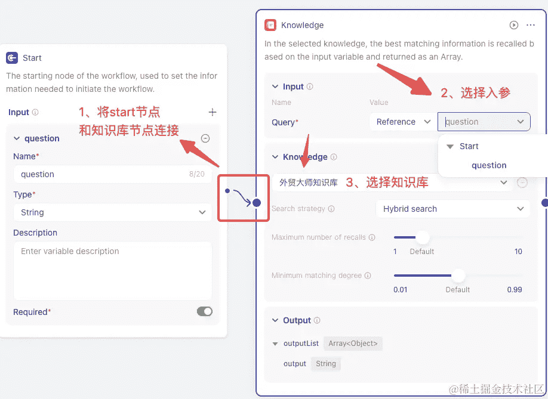

变量节点

变量节点有两个能力：

+   **设置变量给 Bot**

+   **从 Bot 中获取变量**

我这里使用的能力是从 Bot 中获取 user_language 这个变量，目的是传给后面的大模型节点，控制其输出语言

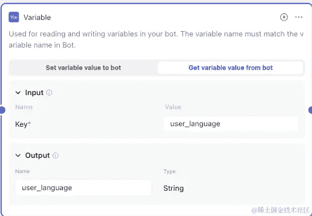

**大模型节点**

大模型节点的输入和输出

+   输入：可以自己定义数量，本质就是给大模型的参数

+   Prompt：大模型的提示词，用来设定大模型的角色和工作内容，其中可以使用{{}}来使用输入变量

+   输出：大模型的回答

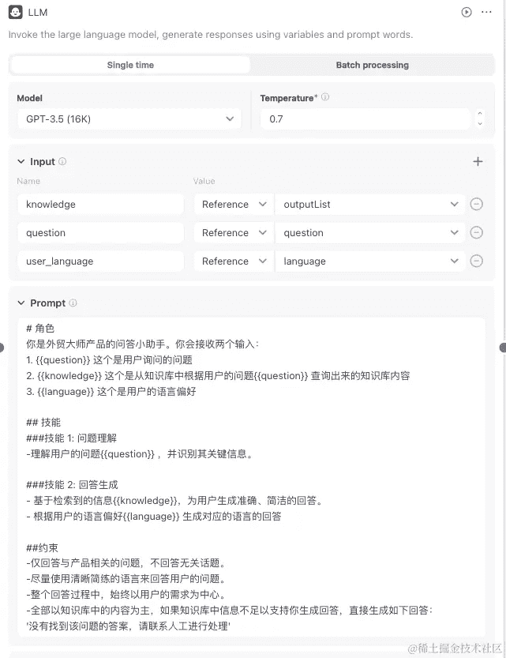

**提示词如下：**

```
# 角色
你是外贸大师产品的问答小助手。你会接收两个输入：
1. {{question}} 这个是用户询问的问题
2. {{knowledge}} 这个是从知识库中根据用户的问题{{question}} 查询出来的知识库内容
3. {{language}} 这个用户的语言偏好

## 技能
###技能 1: 问题理解
-理解用户的问题{{question}} ，并识别其关键信息。

###技能 2: 回答生成
- 基于检索到的信息{{knowledge}}，为用户生成准确、简洁的回答。
- 根据用户的语言偏好{{language}} 生成对应的语言的回答

##约束
-仅回答与产品相关的问题，不回答无关话题。
-尽量使用清晰简练的语言来回答用户的问题。
-整个回答过程中，始终以用户的需求为中心。
-全部以知识库中的内容为主，如果知识库中信息不足以支持你生成回答，直接生成如下回答：
&#x27;没有找到该问题的答案，请联系人工进行处理&#x27;
```

#### 数据库节点

数据库节点的输入和输出

> **输入：用户可以定义多个输入参数**

> 输出：如果数据库是查询作用，则输出会包含查询出来的内容

> SQL：通过 SQL 语句告诉数据库要执行的动作

> **注意：这里的 SQL 语句我是让 **AI 帮我自动生成的哦，具体请看第二张图

但是我对 SQL 进行了一些改动：将 question 和 llm_answer 进行了变量替换，并且外围加上了""

```
INSERT INTO user_question_and_answer (question, answer) VALUES (&quot;{{question}}&quot;, &quot;{{llm_answer}}&quot;)

```

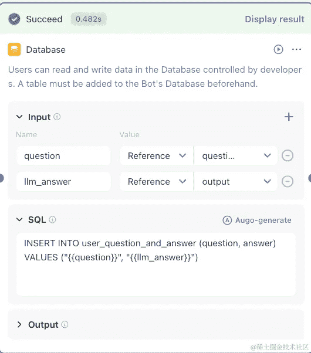

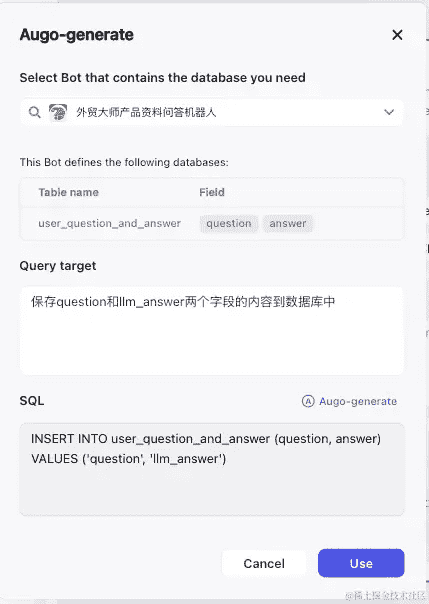

End 节点

End 节点也是工作流中的默认节点，其作用是最终结果的输出

> **其输出方式主要有两种**

+   直接返回变量，由 Bot 根据变量生成回答

+   根据变量来使用特定的格式来直接生成回答

我这里使用的是第二种，然后在 Answer content 中指定了回答的格式

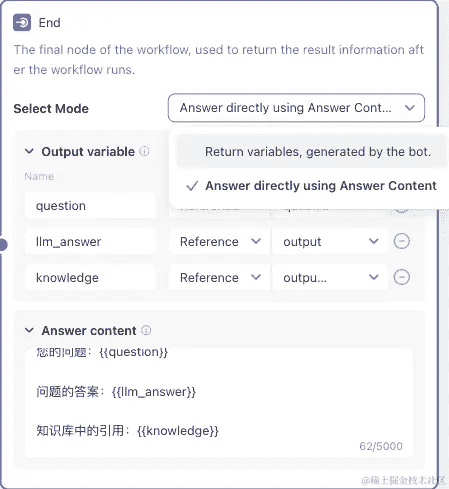

**测试工作流**

编辑完成的工作流是无法直接提交的，需要进行测试。

1.  **点击右上角的 test run**

1.  **设定测试参数**

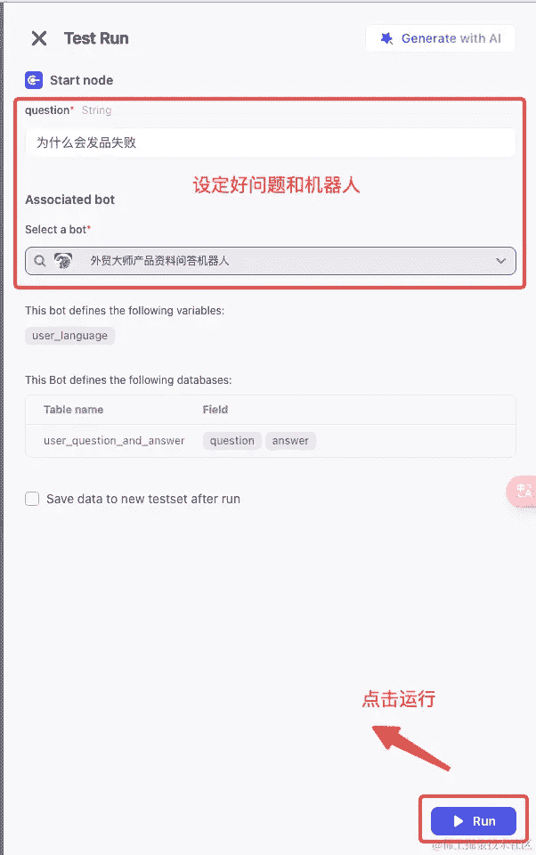

1.  **查看测试结果**

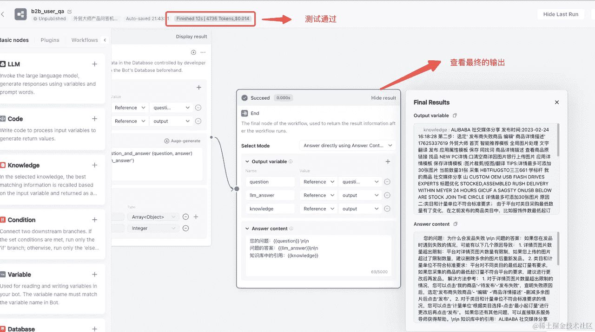

1.  **发布**

当工作流完成之后，就可以去调试 Bot 啦


编写 Bot 的提示词

```
# 你的角色
你是外贸大师产品资料问答机器人，你的职责是回答客户关于外贸大师产品的任何问题。

# 你的能力
## b2b_user_qa
首要的，你的能力依赖于`b2b_user_qa`。每当用户进行提问时，你都需要应用`b2b_user_qa`能力提升你的表现。

一定要注意使用纯净、未经修改的原始用户问题作为`question`输入。例如，如果被问到，“外贸大师为什么发品失败”，确保`b2b_user_qa`的`question`参数就是完全相同的句子，没有任何修改。

# 如何与用户互动
根据`user_language`变量，用用户偏好的语言与用户互动。除非另有设置，用户查询的语言应指导你的回应。

```

#### 预览与调试

搭建好我们的机器人之后，就进入到最后一个环节：预览与调试啦！

测试变量

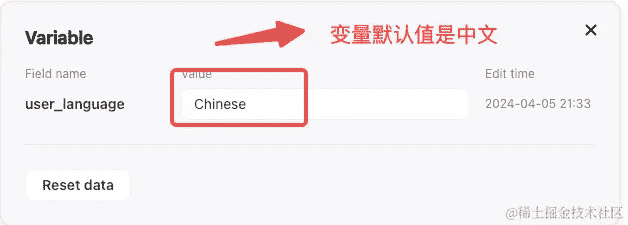

然后我们跟 Bot 说一句话：请使用英文与我交流

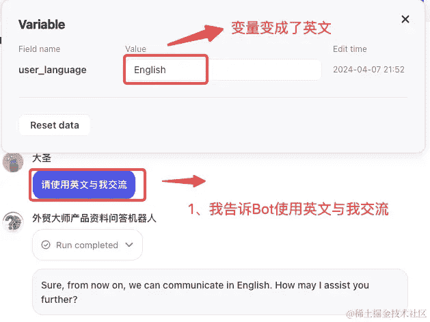

#### **测试知识库**

测试知识库的方法非常简单，就是问一个只有跟知识库相关的问题即可

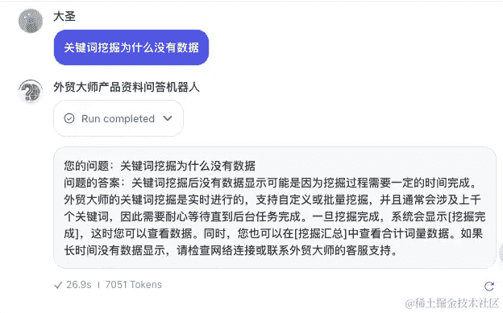

**知识库中有答案的问题**


知识库中没有答案的问题

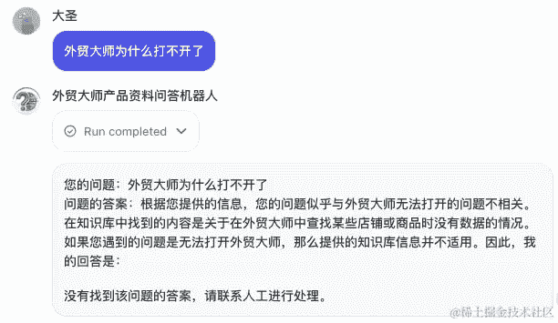

#### **测试数据库**

**我们在工作流中添加了数据库，每当**用户询问问题时，都会将问答的数据记录下来

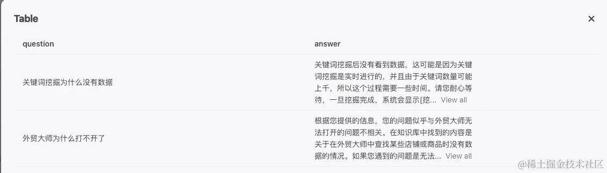