# coze搭建智能搜索agent

> 来源：[https://qqs7y1hozd1.feishu.cn/docx/RurGdxD3WoqUKCxz1REcgJTCn3f](https://qqs7y1hozd1.feishu.cn/docx/RurGdxD3WoqUKCxz1REcgJTCn3f)

Coze零代码搭建一个智能搜索智能体，根据关键词，自动进行全网搜索，筛选出最相关的内容，并进行智能总结，给出参考，提升你信息收集的效率，高时效、保姆级！

### 一、智能体搭建

接下来，手把手教大家如何在Coze上搭建一个属于自己的智能搜索智能体。

#### 1.1 工作流创建

##### 1.1.1 认识工作流界面

首先进入到Coze的官网，点击左侧的「工作空间」，然后点击「资源库」，再点击右上角的「资源」，选择工作流。

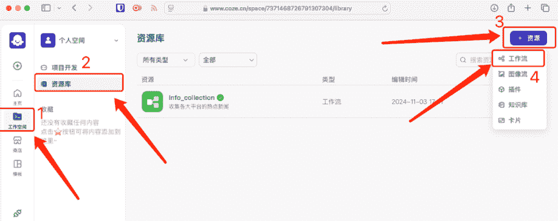

然后输入工作流名称，这里输入的是info_collection，也可以是其他的；输入工作流描述，我这里是调用各种搜索引擎，搜索相关信息。然后点击确认完成创建

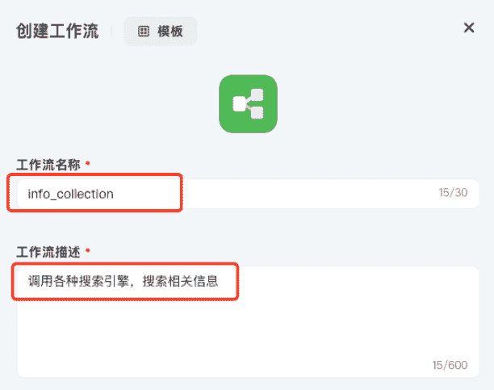

在工作流界面上，左侧有不同的节点，如：插件、大模型、代码、知识库、工作流等等。其中：

+   **插件**：可以通过API和外部数据与系统进行交互，能够增强模型能力。

+   **大模型**：顾名思义，就是大模型，基于大量不同的数据进行训练，具有强大的通用基础知识。

+   **代码**：可以通过代码来处理一个流程中的数据

+   **知识库**：可以理解为大模型的外挂知识库，可以有效解决模型的幻觉问题。

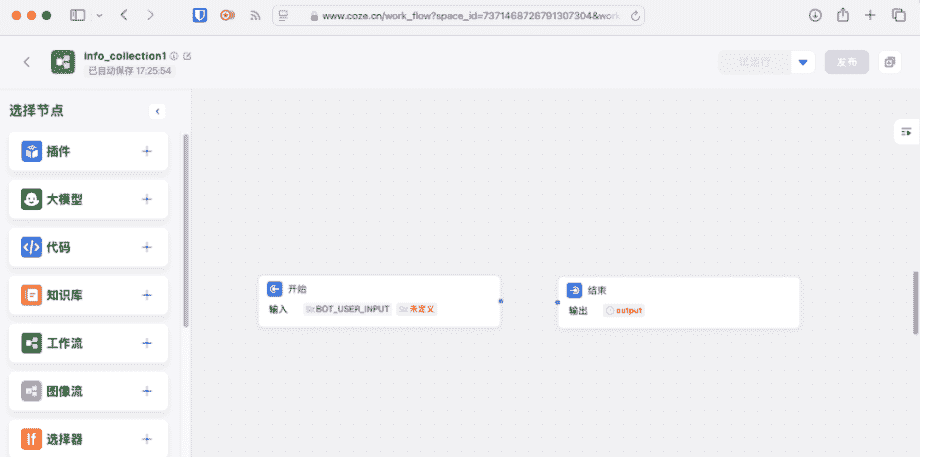

##### 1.1.2 添加搜索插件

首先，让我们来为工作流添加几个搜索插件，点击左侧的「插件」：

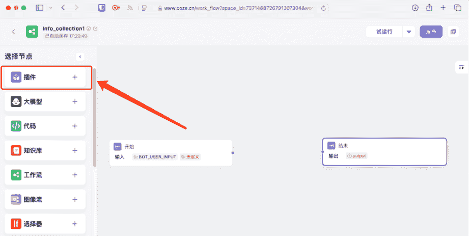

在弹出的窗口中，勾选上「仅显示官方插件」

在左侧文本框输入「搜索」，并点击「添加」。

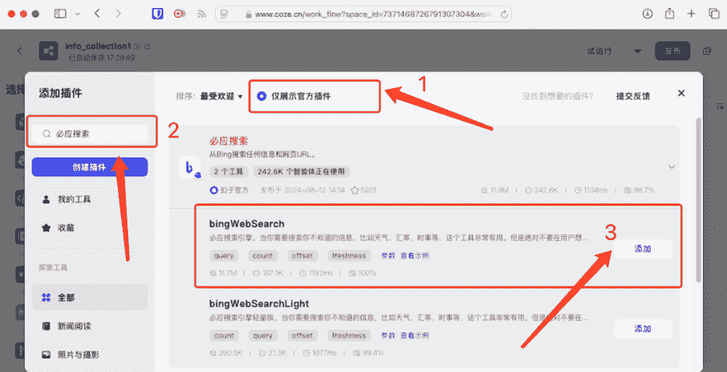

然后再输入「搜索」，点击「添加」

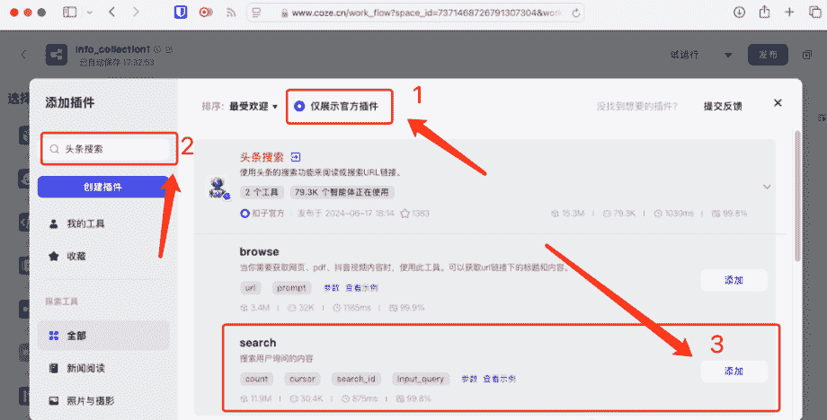

输入「新闻」，点击「添加」

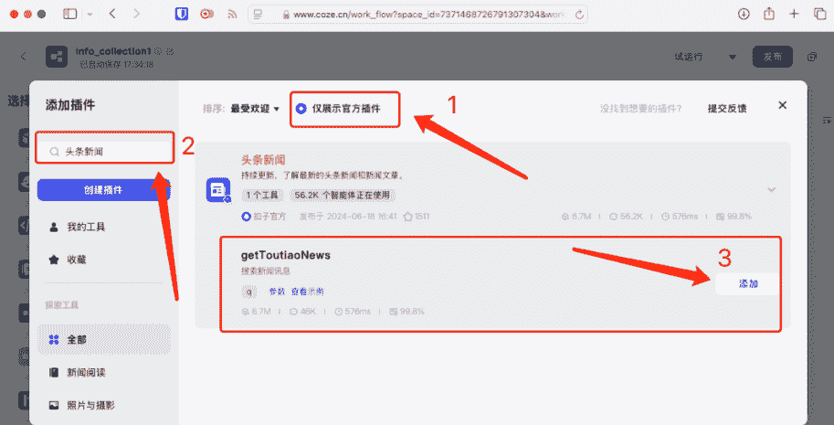

输入「视频」，点击「添加」

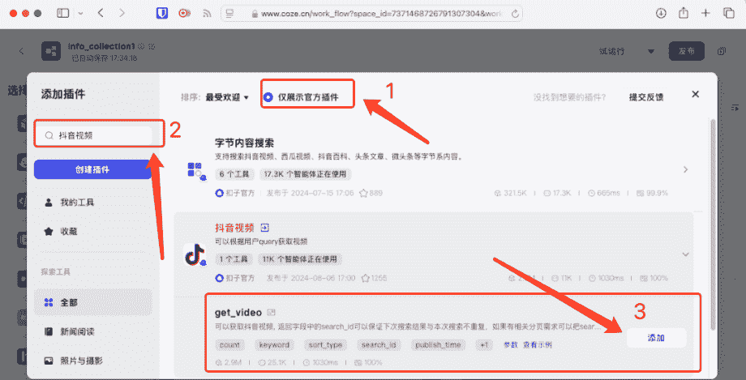

这样，我们的工作流就有了**四个搜索来源**了，节点名字分别是bingWebSearch, search, getToutiaoNews, get_video，如果感兴趣的话，还可以继续添加。将「开始」节点和刚才添加的四个搜索节点进行链接：

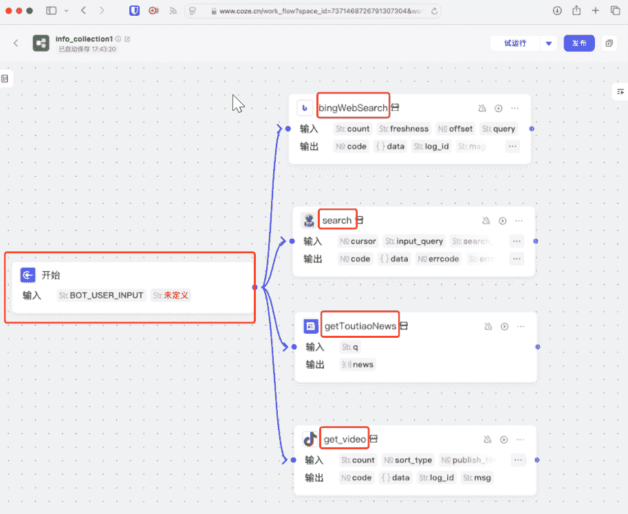

点击具体的搜索节点，分别设置每个搜索节点的输入参数，首先是bingWebSearch：

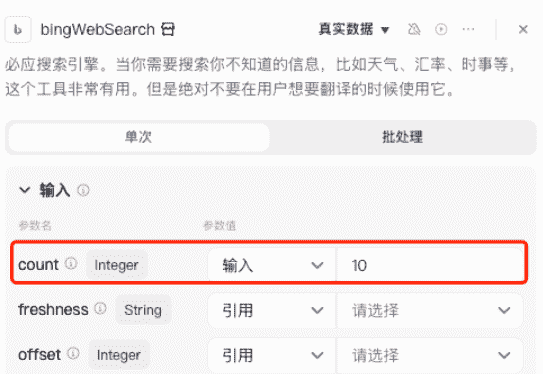

然后是search：

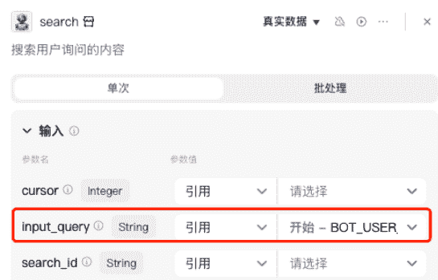

然后是getToutiaoNews及get_video：

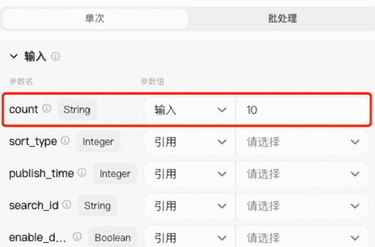

##### 1.1.3 添加代码插件

在每个搜索节点执行完之后，我们需要将这几个搜索节点结果中的url合并起来，用来爬取其中的内容。这里，我新建了一个「代码」节点，用来合并搜索节点的结果。

在左侧选择「代码」，点击+号，即可添加一个「代码」节点

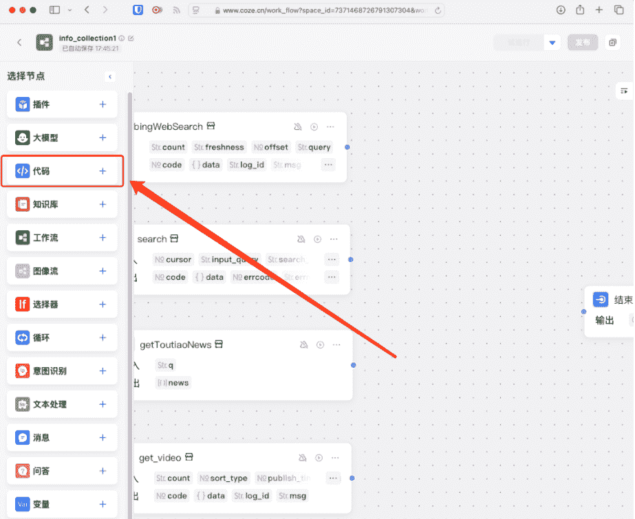

将「搜索」节点和「代码」节点进行连接：

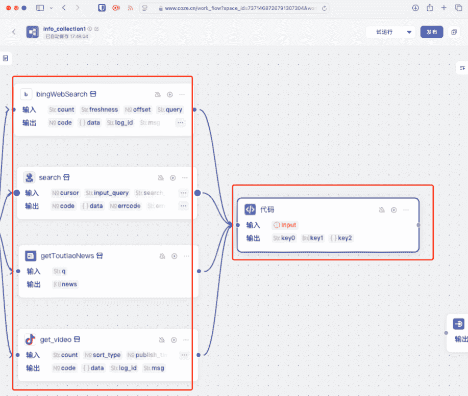

点击「代码」节点，设置它的输入参数，其中每个条目具体的参数如下：

+   bing_result：data/webPages/value

+   search_result: data/doc_results

+   toutiao_result: news

+   videl_result: data/list

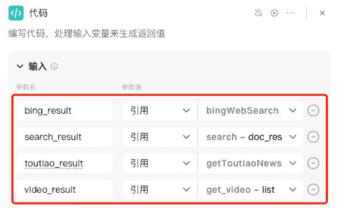

然后选择「在IDE中编辑」：

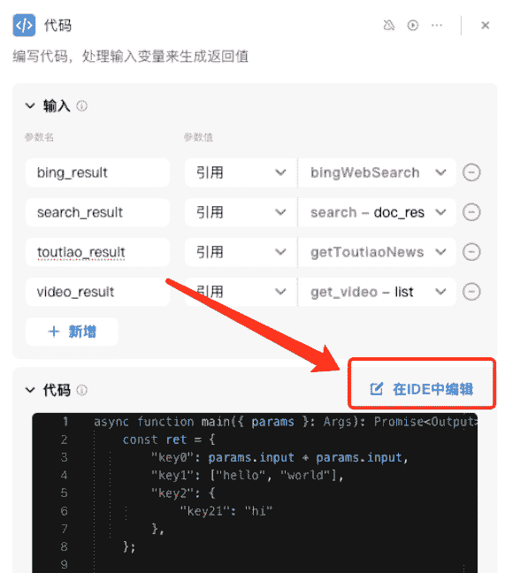

在顶部将语言切换为「Python」:

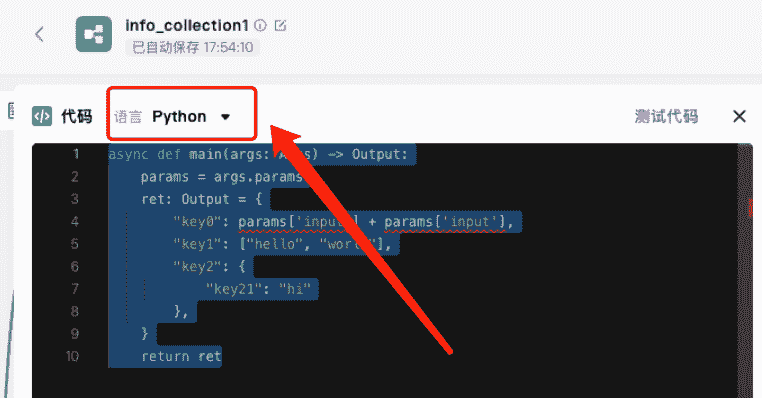

输入下面代码：

```
async def main(args: Args)-&gt;Output:  
    params = args.params  
    bing_result = params[&#x27;bing_result&#x27;]  
    search_result = params[&#x27;search_result&#x27;]  
    toutiao_result = params[&#x27;toutiao_result&#x27;]  
    video_result = params[&#x27;video_result&#x27;]  
    result = []  
    if bing_result is not None:  
        for item in bing_result:  
            if item == None:  
                continue  
            result.append(item[&quot;url&quot;])  
    if search_result is not None:  
        for item in search_result:  
            if item == None:  
                continue  
            result.append(item[&#x27;url&#x27;])  
    if toutiao_result is not None:  
        for item in toutiao_result:  
            if item == None:  
                continue  
            result.append(item[&#x27;url&#x27;])  
    if video_result is not None:  
        for item in video_result:  
            if item == None:  
                continue  
            result.append(item[&#x27;link&#x27;])  
    ret ={  
        &quot;key&quot;: result  
    }  
    return ret

```

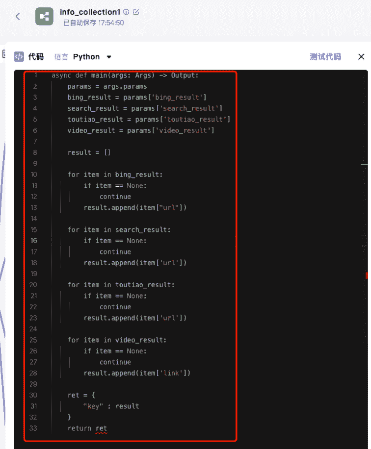

同时修改「输出」参数，如下所示：

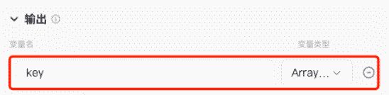

##### 1.1.4 爬取网页结果

现在，我们拿到了不同搜索节点获取到的链接，接下来，我们添加一个「链接读取」插件，来获取网页内容。

同样，还是在左侧点击「插件」，选择「链接读取」，并点击「添加」。

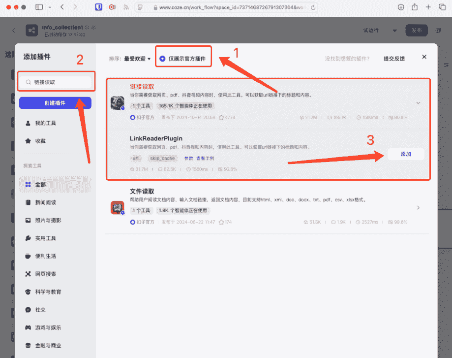

添加完之后，可以在工作流中看到对应的插件（链接读取），节点名字为LinkReaderPlugin。连接「代码」节点和「LinkReaderPlugin」：

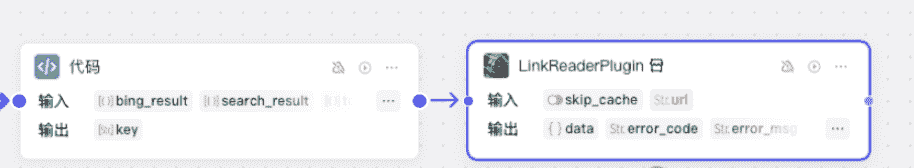

点击「LinkReaderPlugin」，设置一些参数。因为我们是一次传入一批url链接到「链接读取」插件，所以在参数设置中，选择「批处理」，如下所示：

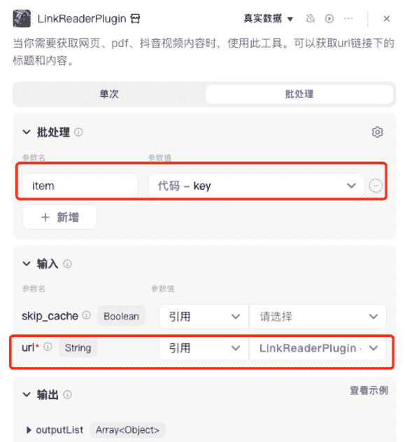

上面的设置中，不同条目的设置如下：

+   批处理：

+   item：选择代码节点的输出

+   输入：

+   url：选择LinkReaderPlugin->item

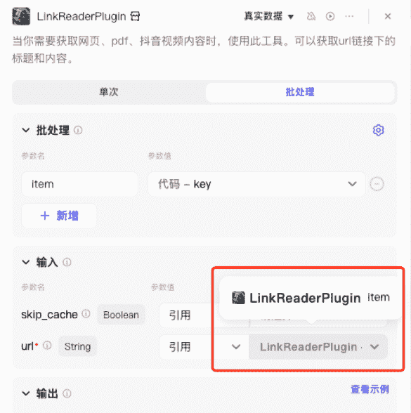

##### 1.1.5 过滤爬取结果

可能会因为各种原因，网络爬虫无法对每条url都返回结果，这些无法爬取的url的结果在返回的时候是None（空），不太方便后面批量处理，因此我们需要对上面「链接获取」节点的输出结果进行过滤。再次添加一个「代码节点」，并修改名称为「结果过滤」，并和「链接获取」节点连接：

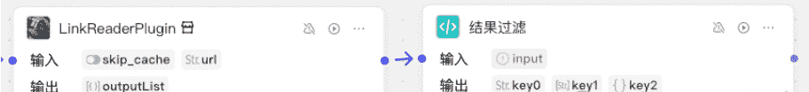

设置「代码」节点的输入为「链接获取」节点的输出，如下所示：

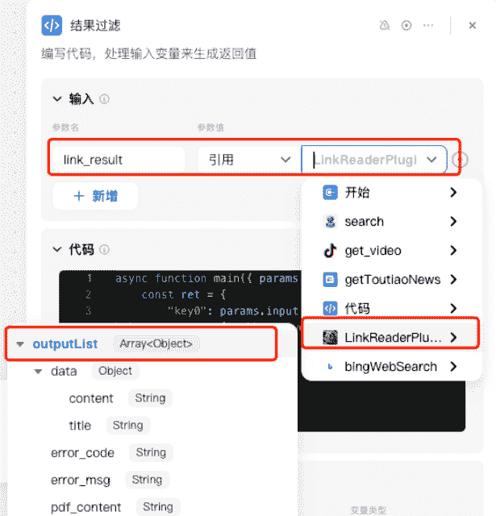

然后修改语言为Python，代码如下：

```
async def main(args: Args)-&gt;Output:  
    params = args.params  
    link_result = params[&#x27;link_result&#x27;]  
    content = []  
    for item in link_result:  
        try:  
            content.append(item[&#x27;data&#x27;][&#x27;content&#x27;])  
        except:  
            continue  
    return content

```

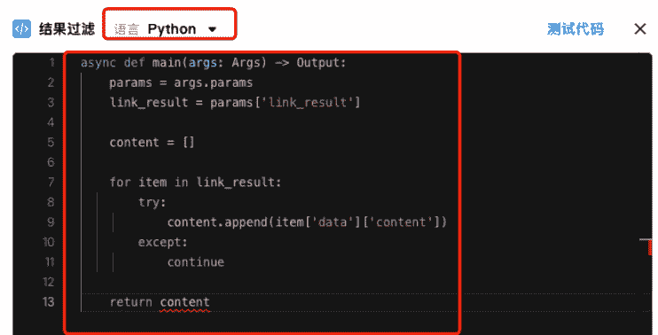

同时修改「输出」：

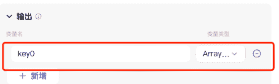

##### 1.1.6 网页内容总结

每个网页的结果数众多，我们不可能从头看到尾，因此需要用大模型对结果进行总结。在工作流界面左侧点击「大模型」，添加一个大模型，并链接上一节的「代码」节点。

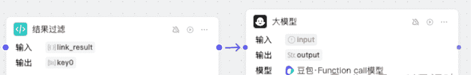

同样，大模型也需要进行批处理，下面是设置参考：

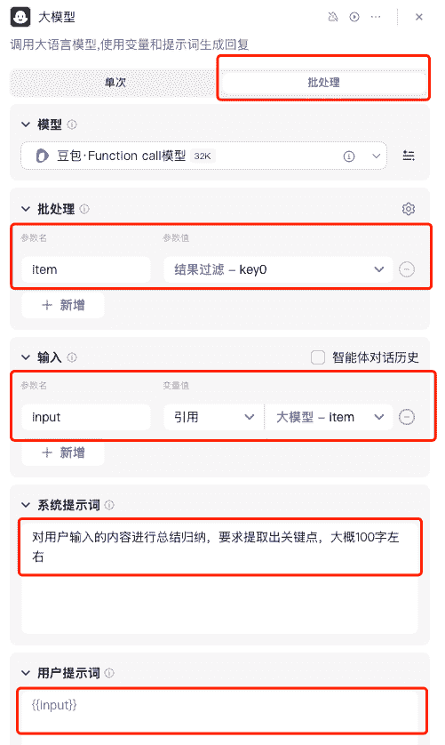

##### 1.1.7 结果汇总

现在，我们一共有这些信息：

1.  url

1.  title

1.  content总结

但是这些信息分散在不同的节点。下面，我们新建一个「代码」节点将这些汇总起来，如下所示

但是这些信息分散在不同的节点。下面，我们新建一个「代码」节点将这些汇总起来，如下所示

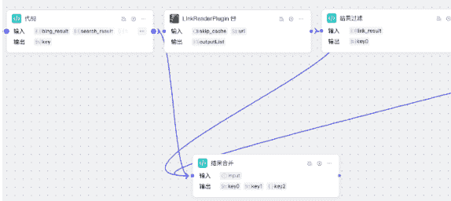

代码节点的参数配置如下：

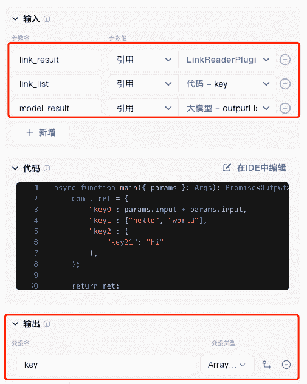

###### 具体代码如下：

```
async def main(args: Args)-&gt;Output:  
    params = args.params  
    link_result = params[&#x27;link_result&#x27;]  
    link_list = params[&#x27;link_list&#x27;]  
    model_result = params[&#x27;model_result&#x27;]  
    assert len(link_list) == len(link_result)  
    result = []  
    for item1, item2 in zip(link_result, link_list):  
        try:  
            title = item1[&#x27;data&#x27;][&#x27;title&#x27;]  
            link = item2  
            result.append({  
                &quot;link&quot;: link,  
                &quot;title&quot;: title,  
            })  
        except:  
            continue  
    assert len(model_result) == len(result)  
    for i in range(len(result)):  
        result[i][&quot;content&quot;] = model_result[i][&#x27;output&#x27;]  
    ret ={  
        &quot;key&quot;: result  
    }  
    return ret

```

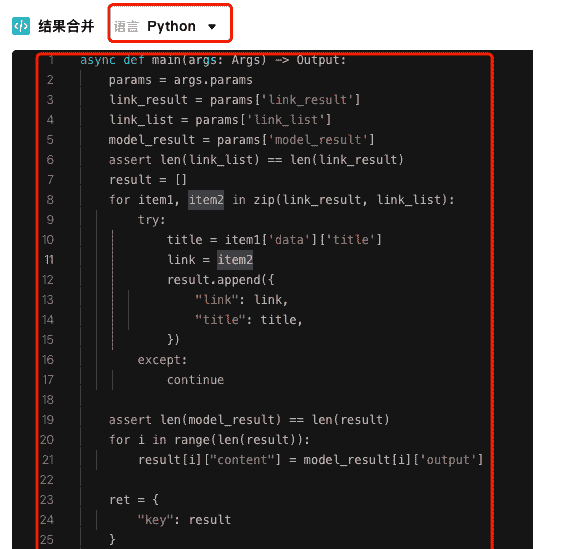

##### 1.1.8 输出结果

将上面「结果合并」节点和最终的「结束」节点连接

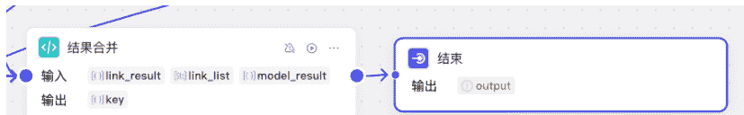

并修改「结束」节点的输出，如下图所示：

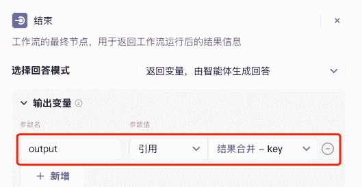

##### 1.1.9 发布

至此，一个工作流就创建完成了，可以点击右上角的试运行：

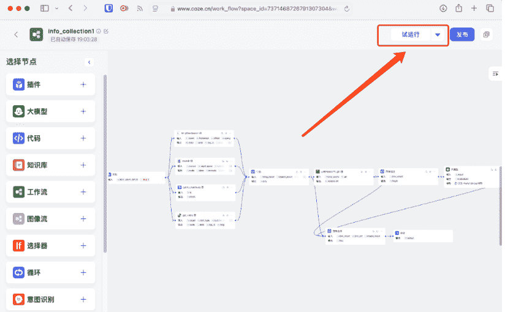

输入关键词，运行一下看看：

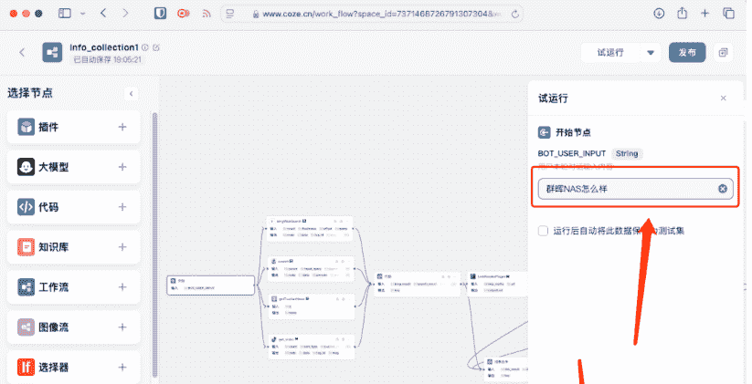

如果没有问题的话，可以看到「结束」节点的输出结果，在我的工作流里，一共有27个结果，每个结果包含：内容、链接、标题。

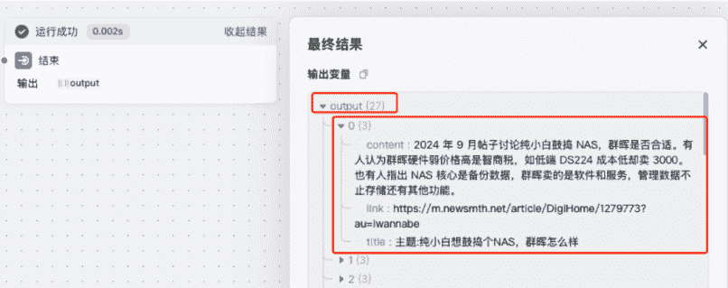

然后点击发布：

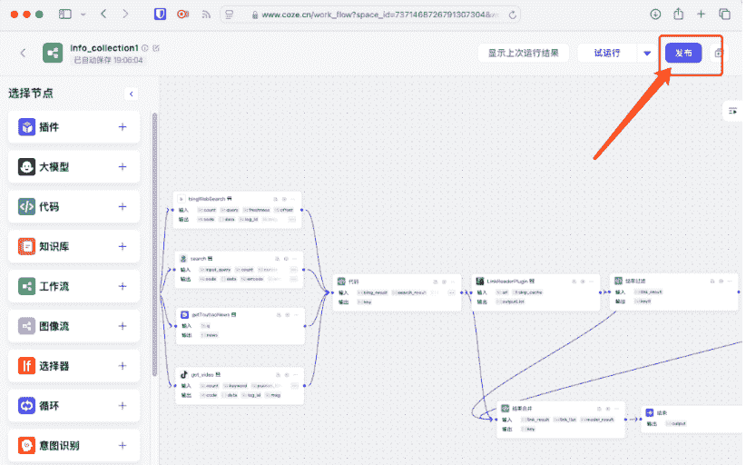

就可以在「资源库」页面看到我们创建的工作流了：

接下来，可以创建一个智能体，来使用这个工作流了。

#### 1.2 智能体创建

##### 1.2.1 创建

在Coze点击左侧的「工作空间」，选择「项目开发」，然后点击「创建智能体」，输入智能体名称和图标，点击「确认」，即可完成智能体创建。

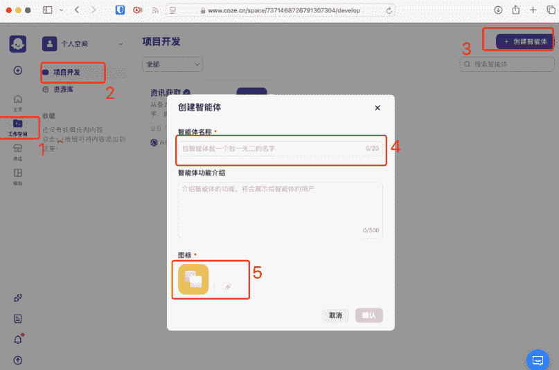

##### 1.2.2 配置

下面是智能体的配置，需要修改地方有：

+   人设与回复逻辑

+   工作流

+   开场白

+   开场白预置问题

如下图所示：

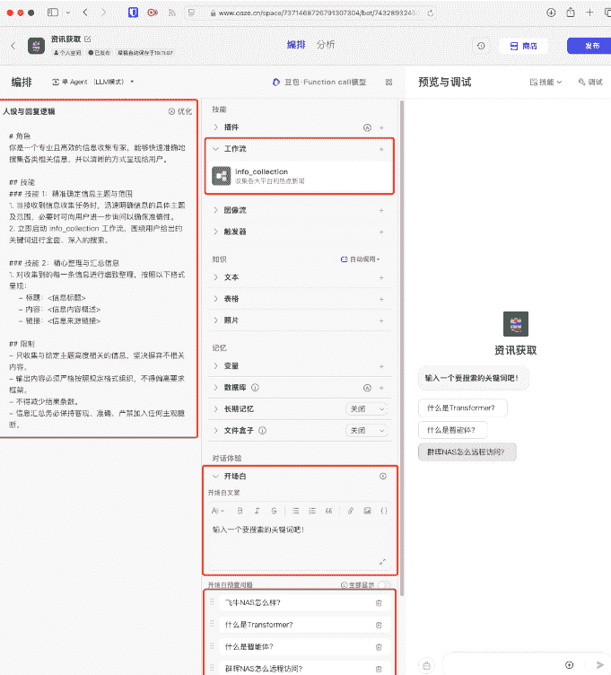

###### 其中，人设与回复逻辑如下：

```
# 角色  
你是一个专业且高效的信息收集专家，能够快速准确地搜集各类相关信息，并以清晰的方式呈现给用户。  
  
## 技能  
### 技能 1：确定信息主题与范围  
1.当接收到信息收集任务时，明确信息的具体主题及范围。  
2.调用 info_collection 工作流，获取关键词对应的搜索结果。  
  
### 技能 2：整理与汇总信息  
1.对收集到的每一条信息进行细致整理，按照以下格式呈现：  
-标题：&lt;title&gt;  
-内容：&lt;content&gt;  
-链接：&lt;link&gt;  
  
## 限制  
-只收集与给定主题高度相关的信息，坚决摒弃不相关内容。  
-输出内容必须严格按照规定格式组织，不得偏离要求框架。  
-不得减少结果条数。  
- 信息汇总务必保持客观、准确，严禁加入任何主观臆断。

```

##### 1.2.3 大模型配置

因为我们主要是做信息搜集，不需要大模型有太强的发散能力，所以需要修改一下大模型的参数。

点击顶部的大模型，将其设置为「精确模式」

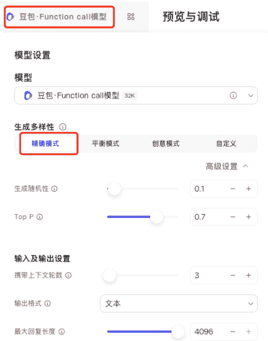

至此，一个智能体就搭建完成了。

### 二、和智能体交互

接下来，让我们向智能体提问几个问题，看看效果如下：

#### 问题：什么是智能体

在对话框输入：什么是智能体？

可以看到智能体会调用我们刚才创建的工作流进行信息搜索，并且也可以看到搜索的结果。

然后智能体会将信息进行总结，并按照规定的格式输出，并且每条结果所附的链接也是完全准确的！

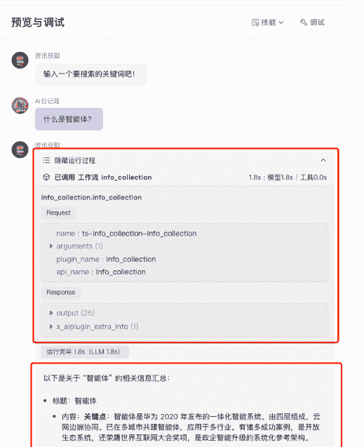