# 基于RAGFlow实践Agent——构建智能客服

> 来源：[https://qqs7y1hozd1.feishu.cn/docx/BjIwdqQGXoONlzxFk95cOsRinGb](https://qqs7y1hozd1.feishu.cn/docx/BjIwdqQGXoONlzxFk95cOsRinGb)

**本文介绍如何使用** RAGFlow 的 Agent 功能来搭建一个商品智能客服，实现能够针对上述四种场景给出不同的解决方案。

+   **第一种：**

> 用户询问类似产品性能，产品使用方法的问题，可以视为售前咨询，只需查询产品手册知识库回答问题即可，未查询到则转人工；

>

+   **第二种：**

> 用户发现某配件损坏无法使用，则需要提示用户给出购买信息，并查询后给出解决方案；

>

+   **第三种：**

> 用户询问产品无法正常使用，可以视为售后指导相关问题，查询知识库，分析并回答用户的问题，若存在配件更换等问题，则转到配件更换服务；

>

+   **第四种：**

> 用户提问和产品无关的问题，或者直接要求转人工，则视为其他问题，只需礼貌回复或提醒正在连接人工客服。

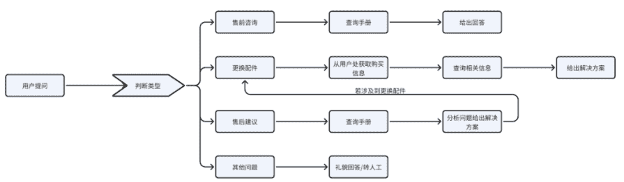

先展示一下本次搭建将会用到的节点：

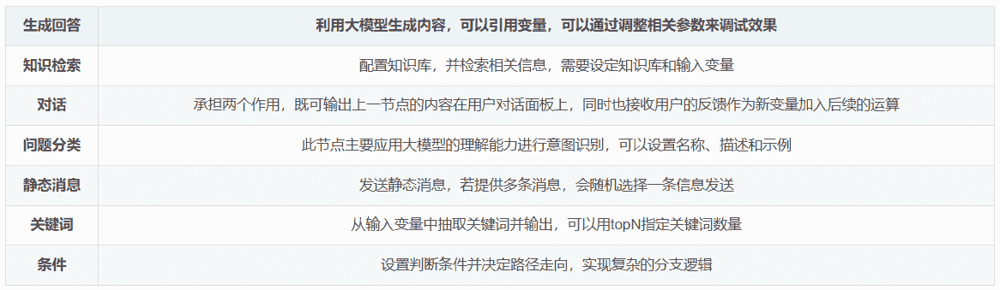

**正式开始搭建：**

1.首先需要引入一个开始节点，通常按需求设置用户刚连接时客服的欢迎词；

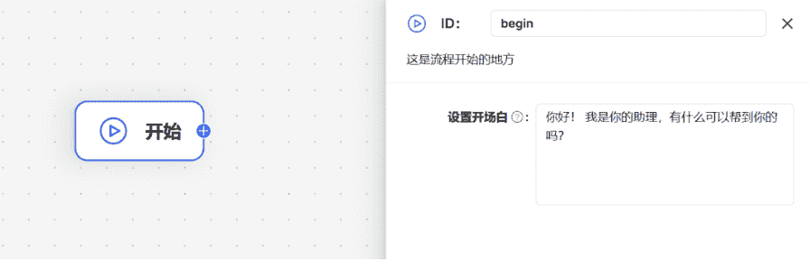

2.使用**对话节点**给出开场白，同时等待用户回复，获取用户的问题；

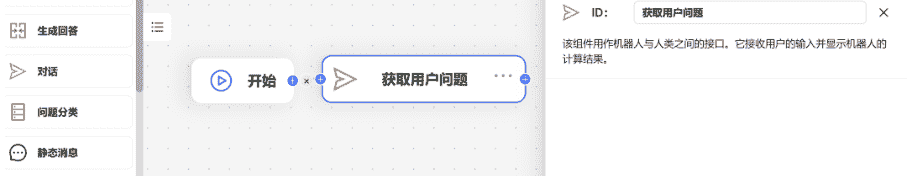

在 RAGFlow 的 Agent 编排中，对话节点起到控制对话流程的作用，既可以把之前 Agent 的运算结果输出到聊天面板，同时也可以获取用户的反馈作为新变量加入后续的运算

同时设置这个节点 ID 为“获取用户问题”，方便后续调用；

3.使用问题分类节点，设置四种情况：a.售前咨询、b.配件更换、c.售后问答、d.其他问题；加入描述和示例，选择好大模型，并设置输入为前节点“获取用户问题”。

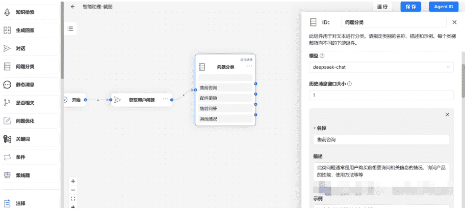

4.开始编排 a 情况“售前咨询”的后续路径：

4.1 为了提高后续知识库的检索效果，可以引入一个关键词抽取节点，这里采用生成回答节点完成该功能，它负责利用大模型从文本中抽取关键词。使用这个节点，我们需要先设置引用变量，引用“获取用户问题”这个节点的输出作为变量，因为需要其作为提示词的一部分输入给大模型，让大模型从用户的问题中抽取关键词，我们把引用的变量命名为 question，然后设置好提示词，提示词中，变量名需要被{}包裹；

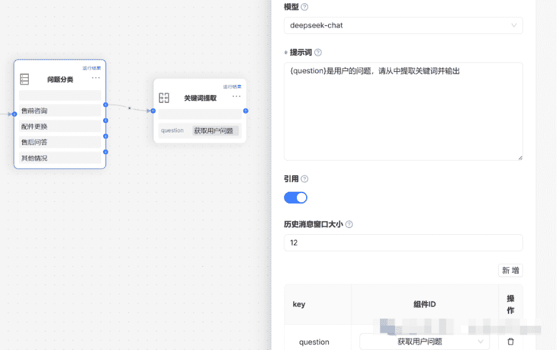

4.2 接下来添加**知识检索节点**，配置产品手册知识库。这里的对话框就是标准 RAG 所需要设置的参数；

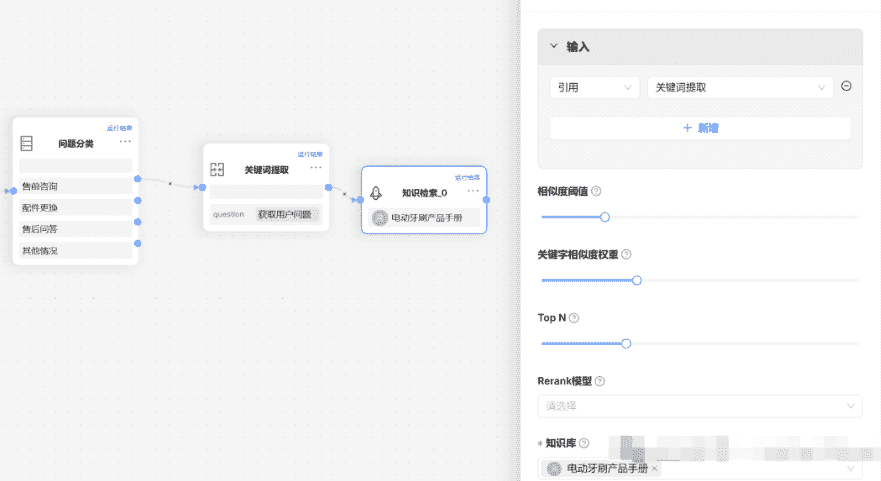

4.3 最后一步，需要让大模型生成回答，因此添加一个生成回答节点：选择大模型之后，添加两个变量：{kb}来源于“知识检索_0”节点，{question}来源于“获取用户问题”节点，{kb}是知识库检索到的内容，{question}是用户的问题，然后编写提示词，让大模型结合两个变量进行回答，注意查询结果为空要输出人工服务的结果；

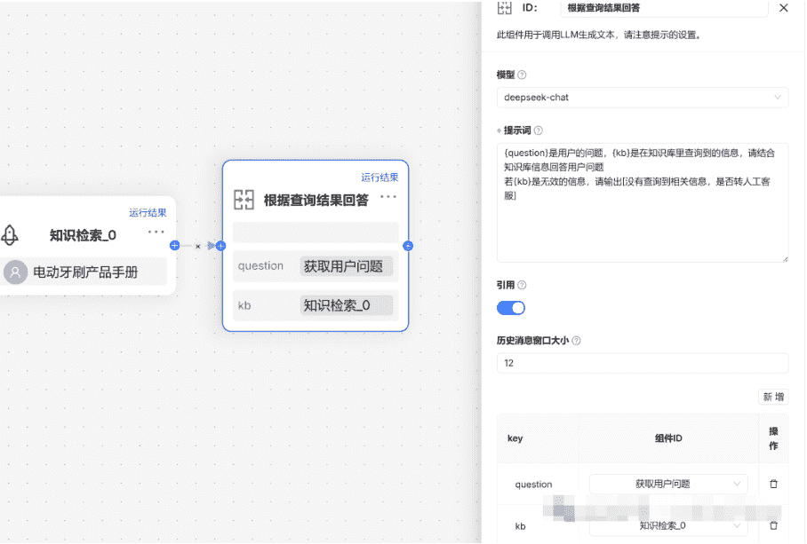

到此，a 情况的第一轮对话完成。**由于 RAGF**low 的 Agent 是支持循环路径的，因此可以直接连接开始的“获取用户问题”节点，并等待下一轮的问题。

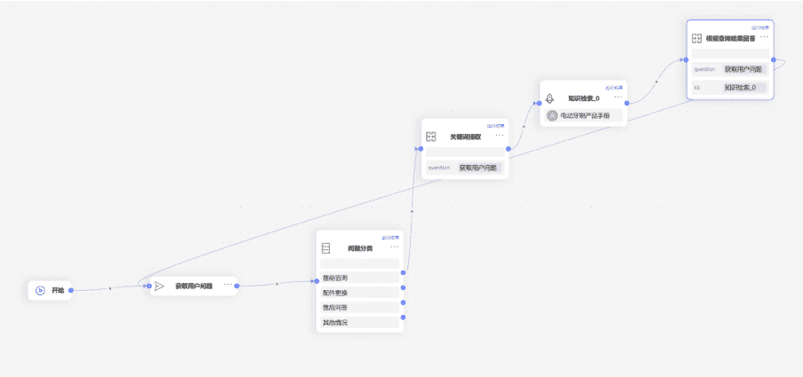

5.设置 b 情况“配件更换”后续路径：

5.1 首先用生成回答节点，生成内容提示用户提供购买信息；

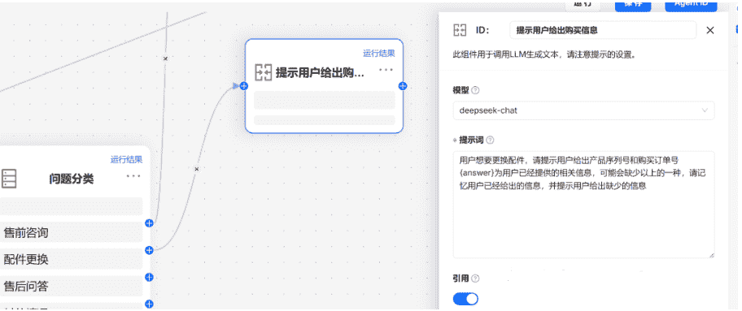

5.2 然后使用对话节点，输出提示信息，并接收用户的输入；

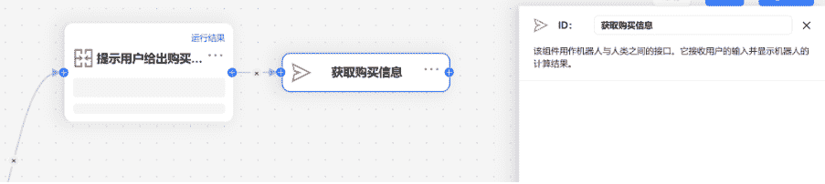

5.3 使用一个生成回答节点用于抽取用户提供的购买信息并结构化输出；

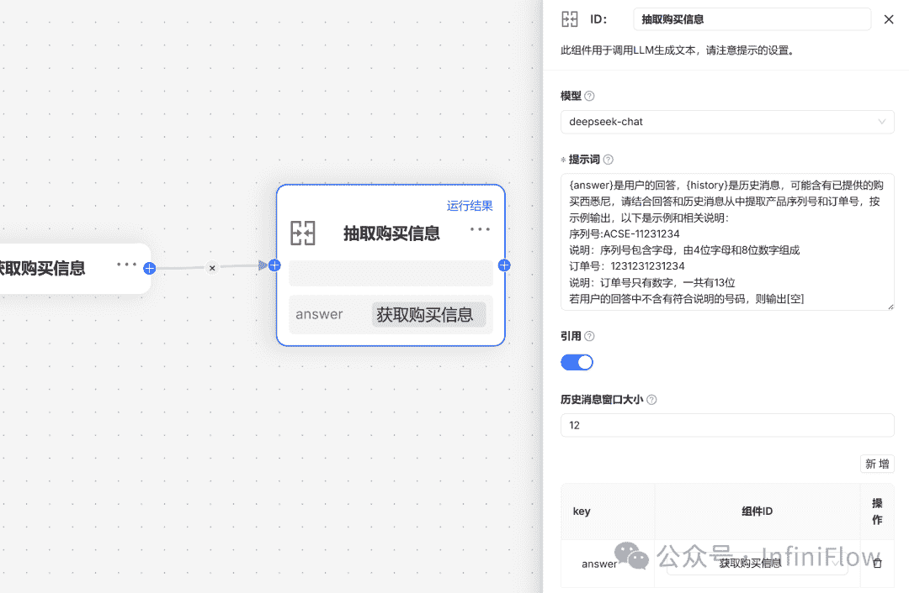

5.4 加入一个条件节点，判断购买信息是否完整，不完整则返回“提示购买信息”节点提示用户补全信息，并补充用于循环迭代的两个变量：在“提示用户给出购买信息”节点加入{answer}变量，来源于“抽取购买信息”节点，用于迭代时让此节点获得用户已经提供的信息；在“抽取购买信息”节点加入{history}变量，来源于“提示用户给出购买信息”节点，用于迭代时让此节点获得用户之前已经提供的信息；并补充好提示词，让大模型能正确识别变量；

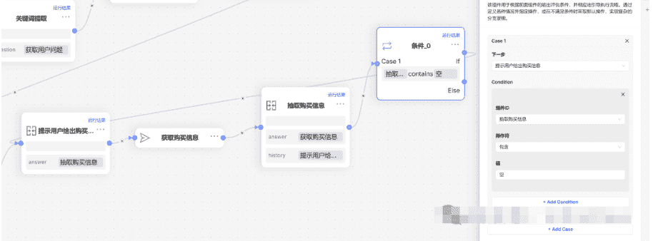

5.5 下一步使用知识检索节点，配置相关知识库，输入引用抽取购买信息的结果作为检索条件；

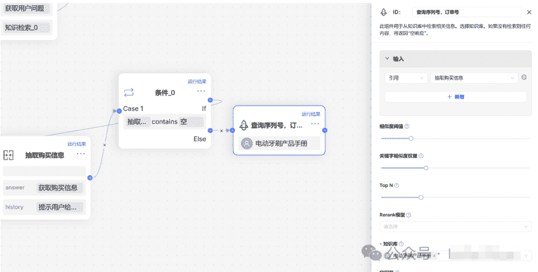

5.6 添加生成回答算子，结合问题和查询知识库得到的结果进行回答，然后再次通过“获取用户问题”节点输出运算结果，并等待下一轮的问题；

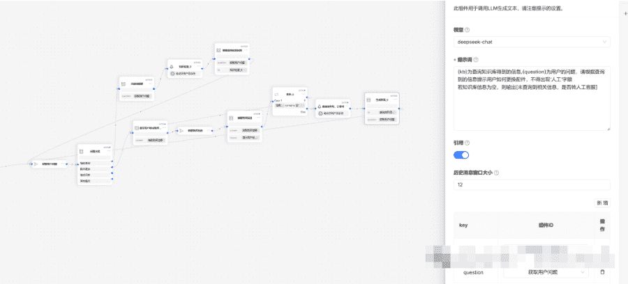

6.设置 c 情况“售后问答”后续路径：

6.1 这里尝试一下用官方配置好的插件’关键词’，只需设置输入变量引用“获取用户问题”**节点和大模型**即可抽取关键词，此节点和上边a情况和b情况开始的时候，由我们自己配置生成回答节点来抽取关键词所达成的效果一致；

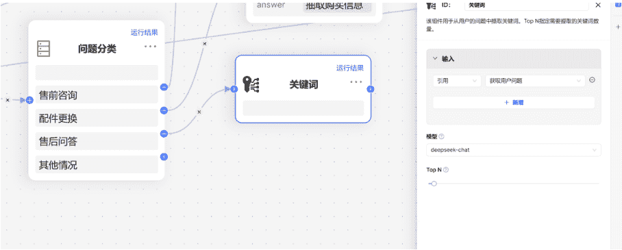

6.2 然后使用知识检索节点，配置产品手册，输入引用关键词节点；

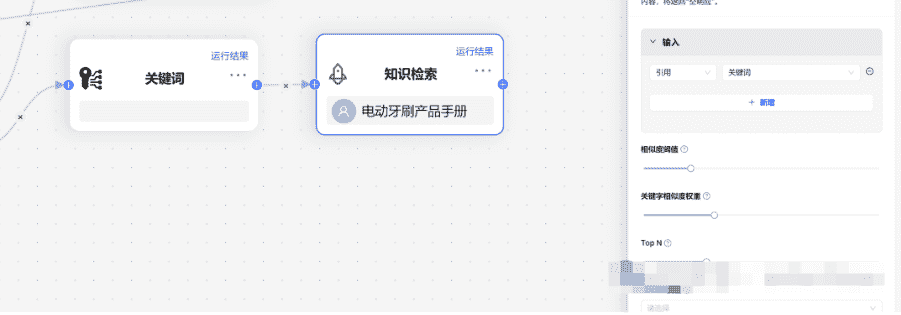

6.3 添加生成回答节点，添加提示词，结合问题和知识库查询结果，分析问题属于哪种类型并生成回答，由于配件损坏和人工客服都有独立的路径，所以无需编排后续路径，直接利用“获取用户问题”节点输出运算结果，并等待下一轮的问题；

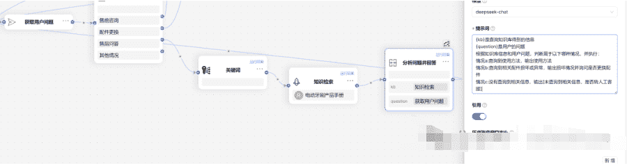

7.设置 d 情况“其他问题”后续路径：

7.1 使用条件节点判断是否为转人工需求，若是，则接静态消息节点，并连接“获取用户问题”节点输出静态消息；

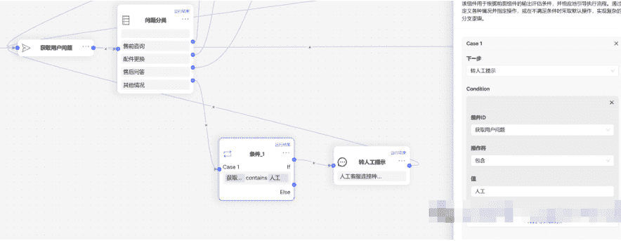

7.2 若不是，则接生成回答节点，配置好提示词，恰当的回答用户，然后连接“获取用户问题”节点输出运算结果；

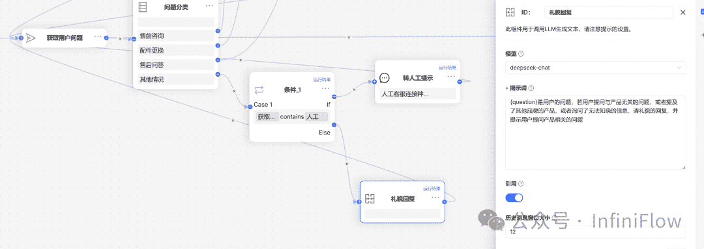

7.3 至此智能客服 Agent 搭建完成，可以处理四种不同情况的问答，并以标准化流程处理问题。运行展示：

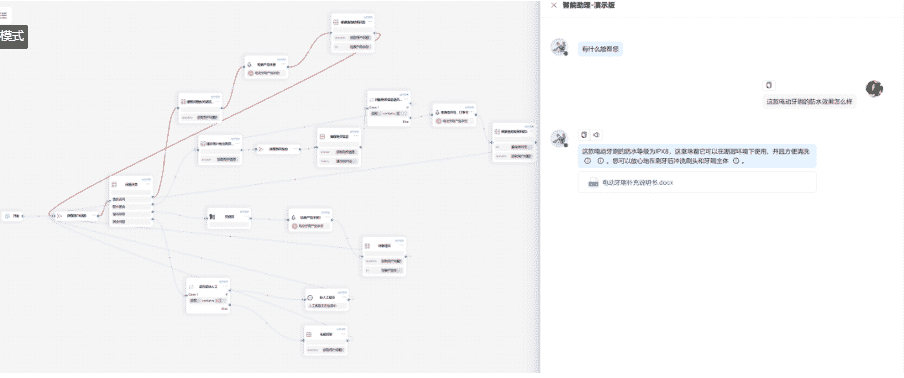

项目地址：https://github.com/infiniflow/ragflow/