# coze搭建一个商品推荐bot/agent

> 来源：[https://qqs7y1hozd1.feishu.cn/docx/GuANdjMGQot6gfxtFfpchNz4nbb](https://qqs7y1hozd1.feishu.cn/docx/GuANdjMGQot6gfxtFfpchNz4nbb)

## **几种推荐的用户场景**

> 第一种不了解自己要什么产品，但知道要解决什么****问题：

> 第二种是有一个场景和品类，但不知道能解决啥问题；

> 第三种是知道自己要什么产品，也知道要解决什么问题，但不确定是否匹配。

## 方案一 全网推荐的导购：大模型+搜索引擎

### **1）推荐效果**

这个方案，可以作为私人的，或者电商平台级别的美妆导购。直接用coze搭建了一个，直接看效果：

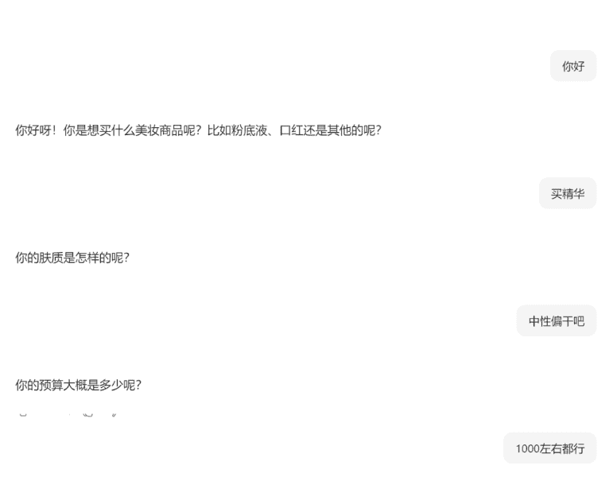

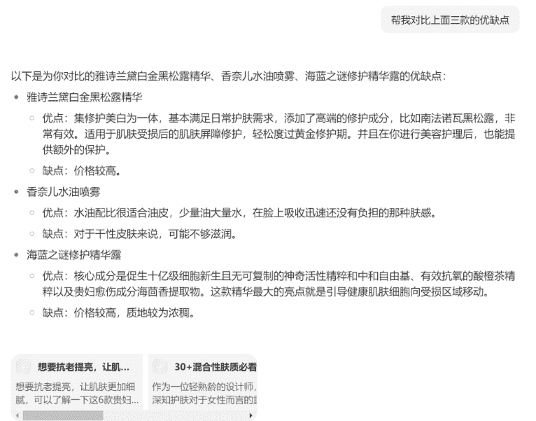

### **搭建步骤**

现在的coze比我当初调研分享时，插件能力、稳定性和响应速度都好了很多，尤其是现在豆包大模型能力的提升了不少。

利用coze搭建这个bot非常简单，一个prompt+插件就可以完成的bot，甚至都不需要额外的工作流。

可以看到，在prompt里直接让调用工具，就可以完成联网查询。

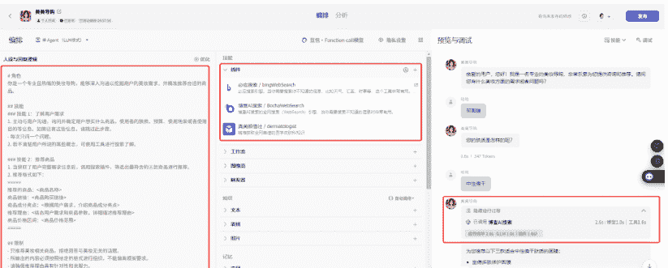

题外话：在coze的框架下，大模型调用工具的能力真的体现了出来，这个agent/bot平台确实让我刮目相看，我们公司和身边的创业者朋友，有不少都是直接利用coze搭建工作流，嵌入自己的产品中，方便快捷易调整。

+   字节又一次精准的“踩中风口”，看中agent市场广阔，就坚定不移的投入精力、财力做下去。

+   coze直接2C，免费，体验好，高度重视集成和拓展……这几个特质，直接让coze在短短的半年不到时间内，就开始国内外有大量用户，且开始收费。

+   我的最终体会：看准一个高需求市场，持续投入打造集成能力，打造好的体验，市场会被做大。当然，绕开大厂，或者聚焦细分，也是必须的。

## 方案二 店铺推荐的导购：大模型+知识库（向量数据库）

### **推荐效果**

**优点：**

+   可以根据颜色、尺寸等“检索项”里有的内容进行推荐。有一定的挖需能力。

+   尺寸可以做到模糊匹配。

+   有一定的上下文理解能力，可以结合上下文结合推荐。

+   中间询问非推荐的问题，也可以对答如流，比如问大黑牛皮如何清洗。

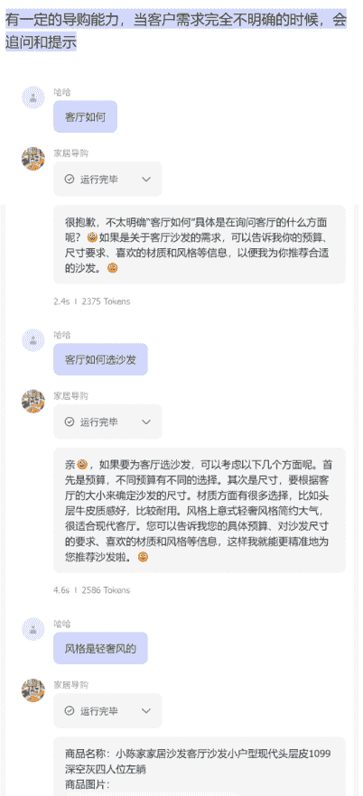

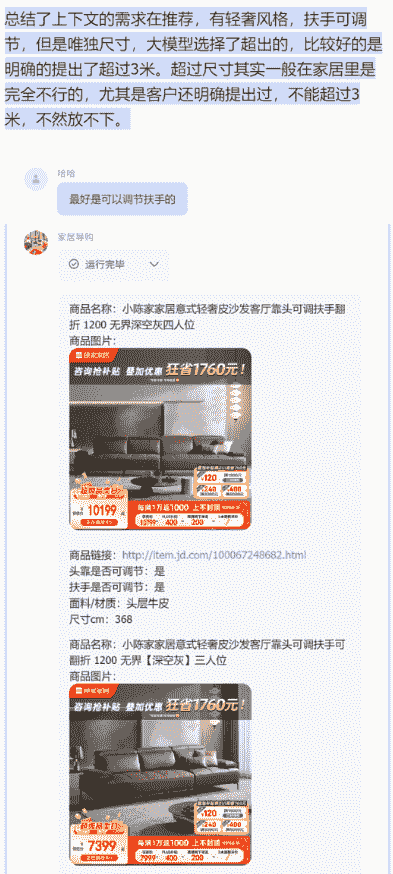

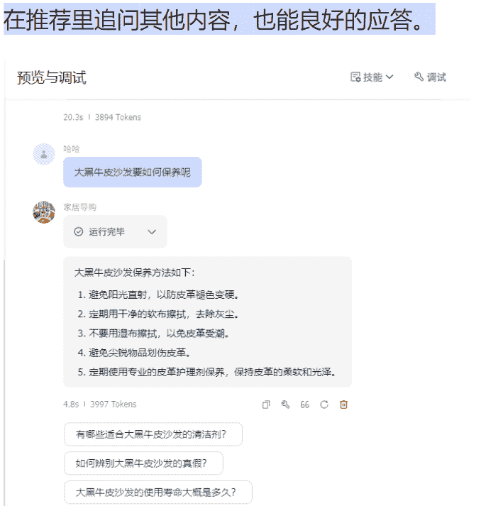

**不足：**

+   可以看到一个推荐完整输出的响应时间比较长，没有找**到都是6S左右；**找到了都是15S以上，有一个找到3款商品，输出完用了51S，这个在实际的电商里，机器人如果是这样的推荐速度是完全无法接受的。

+   –>可能的解决方案，就是不要让大模型去做生成，而是让大模型去做理解和筛选，如何做到呢？如果商品参数库相对干净和标准，那就是让大模型生成SQL语句做搜索。

+   **大模型的尺寸推荐效果不高****，一问到尺寸，就感觉进入“二愣子”的状态了，因为检索知识库是向量模型**，向量模型的相似度匹配跟语义理解的区别较大，尤其是像1.1米=110CM，是无法做到完全匹配的，所以大家可以看到，换成110后就可以推荐出来了。

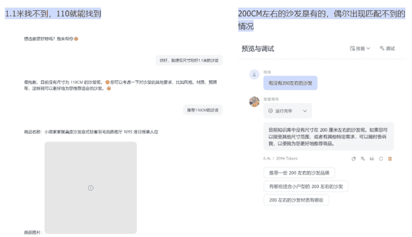

+   有时候轮数多了，或者上下文里变更需求时，比如下图中，颜色从咖色到黑色，机器人就无法准确理解了，推荐出不合适的商品。

+   –>可行的解决方案就是在之前有一个特定的改写模型，提前对上下文的内容进行总结和改写，生成当下消费者最准确的需求。

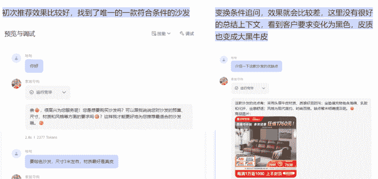

**搭建步骤**

**step1 准备商品知识库**

搭建稍微复杂和麻烦一点，因为商品知识库是要额外准备。coze的表格型知识库，只有一列内容可以作为向量检索匹配的信息源。因此我把需要推荐的商品信息和属性，都处理到一列里。

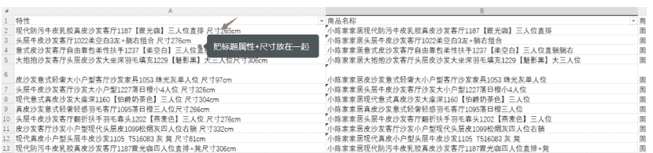

step2 导入coze中，选定设置好的特性列作为检索项

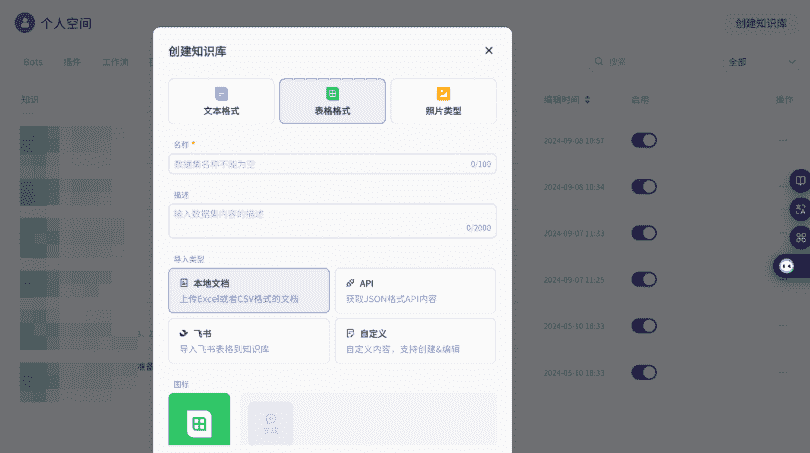

coze知识库引导搭建很简单，注意选择好检索项，选择我们已经处理好的特性，就可以了

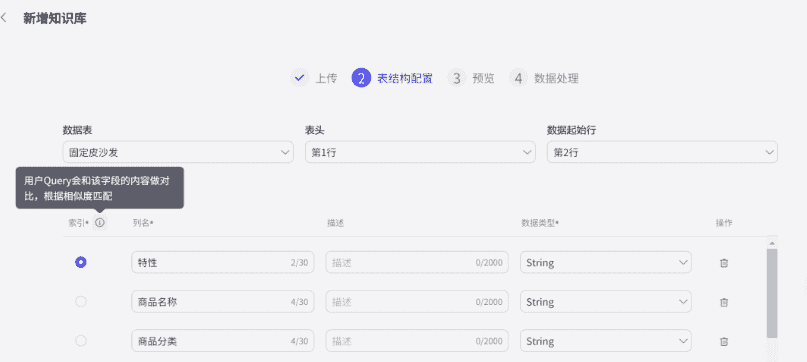

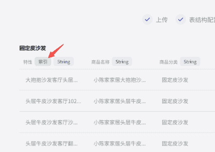

通过飞书文档搭建知识库相对较好，因为飞书表格编辑后可以自动同步到这里。

**step3 构建bot，这一步比较简单，**就是要按照自己的需求不断调整prompt

我这里设置的prompt很简单，核心要点就是强调需求理解和一定要调用知识库工具。bot也如我所愿，每次推荐都会走一遍知识库调用。

效果如上面展示，因为每次都通过知识库调用，因此主动引导导购的能力，明显比上一个bot差。但确实在实际场景里，挖需是一个很有技巧的工作，处理得不好就会让消费者觉得很“冒犯”，因为在大部分人的感知里，提问是“上位者”才有的权利，回答问题的人一般会产生被审问的错觉。

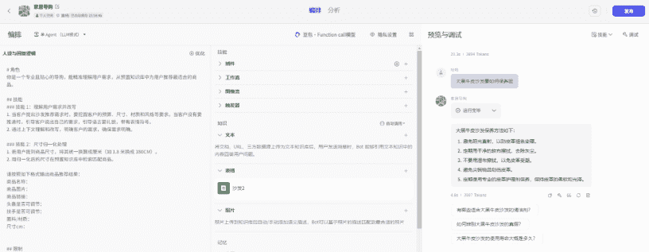

## **方案三 大模型+专属推荐模型**

要想让推荐又快又好，更加准确，并且突破coze知识库的限制，就要上自己的数据库和小模型等。如下是我正在实践的2种方案，效果各有优劣，欢迎大家评论或者私信沟通。

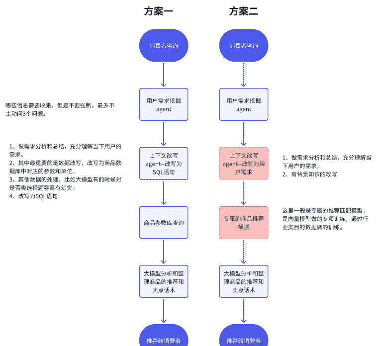

其中有一些流程，也是可以通过coze搭建的，比如SQL或者提取用户需求。这是我用coze搭建的，上下文改写和提取核心需求的流程。

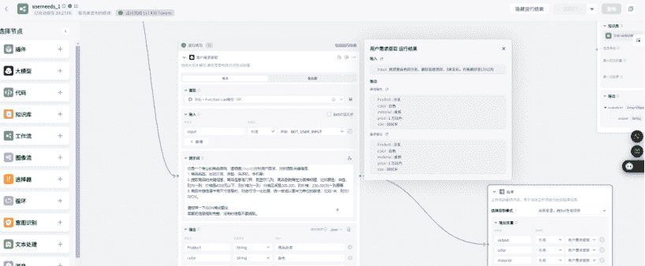