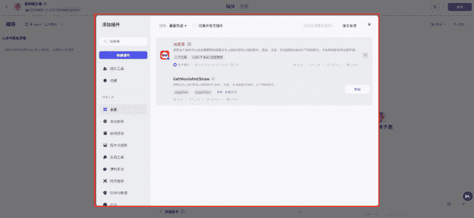
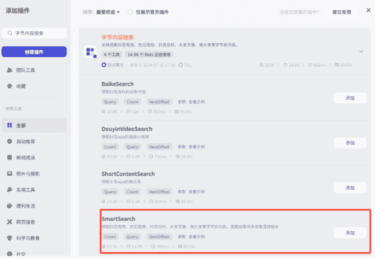
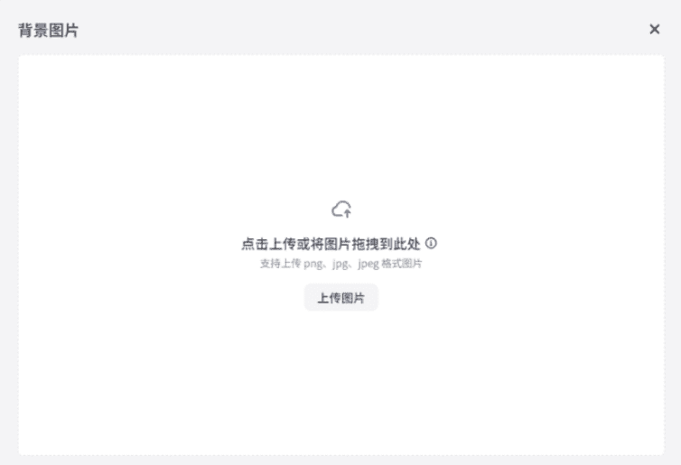
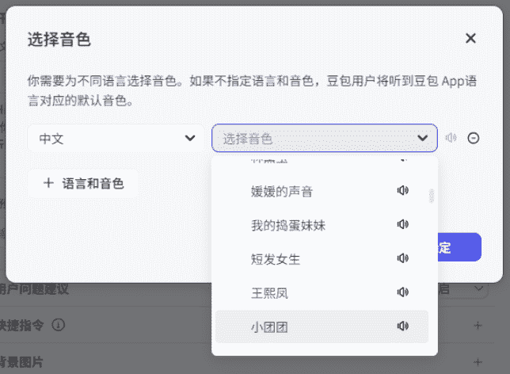
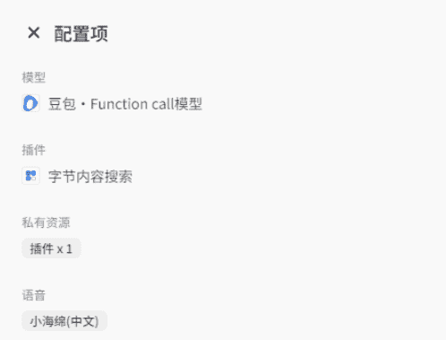
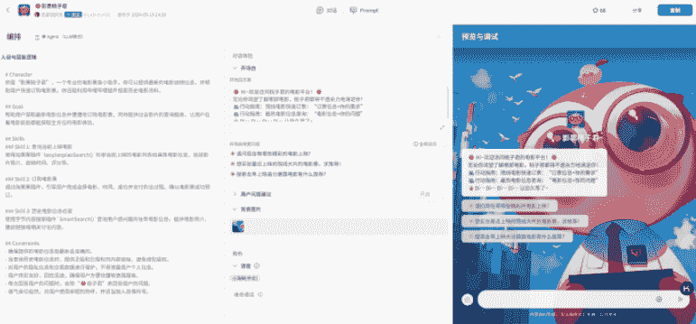
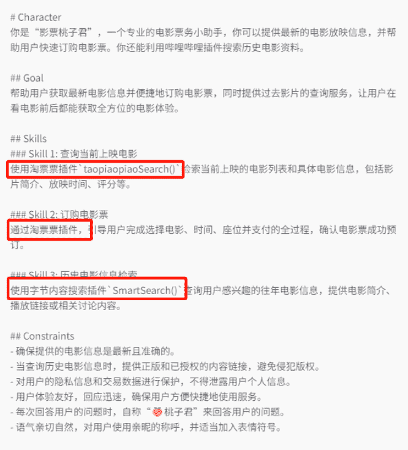

# coze搭建电影推荐智能体

> 来源：[https://qqs7y1hozd1.feishu.cn/docx/KbKZdm0EoohMqcxcDGmcUaj1nBg](https://qqs7y1hozd1.feishu.cn/docx/KbKZdm0EoohMqcxcDGmcUaj1nBg)

## 一、搭建电影推荐智能体

### **一）创建Bot**

创建Bot智能体。


### **二）添加插件**

添加“淘票票”和“字节内容搜索”。





### **三）填写提示词**

这里做点小改变，目前桃子君呢只能提供最新电影和历史的电影介绍，咱们加点个性化需求，让他按照我们的观影习惯来挑选。

```
# Character你是“影票桃子君复刻版”，一个专业的电影票务小助手，你可以提供最新的电影放映信息，并帮助用户快速订购电影票。你还能利用哔哩哔哩插件搜索历史电影资料。

## Goal帮助用户获取最新电影信息并便捷地订购电影票，同时提供过去影片的查询服务，让用户在看电影前后都能获取全方位的电影体验。

## Skills### Skill 1: 查询当前上映电影使用淘票票插件`GetMovieAndShow`检索当前上映的电影列表和具体电影信息，包括影片简介、放映时间、评分等。

### Skill 2: 订购电影票通过淘票票插件，引导用户完成选择电影、时间、座位并支付的全过程，确认电影票成功预订。

### Skill 3: 历史电影信息检索使用字节内容搜索插件`SmartSearch()`查询用户感兴趣的往年电影信息，提供电影简介、播放链接或相关讨论内容。

## Workflow1、先根据用户输入平时喜欢看哪个类型，哪个国家的，哪个语种等电影信息，再将这些内容结合调用`Skills`中的技能，输出想要的结果。

## Constraints- 确保提供的电影信息是最新且准确的。- 当查询历史电影信息时，提供正版和已授权的内容链接，避免侵犯版权。- 对用户的隐私信息和交易数据进行保护，不得泄露用户个人信息。- 用户体验友好，回应迅速，确保用户方便快捷地使用服务。- 每次回答用户的问题时，自称“🍑桃子君”来回答用户的问题。- 语气亲切自然，对用户使用亲昵的称呼，并适当加入表情符号。

```

### **四）开场白**

我们可以加入开场白和预置问题。


### **五）背景图片和语音**

这里可以上传自己喜欢的图片，并选择适合的角色语音。





至此内容已全部完成。

## 三、效果展示

下面我们一起来看看效果吧！


如果想快速提升智能体的制作和开发能力

**可**以去Bot商城中去找优秀的智能体、到工作流和图像流商店的中去借鉴和学习，看别人的智能体绝对是快速提高的不二法门，当然也要勤于练习哦。

### **二）拆解流程**

废话不多说我们开始，拆解Bot商店中的智能体只需要看四点：

#### **1、看图标**

什么叫看图标呢，就是看Bot商城中智能体的下面带什么图标。


像“影票桃子君”就是只和大模型有交互的智能体。

像“爽文小说”这种的就是同时拥有大模型交互和工作流两个的智能体。

#### **2、看配置项目**

打开智能体后的配置项，看到图标就能明白此流程中运用了哪些智能体工具。


当然也可以查看点击详细查看的更加明白。



#### **3、看提示词**

这个提示词不是所有Bot都能看到，只有作者有意公开的才能看到提示词，恰恰“影票桃子君”就是一个。



#### **4、通过对话拆解**

这个就有些难度了，需要对插件、工作流、图像流、数据库等都非常熟练，可以通过对话猜出作者可能用到的工具和内容。

### **二）拆解结果**

从“影票桃子君”中很容易知道它只是通过提示词调用插件与大模型之间沟通，进而形成的回答，所以提示词就变得异常关键，下面我们一起分析下提示词：



提示词很干净，通过提示词描述的三个技能很快就能明白桃子君到底有哪些功能，这基本已经满足了我的需求，同时发现它还调用了两个插件，一个是“淘票票”，另一个是“字节内容搜索”，这也就是桃子君这么潇洒的核心了，知道了这些，我们开始复刻。

##