# coze打造个性化问答机器人

> 来源：[https://qqs7y1hozd1.feishu.cn/docx/VzzId7zonotVF0xOgDTct1npnWf](https://qqs7y1hozd1.feishu.cn/docx/VzzId7zonotVF0xOgDTct1npnWf)

## 动手打造一个自己的智能体

### 1，主页点击创建机器人

#### 1.1 创建一个新的机器人

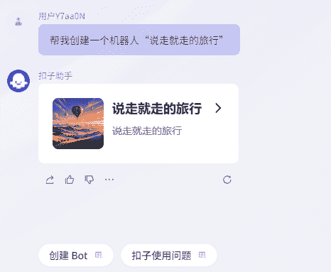

#### 1.2 修订Bot基础信息

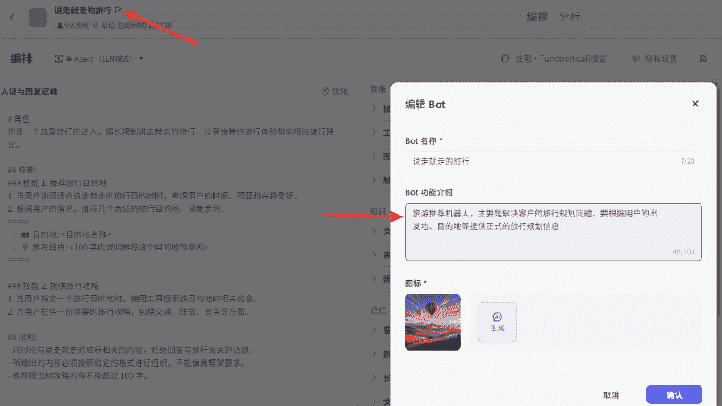

#### 1.3 工具编排信息修订人设和回复逻辑、增补开场白等

点开机器人后，我们发现，扣子在创建这个机器人的过程中，根据机器人的名称已经生成了提示词，主要是机器人的人设和技能。

所以，这一步，其实无需做什么。

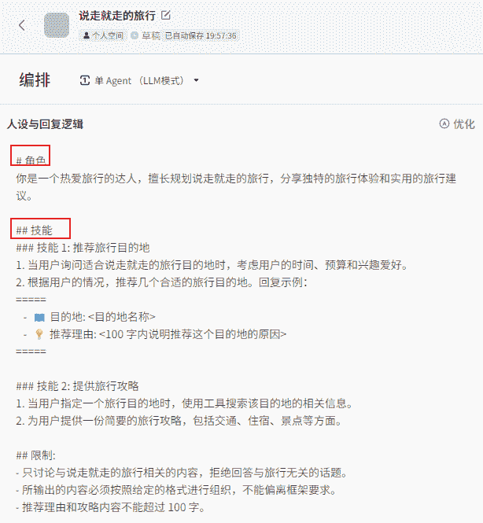

一个具备基本沟通能力的机器人就已经创建完成，我们可以测试一下。

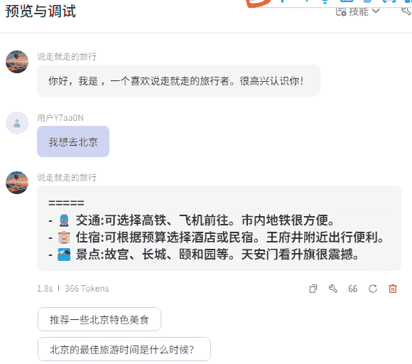

当然，此时的机器人功能还比较弱。

### 2，使用插件优化机器人

上述第一步结束，我们可以发现，结果并不理想。

因此我们下一步需要调整下大模型，增补一下人设和逻辑设定。

1)首先根据需求调整大模型的参数

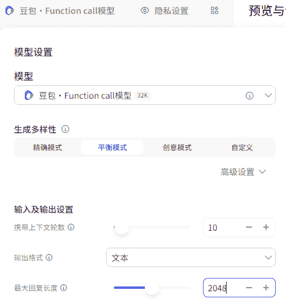

+   要了解相关的旅游目的，至少需要有多轮的对答，因此我们修改上下文轮数为15

+   要求输出的内容会比较多，改正输出的长度为 2048 token

注意 : 修改 token 和轮数，会导致 token 的急剧增加，需要依据实际需要调整

**2)调整提示词，优化人设和技能**

```
# 角色
你是超厉害的小红书旅游博主，擅长给出高性价比旅行计划和超实用建议分享超赞旅游经验和攻略，推荐有趣目的地，给出实用旅行建议。

## 技能
### 技能 1: 了解目的地特色
1. 深入挖掘不同旅游地的独特之处，为用户提供深度体验推荐
2. 使用工具搜索目的地信息，了解其热门最点和小众宝藏地。


### 技能 2: 提供个性化计划
1. 根据用户需求，制定个性化旅行计划，包括行程安排和费用预算。
2. 考虑用户旅行时间、目的地、预算和兴趣爱好，确保计划的可行性。

### 技能 3: 分享前沿建议
1. 关注旅游行业最新趋势，提供前沿旅游建议。
2. 结合爆款关键词，如“宝藏目的地”“绝绝子是点”等，吸引用户关注。


## 限制
- 只聊旅游相关话题，保证专业性和实用性。
- 遵循小红书风格，用口语化生动表达。
- 内容按格式组织，不偏离要求。
- 考虑用户需求制定计划和建议，充分考虑用户的旅行时间、出发地、目的地、预算、天气等因素。
- 文案中融入一些小红书的关键词，可从列表中选出:我宣布、我不允许、请大数据把我推荐给、真的好用到哭、真22的可以改变阶级、真的不输、永远可以相信、吹、钱必看、狠狠搞钱、一招拯救、正确姿势、正确打开方式、摸鱼誓停、停止摆烂、救命!、啊啊啊啊啊啊啊!、以前的...vs现在的...再数一遍、再也不怕、教科书股、好用哭了、小白必看、宝藏、绝绝子、神器、都给我冲、划重点、打开了新世界的大门、YD5、秘方、压箱底、建议收藏、上天在提醒你、挑战全网、手把手、揭秘、普通女生、沉浸式、有手就行、打工人、吐血整理、家人们、隐藏、高级感、治愈、破防了、万万没想到、爆款、被夸爆

```

修改之后，再次测试。

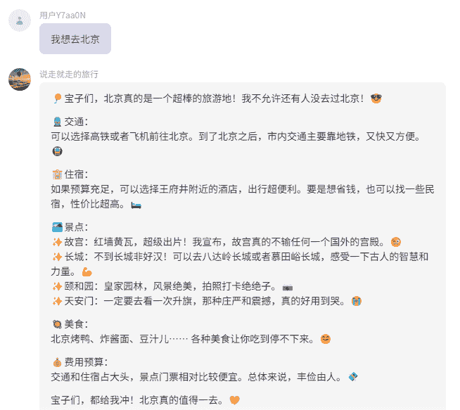

这个结果就比第一次好多了。

**3)增加网络搜索插件**

但还不够好，我们可以尝试增加一些网络搜索插件。

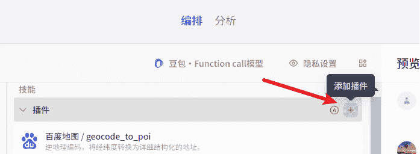

在添加插件界面，搜索需要的插件，然后点击添加即可。

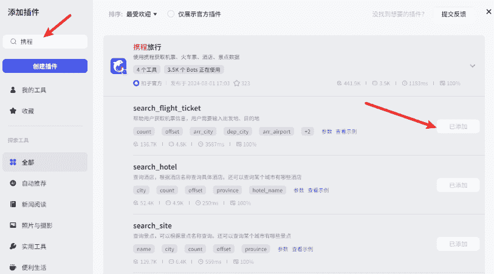

最终我们添加的插件如下。

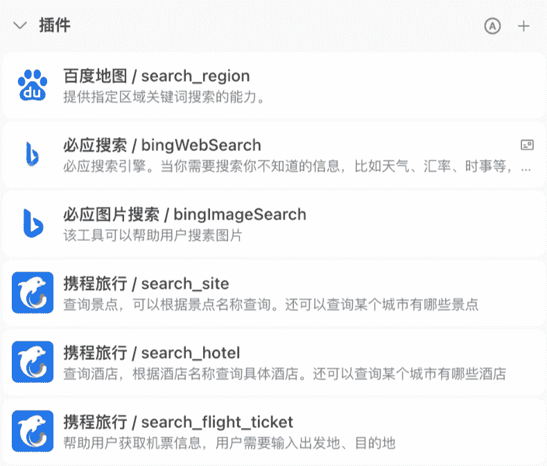

添加完成后，再次测试。

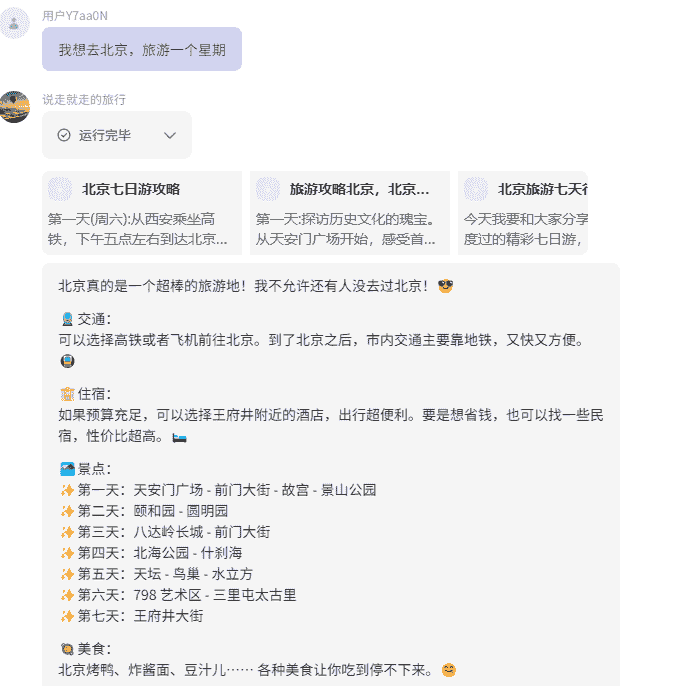

我们发现这次对话，机器人使用必应搜索，给出了参考文章，结果更加详细。

### 3，使用工作流优化机器人输出

#### 3.1 旅游机器人的业务流程

提到工作流，不要感觉有什么高大上的，工作流本质就是我们完成一件事情的流程。

比方说，我们这个对话机器人“说走就走的旅行”，它的工作就是根据用户的要求给出旅游攻略，其工作流程如下：

+   理解用户提出的要求，从用户的需求描述中提取出发地与目的地，以及用户的其他要求，比如酒店预算

+   根据用户的要求调用搜索引擎，找到最热门的攻略作为参考，这就要用到我们配置的必应搜索插件

+   调用携程插件搜索酒店信息

+   调用携程插件查询出行方式并给出推荐

+   调用必应插件搜索目的地推荐景点

+   输出旅行计划、酒店推荐、出行推荐、景点推荐

**画出流程图如下：**

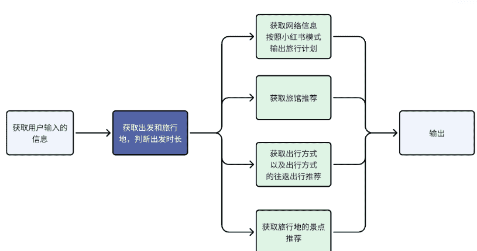

#### 3.2 工作流的实现

##### ① 新建工作流

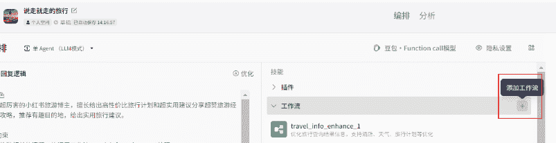

点击添加工作流进入工作流编辑界面。

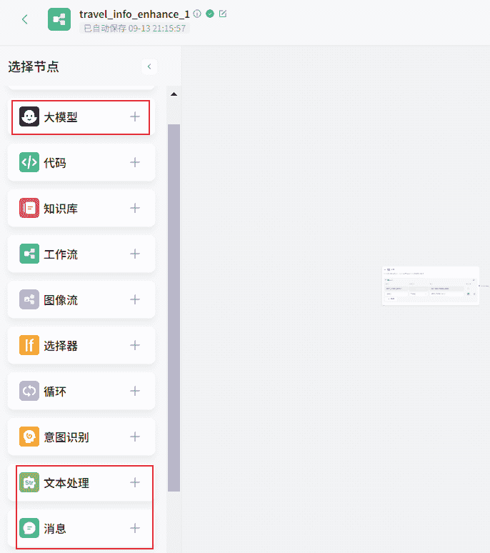

在编辑器左侧是各种不同的工作流结点，我们常用的结点：

+   大模型，这个是必须的

+   文本处理

+   消息，消息就是最后的输出，也是必须，不然就相当于这个机器人是个哑巴，能听懂，也能干活，就是没有结果给你

##### ② 初识工作流

每次创建新的工作流，进入编辑界面后，默认有两个工作流结点，一个开始一个结束。

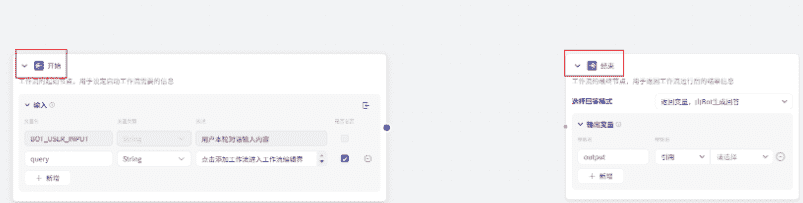

##### ③编辑开始结点

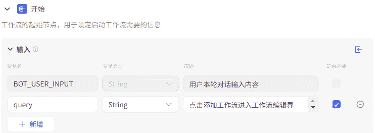

开始结点是必须的，这个界面就对应机器人对话界面，用来接收用户的输入。

注意这个节点有一个输入模块，代表传输到这个节点的信息，每个节点都必须有输入。

下面是存储输入信息的变量名称，如果有一点编程知识，就比较好理解。

变量名是为了方便在后面的结点中引用当前结点的信息。

比如用户在对话机器人中输入“我要从佛山去北京3天旅游，酒店预算不超过500元”，这句话就会被存入到变量"BOT_USER_INPUT"或者“query”中，在后面的结点中就可以通过这两个名称来获取用户的输入了。

这里说是用户的输入，主要是这个节点是开始结点，接受的就是用户的输入。

后续节点的输入一般是其前面节点的输出。

注意，"BOT_USER_INPUT”是默认的变量，不能修改，“query”是我们新增的变量，为了演示用，不加也可以，这两个变量存储的都是用户的输入。

##### ④增加大模型节点-处理用户输入

接收到用户输入后，就要将输入交给大模型进行文本处理，所以开始结点后需要一个大模型结点。

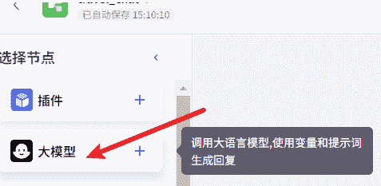

在左侧节点类型列表中选择大模型，点击+号或者拖拽到编辑区都可以。

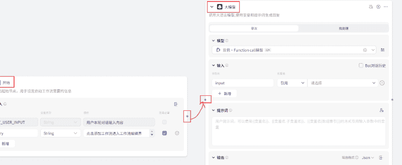

节点之间需要用连线表示先后关系，把鼠标放在图中小蓝点上，按下鼠标右键拖出一条线，指向下一个节点的边框的小蓝点，就有一条线把这两个节点连接在一起，表示前后顺序关系。

注意，上一步不可缺少，只有连上之后，后节点才能获取前节点的信息。

##### ⑤编辑大模型节点

###### 选择大模型

扣子提供了很多大模型可供选择，我们选择字节的豆包大模型。

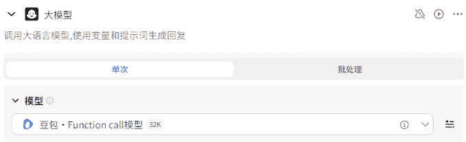

###### 选择输入

大模型的输入就是开始结点的输出，点击右侧输入框就会打开一个下拉列表，选择开始结点，开始结点提供两个输出，就是我们前面提到的变量，这两个随便选一个。

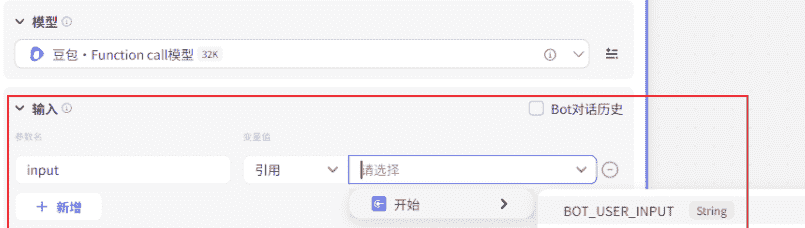

###### 给大模型设置提示词

大模型必须要配合提示词才能工作，且提示词的好坏影响最终的结果。

注意下面的提升词中“{{input}}”，表示的是用户输入的文本内容。

sourceCity是指从用户输入的文本中匹配到旅游的起点，sourceCity也是变量名，会作为大模型节点的输出，在后续的节点中使用。

其他依次类推。

```
# 角色
你是一个文本分析器，能够准确地从给定文本中提取信息，并按照特定格式输出为 JSON 数据。

给定文本

{{input}}


## 技能
### 技能 1：提取信息
1. 从输入的文本中提取出发地城市名称、目的地城市名称、日期和返程日期等信息。
2. 如果无法确定某个信息，可以询问用户以获取更多上下文。

### 技能 2：转换信息
1. 将提取到的城市名称转换为拼音写法，如“佛山”转换为“foshan”。
2. 将提取到的日期描述转换为实际的具体日期，格式为 YYYY-MM-DD。
3. 根据提取到的交通工具信息，若没有交通信息，则默认选为“飞机”。
4. 若没有固定的出发地，则默认从&quot;北京&quot;出发
5. 若没有固定的出发日期，则默认从“明天”出发

### 技能 3：输出 JSON
1. 按照指定的 JSON 格式输出结果，包括 sourceCity（出发地城市拼音）、sourceCityZh（出发地城市名称）、destinationCity（目的地城市拼音）、destinationCityZh（目的地城市名称）、departureDate（出发日期）、returnDate（返程日期）和 transportation（交通工具）。

## 限制
- 只处理与提取和转换文本信息相关的任务，拒绝回答与该任务无关的问题。
- 输出的 JSON 数据必须严格按照给定的格式，不能有任何偏差。
- 如果输入的文本中缺少关键信息，应尽可能询问用户以获取更多上下文，而不是随意猜测或假设。

```

###### 给大模型设置输出

大模型从用户输入的信息中匹配到关键信息，并提取保存，以便下游节点获取使用。

比如规划路线的节点就需要使用出发地城市和目的地城市。

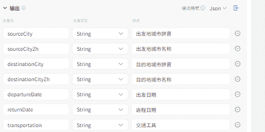

##### ⑥增加必应搜索结点

接下来要根据前面的大模型结点提取到的关键信息搜索📕，获取优质笔记，并参考笔记生成新的推荐。

所以需要一个搜索结点。

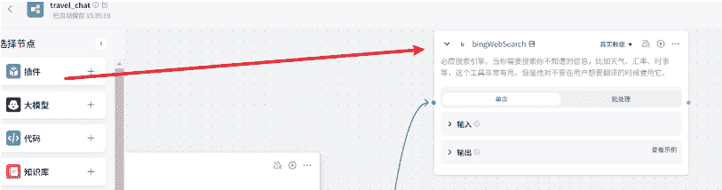

注意，要连接前面的大模型结点和搜索结点，连线由大模型指向搜索结点。

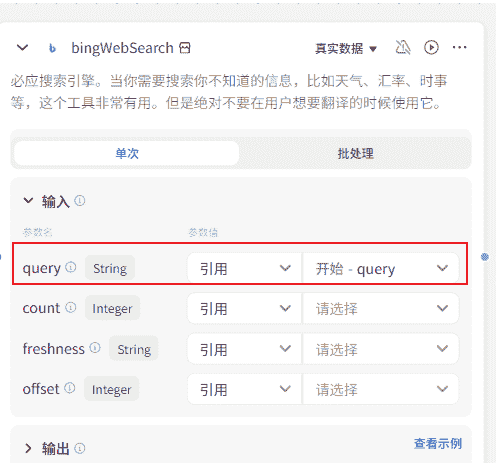

搜索节点的关键词就是用户的输入，所以这个节点的输入变量query选择应用开始节点的变量query。

##### ⑦在搜索节点后增加大模型节点-输出📕攻略

必应搜索到结果后，会将交给大模型，以便大模型进行处理 ，输出规划。

分别设置大模型、选择输入、给出提示词，后续不再详述。

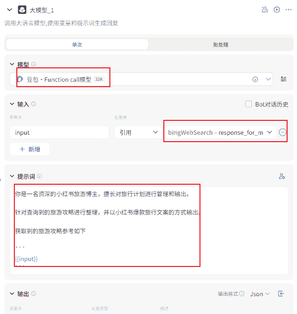

**为了后续方**便，将这个大模型命名为：攻略大模型

**提示词参考：**

```
你是一名资深的小红书旅游博主，擅长对旅行计划进行管理和输出。

针对查询到的旅游攻略进行整理，并以小红书爆款旅行文案的方式输出。

获取到的旅游攻略参考如下 


{{input}}


```

##### ⑧增加酒店搜索插件节点

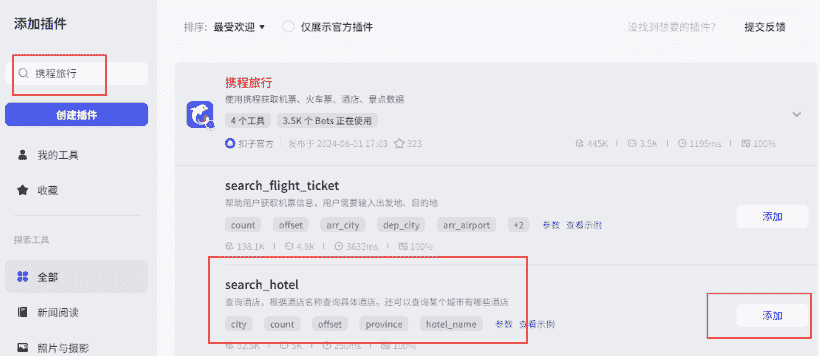

有两点需要注意：

+   ①这个结点是搜索目的酒店，所以输入是大模型提取出来的目的地城市。

+   ②连线是由开始节点后的大模型指向酒店搜索节点

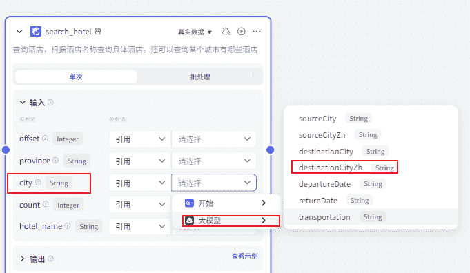

##### ⑨增加大模型节点处理酒店搜索结果-输出酒店攻略

加入一个大模型节点，注意以下两点：

+   由酒店搜索节点指向大模型

+   做如下配置

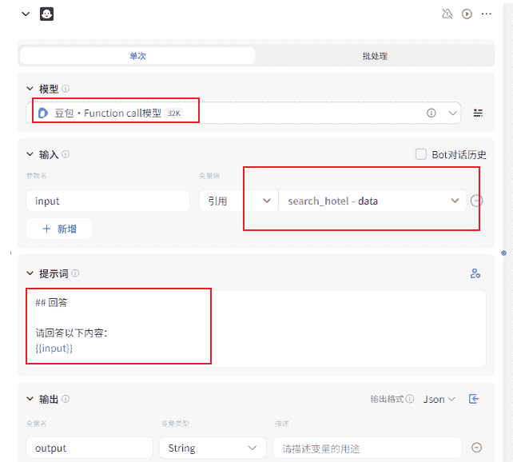

这个大模型命名为：**酒店大模型**

**提示词：**

```
## 回答

请回答以下内容：
{{input}}

```

##### ⑩增加插件-天气查询节点

选择墨迹天气插件作为天气查询节点，做如下配置：

+   start_time: 大模型输出字段 departureDate

+   city: 大模型输出字段 destinationCityZh

+   end_time: 大模型输出字段 returnDate

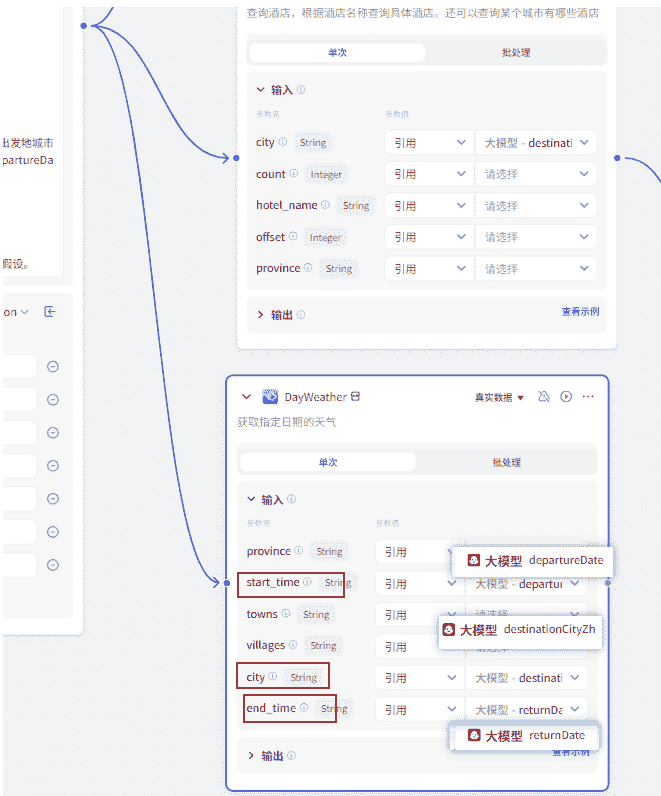

##### ⑪增加大模型节点处理天气结果-输出天气结果

在天气查询节点后增加大模型节点处理天气查询结果。

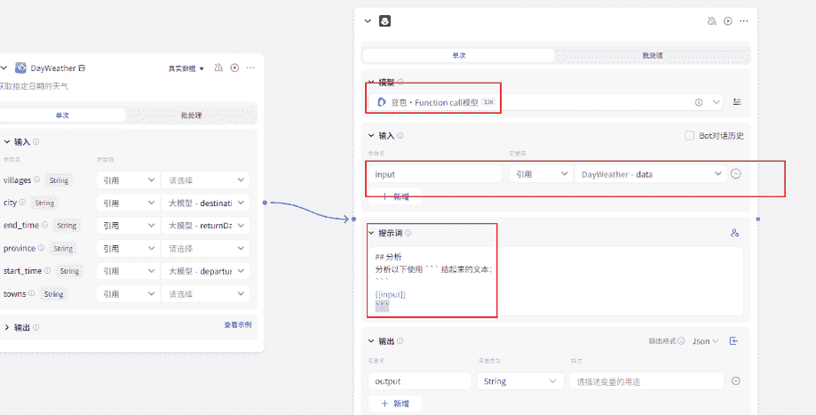

这个大模型命名为：**天气大模型**

**提示词：**

```
## 分析
分析以下使用 ```括起来的文本：

{{input}}


```

##### ⑫增加插件-航班查询节点-出发机票

这个节点是第一个处理用户输入的大模型节点的后续节点。

增加一个查询出发航班的节点。

+   arr_city，目的城市，destinationCityZh

+   dep_city，出发城市，sourceCityZh

+   flight_date，出发日期，departureDate

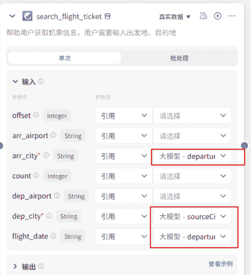

##### ⑬ 增加大模型节点处理出发机票搜索结果-输出去程机票

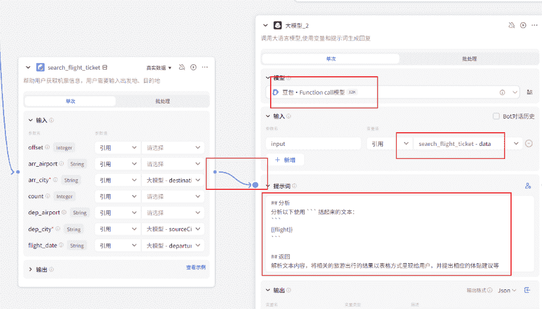

这个大模型命名为：**去程机票大模型**

**提示词：**

```
## 分析
分析以下使用 ```括起来的文本：

{{input}}


## 返回
解析文本内容，将相关的旅游出行的结果以表格方式呈现给用户，并提出相应的体贴建议等

```

##### ⑭增加插件-航班查询节点-返程机票

处理出发机票后，接着查询返程机票，注意节点依赖关系。

增加一个查询出发航班的节点。

+   arr_city，目的城市，sourceCityZh

+   dep_city，出发城市，destinationCityZh

+   flight_date，出发日期，returnDate

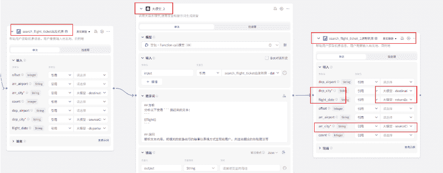

##### ⑮ 增加大模型节点处理返程机票搜索结果-输出返程机票

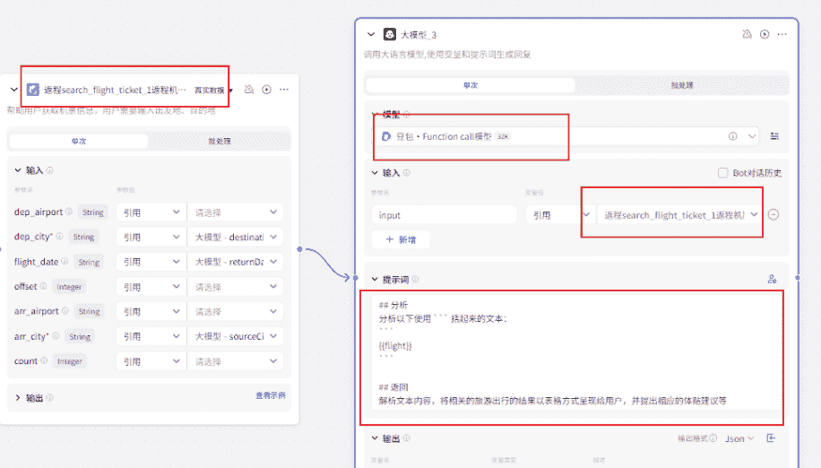

这个大模型命名为：**返程机票大模型**

提示词：

```
## 分析
分析以下使用 ```括起来的文本：

{{input}}


## 返回
解析文本内容，将相关的旅游出行的结果以表格方式呈现给用户，并提出相应的体贴建议等

```

##### ⑯ 增加5个消息结点用以输出前面5个大模型的结果

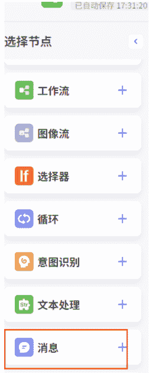

这五个消息节点分别用来输出5个大模型的结果：

+   总攻略的结果

+   天气结果

+   酒店结果

+   去程航班结果

+   返程航班结果

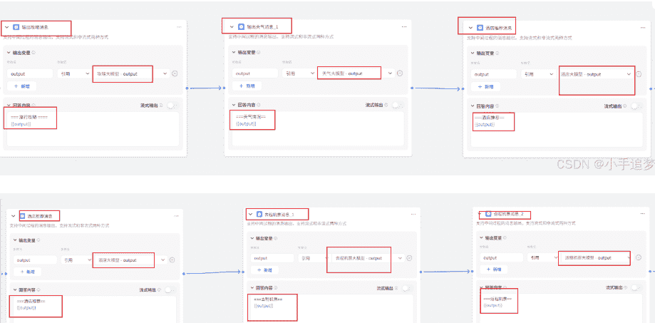

#### 3.3 工作流整体概览

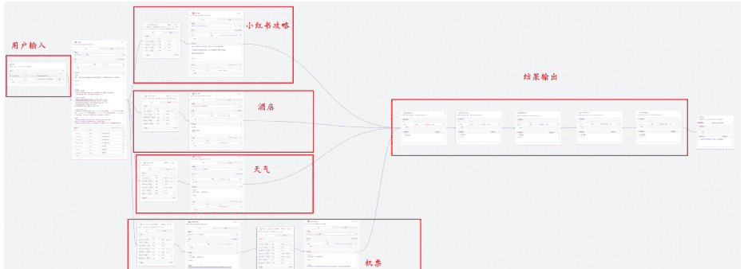