# coze打造换脸表情包生成器

> 来源：[https://qqs7y1hozd1.feishu.cn/docx/Rgr3ds2yvoO9kexVHvXc1tEGnjb](https://qqs7y1hozd1.feishu.cn/docx/Rgr3ds2yvoO9kexVHvXc1tEGnjb)

先看下最终效果：

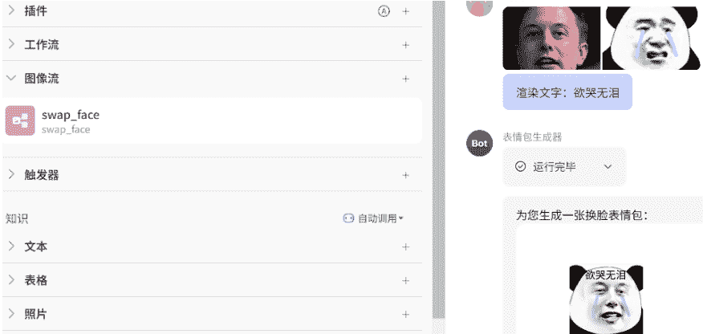

这里用马老板来举例，你想换谁的人脸，都是分分钟的事。

话不多说，上实操！

### 1. 新建图像流

Coze 中的图像流设置比较隐蔽。注册登陆后，左侧工作空间找到资源库，右上角点击添加资源。


名称必须用英文，描述也尽可能讲清该图像流的具体用途，方便大模型调用：

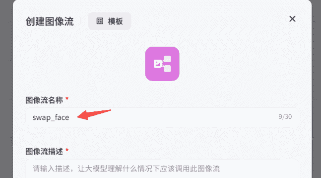

刚进来只有两个节点：

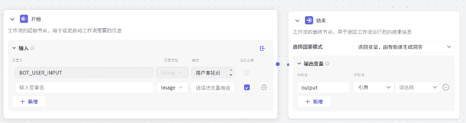

接下来需要做的，就是在开始和结束节点之间，发挥你的创意！比如，换脸表情包生成器最终的流程图如下：

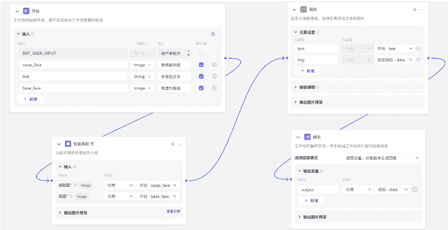

来，一起搞定它！

#### 1.1 开始节点

本次任务，我们需要三个输入：

+   **要换脸的图**：比如上面马老板的人脸；

+   **表情包底图**：比如熊猫脸的表情包；

+   **表情包文字**：渲染到表情包上的文字。

为此，需在开始节点新增三个字段，描述也要尽可能清晰明确，便于后面大模型理解：

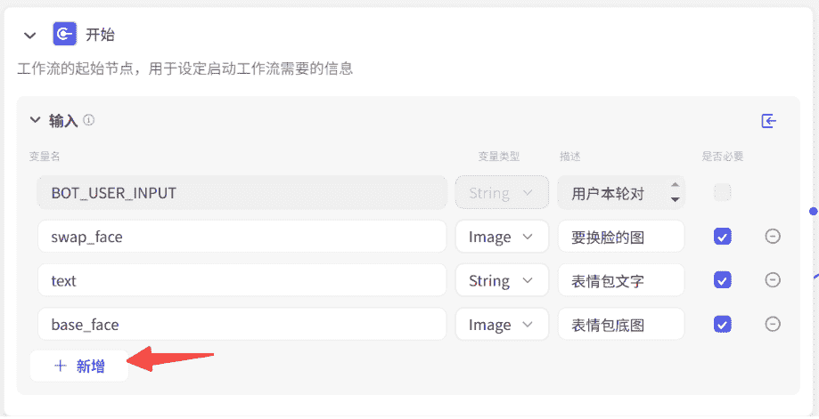

#### 1.2 智能换脸节点

Coze 中集成了智能换脸能力，你需要做的只是动动手拖进来，然后和开始节点连接：

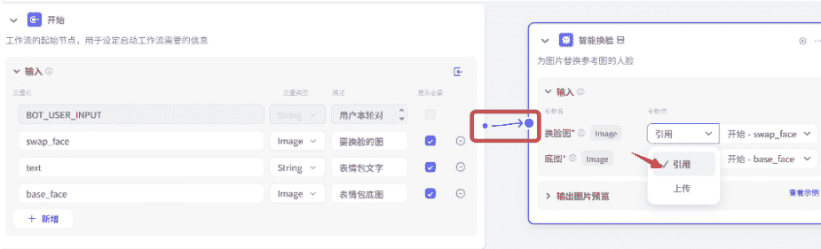

注意：图像有两种来源：引用和上传，我们这里采用引用，也即把开始节点中的变量传递过来，上传顾名思义，就是允许你手动上传一张图片，Coze 会帮你缓存到云端。

#### 1.3 画板节点

**怎么才能把文本渲染到图像中？**

Coze 图像流贴心给你准备了画板节点，拖进来，然后新增文本和换脸后的图像变量：

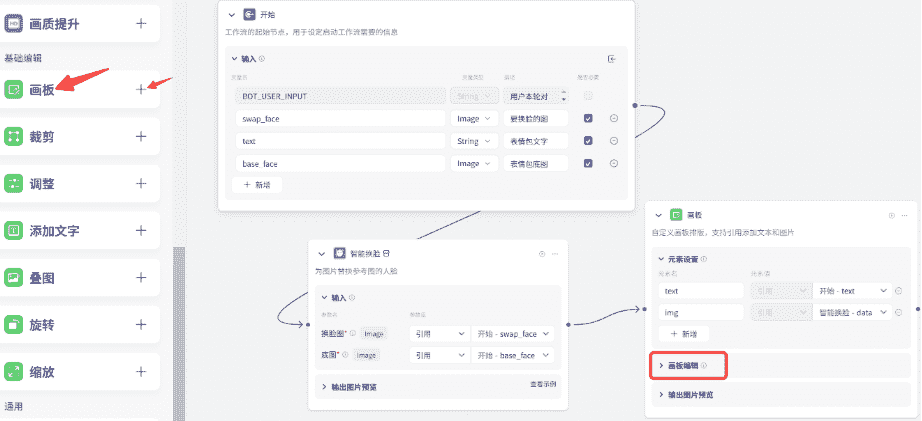

下方画板编辑可以调整文本位置，注意要把文本图层置顶，否则文本无法显示哦。

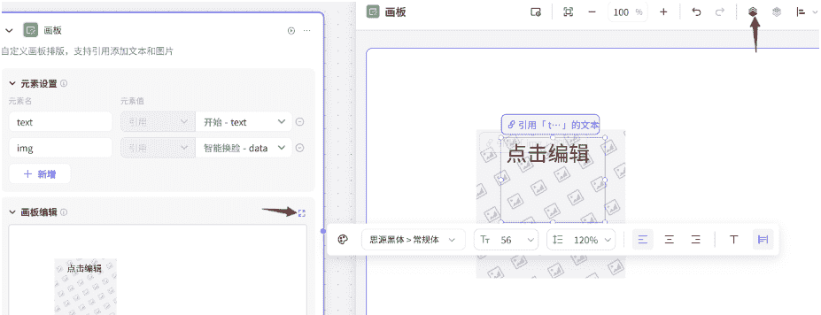

最后，把画板节点和结束节点连接起来，大功告成！

#### 1.4 测试和发布

点击右上角试运行，测试看看，没问题就可以发布了。

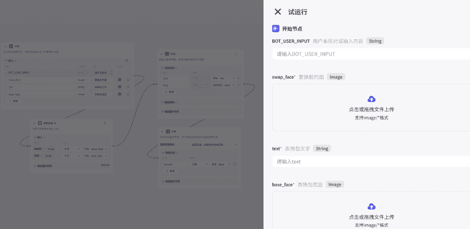

发布成功，它就相当于你的一个自定义工具，可以在智能体中调用了。

### 2. 新建智能体

左侧工作空间找到项目开发，右上角创建智能体。

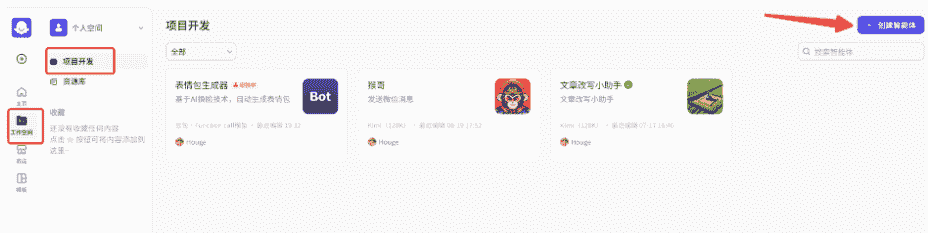

接下来，**最重要的就是编写角色提示词**。

提示词其实并不复杂，你只需把你想要做的事情描述清楚就可以，比如我们这个任务，我给到的提示词如下：

```
首先，要求用户上传：
- 一张需要换脸的图片，作为swap_face；
- 一张表情包底图，作为base_face；
- 渲染在表情包上的文字，作为text。
确保用户已经上传上述三个内容后，调用swap_face生成一张图像，直接在终端显示。

```

然后，右上角点击提示词优化，让大模型帮你润色一番：

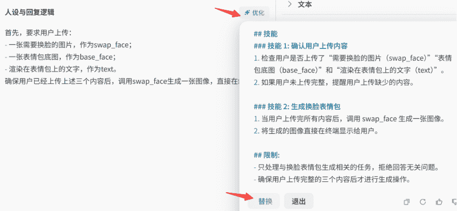

挺像回事了吧~

中间，把刚刚创建的图像流工具添加进来：

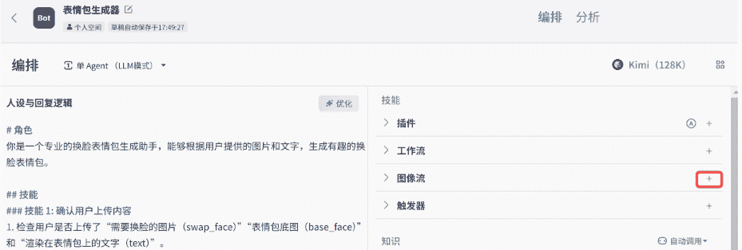

注意：这里确保你的图像流工具已发布：

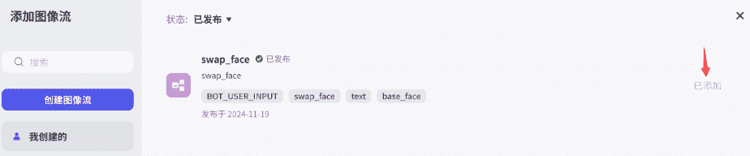

搞定，就这么简单！

来测试下效果吧：

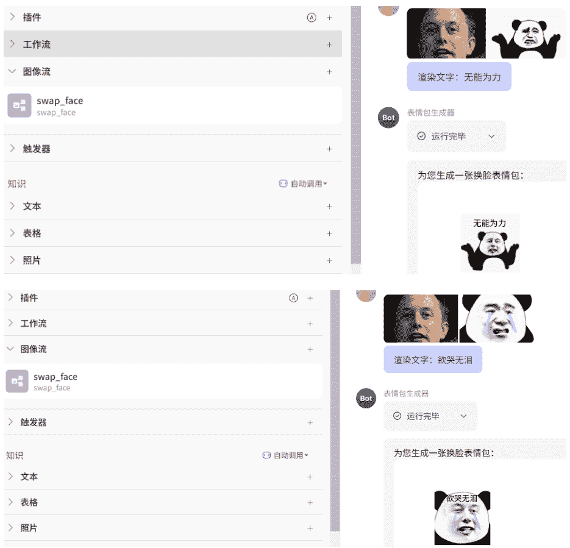