# coze搭建智能待办事项agent

> 来源：[https://qqs7y1hozd1.feishu.cn/docx/V8p2dfZRHohZlBxv4JyczBR4nfb](https://qqs7y1hozd1.feishu.cn/docx/V8p2dfZRHohZlBxv4JyczBR4nfb)

### 前期准备

#### 创建数据表

1.  添加一个新的表todo_list

设为单用户模式

1.  字段设置

设置三个字段，分别是do_des对应事项概括描述，do_content对应事项详情，事项信息的原文，create_at对应创建时间。

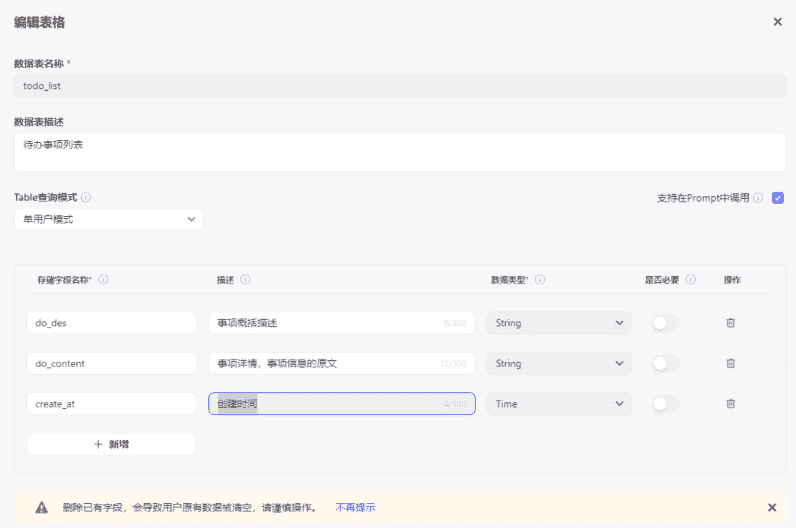

### 记录待办事项工作流

#### 流程图

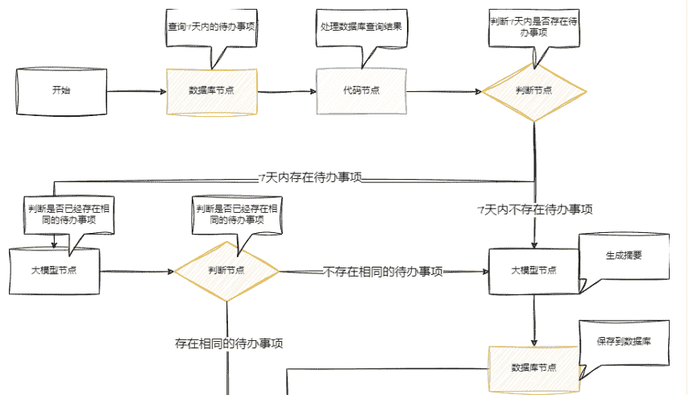

#### 详细步骤

点击添加工作流并点击创建工作流，进入工作流编辑面板。

**part.1 判断内容是否重复**

第一个节点

首先添加一个数据库节点，用来查询最近7天内的全部记录

**查询语句如下：**

SELECT do_des, do_content FROM todo_list WHERE create_at>= DATE_SUB(CURRENT_DATE, INTERVAL 7 DAY)

提示：

查询时不支持 select *

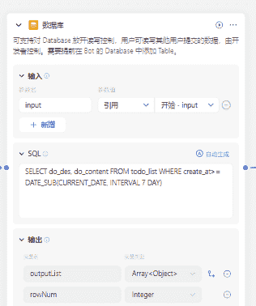

**输出参数：**

outputList，系统默认 rowNum，系统默认

**第二个节点**

使用代码节点，用来将查询数据库得到的数据转换为一个字符串，以便作为上下文提供给大模型

输入参数：

list，引用各个数据库查询的输出outputList。

**代码如下：**

```
`import dayjs from &#x27;dayjs&#x27;;   async function main({ params }: Args): Promise&lt;Output&gt; {       let status = 0       let data = &#x27;&#x27;       let data_arr:string[] = []       const time = dayjs().format(&#x27;YYYY-MM-DD HH:mm:ss&#x27;)          const {list} = params          if(list.length &gt; 0) {           status = 1           list.forEach((value, index) =&gt; {               data_arr.push(   `   事项 ${index + 1}   ${value[&#x27;do_content&#x27;]}        `)           })       }          data = data_arr.join(&#x27;\n\n&#x27;)       const ret = {           &quot;status&quot;: status,           &quot;data&quot;: data,           &quot;time&quot;: time,       };          return ret;   }   `

```

**输出参数：**

status，判断查询结果是否为空，如果为空则直接到第三步。data，将数据库查询结果转为字符串的结果。time，当前的时间

第三个节点

使用选择器节点，用来判断数据库查询结果是否为空，如果为空则直接生成摘要以及后续动作，否则需要判断已经保存过类似的事项。

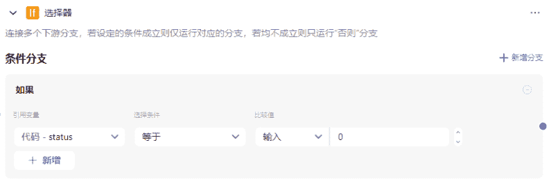

#### 判断事项是否重复

通过大模型来判断事项是否重复

添加一个大模型节点，因为doto_list参数的值可能会比较长，因此我们尽量使用上下文较长的模型。

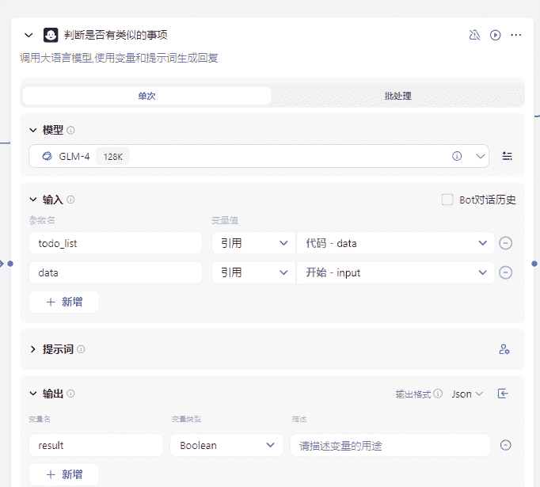

**输入参数：**

todo_list，引用代码节点的输出参数data。data，引用开始节点的输入参数input。

**提示词：**

```
角色
作为一个事项管理的专业人士，帮我总结事项，和判断事项是否有重复。
上下文
当前已经存在的事项如下：{{todo_list}}
行动
判断新的事项是否已经存在于已经存在的事项列表中，如果存在就返回true，否则就返回false
结果示例
true
新的事项
{{data}}
```

**输出参数：**

result，类型选择布尔类型

随后再添加一个判断节点

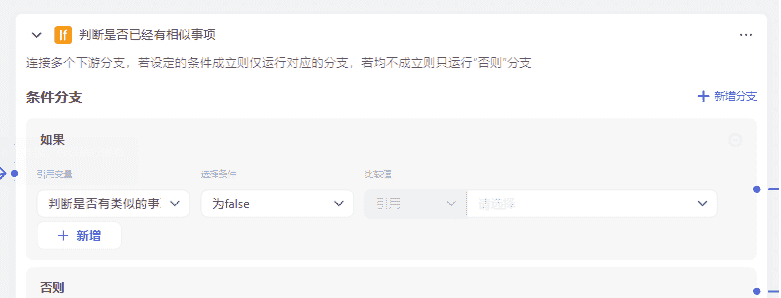

判断大模型节点的输出是否为false，如果不存在重复项则直接生成摘要并保存到数据库，否则直接返回已存在

#### 生成摘要并保存到数据库

添加一个大模型用来生成摘要。

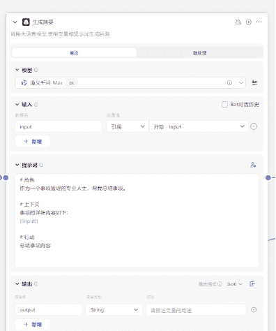

**输入参数：**

input，引用开始节点的输入input。

**提示词：**

```
角色
作为一个事项管理的专业人士，帮我总结事项。
上下文
事项的详细内容如下：{{input}}
行动
总结事项内容
```

**输出参数：**

output，为生成的摘要结果。

添加一个数据库节点，用来执行保存信息。

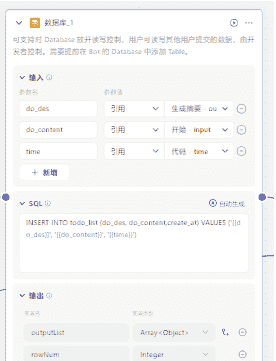

**输入参数：**

do_des，引用大模型生成摘要 do_content，引用开始节点的input time，引用当前时间

**SQL语句：**

INSERT INTO todo_list (do_des, do_content,create_at) VALUES (‘{{do_des}}’, ‘{{do_content}}’, ‘{{time}}’)

**输出：**

outputList，系统默认 rowNum，系统默认

#### 统一输出内容

将不同的情况返回的结果进行统一处理，最后返回给结束节点。

添加一个代码节点，这个节点处理也比较简单，就是判断一下是否重复。

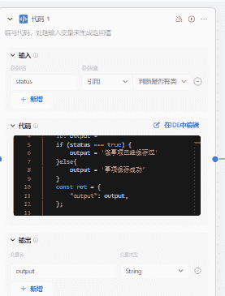

**输入参数：**

status，引用判断重复的大模型的输出结果

```
async function main({ params }: Args): Promise&lt;Output&gt; {       const { status } = params          let output = &#x27;&#x27;       if (status === true) {           output = &#x27;该事项已经保存过&#x27;       }else{           output = &#x27;事项保存成功&#x27;       }       const ret = {           &quot;output&quot;: output,       };          return ret;   }   

```

**输出参数：**

output，传给结束节点的内容。结束节点选择，使用设定内容直接回答即可

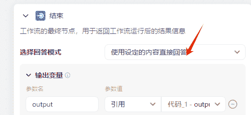

#### 详细步骤

数据库查询节点

查询7天内添加的待办事项

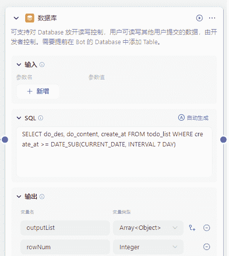

代码节点，处理数据库查询结果，将其转为字符串

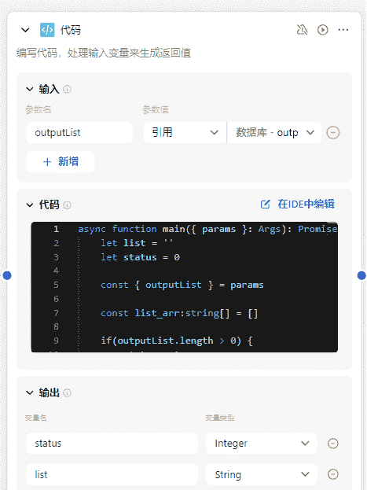

代码：

```
`async function main({ params }: Args): Promise&lt;Output&gt; {       let list = &#x27;&#x27;       let status = 0          const { outputList } = params          const list_arr:string[] = []          if(outputList.length &gt; 0) {           status = 1           outputList.forEach((v, i) =&gt; {               list_arr.push(   `   事项 ${i+1}   ${v[&#x27;do_content&#x27;]}   `               )           })       }          list = list_arr.join(&#x27;\n\n&#x27;)          const ret = {           &quot;status&quot;: status,           &quot;list&quot;: list,       };          return ret;   }   `

```

选择器节点

判断7天内是否有待办事项

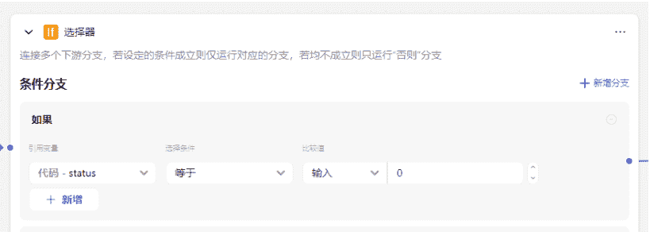

大模型节点

处理用户的请求

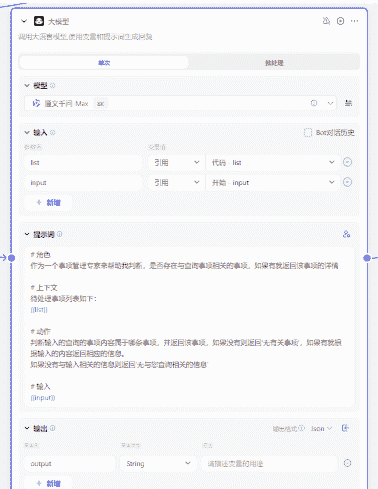

输入参数：

list，引用代码节点处理的数据库查询结果

input，引用开始节点的输入参数

**输出参数：**

output，大模型的处理结果。

代码节点

将不同分支的结果统一处理为返回内容

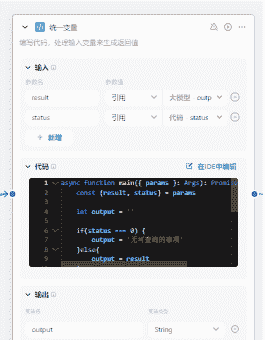

**输入参数：**

result，引用大模型的处理结果 status，引用代码节点的判断7天内是否存在待办事项的结果。

**代码：**

```
async function main({ params }: Args): Promise&lt;Output&gt; {       const {result, status} = params          let output = &#x27;&#x27;          if(status === 0) {           output = &#x27;无可查询的事项&#x27;       }else{           output = result       }       const ret = {           &quot;output&quot;: output,       };          return ret;   }   

```

**输出参数：**

output，输出处理结果

### Agent的Prompt


## 测试

### 测试保存待办事项

#### 尝试输入一个事项

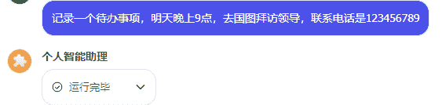