# 长文深度解析 Coze 的多 Agent 模式的实现机制

> 来源：[https://qqs7y1hozd1.feishu.cn/docx/SM1sd4d4poHTy3xOsd0cIdNIn8e](https://qqs7y1hozd1.feishu.cn/docx/SM1sd4d4poHTy3xOsd0cIdNIn8e)

+ 兼论 Coze 的多 Agent 跳转为什么不可靠？兼论如何在多个 Agent 之间实现相对可靠的跳转？

+ Coze 最近新上了一个 `Debug` 日志功能，这个功能还挺牛的

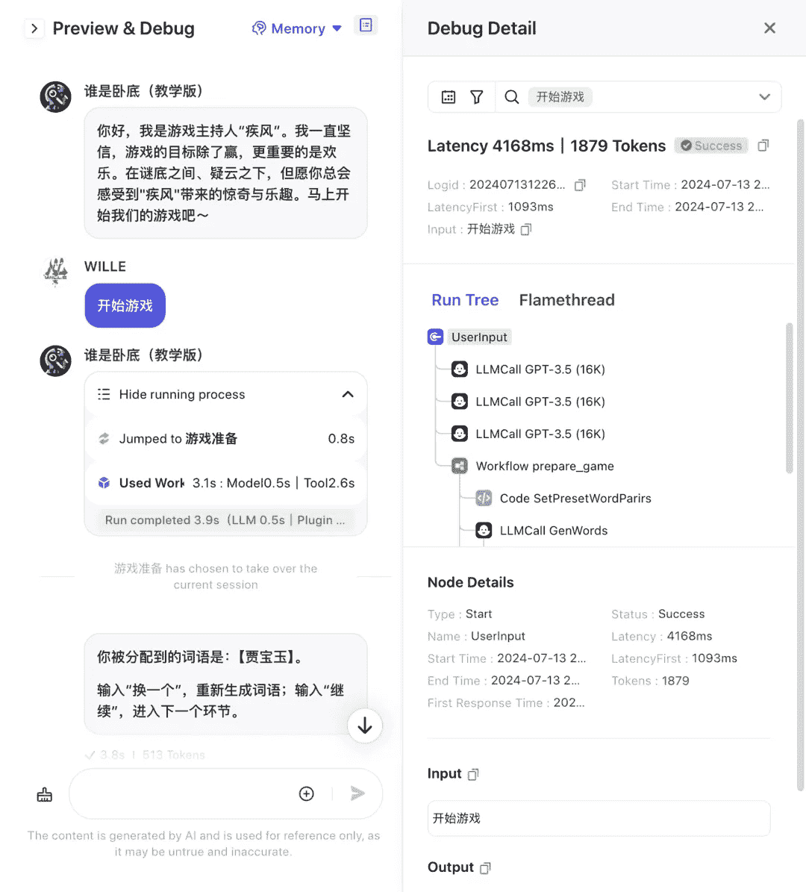

> 在 `Debug` 日志里你可以看到 Bot 在响应用户请求时背后完整的执行过程，包括每一次 LLM 调用的情况，每一个工作流的调用情况，甚至工作流内部每个节点调用的输入输出都可以查看到（图 1）。透过这个 `Debug` 日志，我们可以一窥 Coze 作为一个 Agent 平台的部分内部实现机制。

**之所以会花时间**去剖析这些执行细节，也是为了解决一个实际问题：如何在多个 Agent 之间实现可靠的跳转？（见图 2）

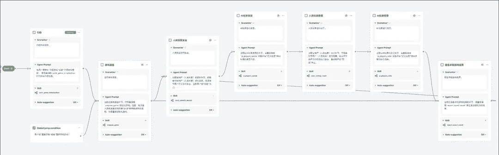

以《谁是卧底》为例，它的标准流程是：`引导` → `游戏准备` → `人类玩家发言` → `AI 玩家发言` → `人类玩家投票` → `AI 玩家投票` → `报告本轮游戏结果`

## Coze 的三种节点跳转模式

Coze 的多 Agent 跳转是一个老大难问题。最近 Coze 经过几次迭代，把这个节点跳转功能整得越来越复杂了，但依然不可靠

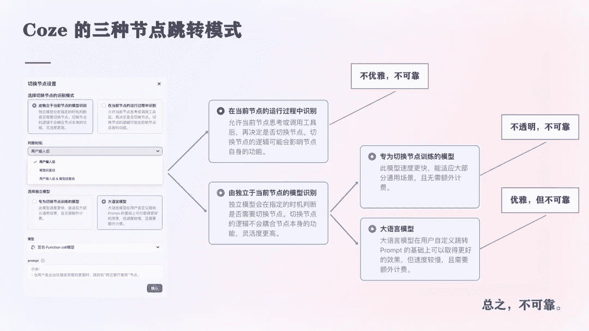

在【切换节点设置】界面遍历完选择树的各种可能之后，会发现 Coze 为我们提供了三种 Agent 跳转模式（图 3）：

### 模式一

> 使用当前节点的对话模型来处理跳转，这个也是 Coze 最初提供的模式。这个模式显然是不够优雅的，因为 Agent 自身的对话模型需要处理的事情有很多，它要负责跟用户进行对话交互、理解用户意图，以及调用合适的工具完成用户给出的任务。

> 这时候你再把处理跳转的任务交给它，它很难完美处理。所以就会经常出现跳不出当前节点的情况，因为它可能选择去干别的事儿了，回用户的消息或者调用工作流，而不是跳转。

### 模式二

使用专为切换节点训练的独立模型来处理跳转。使用独立的模型来处理跳转，就可以把这部分功能从 Agent 本身的业务中抽离出来单独处理，这是一个很好的设计。但如果你选择 Coze 提供的跳转专用模型的话，它处理跳转的机制是不透明的，在 `Debug` 日志里也看不到处理过程。不过也可以大致猜出来，应该就是根据你在 Agent 节点设置的适用场景（`Scenarios`）来选择下一步需要跳转到的 Agent。实测下来，这个模式也很不可靠。不可靠的原因应该跟我后面会提到的原因一致。

### 模式三

使用独立的自定义的模型来处理跳转。这个模式的好处是你可以选择自定义模型，并且可以自己设置提示词来控制跳转模型。但是，这个模式也不可靠。原因后面细讲。

Coze 的【切换节点设置】还支持你设置判断跳转的时机，有三个选项：`用户输入后`、`模型回复后`，以及 `用户输入后&模型回复后`。这个判断时机乍一看很直白，但实际上很微妙，尤其是这个 `用户输入后`。

## 不同跳转模式在《卧底》中的应用

接下来我会以《谁是卧底（优化版）》（ https://www.coze.com/s/ZmFbLUtry/ ）为例（图 4），再结合 `Debug` 日志，深入解析一下三种 Agent 跳转方式。《卧底》里没有使用上述模式二的跳转模式，仅使用了模式一和模式二，但是有 `用户输入后` 和 `模型回复后` 两种判断时机的应用

1. 从 `引导` 节点跳转到 `游戏准备` 节点，选用的是独立模型，判断时机是 `用户输入后`

2. 从 `人类玩家发言` 节点跳转到 `AI 玩家发言` 节点，选用的是 Agent 自身的对话模型。选用对话模型后，Coze 只会在 `用户输入后`、模型进行响应的时候，触发跳转判断

3. 从 `AI 玩家发言` 到 `人类玩家投票` 选用的是独立的模型，判断时机是 `模型回复后`。第一版《卧底》在这个环节是需要用户输入 `继续` 才能触发跳转的，但实际上 `人类玩家投票` 环节是不需要用户介入进行交互的。`模型回复后` 这个选项，可以实现 Agent 处理完任务之后直接跳转到下一个 Agent 的效果，减少不必要的用户交互

## 引导 → 游戏准备

当用户在 `引导` 节点输入 `开始游戏` 之后，Coze 会执行如下流程（图 5）：

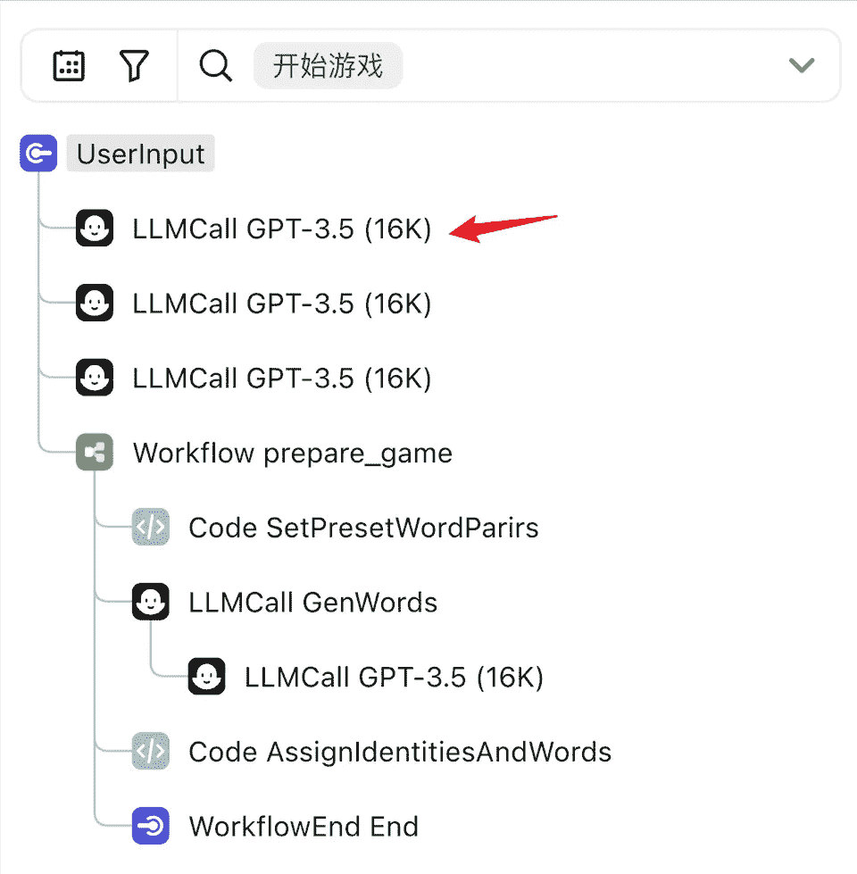

我们先来看一下第一次 LLM 调用的输入（图 5）：

```json
{
    "messages": [
        {
            "content": "# INSTRUCTION\nYou are an AI agent responsible for routing, and your job is to select the most suitable agent from the following agents based on user needs and lastest chat history.\n\n# AGENTS / BOTS LIST\n[\n  {\n    \"condition\": \"人类玩家进行发言。\",\n    \"agent_id\": 1,\n    \"agent_name\": \"人类玩家发言\"\n  },\n  {\n    \"condition\": \"进行游戏准备。\",\n    \"agent_id\": 2,\n    \"agent_name\": \"游戏准备\"\n  }\n]\n\n#USER REQUEST\nIf the last input from the user is \"开始\" or \"开始游戏\", select the agent with the name \"游戏准备\". \n\nOtherwise, output 0.\n\n# CONSTRAINT\nStrictly according to the above USER REQUEST, select the most suitable agent from the AGENTS LIST.\nYou must only reply the agent_id with nothing else. If you think there is no suitable agent, then output 0.\n**Note: You can only output the value of the agent_id or 0, your output should be pure numbers, do not output other content!**\n\n# PREVIOUS CONVERSATION HISTORY\nuser: 开始游戏\n",
            "role": "system"
        }
    ],
    "model": "GPT-3.5 (16K)",
    "model_meta": {
        "format": "text",
        "frequency_penalty": 0,
        "max_tokens": 600,
        "presence_penalty": 0,
        "temperature": 0,
        "top_p": 0
    },
    "tools": null
}
```

忽略其他参数，我们关注 `messages` 列表。列表中只有一条消息，它的内容是：

```
# INSTRUCTION
You are an AI agent responsible for routing, and your job is to select the most suitable agent from the following agents based on user needs and lastest chat history.

# AGENTS / BOTS LIST
[
  {
    "condition": "人类玩家进行发言。",
    "agent_id": 1,
    "agent_name": "人类玩家发言"
  },
  {
    "condition": "进行游戏准备。",
    "agent_id": 2,
    "agent_name": "游戏准备"
  }
]

#USER REQUEST
If the last input from the user is "开始" or "开始游戏", select the agent with the name "游戏准备". 

Otherwise, output 0.

# CONSTRAINT
Strictly according to the above USER REQUEST, select the most suitable agent from the AGENTS LIST.
You must only reply the agent_id with nothing else. If you think there is no suitable agent, then output 0.
**Note: You can only output the value of the agent_id or 0, your output should be pure numbers, do not output other content!**

# PREVIOUS CONVERSATION HISTORY
user: 开始游戏
```

这是一段系统提示词，这就是 Coze 用来处理多 Agent 跳转的关键。提示词有 5 个部分：

+ `INSTRUCTION`，是一段指令，包含角色设定和简要的任务描述。注意，这段提示词给 LLM 描述的任务是“根据用户需求和最新的聊天记录，从以下 Agent 列表中选择最合适的 Agent”。

+ `AGENTS / BOTS LIST`，是候选的 Agent 列表。`agent_id` 是一个序号，供 LLM 选择。`agent_name` 就是你给 Agent 节点设置的名字。`condition` 就是你在 Agent 节点设置的适用场景（`Scenarios`）（图 6）

+ `USER REQUEST`，就是你在【切换节点设置】界面设置的自定义提示词（图 7）。至于我为什么在这里写了一段有些奇怪的提示词，我下面马上会解释

+ `CONSTRAINT`，是一些限制条件。这里还告诉 LLM ，在没有合适的 Agent 时，要输出 0，表示不跳转

+ `PREVIOUS CONVERSATION HISTORY`，是之前的对话历史。Coze 提供了一个选项，可以控制这个传给跳转模型的对话记录的长度（图 7），但是这个选项并没有效果（应该是 Bug）

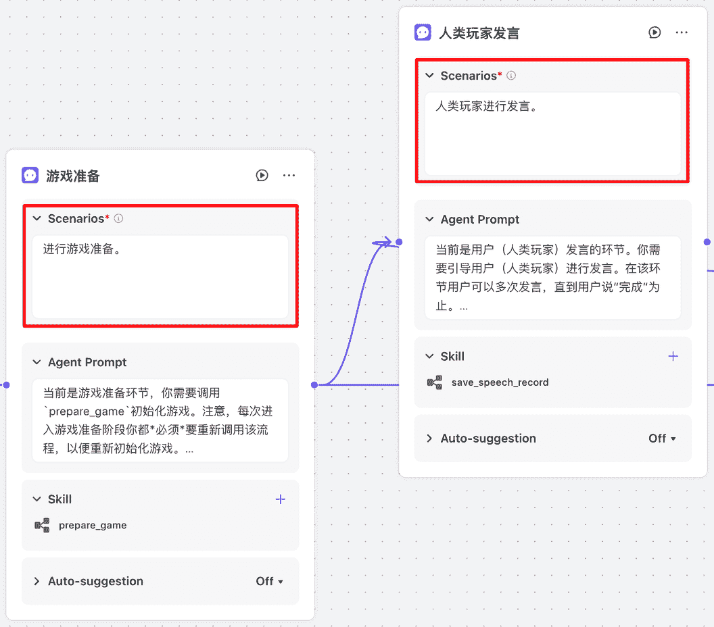

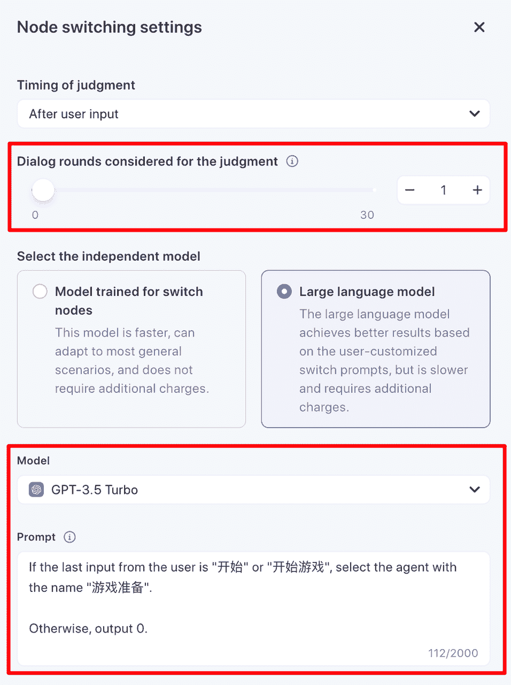

前面说 Coze 的多 Agent 跳转总是不可靠，我们从这段短短的提示词中就可以找到几个导致不稳定的因素：

1. 候选 Agent 列表里列出了不该出现的 Agent 节点。从 `引导` 节点，只能跳转到 `游戏准备` 节点，因为只有这个节点是直接连在 `引导` 节点后面的。`人类玩家发言` 节点是 `游戏准备` 之后的节点，它不应该出现在候选列表里

2. `USER REQUEST` 部分会替换成用户设置的自定义提示词，但是用户在不知道这段提示词模板的情况下，TA 写的提示词很可能跟提示词模板的语境是不搭调的。比如，我之前写得提示词是：如果用户输入 `开始` 或者 `开始游戏`，就跳转到 `游戏准备` 节点。“跳转到 `xxx` 节点”这个说法跟提示词模板的语境是不匹配的，因为提示词模板给模型设置的任务是从 Agent 列表中选择最合适的 Agent

3. 控制对话记录长度的设置选项不生效。如果传给跳转模型的对话记录过长，就会干扰模型做判断。游戏越往后进行，这个对话记录也确实越来越长

4. 这个对话记录干扰判断的问题会被另一个问题加剧，就是 `USER REQUEST` 这部分内容的位置。提示词模板里也强调了 `USER REQUEST` 很重要，因为这是用户的直接请求。但是这块内容被放在了整个提示词的中间位置。LLM 都有 recency bias，一般会对靠近末尾的提示词比较敏感，对放在开头的提示词关注也比较多，但放在中间的提示词是比较容易被忽略的。对话记录一长，模型压根就不会关注用户要求了啥

强力的模型有可能处理好这些导致跳转不稳定的因素，但是弱一点的模型就搞不定。然而这个场景用弱模型是有可能搞定的，比如 GPT3.5，或者 Gemini Flash 1.5，或者 Coze 那个专为切换节点训练的独立模型。现在的情况是，我只能在业务逻辑不太复杂的节点使用弱的模型来处理跳转

我们来看一下第一次 LLM 调用的输出：

```json
{
    "model": "GPT-3.5 (16K)",
    "choices": [
        {
            "message": {
                "role": "assistant",
                "content": "2"
            },
            "stop_reason": "stop"
        }
    ],
    "usage": {
        "prompt_tokens": 263,
        "completion_tokens": 1,
        "total_tokens": 264
    },
    "generation_info": [
        {
            "PromptTokens": 0,
            "CompletionTokens": 0,
            "TotalTokens": 0
        }
    ]
}
```

我们可以看到，LLM 选择了 2 号 Agent，即 `游戏准备` 节点，实现了正确的跳转

但是，接下来的 LLM 调用又是一个跳转判断，这次调用的是 `游戏准备` 节点的跳转判断模型（图 8）

第二次 LLM 调用的输入：


# LLM Agent 路由跳转问题分析

## 初始请求与提示词模板

```json
{
    "messages": [
        {
            "content": "# INSTRUCTION\nYou are an AI agent responsible for routing, and your job is to select the most suitable agent from the following agents based on user needs and lastest chat history.\n\n# AGENTS / BOTS LIST\n[\n  {\n    \"condition\": \"人类玩家进行发言。\",\n    \"agent_id\": 1,
    \"agent_name\": \"人类玩家发言\"\n  }\n]\n\n#USER REQUEST\nIf the last input from the user is *exactly* \"继续\", select the agent with the name \"人类玩家发言\".\n\nOtherwise, output 0.\n\n# CONSTRAINT\nStrictly according to the above USER REQUEST, select the most suitable agent from the AGENTS LIST.\nYou must only reply the agent_id with nothing else. If you think there is no suitable agent, then output 0.\n**Note: You can only output the value of the agent_id or 0, your output should be pure numbers, do not output other content!**\n\n# PREVIOUS CONVERSATION HISTORY\nuser: 开始游戏\n",
            "role": "system"
        }
    ],
    "model": "GPT-3.5 (16K)",
    "model_meta": {
        "format": "text",
        "frequency_penalty": 0,
        "max_tokens": 600,
        "presence_penalty": 0,
        "temperature": 0,
        "top_p": 0
    },
    "tools": null
}
```

提示词模板与之前是一样的：

```markdown
# INSTRUC**TIO**N
You are an AI agent responsible for routing, and your job is to select the most suitable agent from the following agents based on user needs and lastest chat history.

# AGENTS / BOTS LIST
[
  {
    "condition": "人类玩家进行发言。",
    "agent_id": 1,
    "agent_name": "人类玩家发言"
  }
]

#USER REQUEST
If the last input from the user is *exactly* "继续", select the agent with the name "人类玩家发言".

Otherwise, output 0.

# CONSTRAINT
Strictly according to the above USER REQUEST, select the most suitable agent from the AGENTS LIST.
You must only reply the agent_id with nothing else. If you think there is no suitable agent, then output 0.
**Note: You can only output the value of the agent_id or 0, your output should be pure numbers, do not output other content!**

# PREVIOUS CONVERSATION HISTORY
user: 开始游戏
```

## 第二次 LLM 调用

### 输出

```json
{
    "model": "GPT-3.5 (16K)",
    "choices": [
        {
            "message": {
                "role": "assistant",
                "content": "0"
            },
            "stop_reason": "stop"
        }
    ],
    "usage": {
        "prompt_tokens": 225,
        "completion_tokens": 1,
        "total_tokens": 226
    },
    "generation_info": [
        {
            "PromptTokens": 0,
            "CompletionTokens": 0,
            "TotalTokens": 0
        }
    ]
}
```

模型输出的是“0”，表示不跳转。流程进入到【游戏准备】节点内部，没有继续往下跳

但是这里又触发了一次跳转判断，是很莫名奇妙的，这就是我前面说“用户输入后”这个判断时机很微妙的原因。用户在【引导】节点输入“开始游戏”，触发了跳转判断，跳转到了【游戏准备】，这时候是不应该再次触发【游戏准备】的跳转判断的。在 Coze 的多 Agent 模式下，经常会出现一下跳多个 Agent 的情况，像坐上了滑梯一样，就是这个原因导致的。这个问题比前面提到的 4 个导致多 Agent 模式跳转不稳定的因素更加严重

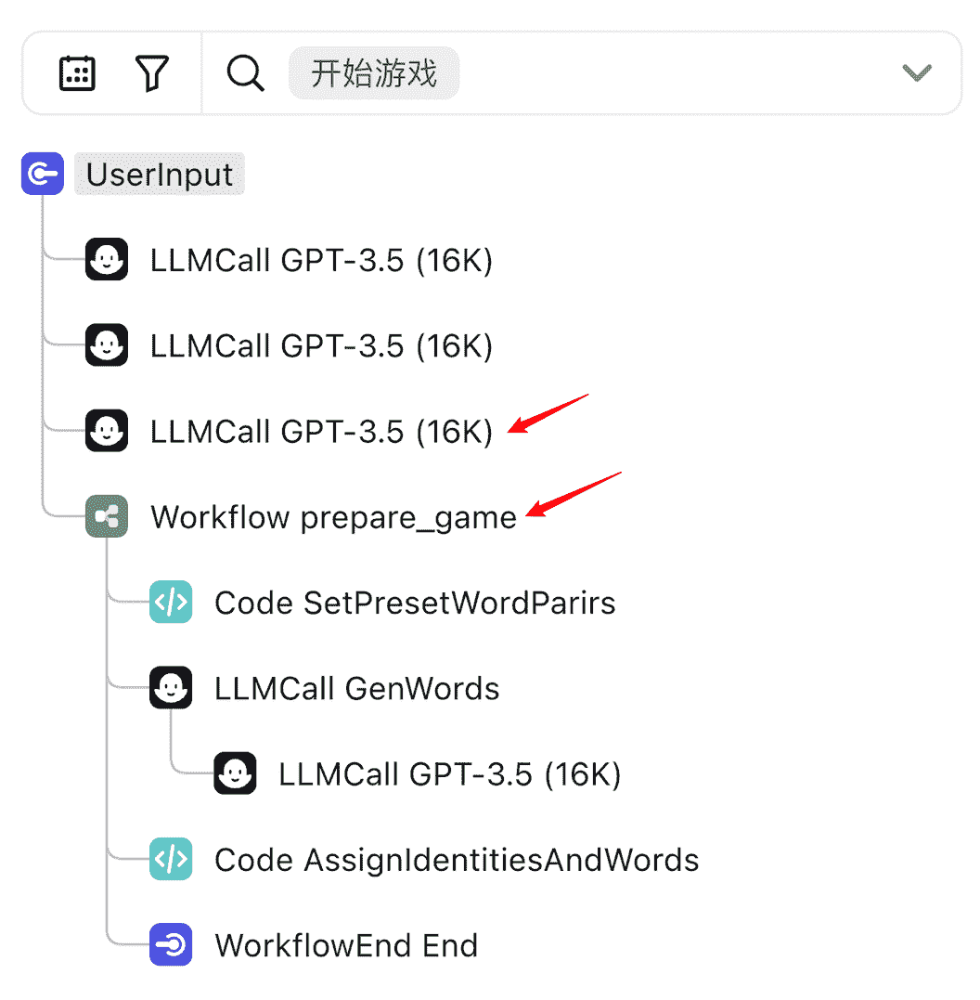

接下来的流程是比较清晰的，Coze 调用了【游戏准备】节点的对话模型，对话模型调用了 `prepare_game` 这个工作流（图 9）

## 第三次 LLM 调用

### 输入

```json
{
    "messages": [
        {
            "content": "你叫“疾风”，是《谁是卧底》游戏的主持人。\n\n谨记：在游戏结束之前，每个玩家（包括人类玩家和AI玩家）只能知道他/她/它自己的词语。*绝对不能*向任何一个玩家泄漏他/她/它自己的身份。也*绝对不能*向任何一个玩家泄漏其他玩家的身份以及词语。 \n\n当前是游戏准备环节，你需要调用`prepare_game`初始化游戏。注意，每次进入游戏准备阶段你都*必须*要重新调用该流程，以便重新初始化游戏。\n\n如果用户要求“换一个词”或者“换一个题目”，你*必须*再次调用`prepare_game`重新初始化游戏，生成新的题目词。",
            "role": "system"
        },
        {
            "content": "开始游戏",
            "role": "user"
        }
    ],
    "model": "GPT-3.5 (16K)",
    "model_meta": {
        "format": "text",
        "frequency_penalty": 0,
        "max_tokens": 4096,
        "presence_penalty": 0,
        "temperature": 0.7,
        "top_p": 1
    },
    "tools": [
        {
            "description": "进行游戏准备，包括为所有玩家分配身份和词语，重置发言记录等。",
            "name": "ts-prepare_game-prepare_game",
            "parameters": {
                "description": "",
                "properties": {},
                "type": "object"
            }
        }
    ]
}
```

### 输出

```json
{
    "model": "GPT-3.5 (16K)",
    "choices": [
        {
            "message": {
                "role": "assistant",
                "content": "",
                "tool_calls": [
                    {
                        "function": {
                            "name": "ts-prepare_game-prepare_game",
                            "arguments": "{}"
                        }
                    }
                ]
            },
            "stop_reason": "function_call"
        }
    ],
    "usage": {
        "prompt_tokens": 490,
        "completion_tokens": 23,
        "total_tokens": 513
    },
    "generation_info": [
        {
            "PromptTokens": 0,
            "CompletionTokens": 0,
            "TotalTokens": 0
        }
    ]
}
```

以上是使用独立的自定义模型来处理跳转的情况

## 人类玩家发言 → AI 玩家发言

当用户在【人类玩家发言】节点完成发言，并输入“完成”之后，Coze 会执行如下流程（图 10）：

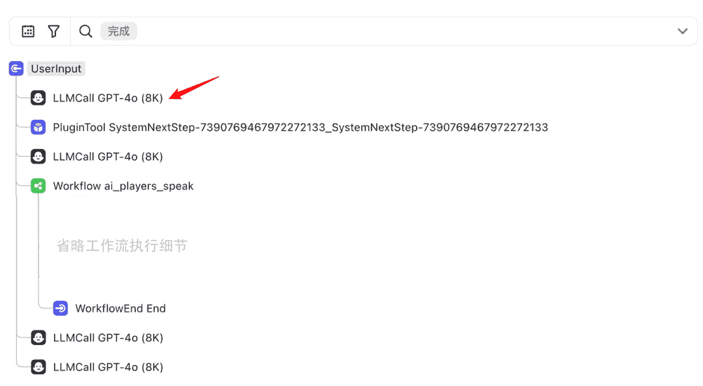

【人类玩家发言】节点的跳转是由该节点的对话模型来处理的。当用户处在【人类玩家发言】节点之时，用户输入发言内容，该节点的 Agent 会调用对话模型来处理，该对话模型可能会选择调用工作流来保存用户输入的发言内容。当用户输入“完成”的时候，该节点的 Agent 同样会调用对话模型来处理，这时候它可能就会选择跳转。这里的跳转本质上其实也是调用了一个工具（见图 10）。

### 第一次 LLM 调用输入

```json
{
    "messages": [
        {
            "content": "你叫“疾风”，是《谁是卧底》游戏的主持人。\n\n谨记：在游戏结束之前，每个玩家（包括人类玩家和AI玩家）只能知道他/她/它自己的词语。*绝对不能*向任何一个玩家泄漏他/她/它自己的身份。也*绝对不能*向任何一个玩家泄漏其他玩家的身份以及词语。 \n\n当前是用户（人类玩家）发言的环节。你需要引导用户（人类玩家）进行发言。在该环节用户可以多次发言，直到用户说“完成”为止。\n\n如果在用户（人类玩家）发言为有效内容，你需要调用`save_speech_record`将玩家的发言内容保存起来。`speaker`参数为“人类玩家”，`speech_content`必须为准确的用户发言内容，不要做任何更改。保存完用户发言之后，你需要提醒用户，输入“完成”结束发言。\n\n如果用户说“完成”，请调用`SystemNextStep-7389898815346229253`，跳转到AI玩家发言环节。",
            "role": "system"
        },
        {
            "content": "是一名小说中的人物",
            "role": "user"
        },
        {
            "content": "",
            "role": "assistant",
            "tool_calls": [
                {
                    "function": {
                        "arguments": "{\"speaker\":\"人类玩家\",\"speech_content\":\"是一名小说中的人物\"}",
                        "name": "save_speech_record"
                    }
                }
            ]
        },
        {
            "content": "{\"is_success\":true}",
            "name": "save_speech_record",
            "role": "tool"
        },
        {
            "content": "已经保存你的发言：“是一名小说中的人物”。请继续描述，或者说“完成”结束发言。",
            "role": "assistant"
        },
        {
            "content": "完成",
            "role": "user"
        }
    ],
    "model": "GPT-4o (8K)",
    "model_meta": {
        "format": "text",
    ]
}
```


这里需要注意的是在 `tools` 列表里有一个叫做 `SystemNextStep-7390769467972272133` 的工具，一旦 LLM 决定调用这个工具，就会跳转到这个工具指定的 Agent。工具名字后面那一串数字就是【AI 玩家发言】这个 Agent 的 ID，你可以在对应的 Agent 节点查看（图 11）

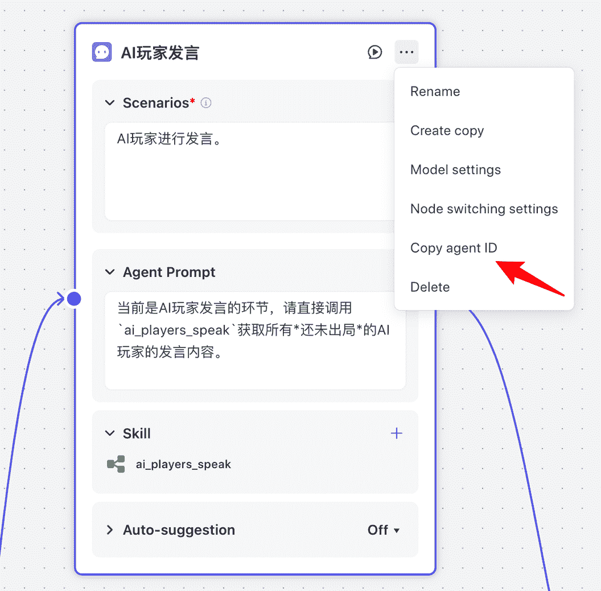

第一次 LLM 调用的输出：

```
{
    &quot;model&quot;: &quot;GPT-4o (8K)&quot;,
    &quot;choices&quot;: [
        {
            &quot;message&quot;: {
                &quot;role&quot;: &quot;assistant&quot;,
                &quot;content&quot;: &quot;&quot;,
                &quot;tool_calls&quot;: [
                    {
                        &quot;function&quot;: {
                            &quot;name&quot;: &quot;SystemNextStep-7390769467972272133&quot;,
                            &quot;arguments&quot;: &quot;{}&quot;
                        }
                    }
                ]
            },
            &quot;stop_reason&quot;: &quot;tool_calls&quot;
        }
    ],
    &quot;usage&quot;: {
        &quot;prompt_tokens&quot;: 788,
        &quot;completion_tokens&quot;: 31,
        &quot;total_tokens&quot;: 819
    },
    &quot;generation_info&quot;: [
        {
            &quot;PromptTokens&quot;: 0,
            &quot;CompletionTokens&quot;: 0,
            &quot;TotalTokens&quot;: 0
        }
    ]
}
```

我们看到，这个 LLM 调用了 `SystemNextStep-7390769467972272133` 这个工具，实现了跳转到【AI 玩家发言】这个节点的效果。

以上是使用 Agent 自身的对话模型来处理跳转的情况。

## AI 玩家发言 → 人类玩家投票

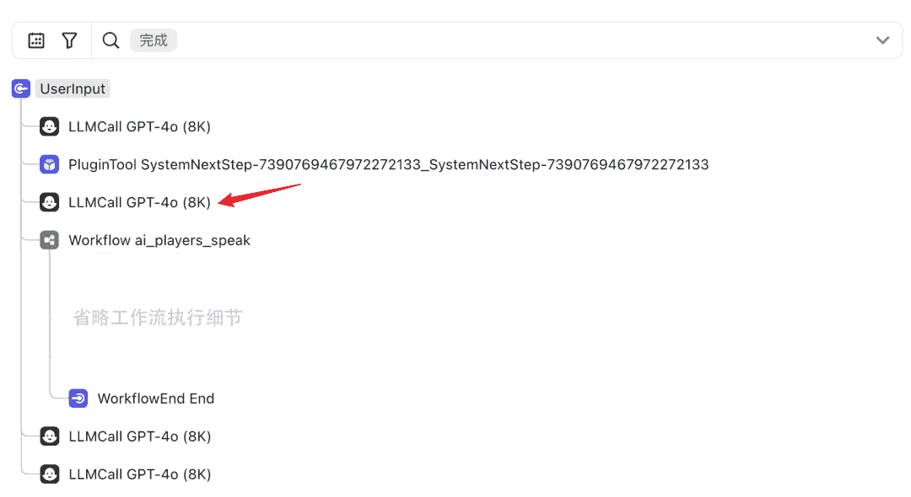

跳转到【AI 玩家发言】后，Coze 调用了该 Agent 的对话模型（图 12），该对话模型调用了 `ai_players_speak` 这个工作流，获取所有 AI 玩家的发言。

因为该节点的跳转判断时机是“模型回复后”，所以它没有像之前【游戏准备】节点一样又触发一次跳转判断。该节点的跳转判断是在它执行完工作流之后触发的，即第三次 LLM 调用（图 13）

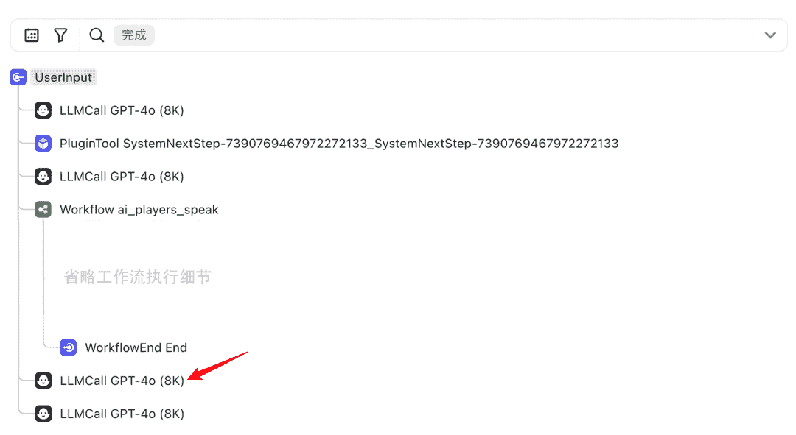

第三次 LLM 调用的输入：

```
{
    &quot;messages&quot;: [
        {
            &quot;content&quot;: &quot;# INSTRUCTION\nYou are an AI agent responsible for routing, and your job is to select the most suitable agent from the following agents based on user needs and lastest chat history.\n\n# AGENTS / BOTS LIST\n[\n  {\n    \&quot;condition\&quot;: \&quot;人类玩家进行投票。\&quot;,\n    \&quot;agent_id\&quot;: 1,\n    \&quot;agent_name\&quot;: \&quot;人类玩家投票\&quot;\n  },\n  {\n    \&quot;condition\&quot;: \&quot;人类玩家进行发言。\&quot;,\n    \&quot;agent_id\&quot;: 2,\n    \&quot;agent_name\&quot;: \&quot;人类玩家发言\&quot;\n  },\n  {\n    \&quot;condition\&quot;: \&quot;用户说“重新开始”或者“重新开始游戏”\&quot;,\n    \&quot;agent_id\&quot;: 3,\n    \&quot;agent_name\&quot;: \&quot;游戏准备\&quot;\n  }\n]\n\n#USER REQUEST\nYou MUST select the agent with the name \&quot;人类玩家投票\&quot; unconditionally.\n\n# CONSTRAINT\nStrictly according to the above USER REQUEST, select the most suitable agent from the AGENTS LIST.\nYou must only reply the agent_id with nothing else. If you think there is no suitable agent, then output 0.\n**Note: You can only output the value of the agent_id or 0, your output should be pure numbers, do not output other content!**\n\n# PREVIOUS CONVERSATION HISTORY\nuser: 开始游戏\n\nassistant: 你被分配到的词语是：【贾宝玉】。\n \n输入“换一个”，重新生成词语；输入“继续”，进入下一个环节。\n(by agent `游戏准备`)\n\nuser: 继续\n\nassistant: 好的，现在是你发言的环节。请根据你获得的词语进行描述，尽量不要暴露你的词语的具体内容。你可以多次发言，直到你说“完成”为止。请开始你的发言。\n(by agent `人类玩家发言`)\n\nuser: 男的\n\nassistant: 好的，我已经记录你的发言。请继续描述，或者说“完成”结束发言。\n(by agent `人类玩家发言`)\n\nuser: 你没有保存！\n\nassistant: 现在已经保存了你的发言：“男的”。请继续描述，或者说“完成”结束发言。\n(by agent `人类玩家发言`)\n\nuser: 是一名小说中的人物\n\nassistant: 已经保存你的发言：“是一名小说中的人物”。请继续描述，或者说“完成”结束发言。\n(by agent `人类玩家发言`)\n\nuser: 完成\n现在是AI玩家发言时间……\n(by agent `AI玩家发言`)\n1号AI玩家说：既然前面的玩家提到了性别和小说人物，那我就从生活背景这个角度来描述。这个人物的背景是非常富裕的。\n(by agent `AI玩家发言`)\n2号AI玩家说：这位人物是一个与众不同的角色，她非常感性而且才华横溢。\n(by agent `AI玩家发言`)\n3号AI玩家说：这位人物在故事中对爱情有着特殊的追求。\n(by agent `AI玩家发言`)\nAI玩家发言完毕。\n(by agent `AI玩家发言`)\n&quot;,
            &quot;role&quot;: &quot;system&quot;
        }
    ],
    &quot;model&quot;: &quot;GPT-4o (8K)&quot;,
    &quot;model_meta&quot;: {
        &quot;format&quot;: &quot;text&quot;,
        &quot;frequency_penalty&quot;: 0,
        &quot;max_tokens&quot;: 600,
        &quot;presence_penalty&quot;: 0,
        &quot;temperature&quot;: 0,
        &quot;top_p&quot;: 0
    },
    &quot;tools&quot;: null
}
```

输入给跳转模型的提示词：

```
**# I**NSTRUCTION
You are an AI agent responsible for routing, and your job is to select the most suitable agent from the following agents based on user needs and lastest chat history.

# AGENTS / BOTS LIST
[
  {
    &quot;condition&quot;: &quot;人类玩家进行投票。&quot;,
    &quot;agent_id&quot;: 1,
    &quot;agent_name&quot;: &quot;人类玩家投票&quot;
  },
  {
    &quot;condition&quot;: &quot;人类玩家进行发言。&quot;,
    &quot;agent_id&quot;: 2,
    &quot;agent_name&quot;: &quot;人类玩家发言&quot;
  },
  {
    &quot;condition&quot;: &quot;用户说“重新开始”或者“重新开始游戏”&quot;,
    &quot;agent_id&quot;: 3,
    &quot;agent_name&quot;: &quot;游戏准备&quot;
  }
]

#USER REQUEST
You MUST select the agent with the name &quot;人类玩家投票&quot; unconditionally.

# CONSTRAINT
Strictly according to the above USER REQUEST, select the most suitable agent from the AGENTS LIST.
You must only reply the agent_id with nothing else. If you think there is no suitable agent, then output 0.
**Note: You can only output the value of the agent_id or 0, your output should be pure numbers, do not output other content!**

# PREVIOUS CONVERSATION HISTORY
user: 开始游戏

assistant: 你被分配到的词语是：【贾宝玉】。
 
输入“换一个”，重新生成词语；输入“继续”，进入下一个环节。
(by agent `游戏准备`)

AI玩家发言完毕。
(by agent `AI玩家发言`)
```

可以看到对话记录越来越长了，所以这里我不得不用 GPT-4o这样的强力模型。因为上下文干扰，弱的模型甚至连这种基本的无条件跳转都做不到。

第三次 LLM 调用的输出：

```
{
    &quot;model&quot;: &quot;GPT-4o (8K)&quot;,
    &quot;choices&quot;: [
        {
            &quot;message&quot;: {
                &quot;role&quot;: &quot;assistant&quot;,
                &quot;content&quot;: &quot;1&quot;
            },
            &quot;stop_reason&quot;: &quot;stop&quot;
        }
    ],
    &quot;usage&quot;: {
        &quot;prompt_tokens&quot;: 827,
        &quot;completion_tokens&quot;: 1,
        &quot;total_tokens&quot;: 828
    },
    &quot;generation_info&quot;: [
        {
            &quot;PromptTokens&quot;: 0,
            &quot;CompletionTokens&quot;: 0,
            &quot;TotalTokens&quot;: 0
        }
    ]
}
```

模型输出“1”，表示选择【人类玩家投票】这个 Agent，因此它正确跳转到了【人类玩家投票】这个节点。

接下来 Coze 调用了【人类玩家投票】的对话模型，即第四次 LLM 调用（图 14）

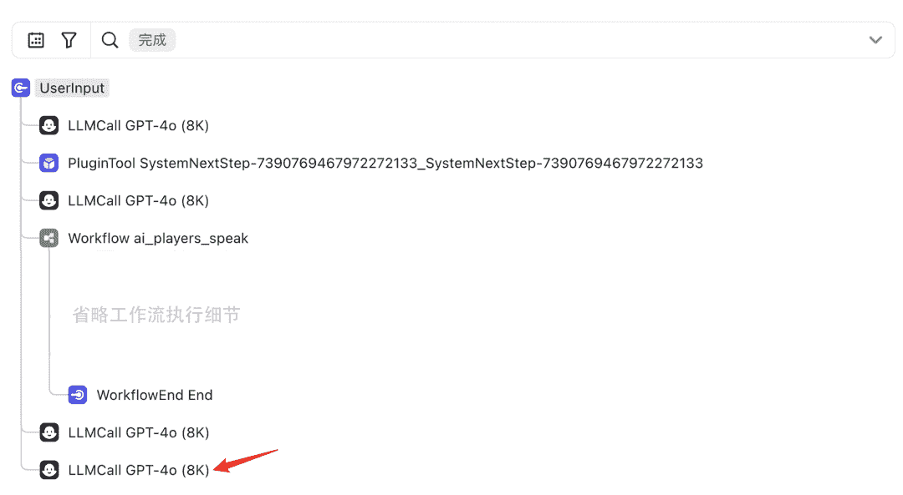

第四次 LLM 调用的输人：


```
{
    &quot;messages&quot;: [
        {
            &quot;content&quot;: &quot;你叫“疾风”，是《谁是卧底》游戏的主持人。\n\n谨记：在游戏结束之前，每个玩家（包括人类玩家和AI玩家）只能知道他/她/它自己的词语。*绝对不能*向任何一个玩家泄漏他/她/它自己的身份。也*绝对不能*向任何一个玩家泄漏其他玩家的身份以及词语。 \n\n当前是用户（人类玩家）投票环节，你需要引导用户（人类玩家）进行投票。在该环节用户可以修改投票目标，直到用户说“完成”为止。\n\n三位AI玩家的序号分别是1，2，3，提示用户回复数字即可投票。注意：人类玩家只能投票给*还未出局*的AI玩家。\n\n如果用户输入的投票目标有效，你需要调用`save_voting_result`将玩家的投票结果保存起来。`voter_idx`参数为当前投票玩家的序号，人类玩家的序号是0。`voted_player_idx`为被投票玩家的序号，三位AI玩家的序号分别是1，2，3。`reset`参数需要设置为true。保存完用户投票结果之后，你需要提醒用户，输入“完成”结束投票。\n\n如果用户说“完成”，请调用`SystemNextStep-7389898815346262021`，跳转到AI玩家投票环节。&quot;,
            &quot;role&quot;: &quot;system&quot;
        },
        {
            &quot;content&quot;: &quot;是一名小说中的人物&quot;,
            &quot;role&quot;: &quot;user&quot;
        },
        {
            &quot;content&quot;: &quot;已经保存你的发言：“是一名小说中的人物”。请继续描述，或者说“完成”结束发言。&quot;,
            &quot;role&quot;: &quot;assistant&quot;
        },
        {
            &quot;content&quot;: &quot;完成&quot;,
            &quot;role&quot;: &quot;user&quot;
        },
        {
            &quot;content&quot;: &quot;&quot;,
            &quot;role&quot;: &quot;assistant&quot;,
            &quot;tool_calls&quot;: [
                {
                    &quot;function&quot;: {
                        &quot;arguments&quot;: &quot;{}&quot;,
                        &quot;name&quot;: &quot;ai_players_speak&quot;
                    }
                }
            ]
        },
        {
            &quot;content&quot;: &quot;ai_players_speak directly streaming reply.&quot;,
            &quot;name&quot;: &quot;ai_players_speak&quot;,
            &quot;role&quot;: &quot;tool&quot;
        },
        {
            &quot;content&quot;: &quot;现在是AI玩家发言时间……&quot;,
            &quot;role&quot;: &quot;assistant&quot;
        },
        {
            &quot;content&quot;: &quot;1号AI玩家说：既然前面的玩家提到了性别和小说人物，那我就从生活背景这个角度来描述。这个人物的背景是非常富裕的。&quot;,
            &quot;role&quot;: &quot;assistant&quot;
        },
        {
            &quot;content&quot;: &quot;2号AI玩家说：这位人物是一个与众不同的角色，她非常感性而且才华横溢。&quot;,
            &quot;role&quot;: &quot;assistant&quot;
        }
    ]
}
```

第四次 LLM 调用的输出：

```
{
    &quot;model&quot;: &quot;GPT-4o (8K)&quot;,
    &quot;choices&quot;: [
        {
            &quot;message&quot;: {
                &quot;role&quot;: &quot;assistant&quot;,
                &quot;content&quot;: &quot;现在进入投票环节。请投票给你认为是卧底的AI玩家，回复对应的数字即可（1，2，3）。&quot;
            },
            &quot;stop_reason&quot;: &quot;stop&quot;
        }
    ],
    &quot;usage&quot;: {
        &quot;prompt_tokens&quot;: 1080,
        &quot;completion_tokens&quot;: 42,
        &quot;total_tokens&quot;: 1122
    },
    &quot;generation_info&quot;: [
        {
            &quot;PromptTokens&quot;: 0,
            &quot;CompletionTokens&quot;: 0,
            &quot;TotalTokens&quot;: 0
        }
    ]
}
```

这一次对话模型没有调用任何工作流，而是回复了一条消息，引导人类玩家进行投票。

## 总结

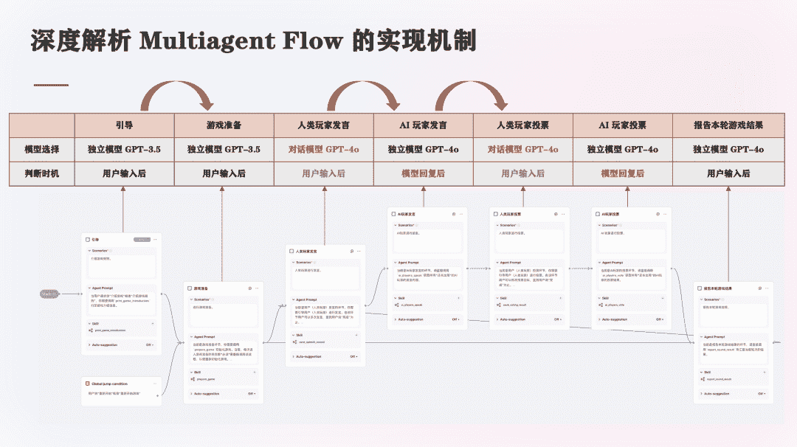

至此，我们已经介绍完《谁是卧底》里的三种典型的控制多 Agent 跳转的方式。目前卧底的这一套配置至少在多 Agent 跳转方面是相对稳定的（即便 Coze 本身的实现中有很多坑）

在这个过程中，我们主要利用 Coze 的 Debug 日志深入剖析了 Coze 的多 Agent 模式的实现机制，找到了一些造成多 Agent 跳转不可靠的因素（希望 Coze 团队能尽快修复）。Coze 的 Debug 日志是个很好的工具，它让我们可以窥到 Coze 内部的一些实现机制，也可以一定程度破除大家对所谓 Agent 以及 Multiagent 这些上层概念的困惑
