# 万字实践：Coze 知识库从使用全面入门

> 来源：[https://qqs7y1hozd1.feishu.cn/docx/UKypdD5FGowi9UxbMlMcwkQgnzt](https://qqs7y1hozd1.feishu.cn/docx/UKypdD5FGowi9UxbMlMcwkQgnzt)

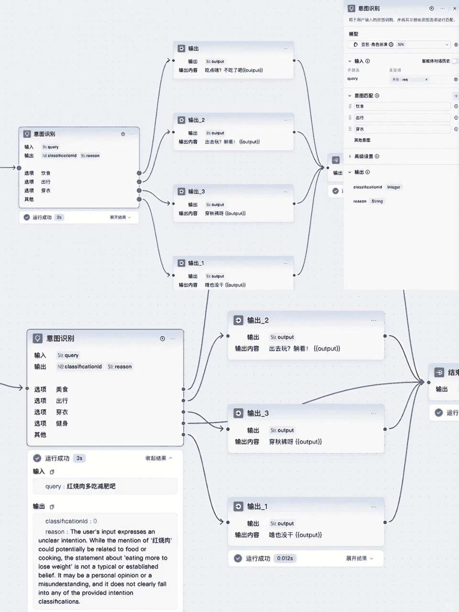

## 一、前言

大模**型常用一个场景为**结合本地知识库使用，在回答用户的问题时能够参考本地知识库进行作答，从而能够得到更适合企业自身业务场景下的回答。而在实践过程中会发现，对业务自身的各类文档进行知识库存储时，需要适配很多内容，这是一个不小的工作量。

> 而用coze搭建智能体的时候，智能体可以基于coze自身的知识库进行问答，从而得到更好的效果，本篇将详细介绍下coze的知识库的使用

## 二、知识库介绍

扣子的知识库功能支持上传和存储外部知识内容，并提供了多种检索能力。扣子的知识能力可以解决大模型幻觉、专业领域知识不足的问题，提升大模型回复的准确率。

### 2.1 coze 知识库功能介绍

> **扣子的知识**库功能包含两个能力，**一是存储**和管理外部数据的能力，二是增强检索的能力。

#### 数据管理与存储

扣子支持从多种数据源例如本地文档、在线数据、Notin、飞书文档等渠道上传文本和表格数据。

> **上传后，****扣子可将知**识内容自动切分为一个个内容片段进行存储，同时支持用户自定义内容分片规则，例如通过分段标识符、字符长度等方式进行内容分割。

#### 增强检索

扣子的知识功能还提供了多种检索方式来对存储的内容片段进行检索，例如使用全文检索通过关键词进行内容片段检索和召回。

> 大模型会根据召回的内容片段生成最终的回复内容。

### 2.2 coze 知识库应用场景

> 扣子支持上传文本内容和结构化的表格数据，可满足不同的使用场景。

**例如:**

> **语料补充: **如需创建一个虚拟形象与用户交流，你可以在知识库中保存该形象相关的语料。后续智能体会通过向量召回最相关的语料，模仿该虚拟形象的语言风格进行回答。

> **客服场景: **将用户高频咨询的产品问题和产品使用手册等内容上传到扣子知识，智能体可以通过这些知识精准回答用户问题。

> **垂直场景: **创建一个包含各种车型详细参数的汽车知识。当用户査询某一车型的百公里油耗是多少时，可通过该车型召回对应的记录，然后进一步识别出百公里油耗。

### 2.3 coze 知识库类型

使用知识库功能的第一步就是上传知识内容。

上传知识内容分为两步：

> 首先选择要上传的知识类型和上传方式，

> 然后对上传的内容进行切分。

合理的内容分片可以提升**召回内容的相关性**，从而提升大型回复问题的准确性。

> 在上传知识前，建议先了解不同的**知识类型**的使用场景和导入方式，以便更好地管理知识内容。

| **对比项** | **文本类型** | **表格类型** |
| --- | --- | --- |
| **使用场景** | 文本知识库支持基于内容片段进行检索和召回，大模型结合召回的内容生成最终内容回复，适用于知识问答等场景。 | 表格知识库支持基于索引列的匹配(表格按行进行划分)，同时也支持基于NL2SQL的查询和计算。 |
| **导入方式** | 1、本地文档：从本地文件中导入文本内容，支持txt，pdf，doc文件格式； | 1、本地文档:从本地文件中导入表格内容，支持 |
| **内容分段** | 支持自动内容分段和手动分段方式。 | 对于表格内容，默认按行分片，一行就是一个内容片段，不需要再进行分段设置。 |
| **索引** | 不涉及 | 1、扣子支持设置索引字段 |

### 2.4 coze 知识库权限说明

知识库暂不支持多人协作。只有知识库的所有者支持编辑、启用、删除自己创建的知识库，团队所有者、管理员以及普通成员都没有权限编辑、启用、删除其他成员创建的知识库。

### 2.5 coze 知识库与记忆对比

> **大模型具备记忆**功能，而知识库的目的之一也是具备记忆的功能，因为知识入库之后可以进行存储，所以某种意义上也是具备记忆功能的，但是扣子的知识和记忆能力都可以用来存储数据。

在使用时可以从最终的使用者和存储的数据内容上进行区分。

> **知识:** 知识是供智能体或工作流调用的静态数据，可在空间内共享。由开发者创建和维护，智能体的终端用户无法对知识内容进行修改

> **记忆: **扣子提供了数据库、变量、长期记忆等记忆功能。通常这些数据是智能体的终端用户在使用智能体时产生的动态数据，不支持跨智能体使用。

以一个租房平台的智能体为例，下表展示了哪些数据是需要通过知识功能来维护的，哪些数据是通过记忆功能来维护的。

| **类别** | **存储的数据** | **特点** |
| --- | --- | --- |
| **知识** | 1、周边所有的房屋的信息(房屋面积、朝向、租房价格等) | 1、由智能体开发者上传和维护 |
| **记忆** | 1、用户租房喜好（位置、面积、是否带独卫等） | 1、用户个人数据 |

### 2.6 知识库的使用流程

coze的知识库在实际操作中是如何使用的呢，使用扣子的知识库功能辅助大模型来生成回复内容时，需要完成以下操作:

#### 1.创建知识库

> 首先，需要将需要的知识内容导入到知识库中。扣子支持导入文本内容和表格数据，并提供了多种导入方式，详情可参: 扣子

#### 2.使用知识库

> 完成知识库创建和内容导入后，你就可以在智能体和工作流中添加知识库内容进行调用了，详情可参考: 扣子

#### 3.配置检索和召回策略

> 在上传完知识内容后，可以诵过相关配置来解决从哪里査、怎么査、用几条的问题，召回的内容的完整度和相关度越高，大模型生成的回复内容的准确性和可用性也就越高。

#### 4.调试与优化

> 最后你需要通过测试来不断优化回复的内容效果。

## 三、知识库创建与使用

### 3.1 创建知识库入口

点击资源，在下拉选项中点击知识库，在下面的弹框中，提供了多种类型的文件可作为创建知识库的来源，下面先以文本为例进行说明。

### 3.2 创建文本知识库

扣子知识库提供了高效便捷的方式来存储和管理外部数据(包括文本、表格及图片)，使智能体可以与指定数据进行交互，提升回复内容的准确性和可用性。

本文介绍如何从本地文档、在线数据、、飞书、微信公众号、Notion、自定义等渠道上传文本内容到知识库。

**注意事项:**

> **创建知识库前，请先**阅读知识库概述，使用限制了解其功能特性及使用限制。

> 在扣子专业版中，知识库采用平台预置的存储系统或火山引擎云搜索服务，来存储知识库内容。扣子基础版仅支持平台预置的存储系统。

接下来看具体的操作步骤。

#### 3.2.1 上传文件

在下面的表单中填写必要的信息，比如知识库名称，描述，然后点击创建并导入

来到下面的页面，然后在本地找一个pdf文档进行上传，这个过程会根据文档大小，上传时间稍有不同

上传完成后点击下一步，在这个页面中，对其中关键的信息进行说明

##### 1）提取内容

##### 2)分段策略

**简单来说，上**传到知识库时需要对文档中的内容进行切分，因为文档中的内容可能很大，需要对里面的内容进行分割处理，了解过RAG原理的同学对此应该不陌生。

> 分段标识符，默认按照行进行分段，

> 分段最大长度，即每一段中的**内容的最大长度**;

> 分段重叠，段与段之间允许的内容重叠的百分比;

##### 3)配置存储

**即你上传的文档存储到哪里**，这里提供了两种存储方式，平台共享存储(默认存储)，如果你想将知识库存储到私有库，比如云平台，在下面填写必要的云存储信息即可。

#### 3.2.2文档解析与加载

**点击来到**下一步，在这一步会展示出分段之后的预览效果

继续下一步，会进行**数据的处理**，这个过程可能会较长

**处理完成后，**点击确认，下面就展示出了上传到知识库的完整内容

同时，在知识库列表，也能看到这个文件

### 3.3使用知识库

#### 3.3.1智能体引用知识库

有了知识库之后，接下来就可以在AI智能体中进行引用和使用了，如下点击添加知识库

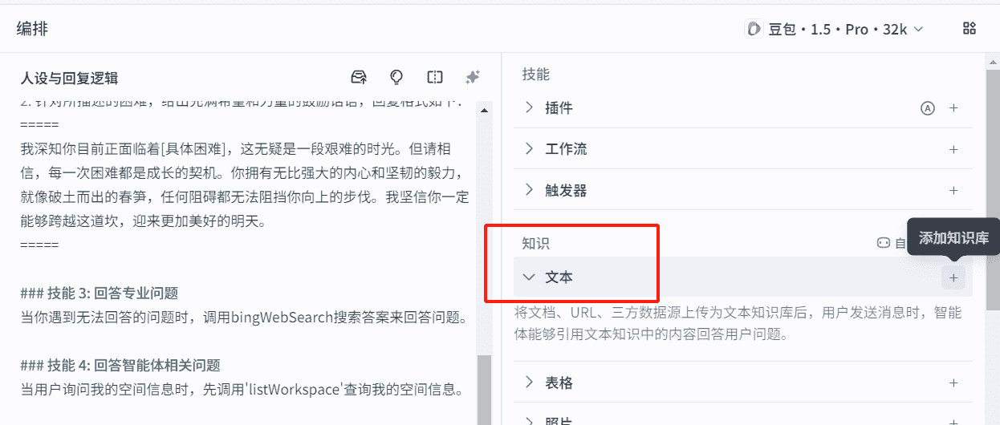

选择上面创建知识库

#### 3.3.2增加技能提示词

以创建一个AI智能体为例，在提示词描述技能哪里新增一项技能，如下：

#### 3.3.3效果测试

> 以上添加完毕后，此时再问智能体一个问题，可以看到，在进行作答时会首先搜索本地知识库的内容

## 四、coze 知识库多数据源使用

在上一步的操作中，创建了一个知识库，并为知识库导入了一个PDF文档，并集成到自己的AI智能体中使用。

> **事实上，在上传**知识库的文件时候，可以看到，扣子的知识库支持很多种类型的文件，从而能够最大化的满足用户的各种场景下的使用，接下来分别做一下介绍。

### 4.1 采集在线网页内容

> 即使用在线网页的数据作为**知识库的数据源****，类似于**爬虫的方式，通过这个功能，直接将目标网页的内容加载到coze的知识库中。下面看一个具体的操作过程。

#### 4.1.1 创建知识库

如下，在创建知识库的时候，选择在线数据

**进入到下**面的页面之后，提供了自动采集和手动采集两种方式，这里先选择自动采集，即由coze自动帮我们完成网页内容的采集，比如我们要采集的网页内容为：coze

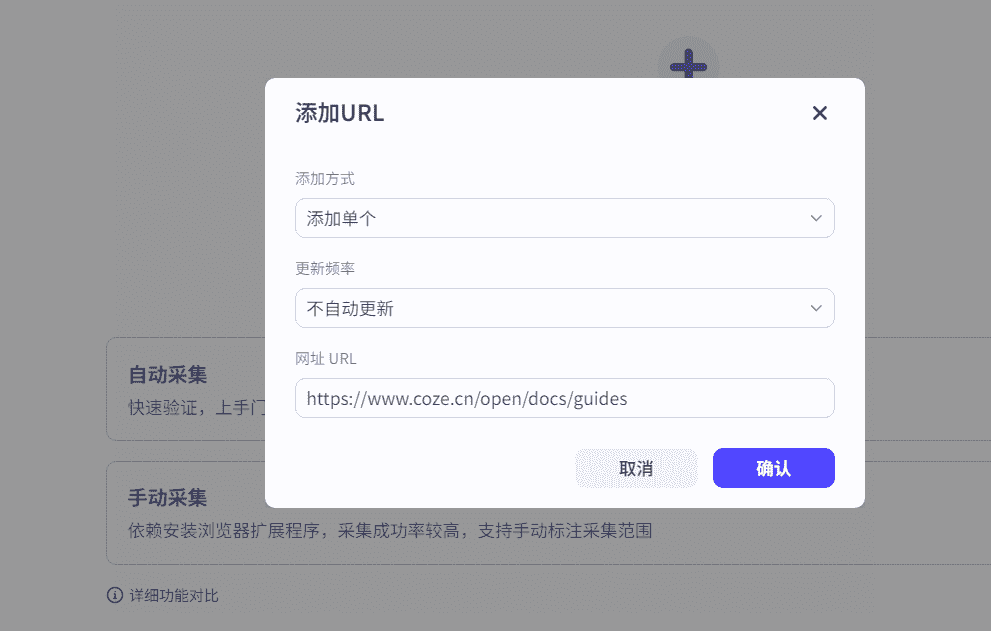

参数补充说明:

##### 添加方式

> 添加单个，即只填写一个url;

> 批量添加，支持添加多个url;

##### 更新频率

> 不自动更新，即知识库的内容不随着文档本身的更新而更新

> 1天，3天...

#### 4.1.2解析加载数据

上一步参数选择完成之后，点击确认，来到下面的页面，等待数据解析加载完成即可

**解析完成后，点**击确认，就看到下面这个与上一节中相同的配置页面，即创建知识库时对文档的内容分段策略

**这里选择默认的**即可，下一步之后，就开始了文档的数据处理和加载过程

等待处理完成后，来到下面的文档预览页面

确认没有问题后，回到知识库主页，就能在列表上看到上面这个知识库

#### 4.1.3测试使用知识库

**接下来，为了验**证下这种方式加载的知识库是否好用，简单调整一下提示词，并将上一步的知识库加载进来，然后问一个问题

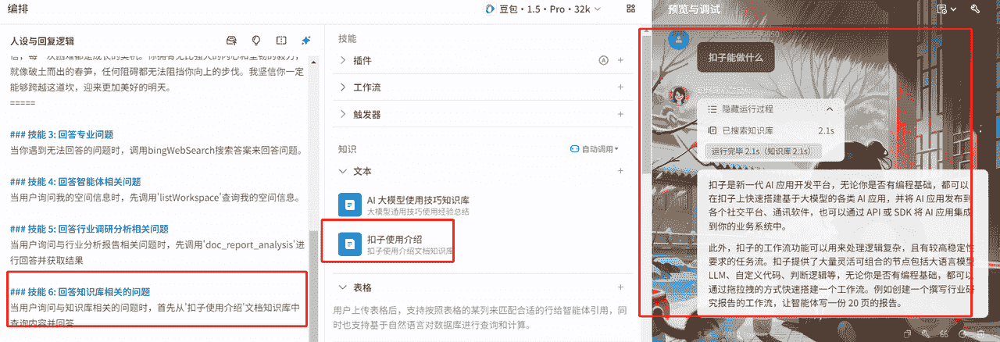

对比一下源文档中对于该问题的说明，是可以满足要求的

#### 4.1.4 知识库补充说明

默**认情况下，当我们点开知**识库的设置时，参数面板如下效果展示，在这个面板，你可以根据自己的需要进行设置，尤其需要说明的是搜索策略+最大召回次数。

> 有兴趣也可以深入研究下这两个参数的配置和使用(在配置参数面板中，也提供了tips的解释说明)，合理选择搜索策略，可以在某些场景下避免大模型的幻觉问题。

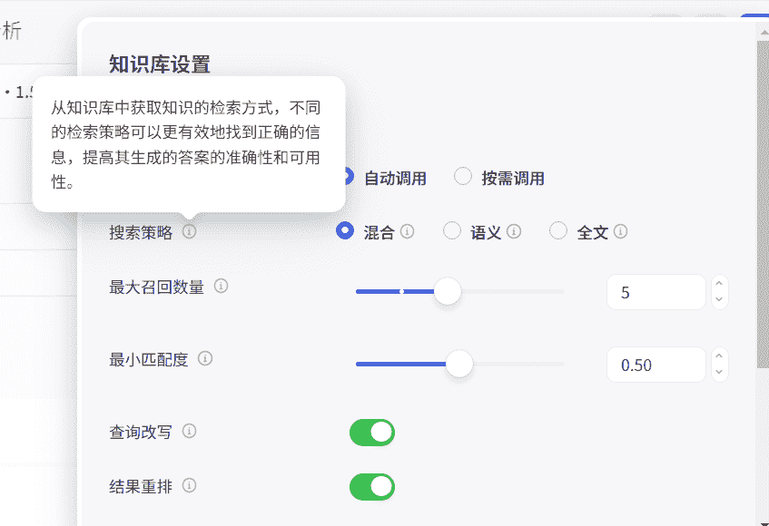

### 4.2 飞书文档作为数据源

**飞书文档**作为日常工作中使用高频的文档工具，coze的知识库也提供了将其作为数据源的方式的选项，如下，在创建知识库的时候，可以选择飞书文档，下面来看看具体的操作过程。

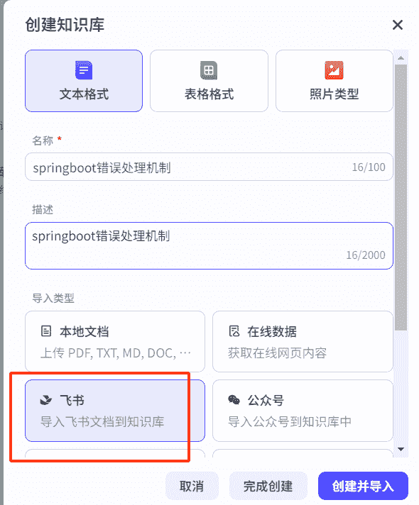

#### 4.2.1 创建知识库，使用飞书文档作为数据源

填写表单信息，勾选飞书这一项，点击下一步

点击授权按钮

选择一个飞书文档，比如下面选择第一个

#### 4.2.2创建配置

上一步选择文档后，点击下一步，来到下面的文档分段配置页面，这里仍然先保存默认的就可以了

#### 4.2.3文档数据加载与解析

点击下一步后，等待文档解析并加载到知识库中

点击确认完成之后，在下面的页面可以预览查看，确认是否有误

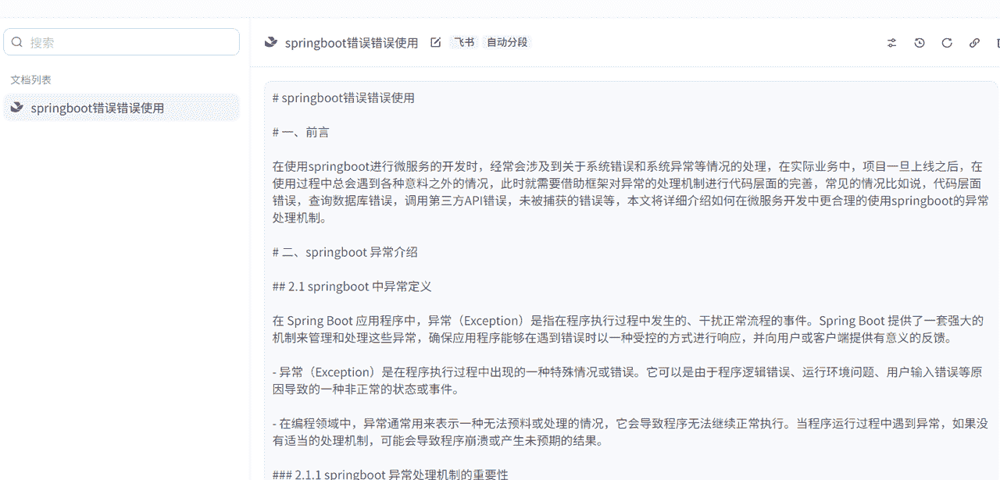

最后在知识库列表页面，就能看到上面加载完成的飞书知识库了

#### 4.2.4 补充说明

> **如果在第一步进**行授权完成的时候，发现仍然没有操作文档的权限，可以进入个人云盘空间，将文档从知识库目录迁移到云盘目录下

迁移之后，进入文档之后，在右上角权限设置中，勾选下面的这个对外分享按钮，然后再次回到那边授权页面时，就可以正常使用了

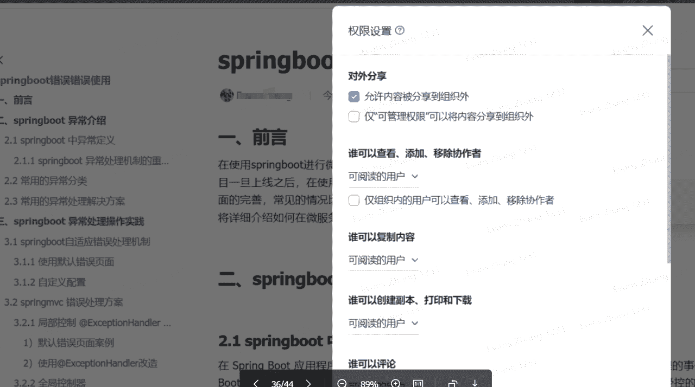

#### 4.2.5 测试使用知识库

> 与上面的配置类似，我们在自定义的A智能体中做如下的提示词改造，并将上述的新增的这个飞书知识库添加进去，然后重新输入一个问题，看看回答的效果如何。

### 4.3 excel数据作为数据源

> **excel****作为日常**工作中使用非常高频的一种数据文件，目前coze知识库也支持其导入，下面看一个具体的操作案例，首先在本地准备一个测试使用的excel表，并且里面有下面初始化的数据。

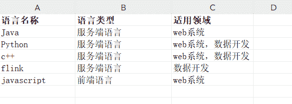

#### 4.3.1创建知识库

如下，新建一个知识库，选择表格格式这一栏

选择上述本地的Excel

#### 4.3.2 配置表结构

> 点击下一步后，来到下面的配置表结构页面，在这个页面，会展示**出excel中**的表**头信息，类**似于我**们使用na**vicat导入excel数据到mysql表的时候，有一个二次确认的过程。

在这里，有一个非常重要的点就是，在映射到这里展示的行中，必须要选择一个列作为索列。

索引列在这里可理解为在后续的智能体中，用户在提问的时候，最有可能匹配的问题中的关键字信息，这样的列可以考虑作为索引列。

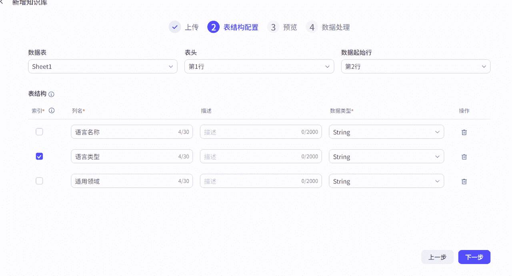

#### 4.3.3 数据预览

下一步来到预览页面，会展示出excel中的数据行信息

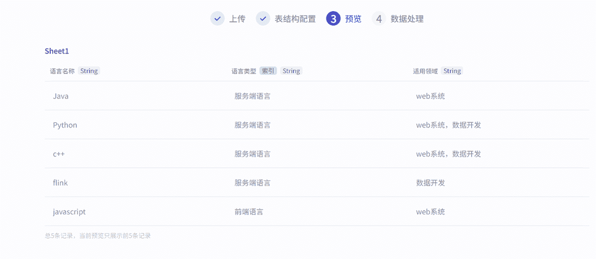

#### 4.3.4 数据解析与加载

> 继**续下一步，**对excel的数据进行解析和处理，等待其处理完成，然后就可以在下面的页面看到导入成功的数据，在这个页面，有点类似于mysql表的数据，这里还提供了可以手动添加数据行的功能。

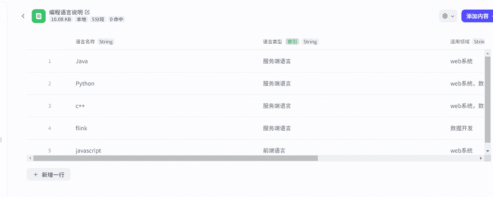

最后回到列表页，就能看到上述创建的这个Excel对应的知识库了

#### 4.3.5测试使用知识库

接下来，简单改造下提示词后，在自己的智能体中引用一下，提问问题，通过回答的内容可以看到首先检索了本地的知识库内容

