# 从零开始搞定 AI Agent 搭建全流程

> 来源：[https://qqs7y1hozd1.feishu.cn/docx/IaFvdD7C7oNtiXxq2O6cOPQSnBd](https://qqs7y1hozd1.feishu.cn/docx/IaFvdD7C7oNtiXxq2O6cOPQSnBd)

> 本文全面介绍AI Agent的生态，结合实践剖析，解答以下问题：

+ 什么是真正复杂的AI Agent？
+ 如何开发复杂AI Agent？

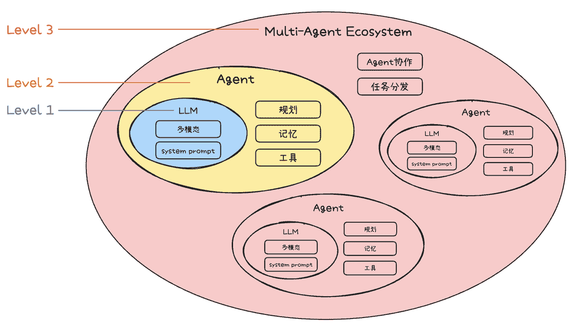

## 一、Agent协议

### 标准化协议关键优势

+ **互操作性**：标准协议使得不同技术栈、不同厂商开发的Agent能够无缝协作，打破了技术壁垒，促进了整个生态系统的繁荣发展。

+ **可扩展性**：通过标准化的接口规范，新的Agent可以快速接入现有系统，而无需重新设计整套通信机制，大大降低了系统扩展的复杂度。

+ **维护便利性**：统一的协议标准使得系统维护、调试和监控变得更加简单，降低了运维成本。

分为 Context-Oriented (面向上下文) 和 Inter-Agent (面向 Agent 间) 两种。

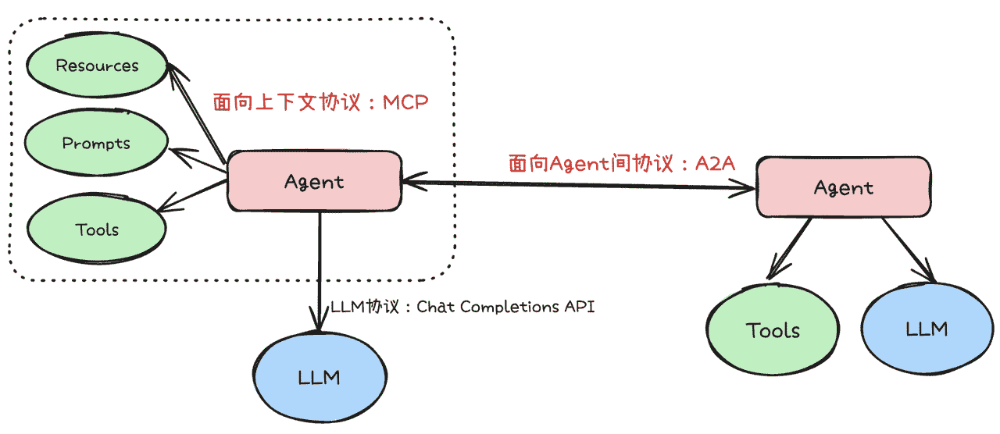

> 面向上下文的协议以 MCP 为代表，面向 Agent 间的协议以 A2A 为代表。

### 1.1 面向上下文协议：MCP

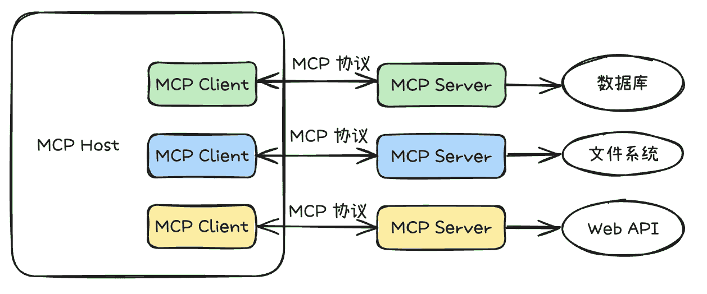

MCP解决 Agent 如何从外部世界（数据、工具、服务）获取完成任务所需信息（上下文）的问题。

MCP主要采用 Client - Server 架构，其核心架构主要包括以下内容：

+ **主机（Host）**：通常是发起连接的 LLM 应用程序，如 Claude Desktop、IDE 插件等。它负责管理客户端实例和安全策略，是用户与 AI 模型进行交互的平台，同时也承担着集成外部工具、访问多样化数据资源的任务。

+ **客户端（Client）**：是主机内的连接器，与服务器建立 1:1 会话。它负责处理协议协商和消息路由，充当主机与外部资源之间的桥梁，通过标准化的协议接口协调数据传输和指令交互，确保信息的实时性与一致性。

+ **服务器（Server）**：是独立运行的轻量级服务，通过标准化接口提供特定功能，如文件系统访问、数据库查询等。服务器连接外部资源与 AI 模型，向 LLMs 暴露来自不同数据源的内容和信息。

### 1.2 面向Agent间协议：A2A

单个 Agent 能力有限，多 Agent 协作成为趋势。面向Agent间的协议主要是为了规范 Agent 之间的沟通、发现和协作。

> A2A协议的核心功能包括：

> 能力发现：智能体通过JSON格式的"Agent Card"宣传自身能力，便于其他Agent发现和调用最合适的智能体。

> 任务和状态管理：以任务为导向，协议定义了任务对象及其生命周期，支持任务的分发、进度同步和结果（工件）输出，适配长短任务场景。

> 协作与消息交换：智能体之间可发送消息，交流上下文、回复、工件或用户指令，实现多智能体间的高效协作。

> 用户体验协商：每条消息可包含不同类型的内容片段（如图片、表单、视频等），支持客户端和远程Agent协商所需的内容格式和UI能力。

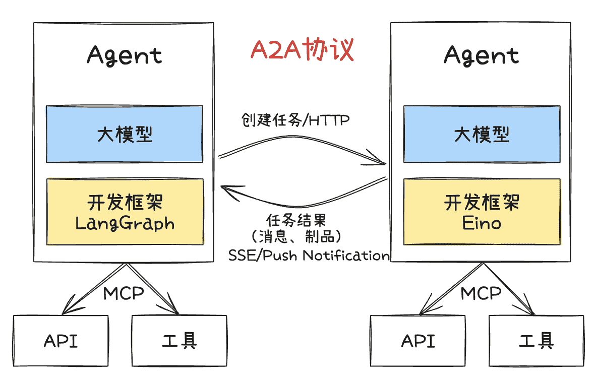

### 1.3 MCP 和 A2A 关系

举个实际的例子使用 MCP 和使用 A2A 的都可以实现：

> 假如 AI Agent 需要完成一个"规划 5 天深圳到厦门旅行"。

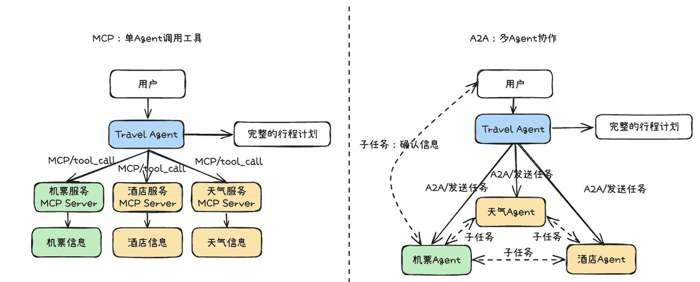

> MCP：像个大总管。

> 一个中央 Agent (MCP Travel Client) 负责调用所有外部服务（机票、酒店、天气），然后汇总信息生成计划。优点是简单可控，缺点是中心化依赖高，不易扩展。

> A2A：像个部门协作。

> 任务被分配给专门的 Agent（交通、住宿、活动），这些 Agent 可以直接相互沟通（比如机票 Agent 直接问天气 Agent 获取信息），也可以和用户进行沟通（比如机票Agent完成初筛之后询问用户是否满足需求，对用户给出的建议进行迭代修改），这种方式更灵活，适合企业内复杂协作。

## 二、Agent思考框架

构建能够自主规划、执行和适应复杂任务的智能体，其核心在于其"思考"能力。

> Agent思考框架，正是为了赋予Agent这种结构化的推理和决策能力而设计的。

### 2.1 思维链（CoT）

> 一种增强大型语言模型（LLM）处理复杂推理任务能力的关键技术。

> 其核心在于引导模型在给出最终答案前，先生成一系列结构化的中间推理步骤——这如同模拟人类解决问题时的逐步思考过程。

> 通过这种方式，LLM能够更深刻地理解问题结构，有效分解复杂任务，并逐步推导出解决方案。

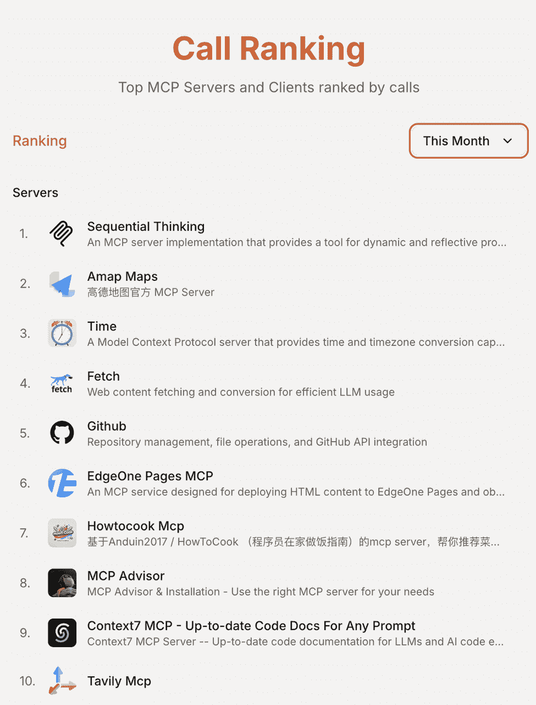

随着DeepSeek R1的深度思考模式验证了思维链对于推理能力的显著提升效果，各大模型厂商纷纷推出了支持慢思考的模型。

### 2.2 ReAct

ReAct（Reasoning and Action）框架通过将"推理"（Reasoning）与"行动"（Action）相结合，有效地解决了这一问题。

> 它允许模型在推理过程中与外部工具或环境进行互动，从而获取最新信息、执行具体操作，并根据反馈调整后续步骤。

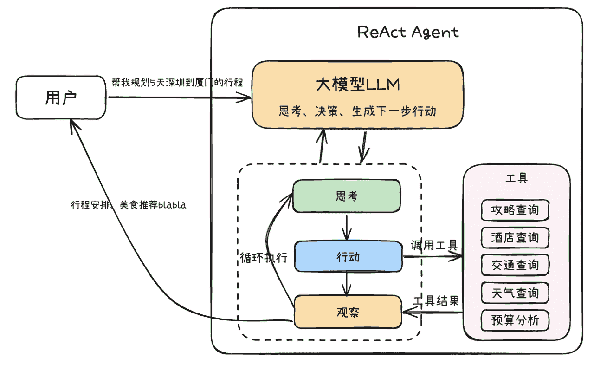

这种动态的交互赋予了模型一种"边思考边行动、边观察边调整"的能力。

其核心运作机制可以概括为思考（Thought）→ 行动（Action）→ 观察（Observation）的迭代循环。

> 思考 (Thought)

> 模型基于当前任务目标和已有的观察信息，进行逻辑推理和规划。它会分析问题，制定策略，并决定下一步需要执行什么动作（例如，调用哪个工具、查询什么信息）来达成目标或获取关键信息。

> 行动 (Action)

> 根据"思考"阶段制定的计划，模型生成并执行一个具体的行动指令。这可能包括调用外部API、执行代码片段、查询数据库，或者与用户进行交互等。

> 观察 (Observation)

> 这些观察结果将作为下一轮"思考"的输入，帮助模型评估当前进展、修正错误，并迭代优化后续的行动计划，直至任务完成。

### 2.3 Plan-and-Execute

Plan-and-Execute 是一种对标准 ReAct 框架的扩展和优化，旨在处理更复杂、多步骤的任务。

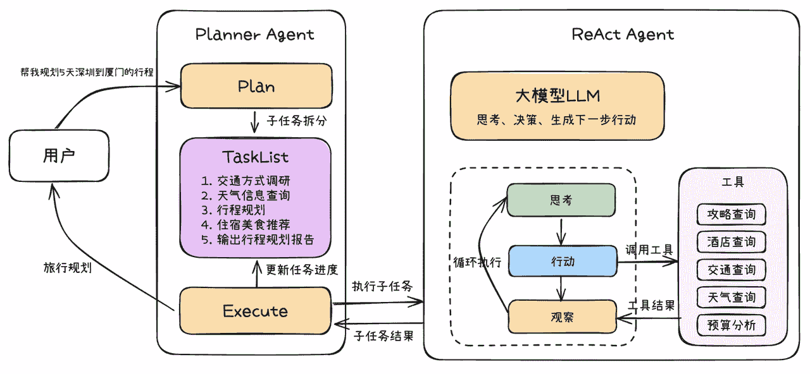

> 它将 Agent 的工作流程明确划分为两个主要阶段：

+ **规划阶段**：Agent 首先对接收到的复杂任务或目标进行整体分析和理解。然后，它会生成一个高层次的计划，将原始任务分解为一系列更小、更易于管理的子任务或步骤。

+ **执行阶段**：计划制定完成后（可能已采纳用户意见），Agent 进入执行阶段。它会按照规划好的步骤逐一执行每个子任务。在执行每个子任务时，Agent 可以采用标准的 ReAct 循环来处理该子任务的具体细节。

> 与标准的 ReAct 相比，Plan-and-Execute 模式的主要优势在于：

+ **结构化与上下文优化**：通过预先规划将复杂任务分解为小步骤，不仅使 Agent 行为更有条理，还有效减少了执行各子任务时的上下文长度，提升了处理长链条任务的效率和稳定性。

+ **提升鲁棒性**：将大问题分解为小问题，降低了单步决策的复杂性。如果某个子任务失败，影响范围相对可控，也更容易进行针对性的调整。

+ **增强可解释性与人机协同**：清晰的计划和分步执行过程使得 Agent 的行为更容易被理解和调试。更重要的是，任务的分解为用户在规划审批和执行监控等环节的参与提供了便利，用户可以对任务的执行步骤给出修改意见，从而实现更高效的人机协作，确保任务结果更符合预期。

## 三、开发框架

> 在掌握了Agent的基本原理后，需要将这些理论转化为实际可用的代码实现。

> 虽然开发框架并非技术瓶颈，但一个优秀的开发框架能够为提供流程编排、状态管理、工具调用等核心能力，大大加速生产级Agent应用的开发进程。

### 3.1 Eino

Eino 框架由以下几个部分组成，其中Eino为核心框架逻辑。

> 包含类型定义、流处理机制、组件抽象、编排功能等，`Eino-Ext`为一些具体组件的实现，例如`DeepSeek ChatModel`、`Langfuse Callbacks`等。

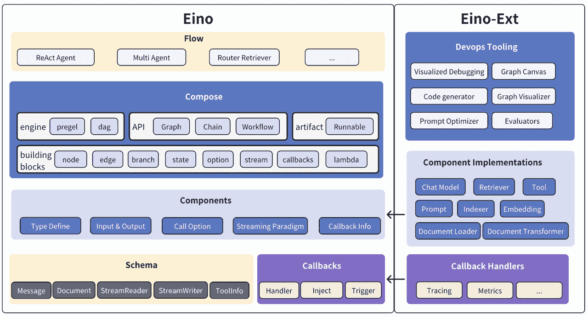

Eino框架有以下几个核心特点：

+ **高可维护性和高可扩展性并存**

> 这种设计既避免了传统框架使用`interface{}`带来的维护困难，又保持了良好的扩展性。强类型系统可以在编译期发现类型不匹配问题，有效避免运行时错误，显著提升代码的稳定性和可维护性。

+ **丰富的开箱即用组件**

> 在基础层面，包含了`ChatModel`、`Tool`、`ChatTemplate`等原子级执行节点；在高级层面，封装了`ReAct Agent`、`MultiQueryRetriever`等复杂业务逻辑组件。

+ **简单易用的开发体验**

> 框架配备了可视化开发工具`EinoDev`，支持通过图形界面快速搭建和调试Agent应用。

### 3.2 组件（Component）

组件是大模型应用能力的提供者，提供原子能力的最小单元，是构建AI Agent的砖和瓦，组件抽象的优劣决定了大模型应用开发的复杂度。

> Eino 的组件抽象秉持着以下设计原则：

> 模块化和标准化：将一系列功能相同的能力抽象成统一的模块，组件间职能明确、边界清晰，支持灵活地组合。

> 可扩展性：接口的设计保持尽可能小的模块能力约束，让组件的开发者能方便地实现自定义组件的开发。

> 可复用性：把最常用的能力和实现进行封装，提供给开发者开箱即用的工具使用。

常用的组件类型可以大致分成对话处理类组件、文本语义处理类组件、决策执行类组件和自定义组件这几类。

### 3.3 对话处理类组件

`ChatTemplate`

> 模板化处理和大模型交互参数的组件抽象。

> 主要作用是将用户提供的变量值填充到预定义的消息模板中，生成用于与语言模型交互的标准消息格式。

> 例如结构化的System Prompt、多轮对话模板等场景。

```
type ChatTemplate interface {
    Format(ctx context.Context, vs map[string]any, opts ...Option) ([]*schema.Message, error)
}
```

`ChatModel`

> 直接和大模型交互的组件抽象，它的主要作用是将用户的输入消息发送给语言模型，并获取模型的响应。

> 提供了非流式的`Generate`和流式的`Stream`方法获取大模型输出内容。

```
type BaseChatModel interface {
    Generate(ctx context.Context, input []*schema.Message, opts ...Option) (*schema.Message, error)
    Stream(ctx context.Context, input []*schema.Message, opts ...Option) (
        *schema.StreamReader[*schema.Message], error)
}

type ToolCallingChatModel interface {
    BaseChatModel

    // WithTools returns a new ToolCallingChatModel instance with the specified tools bound.
    // This method does not modify the current instance, making it safer for concurrent use.
    WithTools(tools []*schema.ToolInfo) (ToolCallingChatModel, error)
}
```

### 3.4 文本语义处理类组件

`Document.Loader`、`Document.Transformer`

> 主要用于获取和处理文本文档，从不同来源（如网络 URL、本地文件等）加载文档内容，并将其转换为标准的文档格式。

```
type Loader interface {
    Load(ctx context.Context, src Source, opts ...LoaderOption) ([]*schema.Document, error)
}
type Transformer interface {
    Transform(ctx context.Context, src []*schema.Document, opts ...TransformerOption) ([]*schema.Document, error)
}
```

`Embedding`

> 将文本转换为向量表示，它的主要作用是将文本内容映射到向量空间，使得语义相似的文本在向量空间中的距离较近。一般用于语义检索场景。

```
type Embedder interface {
    EmbedStrings(ctx context.Context, texts []string, opts ...Option) ([][]float64, error)
}
```

`Indexer`

> 存储和索引文档的组件。它的主要作用是将文档及其向量表示存储到后端存储系统中，并提供高效的检索能力。主要用于构建向量数据库。

```
type Indexer interface {
    Store(ctx context.Context, docs []*schema.Document, opts ...Option) (ids []string, err error)
}
```

`Retriever`

> 从各种数据源检索文档的组件。它的主要作用是根据用户的查询（query）从文档库中检索出最相关的文档，主要用于RAG场景。

```
type Retriever interface {
    Retrieve(ctx context.Context, query string, opts ...Option) ([]*schema.Document, error)
}
```

### 3.5 决策执行类组件

`ToolsNode`

> 是一个用于扩展模型能力的组件，它允许模型调用外部工具来完成特定的任务。

```
// 基础工具接口，提供工具信息
type BaseTool interface {
    Info(ctx context.Context) (*schema.ToolInfo, error)
}

// 可调用的工具接口，支持同步调用
type InvokableTool interface {
    BaseTool
    InvokableRun(ctx context.Context, argumentsInJSON string, opts ...Option) (string, error)
}

// 支持流式输出的工具接口
type StreamableTool interface {
    BaseTool
    StreamableRun(ctx context.Context, argumentsInJSON string, opts ...Option) (*schema.StreamReader[string], error)
}
```

## 四、自定义组件

> `Lambda`

> `Lambda` 组件底层是由输入输出是否流所形成的 4 种运行函数组成，对应 4 种交互模式。

> 也是流式编程范式：`Invoke`、`Collect`、`Transform`。

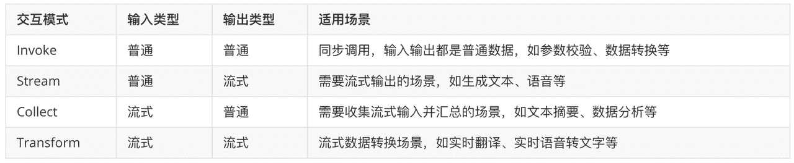

```
type Invoke[I, O, TOption any] func(ctx context.Context, input I, opts ...TOption) (output O, err error)
type Stream[I, O, TOption any] func(ctx context.Context, input I, opts ...TOption) (output *schema.StreamReader[O], err error)
type Collect[I, O, TOption any] func(ctx context.Context, input *schema.StreamReader[I], opts ...TOption) (output O, err error)
type Transform[I, O, TOption any] func(ctx context.Context, input *schema.StreamReader[I], opts ...TOption) (output *schema.StreamReader[O], err error)
```

### 4.1 编排（Compose）

> Eino提出了基于有向图（`Graph`）模型的编排解决方案。

> 每个节点承担特定职责，节点间以上下游数据类型对齐为基本准则，实现类型安全的数据传递。

从以下几个维度对比了使用Eino编排框架与传统开发的优势：


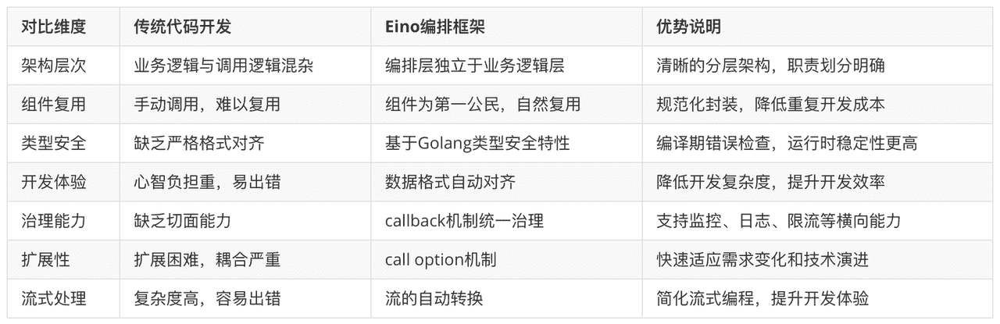

### 4.2 Graph：运行图

以一个简单的查询天气的例子介绍如何使用图编排

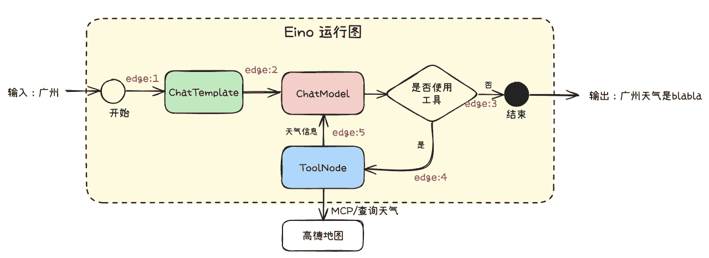

```
func main() {
  ctx := context.Background()
  // 创建运行图
  g := compose.NewGraph[map[string]any, *schema.Message](
    compose.WithGenLocalState(func(ctx context.Context) *state {
      return &state{}
    }))
  // Prompt模板
  promptTemplate := prompt.FromMessages(
    schema.FString,
    schema.SystemMessage("你是一个智能助手，请帮我解决以下问题。"),
    schema.UserMessage("{location}今天天气怎么样？"),
  )
  _ = g.AddChatTemplateNode("ChatTemplate", promptTemplate)

  // 连接MCP获取工具
  tools, toolsInfo, err := ConnectMCP(ctx, amapURL)
  if err != nil {
    panic(err)
  }
  // 创建大模型组件节点
  chatModel, err := openai.NewChatModel(ctx, &openai.ChatModelConfig{
    APIKey:  apiKey,
    BaseURL: baseURL,
    Model:   model,
  })
  if err != nil {
    panic(err)
  }
  // 大模型绑定工具获取Function Call能力
  if err = chatModel.BindTools(toolsInfo); err != nil {
    panic(err)
  }
  _ = g.AddChatModelNode("ChatModel", chatModel,
    compose.WithStatePreHandler(
      func(ctx context.Context, in []*schema.Message, state *state) ([]*schema.Message, error) {
        state.Messages = append(state.Messages, in...)
        return state.Messages, nil
      },
    ),
    compose.WithStatePostHandler(
      func(ctx context.Context, out *schema.Message, state *state) (*schema.Message, error) {
        state.Messages = append(state.Messages, out)
        return out, nil
      },
    ),
  )

  // 创建工具组件节点
  toolsNode, err := compose.NewToolNode(ctx, &compose.ToolsNodeConfig{
    Tools: tools,
  })
  _ = g.AddToolsNode("ToolNode", toolsNode)

  // 创建图的边
  _ = g.AddEdge(compose.START, "ChatTemplate") // edge:1
  _ = g.AddEdge("ChatTemplate", "ChatModel") // edge:2
  _ = g.AddBranch("ChatModel", compose.NewGraphBranch(
    func(ctx context.Context, in *schema.Message) (endNode string, err error) {
      // 是否使用工具
      if len(in.ToolCalls) == 0 {
        return compose.END, nil
      }
      return "ToolNode", nil
    }, map[string]bool{
      compose.END: true, // edge:3
      "ToolNode":  true, // edge:4
    }))
  _ = g.AddEdge("ToolNode", "ChatModel") // edge:5

  // 编译运行图
  r, err := g.Compile(ctx, compose.WithMaxRunSteps(10))
  if err != nil {
    panic(err)
  }

  // 执行
  in := map[string]any{"location": "广州"}
  ret, err := r.Invoke(ctx, in)
  if err != nil {
    panic(err)
  }
  // 输出天气信息
  log.Println("invoke result: ", ret)
}
```

### 4.3 Callbacks：切面

`Callback`有以下几个触发时机，分别对应了`Handler`里边的回调方法：

```
const (
    TimingOnStart CallbackTiming = iota // 进入并开始执行
    TimingOnEnd // 成功完成即将 return
    TimingOnError // 失败并即将 return err
    TimingOnStartWithStreamInput // OnStart，但是输入是 StreamReader
    TimingOnEndWithStreamOutput // OnEnd，但是输出是 StreamReader
)

type Handler interface {
    OnStart(ctx context.Context, info *RunInfo, input CallbackInput) context.Context
    OnEnd(ctx context.Context, info *RunInfo, output CallbackOutput) context.Context
    OnError(ctx context.Context, info *RunInfo, err error) context.Context
    OnStartWithStreamInput(ctx context.Context, info *RunInfo,
       input *schema.StreamReader[CallbackInput]) context.Context
    OnEndWithStreamOutput(ctx context.Context, info *RunInfo,
       output *schema.StreamReader[CallbackOutput]) context.Context
}
```

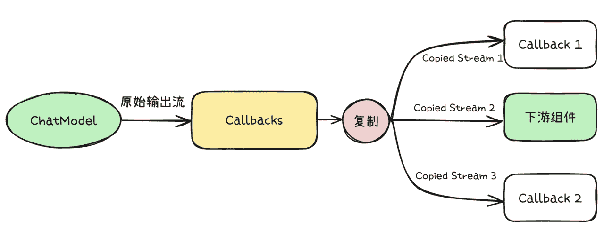

`Eino`通过数据复制的方式。

> 保证了在`Callbacks`的处理过程中数据流的并发安全性。

> 每个`Handler`都能消费到一份独立的数据流。

### 4.4 Checkpoint：检查点

Human In The Loop（HITL）是一种让人类用户能够实时参与和干预AI Agent执行过程的机制。

HITL可以实现以下重要功能：

+   质量审核

> 在人机协同工作中，用户可以在重要决策节点实时干预，例如审核AI生成的内容、修改推荐结果等，确保关键任务（如数据库敏感数据、运维操作等）的准确性和安全性。

+   实时干预

> 通过人类在关键节点的参与，系统可以及时调整，避免偏差，从而提高整体决策的准确性。

+   模型优化

> 收集人类反馈数据，用于后续模型训练和优化，逐步提升AI系统的表现和适应能力。

+   用户互动

> 在复杂任务中询问用户的意见，以提高用户体验，增强互动性。

`Eino`框架通过`Checkpoint`（检查点）机制优雅地实现了Human In The Loop的能力。

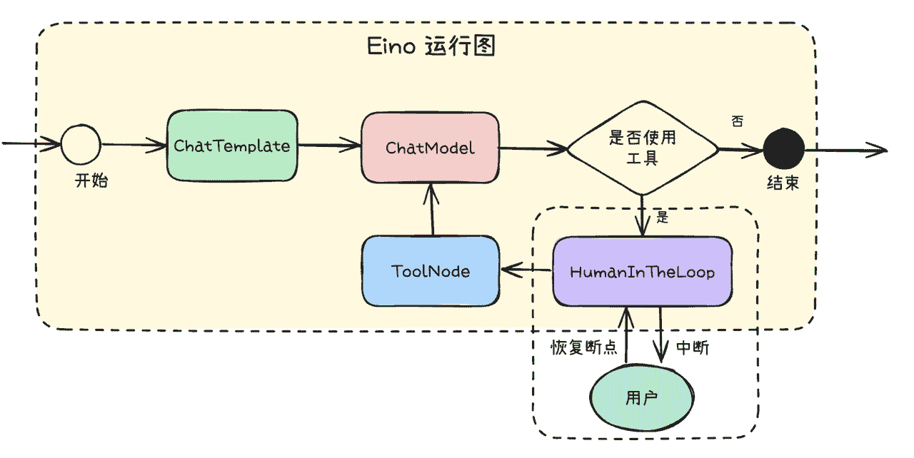

以下展示使用`CheckPoint`的能力实现Human In The Loop的效果：

```
func main() {
  _ = compose.RegisterSerializableType[myState]("state")
  ctx := context.Background()
  g := compose.NewGraph[map[string]any, *schema.Message](
    compose.WithGenLocalState(
      func(ctx context.Context) *myState {
        return &myState{}
      },
    ),
  )
  _ = g.AddChatTemplateNode("ChatTemplate", newChatTemplate(ctx))
  _ = g.AddChatModelNode("ChatModel", newChatModel(ctx),
    compose.WithStatePreHandler(
      func(ctx context.Context, in []*schema.Message, state *myState) ([]*schema.Message, error) {
        state.History = append(state.History, in...)
        return state.History, nil
      }),
    compose.WithStatePostHandler(
      func(ctx context.Context, out *schema.Message, state *myState) (*schema.Message, error) {
        state.History = append(state.History, out)
        return out, nil
      }),
  )
  _ = g.AddLambdaNode("HumanInTheLoop", compose.InvokableLambda(
    func(ctx context.Context, input *schema.Message) (output *schema.Message, err error) {
      var userInput string
      _ = compose.ProcessState(ctx, func(ctx context.Context, s *myState) error {
        userInput = s.Input
        return nil
      })
      if userInput == "" {
        return nil, compose.InterruptAndRerun
      }
      if strings.ToLower(userInput) == "n" {
        return nil, fmt.Errorf("user cancel")
      }
      return input, nil
    }))
  _ = g.AddToolsNode("ToolsNode", newToolsNode(ctx),
    compose.WithStatePreHandler(
      func(ctx context.Context, in *schema.Message, state *myState) (*schema.Message, error) {
        return state.History[len(state.History)-1], nil
      }))
  _ = g.AddEdge(compose.START, "ChatTemplate")
  _ = g.AddEdge("ChatTemplate", "ChatModel")
  _ = g.AddEdge("ToolsNode", "ChatModel")
  _ = g.AddBranch("ChatModel",
    compose.NewGraphBranch(func(ctx context.Context, in *schema.Message) (endNode string, err error) {
      if len(in.ToolCalls) > 0 {
        return "HumanInTheLoop", nil
      }
      return compose.END, nil
    }, map[string]bool{"HumanInTheLoop": true, compose.END: true}))
  _ = g.AddEdge("HumanInTheLoop", "ToolsNode")

  runner, err := g.Compile(ctx, compose.WithCheckPointStore(newCheckPointStore(ctx)))
  if err != nil {
    panic(err)
  }

  taskID := uuid.New().String()
  var history []*schema.Message
  var userInput string
  for {
    result, err := runner.Invoke(ctx, map[string]any{"name": "Alice", "location": "广州"},
      compose.WithCheckPointID(taskID),
      compose.WithStateModifier(func(ctx context.Context, path compose.NodePath, state any) error {
        state.(*myState).Input = userInput
        state.(*myState).History = history
        return nil
      }))
    if err == nil {
      fmt.Printf("执行成功: %s", result.Content)
      break
    }
    info, ok := compose.ExtractInterruptInfo(err)
    if !ok {
      log.Fatal(err)
    }
    history = info.State.(*myState).History
    for _, tc := range history[len(history)-1].ToolCalls {
      fmt.Printf("使用工具: %s, 参数: %s\n请确认参数是否正确? (y/n): ", tc.Function.Name, tc.Function.Arguments)
      fmt.Scanln(&userInput)
    }
  }
}
```

## 五、tRPC-A2A-Go

在实际的多智能体系统开发中，将`Agent`封装为支持`A2A`协议的服务具有诸多优势。

> `tRPC-A2A-Go` 框架为开发者提供了完整的`A2A`协议客户端和服务端实现.

> 帮助开发者快速将`Agent`封装为标准的`A2A`服务，兼容主流的智能体生态，显著降低了多`Agent`协同系统集成和运维的难度。

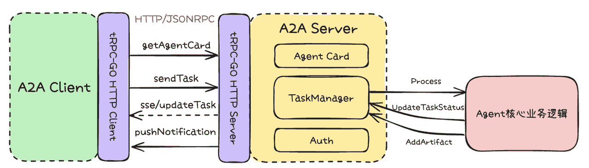

### 5.1 A2A Server

> 将`Eino`框架的`Agent`使用`A2A`协议对外提供服务有以下几个步骤：

1.  实现任务状态同步能力，通过`Callbacks`切面将任务开始、任务结束，以及中间执行状态流式消息进行输出。

1.  实现`TaskProcessor`接口处理新任务，内部通过调用`graph.Stream`执行运行图。


```go
// TaskProcessor defines the interface for the core agent logic that processes a task.
// Implementations of this interface are injected into a TaskManager.
type TaskProcessor interface {
  // Process executes the specific logic for a task.
  // It receives the task ID, the initial message, and a TaskHandle for callbacks.
  // It should use handle.Context() to check for cancellation.
  // It should report progress and results via handle.UpdateStatus and handle.AddArtifact.
  // Returning an error indicates the processing failed fundamentally.
  Process(ctx context.Context, taskID string, initialMsg protocol.Message, handle TaskHandle) error
}
```

1. 完成 `AgentCard` 描述 Agent 的能力，创建 A2A Server

```go
func NewA2AServer(agent *Agent) (*server.A2AServer, error) {
  var err error
  agentCard := getAgentCard() // 按照 A2A 协议标准生成 AgentCard，描述 Agent 能力
  redisCli, err := tgoredis.New("trpc.redis.deepresearch")
  if err != nil {
    return nil, fmt.Errorf("failed to create redis client: %w", err)
  }
  // 创建基于 Redis 的任务管理器
  taskManager, err := redistaskmanager.NewRedisTaskManager(redisCli, agent)
  if err != nil {
    return nil, fmt.Errorf("failed to create task manager: %w", err)
  }
  srv, err := server.NewA2AServer(agentCard, taskManager)
  if err != nil {
    return nil, fmt.Errorf("failed to create A2A server: %w", err)
  }
  return srv, nil
}
```

1. 将 A2A Server 注册到 tRPC 服务上，并启动服务

```go
func main() {
  s := trpc.NewServer()
  agt, err := deepresearch.NewAgent()
  if err != nil {
    log.Fatal(err)
  }
  a2aServer, err := deepresearch.NewA2AServer(agt)
  if err != nil {
    log.Fatal(err)
  }
  thttp.RegisterNoProtocolServiceMux(
    s.Service("trpc.a2a_samples.deepresearch.A2AServerHandler"),
    a2aServer.Handler(),
  )
  if err := s.Serve(); err != nil {
    log.Fatal(err)
  }
}
```

### 5.2 A2A Client

创建一个 A2A 客户端使用 A2A 协议向 Agent 发起任务分为以下几个步骤：

#### ① 创建 A2A 客户端

```go
// 客户端
a2aClient, err := a2aclient.NewA2AClient(agentConfig.ServerURL, a2aclient.WithTimeout(time.Minute * 10))
```

#### ② 调用 `StreamTask` 发起流式任务

```go
taskChan, err := a2aClient.StreamTask(c, protocol.SendTaskParams{
  ID:      taskID,
  Message: initMessage,
})
```

#### ③ 流式处理任务执行结果

```go
for v := range taskChan {
  switch event := v.(type) {
  case protocol.TaskStatusUpdateEvent:
    handleTaskStatusUpdateEvent(c, req, ch, event)
  }
}
```

## 六、从零开发多Agent协同系统

接下来，将结合实际 Demo，从整体架构到核心模块的实现，完整展现一个多Agent协同系统的开发过程。

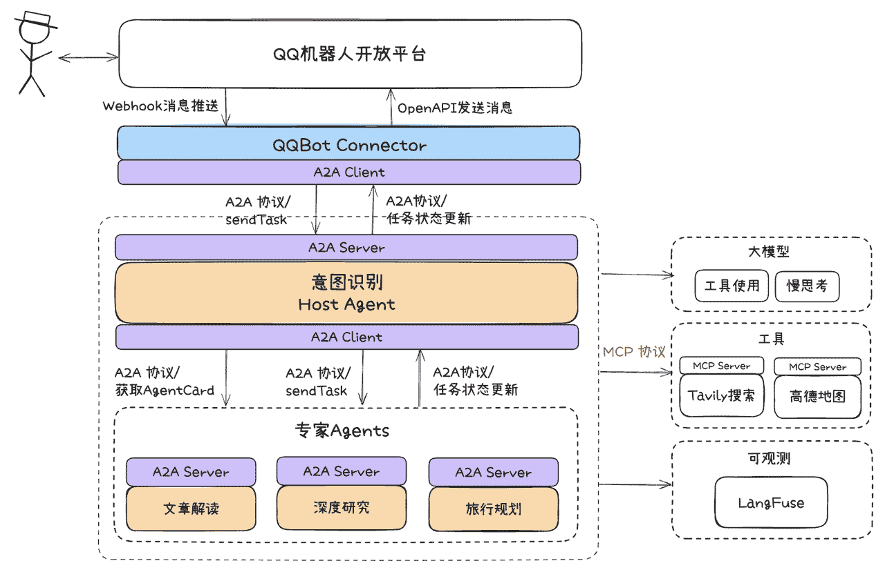

### 6.1 Agent 设计

下面以 Demo 中的几个典型 Agent 为例，详细介绍设计思路与实现方式，基于 Eino 框架快速落地多智能体协作系统。

### 6.2 旅行规划

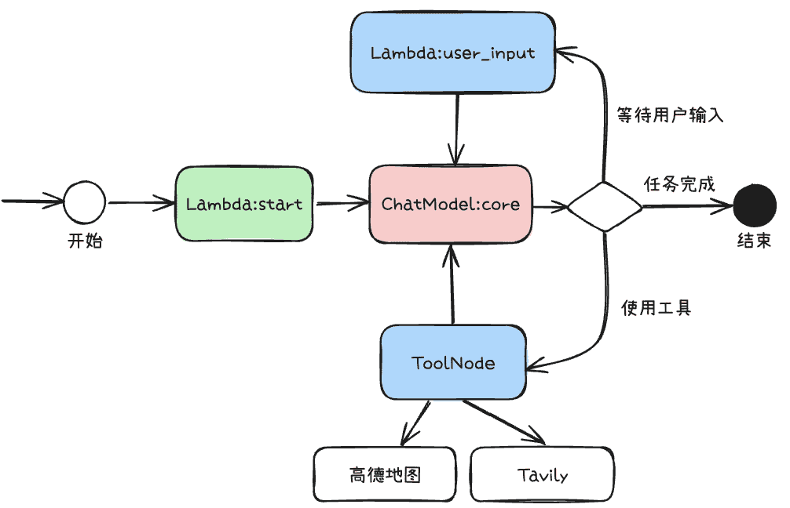

旅行规划 Agent 使用经典的 ReAct 框架实现。主要集成了高德地图 MCP 能力，实现了路线规划、交通方式推荐、实时路况查询等功能，以及 Tavily 进行 AI 搜索，能够检索目的地的景点介绍、游玩攻略、美食推荐等内容。在此基础上，通过增加了 `Lambda:user_input` 节点等待用户下一轮对于行程规划的建议和追问。

### 6.3 深度搜索

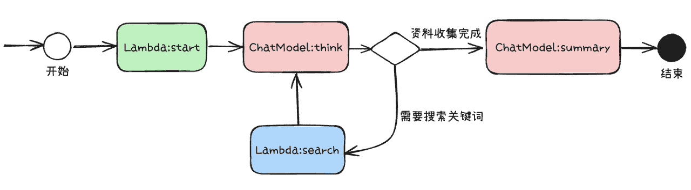

深度搜索 Agent 利用大模型对复杂问题进行多角度分析，边推理边搜索。在执行流程内部，通过 `ChatModel:think` 进行问题分析，并判断上下文的资料是否足够回答用户问题，如果不够那么输出关键词借助搜索工具获取资料补充上下文，如果足够，通过 `ChatModel:summary` 模型，输出对于问题的分析总结报告。

### 6.4 意图识别

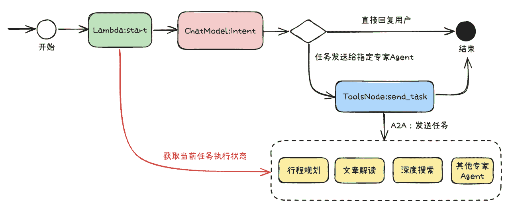

> 这种设计让意图识别 Agent 具备了高度的灵活性和可扩展性。

+ 一方面，它能够根据用户需求动态选择并对接不同类型的下游专家 Agent，实现多智能体间的高效协作与任务流转；
+ 另一方面，专家 Agent 采用标准化 A2A 协议进行封装，具备天然的可插拔能力，通过 AgentCard 描述能力让意图识别 Agent 进行判断当前的任务类型，支持在系统运行时无缝添加、替换或扩展新的专家 Agent。

### 6.5 连接生态

`Connector` 是 A2A 多 Agent 系统实现 "能力复用" 和 "生态扩展" 的关键。

> 它的核心目标是将标准化的 Agent 能力，通过协议适配、接口封装等方式，快速对接到不同的外部平台和应用场景，实现 "写一次，处处可用"。

+ **解耦**

> Agent 本身只关注业务逻辑和 A2A 协议实现，不直接依赖于任何具体平台。`Connector` 负责协议转换、消息编解码、上下游适配，最大程度降低 Agent 与外部生态的耦合度。

+ **标准**

> 所有对接均基于 A2A 协议的标准输入输出格式，保证能力的可组合性和可迁移性。无论是对接 IM、Web、App 还是第三方 API，均通过统一的协议层进行交互。

+ **可扩展**

> `Connector` 采用插件化、模块化设计，支持按需扩展新的平台适配器。只需实现对应的适配接口，即可将 Agent 能力无缝接入新的生态系统。

### 6.6 接入 Cherry Studio

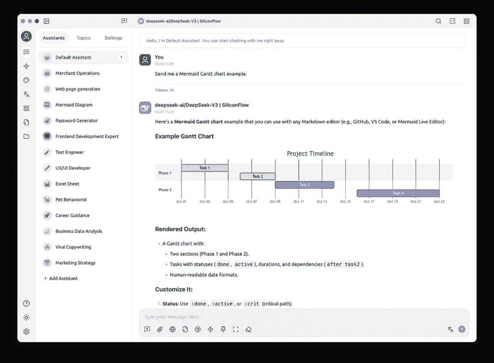

> 通过实现 OpenAI 兼容的 `Connector`，将 Agent 能力以标准 `chat/completion` 协议对外暴露，可以直接在 Cherry Studio 客户端中便捷地接入和调试 Agent，实时体验其交互效果与能力表现，极大提升了开发和测试的效率与直观性。

1. 实现 `chat/completion` 接口，获取 model 作为 Agent 名字，调用 `A2AServer`，将任务执行结果，使用 SSE 协议流式输出到 `chat/completion` 响应里

```go
func (s *Server) chatHandler(c *gin.Context) {
  var req api.ChatRequest
  if err := c.ShouldBindJSON(&req); errors.Is(err, io.EOF) {
    c.AbortWithStatusJSON(http.StatusBadRequest, gin.H{"error": "missing request body"})
    return
  } else if err != nil {
    c.AbortWithStatusJSON(http.StatusBadRequest, gin.H{"error": err.Error()})
    return
  }

  var foundAgent bool
  var agentConfig config.AgentConfig
  for _, agent := range config.GetMainConfig().OpenAIConnector.Agents {
    if agent.Name == req.Model {
      foundAgent = true
      agentConfig = agent
      break
    }
  }
  if !foundAgent {
    c.AbortWithStatusJSON(http.StatusBadRequest, gin.H{"error": fmt.Sprintf("agent %s not found", req.Model)})
    return
  }

  ch := make(chan any)
  go func() {
    defer close(ch)
    initMessage := protocol.Message{
      Role:  "user",
      Parts: []protocol.Part{protocol.NewTextPart(req.Messages[len(req.Messages)-1].Content)},
    }
    // 客户端
    a2aClient, err := a2aclient.NewA2AClient(agentConfig.ServerURL, a2aclient.WithTimeout(time.Minute * 10))
    if err != nil {
      ch <- gin.H{"error": err.Error()}
      return
    }
    taskChan, err := a2aClient.StreamTask(c, protocol.SendTaskParams{
      ID:      taskID,
      Message: initMessage,
    })
    if err != nil {
      ch <- gin.H{"error": err.Error()}
      return
    }
    for v := range taskChan {
      switch event := v.(type) {
      case protocol.TaskStatusUpdateEvent:
        handleTaskStatusUpdateEvent(c, req, ch, event)
      }
    }
    res := api.ChatResponse{
      Model:      req.Model,
      CreatedAt:  time.Now().UTC(),
      Message:    api.Message{Role: "assistant", Content: ""},
      Done:       true,
      DoneReason: "stop",
    }
    ch <- res
  }()
  // 流式返回数据
  streamResponse(c, ch)
}
```

配置 Cherry Studio 模型，连接 connector 服务

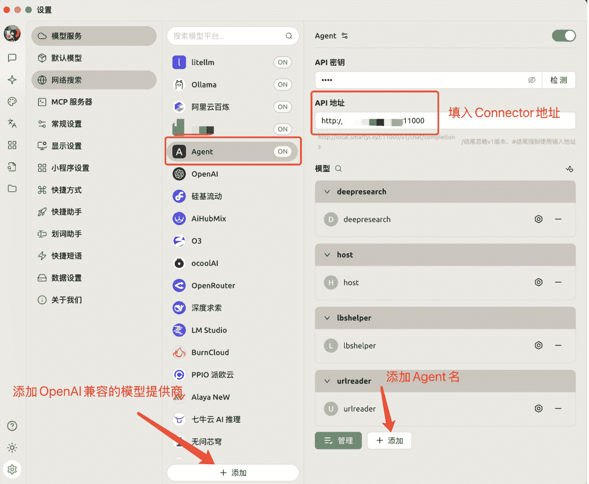

### 6.7 Agent 观测

**数据看板：** 通过 `Dashboard`，可以实时查看 LLM 应用的质量、成本、延迟等多维度指标，全面监控和分析智能体系统的运行状态。


## 八、总结

以上系统梳理了 AI Agent 的核心理念、主流协议（MCP、A2A）、思考框架（CoT、ReAct、Plan-and-Execute），并结合 Golang 生态下的 Eino、tRPC-A2A-Go 等工程化框架，结合实际例子详细讲解了如何优雅地开发、编排和观测复杂的智能体系统。

+ 协议标准化是 Agent 生态繁荣的基础：

> MCP、A2A 等协议的出现，极大降低了工具和 Agent 的集成门槛，让"能力复用"成为可能。未来，协议的进一步融合和演进，将推动智能体生态走向真正的互联互通。

+ 思考框架决定 Agent 的智能上限：

> 从 CoT 到 ReAct，再到 Plan-and-Execute，结构化的推理与行动流程，是 Agent 胜任复杂任务的关键。合理选择和实现思考框架，是打造高鲁棒性、高可解释性 Agent 的核心。

+ 工程化框架让复杂 Agent 开发变得高效：

> Eino、tRPC-A2A-Go 等框架，通过组件化、强类型、编排与切面机制，极大提升了开发效率和系统可维护性。无论是单体智能体，还是多 Agent 协作，都能快速落地生产级应用。

+ 可观测与人机协同是生产级 Agent 的基础能力：

> 只有让 Agent 的推理过程、工具调用、任务状态对用户和开发者透明，实现高质量的交付和持续优化。Human In The Loop 机制，则为关键场景下的安全性和可控性提供了保障。

+ **选择适合自身场景的协议与框架：**

> 没有万能的协议和框架，只有最适合当前业务和团队的技术选型。理解协议的边界、框架的能力，结合实际需求做出权衡，才能真正发挥 AI Agent 的价值。
