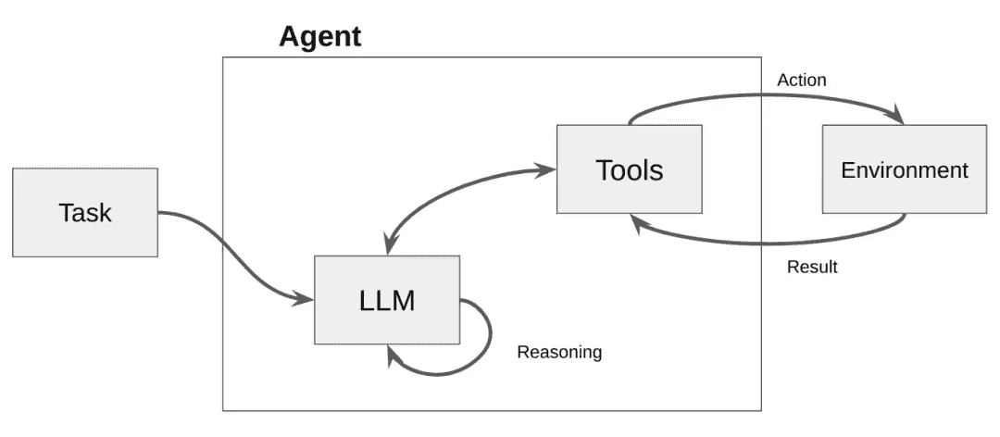

# 从零开始构建你的第一个 ReAct Agent

> 来源：[https://qqs7y1hozd1.feishu.cn/docx/Ur1yd57VLo4e7txZdhDcWWGKnMa](https://qqs7y1hozd1.feishu.cn/docx/Ur1yd57VLo4e7txZdhDcWWGKnMa)

> 本文完整介绍 ReAct **框架在实际任务中是**如何运行的，展示如何结合工具链完成“推理 + 执行”的闭环过程。



# 一、环境配置

可以通过以下代码来创建相关的conda环境并下载openai库。

```
conda create -n langgraph python=3.12 -y
conda activate langgraph
pip install openai
```

安装完成后，还需要配置大模型的**调用接口**。

```
from openai import OpenAI
aliyun_api_key = &#x27;你的api_key&#x27;
client = OpenAI(
    api_key=aliyun_api_key,
    base_url=&quot;https://dashscope.aliyuncs.com/compatible-mode/v1&quot;
)

response = client.chat.completions.create(
    model=&quot;qwen-max&quot;,
    messages=[
        {&#x27;role&#x27;: &#x27;user&#x27;, &#x27;content&#x27;: &quot;你是谁？&quot;}
    ]
)

# 打印完整回答内容
print(response.choices[0].message.content)
```

# 二、Agent 搭建

## 1.搭建思路

对于一个常见的ReAct框架的Agent，需要以下几个零部件：

+   **LLM 模型（大脑）：**

> OpenAI、通义千问、Claude 等大语言模型。其作用是负责理解用户输入、组织推理逻辑、判断调用哪个工具、最后生成回答。它是整个 Agent 推理与决策的基础。

>

+   **Memory（记忆）：**

> 保存对话的上下文。其作用是记录用户的历史对话、身份信息、上下文等，让 Agent 在多轮对话中保持“记忆”。

>

+   **工具（行动能力）：**计算器、搜索器、数据库查询器等。其作用是帮助 Agent 执行它不能直接回答的任务，例如查天气、算数学题、提取表格数据等。

>

+   Prompt 模板（思维方式）：如 ReAct 提示词。其作用是明确告诉模型“你要如何思考、如何调用工具、如何表达每一步的过程”。

> 总的来说，大模型是大脑，Prompt是思维方式，**工具是行动能力，Memo****r**y是记忆系统。四者合力，才能构建出一个真正实用的 ReAct Agent。下面就来一步步的将这四部分内容进行完善，完成最初的前期准备工作。

## 2.构建大脑及内部记忆

**首先，需要构建一个支持 **LLM 对话的类，用于与大语言模型进行交互，同时记录完整的对话信息，为后续循环调用做好准备。

```
import re
from openai import OpenAI
aliyun_api_key = &#x27;你的api_key&#x27;
client = OpenAI(
    api_key=aliyun_api_key,
    base_url=&quot;https://dashscope.aliyuncs.com/compatible-mode/v1&quot;
)
class Agent:
    def __init__(self, system=&quot;&quot;):
        self.system = system
        self.messages = []
        if self.system:
            self.messages.append({&quot;role&quot;: &quot;system&quot;, &quot;content&quot;: system})

    def __call__(self, message):
        self.messages.append({&quot;role&quot;: &quot;user&quot;, &quot;content&quot;: message})
        result = self.execute()
        self.messages.append({&quot;role&quot;: &quot;assistant&quot;, &quot;content&quot;: result})
        return result

    def execute(self):
        response = client.chat.completions.create(
            model=&quot;qwen-max&quot;,
            messages=self.messages
        )
        return response.choices[0].message.content
```

可以一步步来看看这个 Agent 类具体实现了哪些功能。

首先，通过以下代码**创建一个 Agent 对象：**

```
abot = Agent(&#x27;你是一个乐于助人的机器人&#x27;)
```

在创建这个对象的过程中，其实是将 '你是一个乐于助人的机器人' 作为参数传入了类的构造函数 init()，即：

```
class Agent:
    def __init__(self, system=&#x27;你是一个乐于助人的机器人&#x27;):
```

在构造函数中，**通过 ****self.system**** 和 ****self.messages**** 定义了两个类的属性：**

+   self.system：保存系统提示词，也就是设定的大模型身份。

>

+   self.messages：初始化一个空列表，用于保存整段对话的历史信息（包含 system、user、assistant 三类角色的内容）。

```
        self.system = &#x27;你是一个乐于助人的机器人&#x27;
        self.messages = []
```

再然后就是把系统提示词加入到self.messages 的列表当中，即便是空的字符串也是需要加入进去的。

```
        if self.system:
            self.messages.append({&quot;role&quot;: &quot;system&quot;, &quot;content&quot;: &#x27;你是一个乐于助人的机器人&#x27;})
```

加入进去后，self.mesages就会变成下面这样把一条信息保存起来。

```
self.messages = [{&quot;role&quot;: &quot;system&quot;, &quot;content&quot;: &#x27;你是一个乐于助人的机器人&#x27;}]
```

以上就完成了Agen这个类创建的前期准备工作了。当去调用这个类，也就是和刚刚创建好的abot 去对话，可以这样来完成：

```
result = abot(&quot;你是谁？&quot;)
print(result)
```

当使用 abot() 来传入信息时，其实是调用了 Agent 类中定义的 call() 方法，**并将 ****'你是谁？'**** 作为 ****message**** 传入：**

```
    def __call__(self, message=&#x27;你是谁&#x27;):
```

然后下一步就是执行这个函数里的内容，第一步就是把这个信息传入到这个字典里，并且也是通过.append的方式添加到列表中。

```
        self.messages.append({&quot;role&quot;: &quot;user&quot;, &quot;content&quot;: &#x27;你是谁&#x27;})
```

经过这样之后，列表就会更新成下面这样。

```
self.messages = [{&quot;role&quot;: &quot;system&quot;, &quot;content&quot;: &#x27;你是一个乐于助人的机器人&#x27;}, {&quot;role&quot;: &quot;user&quot;, &quot;content&quot;: &#x27;你是谁&#x27;}]
```

再然后就是去执行一个函数self.execute() ，并将结果保存在变量result这里。

```
        result = self.execute()
```

> 这个函数其实就是Agent这个类里的第三个函数def execute(self): ，就是用的最普通的openai调用方法来获取回复，但是这里需要注意的是，传入给大模型的信息其实正是一直保存在self.messages的信息，所以大模型会基于系统提示词和用户提示词给出对应的回复。

比如这里的回复就应该是：我是来自阿里云的大规模语言模型，我叫通义千问。

```
def execute(self):
    response = client.chat.completions.create(
        model=&quot;qwen-max&quot;,
        messages=self.messages
    )
    return response.choices[0].message.content
```

最后保存大模型回复的信息也会以格式化的形式添加到self.messages 中，以作为聊天记录等待下一次的调用。完成一次聊天后，在self.messages 保存的聊天记录应该如下所示：

```
self.messages = [{&quot;role&quot;: &quot;system&quot;, &quot;content&quot;: &#x27;你是一个乐于助人的机器人&#x27;}, {&quot;role&quot;: &quot;user&quot;, &quot;content&quot;: &#x27;你是谁&#x27;},{&quot;role&quot;: &quot;assistant&quot;, &quot;content&quot;: &#x27;我是来自阿里云的大规模语言模型，我叫通义千问。&#x27;}]
```

通过这样的方式，不仅完成了一次完整的问答过程，还保留了整个对话的上下文，为后续多轮交互提供了基础。

## 3.工具准备

Agent 的工具是指大语言模型在完成任务时可以调用的外部函数或服务，比如搜索引擎、计算器、数据库查询、文件读取等，它让模型不仅能“思考”，还能“行动”。

> 通过这些工具，模型可以在无法直接回答的问题面前主动获取信息、执行代码或调用API，从而完成更复杂、更真实的智能任务。这种“思考+行动”的模式，是构建智能 Agent 系统的核心能力之一。

比如说可以设置两个小的工具来完成后续的Agent任务，第一个是计算器工具calculate(what) ，这是一个用于执行数学表达式的工具函数，能够接收一个字符串形式的表达式，并使用 Python 的 eval() 函数进行计算。

```
def calculate(what):
    return eval(what)

print(calculate(&quot;3 + 7 * 2&quot;))   # 返回 17
print(calculate(&quot;10 / 4&quot;))      # 返回 2.5
```

另外一个是狗狗体重查询工具average_dog_weight(name) ，该函数根据传入的狗的品种名称，返回该品种的平均体重信息。如果传入的品种不在预设列表中，则返回默认的平均体重信息。

```
def average_dog_weight(name):
    if name in&quot;Scottish Terrier&quot;: 
        return(&quot;Scottish Terriers average 20 lbs&quot;)
    elif name in&quot;Border Collie&quot;:
        return(&quot;a Border Collies average weight is 37 lbs&quot;)
    elif name in&quot;Toy Poodle&quot;:
        return(&quot;a toy poodles average weight is 7 lbs&quot;)
    else:
        return(&quot;An average dog weights 50 lbs&quot;)

average_dog_weight(&quot;Scottish Terrier&quot;)  
# 返回 &quot;Scottish Terriers average 20 lbs&quot;
average_dog_weight(&quot;Labrador&quot;)          
# 返回 &quot;An average dog weights 50 lbs&quot;
```

最后可以把这两个工具注册到一起，并且还需要写入到提示词模版当中，那这样就可以让大模型知道有哪些工具可用，并且调用的时候使用什么样的格式。

```
known_actions = {
    &quot;calculate&quot;: calculate,
    &quot;average_dog_weight&quot;: average_dog_weight
}
```

## 4.提示词模版

> 在完成工具准备并明确任务了以后，就可以开始来构建提示词模板了。这里所使用的提示词模版肯定不能是上面那种有用的助手那么简单，因为需要其能够实现思考、行动、暂停、观察这样一轮轮的步骤完成，因此这个提示词也是需要复杂一些。

以下是这个任务所使用的提示词模版：

```
prompt = &quot;&quot;&quot;
You run in a loop of Thought, Action, PAUSE, Observation.
At the end of the loop you output an Answer
Use Thought to describe your thoughts about the question you have been asked.
Use Action to run one of the actions available to you - then return PAUSE.
Observation will be the result of running those actions.

Your available actions are:

calculate:
e.g. calculate: 4 * 7 / 3
Runs a calculation and returns the number - uses Python so be sure to use floating point syntax if necessary

average_dog_weight:
e.g. average_dog_weight: Collie
returns average weight of a dog when given the breed

Example session:

Question: How much does a Bulldog weigh?
Thought: I should look the dogs weight using average_dog_weight
Action: average_dog_weight: Bulldog
PAUSE

You will be called again with this:

Observation: A Bulldog weights 51 lbs

You then output:

Answer: A bulldog weights 51 lbs
&quot;&quot;&quot;.strip()
```

可以深入的来看看每一部分其具体是怎么实现的：

> 第一部分是定义大语言模型的行为流程，即模型需要按照 Thought → Action → PAUSE → Observation → Answer 的顺序来思考和回答问题。

这种结构让模型像人一样，先思考，再行动，观察结果，最后得出结论，是 ReAct 智能体模式的核心逻辑。

```
You run in a loop of Thought, Action, PAUSE, Observation.
At the end of the loop you output an Answer
```

第二部分是解释各个关键结构，Thought 表示模型的思考过程，Action 用于调用工具，PAUSE 代表暂时停止以等待外部执行，Observation 是动作执行后的反馈信息。

这一段为模型提供了清晰的格式指南，确保它知道每一步该怎么做。

```
Use Thought to describe your thoughts about the question you have been asked.
Use Action to run one of the actions available to you - then return PAUSE.
Observation will be the result of running those actions.
```

第三部分列出了当前模型可调用的两个工具，一个是 calculate 用于执行数学计算，一个是 average_dog_weight 用于查询狗的平均体重。

**每个工具都有调用示例和用途描述**，明确告诉模型能干什么、怎么写，帮助它在需要时做出正确选择。

```
Your available actions are:

calculate:
e.g. calculate: 4 * 7 / 3
Runs a calculation and returns the number - uses Python so be sure to use floating point syntax if necessary

average_dog_weight:
e.g. average_dog_weight: Collie
returns average weight of a dog when given the breed
```

第四部分是示例演示，通过一个完整的例子（“Bulldog 的体重”）演示了整个流程如何运作，从用户提问，到模型思考、选择工具、接收观察结果，再到最终生成答案。

**这种 few-s**hot 示例起到了“教模型怎么做”的作用，帮助它快速学习并模仿。

```
Example session:

Question: How much does a Bulldog weigh?
Thought: I should look the dogs weight using average_dog_weight
Action: average_dog_weight: Bulldog
PAUSE

You will be called again with this:

Observation: A Bulldog weights 51 lbs

You then output:

Answer: A bulldog weights 51 lbs
```

> 所以这个提示词是一个典型的 ReAct 模式 Prompt，用于引导大语言模型按 “Thought → Action → Observation → Answer” 的流程进行多步推理。

>

> 它**定义了两个可调用工具（计算**器与狗体重查询），并通过示例教会模型如何思考、选择工具、暂停等待执行结果，最终给出回答。整个提示结构清晰，逻辑合理，是构建工具增强型智能体的经典设计模板。

基于这个提示词模版，大模型就能够照着示例来一步步完成想要其完成的任务。

# 三、Agent 组装

当准备好了四部分Agent的组件后，就可以将其组装起来，实现真正的Agent流程了。

**具体的代码实现如下所示：**

```
action_re = re.compile(&#x27;^Action: (\w+): (.*)$&#x27;)
def query(question, max_turns=5):
    i = 0
    bot = Agent(prompt)
    next_prompt = question
    while i &lt; max_turns:
        i += 1
        result = bot(next_prompt)
        print(result)
        actions = [
            action_re.match(a) 
            for a in result.split(&#x27;\n&#x27;) 
            if action_re.match(a)
        ]
        if actions:
            # There is an action to run
            action, action_input = actions[0].groups()
            if action notin known_actions:
                raise Exception(&quot;Unknown action: {}: {}&quot;.format(action, action_input))
            print(&quot; -- running {} {}&quot;.format(action, action_input))
            observation = known_actions[action](action_input)
            print(&quot;Observation:&quot;, observation)
            next_prompt = &quot;Observation: {}&quot;.format(observation)
        else:
            return result
```

## 第一部分：正则表达式定义（识别 Action 行）

这一行是用 Python 的 re 模块预编译了一个正则表达式，用于匹配模型输出中的动作调用指令。

```
action_re = re.compile(&#x27;^Action: (\w+): (.*)$&#x27;)
```

**正则表达式的含义是：**

+   ^Action: 表示必须以 Action: 开头

+   (\w+) 匹配一个由字母、数字或下划线组成的字符串，用来捕获工具名

+   : 是第二个冒号

+   (.*) 匹配这一行剩下的所有内容，作为工具的输入参数

+   $ 表示这一行的末尾

**比如说以下的内容：**

```
Action: calculate: 5 + 3
Action: average_dog_weight: Border Collie
```

**就可以提取出：**

+   工具名：如 calculate

+   参数内容：如 5 + 3

**这在整个 ReA**ct 框架中起到了“解析模型指令”的作用，是连接 LLM 与工具函数的桥梁。

## 第二部分：函数定义和初始化 Agent

这是 query 函数的定义部分，它是整个“ReAct式推理对话”的主函数。

```
def query(question, max_turns=5):
    i = 0
    bot = Agent(prompt)
    next_prompt = question
```

**函数参数说明：**

+   question 是用户输入的问题，比如：“我有两只狗，一只是 Border Collie，一只是 Scottish Terrier，它们的总重是多少？”

+   max_turns 是最多允许模型推理的轮数，用于避免死循环

> 内部变量初始化：

+   i = 0：轮次计数器，从第 0 轮开始

+   bot = Agent(prompt)：实例化一个 Agent 对象，并加载前面写好的系统提示词 prompt，使得模型具备 ReAct 风格行为

+   next_prompt = question：把用户问题作为第一轮对话的输入

这一部分的作用是准备好模型上下文、轮次计数器和初始输入内容，为后续的对话循环做准备。

## 第三部分：进入推理循环，每轮运行 Agent

这是 query() 函数的主循环体，每次循环代表一次推理轮次。

```
while i &lt; max_turns:
    i += 1
    result = bot(next_prompt)
    print(result)
```

**解释：**

+   循环条件是轮数不能超过 max_turns ，这也就是前面所说的5轮。

+   每轮输入 next_prompt，一开始也是提问的问题，后面随着每一轮运行，内容不断增加

+   result 是模型输出的完整文本，可能包含：

+   Thought: 模型的推理说明

+   Action: 工具调用请求

+   PAUSE 暂停符号（人为控制）

+   或最终的 Answer: xxx

通过 print(result) 打印结果，让看到每一步模型做了什么，是非常常见的开发习惯。正式上线的时候可以去掉以提升速度。

## 第四部分：识别输出中是否包含 Action 调用指令

这段代码的目标是从模型输出中提取出 Action: xxx: yyy 的指令。

```
actions = [
    action_re.match(a) 
    for a in result.split(&#x27;\n&#x27;) 
    if action_re.match(a)
]
```

**解释：**

+   result.split('\n') 将多行模型输出按行拆分为一个列表

+   对每一行使用正则表达式 action_re.match(a) 进行匹配

+   如果某一行符合格式 Action: 工具名: 参数，就会返回一个匹配对象（Match 对象）

+   把这些匹配对象组成一个列表 actions

**这个部分的作用是：**

+   分析模型的输出，看它有没有发出“我想调用哪个工具”的指令

+   如果有，就提取出来准备执行

+   如果没有，则说明模型已经准备好输出最终结果，不需要调用工具

## 第五部分：判断是否执行动作，并提取调用细节

这一段表示如果 actions 列表非空，说明找到了模型想执行的 Action。

这个时候就取出第一个匹配项，并用 .groups() 方法获得两个内容：

+   action：工具名称（如 calculate）

+   action_input：参数内容（如 5 + 3）

```
if actions:
    action, action_input = actions[0].groups()
```

注意这里只取第一个 Action，意味着如果模型一次输出多个动作，只会执行第一个。你可以扩展为多动作支持，但这个例子中是单轮单动作执行。

## 第六部分：检查工具是否合法并执行

这段是一个保护机制，确保模型调用的工具必须是在你定义的工具字典 known_actions 中注册过的。

```
    if action not in known_actions:
        raise Exception(&quot;Unknown action: {}: {}&quot;.format(action, action_input))
```

如果模型写错了工具名称，或者调用了你未定义的函数，这段代码就会抛出异常，终止程序，防止模型“乱调用”。

## 第七部分：实际执行工具函数，并获取 observation

当确保函数存在后，就可以实际的去执行这个函数并获取结果了。

```
    print(&quot; -- running {} {}&quot;.format(action, action_input))
    observation = known_actions[action](action_input)
    print(&quot;Observation:&quot;, observation)
```

+   known_actions[action] 表示从工具字典中取出对应的函数（如 calculate）

+   (...) 表示调用这个函数，把 action_input 作为参数传进去

+   执行后得到的返回值就是 observation（观察结果）

**比如说假如传入的是下面的内容：**

```
action = &quot;calculate&quot;
action_input = &quot;3 + 5&quot;
observation = calculate(&quot;3 + 5&quot;)  # → 8
```

这个 observation 会作为反馈提供给模型，让它继续思考下一步。

## 第八部分：将 Observation 返回模型，形成闭环

这行代码的作用是把上一轮工具运行得到的结果包装成 Observation 格式，然后作为下一轮对话的输入内容。

```
    next_prompt = &quot;Observation: {}&quot;.format(observation)
```

这样模型在下一次运行时就能“看到”之前工具的执行结果，形成 ReAct 模式中的“观察反馈”闭环。

## 第九部分：如果没有 Action，直接返回最终结果

如果这一轮模型输出中没有 Action，说明它认为已经有足够信息来给出最终回答了。

```
else:
    return result
```

**比如：**

```
Answer: The total weight of your dogs is 57 lbs.
```

这时候就不再继续工具调用流程，直接返回这个结果作为最终输出。

# 四、实际调用

在准备好整体的调用逻辑及工具后，可以通过调用函数开启手搓的Agent了！这里提出的问题就是：我有两只小狗，一只是border collie，另一只是scottish terrier，总共有多重：

```
question = &quot;&quot;&quot;I have 2 dogs, a border collie and a scottish terrier. \
What is their combined weight&quot;&quot;&quot;
query(question)
```

可以通过query函数里print的内容在终端看到其中的变化：

```
Thought: I need to find the average weight of a Border Collie and a Scottish Terrier, then add them together to get their combined weight.
Action: average_dog_weight: Border Collie
PAUSE
 -- running average_dog_weight Border Collie
Observation: a Border Collies average weight is37 lbs
Thought: Now that I have the average weight of a Border Collie, I need to find the average weight of a Scottish Terrier.
Action: average_dog_weight: Scottish Terrier
PAUSE
 -- running average_dog_weight Scottish Terrier
Observation: Scottish Terriers average 20 lbs
Thought: I now have the average weights of both a Border Collie and a Scottish Terrier. I can now add these two weights together to find their combined weight.
Action: calculate: 37 + 20
PAUSE
 -- running calculate 37 + 20
Observation: 57
Answer: The combined weight of a Border Collie and a Scottish Terrier is57 lbs.
```

## 第一步：第一次 Thought + Action

> 从文本可以看出，模型先“想了想”：要得到总重，得先分别查两只狗的平均体重，再把它们加起来。然后决定先查 Border Collie 的体重，调用工具 average_dog_weight 。

**最后加上 ****PAUSE**，意味着它希望系统先执行完工具再继续。

```
Thought: I need to find the average weight of a Border Collie and a Scottish Terrier, then add them together to get their combined weight.
Action: average_dog_weight: Border Collie
PAUSE
```

这里需要注意的是，运行result = bot(next_prompt) 后，这部分思考和行动的内容都会作为聊天记录保存在self.messages里了，这样可以帮助模型后续进一步完成任务。

## 第二步：系统执行 Border Collie 工具

> 停下后就开始进行行动（action）了，就是从known_actions 字典中调用 average_dog_weight("Border Collie")。可以得到结果 "a Border Collies average weight is 37 lbs"。最后系统把这个 observation 反馈给模型，让它继续推理。

```
 -- running average_dog_weight Border Collie
Observation: a Border Collies average weight is 37 lbs
```

这个时候，observation会作为下一个提问传给模型，模型基于历史记录及这个观察进一步的完成任务，同样的，在历史里会把这个observation的信息作为user message传入self.messages。

## 第三步：模型继续推理下一步

> 在接收到观察的信息后，模型知道了第一只狗的体重。

> 接着模型思考“我还需要第二只狗的体重”所以这一步它调用 average_dog_weight: Scottish Terrier 工具进一步进行调整。

```
Thought: Now that I have the average weight of a Border Collie, I need to find the average weight of a Scottish Terrier.
Action: average_dog_weight: Scottish Terrier
PAUSE
```

当然这个信息也回作为assistant回复的信息保存在self.messages 中。

## 第四步：系统执行第二个工具

> 在收到action指令后，系统继续调用工具函数：

> average_dog_weight("Scottish Terrier")。最后可以得到体重：20 lbs。然后系统再次将结果作为 Observation 反馈给模型。

```
 -- running average_dog_weight Scottish Terrier
Observation: Scottish Terriers average 20 lbs
```

## 第五步：模型思考并调用加法工具

系统看到了已经找到了两个体重（37和20），所以模型决定 调用 calculate: 37 + 20 工具来进行计算。

```
Thought: I now have the average weights of both a Border Collie and a Scottish Terrier. I can now add these two weights together to find their combined weight.
Action: calculate: 37 + 20
PAUSE
```

## 第六步：系统执行加法工具

根据正则表达式的解析，系统调用 calculate("37 + 20") → eval("37 + 20") 得出 57。最后将把这个 Observation 返回给模型。

```
 -- running calculate 37 + 20
Observation: 57
```

## 最后一步：模型输出最终答案

最后模型输出一个Answer的答案内容，由于并没有输出Action的信息，因此整个推理链条闭环，任务结束。

```
Answer: The combined weight of a Border Collie and a Scottish Terrier is 57 lbs.
```

# 五、整体流程展示

**完整代码如下所示：**

```
import re
from openai import OpenAI
aliyun_api_key = &#x27;你的api_key&#x27;
client = OpenAI(
    api_key=aliyun_api_key,
    base_url=&quot;https://dashscope.aliyuncs.com/compatible-mode/v1&quot;
)

class Agent:
    def __init__(self, system=&quot;&quot;):
        self.system = system
        self.messages = []
        if self.system:
            self.messages.append({&quot;role&quot;: &quot;system&quot;, &quot;content&quot;: system})

    def __call__(self, message):
        self.messages.append({&quot;role&quot;: &quot;user&quot;, &quot;content&quot;: message})
        result = self.execute()
        self.messages.append({&quot;role&quot;: &quot;assistant&quot;, &quot;content&quot;: result})
        return result

    def execute(self):
        response = client.chat.completions.create(
            model=&quot;qwen-max&quot;,
            messages=self.messages
        )
        return response.choices[0].message.content

abot = Agent(&#x27;你是一个乐于助人的机器人&#x27;)
result = abot(&quot;你是谁？&quot;)
print(result)

prompt = &quot;&quot;&quot;
You run in a loop of Thought, Action, PAUSE, Observation.
At the end of the loop you output an Answer
Use Thought to describe your thoughts about the question you have been asked.
Use Action to run one of the actions available to you - then return PAUSE.
Observation will be the result of running those actions.

Your available actions are:

calculate:
e.g. calculate: 4 * 7 / 3
Runs a calculation and returns the number - uses Python so be sure to use floating point syntax if necessary

average_dog_weight:
e.g. average_dog_weight: Collie
returns average weight of a dog when given the breed

Example session:

Question: How much does a Bulldog weigh?
Thought: I should look the dogs weight using average_dog_weight
Action: average_dog_weight: Bulldog
PAUSE

You will be called again with this:

Observation: A Bulldog weights 51 lbs

You then output:

Answer: A bulldog weights 51 lbs
&quot;&quot;&quot;.strip()

def calculate(what):
    return eval(what)

def average_dog_weight(name):
    if name in&quot;Scottish Terrier&quot;: 
        return(&quot;Scottish Terriers average 20 lbs&quot;)
    elif name in&quot;Border Collie&quot;:
        return(&quot;a Border Collies average weight is 37 lbs&quot;)
    elif name in&quot;Toy Poodle&quot;:
        return(&quot;a toy poodles average weight is 7 lbs&quot;)
    else:
        return(&quot;An average dog weights 50 lbs&quot;)

known_actions = {
    &quot;calculate&quot;: calculate,
    &quot;average_dog_weight&quot;: average_dog_weight
}

action_re = re.compile(&#x27;^Action: (\w+): (.*)$&#x27;)   # python regular expression to selection action
def query(question, max_turns=5):
    i = 0
    bot = Agent(prompt)
    next_prompt = question
    while i &lt; max_turns:
        i += 1
        result = bot(next_prompt)
        print(result)
        actions = [
            action_re.match(a) 
            for a in result.split(&#x27;\n&#x27;) 
            if action_re.match(a)
        ]
        if actions:
            # There is an action to run
            action, action_input = actions[0].groups()
            if action notin known_actions:
                raise Exception(&quot;Unknown action: {}: {}&quot;.format(action, action_input))
            print(&quot; -- running {} {}&quot;.format(action, action_input))
            observation = known_actions[action](action_input)
            print(&quot;Observation:&quot;, observation)
            next_prompt = &quot;Observation: {}&quot;.format(observation)
        else:
            return result

question = &quot;&quot;&quot;I have 2 dogs, a border collie and a scottish terrier. \
What is their combined weight&quot;&quot;&quot;
query(question)
```