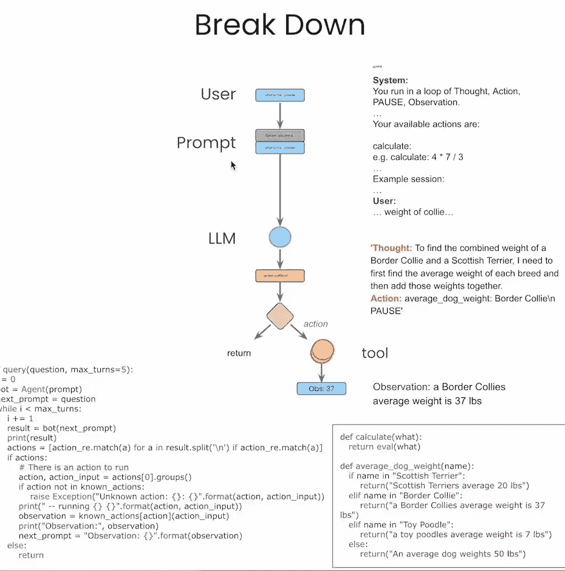
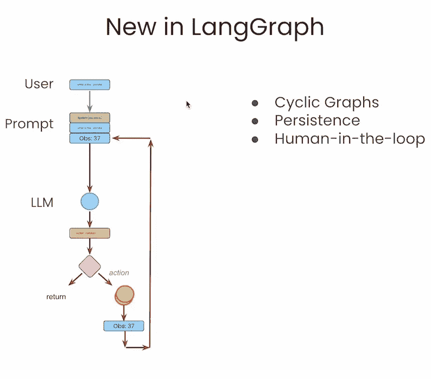
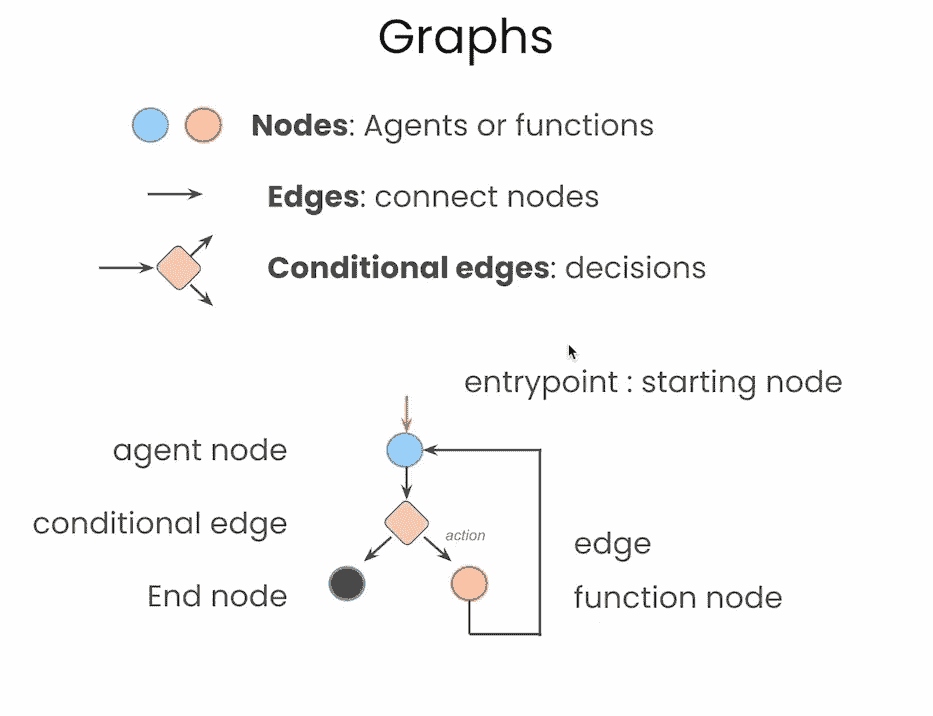
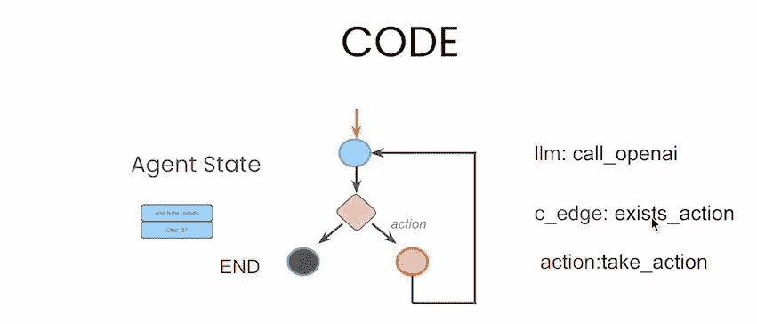
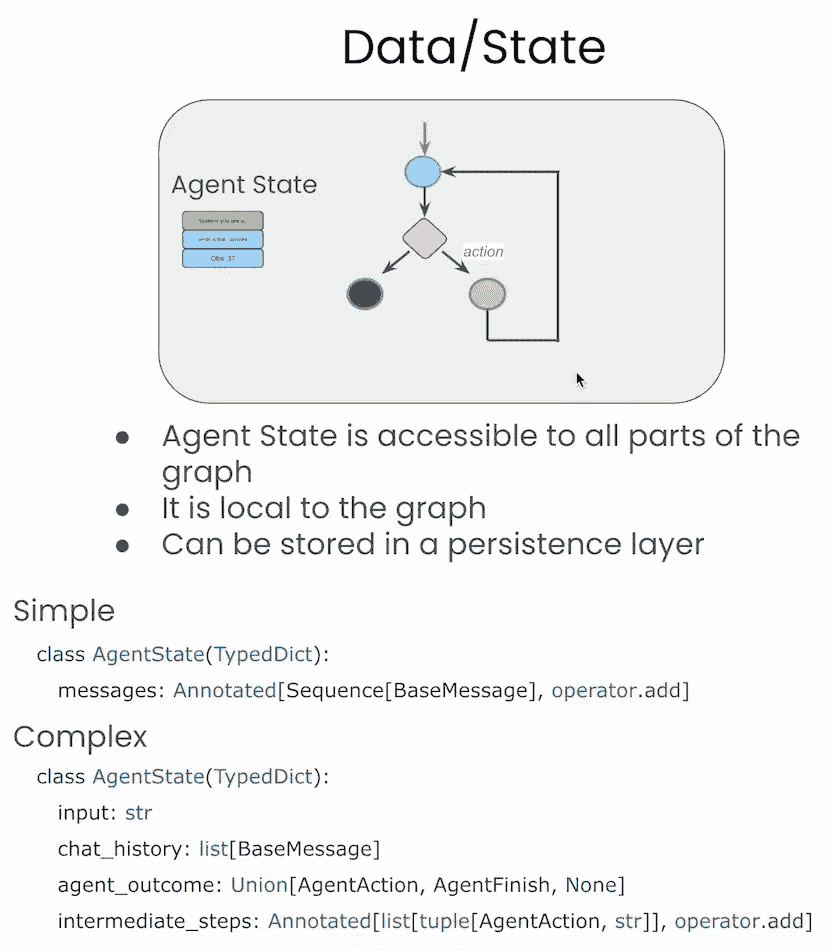
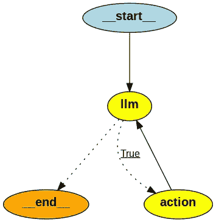
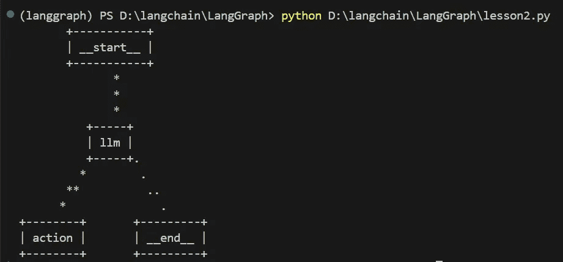
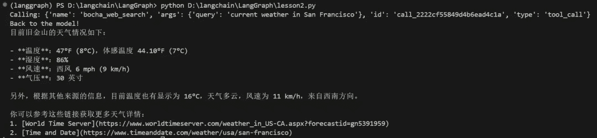

# 从零开始搭建基于 LangGraph 的 AI Agent

> 来源：[https://qqs7y1hozd1.feishu.cn/docx/VpcldajVyoHDNvxpU8fcUmmKnjc](https://qqs7y1hozd1.feishu.cn/docx/VpcldajVyoHDNvxpU8fcUmmKnjc)

> 引入当前 Agent 热门框架——LangGraph。

> 将 Agent 的运行流程抽象为“节点 + 状态流转”，用更高效、更优雅的方式构建复杂智能体系统。




# LangGraph

> LangGraph 最核心的设计理念就是将智能体流程图形化建模。

>

> 在 LangGraph 中，每一个操作单元（比如大模型调用、函数执行、判断逻辑）都是一个 节点（Node），节点之间通过 边（Edge） 相连接，构成了完整的智能体工作流。

>

> 特别是，它支持 条件边（Conditional Edges），可以根据状态决定分支路径，类似于传统的 if-else 语句。

>

> 这样构建出来的智能体，就像画流程图一样简单、直观，极大地增强了结构可视性与逻辑解耦能力。

>

另外，LangGraph 并不只是“把流程画出来”这么简单，它还原生支持三个非常重要的功能：

+   ✅ Cyclic Graphs（循环图）：

> 支持智能体在不同节点之间循环跳转，方便实现多轮思考与行动；

>

+   ✅ Persistence（状态持久化）：

> 图中状态可以随时保存、恢复，支持断点续跑与回溯；

>

+   ✅ Human-in-the-loop（人类参与环节）：

> 支持在流程中插入人工确认、反馈或干预节点，增强系统可控性。

这些功能，若在传统实现中靠代码维护会非常复杂，而 LangGraph 提供了图层级的原生支持，几乎开箱即用。



# 完整代码



## 前期准备

首先创建环境同时**在终端安装以下这些库：**

```
pip install langgraph langchain langchain-openai langchain-community pygraphviz
```

然后还可以配置好大模型的环境，**只需要写入****api_key****的信息即可：**

```
from langchain_openai import ChatOpenAI
aliyun_api_key = &#x27;你的api_key&#x27;
model = ChatOpenAI(
    model=&quot;qwen-plus&quot;,  # 或其他你在 DashScope 控制台启用的模型名
    openai_api_key=aliyun_api_key,
    openai_api_base=
)
```

**配置Tavily Search**

```
from langchain_community.tools.tavily_search import TavilySearchResults
import os
os.environ[&quot;TAVILY_API_KEY&quot;] = &quot;你的api_key&quot;
tool = TavilySearchResults(max_results=4) #increased number of results
print(type(tool))
```

只需要在最下面写入API_KEY并看看返回的结果即可。

```
from typing import Type
from pydantic import BaseModel, Field, PrivateAttr
from langchain_core.tools import BaseTool
import requests

# 输入参数定义
class BoChaSearchInput(BaseModel):
    query: str = Field(..., description=&quot;搜索的查询内容&quot;)

# LangChain Tool 定义
class BoChaSearchResults(BaseTool):
    name: str = &quot;bocha_web_search&quot;
    description: str = &quot;使用博查API进行网络搜索，可以用来查找实时信息或新闻&quot;
    args_schema: Type[BaseModel] = BoChaSearchInput

    # 私有属性，用于保存调用参数
    _api_key: str = PrivateAttr()
    _count: int = PrivateAttr()
    _summary: bool = PrivateAttr()
    _freshness: str = PrivateAttr()

    # 初始化方法
    def __init__(self, api_key: str, count: int = 5, summary: bool = True, freshness: str = &quot;noLimit&quot;, **kwargs):
        super().__init__(**kwargs)
        self._api_key = api_key
        self._count = count
        self._summary = summary
        self._freshness = freshness

    # Tool 实际运行逻辑
    def _run(self, query: str) -&gt; str:
        url = &quot;https://api.bochaai.com/v1/web-search&quot;
        headers = {
            &quot;Authorization&quot;: f&quot;Bearer {self._api_key}&quot;,
            &quot;Content-Type&quot;: &quot;application/json&quot;
        }
        payload = {
            &quot;query&quot;: query,
            &quot;summary&quot;: self._summary,
            &quot;freshness&quot;: self._freshness,
            &quot;count&quot;: self._count
        }

        try:
            response = requests.post(url, headers=headers, json=payload, timeout=10)
            response.raise_for_status()
            data = response.json()

            # ✅ 正确解析返回值中的搜索结果位置
            results = data.get(&quot;data&quot;, {}).get(&quot;webPages&quot;, {}).get(&quot;value&quot;, [])
            ifnot results:
                returnf&quot;未找到相关内容。\n[DEBUG] 返回数据：{data}&quot;

            # 格式化输出结果
            output = &quot;&quot;
            for i, item in enumerate(results[:self._count]):
                title = item.get(&quot;name&quot;, &quot;无标题&quot;)
                snippet = item.get(&quot;snippet&quot;, &quot;无摘要&quot;)
                url = item.get(&quot;url&quot;, &quot;&quot;)
                output += f&quot;{i+1}. {title}\n{snippet}\n链接: {url}\n\n&quot;

            return output.strip()

        except Exception as e:
            returnf&quot;搜索失败: {e}&quot;

tool = BoChaSearchResults(api_key=&quot;你的博查API Key&quot;, count=4)

# 单次使用（模拟 Agent 工具调用）
result = tool.invoke({&quot;query&quot;: &quot;阿里巴巴2024年的ESG报告&quot;})
print(result)
```

测试完没问题以后，就正式开始关于LangGraph的Agent构件。

# LangGraph Agent 构建

无论是节点（node）还是条件边（conditional edge），它们之所以能够实现特定功能，归根结底都依赖于函数的逻辑驱动来完成：

+   🔵 蓝色圆形节点 代表大模型的调用，例如 llm: call_openai

+   🟠 橙色圆形节点 表示工具的执行，例如 action: take_action

+   🔺 菱形条件节点 通过函数 exists_action 判断下一步是调用工具还是结束流程

+   ⚫ 黑色终止节点 表示流程终点（END）

+   🟦 蓝色长方形框 表示智能体的“状态存储”（Agent State），用于在每一轮中保留对话历史和工具调用等关键信息

基于下图这个简洁示例，可以直观理解 LangGraph 的运行机制：

> 用户提出问题 → 调用 LLM → 判断是否需要执行工具 → 如需执行则调用工具并将结果返回给 LLM → 重复判断，直到流程结束，将最终答案返回给用户。

这个过程清晰高效，充分体现了 LangGraph 在构建多轮智能体流程中的优势。



### AgentState 构建

在 LangGraph 中，图的运行围绕一个统一的Agent State进行。

这个状态结构可以是简单的消息列表（如 messages），也可以是你自定义的复杂结构，包含：

+   用户输入内容（input）；

+   对话历史（chat_history）；

+   中间步骤与工具调用记录（intermediate_steps）；

+   逻辑判断需要的标志位等。

每个节点都可以读取或修改这个状态，从而实现智能体行为的记忆、调整与追踪。这种显式的状态流，不仅便于调试与维护，也为多轮对话、任务跟踪等高级功能打下了基础。



> 在实际构建 LangGraph 智能体时，首先需要定义一个 AgentState 类，用于描述图中各节点在运行过程中共享和修改的“状态结构”。

最简单的 AgentState 定义如下，**它只包含一个字段 ****messages****，用于存储当前的消息列表：**

```
class AgentState(TypedDict):
    messages: Annotated[list[AnyMessage], operator.add]
```

来仔细分析这一段代码的含义。

首先，AgentState 继承自 TypedDict，这是 Python 中用于描述“字典结构”的一种类型注解方式，能够让每个字段拥有明确的名称和类型。默认情况下，Python 的字典是动态的，可以存放任意键值对，例如：

```
data = {&quot;name&quot;: &quot;小明&quot;, &quot;age&quot;: 18}
```

> 虽然这种写法很灵活，但当构建一个空字典、或者用于多人协作时，别人很难一眼看出这个字典中应该包含哪些字段、每个字段又应该是什么类型。

>

> 这时就可以通过 TypedDict 来提前约定字典结构，例如告诉开发者：“这个字典中必须有一个 messages 字段，它是一个列表，并且列表中的元素都是 AnyMessage 类型”。

**来看字段定义部分：**

```
messages: Annotated[list[AnyMessage], operator.add]
```

> 其中 messages 是字典的键，右侧的 Annotated[...] 是这个字段的类型说明。

>

> Annotated 是 Python 的类型提示工具，它允许在基本类型的基础上附加额外的元信息，这些信息虽然不会被 Python 自身使用，但可以被像 LangGraph 或 FastAPI 这样的框架所读取和利用。

**比如下面的例子：**

```
name: Annotated[str, &quot;这是用户输入的名字&quot;]
```

它本质上和 name: str 是等价的，但在此基础上，还给这个变量增加了注释信息，让外部工具能够识别“这个字段是做什么的”。

> 在 LangGraph 中，这个 Annotated 的作用非常关键。它告诉框架：如果多个节点都返回 messages 字段的内容，请使用 operator.add 来合并它们。

而 operator.add 则**是 Python 的内置函数，**作用等价于 +，在这里主要用于列表的拼接操作：

```
operator.add([1, 2], [3, 4])  # 返回 [1, 2, 3, 4]
```

所以当多个节点输出了消息列表时，LangGraph 就会自动将这些列表合并为一个完整的消息历史。

> 其中 list[AnyMessage] 表示消息列表，AnyMessage 是 LangChain 中对所有消息类型的统一封装，它可以是用户消息（HumanMessage）、AI 回复（AIMessage）、系统提示（SystemMessage）或工具调用信息（ToolMessage）等。

通过这种机制，可以将每一步交互的上下文（包括系统提示、用户提问、AI 回复等）都保存在 AgentState["messages"] 中，从而让整个智能体始终保持清晰连贯的对话历史。

**例如，在一次典型的调用过程中，****AgentState**** 可能如下变化：**

```
# 第一步：初始化系统提示词
AgentState = {
    &quot;messages&quot;: [SystemMessage(content=&quot;你是一个有用的人工智能助手&quot;)]
}

# 第二步：用户发起提问
AgentState = {
    &quot;messages&quot;: [
        SystemMessage(content=&quot;你是一个有用的人工智能助手&quot;),
        HumanMessage(content=&quot;你好&quot;)
    ]
}

# 第三步：AI 生成回复
AgentState = {
    &quot;messages&quot;: [
        SystemMessage(content=&quot;你是一个有用的人工智能助手&quot;),
        HumanMessage(content=&quot;你好&quot;),
        AIMessage(content=&quot;你好，我是通义千问大模型&quot;)
    ]
}
```

这样每次 LangGraph 中的节点运行时，都可以通过完整的消息历史做出更有上下文感知的判断或回应。

当然，AgentState 并不一定只包含 messages 一个字段。也可以根据需要拓展为更复杂的结构，例如：

```
class AgentState(TypedDict):
    input: str
    chat_history: list[BaseMessage]
    agent_outcome: Union[AgentAction, AgentFinish, None]
    intermediate_steps: Annotated[list[tuple[AgentAction, str]], operator.add]
```

通过这种方式，就能更精准地控制智能体的中间状态、处理逻辑和返回结果。

> 另外，除了operate.add这一种操作的方式以外，其实还有其他的操作方式，比如说可以自己设置一个函数，让AgentState里每种类型的信息只保留一条，比如有新的AIMessage进来就只保留新的AIMessage，旧的就删掉这样。

最后再在AgentState中的operate.add替换为r**educe_me**ssage即可，具体的代码如下：

```
from uuid import uuid4
from langchain_core.messages import AnyMessage, SystemMessage, HumanMessage, AIMessage

&quot;&quot;&quot;
在之前的示例中，通常为 `messages` 这个状态字段设置默认的合并方式 `operator.add`（也就是使用 `+`），
它的作用是每次都将新消息追加到原来的消息列表末尾。

现在，为了支持“替换已有消息”的能力，为 `messages` 字段指定了一个自定义的合并函数 `reduce_messages`。
这个函数的功能是：如果新消息中有某条消息的 id 与已有消息重复，就用新消息替换旧的；否则就将其追加到末尾。
&quot;&quot;&quot;

# 自定义消息合并函数
def reduce_messages(left: list[AnyMessage], right: list[AnyMessage]) -&gt; list[AnyMessage]:
    # 为新传入的消息设置唯一 id（如果还没有的话）
    for message in right:
        ifnot message.id:
            message.id = str(uuid4())  # 生成一个唯一的 UUID 作为 id

    # 拷贝一份旧的消息列表，用于合并操作
    merged = left.copy()

    # 遍历新消息
    for message in right:
        # 检查该新消息是否和旧消息中的某条 id 相同
        for i, existing in enumerate(merged):
            if existing.id == message.id:
                # 如果 id 相同，则用新消息替换旧消息
                merged[i] = message
                break
        else:
            # 如果没有重复 id，则将新消息追加到末尾
            merged.append(message)

    return merged

# 定义 Agent 的状态结构，使用自定义合并函数来处理 messages 字段
class AgentState(TypedDict):
    messages: Annotated[list[AnyMessage], reduce_messages]
```

综上所述，AgentState 的本质就是构建智能体“流程图”中的状态存储核心。

> 它通过类型约束明确字段结构，通过 Annotated 机制指导 LangGraph 的状态合并行为，是整个智能体正常运作的关键基础之一。

**接下来会进一步看看其****他组件是如何与 AgentS**tate 配合完成智能体任务流程的。

### 创建 Agent 框架

所谓创建框架，其实就是需要按照下面图片的样子搭建起Agent的基本节点内容：


这一切的起点，就是创建一个名为 Agent 的类，并在其中定义一个构造方法（def __init__:）。这个构造方法会在每次实例化 Agent 时自动被调用，用于初始化这个 Agent 的内部状态。

**后续要实现的节点配置、交互逻辑**等核心内容，都会在这个构造方法中逐步完善。

```
class Agent:
    def __init__(self):
```

这里的 self 是 Python 中类的一个关键字，代表“当前实例对象的引用”。借助 self，可以在类的方法中访问并修改这个对象自身的属性或方法。

举个例子，如果希望为 Agent** 设置一个系统**提示词 system（默认为空字符串），就可以这样写：

```
class Agent:
    def __init__(self, system=&quot;&quot;):
      self.system = system

abot = Agent(&quot;你是一个友好的机器人&quot;)
print(abot.system)  # 输出：你是一个友好的机器人
```

这里的 self.system = system 就是说：把这个system 储存在当前的 Agent 对象里，这样以后就可以通过 abot.name 来访问这个值。

> **接下来，将基于 LangG**raph 来构建状态驱动的智能体流程图（graph）。这个流程图是智能体运行的核心框架，它由多个节点组成，每个节点都共享一个统一的状态结构。

>

> 构建流程图的第一步，就是使用 LangGraph 中的 StateGraph 类。它的初始化需要传入一个状态定义，也就是在上一节中构建好的 AgentState 类型结构。

**具体示例如下：**

```
from langgraph.graph import StateGraph
class Agent:
    def __init__(self, system=&quot;&quot;):
      self.system = system
      graph = StateGraph(AgentState)
```

当完成了 graph 的定义之后，接下来的工作，就是往这个流程图中逐步添加各类节点，定义它们之间的连接关系与状态流转逻辑。

**下面是一个典型的智能体初始化结**构，在其中依次添加了几个关键节点：

```
from langgraph.graph import StateGraph, END

class Agent:
    def __init__(self, system=&quot;&quot;):
        self.system = system
        graph = StateGraph(AgentState)

        # 添加大模型调用节点
        graph.add_node(&quot;llm&quot;, self.call_openai)

        # 添加工具执行节点
        graph.add_node(&quot;action&quot;, self.take_action)

        # 添加条件跳转逻辑：
        # 如果 llm 的输出中包含 tool_calls，就跳转到 action 节点执行；
        # 否则直接结束流程（END）
        graph.add_conditional_edges(
            &quot;llm&quot;,
            self.exists_action,
            {True: &quot;action&quot;, False: END}
        )

        # 执行完 action 节点后，再回到 llm 节点继续处理对话
        graph.add_edge(&quot;action&quot;, &quot;llm&quot;)
```

**来逐条解释一下这些步骤的作用：**

+   ✅ 添加节点：使用 graph.add_node("节点名称", 对应函数) 的方式，将某个逻辑单元注册为图中的一个节点。这里的 "llm" 和 "action" 就分别对应模型调用和工具调用两个核心逻辑。

>

+   🔀 添加条件跳转：通过 graph.add_conditional_edges(...) 方法，可以为某个节点添加“判断分支”。

**这个方法接受三个参数：**

+   其中 END 是 LangGraph 中的流程终止标志，表示不再进入其他节点。

1.  当前节点名（如 "llm"）；

1.  判断函数（如 self.exists_action），返回 True 或 False；

1.  判断结果对应的下一跳分支，用字典表示，例如 {True: "action", False: END}。

>

+   🔁 添加普通边：除了条件跳转外，还可以用 graph.add_edge("前一节点", "后一节点") 来添加常规的线性连接，比如将 "action" 节点执行完后回到 "llm" 节点，继续对话。

通过以上这几个步骤，就可以用代码将一个完整的对话流程以图的方式搭建起来了。LangGraph 会根据你定义的节点和边，自动控制整个智能体在运行时的流程调度。

接下来将继续构建这些节点的具体功能函数，让它们真正动起来。

> 除了设置节点以外，其实我需要设置一些其他的内容，比如说要设置一下graph的起始点，不然代码就知道从哪开始了。还有就是现在的graph对象还只是一个草图，假如想要让其成为一个可执行的版本，还需要通过.compile()方法使其“编译”成最终执行版本。

然后也需要去将所有能够使用的工具以及作为Agent大脑的模型接入进来，这样才能完整的构造出一个可真正被使用的模型。

```
class Agent:
    def __init__(self, model, tools, system=&quot;&quot;):
        self.system = system
        graph = StateGraph(AgentState)
        graph.add_node(&quot;llm&quot;, self.call_openai)
        graph.add_node(&quot;action&quot;, self.take_action)
        graph.add_conditional_edges(
            &quot;llm&quot;,
            self.exists_action,
            {True: &quot;action&quot;, False: END}
        )
        graph.add_edge(&quot;action&quot;, &quot;llm&quot;)
        graph.set_entry_point(&quot;llm&quot;)
        self.graph = graph.compile()
        self.tools = {t.name: t for t in tools}
        self.model = model.bind_tools(tools)
```

**那我具体来讲讲新的这两部分：**

+   self.tools = {t.name: t for t in tools}

**那在LangC**hain当中，一般来说传入工具都是一个列表，比如说长这样：

```
tools = [
    Tool(name=&quot;search_weather&quot;, func=search_weather_func),
    Tool(name=&quot;calculate&quot;, func=calculator_func)
]
```

那么这一句执行完后，self.tools 就是：

```
{
    &quot;search_weather&quot;: Tool(...),
    &quot;calculate&quot;: Tool(...)
}
```

这个字典的作用是在工具调用节点（例如 take_action()）中，通过：

```
tool = self.tools[t[&#x27;name&#x27;]]
result = tool.invoke(t[&#x27;args&#x27;])
```

> 快速从名字找到对应工具并调用。

+   self.model = model.bind_tools(tools)

> 这句话的作用就是把这些工具“绑定”到语言模型中，让模型在推理时知道可以调用哪些工具，并在需要时自动生成调用指令（tool_calls）。

在没有绑定工具前，**模型只会生成纯文本回复：**

```
AI: 今天天气晴，25度。
```

绑定工具后，**模型可以生成结构化调用：**

```
{
  &quot;tool_calls&quot;: [
    {
      &quot;name&quot;: &quot;search_weather&quot;,
      &quot;args&quot;: {
        &quot;city&quot;: &quot;北京&quot;
      }
    }
  ]
}
```

所以这就是在初始阶段将model和tools进行绑定，告诉模型在后续的流程中到底有哪些工具可以进行使用。

> 这样初始的Agent就搭建完成。根据下图构建了控制整体内部记忆的AgentState，并且也构建起传入llm然后根据conditional_edge判断是否执行的流程，这样只需要将三个函数补充起来，就可以开启Agent的判定和使用。


### 大语言模型调用(call_openai)

接下来要编写的是智能体中“大模型调用”的逻辑函数，也就是 call_openai 方法，它的核心职责是：根据当前对话状态，调用语言模型并返回回复消息。

```
    def call_openai(self, state: AgentState):
        messages = state[&#x27;messages&#x27;]
        if self.system:
            messages = [SystemMessage(content=self.system)] + messages
        message = self.model.invoke(messages)
        return {&#x27;messages&#x27;: [message]}
```

由于在 Agent 类的初始化过程中，已经传入并绑定好了语言模型 model，同时也完成了工具注册，因此这里无需再额外配置模型调用方式，只需要负责整理输入信息，并将其传递给模型即可。

**以下是该方法的几个关键点说明：**

+   **st**ate: AgentState ：

大家可能会好奇，这是干嘛呢？怎么又有state又有AgentState，难道这不是重复了吗？

那学过函数的可能都知道，一般在这个括号里写入的是变量。这里其实就是代表函数输入有两个变量，一个是内部变量self，另一个就是需要传入的变量state。

> 这个冒号其实代表的含义是要传入一个和 AgentState 定义的结构相同的字典对象才行，否则编辑器或类型检查器（如 mypy）会报错。

+   messages = state['messages']

这段代码其实就是字典检索的方法，根据'messages'这个键，把对应后面所有存有对话记录的列表获取出来。

> 最后将其保存在变量messages里面，这时候messages里就存放了一个列表了。

+   **m**essages = [SystemMessage(content=self.system)] + messages

这一段是判断在初始化 Agent 时是否提供了系统提示词 self.system。

> 如果有，就将其封装成一个 SystemMessage 对象，并添加到 messages 列表的最前面，确保语言模型在生成回复时，能优先读取这一指导信息。

举个例子，假设当前 messages 是空的，s**elf.system** = "你是一个友好的人工智能助手"，那执行完后结果如下：

```
messages = []
if True:
  messages = [SystemMessage(content=&#x27;你是一个友好的人工智能助手&#x27;)] + messages
  
# 最后的messages将变成:
messages = [SystemMessage(content=&#x27;你是一个友好的人工智能助手&#x27;)]
```

+   **message = self.mo**del.invoke(messages)

最后呢，就可以调用存好在内部变量self里面的model，并使用LangChain常用的调用方法.invoke()进行调用，同时将添加了系统提示词的所有信息放入，最终让大模型生成回复。

> 最终返回的内容其实是一个LangChain格式的AIMessage，最后return回来的东西其实就是可以用于符合AgentState格式定义的{'messages': [message]}。后续就可以把这部分信息给添加到AgentState中。

这样，就完成了一个完整的**语言模型调用流程：** 从输入 state 提取上下文 → 整理消息 → 模型调用 → 生成并返回新消息，整个过程简洁高效。

### 工具使用判定（exists_action）

在这个conditional_edge里，需要判断是要执行action节点。那怎么知道要不要执行工具呢？其实还是通过存在AgentState里面的内容来进行判定。

> 还记得前面讲过，大模型的返回内容里如果包含工具调用的提示，那就说明它打算用工具，那就跳转去执行 action 节点；反之则结束流程，走向 END。

```
    def exists_action(self, state: AgentState):
        result = state[&#x27;messages&#x27;][-1]
        return len(result.tool_calls) &gt; 0
```

那从这个代码里也能看出，也是找到AgentState里最后一条传入的信息（[-1]就代表找的是最新的一条），然后使用LangGraph里的.tool_calls的方法去看到底有几条方法可以调用。

> 只要其数量（用len()函数来计算）大于0，那就返回True。要是等于0的话（当然不可能＜0），那就返回False。这样也就算是实现了控制了。

**那可以重点看看这里的****.tool_calls****是干嘛用的：**

其实.tool_calls 是大模型请求调用外部工具时，生成的结构化调用指令。也就是说，模型不仅能说话，还能“指挥”工具运行，它通过 .tool_calls 来告诉你。

比如可以让通过提示词AI返回的内容写成下面的格式：

```
AIMessage(
    content=&quot;&quot;,  # 如果模型想调用工具，这里一般是空
    tool_calls=[
        {
            &quot;id&quot;: &quot;tool_call_1&quot;,
            &quot;name&quot;: &quot;search_weather&quot;,
            &quot;args&quot;: {&quot;city&quot;: &quot;北京&quot;}
        }
    ]
)
```

这里面的content就是模型回复的文本内容，假如调用工具的时候就不回复文本内容而是返回tool_calls的内容。

那这个时候去看result.tool_calls其实就是获取了以下这个列表：

```
[
        {
            &quot;id&quot;: &quot;tool_call_1&quot;,
            &quot;name&quot;: &quot;search_weather&quot;,
            &quot;args&quot;: {&quot;city&quot;: &quot;北京&quot;}
        }
    ]
)
```

只要这个列表里的字典数量大于0，那就返回True，不然就返回False。很显然这里出现了一个，所以返回的len(result.tool_calls)应该就等于1，那1>0自然返回的就是True，去执行action节点了！

### 执行模型（take_action）

那最后一个需要写的函数就是执行模型了，其实和上面类似，第一步还是要获取到底哪些工具需要被调用。然后一个个去执行并获取结果。

假如工具不存在，那就返回警告信息，假如没有问题就正常拿去执行即可。

```
def take_action(self, state: AgentState):
    # 从当前状态中取出最新一条消息的 tool_calls（即模型请求调用的工具列表）
    tool_calls = state[&#x27;messages&#x27;][-1].tool_calls
    results = []  # 用于存放每个工具调用的执行结果（最终会作为 ToolMessage 返回）

    # 遍历每一个工具调用请求
    for t in tool_calls:
        print(f&quot;Calling: {t}&quot;)  # 打印当前调用的信息，便于调试观察

        # 如果调用的工具名称不在 self.tools 中，说明模型调用了一个无效的工具
        ifnot t[&#x27;name&#x27;] in self.tools:
            print(&quot;\n ....bad tool name....&quot;)  # 打印警告信息
            result = &quot;bad tool name, retry&quot;    # 返回提示信息，通知模型重试
        else:
            # 调用注册的实际工具函数，并传入模型提供的参数
            result = self.tools[t[&#x27;name&#x27;]].invoke(t[&#x27;args&#x27;])

        # 将执行结果打包成一个 ToolMessage（LangChain 约定格式），用于反馈给模型
        results.append(
            ToolMessage(
                tool_call_id=t[&#x27;id&#x27;],  # 对应这次调用的 ID
                name=t[&#x27;name&#x27;],        # 工具名称
                content=str(result)    # 工具返回的结果（转成字符串）
            )
        )

    print(&quot;Back to the model!&quot;)  # 调用结束，准备将结果送回模型进行下一轮回复
    return {&#x27;messages&#x27;: results}  # 返回格式为一个包含 ToolMessage 列表的 dict，LangGraph 会自动加进 state[&#x27;messages&#x27;]
```

最后返回的内容就是一个ToolMessage的列表，展示其完整的情况。

这里可以举一个简单的例子，假设获取到的工具就是像上面一样的搜索温度的例子：

```
tool_calls = [
    {
        &quot;id&quot;: &quot;call1&quot;,
        &quot;name&quot;: &quot;search_weather&quot;,
        &quot;args&quot;: {&quot;city&quot;: &quot;北京&quot;}
    }
]
```

**查找工具 ****search_weather****，执行：**

```
search_weather(&quot;北京&quot;)  → &quot;北京 今天晴，气温26℃
```

**然后包装成 ****ToolMessage****：**

```
ToolMessage(
    tool_call_id=&quot;call1&quot;,
    name=&quot;search_weather&quot;,
    content=&quot;北京 今天晴，气温26℃&quot;
)
```

最后这个信息也将保存到AgentState中等待进一步的运行。

### 实例创建及可视化

在构建出来这个Agent的框架以后，就可以进行创建了。当然在此之前需要先配置好提示词prompt。

```
prompt = &quot;&quot;&quot;你是一名聪明的科研助理。可以使用搜索引擎查找信息。
你可以多次调用搜索（可以一次性调用，也可以分步骤调用）。
只有当你确切知道要找什么时才去检索信息。
如果在提出后续问题之前需要先检索信息，你也可以这样做！
&quot;&quot;&quot;
```

**然后就可以将创建A**gent类必要的三个内容一并传入：

```
abot = Agent(model, [tool], system=prompt)
```

然后假如是在Juypte**r Note**book去运行的话可以运行下面的代码打印出当前Agent的整体框架图：

```
from IPython.display import Image

Image(abot.graph.get_graph().draw_png())
```



**假如本地运行安装不了p**ygraphviz库的话可以通过以下代码简单看到其整体的框架：

```
ascii_diagram = abot.graph.get_graph().draw_ascii()
print(ascii_diagram)
```



### 实际调用

在确保模型创建好了以后，可以开始进行实际调用的环节了。

> 首先需要通过HumanMessage写入问题，然后也是通过abot.graph.inoke的方式传入问题给到创建的Agent类。

**最终可以打印出对应的结果：**

```
messages = [HumanMessage(content=&quot;What is the weather in sf?&quot;)]
result = abot.graph.invoke({&quot;messages&quot;: messages})
print(result[&#x27;messages&#x27;][-1].content)
```

可以看到，模型并未虚构了一个气候的信息给，相反其真的调用了设置的工具bocha_web_search，并且得到了准确的信息。因此可以看到这个Agent流程是真实可用的。



**完整代码如下所示：**

```
from langgraph.graph import StateGraph, END
from typing import TypedDict, Annotated, Type
import operator
from langchain_core.messages import AnyMessage, SystemMessage, HumanMessage, ToolMessage
from langchain_openai import ChatOpenAI
from pydantic import BaseModel, Field, PrivateAttr
from langchain_core.tools import BaseTool
import requests

# ----------------------------- Tool 定义 -----------------------------
class BoChaSearchInput(BaseModel):
    query: str = Field(..., description=&quot;搜索的查询内容&quot;)

class BoChaSearchResults(BaseTool):
    name: str = &quot;bocha_web_search&quot;
    description: str = &quot;使用博查API进行网络搜索，可用来查找实时信息或新闻&quot;
    args_schema: Type[BaseModel] = BoChaSearchInput

    _api_key: str = PrivateAttr()
    _count: int = PrivateAttr()
    _summary: bool = PrivateAttr()
    _freshness: str = PrivateAttr()

    def __init__(self, api_key: str, count: int = 5, summary: bool = True, freshness: str = &quot;noLimit&quot;, **kwargs):
        super().__init__(**kwargs)
        self._api_key = api_key
        self._count = count
        self._summary = summary
        self._freshness = freshness

    def _run(self, query: str) -&gt; str:
        url = &quot;https://api.bochaai.com/v1/web-search&quot;
        headers = {
            &quot;Authorization&quot;: f&quot;Bearer {self._api_key}&quot;,
            &quot;Content-Type&quot;: &quot;application/json&quot;
        }
        payload = {
            &quot;query&quot;: query,
            &quot;summary&quot;: self._summary,
            &quot;freshness&quot;: self._freshness,
            &quot;count&quot;: self._count
        }

        try:
            response = requests.post(url, headers=headers, json=payload, timeout=10)
            response.raise_for_status()
            data = response.json()

            results = data.get(&quot;data&quot;, {}).get(&quot;webPages&quot;, {}).get(&quot;value&quot;, [])
            ifnot results:
                returnf&quot;\u672a\u627e\u5230\u76f8\u5173\u5185\u5bb9\u3002\n[DEBUG] \u8fd4\u56de\u6570\u636e\uff1a{data}&quot;

            output = &quot;&quot;
            for i, item in enumerate(results[:self._count]):
                title = item.get(&quot;name&quot;, &quot;\u65e0\u6807\u9898&quot;)
                snippet = item.get(&quot;snippet&quot;, &quot;\u65e0\u6458\u8981&quot;)
                url = item.get(&quot;url&quot;, &quot;&quot;)
                output += f&quot;{i+1}. {title}\n{snippet}\n\u94fe\u63a5: {url}\n\n&quot;

            return output.strip()

        except Exception as e:
            returnf&quot;\u641c\u7d22\u5931\u8d25: {e}&quot;

# ----------------------------- 智能体状态定义 -----------------------------
class AgentState(TypedDict):
    messages: Annotated[list[AnyMessage], operator.add]

# ----------------------------- Agent 实现 -----------------------------
class Agent:

    def __init__(self, model, tools, system=&quot;&quot;):
        self.system = system
        graph = StateGraph(AgentState)
        graph.add_node(&quot;llm&quot;, self.call_openai)
        graph.add_node(&quot;action&quot;, self.take_action)
        graph.add_conditional_edges(&quot;llm&quot;, self.exists_action, {True: &quot;action&quot;, False: END})
        graph.add_edge(&quot;action&quot;, &quot;llm&quot;)
        graph.set_entry_point(&quot;llm&quot;)
        self.graph = graph.compile()
        self.tools = {t.name: t for t in tools}
        self.model = model.bind_tools(tools)

    def exists_action(self, state: AgentState):
        result = state[&#x27;messages&#x27;][-1]
        return len(result.tool_calls) &gt; 0

    def call_openai(self, state: AgentState):
        messages = state[&#x27;messages&#x27;]
        if self.system:
            messages = [SystemMessage(content=self.system)] + messages
        message = self.model.invoke(messages)
        return {&#x27;messages&#x27;: [message]}

    def take_action(self, state: AgentState):
        tool_calls = state[&#x27;messages&#x27;][-1].tool_calls
        results = []
        for t in tool_calls:
            print(f&quot;Calling: {t}&quot;)
            ifnot t[&#x27;name&#x27;] in self.tools:
                print(&quot;\n ....bad tool name....&quot;)
                result = &quot;bad tool name, retry&quot;
            else:
                result = self.tools[t[&#x27;name&#x27;]].invoke(t[&#x27;args&#x27;])
            results.append(ToolMessage(tool_call_id=t[&#x27;id&#x27;], name=t[&#x27;name&#x27;], content=str(result)))
        print(&quot;Back to the model!&quot;)
        return {&#x27;messages&#x27;: results}

# ----------------------------- 模型和启动 -----------------------------
prompt = &quot;&quot;&quot;\
你是一名聪明的科研助理。可以使用搜索引擎查找信息。
你可以多次调用搜索（可以一次性调用，也可以分步骤调用）。
只有当你确切知道要找什么时，才去检索信息。
如果在提出后续问题之前需要先检索信息，你也可以这样做！
&quot;&quot;&quot;

aliyun_api_key = &#x27;你的api_key&#x27;
model = ChatOpenAI(
    model=&quot;qwen-plus&quot;,
    openai_api_key=aliyun_api_key,
    openai_api_base=&quot;https://dashscope.aliyuncs.com/compatible-mode/v1&quot;
)

tool = BoChaSearchResults(api_key=&quot;你的api_key&quot;, count=4)
abot = Agent(model, [tool], system=prompt)
# 绘制当前的 Graph
# ascii_diagram = abot.graph.get_graph().draw_ascii()
# print(ascii_diagram)
# ----------------------------- 测试使用 -----------------------------
messages = [HumanMessage(content=&quot;What is the weather in sf?&quot;)]
result = abot.graph.invoke({&quot;messages&quot;: messages})
print(result[&#x27;messages&#x27;][-1].content)
```