# Agent问答助手中多轮对话设计

> 来源：[https://qqs7y1hozd1.feishu.cn/docx/EdDZdhck9oG9raxe2jxcDOy1nig](https://qqs7y1hozd1.feishu.cn/docx/EdDZdhck9oG9raxe2jxcDOy1nig)

## 架构设计

一个典型的基于 Workflow 引擎的对话系统架构如下：

> 在这个架构中，Workflow 实例是对话的“大脑”

>

> 它保存了当前对话的状态和所有已收集的上下文（槽位信息）

>

> 而具体的节点执行具体的逻辑。

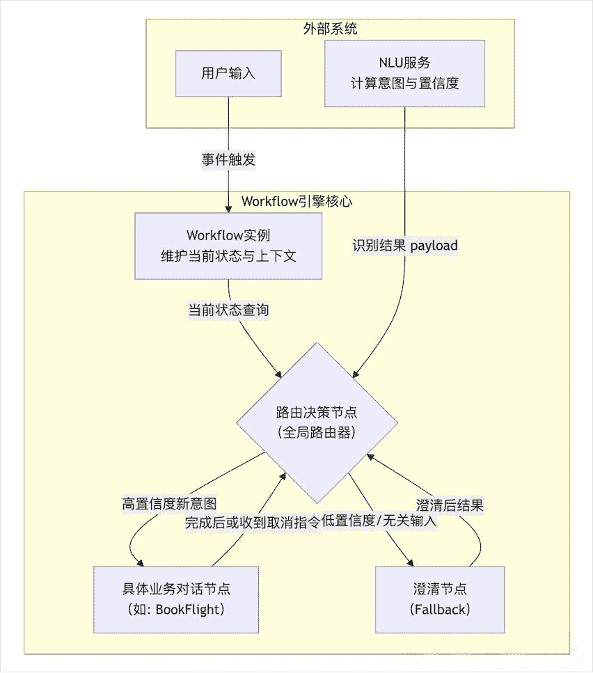

> 全局路由节点，整个 Workflow 的枢纽和心脏。

> 实现“跳转重新识别”的 Workflow关键在于设计一个全局路由节点（Global Router Node）。

## Workflow 需要定义以下类型的节点：

+   **globalRo**uterState（全局路由节点）

> 核心决策节点。它不处理具体业务，只负责询问NLU并根据结果决定下一个状态。

>

+   **bookFlightState****（预订机票节点）**

> 一个具体的业务节点。它可能自身还包含一系列子状态（询问日期、目的地等），但这可以被抽象为“正在处理订票流程”这一个状态。

>

+   **handle**FallbackState（澄清节点）

> 用于处理低置信度的情况，向用户发送澄清提示。

>

+   **...其他业务节点...**

#####

下面通过一个具体序列图来展示一次完整的“跳转重新识别”过程：

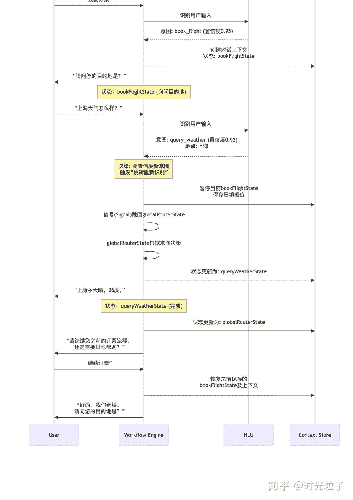

### **这个流程的关键实现细节：**

1.  **状态持久化：**

> Workflow 引擎的核心能力是自动将每个节点的状态（包括局部变量、上下文）持久化。

> 当从 bookFlightState 跳回 globalRouterState 时，bookFlightState 的当前状态（比如已经问了第一个问题）会被自动保存。

>

1.  事件信号（Signaling）：

> bookFlightState 不是一个死循环。它是一个可以被外部事件中断的活动状态。

> 当 NLU 返回一个高置信度的、与当前上下文无关的新意图时，Workflow 会向自身发送一个信号（Signal）。

> 这个信号会中断当前 bookFlightState 的活动，并推动状态机向下一个状态（即 globalRouterState）转移。

>

1.  **上下文存储：**

> 所有收集到的槽位信息（如 destination、date）都应存储在 Workflow 的上下文（Context）或变量（Variables）中。

> 这样，当之后需要恢复订票流程时，所有之前填写的信息都还在。

>

1.  **路由决策逻辑：**

> globalRouterState 节点包含所有的判断逻辑：

+   置信度检查：对比置信度与阈值。

+   全局指令拦截：检查是否是 cancel, help 等。

+   父级上下文检查：判断新意图是否与当前或父级上下文有关。

## 典型对话流

一个典型的、推荐的对话系统处理流程如下图所示：

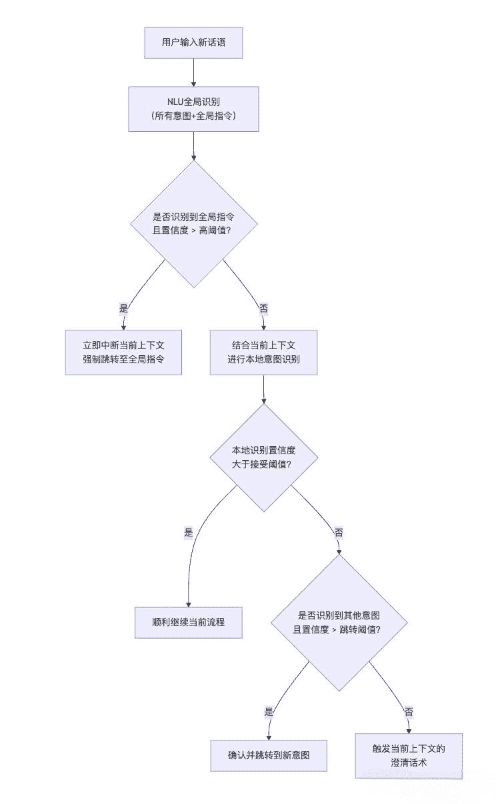

**这个流程的关键点在于：**

> **全局意图拥有最高优先级：**

> 像“帮助”、“取消”、“主菜单”、“转人工”这类指令，在任何上下文中都应被优先响应。这是用户体验的“安全网”。

**置信度阈值是关键杠杆：**

+   **高阈值（例如 >0.9）**

> 用于全局中断。只有非常确定的指令才能打断当前流程。

>

+   **接受阈值（例如 >0.7）**

> 用于本地流程。高于此阈值就继续。

>

+   **跳转阈值（例如 >0.8）**

> 介于两者之间。当一个非全局意图但置信度明显高于当前上下文可能意图时，可以考虑跳转。

> **拒识的最后手段：**

> 当所有识别路径都失败时（即全局识别和本地识别置信度都很低），最终会 fallback 到当前上下文的澄清话术。

> 这意味着，尽管经过了全局尝试，但最终处理“拒识”事件的，仍然是当前所在的节点。

> 一个问答助手，能不能准确地回复用户的问题，主要在于3个方面：

1.  知识库是不是构建的相对比较好，比如分块逻辑，块大小，检索逻辑等等。

1.  LLM节点的提示词写的是不是足够好，足够稳定。

1.  是不是很好的能理解用户的问题。

## 分层路由（Hierarchical Routing）

**实现方法：**

1.  第一层：领域识别（Domain Classification）：

+   训练一个高召回率的顶层分类器，它的目标不是精确识别具体意图，而是快速判断用户输入属于哪个大的领域（Domain）。

+   例如：机票相关、酒店相关、客服操作、闲聊。

+   这个分类器意图数量少，非常轻量且快速。

1.  第二层：意图识别（Intent Classification）：

+   根据顶层分类器的结果，将用户输入路由到对应的领域专属子分类器。

+   例如，如果第一层判断为 机票相关，则调用专门为机票领域训练的意图分类器，它只包含几十个机票相关的意图（book_flight, change_flight, ask_about_baggage…）。

+   这些子分类器因为只需区分少量相似意图，所以精度更高。

**优点：**

> 每个分类器的负担大大减轻。

> 精度显著提升，因为子分类器是在一个狭小的领域内做细分。

> 易于扩展，新增一个领域只需训练一个新的子分类器，不影响其他部分。

**工具实现：**

> 许多专业的对话AI平台（如 Rasa）原生支持这种层次化意图和响应选择。

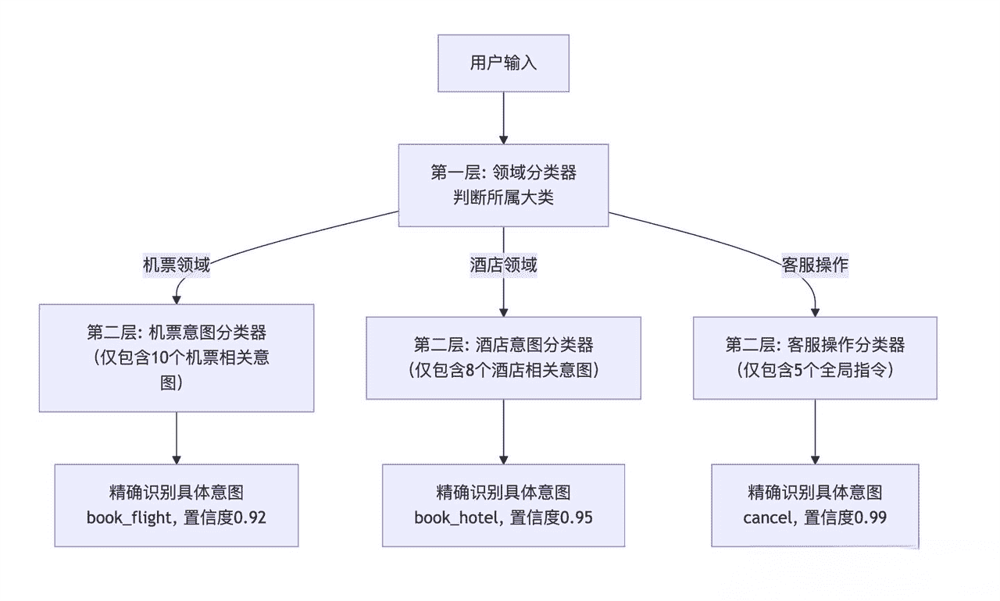

### SOP节点内处理

对于SOP节点，下一轮是否可以直接路由继续上一轮的意图节点。

> 这是一种常见且实用的设计模式，尤其适合于强流程性（SOP-Driven） 的任务型对话场景。这种模式的核心是在 “流程效率” 和 “用户灵活性” 之间做一个权衡。

**这个方案的核心逻辑是**

> 一旦进入一个SOP意图节点，就默认用户接下来的输入都是针对这个SOP的，除非有强有力的证据表明不是。

**其工作流程如下所示：**

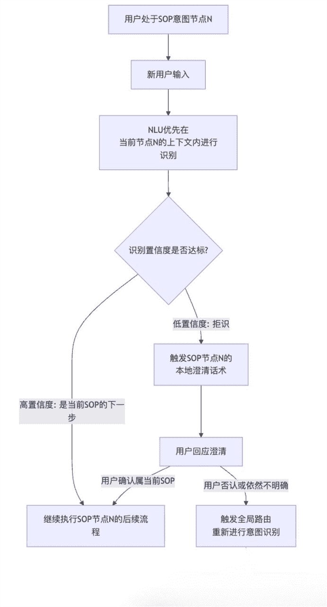

### 增加问题分类器

增加一个一个分支用于回答用户的其他问题：

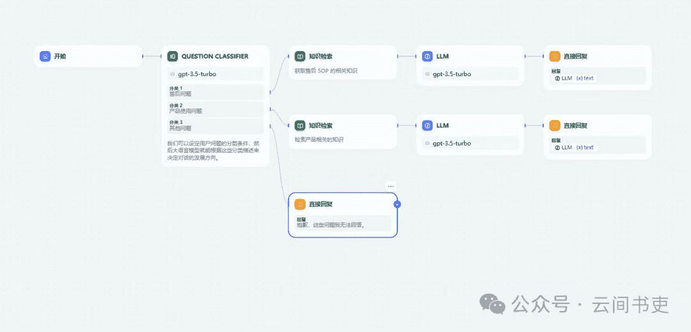

### 记忆工具的运行机制

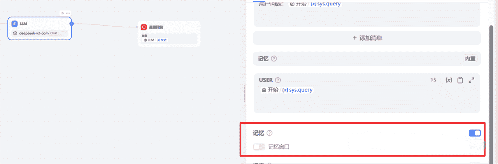

```
{
  &quot;model_mode&quot;:&quot;chat&quot;,
&quot;prompts&quot;:[
    {
      &quot;role&quot;:&quot;system&quot;,
      &quot;text&quot;:&quot;使用以下上下文作为你所学习的知识，放在&lt;context&gt;&lt;/context&gt; XML标签内。\n&lt;context&gt;\n{{#context#}}\n&lt;/context&gt;\n当回答用户时：\n如果你不知道，就说你不知道。如果你不确定时不知道，寻求澄清。\n避免提及你从上下文中获取的信息。\n并根据用户问题的语言进行回答。&quot;,
      &quot;files&quot;:[]
    },
    {
      &quot;role&quot;:&quot;user&quot;,
      &quot;text&quot;:&quot;用户问题：1+4&quot;,
      &quot;files&quot;:[]
    }
],
&quot;usage&quot;:{
    &quot;prompt_tokens&quot;:213,
    &quot;prompt_unit_price&quot;:&quot;0&quot;,
    &quot;prompt_price_unit&quot;:&quot;0&quot;,
    &quot;prompt_price&quot;:&quot;0&quot;,
    &quot;completion_tokens&quot;:5,
    &quot;completion_unit_price&quot;:&quot;0&quot;,
    &quot;completion_price_unit&quot;:&quot;0&quot;,
    &quot;completion_price&quot;:&quot;0&quot;,
    &quot;total_tokens&quot;:218,
    &quot;total_price&quot;:&quot;0&quot;,
    &quot;currency&quot;:&quot;USD&quot;,
    &quot;latency&quot;:0.33365140948444605
},
&quot;finish_reason&quot;:&quot;stop&quot;,
&quot;model_provider&quot;:&quot;langgenius/openai_api_compatible/openai_api_compatible&quot;,
&quot;model_name&quot;:&quot;deepseek-v3&quot;
}
```

可以看到，每次只保留了最新的请求的问题。

### 打开记忆窗口

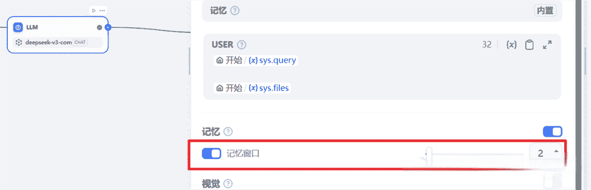

接着看请求参数：

```
{
  &quot;model_mode&quot;:&quot;chat&quot;,
&quot;prompts&quot;:[
    {
      &quot;role&quot;:&quot;system&quot;,
      &quot;text&quot;:&quot;使用以下上下文作为你所学习的知识，放在&lt;context&gt;&lt;/context&gt; XML标签内。\n&lt;context&gt;\n{{#context#}}\n&lt;/context&gt;\n当回答用户时：\n如果你不知道，就说你不知道。如果你不确定时不知道，寻求澄清。\n避免提及你从上下文中获取的信息。\n并根据用户问题的语言进行回答。&quot;,
      &quot;files&quot;:[]
    },
    {
      &quot;role&quot;:&quot;user&quot;,
      &quot;text&quot;:&quot;用户问题：1+5&quot;,
      &quot;files&quot;:[]
    },
    {
      &quot;role&quot;:&quot;user&quot;,
      &quot;text&quot;:&quot;1+4&quot;,
      &quot;files&quot;:[]
    },
    {
      &quot;role&quot;:&quot;assistant&quot;,
      &quot;text&quot;:&quot;1 + 4 = 5&quot;,
      &quot;files&quot;:[]
    },
    {
      &quot;role&quot;:&quot;user&quot;,
      &quot;text&quot;:&quot;1+5\n\n[]&quot;,
      &quot;files&quot;:[]
    }
],
&quot;usage&quot;:{
    &quot;prompt_tokens&quot;:213,
    &quot;prompt_unit_price&quot;:&quot;0&quot;,
    &quot;prompt_price_unit&quot;:&quot;0&quot;,
    &quot;prompt_price&quot;:&quot;0&quot;,
    &quot;completion_tokens&quot;:5,
    &quot;completion_unit_price&quot;:&quot;0&quot;,
    &quot;completion_price_unit&quot;:&quot;0&quot;,
    &quot;completion_price&quot;:&quot;0&quot;,
    &quot;total_tokens&quot;:218,
    &quot;total_price&quot;:&quot;0&quot;,
    &quot;currency&quot;:&quot;USD&quot;,
    &quot;latency&quot;:0.389557683840394
},
&quot;finish_reason&quot;:&quot;stop&quot;,
&quot;model_provider&quot;:&quot;langgenius/openai_api_compatible/openai_api_compatible&quot;,
&quot;model_name&quot;:&quot;deepseek-v3&quot;
}
```

可以看到，他只保留了最新一次和上一次的 user 问题。

### query 改写节点

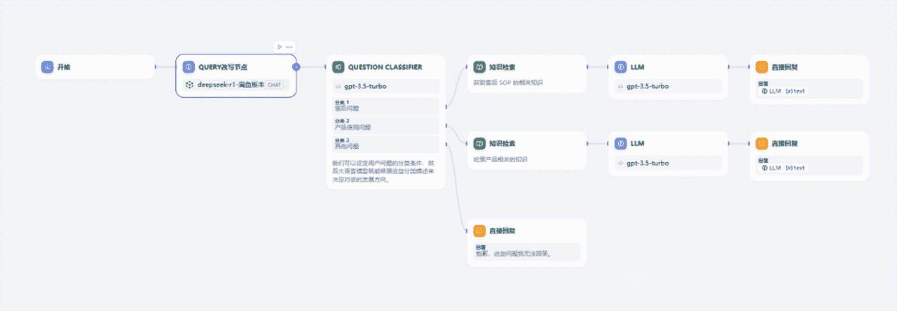

改写节点的提示词如下：

```
**# 角色与任务****
你是一个专**用于**智能客服系统的“用户问题改**写专**家”。

你的核心任务是**：结**合上下文对话，将用户当前**提出的、可**能模糊或有依****赖的问题，改**写**成一个信息完整、**意**图明确、无需上下****文即可独**立**理解的标准问题。**
**
# 工作原则
1.******联系上下文补全****信息******：分析对话历史，**弄**清用户问题中“它”、**“**我的”、“那个”****等代词**的**具体指代，并补全**问**题中被省略的主语或宾**语**。
2.**判断****是否需**要改写**：如果用户原问题本身已经是一个完整的标准问题，则无需改写，直接输出原问题。
3.**忠于用户字面意图**：这是最重要的原则。你的任务是让问题变得信息完整，而不是改变用户的提问焦点。
    ***例如**：如果用户问的是关于“一般情况”的问题，就绝不能将其改写为针对“他当前个案”的问题。

# 输出要求
***格式唯一**：最终输出的内容，必须且只能是改写后或无需改写的“标准问题”文本。
***绝对禁止**：禁止输出任何解释、说明、注释、理由或任何形式的对话。

# 示例
---

**示例 1: (指代消解)**
***对话历史**: &quot;你好，我想了解一下你们的‘长乐安康’重疾险。&quot;
***用户当前问题**: &quot;它的等待期是多久？&quot;
***你的输出**:
    “长乐安康”重疾险的等待期是多久？
---
**示例 2: (省略补全)**

***对话历史**: &quot;给孩子投保补充医疗保险，理赔时需要哪些申请资料？&quot;

***用户当前问题**: &quot;如果是我自己呢？&quot;

***你的输出**:  
  我给自己投保的补充医疗保险，理赔时需要哪些申请资料？
---

**示例 3: (忠于字面意图)**
***对话历史**: &quot;我上周五提交的理赔申请，现在什么进度了？&quot;

***用户当前问题**: &quot;一般要审核多久？&quot;

***你的输出**:
  理赔申请的审核一般需要多久？
---
```

增加一个会话变量 chat_history 用于保存用户的问题：

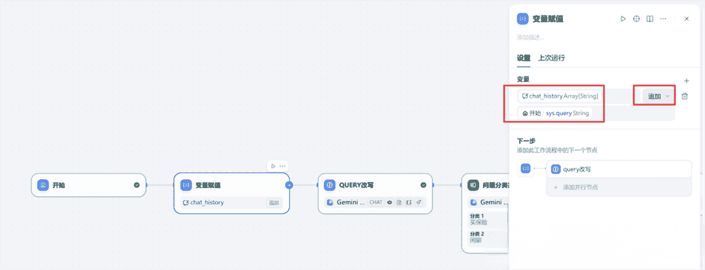

为了增加健壮性，我们还需要增加一个代码判断节点：

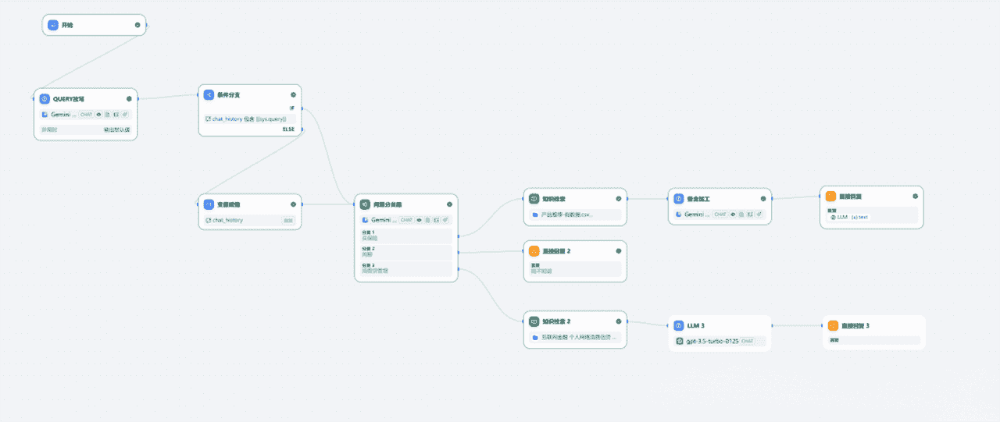

### query 改写提示词

```
**# 核心**任务

你是一个“用户问题改写”模型。你的任务是参考用户历史提问，将用户当前问题改写成一个无需上下文、可独立理解的标准问题。

 # 工作流程与规则

输入分析：
用户历史提问：用户在此之前所有说过的话。
用户当前问题：用户最新一句的提问。
改写规则：
补全信息：利用“用户历史提问”作为上下文，补全“当前问题”中省略或指代不明的信息（如主语、宾语、“它”、“那个”等）。
忠于原意：严格遵循用户的字面意图，仅做信息补全，不改变或猜测用户的提问焦点。（例如：问“一般情况”，就不能改写为“我的情况”）。
无需改写则照搬：若“当前问题”本身已是标准问题，直接输出原文，不做任何修改。
输出要求：
唯一格式：输出内容只能是最终的标准问题文本。
严禁额外内容：禁止输出任何形式的解释、注释、理由或对话。

# 示例

示例 1: (补全指代)
用户历史提问: &quot;你好，我想了解一下你们的‘长乐安康’重疾险。&quot;
用户当前问题: &quot;它的等待期是多久？&quot;
你的输出:
“长乐安康”重疾险的等待期是多久？

示例 2: (补全主体)
用户历史提问: &quot;给孩子投保补充医疗保险，理赔时需要哪些申请资料？&quot;
用户当前问题: &quot;如果是我自己呢？&quot;
你的输出:
我给自己投保的补充医疗保险，理赔时需要哪些申请资料？

示例 3: (忠于原意)
用户历史提问: &quot;我上周五提交的理赔申请，现在什么进度了？&quot;
用户当前问题: &quot;一般要审核多久？&quot;
你的输出:
理赔申请的审核一般需要多久？

待处理信息：
用户历史提问:{{#context#}}
```