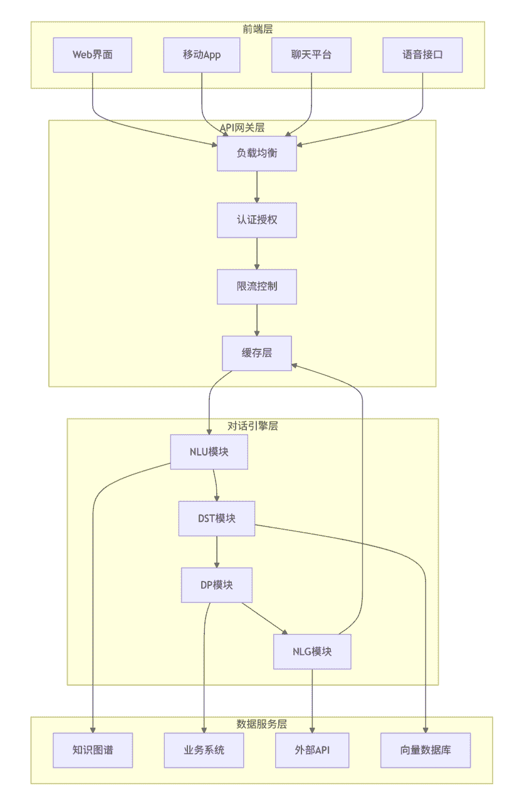
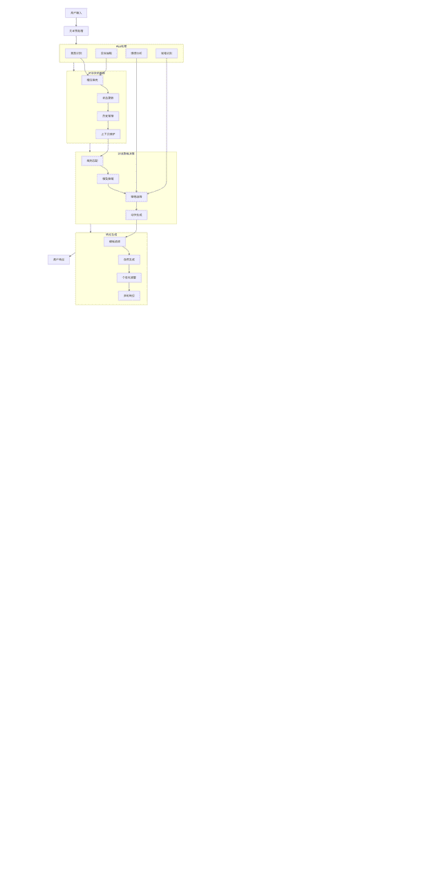
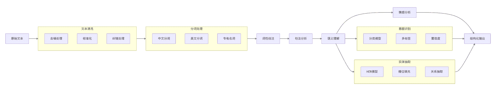
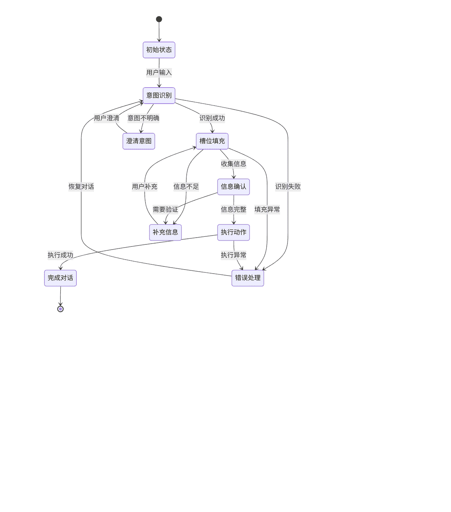
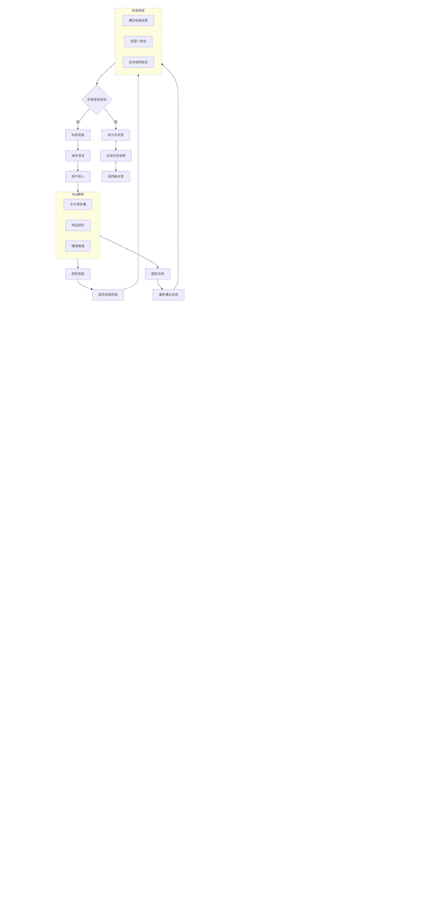
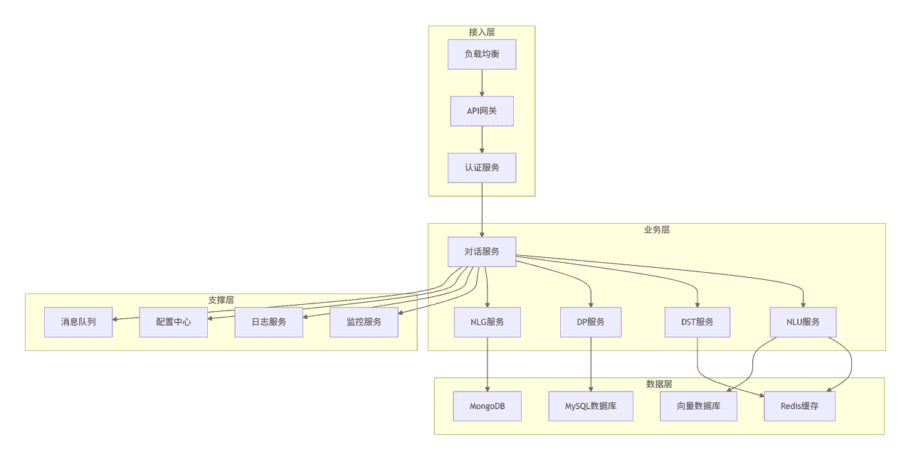
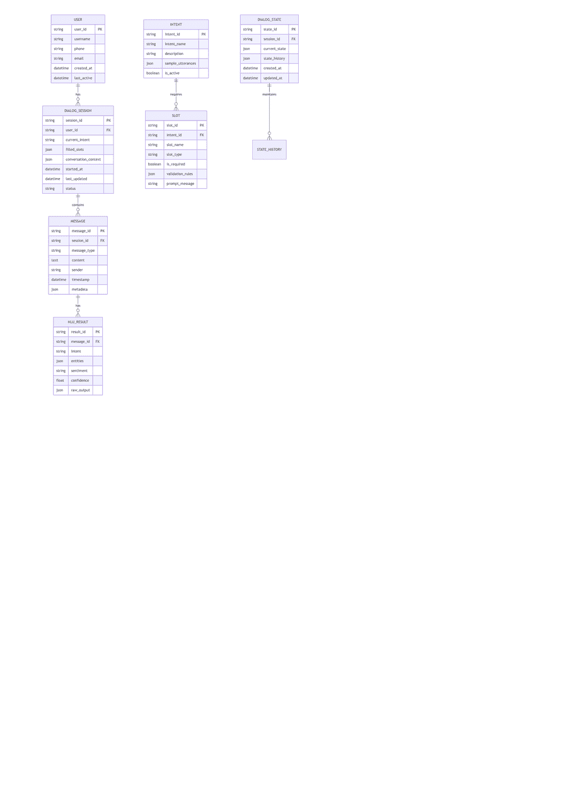
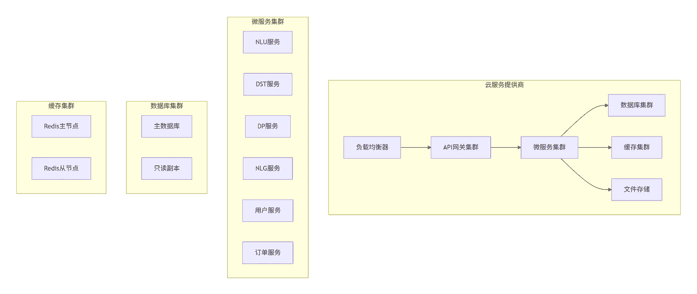
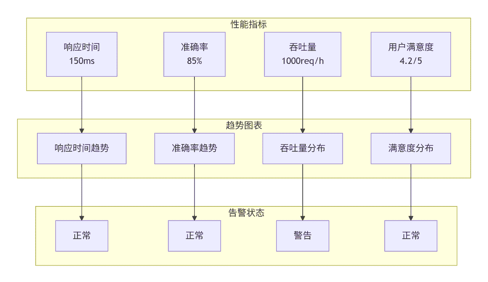
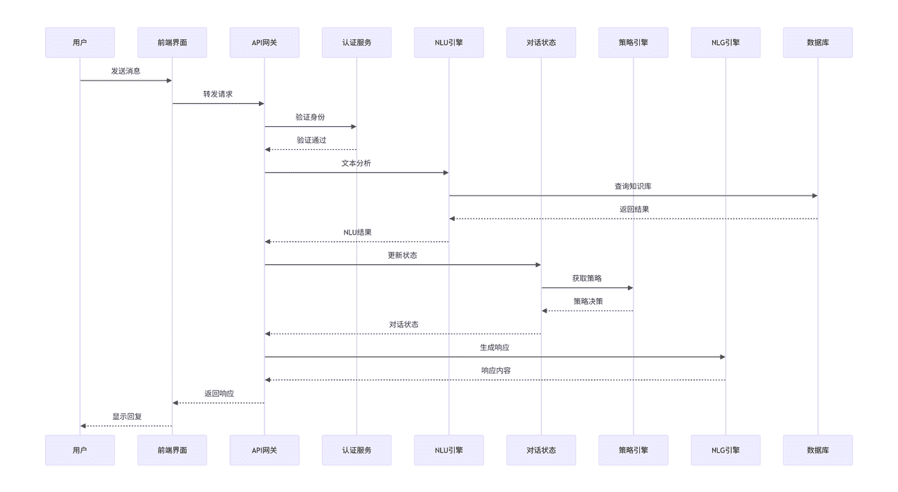

# 基于Agent，0-1实现用户意图识别

> 来源：[https://qqs7y1hozd1.feishu.cn/docx/UiOxdHZOjotbfzxP5YicW5MhnIh](https://qqs7y1hozd1.feishu.cn/docx/UiOxdHZOjotbfzxP5YicW5MhnIh)

## 确定需求和设计对话流程

### 1.1 需求分析


> **明确应用场景：**

> 确定系统的具体用途，例如订票、客户服务、产品推荐等。

>

> **定义功能：**

> 列出系统需要支持的功能，如查询、预订、支付、问题解答等。

### 1.2 设计对话流程

> **绘制对话图：**

> 使用状态机或决策树来表示可能的对话路径，确保覆盖所有常见的用户请求和场景。

>

> **定义对话节点：**

> 每个节点代表一个对话状态或任务，如“确认出发地”、“选择日期”、“提供票价”等。

>

> **设定转换规则：**

> 规定从一个节点到另一个节点的条件，例如用户输入特定关键词或完成某个动作后触发的状态转换。



### 核心组件详细设计

```
class MultiTurnDialogSystem:
    &quot;&quot;&quot;多轮对话系统核心类&quot;&quot;&quot;
    
    def __init__(self):
        self.nlu_engine = NLUEngine()           # 自然语言理解
        self.dst_engine = DialogStateTracker()  # 对话状态跟踪
        self.dp_engine = DialogPolicy()         # 对话策略
        self.nlg_engine = NLGEngine()           # 自然语言生成
        self.context_manager = ContextManager() # 上下文管理
        
    async def process_message(self, user_id: str, message: str) -&gt; Dict:
        &quot;&quot;&quot;处理用户消息的完整流程&quot;&quot;&quot;
        # 1. NLU处理
        nlu_result = await self.nlu_engine.parse(message, user_id)
        
        # 2. 对话状态更新
        current_state = self.dst_engine.update_state(user_id, nlu_result)
        
        # 3. 对话策略决策
        action = self.dp_engine.select_action(current_state)
        
        # 4. 响应生成
        response = self.nlg_engine.generate_response(action, current_state)
        
        # 5. 上下文更新
        self.context_manager.update_context(user_id, {
            &#x27;user_input&#x27;: message,
            &#x27;system_response&#x27;: response,
            &#x27;nlu_result&#x27;: nlu_result,
            &#x27;timestamp&#x27;: datetime.now()
        })
        
        return {
            &#x27;response&#x27;: response,
            &#x27;action&#x27;: action,
            &#x27;confidence&#x27;: nlu_result.get(&#x27;confidence&#x27;, 0.0),
            &#x27;next_expected_slots&#x27;: current_state.get(&#x27;missing_slots&#x27;, [])
        }
```

## 数据准备

### 2.1 收集训练数据

> **历史对话记录：**

> 获取过去客户与客服人员之间的对话记录，用作训练数据。

>

> **公开数据集：**

> 利用公开的对话数据集，特别是那些专注于您所涉及的领域（如旅行、金融等）。

>

> **模拟对话：**

> 创建一些模拟对话，以补充实际数据的不足。

### 对话状态管理架构

```
class DialogStateTracker:
    &quot;&quot;&quot;对话状态跟踪器&quot;&quot;&quot;
    
    def __init__(self):
        self.user_states = {}  # 用户对话状态存储
        self.slot_templates = self.load_slot_templates()
        
    def load_slot_templates(self) -&gt; Dict:
        &quot;&quot;&quot;加载槽位模板&quot;&quot;&quot;
        return {
            &#x27;book_hotel&#x27;: {
                &#x27;required&#x27;: [&#x27;location&#x27;, &#x27;check_in&#x27;, &#x27;check_out&#x27;, &#x27;room_type&#x27;],
                &#x27;optional&#x27;: [&#x27;budget&#x27;, &#x27;hotel_chain&#x27;, &#x27;special_requests&#x27;],
                &#x27;dependencies&#x27;: {
                    &#x27;check_out&#x27;: [&#x27;check_in&#x27;]
                }
            },
            &#x27;book_flight&#x27;: {
                &#x27;required&#x27;: [&#x27;departure&#x27;, &#x27;destination&#x27;, &#x27;departure_date&#x27;],
                &#x27;optional&#x27;: [&#x27;return_date&#x27;, &#x27;airline&#x27;, &#x27;class_type&#x27;],
                &#x27;dependencies&#x27;: {
                    &#x27;return_date&#x27;: [&#x27;departure_date&#x27;]
                }
            }
        }
    
    def update_state(self, user_id: str, nlu_result: Dict) -&gt; Dict:
        &quot;&quot;&quot;更新对话状态&quot;&quot;&quot;
        if user_id not in self.user_states:
            self.user_states[user_id] = self.initialize_state()
        
        current_state = self.user_states[user_id]
        intent = nlu_result[&#x27;intent&#x27;][&#x27;name&#x27;]
        
        # 更新当前意图
        if intent != &#x27;unknown&#x27;:
            current_state[&#x27;current_intent&#x27;] = intent
        
        # 更新槽位
        self.fill_slots(current_state, nlu_result[&#x27;entities&#x27;])
        
        # 计算缺失槽位
        current_state[&#x27;missing_slots&#x27;] = self.get_missing_slots(current_state)
        
        # 更新对话历史
        current_state[&#x27;conversation_history&#x27;].append({
            &#x27;turn&#x27;: len(current_state[&#x27;conversation_history&#x27;]) + 1,
            &#x27;user_input&#x27;: nlu_result[&#x27;text&#x27;],
            &#x27;intent&#x27;: intent,
            &#x27;filled_slots&#x27;: nlu_result[&#x27;entities&#x27;],
            &#x27;timestamp&#x27;: datetime.now()
        })
        
        # 维护对话历史长度
        if len(current_state[&#x27;conversation_history&#x27;]) &gt; 10:
            current_state[&#x27;conversation_history&#x27;] = current_state[&#x27;conversation_history&#x27;][-10:]
        
        return current_state
    
    def initialize_state(self) -&gt; Dict:
        &quot;&quot;&quot;初始化对话状态&quot;&quot;&quot;
        return {
            &#x27;current_intent&#x27;: None,
            &#x27;filled_slots&#x27;: {},
            &#x27;missing_slots&#x27;: [],
            &#x27;conversation_history&#x27;: [],
            &#x27;turn_count&#x27;: 0,
            &#x27;created_at&#x27;: datetime.now(),
            &#x27;last_updated&#x27;: datetime.now()
        }
    
    def fill_slots(self, state: Dict, entities: List[Dict]):
        &quot;&quot;&quot;填充槽位&quot;&quot;&quot;
        for entity in entities:
            slot_name = entity[&#x27;type&#x27;]
            slot_value = entity[&#x27;text&#x27;]
            
            # 验证槽位是否属于当前意图
            intent = state[&#x27;current_intent&#x27;]
            if intent and intent in self.slot_templates:
                valid_slots = (self.slot_templates[intent][&#x27;required&#x27;] + 
                             self.slot_templates[intent][&#x27;optional&#x27;])
                if slot_name in valid_slots:
                    state[&#x27;filled_slots&#x27;][slot_name] = slot_value
    
    def get_missing_slots(self, state: Dict) -&gt; List[str]:
        &quot;&quot;&quot;获取缺失的必要槽位&quot;&quot;&quot;
        intent = state[&#x27;current_intent&#x27;]
        if not intent or intent not in self.slot_templates:
            return []
        
        required_slots = self.slot_templates[intent][&#x27;required&#x27;]
        filled_slots = set(state[&#x27;filled_slots&#x27;].keys())
        
        missing_slots = []
        for slot in required_slots:
            if slot not in filled_slots:
                # 检查依赖关系
                dependencies = self.slot_templates[intent].get(&#x27;dependencies&#x27;, {}).get(slot, [])
                if all(dep in filled_slots for dep in dependencies):
                    missing_slots.append(slot)
        
        return missing_slots
```

### 2.2 数据标注

> **意图标注：**

> 为每个用户输入标记出其意图，例如“查询航班”、“预订酒店”等。

>

> **实体标注：**

> 识别并标注用户输入中的关键信息，如地点、时间、数量等。

>

> **对话状态标注：**

> 为每一轮对话标注当前的对话状态，帮助模型理解对话的进展。



### 基于规则的策略引擎

```
class RuleBasedDialogPolicy:
    &quot;&quot;&quot;基于规则的对话策略&quot;&quot;&quot;
    
    def __init__(self):
        self.rules = self.load_rules()
        self.action_templates = self.load_action_templates()
    
    def select_action(self, state: Dict) -&gt; Dict:
        &quot;&quot;&quot;选择对话动作&quot;&quot;&quot;
        intent = state.get(&#x27;current_intent&#x27;)
        missing_slots = state.get(&#x27;missing_slots&#x27;, [])
        filled_slots = state.get(&#x27;filled_slots&#x27;, {})
        
        # 规则匹配
        for rule in self.rules:
            if self.match_rule(rule, state):
                return self.execute_rule(rule, state)
        
        # 默认策略
        return self.default_policy(state)
    
    def match_rule(self, rule: Dict, state: Dict) -&gt; bool:
        &quot;&quot;&quot;匹配规则条件&quot;&quot;&quot;
        conditions = rule.get(&#x27;conditions&#x27;, {})
        
        # 检查意图匹配
        if &#x27;intent&#x27; in conditions and state.get(&#x27;current_intent&#x27;) != conditions[&#x27;intent&#x27;]:
            return False
        
        # 检查槽位条件
        if &#x27;required_slots&#x27; in conditions:
            for slot in conditions[&#x27;required_slots&#x27;]:
                if slot not in state.get(&#x27;filled_slots&#x27;, {}):
                    return False
        
        # 检查缺失槽位条件
        if &#x27;missing_slots&#x27; in conditions:
            missing = state.get(&#x27;missing_slots&#x27;, [])
            if not all(slot in missing for slot in conditions[&#x27;missing_slots&#x27;]):
                return False
        
        return True
    
    def default_policy(self, state: Dict) -&gt; Dict:
        &quot;&quot;&quot;默认对话策略&quot;&quot;&quot;
        missing_slots = state.get(&#x27;missing_slots&#x27;, [])
        
        if missing_slots:
            # 询问缺失信息
            return {
                &#x27;action_type&#x27;: &#x27;request_slot&#x27;,
                &#x27;slot_name&#x27;: missing_slots[0],
                &#x27;template&#x27;: f&quot;请问您的{self.get_slot_display_name(missing_slots[0])}是什么？&quot;,
                &#x27;confidence&#x27;: 1.0
            }
        elif state.get(&#x27;current_intent&#x27;):
            # 执行意图
            return {
                &#x27;action_type&#x27;: &#x27;execute_intent&#x27;,
                &#x27;intent_name&#x27;: state[&#x27;current_intent&#x27;],
                &#x27;slots&#x27;: state[&#x27;filled_slots&#x27;],
                &#x27;template&#x27;: self.generate_execution_response(state),
                &#x27;confidence&#x27;: 0.9
            }
        else:
            # 请求澄清
            return {
                &#x27;action_type&#x27;: &#x27;clarify_intent&#x27;,
                &#x27;template&#x27;: &quot;我不太明白您的意思，能再说具体一些吗？&quot;,
                &#x27;confidence&#x27;: 0.8
            }
```

## 模型选择与训练

### 3.1 选择模型架构

**基于规则的模型：**

> 对于简单的应用，可以使用预定义的规则和模式匹配来处理用户输入。

**机器学习模型：**

> 传统机器学习：使用SVM、随机森林等算法进行意图分类和实体识别。

> 深度学习模型：利用RNN、LSTM、GRU、Transformer等神经网络架构，特别是预训练的语言模型（如BERT, RoBERTa），通过微调适应特定任务。

> 混合模型：结合规则和机器学习的优势，提高系统的灵活性和准确性。



### **高级NLU实现代码**

```
import torch
import torch.nn as nn
from transformers import BertModel, BertTokenizer
from typing import Dict, List, Tuple

class AdvancedNLUEngine:
    &quot;&quot;&quot;高级NLU引擎，集成意图识别、实体抽取和情感分析&quot;&quot;&quot;
    
    def __init__(self, model_name: str = &quot;bert-base-chinese&quot;):
        self.tokenizer = BertTokenizer.from_pretrained(model_name)
        self.model = JointIntentSlotModel(
            num_intents=20, 
            num_slots=50,
            num_sentiments=5,
            model_name=model_name
        )
        self.slot_labels = self.load_slot_labels()
        self.intent_labels = self.load_intent_labels()
        
    class JointIntentSlotModel(nn.Module):
        &quot;&quot;&quot;联合意图识别和槽位填充模型&quot;&quot;&quot;
        
        def __init__(self, num_intents: int, num_slots: int, num_sentiments: int, model_name: str):
            super().__init__()
            self.bert = BertModel.from_pretrained(model_name)
            self.intent_classifier = nn.Sequential(
                nn.Dropout(0.1),
                nn.Linear(768, 256),
                nn.ReLU(),
                nn.Linear(256, num_intents)
            )
            self.slot_classifier = nn.Sequential(
                nn.Dropout(0.1),
                nn.Linear(768, 256),
                nn.ReLU(),
                nn.Linear(256, num_slots)
            )
            self.sentiment_classifier = nn.Sequential(
                nn.Dropout(0.1),
                nn.Linear(768, 128),
                nn.ReLU(),
                nn.Linear(128, num_sentiments)
            )
            
        def forward(self, input_ids, attention_mask):
            outputs = self.bert(
                input_ids=input_ids,
                attention_mask=attention_mask,
                return_dict=True
            )
            
            sequence_output = outputs.last_hidden_state  # [batch, seq_len, hidden]
            pooled_output = outputs.pooler_output        # [batch, hidden]
            
            # 意图分类
            intent_logits = self.intent_classifier(pooled_output)
            
            # 槽位填充
            slot_logits = self.slot_classifier(sequence_output)
            
            # 情感分析
            sentiment_logits = self.sentiment_classifier(pooled_output)
            
            return intent_logits, slot_logits, sentiment_logits
    
    async def parse(self, text: str, user_id: str = None) -&gt; Dict:
        &quot;&quot;&quot;解析用户输入&quot;&quot;&quot;
        # 文本预处理
        processed_text = self.preprocess_text(text)
        
        # 模型推理
        encoding = self.tokenizer(
            processed_text,
            padding=&#x27;max_length&#x27;,
            truncation=True,
            max_length=128,
            return_tensors=&#x27;pt&#x27;
        )
        
        with torch.no_grad():
            intent_logits, slot_logits, sentiment_logits = self.model(
                encoding[&#x27;input_ids&#x27;],
                encoding[&#x27;attention_mask&#x27;]
            )
        
        # 后处理
        intent_result = self.process_intent(intent_logits)
        slot_result = self.process_slots(slot_logits, encoding, text)
        sentiment_result = self.process_sentiment(sentiment_logits)
        
        return {
            &#x27;text&#x27;: text,
            &#x27;intent&#x27;: intent_result,
            &#x27;entities&#x27;: slot_result,
            &#x27;sentiment&#x27;: sentiment_result,
            &#x27;confidence&#x27;: intent_result.get(&#x27;confidence&#x27;, 0.0),
            &#x27;processed_text&#x27;: processed_text
        }
    
    def process_intent(self, intent_logits: torch.Tensor) -&gt; Dict:
        &quot;&quot;&quot;处理意图识别结果&quot;&quot;&quot;
        probabilities = torch.softmax(intent_logits, dim=-1)
        confidence, predicted = torch.max(probabilities, 1)
        
        return {
            &#x27;name&#x27;: self.intent_labels[predicted.item()],
            &#x27;confidence&#x27;: confidence.item(),
            &#x27;probabilities&#x27;: {
                label: prob.item() 
                for label, prob in zip(self.intent_labels, probabilities[0])
            }
        }
    
    def process_slots(self, slot_logits: torch.Tensor, encoding, original_text: str) -&gt; List[Dict]:
        &quot;&quot;&quot;处理槽位填充结果&quot;&quot;&quot;
        predicted_slots = torch.argmax(slot_logits, dim=-1)[0]
        tokens = self.tokenizer.convert_ids_to_tokens(encoding[&#x27;input_ids&#x27;][0])
        
        entities = []
        current_entity = None
        
        for i, (token, slot_id) in enumerate(zip(tokens, predicted_slots)):
            slot_label = self.slot_labels[slot_id.item()]
            
            if slot_label.startswith(&#x27;B-&#x27;):
                # 开始新实体
                if current_entity:
                    entities.append(current_entity)
                current_entity = {
                    &#x27;type&#x27;: slot_label[2:],
                    &#x27;start&#x27;: i,
                    &#x27;end&#x27;: i,
                    &#x27;text&#x27;: self.tokenizer.decode(encoding[&#x27;input_ids&#x27;][0][i])
                }
            elif slot_label.startswith(&#x27;I-&#x27;) and current_entity:
                # 继续当前实体
                current_entity[&#x27;end&#x27;] = i
                current_entity[&#x27;text&#x27;] += self.tokenizer.decode(encoding[&#x27;input_ids&#x27;][0][i])
        
        return entities
```

### 3.2 训练模型

**意图识别：**训练模型识别用户输入的意图，使用标注的数据进行监督学习。

**实体提取：**训练模型从用户输入中提取关键信息，如地点、时间等。

**对话管理：**开发一个对话管理系统，能够根据上下文和用户意图决定下一步的动作。可以使用强化学习或基于规则的方法。


### 系统配置和启动

```
import asyncio
import uvicorn
from fastapi import FastAPI, HTTPException
from pydantic import BaseModel

class ChatRequest(BaseModel):
    user_id: str
    message: str
    session_id: str = None

class ChatResponse(BaseModel):
    response: str
    action: str
    confidence: float
    missing_slots: List[str] = []
    sentiment: Dict = None

app = FastAPI(title=&quot;多轮对话系统API&quot;)

# 全局系统实例
dialog_system = MultiTurnDialogSystem()

@app.post(&quot;/chat&quot;, response_model=ChatResponse)
async def chat_endpoint(request: ChatRequest):
    &quot;&quot;&quot;聊天接口&quot;&quot;&quot;
    try:
        result = await dialog_system.process_message(
            user_id=request.user_id,
            message=request.message
        )
        
        return ChatResponse(
            response=result[&#x27;response&#x27;],
            action=result[&#x27;action&#x27;][&#x27;action_type&#x27;],
            confidence=result[&#x27;confidence&#x27;],
            missing_slots=result.get(&#x27;next_expected_slots&#x27;, []),
            sentiment=result.get(&#x27;sentiment&#x27;)
        )
    except Exception as e:
        raise HTTPException(status_code=500, detail=str(e))

@app.get(&quot;/dialog_state/{user_id}&quot;)
async def get_dialog_state(user_id: str):
    &quot;&quot;&quot;获取对话状态&quot;&quot;&quot;
    state = dialog_system.dst_engine.user_states.get(user_id)
    if not state:
        raise HTTPException(status_code=404, detail=&quot;User not found&quot;)
    return state

if __name__ == &quot;__main__&quot;:
    uvicorn.run(app, host=&quot;0.0.0.0&quot;, port=8000)
```

## 对话管理

### 4.1 上下文跟踪

**对话状态跟踪：**

> 使用对话状态追踪器（DST, Dialogue State Tracker）来维护对话的历史和当前状态，确保对话连贯。

**槽位填充：**

> 为每个对话节点定义所需的槽位（slot），并在对话过程中逐步填充这些槽位，直到满足条件为止。



### 4.2 响应生成

**模板响应：**

> 准备一套预设的回答模板，结合动态生成的内容，给出恰当的回复。

**自然语言生成（NLG）：**

> 使用NLG技术生成自然流畅的回复，可以根据用户的输入和对话状态自动生成文本。



### 性能监控和日志

```
import logging
from prometheus_client import Counter, Histogram, generate_latest

# 监控指标
REQUEST_COUNT = Counter(&#x27;chat_requests_total&#x27;, &#x27;Total chat requests&#x27;)
REQUEST_DURATION = Histogram(&#x27;chat_request_duration_seconds&#x27;, &#x27;Chat request duration&#x27;)
ERROR_COUNT = Counter(&#x27;chat_errors_total&#x27;, &#x27;Total chat errors&#x27;)

class MonitoringMiddleware:
    &quot;&quot;&quot;监控中间件&quot;&quot;&quot;
    
    def __init__(self, app):
        self.app = app
    
    async def __call__(self, scope, receive, send):
        if scope[&#x27;type&#x27;] == &#x27;http&#x27;:
            REQUEST_COUNT.inc()
            start_time = time.time()
            
            try:
                await self.app(scope, receive, send)
            except Exception:
                ERROR_COUNT.inc()
                raise
            finally:
                duration = time.time() - start_time
                REQUEST_DURATION.observe(duration)

# 配置日志
logging.basicConfig(
    level=logging.INFO,
    format=&#x27;%(asctime)s - %(name)s - %(levelname)s - %(message)s&#x27;,
    handlers=[
        logging.FileHandler(&#x27;dialog_system.log&#x27;),
        logging.StreamHandler()
    ]
)

logger = logging.getLogger(&quot;MultiTurnDialogSystem&quot;)
```

## 集成与部署

### 5.1 API 集成

**外部服务：**集成第三方API，如订票系统、支付网关等，以实现完整的业务功能。

**数据库：**连接到数据库，用于存储和检索用户信息、订单记录等。


### 5.2 用户界面

**前端界面：**创建用户界面，可以是Web应用、移动应用或聊天平台上的机器人。

**多渠道支持：**确保系统可以在多个平台上运行，如网站、社交媒体、即时通讯工具等。


## 工具与框架推荐

**Rasa：**一个开源的对话AI平台，支持复杂的对话管理和自定义NLU模型训练。

**Dialogflow：**Google提供的云服务，允许开发者轻松添加自然语言理解和响应生成能力到他们的应用中。

**spaCy：**一个工业级的NLP库，支持快速高效的文本处理和分析。

Hugging Face Transformers：提供了广泛使用的预训练模型库，适用于各种NLP任务。

TensorFlow/PyTorch：强大的深度学习框架，用于构建和训练复杂的NLP模型。



## 代码

使用Rasa来创建一个多轮对话模型：

```
# 安装Rasa
# pip install rasa

# 初始化Rasa项目
# rasa init --no-prompt

# 配置NLU管道
# 在config.yml中配置NLU管道，例如使用预训练的Transformers模型

# 创建训练数据
# 在data/nlu.yml中添加训练数据，包括意图和实体

# 训练NLU模型
# rasa train nlu

# 创建对话流程
# 在domain.yml中定义意图、实体、响应和对话流程

# 训练对话模型
# rasa train core

# 启动Rasa服务器
# rasa run

# 与Rasa对话
# rasa shell

```


通过上述步骤，您可以构建一个多轮对话模型，能够有效地分析用户意图并与用户进行互动。

## 如何在Rasa对话模型中添加情感分析

在Rasa对话模型中添加情感分析可以显著提升用户体验，使机器人能够根据用户的情感状态做出更合适的回应。

要实现这一点，可以使用预训练的情感分析模型或API，并将结果集成到Rasa的对话管理中。

### 选择情感分析工具

#### 1.1 使用预训练模型

Hugging Face Transformers：

> 提供了多个预训练的情感分析模型，如distilbert-base-uncased-finetuned-sst-2-english。

**spaCy：**

> 可以通过加载预训练的NLP模型（如en_core_web_md）并结合自定义管道来实现情感分析。

#### 1.2 使用第三方API

Google Cloud Natural Language API：提供情感分析功能，可以轻松集成到Rasa项目中。

Microsoft Azure Text Analytics API：另一个强大的情感分析服务，支持多种语言。

**IBM Watson Natural Lan**guage Understanding：提供了丰富的情感分析和其他文本分析功能。


### 安装必要的库

根据选择的情感分析工具，安装相应的Python库。

选择Hugging Face Transformers，可以使用以下命令安装：

```
pip install transformers torch
```

如果选择Google Cloud Natural Language API，需要安装Google Cloud SDK并设置认证：

```
pip install google-cloud-language
gcloud auth application-default login
```


### 创建情感分析组件

创建一个自定义的Rasa组件，用于调用情感分析模型或API，并将情感信息添加到对话上下文中。

**以下是一个使用Hugging F**ace Transformers的示例：

```
from typing import Any, Optional, Text, Dict
from rasa_sdk import Tracker
from rasa_sdk.executor import CollectingDispatcher
from transformers import pipeline

class SentimentAnalysisComponent:
    def __init__(self):
        self.nlp = pipeline(&quot;sentiment-analysis&quot;)

    def process(self, message: Text) -&gt; Dict[Text, Any]:
        result = self.nlp(message)[0]
        return {
            &quot;sentiment&quot;: result[&quot;label&quot;],
            &quot;confidence&quot;: result[&quot;score&quot;]
        }

# 在Rasa配置文件中注册这个组件
# config.yml
pipeline:
  - name: &quot;SentimentAnalysisComponent&quot;
    component_class: &quot;path.to.SentimentAnalysisComponent&quot;

```



### 更新Rasa配置文件

在config.yml中添加自定义组件，并确保它位于NLU管道中的适当位置。例如：

```
language: en

pipeline:
  - name: &quot;SpacyNLP&quot;
  - name: &quot;SpacyTokenizer&quot;
  - name: &quot;SpacyFeaturizer&quot;
  - name: &quot;SpacyEntityExtractor&quot;
  - name: &quot;SentimentAnalysisComponent&quot;  # 添加情感分析组件
  - name: &quot;DIETClassifier&quot;
  - name: &quot;EntitySynonymMapper&quot;
  - name: &quot;ResponseSelector&quot;

policies:
  - name: &quot;MemoizationPolicy&quot;
  - name: &quot;TEDPolicy&quot;
  - name: &quot;RulePolicy&quot;

```

### 处理情感分析结果

在您的故事（stories）和响应（responses）中利用情感分析的结果。

> 例如，您可以根据用户的情感状态调整机器人的语气或提供不同的回应。

#### 5.1 修改域文件（domain.yml）

在domain.yml中定义新的槽位（slot）来存储情感信息：

```
slots:
  sentiment:
    type: text
    influence_conversation: true

responses:
  utter_greet_positive:
    - text: &quot;Great to hear from you! How can I assist you today?&quot;
  utter_greet_negative:
    - text: &quot;I&#x27;m sorry to hear that. Let&#x27;s see how we can help.&quot;

```


#### 5.2 更新故事文件（stories.yml）

在stories.yml中添加基于情感的对话路径：


```
version: &quot;2.0&quot;

stories:

- story: greet user (positive)
  steps:
  - intent: greet
  - action: action_analyze_sentiment
  - slot_was_set:
      sentiment: positive
  - action: utter_greet_positive

- story: greet user (negative)
  steps:
  - intent: greet
  - action: action_analyze_sentiment
  - slot_was_set:
      sentiment: negative
  - action: utter_greet_negative

```

安全架构设计

#### 5.3 创建自定义动作（actions.py）

创建一个自定义动作来调用情感分析组件，并根据结果更新槽位：

```
from typing import Any, Text, Dict, List
from rasa_sdk import Action, Tracker
from rasa_sdk.executor import CollectingDispatcher
from .sentiment_analysis_component import SentimentAnalysisComponent

class ActionAnalyzeSentiment(Action):

    def __init__(self):
        self.sentiment_analyzer = SentimentAnalysisComponent()

    def name(self) -&gt; Text:
        return &quot;action_analyze_sentiment&quot;

    def run(self, dispatcher: CollectingDispatcher,
            tracker: Tracker,
            domain: Dict[Text, Any]) -&gt; List[Dict[Text, Any]]:

        user_message = tracker.latest_message.get(&#x27;text&#x27;)
        sentiment_result = self.sentiment_analyzer.process(user_message)

        # 设置槽位
        return [SlotSet(&quot;sentiment&quot;, sentiment_result[&quot;sentiment&quot;])]

```

### 测试与优化

#### 6.1 训练模型

确保所有更改都已保存后，重新训练Rasa模型：

```
rasa train
```



#### 6.2 启动Rasa服务器

启动Rasa服务器以测试新功能：

```
rasa run
```



#### 6.3 与Rasa对话

使用rasa shell与机器人进行对话，测试情感分析的效果：

```
rasa shell
```

